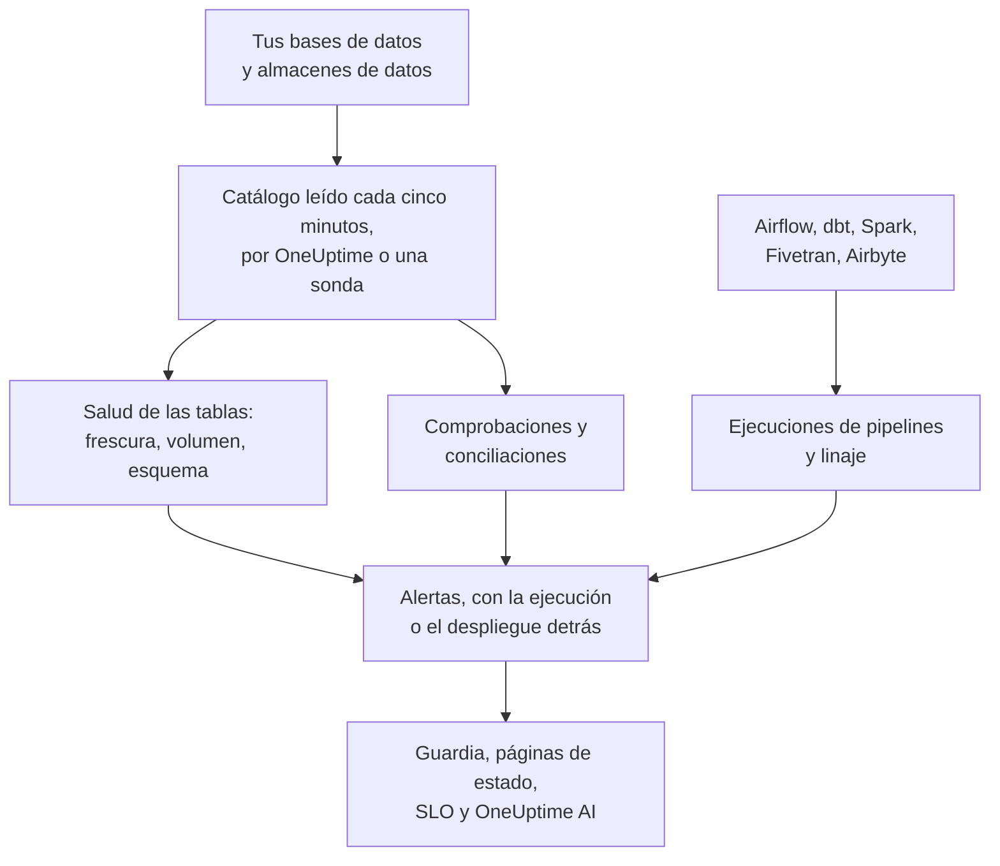

# Observabilidad de datos

Observabilidad de datos vigila las tablas de las que depende tu empresa, en PostgreSQL, MySQL, SQL Server, Oracle, MongoDB, Redshift, Snowflake, BigQuery, ClickHouse, Databricks y Athena, y te avisa cuando sus datos llegan tarde, faltan, son incorrectos o están rotos, antes de que lo noten las personas que los usan. Aprende por sí sola el ritmo de cada tabla, lee el catálogo de cada base de datos para que ningún valor salga de ella, y vincula cada problema de datos con la ejecución del pipeline, el despliegue o la tabla de origen que hay detrás.

Responde a cuatro preguntas:

:::cards
- [¿Están actualizados los datos?](/docs/data-observability/table-health): El último cambio, las filas, el tamaño y las columnas de cada tabla, leídos cada cinco minutos, con alertas cuando una tabla llega tarde, se reduce o cambia de estructura.
- [¿Son correctos los datos?](/docs/data-observability/checks): Comprobaciones de lo que contiene una tabla, conciliaciones entre una tabla y su copia, y las pruebas de dbt, con alertas cuando fallan.
- [¿De dónde vienen y a qué alimentan?](/docs/data-observability/lineage-and-pipelines): Linaje de tus pipelines, de dbt, Fivetran, Airbyte, las vistas y el propio historial de consultas de las bases de datos, para que un problema abra una sola incidencia.
- [¿Pueden confiar en ellos las personas que los usan?](/docs/data-observability/data-products): Productos de datos con un SLA de frescura, en páginas de estado y con seguimiento como SLO, con una insignia «data as of».
:::

## Cómo funciona

1. **Conecta una base de datos** con un usuario de solo lectura. Una base de datos que Seguridad de datos ya conoce se vigila sin hacer nada, igual que cada conjunto de datos de BigQuery que encontró tu conexión con Google Cloud. Una base de datos en una red privada la lee una sonda que ejecutas allí.
2. **Cada cinco minutos** OneUptime lee el catálogo y las estadísticas de cada base de datos: cada tabla y vista, sus columnas, filas y tamaño, y cuándo cambió por última vez. No se escanea ninguna tabla y, en MongoDB, solo se leen los nombres de campo de sus documentos más recientes. Una ruta de un bucket se puede vigilar del mismo modo.
3. **Se aprende el ritmo de cada tabla**: con qué frecuencia suele cambiar. Una tabla que no cumple su ritmo llega tarde; una cuyas filas caen, o cuyas columnas cambian, lo indica.
4. **Las alertas recomendadas** convierten cada uno de esos casos en un monitor que eliges tener, y las comprobaciones que añades leen lo que contiene una tabla.
5. El **Linaje** indica qué tablas alimentan a cuáles, de modo que una alerta sobre una tabla cuya fuente falló primero se trata como consecuencia de esa fuente: una incidencia, no diez.

## En qué se diferencia

- **Forma parte del resto de OneUptime.** Una alerta de datos es una alerta normal: avisa a quien esté de guardia, abre incidentes, aparece en las páginas de estado y cuenta para los SLO. Los servicios que, según tus trazas, escriben en una tabla, y sus despliegues, aparecen junto a cada alerta de tabla.
- **Nada que configurar por tabla.** Los ritmos, las programaciones y las duraciones habituales de las ejecuciones se aprenden de lo que hace cada tabla y cada pipeline, y un monitor recomendado para una base de datos cubre todas sus tablas, incluidas las que se creen más tarde.
- **Una incidencia por causa.** Una alerta cuya tabla, pipeline o base de datos de origen ya tiene una alerta abierta se une a esa alerta como su consecuencia, ya reconocida, de modo que una carga rota avisa una sola vez.
- **Cada alerta se explica sola.** Ordena la causa probable, indica qué depende de la tabla y quién es su propietario, y aprende de lo que dices sobre ella: marca una como **No es un problema** y lo mismo se queda en silencio la próxima vez.
- **OneUptime AI conoce tus datos.** Las investigaciones de alertas de datos parten de quienes escriben en la tabla, de sus ejecuciones y de sus tablas de origen; en Preguntar a la IA, Slack y Microsoft Teams, y desde agentes de IA, se puede preguntar si una tabla está actualizada; y una comprobación se puede escribir a partir de una frase. Consulta [OneUptime AI y la API](/docs/data-observability/ai-and-api).

## Antes de empezar

- **Un rol que pueda configurarla.** Los roles Propietario del proyecto, Administrador del proyecto y Administrador de telemetría conectan bases de datos. Cualquiera que pueda editar activos de datos añade comprobaciones, conciliaciones y productos de datos; quienes tienen el rol Visor leen lo que encontró. Consulta [Referencia de permisos](/docs/permissions/reference).
- **Un usuario de solo lectura en cada base de datos.** [Conectar una base de datos](/docs/data-observability/connect) indica lo mínimo que necesita cada motor. OneUptime sugiere las bases de datos que tus trazas, tus cuentas en la nube y Database Monitoring ya conocen.

## Inicio rápido

:::steps
### Conecta una base de datos

Abre **Observabilidad de datos**, ve a **Bases de datos** y elige **Conectar una base de datos**. Elige el motor y proporciona una cadena de conexión de solo lectura, o el nombre de la variable de entorno de la que la lee tu sonda. [Conectar una base de datos](/docs/data-observability/connect) muestra el usuario de cada motor.

### Revisa sus tablas

En menos de cinco minutos sus tablas aparecen en **Tablas**, cada una con sus filas, su tamaño y cuándo cambió por última vez. La frescura de una tabla se conoce en cuanto ha cambiado dos veces: **Actualizada** mientras mantiene su ritmo, **Con retraso** en cuanto lo pierde.

### Añade las alertas recomendadas

En **Bases de datos**, elige **Alertas recomendadas** para la base de datos y añade las que quieras: una tabla que llega tarde, una cuyas filas caen bruscamente o son inusualmente pocas, una cuyas columnas cambian y una base de datos que deja de informar. Cada una es un monitor normal: la guardia, los propietarios, las ventanas de mantenimiento y las páginas de estado funcionan como con cualquier otro.
:::

## Cuánto cuesta

En OneUptime Cloud, las primeras 100 tablas de un proyecto son gratis. Cada tabla adicional cuesta 1 $ al mes, y 0,25 $ por encima de 1.000. Las vistas son gratis, igual que las tablas de una base de datos que dejes de vigilar. Una comprobación con alerta se factura como un monitor activo. **Bases de datos** y **Vista general** muestran cuántas tablas vigila tu proyecto y cuánto cuestan, y [Precios](https://oneuptime.com/pricing) tiene una calculadora.

Una instalación autoalojada de OneUptime no paga nada por las tablas.

## Próximos pasos

:::cards
- [Conectar una base de datos](/docs/data-observability/connect): El usuario con los mínimos privilegios para cada motor, y sondas para redes privadas.
- [Salud de las tablas](/docs/data-observability/table-health): Frescura, volumen, cambios de esquema, tablas sin uso y las métricas que escribe cada tabla.
- [Comprobaciones y conciliaciones](/docs/data-observability/checks): Reglas sobre los valores de una tabla, la comparación de una tabla con su copia y las pruebas de dbt.
- [Linaje y pipelines](/docs/data-observability/lineage-and-pipelines): OpenLineage, dbt, Fivetran y Airbyte, y una incidencia por causa.
- [Productos de datos](/docs/data-observability/data-products): SLA de frescura para las personas que usan los datos, en páginas de estado y como SLO.
- [OneUptime AI y la API](/docs/data-observability/ai-and-api): Investigaciones, una comprobación a partir de una frase, la frescura para agentes de IA y cada endpoint.
:::
