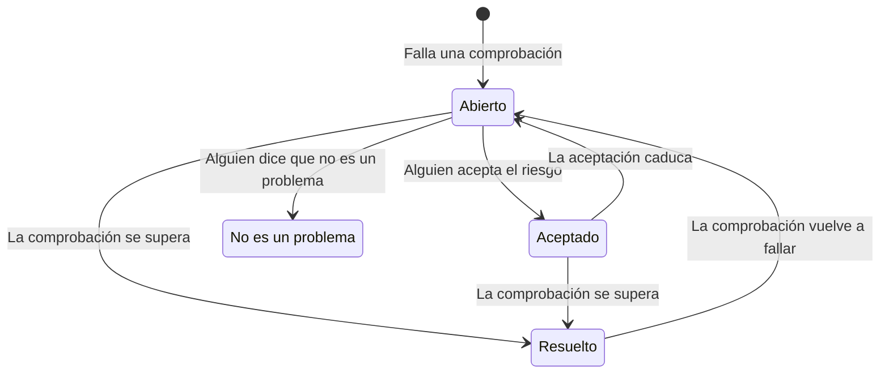

# Comprobaciones y problemas de Seguridad de datos

Seguridad de datos ejecuta 32 comprobaciones en cada almacén, en nueve grupos. Una comprobación lee lo que se sabe de un almacén (cómo está configurado, qué se encontró en él, quién puede acceder a él, dónde está) y el resultado es que se supera, que falla o que no se puede saber. Una comprobación que falla abre un problema en ese almacén, y el problema se cierra solo en cuanto la comprobación se supera. Esta página enumera cada comprobación, cómo se calculan la gravedad y la puntuación de riesgo de un problema, y qué le pasa a un problema a lo largo de su vida.

:::cards
- [Cómo decide una comprobación](#cómo-decide-una-comprobación): Se supera, falla o no se puede saber, y lo grave que es un fallo.
- [Cada comprobación](#cada-comprobación): Las 32, con lo que comprueba cada una y cómo corregirlo.
- [Puntuación de riesgo](#puntuación-de-riesgo): Cómo se ordenan los problemas dentro de una gravedad.
- [Qué le pasa a un problema](#qué-le-pasa-a-un-problema): Abierto, resuelto, aceptado, no es un problema.
- [Corrígelo desde aquí](#corrígelo-desde-aquí): Bloquea un bucket público, o deja de compartir una instantánea, con un clic.
:::

## Cómo decide una comprobación

Cada comprobación lee datos sobre un almacén y responde de una de cuatro formas:

| Respuesta | Qué significa | Qué le pasa al problema |
| --- | --- | --- |
| Se supera | La comprobación no encuentra nada mal. | Un problema abierto o aceptado se resuelve. |
| Falla | La comprobación encuentra el problema y dice en una frase lo que vio: la evidencia del problema. | Se abre un problema, o el que está abierto se actualiza. |
| No se puede saber | No se pudo leer un dato: un permiso que el rol no tiene, una llamada que falló. | No cambia nada: un problema abierto sigue abierto, porque nadie puede concluir que un problema está corregido cuando OneUptime no pudo mirar. |
| No se aplica | El tipo del almacén no tiene ese ajuste. | Un problema abierto se resuelve. |

### La gravedad depende de los datos

El mismo problema importa más con datos más sensibles. Cada comprobación da una gravedad para cada nivel de sensibilidad, y un problema toma la de su almacén: un bucket público de números de tarjeta tiene gravedad Crítica, y uno de imágenes del sitio web, solo Baja. Un guion significa que no hay ningún problema. La sensibilidad de un almacén viene de sus hallazgos (consulta [Tipos de datos sensibles](/docs/data-security/data-types#sensibilidad)), así que las muestras de contenido hacen que las gravedades sean correctas.

Unas pocas comprobaciones fijan en cambio la gravedad según lo que vieron. **Contiene secretos almacenados** tiene gravedad Alta en cualquier almacén, y Crítica en uno que es público o se comparte con otras cuentas.

## Cada comprobación

La gravedad se da para datos Restringidos, Confidenciales, Internos y Públicos, en ese orden. La página de cada problema muestra la corrección completa para su propio almacén (los pasos en la consola, el comando de la CLI y, cuando corresponde, el Terraform) con el nombre y la región del almacén ya rellenados.

### Exposición

| Comprobación | Se ejecuta en | Qué comprueba | Gravedad | Cómo corregirlo |
| --- | --- | --- | --- | --- |
| Cualquiera en internet puede leerlo (`public-read`) | Almacenamiento de objetos, Data warehouse, Búsqueda | La política, la ACL o las vinculaciones de IAM del almacén permiten a cualquiera leer sus datos sin iniciar sesión. | Crítica / Crítica / Alta / Baja | Quita cada concesión a entidades principales anónimas o a todas las autenticadas. Los archivos que deben ser públicos van en un almacén marcado como **Público por diseño** que no contenga nada más. |
| Cualquiera en internet puede cambiarlo (`public-write`) | Almacenamiento de objetos, Data warehouse, Búsqueda | La política, la ACL o las vinculaciones de IAM del almacén permiten a cualquiera escribir o eliminar sus datos. | Crítica / Crítica / Crítica / Alta | Quita cada concesión de escritura o eliminación a entidades principales anónimas o a todas las autenticadas. |
| El acceso público no está bloqueado (`public-access-not-blocked`) | AWS S3 Bucket | S3 Block Public Access no está activado por completo para el bucket o su cuenta, así que un solo cambio de política puede hacerlo público. | Alta / Media / Baja / — | Activa los cuatro ajustes de Block Public Access del bucket. |
| La base de datos acepta conexiones desde internet (`internet-reachable`) | Base de datos, Data warehouse, Búsqueda, Caché | La base de datos tiene activado un endpoint público o el acceso desde la red pública. | Alta / Alta / Media / Baja | Desactiva el endpoint público, y accede a la base de datos a través de una red privada o un bastión. |
| Su firewall deja entrar a cualquier dirección (`open-to-all-addresses`) | Base de datos, Data warehouse, Búsqueda, Caché | Una regla de firewall o una red autorizada permite 0.0.0.0/0 o todo el rango de direcciones. | Crítica / Crítica / Alta / Media | Sustituye la regla que lo permite todo por las direcciones o redes que necesitan acceso. |
| Cualquiera puede restaurar una instantánea suya (`snapshot-public`) | Base de datos, Instantánea | Una instantánea de la base de datos se comparte públicamente, así que cualquier cuenta en la nube puede restaurar una copia completa. | Crítica / Crítica / Crítica / Alta | Haz privada la instantánea. |
| Una instantánea suya se comparte con otras cuentas (`snapshot-shared-externally`) | Base de datos, Instantánea | Una instantánea de la base de datos se comparte con cuentas ajenas a las que tienes conectadas. | Alta / Alta / Media / Baja | Deja de compartir la instantánea con las cuentas que no deberían tenerla. |
| Cuentas ajenas a tu organización pueden acceder a él (`shared-with-external-accounts`) | Todos los almacenes salvo la telemetría | La política del almacén concede acceso a cuentas, inquilinos o proyectos que no están conectados a OneUptime. | Alta / Alta / Media / Baja | Revisa cada entidad principal externa y quita las que no necesitan acceso. |

### Cifrado

| Comprobación | Se ejecuta en | Qué comprueba | Gravedad | Cómo corregirlo |
| --- | --- | --- | --- | --- |
| Sus datos no están cifrados en reposo (`not-encrypted-at-rest`) | Todos los almacenes salvo la telemetría | El cifrado del almacenamiento está desactivado. | Alta / Media / Baja / — | Activa el cifrado en reposo. Una instancia de RDS no se puede cifrar en el sitio: restaura una copia cifrada de su instantánea. |
| Los datos restringidos no están bajo tu propia clave (`no-customer-managed-key`) | Todos los almacenes salvo la telemetría | El almacén contiene datos restringidos pero está cifrado con la clave predeterminada del proveedor, no con una gestionada por el cliente. | Media / — / — / — | Cifra el almacén con una clave que gestiones en tu servicio de claves. |
| Se permiten conexiones sin cifrar (`encryption-in-transit-not-enforced`) | Todos los almacenes salvo la telemetría | El almacén acepta conexiones que no usan TLS. | Alta / Media / Baja / — | Exige TLS en cada conexión. En S3, deniega cada solicitud en la que `aws:SecureTransport` sea false. |
| Acepta TLS anterior a 1.2 (`weak-tls`) | Todos los almacenes salvo la telemetría | La versión mínima de TLS es 1.0 o 1.1. | Media / Media / Baja / — | Fija la versión mínima de TLS en 1.2 o posterior. |

### Recuperación

| Comprobación | Se ejecuta en | Qué comprueba | Gravedad | Cómo corregirlo |
| --- | --- | --- | --- | --- |
| No tiene copias de seguridad, o las conserva menos de 7 días (`no-backups`) | Base de datos, Data warehouse | Las copias de seguridad automáticas están desactivadas, o se conservan menos de 7 días. | Alta / Media / Baja / — | Activa las copias de seguridad automáticas y consérvalas al menos 7 días. |
| La recuperación a un momento dado está desactivada (`no-point-in-time-recovery`) | AWS DynamoDB Table, Azure Cosmos DB Account | La tabla o la base de datos no se puede restaurar a un momento anterior a un error. | Media / Baja / — / — | Activa la recuperación a un momento dado. |
| Se puede eliminar en un solo paso (`deletion-protection-off`) | Base de datos, Data warehouse | La protección contra la eliminación está desactivada. | Media / Baja / — / — | Activa la protección contra la eliminación. |
| Los archivos eliminados o sobrescritos no se pueden recuperar (`deleted-data-not-recoverable`) | Almacenamiento de objetos | El control de versiones y la eliminación temporal están desactivados. | Media / Baja / — / — | Activa el control de versiones o la eliminación temporal. |

### Visibilidad

| Comprobación | Se ejecuta en | Qué comprueba | Gravedad | Cómo corregirlo |
| --- | --- | --- | --- | --- |
| Nadie sabría quién lo leyó (`access-not-logged`) | Todos los almacenes salvo la telemetría | Las lecturas del almacén no se registran: no hay registros de acceso ni registros de auditoría de acceso a datos. | Alta / Media / Baja / — | Activa el registro de acceso o de auditoría para las lecturas: los registros de acceso al servidor de S3 o los eventos de datos de CloudTrail, los registros de diagnóstico StorageRead de Azure, los registros de auditoría Data Access de Cloud Storage. |

### Acceso

| Comprobación | Se ejecuta en | Qué comprueba | Gravedad | Cómo corregirlo |
| --- | --- | --- | --- | --- |
| Cualquiera con la clave de la cuenta puede leerlo todo (`shared-key-access`) | Azure Storage Account | La cuenta de almacenamiento permite el acceso con clave compartida, que omite Microsoft Entra ID y no deja un registro de auditoría por persona. | Media / Baja / — / — | Pasa las aplicaciones a Microsoft Entra ID y después desactiva el acceso con clave de la cuenta de almacenamiento. |
| Los objetos pueden llevar sus propias reglas de acceso (`object-acls-enabled`) | AWS S3 Bucket, Google Cloud Storage Bucket | Las ACL de objetos están activadas, así que un objeto puede hacerse público mientras el bucket parece privado. | Baja / Baja / — / — | En S3, pon Object Ownership en Bucket owner enforced. En Cloud Storage, activa el acceso uniforme a nivel de bucket. |
| Más de 25 identidades pueden leer datos restringidos (`many-readers`) | Todos los almacenes salvo la telemetría | Más identidades de las que la mayoría de los equipos pueden revisar tienen acceso de lectura al almacén. | Media / — / — / — | Abre la página **Quién puede acceder** del almacén y quita el acceso que no se usa o es más amplio de lo necesario. |

### Higiene de los datos

| Comprobación | Se ejecuta en | Qué comprueba | Gravedad | Cómo corregirlo |
| --- | --- | --- | --- | --- |
| Contiene secretos almacenados (`secrets-stored`) | Todos los almacenes salvo la telemetría | Se encontraron contraseñas, claves de API, tokens o claves privadas en los datos del almacén. | Alta / Alta / Alta / Alta | Rota cada secreto encontrado, como si se hubiera filtrado. Mueve los secretos a un gestor de secretos y elimínalos del almacén. |
| Se guardan códigos de seguridad de tarjetas (`card-security-codes-stored`) | Todos los almacenes salvo la telemetría | Se encontraron códigos CVV o CVC. PCI DSS prohíbe conservarlos después de autorizar un pago, cifrados o no. | Crítica / Crítica / Crítica / Crítica | Detén el código que los escribe, elimina los códigos guardados y comprueba que no quede ninguno en las copias de seguridad. |
| Los números de tarjeta se guardan legibles (`card-numbers-readable`) | Todos los almacenes salvo la telemetría | Se encontraron números de tarjeta completos en forma legible. PCI DSS exige que sean ilegibles dondequiera que se guarden. | Alta / Alta / Alta / Alta | Tokeniza los números de tarjeta con tu proveedor de pagos, o cífralos a nivel de campo, y elimina las copias legibles. |
| Las contraseñas se guardan en texto plano (`plaintext-passwords`) | Todos los almacenes salvo la telemetría | Un campo de contraseña contiene valores que no son hashes de contraseña (bcrypt, argon2, scrypt o PBKDF2). | Crítica / Crítica / Crítica / Crítica | Aplica hash a las contraseñas con bcrypt, scrypt o argon2, migra las guardadas y haz que cada cuenta restablezca su contraseña. |
| Se copiaron datos de producción en un almacén que no es de producción (`production-data-in-non-production`) | Todos los almacenes salvo la telemetría | Los valores encontrados en un almacén de producción también se encontraron aquí, en un almacén de desarrollo, pruebas o staging. | Alta / Media / — / — | Sustituye la copia por datos enmascarados o sintéticos, y elimina los datos reales del almacén que no es de producción. |
| Datos sensibles que nadie ha usado en 90 días (`stale-sensitive-data`) | Todos los almacenes salvo la telemetría | El almacén contiene datos sensibles y no ha tenido lecturas ni escrituras en 90 días. | Media / Baja / — / — | Confirma que los datos ya no se necesitan, y después archívalos con una fecha de retención, o elimínalos. |
| Este almacén sensible no tiene propietario (`no-owner`) | Todos los almacenes | El almacén contiene datos sensibles y no tiene propietario. | Media / Baja / — / — | Añade un propietario en la página **Propietarios** del almacén, o una regla del propietario que coincida con sus etiquetas. |

### Telemetría

| Comprobación | Se ejecuta en | Qué comprueba | Gravedad | Cómo corregirlo |
| --- | --- | --- | --- | --- |
| Los datos sensibles están llegando a tu telemetría (`sensitive-data-in-telemetry`) | Telemetría | Los registros, trazas, excepciones, reproducciones o conversaciones de IA llevan datos sensibles que ninguna regla de depuración enmascara. | Alta / Media / Baja / — | Pulsa **Depurar** en cada hallazgo para enmascarar los datos en la ingesta, y después corrige el código que los escribe. |
| Los secretos están llegando a tu telemetría (`secrets-in-telemetry`) | Telemetría | Aparecen contraseñas, claves de API o tokens en registros, trazas, excepciones o conversaciones de IA. | Crítica / Crítica / Crítica / Crítica | Rota primero el secreto, después pulsa **Depurar** y corrige el código que lo escribe. |

### Residencia

| Comprobación | Se ejecuta en | Qué comprueba | Gravedad | Cómo corregirlo |
| --- | --- | --- | --- | --- |
| Los datos se guardan fuera de las regiones en las que pueden estar (`residency-violation`) | Todos los almacenes salvo la telemetría | La región del almacén, o una región a la que se replican sus datos, incumple una regla de residencia. | Alta / Alta / Media / — | Mueve los datos a una región permitida, o deja de copiarlos a la otra. Si la transferencia es legal, acepta el problema y registra por qué. |

### IA

| Comprobación | Se ejecuta en | Qué comprueba | Gravedad | Cómo corregirlo |
| --- | --- | --- | --- | --- |
| Se están enviando datos sensibles a un proveedor de IA (`sensitive-data-to-ai`) | Conversaciones de IA | Las conversaciones de IA registradas en OneUptime llevan datos sensibles a un proveedor de modelos. | Crítica / Alta / Baja / — | Oculta los valores sensibles antes de enviar los prompts, o envía estas llamadas a un modelo que alojes tú. |
| Hay datos restringidos en un almacén usado para IA (`sensitive-data-in-ai-store`) | Todos los almacenes salvo la telemetría | Un almacén etiquetado como datos de entrenamiento o de recuperación para IA contiene datos restringidos. | Alta / Media / — / — | Quita o enmascara los datos restringidos antes de usarlos para entrenar o fundamentar un modelo. |

## Puntuación de riesgo

La gravedad dice lo grave que es un problema. La puntuación de riesgo, de 0 a 100, ordena los problemas de una misma gravedad según lo que agrava el mismo problema:

```text
risk = severity + 10 × exposure + 6 × volume + 5 × activity + 4 × production, at most 100
```

| Factor | Puntos |
| --- | --- |
| Gravedad | 75 para Crítica, 50 para Alta, 25 para Media, 0 para Baja |
| Exposición | 10 para Público, 8 para Otras cuentas, 6 para Accesible desde internet, 3 para Desconocido, 0 para Privado |
| Volumen | Hasta 6, según los registros sensibles estimados del almacén en escala logarítmica: 1 para 10 registros, 3 para 1.000, 5 para un millón, 6 para diez millones o más |
| Actividad | 5 cuando Operaciones de seguridad vio detecciones en el almacén en la última semana |
| Producción | 4 para un almacén en producción |

Los extras suman como máximo 25 puntos, así que un problema nunca puntúa por debajo de un problema de una gravedad inferior. Un bucket público de producción con un millón de registros de datos restringidos puntúa 75 + 10 + 5 + 4 = 94 en un problema crítico. Cada problema enumera los factores que sumaron a su puntuación, con sus puntos, y el almacén muestra la puntuación de su peor problema abierto.

El entorno de un almacén (Producción, Staging, Desarrollo, Pruebas o Desconocido) viene de sus etiquetas (`env`, `environment`, `stage`, `tier` y similares) o, si no tiene ninguna, de las palabras de su nombre, como `prod`, `staging`, `dev` o `qa`. Fíjalo en el almacén cuando ninguna de las dos lo indique.

## Qué le pasa a un problema



OneUptime abre, actualiza y resuelve problemas a medida que se ejecutan las comprobaciones. Lo que una persona hace con un problema es decidir qué pasa después:

| Estado | Cómo llega ahí | Qué sigue |
| --- | --- | --- |
| **Abierto** | Su comprobación falla ahora en el almacén. | Cuenta en la Vista general, en el resumen del almacén y en el cumplimiento, hasta que la comprobación se supera. |
| **Resuelto** | Su comprobación se superó en una ejecución posterior, ya no se aplica o se desactivó, o se archivó su almacén. Una persona también puede elegir **Marcar como resuelto**: el almacén se vuelve a comprobar al momento. | Se vuelve a abrir si la comprobación vuelve a fallar, y el problema cuenta cuántas veces se reabrió. |
| **Aceptado** | Una persona eligió **Aceptar el riesgo**, con un **Motivo** y una fecha en **Aceptado hasta**, como máximo a un año. | Sigue cerrado hasta esa fecha, y después se vuelve a abrir si la comprobación sigue fallando. Acéptalo de nuevo entonces si el motivo sigue siendo válido. |
| **No es un problema** | Una persona eligió **No es un problema**: el hallazgo era erróneo. | Sigue cerrado, aunque la comprobación falle. **Reabrir** lo devuelve a Abierto. |

Los Security Member, los Security Admin, los Project Admin y los Project Owner pueden cambiar el estado de un problema y usar **Asignar** para dárselo a una persona o a un equipo. Cada cambio se escribe en la **Cronología** del problema: cuándo se abrió, cada cambio de gravedad, cada cambio de estado y quién lo hizo, las nuevas comprobaciones solicitadas y lo que hicieron las integraciones.

Un problema que se vuelve a abrir conserva su historial. Los riesgos aceptados se revisan cada día, así que uno caduca a tiempo aunque no se haya escaneado nada.

## Corrígelo desde aquí

Un problema abierto sobre un bucket público o una instantánea compartida se puede corregir desde su página. Encima de los pasos en la consola, **Corrígelo desde aquí** ofrece el cambio que lo corrige:

| El problema | Su almacén | El botón | Qué cambia |
| --- | --- | --- | --- |
| `public-read`, `public-write` o `public-access-not-blocked` | Un bucket de S3, una cuenta de almacenamiento de Azure o un bucket de Cloud Storage | **Bloquear el acceso público** | Activa los cuatro ajustes de Block Public Access del bucket, desactiva el acceso anónimo a blobs de la cuenta de almacenamiento, o impone la prevención del acceso público del bucket |
| `snapshot-public` o `snapshot-shared-externally` | Una instantánea de RDS, una base de datos RDS, o un clúster de Aurora o DocumentDB | **Revocar el uso compartido** | Deja de compartir la instantánea, o cada instantánea manual compartida de la base de datos, con todo el mundo y con las cuentas ajenas a las que conectaste |

Primero pregunta, y dice qué cambia y qué deja de funcionar. Cambia cómo se comparte el almacén, nunca sus datos, y no cambia nada que ya esté cerrado. Un almacén marcado como **Público por diseño** nunca se bloquea.

Actúa a través de la conexión a la nube del almacén, así que la conexión necesita **Respuesta de seguridad de datos** activada y su comando de configuración ejecutado de nuevo (consulta [Configurar Seguridad de datos](/docs/data-security/setup#dejar-que-seguridad-de-datos-cierre-una-exposición)). Hasta entonces, el panel dice qué hay que activar. El almacén se vuelve a comprobar justo después, y el problema se resuelve solo en cuanto su comprobación se supera. La **Cronología** del problema y la **Cronología** del almacén dicen qué se hizo y quién lo hizo.

## Ajustes de las comprobaciones

**Seguridad de datos → Ajustes → Comprobaciones** enumera cada comprobación por grupo, con lo que busca y la gravedad que recibe un fallo para cada sensibilidad. Cada comprobación se puede ajustar para el proyecto, y cada cambio se guarda al momento:

- **Su interruptor** desactiva la comprobación, cuando no encaja con tu forma de trabajar. Sus problemas abiertos y aceptados se resuelven, e indican que la comprobación ya no se ejecuta.
- **Su gravedad** es **Por sensibilidad** tal como viene, o una sola gravedad que recibe cada fallo de la comprobación, contenga lo que contenga su almacén.

Para silenciar una comprobación solo en un almacén, acepta el riesgo en el problema de ese almacén, o marca el problema como que no es un problema. Para un hallazgo que es erróneo, y no un problema que no importa, marca en su lugar el hallazgo como no sensible (consulta [Tipos de datos sensibles](/docs/data-security/data-types#no-sensible-y-nunca-sensible)).

**Comprobar ahora** en un almacén vuelve a leer su configuración y ejecuta sus comprobaciones. **Escanear ahora** muestrea su contenido, y sus comprobaciones se ejecutan cuando termina el escaneo.

## Próximos pasos

:::cards
- [Integraciones de Seguridad de datos](/docs/data-security/integrations): Casos de seguridad, alertas y correos a los propietarios cuando se abre un problema.
- [Flujos de datos, acceso y residencia](/docs/data-security/flows-access-residency): El acceso, las copias y las regiones que leen varias comprobaciones.
- [Cumplimiento de Seguridad de datos](/docs/data-security/compliance): Los requisitos de los marcos de los que cada comprobación es evidencia.
:::
