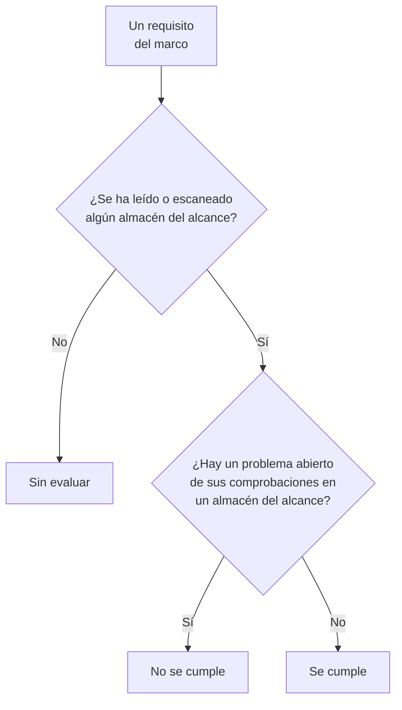

# Cumplimiento de Seguridad de datos

Seguridad de datos puntúa nueve marcos a partir de lo que encontraron sus escaneos. Cada marco abarca los almacenes de los que tratan sus normas (el RGPD, los almacenes que contienen datos personales; PCI DSS, los almacenes donde se encontraron datos de tarjetas; SOC 2, todos los almacenes), y cada uno de sus requisitos se cumple o no según las comprobaciones que son evidencia de él. **Seguridad de datos → Cumplimiento** muestra la puntuación de cada marco, cuántos almacenes abarca y cada requisito con cuántos problemas abiertos lo incumplen. Una puntuación es evidencia para una auditoría, no un certificado: dice lo que OneUptime puede ver de los almacenes que lee.

:::cards
- [Los marcos](#los-marcos): Los nueve, y qué almacenes abarca cada uno.
- [Cómo se puntúa un marco](#cómo-se-puntúa-un-marco): Requisitos que se cumplen, que no se cumplen y sin evaluar.
- [Requisitos y sus comprobaciones](#requisitos-y-sus-comprobaciones): Cada requisito, y las comprobaciones que son evidencia de él.
- [Registro de actividades de tratamiento](#registro-de-actividades-de-tratamiento): El artículo 30 del RGPD, redactado a partir de tus almacenes.
:::

## Los marcos

| Marco | Nombre completo | Almacenes en el alcance |
| --- | --- | --- |
| RGPD | Reglamento General de Protección de Datos de la UE | Los almacenes que contienen datos personales. |
| CCPA | Ley de Privacidad del Consumidor de California, modificada por la CPRA | Los almacenes que contienen información personal. |
| HIPAA | Regla de Seguridad de HIPAA | Los almacenes que contienen datos de salud. |
| PCI DSS | PCI DSS v4.0 | Los almacenes donde se encontraron números de tarjeta. |
| SOC 2 | Criterios de servicios de confianza de SOC 2 | Todos los almacenes de datos. |
| ISO 27001 | ISO/IEC 27001:2022 | Todos los almacenes de datos. |
| NIST CSF | Marco de Ciberseguridad 2.0 del NIST | Todos los almacenes de datos. |
| LGPD | Ley General de Protección de Datos de Brasil | Los almacenes que contienen datos personales de personas en Brasil. |
| DPDP | Ley de Protección de Datos Personales Digitales de la India, de 2023 | Los almacenes que contienen datos personales de personas en la India. |

## Qué almacenes abarca un marco

El alcance de un almacén sale de los datos encontrados en él, así que cambia a medida que los escaneos encuentran más:

- **SOC 2, ISO 27001 y NIST CSF** son marcos de seguridad: abarcan todos los almacenes, contengan lo que contengan.
- **RGPD, CCPA, HIPAA y PCI DSS** abarcan los almacenes que contienen un tipo de datos que protegen. Los datos personales incluyen un almacén en el RGPD y la CCPA; los datos de salud, también en HIPAA; y los números de tarjeta, los códigos de seguridad de tarjetas y las fechas de caducidad de tarjetas, en PCI DSS. Un almacén que solo contiene secretos o documentos de la empresa no está en ninguno de ellos.
- **LGPD y DPDP** son leyes propias de un país: abarcan los almacenes que contienen datos personales de personas en Brasil o en la India, deducidos de los tipos de datos que pertenecen a ese país, como un CPF brasileño o un número Aadhaar indio.

[Tipos de datos sensibles](/docs/data-security/data-types#tipos-de-datos-integrados) enumera cada tipo de datos, con su país.

## Cómo se puntúa un marco

- **Un requisito se cumple** cuando ningún problema abierto de las comprobaciones asociadas a él está en un almacén del alcance del marco, y **no se cumple** cuando alguno lo está.
- **No se evalúa** mientras no se haya leído la configuración ni escaneado el contenido de ningún almacén del alcance.
- **Seguridad de datos cumple por sí misma dos requisitos**: el artículo 30 del RGPD, registro de las actividades de tratamiento, e ISO 27001 A.5.12, clasificación de la información. Se cumplen en cuanto se han leído o escaneado todos los almacenes del alcance, y no se cumplen mientras falte alguno.
- **La puntuación** es la proporción de los requisitos evaluados de un marco que se cumplen, como porcentaje entero. Un marco sin nada evaluado no tiene puntuación.

Solo cuentan los problemas abiertos. Un problema cuyo riesgo se aceptó, o que no es un problema, no hace que sus requisitos dejen de cumplirse, así que un riesgo aceptado es una decisión que tu auditoría puede ver en el problema: quién lo aceptó, por qué y hasta cuándo.

## Requisitos y sus comprobaciones

### RGPD

| Requisito | Qué pide | Comprobaciones |
| --- | --- | --- |
| Art. 5(1)(c) | Minimización de datos | `production-data-in-non-production`, `stale-sensitive-data`, `sensitive-data-in-telemetry`, `sensitive-data-to-ai`, `sensitive-data-in-ai-store` |
| Art. 5(1)(e) | Limitación del plazo de conservación | `stale-sensitive-data` |
| Art. 25 | Protección de datos desde el diseño y por defecto | `production-data-in-non-production`, `stale-sensitive-data`, `sensitive-data-in-telemetry`, `sensitive-data-to-ai`, `sensitive-data-in-ai-store` |
| Art. 28 | Encargados del tratamiento | `sensitive-data-to-ai` |
| Art. 30 | Registro de las actividades de tratamiento | Lo cumple la propia Seguridad de datos |
| Art. 32 | Seguridad del tratamiento | `public-read`, `public-write`, `public-access-not-blocked`, `internet-reachable`, `open-to-all-addresses`, `snapshot-public`, `snapshot-shared-externally`, `shared-with-external-accounts`, `not-encrypted-at-rest`, `no-customer-managed-key`, `encryption-in-transit-not-enforced`, `weak-tls`, `no-backups`, `no-point-in-time-recovery`, `deletion-protection-off`, `deleted-data-not-recoverable`, `access-not-logged`, `shared-key-access`, `object-acls-enabled`, `many-readers`, `secrets-stored`, `plaintext-passwords`, `secrets-in-telemetry` |
| Arts. 44-49 | Transferencias a terceros países | `residency-violation` |

### CCPA

| Requisito | Qué pide | Comprobaciones |
| --- | --- | --- |
| 1798.100(c) | Recogida limitada a lo necesario | `production-data-in-non-production`, `stale-sensitive-data`, `sensitive-data-in-telemetry`, `sensitive-data-to-ai`, `sensitive-data-in-ai-store` |
| 1798.150 | Procedimientos de seguridad razonables | `public-read`, `public-write`, `public-access-not-blocked`, `internet-reachable`, `open-to-all-addresses`, `snapshot-public`, `snapshot-shared-externally`, `shared-with-external-accounts`, `shared-key-access`, `object-acls-enabled`, `many-readers` |

### HIPAA

| Requisito | Qué pide | Comprobaciones |
| --- | --- | --- |
| 164.308(a)(7) | Plan de contingencia | `no-backups`, `no-point-in-time-recovery`, `deletion-protection-off`, `deleted-data-not-recoverable` |
| 164.312(a)(1) | Control de acceso | `public-read`, `public-write`, `public-access-not-blocked`, `internet-reachable`, `open-to-all-addresses`, `snapshot-public`, `snapshot-shared-externally`, `shared-with-external-accounts`, `shared-key-access`, `object-acls-enabled`, `many-readers` |
| 164.312(a)(2)(iv) | Cifrado y descifrado | `not-encrypted-at-rest`, `no-customer-managed-key` |
| 164.312(b) | Controles de auditoría | `access-not-logged` |
| 164.312(e)(1) | Seguridad de la transmisión | `encryption-in-transit-not-enforced`, `weak-tls` |

### PCI DSS

| Requisito | Qué pide | Comprobaciones |
| --- | --- | --- |
| 3.3.1 | Los datos de autenticación sensibles no se conservan después de la autorización | `card-security-codes-stored` |
| 3.4.1 | Los números de tarjeta se enmascaran al mostrarse | `card-numbers-readable`, `sensitive-data-in-telemetry` |
| 3.5.1 | Los números de tarjeta son ilegibles dondequiera que se guarden | `not-encrypted-at-rest`, `no-customer-managed-key`, `card-numbers-readable` |
| 4.2.1 | Una criptografía robusta protege los datos de tarjetas en tránsito | `encryption-in-transit-not-enforced`, `weak-tls` |
| 7.2 | El acceso se define y se asigna según la necesidad | `public-read`, `public-write`, `public-access-not-blocked`, `internet-reachable`, `open-to-all-addresses`, `snapshot-public`, `snapshot-shared-externally`, `shared-with-external-accounts`, `shared-key-access`, `object-acls-enabled`, `many-readers` |
| 8.3.2 | Los factores de autenticación son ilegibles cuando se guardan | `plaintext-passwords` |
| 10.2 | Los registros de auditoría registran el acceso a los datos de tarjetas | `access-not-logged` |

### SOC 2

| Requisito | Qué pide | Comprobaciones |
| --- | --- | --- |
| A1.2 | Copia de seguridad y recuperación | `no-backups`, `no-point-in-time-recovery`, `deletion-protection-off`, `deleted-data-not-recoverable` |
| CC6.1 | Seguridad del acceso lógico | `public-read`, `public-write`, `public-access-not-blocked`, `internet-reachable`, `open-to-all-addresses`, `snapshot-public`, `snapshot-shared-externally`, `shared-with-external-accounts`, `not-encrypted-at-rest`, `no-customer-managed-key`, `shared-key-access`, `object-acls-enabled`, `many-readers`, `secrets-stored`, `plaintext-passwords`, `secrets-in-telemetry` |
| CC6.7 | Transmisión de la información | `encryption-in-transit-not-enforced`, `weak-tls` |
| CC7.2 | Supervisión de los componentes del sistema | `access-not-logged` |

### ISO 27001

| Requisito | Qué pide | Comprobaciones |
| --- | --- | --- |
| A.5.9 | Inventario de la información y otros activos asociados | `no-owner` |
| A.5.12 | Clasificación de la información | Lo cumple la propia Seguridad de datos |
| A.5.15 | Control de acceso | `public-read`, `public-write`, `public-access-not-blocked`, `internet-reachable`, `open-to-all-addresses`, `snapshot-public`, `snapshot-shared-externally`, `shared-with-external-accounts`, `shared-key-access`, `object-acls-enabled`, `many-readers` |
| A.5.34 | Privacidad y protección de la PII | `production-data-in-non-production`, `stale-sensitive-data`, `sensitive-data-in-telemetry`, `sensitive-data-to-ai`, `sensitive-data-in-ai-store` |
| A.8.11 | Enmascaramiento de datos | `production-data-in-non-production`, `stale-sensitive-data`, `sensitive-data-in-telemetry`, `sensitive-data-to-ai`, `sensitive-data-in-ai-store` |
| A.8.12 | Prevención de la fuga de datos | `secrets-stored`, `secrets-in-telemetry` |
| A.8.13 | Copia de seguridad de la información | `no-backups`, `no-point-in-time-recovery`, `deletion-protection-off`, `deleted-data-not-recoverable` |
| A.8.15 | Registro de eventos | `access-not-logged` |
| A.8.24 | Uso de la criptografía | `not-encrypted-at-rest`, `no-customer-managed-key`, `encryption-in-transit-not-enforced`, `weak-tls`, `plaintext-passwords` |

### NIST CSF

| Requisito | Qué pide | Comprobaciones |
| --- | --- | --- |
| ID.AM-07 | Se mantienen inventarios de datos y metadatos | `no-owner` |
| PR.AA-05 | Se gestionan los permisos de acceso | `public-read`, `public-write`, `public-access-not-blocked`, `internet-reachable`, `open-to-all-addresses`, `snapshot-public`, `snapshot-shared-externally`, `shared-with-external-accounts`, `shared-key-access`, `object-acls-enabled`, `many-readers` |
| PR.DS-01 | Los datos en reposo están protegidos | `not-encrypted-at-rest`, `no-customer-managed-key`, `secrets-stored`, `secrets-in-telemetry` |
| PR.DS-02 | Los datos en tránsito están protegidos | `encryption-in-transit-not-enforced`, `weak-tls` |
| PR.DS-11 | Se hacen y se prueban copias de seguridad de los datos | `no-backups`, `no-point-in-time-recovery`, `deletion-protection-off`, `deleted-data-not-recoverable` |
| DE.CM-09 | Se supervisan los datos y su uso | `access-not-logged` |

### LGPD

| Requisito | Qué pide | Comprobaciones |
| --- | --- | --- |
| Art. 6 | Necesidad y limitación de la finalidad | `production-data-in-non-production`, `stale-sensitive-data`, `sensitive-data-in-telemetry`, `sensitive-data-to-ai`, `sensitive-data-in-ai-store` |
| Art. 33 | Transferencia internacional de datos | `residency-violation` |
| Art. 46 | Medidas de seguridad | `public-read`, `public-write`, `public-access-not-blocked`, `internet-reachable`, `open-to-all-addresses`, `snapshot-public`, `snapshot-shared-externally`, `shared-with-external-accounts`, `not-encrypted-at-rest`, `no-customer-managed-key`, `shared-key-access`, `object-acls-enabled`, `many-readers` |

### DPDP

| Requisito | Qué pide | Comprobaciones |
| --- | --- | --- |
| Secc. 8(5) | Salvaguardas de seguridad razonables | `public-read`, `public-write`, `public-access-not-blocked`, `internet-reachable`, `open-to-all-addresses`, `snapshot-public`, `snapshot-shared-externally`, `shared-with-external-accounts`, `not-encrypted-at-rest`, `no-customer-managed-key`, `shared-key-access`, `object-acls-enabled`, `many-readers` |
| Secc. 8(7) | Supresión cuando se ha cumplido la finalidad | `production-data-in-non-production`, `stale-sensitive-data`, `sensitive-data-in-telemetry`, `sensitive-data-to-ai`, `sensitive-data-in-ai-store` |
| Secc. 16 | Transferencia fuera de la India | `residency-violation` |

## Registro de actividades de tratamiento

El artículo 30 del RGPD te pide llevar un registro de tus actividades de tratamiento. Seguridad de datos redacta la parte que trata de dónde se guardan los datos personales: una fila por cada almacén que contiene datos personales.

| Columna | De dónde sale |
| --- | --- |
| Almacén, tipo, proveedor y región | Descubrimiento |
| Entorno | Las etiquetas o el nombre del almacén, o lo que fijes tú |
| Sensibilidad, categorías y tipos de datos | Lo que encontraron los escaneos, o la sensibilidad que fijes tú |
| Propietarios | Los propietarios del almacén: personas y los miembros de sus equipos |
| Finalidad | Lo que escribas en la **Finalidad** del almacén: por qué contiene datos personales |
| Retención | Lo que escribas en la **Retención** del almacén: cuánto tiempo se guardan los datos en él |
| Marcos | Los marcos que sus tipos de datos incluyen en el alcance |

Rellena **Finalidad** y **Retención** en los **Ajustes** de cada almacén: son las dos cosas que ningún escaneo puede saber. La API de Seguridad de datos también devuelve el registro y las puntuaciones, en `/data-security/record-of-processing` y `/data-security/compliance`, a quien pueda leer almacenes de datos (consulta [Integraciones de Seguridad de datos](/docs/data-security/integrations#api-terraform-y-mcp)).

## Próximos pasos

:::cards
- [Comprobaciones y problemas de Seguridad de datos](/docs/data-security/checks-and-issues): Las comprobaciones detrás de cada requisito, y cómo corregirlas.
- [Flujos de datos, acceso y residencia](/docs/data-security/flows-access-residency): Las reglas de residencia, para las transferencias del RGPD, la LGPD y la DPDP.
- [Tipos de datos sensibles](/docs/data-security/data-types): Los tipos de datos que incluyen un almacén en el alcance de un marco.
:::
