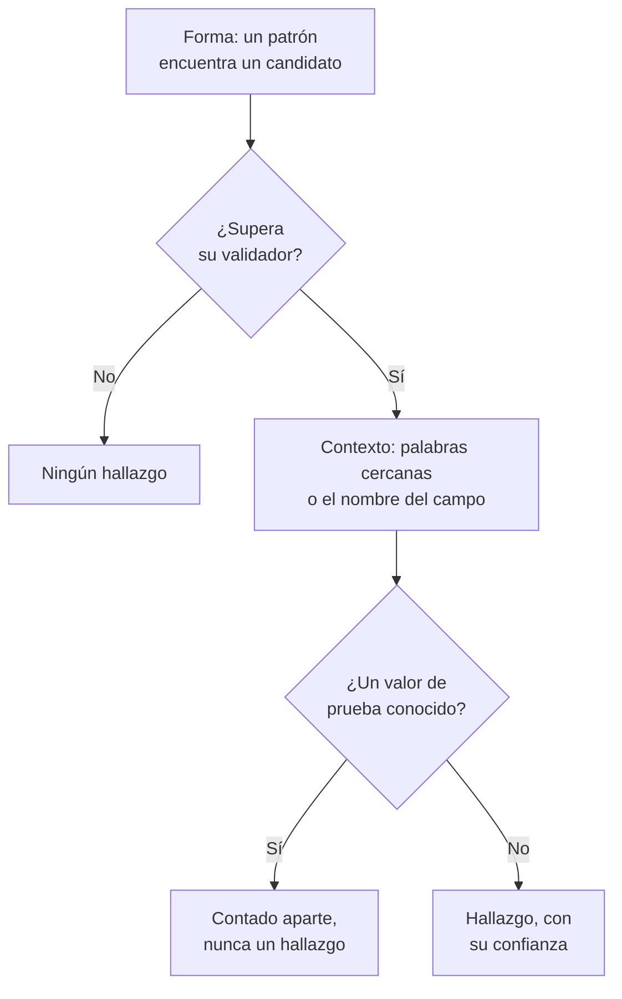

# Tipos de datos sensibles

Seguridad de datos conoce 143 clases de datos sensibles: números de tarjeta, cuentas bancarias, documentos nacionales de identidad de 43 países, identificadores sanitarios, claves y tokens de API, y las categorías especiales de datos personales. Cada una tiene una categoría, una sensibilidad y, cuando pertenece a un país, ese país. Esta página explica cómo se encuentra un valor y enumera cada tipo de datos, para que puedas saber por qué se encontró algo y decidir qué hacer al respecto.

:::cards
- [Cómo se encuentra un valor](#cómo-se-encuentra-un-valor): Forma, validador, contexto, valores de prueba, confianza.
- [Campos y columnas](#campos-y-columnas): Cómo se juzga una columna o un atributo entero.
- [Cada tipo de datos](#tipos-de-datos-integrados): Los 143, por categoría.
- [Tus propios tipos de datos](#tus-propios-tipos-de-datos): IDs de empleado, números de póliza y el cuadro Probarlo.
:::

## Cómo se encuentra un valor

Cada escaneo (una línea de registro, una celda de CSV, una fila de base de datos, los primeros bytes de un objeto) sigue los mismos pasos:

1. **Forma.** Cada tipo de datos tiene patrones que encuentran candidatos: dieciséis dígitos, `AKIA` y dieciséis letras, una palabra, una `@` y un dominio. Un patrón nunca coincide dentro de un token más largo, así que un número de tarjeta no se encuentra dentro de una serie de dígitos más larga.
2. **Validador.** Un candidato debe cumplir las reglas propias de su tipo: una suma de comprobación (Luhn para las tarjetas, mod 97 para los IBAN, Verhoeff para los números Aadhaar, el dígito de control de la mayoría de los documentos nacionales de identidad), una fecha real, un prefijo conocido, suficiente aleatoriedad para un secreto. Un candidato que no las cumple no es ningún hallazgo. Los marcadores de posición como `000000000` y `123456789` fallan en todos los tipos numéricos.
3. **Contexto.** Las palabras cercanas a un candidato (por defecto, hasta 64 caracteres antes y 32 después) que dicen qué es suben su confianza un nivel, y también lo hace un campo cuyo nombre apunta al tipo. Las palabras que dicen que es otra cosa, como un número de pedido o de seguimiento, la bajan un nivel. Un número sin suma de comprobación y con una forma común, como un número de pasaporte o una cuenta bancaria, solo cuenta junto a palabras que lo nombran.
4. **Valores de prueba conocidos.** Los números de tarjeta de prueba publicados (como `4242 4242 4242 4242` de Stripe), los IBAN de ejemplo, las direcciones en `example.com` y otros dominios reservados, las direcciones IP de documentación, los IDs de muestra que imprime la documentación oficial, las claves de modo de prueba como `sk_test_` y las claves de marcador de posición se cuentan aparte. Nunca producen un hallazgo, así que un almacén lleno de ellos se lee como un entorno de pruebas, no como una filtración.
5. **Confianza.** Lo que queda es un hallazgo, tan seguro como permiten sus pruebas.

| Confianza | Qué significa |
| --- | --- |
| **Alta** | El valor superó su validador, y las palabras que lo rodean o el campo en el que está dicen qué es; o, para un campo, la mayoría de sus valores son de ese tipo. |
| **Media** | El valor superó su validador sin nada alrededor que lo confirme, o el nombre del campo dice qué contiene y algunos valores lo confirman. |
| **Baja** | La forma coincide, pero nada lo confirma. |

Solo cuentan los hallazgos de confianza Alta y Media: hacen que un almacén sea sensible y pueden abrir un problema. Los hallazgos de confianza Baja se listan en el almacén, plegados, para que una persona los juzgue.

Cuando dos tipos de datos reclaman los mismos caracteres, gana el hallazgo más seguro: el de mayor confianza, después el detector cuyas propias reglas prueban más, y después la coincidencia más larga.

Un valor largo se lee en ventanas de 64 KB que se solapan 4 KB, así que un valor se encuentra entero esté donde esté, y se leen como máximo 4 MB de un valor.

## Campos y columnas

Una columna, un campo JSON o un atributo de registro se juzga como un todo. Su nombre sugiere un tipo de datos, y sus valores muestreados lo prueban. La proporción de sus valores que contienen el tipo decide lo seguro que es el hallazgo:

| Valores que contienen el tipo | Confianza |
| --- | --- |
| 60% o más | Alta |
| 25% o más | Alta cuando el nombre del campo apunta al tipo, Media en otro caso |
| Menos | Media cuando el nombre del campo apunta al tipo, Baja en otro caso: unos pocos correos en una columna de otra cosa |

Un campo cuyos valores tienen de media más de 80 caracteres es texto libre (notas, mensajes, descripciones), y no se espera que contenga un solo tipo. Sus hallazgos conservan la confianza que cada coincidencia obtuvo por sí sola, e indican que se encontraron en texto libre. Se clasifican hasta 1.000 valores de un campo, y hasta 16 KB de cada uno.

El nombre de un campo se divide en palabras (`customerEmail`, `customer_email` y `customer-email` son todos «customer email»), y la pista de nombre de un tipo coincide cuando sus palabras aparecen en ese orden, una junto a otra: «date of birth» coincide con `customer_date_of_birth`, no con `birth_city`. Solo la última parte de una ruta con puntos es el nombre propio del campo, junto con la parte anterior cuando la última es una palabra genérica como `number`, `id` o `value`: `customer.address.city` no es una dirección postal, y `card.number` sigue siendo un número de tarjeta.

Algunos tipos de datos no se pueden distinguir por sus valores: ningún patrón distingue el nombre de una persona del de una calle, ni una religión de cualquier otra palabra. Estos se encuentran solo por el nombre del campo, cuando el campo tiene valores: Nombre de persona, Nombre de usuario, Género, Nacionalidad, Información de salud, Origen racial o étnico, Creencia religiosa, Orientación sexual, Opinión política, Afiliación sindical, Datos biométricos, Datos genéticos y Antecedentes penales. Un nombre, un nombre de usuario, un género o una nacionalidad tiene entonces confianza Alta cuando el 60% o más de los valores lo parecen, y Media en otro caso.

Un campo cuyo nombre dice que contiene una contraseña (`password`, `passwordHash`, `pwd`, no `password_changed_at`) debería contener un hash: bcrypt, argon2, scrypt, PBKDF2 u otro esquema que probablemente use un almacén. Los valores vacíos, los marcadores de posición como `********` y los valores cifrados se dejan aparte. Cuando entre los demás hay más valores que no son hashes que hashes, el campo contiene las propias contraseñas, que ningún patrón puede ver, y el almacén no supera [Las contraseñas se guardan en texto plano](/docs/data-security/checks-and-issues#higiene-de-los-datos).

## Sensibilidad

| Sensibilidad | Qué significa |
| --- | --- |
| **Restringido** | Si se filtra, causa daño: secretos, números de tarjeta, historiales médicos, documentos de identidad oficiales. |
| **Confidencial** | Datos personales, y documentos marcados como confidenciales. |
| **Interno** | Los datos propios de la empresa, no destinados a terceros. |
| **Público** | No se encontró nada sensible. |

Un almacén es tan sensible como el tipo de datos más sensible encontrado en él con al menos confianza Media. Los valores de prueba y los hallazgos marcados como no sensibles no cuentan para nada, y un almacén donde no se encontró nada es Público. Para tratar un almacén como más o menos sensible de lo que dicen sus hallazgos, fija tú mismo su sensibilidad en los **Ajustes** del almacén: las comprobaciones usarán entonces esa.

## Categorías

| Categoría | Qué abarca | Datos personales |
| --- | --- | --- |
| Secretos y credenciales | Contraseñas, claves de API, tokens y claves privadas que desbloquean otros sistemas. | No |
| Financieros | Números de tarjeta, cuentas bancarias, IBAN y monederos de criptomonedas. | Sí |
| Salud | Números de historia clínica, identificadores sanitarios, diagnósticos y recetas. | Sí |
| Identificación oficial | Números de identidad nacional, fiscales, de pasaporte y de la seguridad social. | Sí |
| Categoría especial | Lo que el artículo 9 del RGPD protege más: origen étnico, religión, orientación sexual, política, afiliación sindical, datos biométricos y genéticos. | Sí |
| Contacto e identidad | Quién es alguien y cómo contactarlo: correo electrónico, teléfono, dirección, fecha de nacimiento, dirección IP. | Sí |
| Confidencial de la empresa | Documentos marcados como confidenciales, solo para uso interno o protegidos por secreto profesional. | No |

Los datos personales son datos sobre una persona, en el sentido del RGPD, la CCPA, la LGPD y la DPDP. Un almacén que solo contiene secretos y documentos de la empresa queda fuera del alcance de un marco de privacidad, nunca del de uno de seguridad (consulta [Cumplimiento de Seguridad de datos](/docs/data-security/compliance)).

## Tipos de datos integrados

Un tipo de datos que pertenece a un país lo nombra, con un código ISO 3166-1: las reglas de residencia y los marcos ligados a un país lo leen (consulta [Residencia](/docs/data-security/flows-access-residency#reglas-de-residencia)). El ID es el nombre con el que la API y los hallazgos se refieren al tipo.

### Contacto e identidad

| Tipo de datos | ID | Qué es | Sensibilidad | País |
| --- | --- | --- | --- | --- |
| Dirección de correo electrónico | `email-address` | La dirección de correo electrónico de una persona. | Confidencial | — |
| Número de teléfono | `phone-number` | Un número de teléfono en formato internacional o nacional. | Confidencial | — |
| Nombre de persona | `person-name` | El nombre, el apellido o el nombre completo de una persona, encontrado por el nombre del campo. | Confidencial | — |
| Dirección postal | `postal-address` | Una dirección postal: un número, un nombre de calle y un tipo de vía. | Confidencial | — |
| Código postal | `postal-code` | Un código postal. Por sí solo, acota dónde vive alguien. | Interno | — |
| Fecha de nacimiento | `date-of-birth` | Una fecha junto a palabras que dicen que es la fecha de nacimiento de alguien. | Confidencial | — |
| Dirección IP | `ip-address` | Una dirección IPv4 o IPv6 pública, que el RGPD trata como dato personal. | Confidencial | — |
| Dirección MAC | `mac-address` | La dirección de hardware de una tarjeta de red, que identifica un dispositivo. | Confidencial | — |
| ID de publicidad | `advertising-id` | Un ID de publicidad móvil (IDFA, GAID, AAID) que rastrea un dispositivo. | Confidencial | — |
| Ubicación precisa | `geolocation` | Una latitud y una longitud lo bastante precisas para encontrar un edificio. | Confidencial | — |
| Nombre de usuario | `username` | El nombre de inicio de sesión o de cuenta de una persona, encontrado por el nombre del campo. | Confidencial | — |
| Género | `gender` | El género o el sexo de una persona, encontrado por el nombre del campo. | Confidencial | — |
| Nacionalidad | `nationality` | La nacionalidad o ciudadanía de una persona, encontrada por el nombre del campo. | Confidencial | — |
| Número de identificación del vehículo | `vehicle-identification-number` | Un VIN de 17 caracteres con un dígito de control válido. | Confidencial | — |

### Identificación oficial

| Tipo de datos | ID | Qué es | Sensibilidad | País |
| --- | --- | --- | --- | --- |
| Número de la Seguridad Social de EE. UU. | `us-ssn` | Un número de la Seguridad Social de EE. UU. | Restringido | US |
| ID de contribuyente de EE. UU. (ITIN) | `us-itin` | Un Individual Taxpayer Identification Number de EE. UU. | Restringido | US |
| ID de empleador de EE. UU. (EIN) | `us-ein` | Un Employer Identification Number de EE. UU., junto a palabras que lo indican. | Confidencial | US |
| Número de pasaporte de EE. UU. | `us-passport` | Un número de pasaporte de EE. UU., junto a palabras que lo indican. | Restringido | US |
| Número de permiso de conducir de EE. UU. | `us-drivers-license` | Un número de permiso de conducir de EE. UU., junto a palabras que lo indican. | Restringido | US |
| Número de National Insurance del Reino Unido | `uk-nino` | Un número de National Insurance del Reino Unido. | Restringido | GB |
| Número de pasaporte del Reino Unido | `uk-passport` | Un número de pasaporte del Reino Unido, junto a palabras que lo indican. | Restringido | GB |
| Número de permiso de conducir del Reino Unido | `uk-driving-licence` | Un número de permiso de conducir del Reino Unido de 16 caracteres. | Restringido | GB |
| Número de seguro social de Canadá | `ca-sin` | Un Social Insurance Number canadiense con un dígito de control válido. | Restringido | CA |
| CURP de México | `mx-curp` | Una Clave Única de Registro de Población mexicana. | Restringido | MX |
| RFC de México | `mx-rfc` | Un identificador fiscal mexicano del Registro Federal de Contribuyentes. | Restringido | MX |
| CPF de Brasil | `br-cpf` | Un número de Cadastro de Pessoas Físicas brasileño. | Restringido | BR |
| CNPJ de Brasil | `br-cnpj` | Un número de registro de empresa brasileño (CNPJ). | Confidencial | BR |
| CUIT / CUIL de Argentina | `ar-cuit` | Un código de identificación tributaria o laboral argentino. | Restringido | AR |
| RUT de Chile | `cl-rut` | Un Rol Único Tributario chileno con un dígito verificador válido. | Restringido | CL |
| DNI de España | `es-dni` | Un número de documento nacional de identidad español con su letra de control. | Restringido | ES |
| NIE de España | `es-nie` | Un número de identidad de extranjero español con su letra de control. | Restringido | ES |
| NIF de Portugal | `pt-nif` | Un número de identificación fiscal portugués. | Restringido | PT |
| Número de la seguridad social de Francia (NIR) | `fr-nir` | Un número INSEE francés con su clave de dos dígitos. | Restringido | FR |
| ID fiscal de Alemania | `de-tax-id` | Una Steuerliche Identifikationsnummer alemana. | Restringido | DE |
| Codice fiscale de Italia | `it-codice-fiscale` | Un código fiscal italiano con un carácter de control válido. | Restringido | IT |
| BSN de Países Bajos | `nl-bsn` | Un número de servicio al ciudadano neerlandés que supera la prueba del once. | Restringido | NL |
| Número nacional de Bélgica | `be-national-number` | Un número del registro nacional belga. | Restringido | BE |
| PESEL de Polonia | `pl-pesel` | Un número de identificación nacional polaco. | Restringido | PL |
| Número de identidad personal de Suecia | `se-personnummer` | Un personnummer sueco con un dígito de control válido. | Restringido | SE |
| Número de identidad nacional de Noruega | `no-fodselsnummer` | Un fødselsnummer noruego con sus dos dígitos de control. | Restringido | NO |
| Número CPR de Dinamarca | `dk-cpr` | Un número de registro civil danés, junto a palabras que lo indican. | Restringido | DK |
| Código de identidad personal de Finlandia | `fi-hetu` | Un henkilötunnus finlandés con su carácter de control. | Restringido | FI |
| Número PPS de Irlanda | `ie-ppsn` | Un Personal Public Service Number irlandés. | Restringido | IE |
| Número AHV de Suiza | `ch-ahv` | Un número de la seguridad social suizo (AHV / AVS). | Restringido | CH |
| CNP de Rumanía | `ro-cnp` | Un código numérico personal rumano. | Restringido | RO |
| EGN de Bulgaria | `bg-egn` | Un número civil uniforme búlgaro. | Restringido | BG |
| OIB de Croacia | `hr-oib` | Un número de identificación personal croata. | Restringido | HR |
| AMKA de Grecia | `gr-amka` | Un número de la seguridad social griego. | Restringido | GR |
| Número de identidad de Turquía | `tr-tckn` | Un número T.C. Kimlik turco. | Restringido | TR |
| Número de identidad de Israel | `il-teudat-zehut` | Un número Teudat Zehut israelí. | Restringido | IL |
| Número de identidad de Sudáfrica | `za-id` | Un número de identidad sudafricano con una fecha y un dígito de control válidos. | Restringido | ZA |
| Emirates ID de los EAU | `ae-emirates-id` | Un número de la tarjeta de identidad de los Emiratos Árabes Unidos. | Restringido | AE |
| ID nacional de Arabia Saudí | `sa-national-id` | Un número de identidad nacional saudí o de iqama. | Restringido | SA |
| Número Aadhaar de la India | `in-aadhaar` | Un número Aadhaar de 12 dígitos que supera la comprobación de Verhoeff. | Restringido | IN |
| PAN de la India | `in-pan` | Un Permanent Account Number indio. | Restringido | IN |
| Número de identidad de residente de China | `cn-resident-id` | Un número de tarjeta de identidad de residente chino de 18 caracteres. | Restringido | CN |
| My Number de Japón | `jp-my-number` | Un número individual japonés con un dígito de control válido. | Restringido | JP |
| Número de registro de residente de Corea del Sur | `kr-rrn` | Un número de registro de residente coreano. | Restringido | KR |
| NRIC / FIN de Singapur | `sg-nric` | Un número de tarjeta de identidad o de identificación de extranjero de Singapur. | Restringido | SG |
| Número de tarjeta de identidad de Hong Kong | `hk-hkid` | Un número de tarjeta de identidad de Hong Kong con su dígito de control. | Restringido | HK |
| ID nacional de Taiwán | `tw-national-id` | Un número de identificación nacional taiwanés. | Restringido | TW |
| ID nacional de Tailandia | `th-national-id` | Un número de identificación de ciudadano tailandés. | Restringido | TH |
| Número MyKad de Malasia | `my-mykad` | Un número de tarjeta de identidad malasio. | Restringido | MY |
| NIK de Indonesia | `id-nik` | Un número de identidad de población de Indonesia. | Restringido | ID |
| Número de archivo fiscal de Australia | `au-tfn` | Un tax file number australiano con una comprobación válida. | Restringido | AU |
| Número IRD de Nueva Zelanda | `nz-ird` | Un número del Inland Revenue de Nueva Zelanda con un dígito de control válido. | Restringido | NZ |
| SNILS de Rusia | `ru-snils` | Un número de cuenta del seguro ruso con su número de control. | Restringido | RU |
| INN de Rusia | `ru-inn` | Un número de identificación del contribuyente ruso. | Restringido | RU |
| Número de pasaporte | `passport-number` | Un número de pasaporte de cualquier país, junto a palabras que lo indican. | Restringido | — |

### Financieros

| Tipo de datos | ID | Qué es | Sensibilidad | País |
| --- | --- | --- | --- | --- |
| Número de tarjeta | `credit-card-number` | Un número de tarjeta de pago que supera la comprobación de Luhn y pertenece a una marca de tarjetas. | Restringido | — |
| Código de seguridad de la tarjeta | `card-verification-code` | Un CVV o CVC, que PCI DSS prohíbe conservar después de autorizar un pago. | Restringido | — |
| Fecha de caducidad de la tarjeta | `card-expiration-date` | La fecha de caducidad de una tarjeta, junto a palabras que lo indican. | Confidencial | — |
| IBAN | `iban` | Un número de cuenta bancaria internacional que supera la comprobación mod-97. | Restringido | — |
| Número de cuenta bancaria | `bank-account-number` | Un número de cuenta bancaria, junto a palabras que lo indican. | Restringido | — |
| Código SWIFT / BIC | `swift-bic` | El código SWIFT o BIC de un banco, junto a palabras que lo indican. | Interno | — |
| Número de ruta bancaria de EE. UU. | `us-bank-routing-number` | Un número de ruta ABA con una suma de comprobación válida, junto a palabras que lo indican. | Interno | US |
| Sort code del Reino Unido | `uk-sort-code` | Un sort code bancario del Reino Unido, junto a palabras que lo indican. | Interno | GB |
| IFSC de la India | `in-ifsc` | Un Indian Financial System Code que identifica una sucursal bancaria. | Interno | IN |
| BSB de Australia | `au-bsb` | Un número bank-state-branch australiano, junto a palabras que lo indican. | Interno | AU |
| Dirección de Bitcoin | `bitcoin-address` | Una dirección de Bitcoin con una suma de comprobación válida. | Confidencial | — |
| Dirección de Ethereum | `ethereum-address` | Una dirección de Ethereum, junto a palabras que lo indican. | Confidencial | — |

### Salud

| Tipo de datos | ID | Qué es | Sensibilidad | País |
| --- | --- | --- | --- | --- |
| Número del NHS del Reino Unido | `uk-nhs-number` | Un número del National Health Service del Reino Unido con un dígito de control válido. | Restringido | GB |
| ID de beneficiario de Medicare de EE. UU. | `us-medicare-mbi` | Un Medicare Beneficiary Identifier de EE. UU. | Restringido | US |
| Número de Medicare de Australia | `au-medicare-number` | Un número de tarjeta Medicare australiano con un dígito de control válido. | Restringido | AU |
| Número de seguro médico de Alemania | `de-health-insurance-number` | Una Krankenversichertennummer alemana con un dígito de control válido. | Restringido | DE |
| Número de historia clínica | `medical-record-number` | El número de historia clínica de un paciente, junto a palabras que lo indican. | Restringido | — |
| ID de afiliado al seguro médico | `health-plan-id` | Un número de afiliado o de póliza de seguro médico, junto a palabras que lo indican. | Restringido | — |
| Código de diagnóstico (ICD-10) | `diagnosis-code` | Un código de diagnóstico ICD-10, junto a palabras que lo indican. | Restringido | — |
| Código de medicamento (NDC) | `drug-code` | Un National Drug Code de EE. UU., junto a palabras que lo indican. | Confidencial | — |
| Número DEA de EE. UU. | `us-dea-number` | El número de la Drug Enforcement Administration de quien prescribe, con un dígito de control válido. | Confidencial | US |
| ID de proveedor de EE. UU. (NPI) | `us-npi` | Un National Provider Identifier. Identifica a un proveedor de atención sanitaria, no a un paciente. | Interno | US |
| Información de salud | `health-information` | Diagnósticos, afecciones, medicamentos y otros datos de salud, encontrados por el nombre del campo. | Restringido | — |

### Secretos y credenciales

| Tipo de datos | ID | Qué es | Sensibilidad | País |
| --- | --- | --- | --- | --- |
| ID de clave de acceso de AWS | `aws-access-key-id` | La mitad pública de una clave de acceso de AWS. Con su secreto, firma solicitudes a AWS. | Restringido | — |
| Clave de acceso secreta de AWS | `aws-secret-access-key` | La mitad secreta de una clave de acceso de AWS, junto a palabras que lo indican. | Restringido | — |
| Clave de API de Google | `google-api-key` | Una clave de API de Google Cloud o de Maps. | Restringido | — |
| Clave de cuenta de servicio de Google | `google-service-account-key` | Un archivo de clave de cuenta de servicio de Google Cloud con su clave privada. | Restringido | — |
| Secreto de cliente OAuth de Google | `google-oauth-client-secret` | Un secreto de cliente OAuth de Google. | Restringido | — |
| Clave de cuenta de almacenamiento de Azure | `azure-storage-account-key` | Una clave de cuenta de almacenamiento de Azure o una cadena de conexión que la contiene. | Restringido | — |
| Token SAS de Azure | `azure-sas-token` | Una firma de acceso compartido de Azure, que concede acceso sin iniciar sesión. | Restringido | — |
| Secreto de cliente de Azure | `azure-client-secret` | Un secreto de cliente de una aplicación de Microsoft Entra ID. | Restringido | — |
| Token de GitHub | `github-token` | Un token de acceso personal, OAuth, de app o detallado de GitHub. | Restringido | — |
| Token de GitLab | `gitlab-token` | Un token de acceso personal de GitLab. | Restringido | — |
| Token de Slack | `slack-token` | Un token de bot, de usuario o de app de Slack. | Restringido | — |
| URL de webhook de Slack | `slack-webhook-url` | Un webhook entrante de Slack, que permite a cualquiera publicar en un canal. | Restringido | — |
| Clave secreta de Stripe | `stripe-secret-key` | Una clave secreta o restringida de producción de Stripe, que puede mover dinero. | Restringido | — |
| Clave de API de Twilio | `twilio-api-key` | Un SID de clave de API de Twilio con su secreto. | Restringido | — |
| Clave de API de SendGrid | `sendgrid-api-key` | Una clave de API de SendGrid. | Restringido | — |
| Clave de API de Mailgun | `mailgun-api-key` | Una clave de API de Mailgun. | Restringido | — |
| Clave de API de Mailchimp | `mailchimp-api-key` | Una clave de API de Mailchimp. | Restringido | — |
| Clave de API de OpenAI | `openai-api-key` | Una clave de API de OpenAI, que gasta el crédito de la cuenta. | Restringido | — |
| Clave de API de Anthropic | `anthropic-api-key` | Una clave de API de Anthropic. | Restringido | — |
| Token de Hugging Face | `huggingface-token` | Un token de Hugging Face. | Restringido | — |
| Token de npm | `npm-token` | Un token de acceso de npm, que puede publicar paquetes. | Restringido | — |
| Token de PyPI | `pypi-token` | Un token de subida de PyPI. | Restringido | — |
| Token de Docker Hub | `docker-hub-token` | Un token de acceso personal de Docker Hub. | Restringido | — |
| Token de Shopify | `shopify-token` | Un token de acceso o de app de Shopify. | Restringido | — |
| Token de Square | `square-token` | Un token de acceso o un secreto de Square. | Restringido | — |
| Token de acceso de Braintree | `braintree-access-token` | Un token de acceso de producción de Braintree. | Restringido | — |
| Token de DigitalOcean | `digitalocean-token` | Un token de acceso personal de DigitalOcean. | Restringido | — |
| Clave de API de New Relic | `new-relic-api-key` | Una clave de API de usuario de New Relic. | Restringido | — |
| Clave de API de Datadog | `datadog-api-key` | Una clave de API o de aplicación de Datadog, junto a palabras que lo indican. | Restringido | — |
| Token de HashiCorp Vault | `vault-token` | Un token de servicio de HashiCorp Vault. | Restringido | — |
| Token de Terraform Cloud | `terraform-cloud-token` | Un token de API de Terraform Cloud o Enterprise. | Restringido | — |
| Token de API de Atlassian | `atlassian-api-token` | Un token de API de Atlassian. | Restringido | — |
| Clave de API de Linear | `linear-api-key` | Una clave de API de Linear. | Restringido | — |
| JSON web token | `json-web-token` | Un JWT firmado, a menudo un token de sesión o de acceso. | Restringido | — |
| Clave privada | `private-key` | Un bloque de clave privada PEM, OpenSSH o PGP. | Restringido | — |
| Contraseña en una URL | `password-in-url` | Una URL que lleva un nombre de usuario y una contraseña, como una cadena de conexión a una base de datos. | Restringido | — |
| Contraseña en una cadena de conexión | `connection-string-password` | Un valor Password= o Pwd= en una cadena de conexión. | Restringido | — |
| Cabecera Authorization | `authorization-header` | Una credencial Basic o Bearer copiada de una cabecera HTTP Authorization. | Restringido | — |
| Contraseña o secreto | `generic-secret` | Un valor asignado a una contraseña, un secreto, una clave de API o un token, que parece lo bastante aleatorio para ser real. | Restringido | — |
| Clave privada de Bitcoin | `bitcoin-private-key` | Una clave privada de Bitcoin en formato de importación de monedero, con una suma de comprobación válida. | Restringido | — |

### Categoría especial

| Tipo de datos | ID | Qué es | Sensibilidad | País |
| --- | --- | --- | --- | --- |
| Origen racial o étnico | `racial-or-ethnic-origin` | Raza u origen étnico, encontrados por el nombre del campo. | Restringido | — |
| Creencia religiosa | `religious-belief` | Religión o creencias, encontradas por el nombre del campo. | Restringido | — |
| Orientación sexual | `sexual-orientation` | Orientación sexual, encontrada por el nombre del campo. | Restringido | — |
| Opinión política | `political-opinion` | Opiniones políticas o afiliación a un partido, encontradas por el nombre del campo. | Restringido | — |
| Afiliación sindical | `trade-union-membership` | Afiliación sindical, encontrada por el nombre del campo. | Restringido | — |
| Datos biométricos | `biometric-data` | Huellas dactilares, plantillas faciales, huellas de voz y otros datos biométricos, encontrados por el nombre del campo. | Restringido | — |
| Datos genéticos | `genetic-data` | Datos de ADN y del genoma, encontrados por el nombre del campo. | Restringido | — |
| Antecedentes penales | `criminal-record` | Condenas e infracciones penales (artículo 10 del RGPD), encontradas por el nombre del campo. | Restringido | — |

### Confidencial de la empresa

| Tipo de datos | ID | Qué es | Sensibilidad | País |
| --- | --- | --- | --- | --- |
| Documento protegido por secreto profesional | `privileged-document` | Un documento marcado como protegido por el secreto profesional abogado-cliente o por privilegio legal. | Restringido | — |
| Documento marcado como confidencial | `confidential-document` | Un documento marcado como confidencial, estrictamente confidencial o secreto comercial. | Confidencial | — |
| Documento marcado como interno | `internal-document` | Un documento marcado como solo para uso interno o no apto para distribución. | Interno | — |

## Tus propios tipos de datos

Añade un tipo de datos para lo que solo tiene tu empresa: un ID de empleado, un número de póliza, un código de proyecto. Ve a **Seguridad de datos → Ajustes → Tipos de datos** y añádelo en **Tus tipos de datos**. Se escanea exactamente igual que los integrados, en buckets, bases de datos y telemetría, a partir del siguiente escaneo.

:::steps
### Di qué es

Dale un **Nombre**, como ID de empleado, una **Categoría** y una **Sensibilidad**: lo sensible que es un almacén que lo contiene. Una **Descripción** dice qué es, para quien lea un hallazgo suyo.

### Di cómo se encuentra

Escribe un **Patrón**: una expresión regular de JavaScript para un valor, como `EMP-\d{6}`. Añade los **Nombres de campo** que lo contienen, como `employee id`, y las **Palabras clave** que, cerca de un valor, confirman que es de este tipo. Deja el patrón vacío para encontrar el tipo solo por los nombres de campo.

### Pruébalo

Pega texto de ejemplo en **Probarlo** para ver qué encuentra en él tu tipo de datos. Ejecuta el propio código del escáner sobre el texto, en tu navegador: el texto nunca se envía a OneUptime, y solo se prueban sus primeros 64 KB.
:::

En **Más campos**, **Ignorar mayúsculas y minúsculas** hace que el patrón coincida sin importar si sus letras son mayúsculas o minúsculas, **Requiere una palabra clave** cuenta un valor solo cuando hay una palabra clave cerca o el nombre del campo dice que es de este tipo, y **Suma de comprobación** exige que un valor supere una comprobación: **Ninguno**, **Luhn** (el dígito de control que llevan los números de tarjeta), **Mod97** (los dígitos de control de un IBAN) o **Verhoeff** (el dígito de control de un número Aadhaar).

Un patrón se comprueba al guardarlo: debe compilar, no coincidir con texto vacío y ejecutarse en un tiempo proporcional al texto. Lo ejecuta un motor de coincidencia que nunca retrocede, así que ningún patrón puede bloquear un escaneo, se escriba como se escriba. Un tipo admite como máximo 50 palabras clave y 50 nombres de campo.

Un valor de tu tipo tiene confianza Media por sí solo y Alta con una palabra clave cerca cuando supera una suma de comprobación, y Baja por sí solo y Media con una palabra clave cuando no tiene ninguna. En una columna, decide la proporción de valores que coinciden, como en todos los tipos.

## No sensible, y nunca sensible

Un escaneo puede encontrar algo que no es lo que parece: una columna de números de pedido que superan la comprobación de Luhn, tu propia dirección de soporte en cada línea de registro. Díselo a OneUptime, y deja de contarlo:

- **Marca el hallazgo como no sensible.** En la página **Contenido** del almacén, elige **Marcar como no sensible** en el hallazgo y di por qué. Deja de contar para la sensibilidad del almacén y para sus comprobaciones, y el almacén se vuelve a comprobar al momento. El hallazgo sigue en el almacén, marcado, con tu motivo, para que la siguiente persona vea lo que se decidió.
- **Añade el valor a Nunca sensible**, en los ajustes de Seguridad de datos, para un valor que nunca es un hallazgo en ningún sitio, como `support@yourcompany.com`. Los valores se comparan después de que el escáner los normalice, sin distinguir mayúsculas y minúsculas.
- **Desactiva un tipo de datos integrado.** En **Tipos de datos integrados**, en **Seguridad de datos → Ajustes → Tipos de datos**, cada tipo de datos tiene un interruptor, que se guarda en el momento en que lo cambias. Ningún escaneo del proyecto busca un tipo que esté desactivado.

## Próximos pasos

:::cards
- [Comprobaciones y problemas de Seguridad de datos](/docs/data-security/checks-and-issues): Qué cambia la sensibilidad de un almacén en sus problemas.
- [Datos sensibles en la telemetría](/docs/data-security/telemetry): Los tipos de datos encontrados en tus registros, trazas y prompts.
- [Cumplimiento de Seguridad de datos](/docs/data-security/compliance): Los marcos que cada tipo de datos incluye en el alcance.
:::
