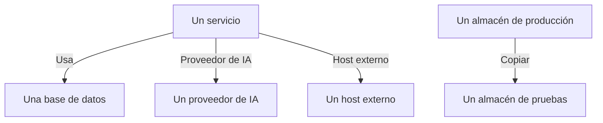

# Flujos de datos, acceso y residencia

Saber qué contiene un almacén es la mitad del trabajo. Seguridad de datos también averigua adónde van esos datos (qué servicios usan el almacén, a qué proveedores de IA y hosts externos llegan los datos, y dónde se copiaron), quién puede acceder a cada almacén y si está en las regiones en las que puede estar. Todo ello sale de evidencias que OneUptime ya tiene: tus trazas, los propios ajustes de acceso de tu nube y las huellas de lo que encontraron los escaneos.

:::cards
- [Flujos de datos](#flujos-de-datos): Servicios, proveedores de IA, hosts externos y copias.
- [Quién puede acceder a un almacén](#quién-puede-acceder-a-un-almacén): Cada concesión que indica tu nube, y lo expuesto que está el almacén.
- [Reglas de residencia](#reglas-de-residencia): Las regiones en las que puede estar cada clase de datos.
:::

## Flujos de datos

| Flujo | Qué significa | De dónde sale |
| --- | --- | --- |
| **Usa** | Un servicio se comunica con un almacén. | El mapa de servicios, que OneUptime calcula cada diez minutos a partir de los spans de cliente de tus servicios. Cada base de datos que aparece en él se vincula a su almacén por nombre, dirección o endpoint, así que una base de datos que ninguna otra fuente incluye se convierte en un almacén propio. |
| **Proveedor de IA** | Un servicio envía datos a un proveedor de IA. | Las llamadas de IA de las trazas del servicio de los últimos 7 días, que nombran el proveedor al que llegan. |
| **Host externo** | Un servicio llama a un host ajeno a tus sistemas. | Los servicios remotos del mapa de servicios, por la dirección a la que se les llama. |
| **Copiar** | Un almacén contiene valores de otro. | Las huellas de los valores que encontró cada escaneo: dos almacenes comparten datos cuando sus huellas de un mismo tipo de datos se solapan en la mitad o más. |

Un flujo lleva los tipos de datos que contiene su origen, y su sensibilidad. Un flujo está confirmado cuando un escaneo demostró que los datos están ahí, no solo que hay un camino hasta ellos: una copia siempre lo está, y un flujo de proveedor de IA lo está cuando las conversaciones de IA del servicio contienen datos confidenciales o restringidos. Un flujo que no se vuelve a ver en 30 días se descarta.

Dos comprobaciones leen los flujos. [Se copiaron datos de producción en un almacén que no es de producción](/docs/data-security/checks-and-issues#higiene-de-los-datos) falla en el destino de una copia. Una copia va desde el almacén de producción cuando solo uno de los dos está en producción y, si no, desde el almacén que OneUptime encontró primero. [Se están enviando datos sensibles a un proveedor de IA](/docs/data-security/checks-and-issues#ia) falla en las conversaciones de IA de un servicio cuando contienen datos sensibles, y nombra los proveedores a los que llegaron.

### Cómo se mantienen privadas las huellas

Una copia se encuentra sin los valores de ninguno de los dos almacenes. Por cada tipo de datos que un escaneo encuentra con confianza Alta, resume los valores que leyó en una firma MinHash: 128 posiciones, cada una el mínimo de una función hash sobre los valores, de las que solo se conservan los 16 bits inferiores. Dos firmas coinciden en aproximadamente tantas posiciones como se solapan sus dos conjuntos de valores, así que comparar firmas estima cuánto de un almacén hay en el otro.

- **Los valores pasan por un hash con una clave propia del proyecto** (HMAC-SHA256), así que nadie sin la clave puede probar un valor conocido contra una firma, y las firmas de dos proyectos nunca se pueden comparar.
- **Solo 16 bits de cada mínimo salen del escaneo.** Ningún valor, ni ningún hash de un valor, se puede recuperar a partir de una firma.
- **Una firma corresponde a un tipo de datos, no a un campo.** Un almacén tiene una por cada tipo de datos encontrado en él con confianza Alta, y nada más.

## Quién puede acceder a un almacén

La lectura de la configuración convierte los propios ajustes de acceso de cada nube (políticas y ACL de buckets, asignaciones de roles de Azure, vinculaciones de IAM de Google Cloud, instantáneas compartidas) en una sola lista de quién puede acceder al almacén, en su página **Quién puede acceder**:

| Columna | Qué indica |
| --- | --- |
| **Entidad principal** | Quién o qué tiene acceso, tal como lo nombra la nube: `*`, un ID de cuenta, un ARN, un correo electrónico, una cuenta de servicio. |
| **Tipo de entidad principal** | Público, Cuenta, Rol, Usuario, Grupo, Entidad de servicio, Cuenta de servicio o Servicio. |
| **Nivel de acceso** | Lectura, Escritura o Administrador. |
| **Concedido mediante** | Qué lo concede: una política de bucket, una ACL, una asignación de rol, una vinculación de IAM o una instantánea compartida. |
| **Externo** | La entidad principal está fuera de las cuentas, suscripciones y proyectos conectados a OneUptime. |
| **Público** | La entidad principal es cualquiera en internet. |

La lista se vuelve a leer con cada lectura de la configuración, y una concesión que la nube ya no indica se elimina. [Más de 25 identidades pueden leer datos restringidos](/docs/data-security/checks-and-issues#acceso) cuenta los lectores de la lista. Los servicios que usan un almacén son sus flujos **Usa**.

A partir de lo que lee, cada almacén recibe una exposición:

| Exposición | Qué significa |
| --- | --- |
| **Público** | Cualquiera en internet puede leerlo. |
| **Otras cuentas** | Pueden acceder a él cuentas ajenas a las que tienes conectadas. |
| **Accesible desde internet** | Su endpoint de red acepta conexiones desde internet. |
| **Privado** | Solo acceden a él tus propias cuentas y redes. |
| **Desconocido** | OneUptime no pudo leer lo suficiente de su configuración para saberlo. |

Público prevalece sobre compartido, y compartido sobre accesible: un bucket público que además se comparte con otra cuenta es Público. La exposición suma a la [puntuación de riesgo](/docs/data-security/checks-and-issues#puntuación-de-riesgo) de un problema.

## Reglas de residencia

Una regla de residencia dice dónde puede estar una clase de datos. Añade una en **Seguridad de datos → Ajustes → Reglas de residencia**:

| Campo | Qué hace |
| --- | --- |
| **Nombre** | Qué es la regla, como «Los datos personales de la UE se quedan en la UE». |
| **Regiones permitidas** | Las regiones en las que esos datos se pueden guardar y copiar, escritas como las nombra tu nube. Una regla sin ninguna no comprueba nada. |
| **Categorías de datos** | Las categorías de datos que cubre. Si se deja vacío, cubre cualquier clase de datos personales. |
| **Datos sobre personas en** | Solo los datos sobre personas de estos países, como códigos ISO 3166-1, por ejemplo `DE` o `IN`. Si se deja vacío, cubre los datos sobre personas de cualquier lugar. |
| **Descripción** | Para qué es la regla, como «Los datos de nuestros clientes de la UE se guardan solo en la UE». |
| **Habilitado** | Si los almacenes se comprueban con la regla. |

Un almacén incumple una regla cuando contiene datos que la regla cubre y su propia región, o una región a la que se copian sus datos, no coincide con ninguna de las regiones permitidas. Las copias son las regiones a las que se replican los datos de un almacén: la replicación de S3, la copia georredundante de una cuenta de almacenamiento, las réplicas de una base de datos. El almacén no supera entonces [Los datos se guardan fuera de las regiones en las que pueden estar](/docs/data-security/checks-and-issues#residencia), con la región y la regla que incumplió.

### Regiones y comodines

Un `*` en una región permitida representa cualquier serie de caracteres, no se distingue entre mayúsculas y minúsculas, y el patrón debe coincidir con la región entera:

| Región permitida | Coincide con | No coincide con |
| --- | --- | --- |
| `eu-*` (AWS) | `eu-west-1`, `eu-central-1` | `us-east-1`, `us-eu-1` |
| `europe-*` (Google Cloud) | `europe-west1`, `europe-north1` | `us-central1` |
| `westeurope` (Azure) | `westeurope` | `northeurope` |

Indica un patrón por cada nube que uses: `eu-*`, `europe-*`, `westeurope` y `northeurope` juntos mantienen los datos en Europa en las tres.

### De quién son los datos de un almacén

OneUptime deduce de quién son los datos de un almacén a partir de los propios datos. Un tipo de datos que pertenece a un país indica que sus personas están en ese país: un ID fiscal alemán indica `DE`, un número Aadhaar indio `IN`, un número del NHS del Reino Unido `GB`. El almacén enumera esos países como los países de sus interesados, y una regla limitada a personas de algunos países solo cubre los almacenes que contienen sus datos. [Tipos de datos sensibles](/docs/data-security/data-types#tipos-de-datos-integrados) nombra el país de cada tipo de datos que tiene uno.

## Próximos pasos

:::cards
- [Comprobaciones y problemas de Seguridad de datos](/docs/data-security/checks-and-issues): Cada comprobación que alimentan estos flujos, concesiones y reglas.
- [Cumplimiento de Seguridad de datos](/docs/data-security/compliance): Cómo cuentan la residencia y el acceso para el RGPD, la LGPD y la DPDP.
- [Topología](/docs/telemetry/topology): El mapa de servicios del que salen los flujos.
:::
