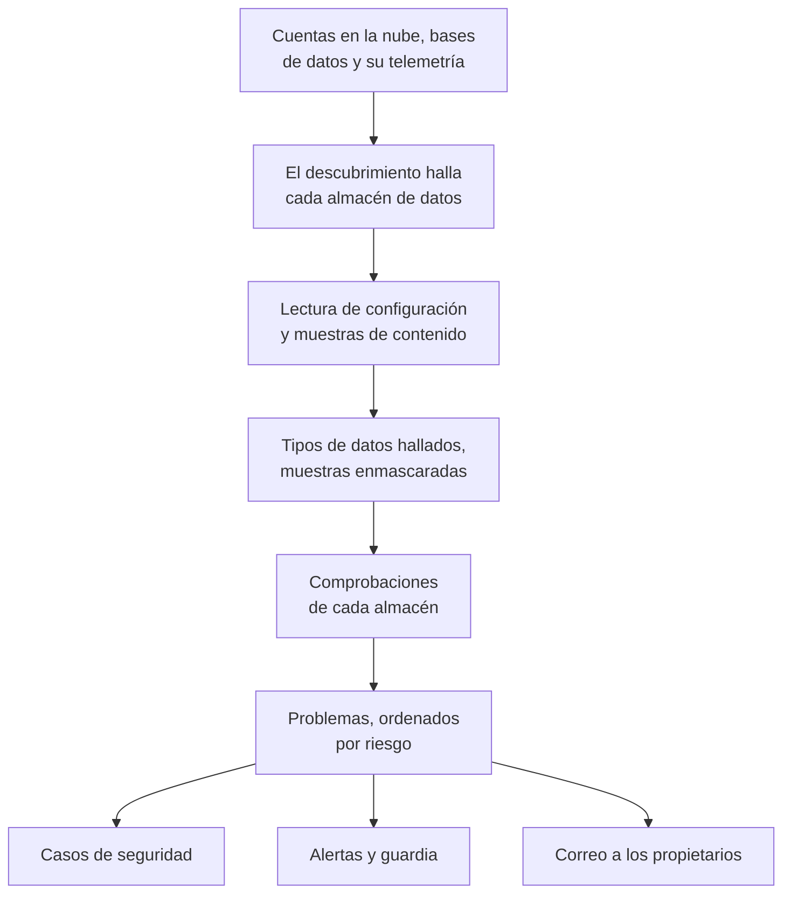

# Seguridad de datos

Data Security encuentra los datos sensibles que guarda su empresa - en buckets en la nube, bases de datos y data warehouses, y en la telemetría que envía a OneUptime - y le dice qué falla en cómo se guardan. Encuentra los almacenes por sí solo, lee cómo está configurado cada uno, toma muestras de lo que contiene y abre un problema por cada fallo, ordenados por riesgo.

Responde a cuatro preguntas:

:::cards
- [¿Dónde están nuestros datos sensibles?](/docs/data-security/data-types): 143 tipos de datos, desde números de tarjeta y documentos de identidad nacionales hasta claves de API, encontrados en buckets, tablas y telemetría.
- [¿Están expuestos?](/docs/data-security/checks-and-issues): 32 comprobaciones de cada almacén: acceso público, cifrado, copias de seguridad, registro de accesos, secretos y copias de datos.
- [¿Quién puede acceder a ellos y adónde van?](/docs/data-security/flows-access-residency): Quién puede leer cada almacén, qué servicios lo usan y a qué proveedores de IA y hosts llegan sus datos.
- [¿Cumplen nuestras normas?](/docs/data-security/compliance): Reglas de residencia, y nueve marcos normativos puntuados a partir de lo que encontraron los escaneos.
:::

## Cómo funciona

1. **El descubrimiento** encuentra los almacenes que OneUptime ya conoce: su inventario en la nube, las bases de datos que supervisa el producto Bases de datos, las bases de datos con las que hablan sus servicios en el mapa de servicios y la telemetría de cada servicio. Solo tiene que añadir un almacén a mano cuando ninguna fuente lo enumera.
2. **La lectura de la configuración** pregunta a cada nube cómo está configurado cada almacén: quién puede acceder a él y cómo se cifra, se respalda y se registra. Lee ajustes, nunca datos.
3. **Las muestras de contenido** leen un poco de lo que contiene un almacén, donde usted lo permite: algunos objetos de cada tipo en un bucket, algunas filas de cada tabla, las entradas más recientes de la telemetría de cada servicio.
4. **La clasificación** encuentra valores sensibles en las muestras y guarda recuentos y muestras enmascaradas, nunca un valor.
5. **Las comprobaciones** deciden qué falla en cada almacén y lo grave que es para los datos que contiene. Cada comprobación que falla abre un problema, que se cierra por sí solo en cuanto la comprobación pasa.

## En qué se diferencia

- **Su telemetría es un almacén de datos.** Los registros, trazas, excepciones, reproducciones de sesiones y conversaciones con IA de cada servicio se comprueban como un bucket, cada hora. Una dirección de correo electrónico en una línea de registro es un hallazgo, y **Scrub It** la enmascara en la ingesta a partir de entonces. Consulte [Datos sensibles en la telemetría](/docs/data-security/telemetry).
- **Los flujos salen del tráfico real.** El mapa de servicios dice qué servicio usa qué base de datos, las llamadas de IA nombran el proveedor al que llegan, y las copias de datos de producción se encuentran comparando huellas. Consulte [Flujos de datos, acceso y residencia](/docs/data-security/flows-access-residency).
- **La evidencia siempre va enmascarada.** Un hallazgo guarda recuentos y como máximo tres muestras enmascaradas, como `j***@e******.com`, enmascaradas dentro del escáner antes de que nada salga de él. Desactive las muestras y solo guardará recuentos.
- **El escáner es de código abierto.** El patrón, la suma de comprobación, las palabras de contexto y los valores de prueba de cada tipo de datos están en el código fuente de OneUptime, así que puede leer exactamente qué produce un hallazgo. El mismo código se ejecuta en los workers de OneUptime, en una sonda y en el cuadro **Test It**.
- **Funciona con el resto de OneUptime.** Un problema Crítico abre un caso de seguridad sobre el almacén, para que [Operaciones de seguridad](/docs/telemetry/security-cases) lo trate como cualquier otra amenaza. Puede generar una alerta que avisa a quien esté de guardia, y envía un correo a los propietarios del almacén. Consulte [Integraciones de Data Security](/docs/data-security/integrations).
- **OneUptime AI ayuda a corregirlo.** **Explain** le dice al propietario de un almacén qué falla y cómo corregirlo en su nube, y **Corregir con IA** abre un pull request en su código de infraestructura.

## Antes de empezar

- **Un rol que pueda configurarlo.** Project Owner, Project Admin y Security Admin cambian los ajustes de Data Security. Security Member gestiona los problemas y escanea almacenes, y Security Viewer lee lo que encontró. Los demás roles no ven nada de ello salvo que su equipo reciba sus permisos: qué buckets contienen números de tarjeta es justo lo que quiere saber un atacante. Consulte [Roles](/docs/permissions/reference#roles).
- **Una cuenta en la nube que leer, o una base de datos.** Data Security lee una cuenta en la nube a través de una [conexión a la nube](/docs/telemetry/cloud-accounts), y una base de datos que usted gestiona a través de una cadena de conexión de solo lectura. La telemetría no necesita nada: se escanea cada hora.

## Inicio rápido

:::steps
### Conectar una cuenta en la nube

Vaya a **Nube → Conectar** y elija su nube. Si la cuenta ya está conectada, elija en su lugar **Editar** en su conexión. [Conectar una cuenta en la nube](/docs/telemetry/cloud-accounts) recorre cada nube paso a paso.

### Elegir el nivel de seguridad de datos

En **Más campos**, establezca **Data security** en **Configuration only** para comprobar cómo está configurado cada almacén, o en **Configuration and content samples** para encontrar además los datos sensibles que contienen. El comando que muestra el formulario cambia con su elección: ejecútelo en el terminal de su nube, como indica el formulario. [Configurar Data Security](/docs/data-security/setup) enumera exactamente lo que concede cada nivel, y [Conectar una cuenta en la nube](/docs/telemetry/cloud-accounts#data-security) muestra el comando de cada nivel.

### Revisar los problemas

Abra **Data Security**. Los almacenes aparecen en **Data Stores** a medida que el descubrimiento los encuentra, cada 15 minutos, y la configuración de una conexión se lee en el plazo de una hora. Los problemas se abren en **Problemas** en cuanto termina una lectura o un escaneo, cada uno con su puntuación de riesgo, y la **Vista general** muestra los cinco de mayor riesgo. Cada problema dice qué falla, por qué importa y cómo corregirlo, con los comandos para su nube.
:::

## Qué cuenta como almacén de datos

| Dónde | Almacenes | Muestras de contenido |
| --- | --- | --- |
| AWS | AWS S3 Bucket, AWS RDS Instance, AWS Aurora Cluster, AWS RDS Snapshot, AWS DynamoDB Table, AWS Redshift Cluster, AWS DocumentDB Cluster, AWS OpenSearch Domain, AWS ElastiCache Cluster, AWS EFS File System | AWS S3 Bucket |
| Azure | Azure Storage Account, Azure SQL Database, Azure Cosmos DB Account, Azure PostgreSQL Server, Azure MySQL Server | Azure Storage Account |
| Google Cloud | Google Cloud Storage Bucket, Google Cloud SQL Instance, Google BigQuery Dataset, Google Firestore Database, Google Spanner Instance, Google Bigtable Instance | Google Cloud Storage Bucket, Google BigQuery Dataset |
| Bases de datos que usted gestiona | PostgreSQL, MySQL, MongoDB, SQL Server, Oracle, Redis, Elasticsearch | PostgreSQL, MySQL |
| OneUptime | Registros, Trazas, Excepciones, Reproducciones de sesiones, Conversaciones con IA | Registros, Trazas, Excepciones, Reproducciones de sesiones, Conversaciones con IA |

Cada almacén recibe las comprobaciones que se aplican a su tipo. Un almacén cuyo contenido no se puede muestrear se comprueba igualmente: un bucket público o una base de datos sin cifrar es un problema contenga lo que contenga.

Un almacén se archiva, con su historial, cuando su fuente deja de enumerarlo: **Archived Stores**, al final del menú de Data Security, lo conserva. Vuelve por sí solo si su fuente lo enumera de nuevo.

## Con qué frecuencia se ejecuta

| Qué | Cuándo |
| --- | --- |
| Encontrar almacenes nuevos | Cada 15 minutos |
| Leer la configuración de una conexión a la nube | Una vez al día, y en el plazo de una hora después de que CloudTrail registre un cambio en el acceso, el cifrado, las copias de seguridad o el uso compartido de un almacén de AWS |
| Muestrear el contenido de un almacén | Cada 24 horas, o con la frecuencia que indique **Scan Every (Hours)** |
| Muestrear la telemetría de cada servicio | Cada hora, la última hora de telemetría |
| Volver a comprobar cada almacén | Después de cada lectura y cada escaneo, después de que cambie cualquier cosa de la que dependa una comprobación, y una vez al día |

**Scan Now** en un almacén muestrea su contenido al momento, y **Check Now** vuelve a leer su configuración.

## Próximos pasos

:::cards
- [Configurar Data Security](/docs/data-security/setup): Los tres niveles, los permisos que concede cada uno y cómo escanear sus propias bases de datos.
- [Tipos de datos sensibles](/docs/data-security/data-types): Cómo se encuentra un valor, y cada tipo de datos que conoce Data Security.
- [Comprobaciones y problemas de Data Security](/docs/data-security/checks-and-issues): Cada comprobación, la puntuación de riesgo y lo que le pasa a un problema.
- [Integraciones de Data Security](/docs/data-security/integrations): Casos de seguridad, alertas, propietarios, flujos de trabajo y OneUptime AI.
:::
