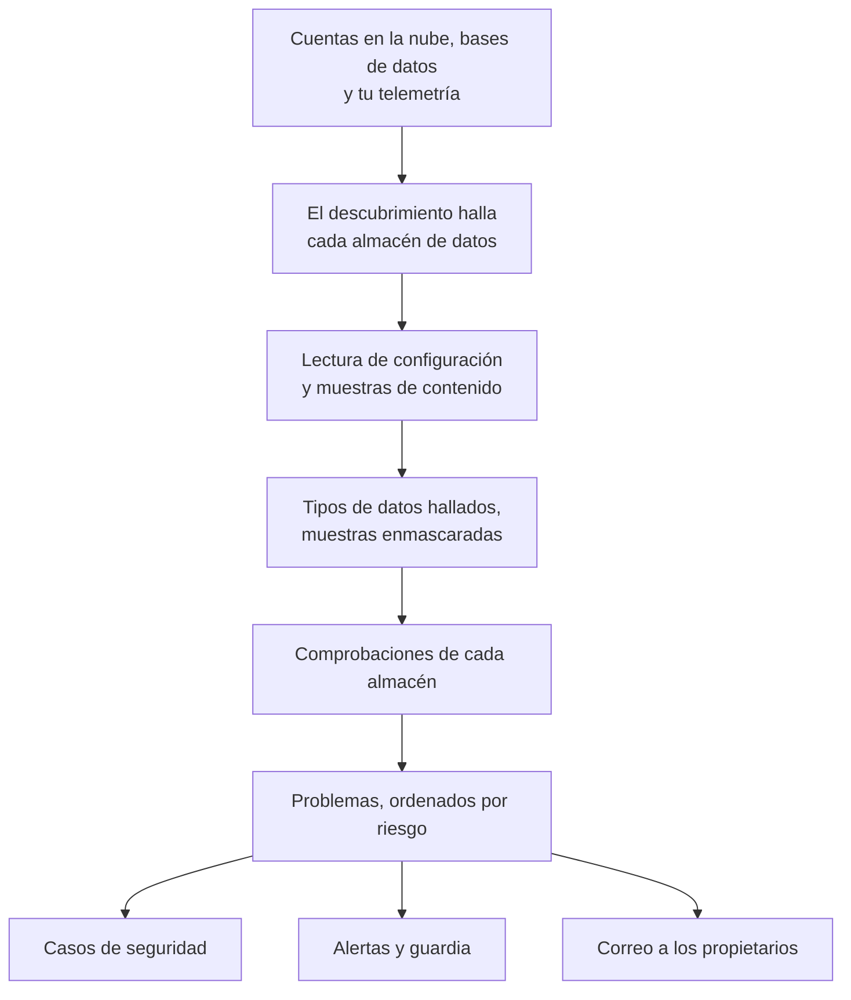

# Seguridad de datos

Seguridad de datos encuentra los datos sensibles que guarda tu empresa (en buckets en la nube, bases de datos y data warehouses, y en la telemetría que envías a OneUptime) y te dice qué falla en cómo se guardan. Encuentra los almacenes por sí sola, lee cómo está configurado cada uno, toma muestras de lo que contiene y abre un problema por cada fallo, ordenado por riesgo.

Responde a cuatro preguntas:

:::cards
- [¿Dónde están nuestros datos sensibles?](/docs/data-security/data-types): 143 tipos de datos, desde números de tarjeta y documentos nacionales de identidad hasta claves de API, encontrados en buckets, tablas y telemetría.
- [¿Están expuestos?](/docs/data-security/checks-and-issues): 32 comprobaciones de cada almacén: acceso público, cifrado, copias de seguridad, registro de actividad, secretos y copias.
- [¿Quién puede acceder a ellos y adónde van?](/docs/data-security/flows-access-residency): Quién puede leer cada almacén, qué servicios lo usan y a qué proveedores de IA y hosts llegan sus datos.
- [¿Cumplen nuestras normas?](/docs/data-security/compliance): Reglas de residencia y nueve marcos de cumplimiento puntuados a partir de lo que encontraron los escaneos.
:::

## Cómo funciona

1. **Descubrimiento** encuentra los almacenes que OneUptime ya conoce: tu inventario en la nube, las bases de datos que supervisa el producto de bases de datos, las bases de datos con las que hablan tus servicios en el mapa de servicios y la telemetría de cada servicio. Solo añades un almacén a mano cuando ninguna fuente lo incluye.
2. **Lectura de la configuración** pregunta a cada nube cómo está configurado cada almacén: quién puede acceder a él y cómo son su cifrado, sus copias de seguridad y su registro de actividad. Lee ajustes, nunca datos.
3. **Muestras de contenido** leen un poco de lo que contiene un almacén, donde lo permites: unos pocos objetos de cada tipo en un bucket, algunas filas de cada tabla y los registros más recientes de la telemetría de cada servicio.
4. **Clasificación** encuentra valores sensibles en las muestras, y guarda recuentos y muestras enmascaradas, nunca un valor.
5. **Comprobaciones** deciden qué falla en cada almacén y lo grave que es para los datos que contiene. Cada comprobación que falla abre un problema, que se cierra solo en cuanto la comprobación se supera.

## En qué se diferencia

- **Tu telemetría es un almacén de datos.** Los registros, trazas, excepciones, reproducciones de sesiones y conversaciones de IA de cada servicio se comprueban como un bucket, cada hora. Una dirección de correo electrónico en una línea de registro es un hallazgo, y **Depurar** la enmascara en la ingesta a partir de entonces. Consulta [Datos sensibles en la telemetría](/docs/data-security/telemetry).
- **Los flujos salen del tráfico real.** El mapa de servicios dice qué servicio usa qué base de datos, las llamadas de IA nombran el proveedor al que llegan, y las copias de datos de producción se encuentran comparando huellas. Consulta [Flujos de datos, acceso y residencia](/docs/data-security/flows-access-residency).
- **La evidencia siempre se enmascara.** Un hallazgo guarda recuentos y como máximo tres muestras enmascaradas, como `j***@e******.com`, enmascaradas dentro del escáner antes de que nada salga de él. Desactiva las muestras y solo guarda recuentos.
- **El escáner es de código abierto.** El patrón, la suma de comprobación, las palabras de contexto y los valores de prueba de cada tipo de datos están en el código fuente de OneUptime, así que puedes leer exactamente qué produce un hallazgo. El mismo código se ejecuta en los workers de OneUptime, en una sonda y en el cuadro **Probarlo**.
- **Funciona con el resto de OneUptime.** Un problema crítico abre un caso de seguridad sobre el almacén, para que [Operaciones de seguridad](/docs/telemetry/security-cases) lo gestione como cualquier otra amenaza. Puede generar una alerta que avise a quien esté de guardia, y envía un correo a los propietarios del almacén. Consulta [Integraciones de Seguridad de datos](/docs/data-security/integrations).
- **OneUptime AI ayuda a corregirlo.** **Explicar con IA** le dice al propietario de un almacén qué falla y cómo corregirlo en su nube, y **Corregir con IA** abre una pull request en tu código de infraestructura.

## Antes de empezar

- **Un rol que pueda configurarla.** Los roles Project Owner, Project Admin y Security Admin cambian los ajustes de Seguridad de datos. Los Security Member gestionan problemas y escanean almacenes, y los Security Viewer leen lo que encontró. Los demás roles no ven nada de ella salvo que su equipo reciba sus permisos: qué buckets contienen números de tarjeta es justo lo que quiere saber un atacante. Consulta [Roles](/docs/permissions/reference#roles).
- **Una cuenta en la nube que leer, o una base de datos.** Seguridad de datos lee una cuenta en la nube mediante una [conexión a la nube](/docs/telemetry/cloud-accounts), y una base de datos que gestionas mediante una cadena de conexión de solo lectura. La telemetría no necesita nada: se escanea cada hora.

## Inicio rápido

:::steps
### Conecta una cuenta en la nube

Ve a **Nube → Conectar** y elige tu nube. Si la cuenta ya está conectada, elige en su lugar **Editar** en su conexión. [Conectar una cuenta en la nube](/docs/telemetry/cloud-accounts) explica cada nube paso a paso.

### Elige el nivel de seguridad de datos

En **Más campos**, pon **Seguridad de datos** en **Solo configuración** para comprobar cómo está configurado cada almacén, o en **Configuración y muestras de contenido** para encontrar también los datos sensibles que contienen. El comando que muestra el formulario cambia según lo que elijas: ejecútalo en el shell de tu nube, como indica el formulario. [Configurar Seguridad de datos](/docs/data-security/setup) enumera exactamente qué concede cada nivel, y [Conectar una cuenta en la nube](/docs/telemetry/cloud-accounts#seguridad-de-datos) muestra el comando de cada nivel.

### Revisa los problemas

Abre **Seguridad de datos**. Los almacenes aparecen en **Almacenes de datos** a medida que el descubrimiento los encuentra, cada 15 minutos, y la configuración de una conexión se lee en menos de una hora. Los problemas se abren en **Problemas** en cuanto termina una lectura o un escaneo, cada uno con su puntuación de riesgo, y la **Vista general** muestra los cinco de mayor riesgo. Cada problema dice qué falla, por qué importa y cómo corregirlo, con los comandos para tu nube.
:::

## Qué cuenta como almacén de datos

| Dónde | Almacenes | Muestras de contenido |
| --- | --- | --- |
| AWS | AWS S3 Bucket, AWS RDS Instance, AWS Aurora Cluster, AWS RDS Snapshot, AWS DynamoDB Table, AWS Redshift Cluster, AWS DocumentDB Cluster, AWS OpenSearch Domain, AWS ElastiCache Cluster, AWS EFS File System | AWS S3 Bucket |
| Azure | Azure Storage Account, Azure SQL Database, Azure Cosmos DB Account, Azure PostgreSQL Server, Azure MySQL Server | Azure Storage Account |
| Google Cloud | Google Cloud Storage Bucket, Google Cloud SQL Instance, Google BigQuery Dataset, Google Firestore Database, Google Spanner Instance, Google Bigtable Instance | Google Cloud Storage Bucket, Google BigQuery Dataset |
| Bases de datos que gestionas | PostgreSQL, MySQL, MongoDB, SQL Server, Oracle, Redis, Elasticsearch | PostgreSQL, MySQL |
| OneUptime | Registros, Trazas, Excepciones, Reproducciones de sesiones, Conversaciones de IA | Registros, Trazas, Excepciones, Reproducciones de sesiones, Conversaciones de IA |

Cada almacén recibe las comprobaciones que se aplican a su tipo. Un almacén cuyo contenido no se puede muestrear se comprueba igualmente: un bucket público o una base de datos sin cifrar es un problema, contenga lo que contenga.

Un almacén se archiva, con su historial, cuando su fuente deja de incluirlo: **Almacenes archivados**, al final del menú de Seguridad de datos, lo conserva. Vuelve por sí solo si su fuente lo vuelve a incluir.

La **Cronología** de un almacén dice qué le ha pasado y quién lo hizo: cuándo se encontró o se añadió, cada cambio en sus ajustes y propietarios, cuándo se archivó o volvió, y cada exposición cerrada desde un problema o un playbook.

## Con qué frecuencia se ejecuta

| Qué | Cuándo |
| --- | --- |
| Encontrar almacenes nuevos | Cada 15 minutos |
| Leer la configuración de una conexión a la nube | Una vez al día, y en menos de una hora después de que CloudTrail registre un cambio en el acceso, el cifrado, las copias de seguridad o el uso compartido de un almacén de AWS |
| Muestrear el contenido de un almacén | Cada 24 horas, o con la frecuencia que indique **Escanear cada (horas)** |
| Muestrear la telemetría de cada servicio | Cada hora, la última hora de telemetría |
| Volver a comprobar cada almacén | Después de cada lectura y cada escaneo, después de que cambies cualquier cosa de la que dependa una comprobación, y una vez al día |

**Escanear ahora** en un almacén muestrea su contenido al momento, y **Comprobar ahora** vuelve a leer su configuración.

## Próximos pasos

:::cards
- [Configurar Seguridad de datos](/docs/data-security/setup): Los tres niveles, los permisos que concede cada uno y cómo escanear tus propias bases de datos.
- [Tipos de datos sensibles](/docs/data-security/data-types): Cómo se encuentra un valor, y cada tipo de datos que conoce Seguridad de datos.
- [Comprobaciones y problemas de Seguridad de datos](/docs/data-security/checks-and-issues): Cada comprobación, la puntuación de riesgo y qué le pasa a un problema.
- [Integraciones de Seguridad de datos](/docs/data-security/integrations): Casos de seguridad, alertas, propietarios, workflows y OneUptime AI.
:::
