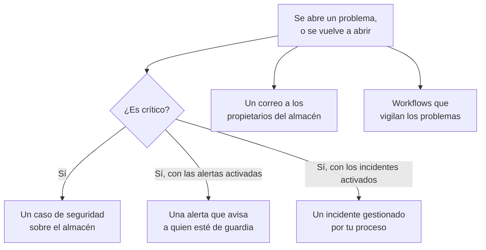

# Integraciones de Seguridad de datos

Seguridad de datos no tiene un sistema de avisos ni una cola de seguridad propios. Entrega lo que encuentra a las partes de OneUptime que ya los tienen: un problema crítico se convierte en un caso de seguridad, puede avisar a quien esté de guardia o declarar un incidente, y cada problema nuevo se envía por correo a los propietarios del almacén. Los workflows, OneUptime AI, la API, Terraform y el servidor MCP acceden a todo lo que guarda.

:::cards
- [Operaciones de seguridad](#operaciones-de-seguridad): Un caso de seguridad por cada almacén con un problema crítico.
- [Alertas y guardia](#alertas-y-guardia): Avisa a quien esté de guardia cuando se abre un problema crítico.
- [Incidentes](#incidentes): Declara un incidente para una brecha de seguridad que deba gestionar tu proceso de incidentes.
- [Propietarios](#propietarios): Quién es el propietario de cada almacén, fijado a mano o con reglas, y el correo que recibe.
- [OneUptime AI](#oneuptime-ai): Explica un problema, abre una pull request que lo corrige o consulta tus datos con Preguntar a la IA.
- [Cerrar una exposición](#cerrar-una-exposición): Bloquea el acceso público o deja de compartir, desde un problema o un playbook.
:::

## Cómo funciona

Cada una de estas acciones se ejecuta cuando una evaluación abre un problema, o lo vuelve a abrir. Cada una se hace en la medida de lo posible: el problema ya está abierto y en su cronología, así que una integración que falla se registra y se omite, y nunca se reintenta hasta crear un segundo caso o un segundo aviso. Lo que hizo cada una se escribe en la **Cronología** del problema, y la página del problema enlaza al caso, a la alerta y al incidente que originó.

| Ajuste | Por defecto | Qué hace |
| --- | --- | --- |
| **Abrir casos de seguridad** | Activado | Un problema crítico abre un caso de seguridad, agrupado por almacén. |
| **Generar alertas** | Desactivado | Un problema crítico genera una alerta, que avisa a quien esté de guardia. |
| **Gravedad de la alerta** | Vacío | La gravedad de esas alertas. Si está vacío, es la más grave del proyecto. |
| **Declarar incidentes** | Desactivado | Un problema crítico declara un incidente, que se gestiona con tu proceso de incidentes. |
| **Gravedad del incidente** | Vacío | La gravedad de esos incidentes. Si está vacío, es la más grave del proyecto. |
| **Notificar a los propietarios** | Activado | Cada problema nuevo se envía por correo a los propietarios de su almacén. |

## Operaciones de seguridad

Cada almacén es una entidad propia en Operaciones de seguridad, del tipo **Almacén de datos**. Con **Abrir casos de seguridad** activado, un problema crítico se envía a Operaciones de seguridad como una detección sobre el almacén:

- su origen es **Seguridad de datos**, y su regla lleva el nombre de la comprobación, como `Data Security: public-read`;
- es crítica, así que el caso que abre tiene la prioridad Crítica del proyecto;
- se agrupa por el almacén: un segundo problema crítico en el mismo almacén se suma al caso abierto sobre él en lugar de abrir otro.

A partir de ahí, el caso se gestiona como cualquier otro: se asigna, se anota, se cierra y los playbooks del proyecto responden a él. Las detecciones del almacén cuentan para su riesgo en [Riesgo de entidades](/docs/telemetry/security-entity-risk), como las de cualquier entidad. Consulta [Casos de seguridad y playbooks](/docs/telemetry/security-cases).

## Alertas y guardia

Con **Generar alertas** activado, un problema crítico genera una alerta, titulada «Data Security:» seguido del título y el almacén del problema. La alerta avisa a quien esté de guardia según sus propias reglas, como cualquier otra alerta (consulta [Alertas](/docs/alerts/index) y [Guardia](/docs/on-call/index)). Un problema tiene como máximo una alerta abierta a la vez, por muchas veces que se evalúe. **Gravedad de la alerta** fija la gravedad de la alerta; si se deja vacía, es la más grave del proyecto.

Una alerta termina junto con su problema: en cuanto el problema deja de estar abierto (su comprobación se supera, o una persona lo marca como resuelto, acepta su riesgo o dice que no es un problema), la alerta se resuelve, y la **Cronología** del problema lo indica. Un problema que se vuelve a abrir genera una alerta nueva.

Las alertas están desactivadas por defecto porque la mayoría de los equipos quieren ver primero un hallazgo de seguridad de datos en un caso de seguridad. Actívalas cuando un bucket público de números de tarjeta deba despertar a alguien.

## Incidentes

Con **Declarar incidentes** activado, un problema crítico declara un incidente, titulado como su alerta, para una brecha de seguridad que deba gestionar tu proceso de incidentes: guardia, canales del espacio de trabajo, páginas de estado y un postmortem (consulta [Incidentes](/docs/incidents/index)). Un problema tiene como máximo un incidente abierto a la vez. **Gravedad del incidente** fija la gravedad del incidente; si se deja vacía, es la más grave del proyecto.

Seguridad de datos nunca resuelve un incidente, ni siquiera cuando su problema se resuelve: un incidente puede llevar una página de estado y un postmortem, así que lo cierra quien lo gestiona. Un caso de seguridad es la otra vía hacia un incidente: **Declarar incidente** en el caso abre uno vinculado a él (consulta [Declarar un incidente](/docs/telemetry/security-cases#declarar-un-incidente)).

## Propietarios

Los propietarios de un almacén son personas y equipos, en la página **Propietarios** del almacén. Son a quienes va dirigido un problema: reciben el correo, y **Este almacén sensible no tiene propietario** falla en un almacén sensible que no tiene ninguno.

Con **Notificar a los propietarios** activado, cada evaluación que abre problemas en un almacén envía a sus propietarios un solo correo (a las personas propietarias y a los miembros de los equipos propietarios, hasta 50) titulado con el número de problemas nuevos del almacén, como «Data Security: 2 new issues on orders-db». Enumera la gravedad y el título de cada problema nuevo y la sensibilidad del almacén, y enlaza al almacén. Nunca lleva una muestra.

### Reglas del propietario y reglas de etiquetas

Las reglas fijan propietarios y etiquetas por ti, a medida que se encuentran los almacenes:

| Regla | Dónde | Qué hace |
| --- | --- | --- |
| **Reglas del propietario** | **Seguridad de datos → Reglas → Reglas del propietario** | Añade usuarios y equipos propietarios a cada almacén que coincide |
| **Reglas de etiquetas** | **Seguridad de datos → Reglas → Reglas de etiquetas** | Añade etiquetas a cada almacén que coincide |

Una regla coincide con un almacén por sus etiquetas, por un patrón de su nombre o de su descripción, o por **Patrón de etiqueta en la nube**: un patrón que se compara con cada una de las etiquetas en la nube del almacén, escritas `key=value`. `^team=payments$` coincide con cada almacén etiquetado `team=payments`, y `^env=` con cada almacén que tiene una etiqueta `env`. Un almacén nuevo recibe las reglas del proyecto en cuanto se encuentra, y el ajuste **Notificar a los propietarios** de una regla del propietario dice si se avisa a los propietarios que añade. [Reglas de etiquetas y propietarios](/docs/configuration/label-and-owner-rules) explica cómo coincide cada regla y cuándo se ejecutan las reglas.

## Workflows

**Almacén de datos** y **Problema de seguridad de datos** son desencadenantes de workflows, cada uno con **Al crear**, **Al actualizar**, **Al crear o actualizar** y **Al eliminar**. Elígelos en el panel **Añadir desencadenante**, en **Recursos de OneUptime**.

- **Problema de seguridad de datos → Al crear** se ejecuta cuando un problema se abre por primera vez. Lee su gravedad en un bloque **Si / Si no**, y publica los críticos en un canal o abre un ticket en tu gestor de incidencias.
- **Problema de seguridad de datos → Al actualizar**, con **Campos que vigilar** en su estado, se ejecuta cuando un problema se resuelve, se acepta o se vuelve a abrir.
- **Almacén de datos → Al crear** se ejecuta cuando el descubrimiento encuentra un almacén, por ejemplo para avisar a un equipo de cada bucket nuevo.

Consulta [Desencadenantes de workflows](/docs/workflows/triggers) para ver los campos que pasa cada desencadenante.

## OneUptime AI

Dos acciones de un problema piden ayuda a OneUptime AI. Ambas envían a OneUptime AI el título y la gravedad del problema, el nombre, el tipo, la región y el ID en la nube del almacén, su sensibilidad y sus tipos de datos, la evidencia, por qué importa la comprobación y la corrección para la nube del almacén, y nunca las muestras de un hallazgo. Ambas se ejecutan bajo los interruptores y los límites de OneUptime AI del proyecto.

- **Explicar con IA** redacta, para el propietario del almacén, qué falla, qué podría pasar y los pasos exactos para corregirlo en su nube. La explicación se guarda en la **Cronología** del problema. Puede pedirla cualquiera que pueda leer Seguridad de datos.
- **Corregir con IA** pide a OneUptime AI que corrija el problema en tu código de infraestructura (Terraform, CloudFormation, Bicep o similares) con el cambio más pequeño que haga que la comprobación se supere, y que abra una pull request. Necesita que el repositorio que contiene el código de infraestructura del almacén esté conectado en **Código**: elígelo en **Repositorio** cuando el proyecto tenga varios. La pull request aparece en **Código** (consulta [Código](/docs/ai/ai-agent)). Pueden pedirla los Security Member y los roles superiores.

### Preguntar a la IA

**Preguntar a la IA** también lee Seguridad de datos. En cualquier página de Seguridad de datos, pregunta qué almacenes contienen números de tarjeta, qué corregir primero o a qué almacenes podría acceder un rol si se filtrara; en la página de un almacén o de un problema, lee primero ese registro. Responde con tres herramientas de lectura, que se ejecutan con tus propios permisos:

| Herramienta | Qué lee |
| --- | --- |
| `query_data_stores` | Los almacenes, primero los de mayor riesgo, por sensibilidad, tipo de datos, exposición, proveedor o nombre, o un almacén con lo que se encontró y dónde, quién puede acceder a él y sus problemas abiertos |
| `query_data_security_issues` | Los problemas, primero los de mayor riesgo, por estado, gravedad, almacén o comprobación, o un problema con su evidencia y la corrección para su nube |
| `query_data_store_access` | Quién puede acceder a un almacén, o cada almacén al que puede acceder una entidad principal |

Leen tipos de datos, ubicaciones y recuentos, nunca las muestras de un hallazgo, enmascaradas o no. Preguntar a la IA no cambia nada en Seguridad de datos.

## Cerrar una exposición

Dos cambios cierran la exposición de un almacén en la nube, cada uno a través de la conexión a la nube del almacén con **Respuesta de seguridad de datos** activada (consulta [Configurar Seguridad de datos](/docs/data-security/setup#dejar-que-seguridad-de-datos-cierre-una-exposición)):

- **Bloquear el acceso público**, en un bucket de S3, una cuenta de almacenamiento de Azure o un bucket de Cloud Storage.
- **Revocar el uso compartido**, en una instantánea de RDS, o en las instantáneas manuales compartidas de una base de datos RDS, un clúster de Aurora o un clúster de DocumentDB.

Una persona ejecuta uno desde un problema abierto que corrige, con **Corrígelo desde aquí** (consulta [Comprobaciones y problemas de Seguridad de datos](/docs/data-security/checks-and-issues#corrígelo-desde-aquí)). Un playbook de Operaciones de seguridad los ejecuta como pasos de la categoría **Contener**, **Bloquear el acceso público a los almacenes de datos** y **Revocar el uso compartido de almacenes de datos**: en cada almacén de datos del que trata el caso, como máximo 10, cada uno en un paso que empieza con **Requiere aprobación** activado. Un almacén marcado como **Público por diseño** nunca se bloquea. En ambos casos, la cronología del almacén dice qué se hizo, y el almacén se vuelve a comprobar al momento, así que el problema se resuelve cuando el cambio surte efecto.

## API, Terraform y MCP

Todo lo que guarda Seguridad de datos es un registro de la API de OneUptime, que se lee con los mismos permisos que en el Dashboard (consulta la [Referencia de la API](/docs/api-reference/api-reference)):

| Registros | Ruta de la API |
| --- | --- |
| Los almacenes de datos, sus cronologías, sus hallazgos y quién puede acceder a ellos | `/data-store`, `/data-store-feed`, `/data-store-finding`, `/data-store-access` |
| Los problemas, sus cronologías y los flujos de datos | `/data-security-issue`, `/data-security-issue-feed`, `/data-security-flow` |
| Los escaneos | `/data-security-scan` |
| Los tipos de datos personalizados, los ajustes de las comprobaciones y las reglas de residencia | `/data-security-custom-data-type`, `/data-security-check-setting`, `/data-security-residency-rule` |
| Los ajustes del proyecto | `/data-security-setting` |
| Los propietarios, las reglas del propietario y las reglas de etiquetas | `/data-store-owner-user`, `/data-store-owner-team`, `/data-store-owner-rule`, `/data-store-label-rule` |

Algunas respuestas se calculan bajo demanda en lugar de guardarse. Cada una es un `POST`:

| Ruta | Qué hace |
| --- | --- |
| `/data-security/overview` | Las cifras de la Vista general: almacenes por sensibilidad y categoría, problemas abiertos por gravedad, los problemas de mayor riesgo y sus últimos 30 días |
| `/data-security/compliance` | La puntuación y los requisitos de cada marco |
| `/data-security/record-of-processing` | El registro de actividades de tratamiento del RGPD, una fila por cada almacén que contiene datos personales |
| `/data-store/<id>/scan-now` | **Escanear ahora**: muestrea el contenido del almacén al momento |
| `/data-store/<id>/check-now` | **Comprobar ahora**: vuelve a leer la configuración del almacén y ejecuta sus comprobaciones |
| `/data-store-finding/<id>/scrub` | **Depurar** en un hallazgo de telemetría |
| `/data-security-issue/<id>/explain` | **Explicar con IA** en un problema |
| `/data-security-issue/<id>/fix-with-ai` | **Corregir con IA** en un problema |
| `/data-store/<id>/response-actions` | Qué acciones de respuesta admite el almacén ahora, y por qué no |
| `/data-store/<id>/respond` | **Bloquear el acceso público** o **Revocar el uso compartido** en el almacén, con el problema desde el que se ejecutó |

El [proveedor de Terraform](/docs/terraform/index) tiene un recurso para cada tipo de registro que creas (los almacenes de datos que añades tú mismo, los tipos de datos personalizados, los ajustes de las comprobaciones, las reglas de residencia, las reglas del propietario y las de etiquetas) con el nombre del registro, como `oneuptime_residency_rule`.

El [servidor MCP](/docs/ai/mcp-server) tiene herramientas para crear, obtener, listar, actualizar, eliminar y contar estos registros: Data Store, Data Store Finding, Data Store Access Entry, Data Flow, Data Security Issue, Data Security Scan, Custom Data Type, Check Setting, Residency Rule y Data Security Setting. Un asistente de IA puede entonces preguntar qué almacenes contienen números de tarjeta, o qué hay abierto en un bucket, con tus permisos.

## Próximos pasos

:::cards
- [Casos de seguridad y playbooks (SOAR)](/docs/telemetry/security-cases): Gestiona los casos que abre Seguridad de datos.
- [Reglas de etiquetas y propietarios](/docs/configuration/label-and-owner-rules): Cómo coinciden las reglas, y cuándo se ejecutan.
- [Desencadenantes de workflows](/docs/workflows/triggers): Ejecuta un workflow cuando se abre un problema o se encuentra un almacén.
- [Comprobaciones y problemas de Seguridad de datos](/docs/data-security/checks-and-issues): Qué significa cada problema, y cómo corregirlo.
:::
