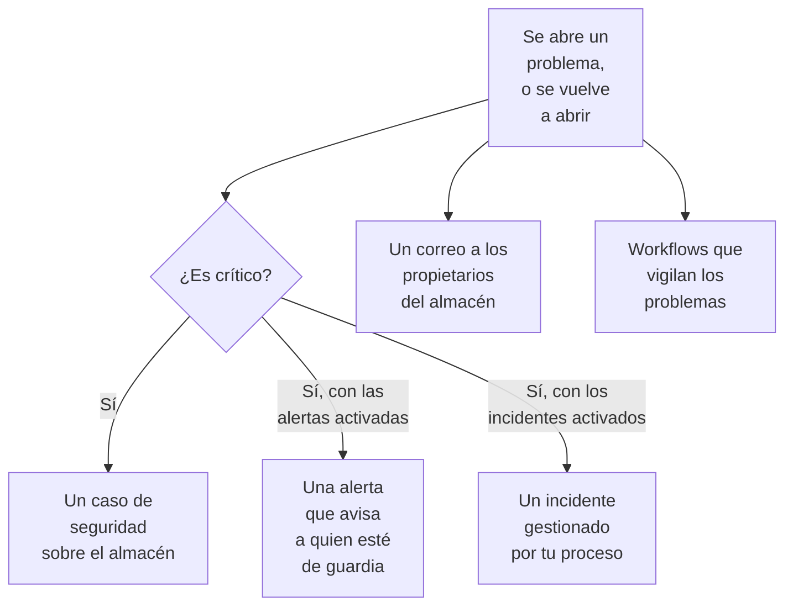

# Integraciones de Seguridad de datos

Seguridad de datos no tiene un sistema de avisos ni una cola de seguridad propios. Entrega lo que encuentra a las partes de OneUptime que ya los tienen: un problema crítico se convierte en un caso de seguridad, puede avisar a quien esté de guardia o declarar un incidente, y cada problema nuevo se envía por correo a los propietarios del almacén. Los workflows, OneUptime AI, la API, Terraform y el servidor MCP acceden a todo lo que guarda.

:::cards
- [Operaciones de seguridad](#operaciones-de-seguridad): Un caso de seguridad por cada almacén con un problema crítico.
- [¿Fue una brecha de datos?](#fue-una-brecha-de-datos): Cada exposición crítica, evaluada: cuánto tiempo, quién podía leer los datos, de quién eran y las leyes sobre brechas de datos que pueden aplicarse.
- [Alertas y guardia](#alertas-y-guardia): Avisa a quien esté de guardia cuando se abre un problema crítico.
- [Incidentes](#incidentes): Declara un incidente para una brecha de seguridad que deba gestionar tu proceso de incidentes.
- [Propietarios](#propietarios): Analiza un problema, abre una pull request que lo corrija, o pregunta a Preguntar a la IA sobre tus datos y deja que actúe, con tu aprobación.
- [OneUptime AI](#oneuptime-ai): Explica un problema, abre una pull request que lo corrige o consulta tus datos con Preguntar a la IA.
- [Cerrar una exposición](#cerrar-una-exposición): Bloquea el acceso público o deja de compartir, desde un problema o un playbook, y activa una protección que falta desde un problema.
:::

## Cómo funciona

Cada una de estas acciones se ejecuta cuando una evaluación abre un problema, o lo vuelve a abrir. Cada una se hace en la medida de lo posible: el problema ya está abierto y en su cronología, así que una integración que falla se registra y se omite, y nunca se reintenta hasta crear un segundo caso o un segundo aviso. Lo que hizo cada una se escribe en la **Cronología** del problema, y la página del problema enlaza al caso, a la alerta y al incidente que originó.

| Ajuste | Por defecto | Qué hace |
| --- | --- | --- |
| **Abrir casos de seguridad** | Activado | Un problema crítico abre un caso de seguridad, agrupado por almacén. |
| **Generar alertas** | Desactivado | Un problema crítico genera una alerta, que avisa a quien esté de guardia. |
| **Gravedad de la alerta** | Vacío | La gravedad de esas alertas. Si está vacío, es la más grave del proyecto. |
| **Declarar incidentes** | Desactivado | Un problema crítico declara un incidente, que se gestiona con tu proceso de incidentes. |
| **Gravedad del incidente** | Vacío | La gravedad de esos incidentes. Si está vacío, es la más grave del proyecto. |
| **Notificar a los propietarios** | Activado | Cada problema nuevo se envía por correo a los propietarios de su almacén. |

## Operaciones de seguridad

Cada almacén es una entidad propia en Operaciones de seguridad, del tipo **Almacén de datos**. Con **Abrir casos de seguridad** activado, un problema crítico se envía a Operaciones de seguridad como una detección sobre el almacén:

- su origen es **Seguridad de datos**, y su regla lleva el nombre de la comprobación, como `Data Security: public-read`;
- es crítica, así que el caso que abre tiene la prioridad Crítica del proyecto;
- se agrupa por el almacén: un segundo problema crítico en el mismo almacén se suma al caso abierto sobre él en lugar de abrir otro.

A partir de ahí, el caso se gestiona como cualquier otro: se asigna, se anota, se cierra y los playbooks del proyecto responden a él. Las detecciones del almacén cuentan para su riesgo en [Riesgo de entidades](/docs/telemetry/security-entity-risk), como las de cualquier entidad. Consulta [Casos de seguridad y playbooks](/docs/telemetry/security-cases).

Cualquier caso de seguridad, lo haya abierto lo que lo haya abierto, muestra los datos en riesgo en su **Impacto**: los almacenes con datos sensibles de los que trata el caso, y cada almacén al que pueden llegar sus usuarios y roles, el más sensible primero, con lo que contiene cada uno, cuántos registros aproximadamente, lo expuesto que está y cuántas identidades pueden llegar a él. Una sesión de rol asumido que nombra el caso cuenta como su rol, y una dirección de correo como los usuarios de la nube a los que pertenece. Se lee con los propios permisos del lector, así que un rol que no puede leer Seguridad de datos ve que esa parte queda fuera.

## ¿Fue una brecha de datos?

En una exposición crítica de un almacén con datos de nivel **Restringido** o **Confidencial** (abierto a cualquiera en internet, compartido con cuentas ajenas a las tuyas o una instantánea que otros pueden restaurar), el caso se evalúa por sí solo en cuanto se abre. Cualquier otro caso sobre un almacén de datos se evalúa cuando una persona pulsa **Evaluar esta exposición** en su **Vista general**. La evaluación se calcula con código simple a partir de lo que registró OneUptime, y se vuelve a calcular cada vez que se lee:

- **Cuánto tiempo estuvo abierto**: desde el cambio en el registro de tu nube que expuso el almacén, si se registró uno en los 30 días anteriores al descubrimiento de la exposición; si no, al menos desde que Seguridad de datos la descubrió; hasta que la propia respuesta de Seguridad de datos lo cerró, un cambio lo cerró o una comprobación lo encontró cerrado.
- **Quién podía leerlo**: si el almacén registraba las lecturas. Si no lo hacía, la evaluación dice «Las lecturas no se registraron. Trata los datos como leídos.» Cuenta las cuentas ajenas a tu empresa que podían leer el almacén, y cuántas de ellas usaron su acceso mientras estuvo abierto, sin nombrarlas nunca.
- **De quién eran los datos**: qué contiene el almacén, cuántos registros aproximadamente, a quién se refieren y dónde viven las personas, según muestran los datos y según indica una persona.
- **Los secretos que rotar**: cada secreto encontrado en el almacén mientras estuvo abierto, por su tipo y por el lugar donde se encontró, nunca su valor.
- **Las leyes sobre brechas de datos que pueden aplicarse**: cada fila de la tabla de leyes sobre brechas de datos de OneUptime, con lo que exige, a quién, su plazo contado desde que Seguridad de datos descubrió la exposición y lo que una persona comprueba todavía antes de que se aplique la ley.

La tabla cubre los artículos 33 y 34 del RGPD, los artículos 33 y 34 del UK GDPR, la Breach Notification Rule de HIPAA, el requisito 12.10.1 de PCI DSS, la LGPD de Brasil, las DPDP Rules y las directivas de CERT-In de la India, y las leyes sobre brechas de datos de California, Colorado, Florida, Nueva York, Texas y Washington. Cada fila enlaza al texto de la propia ley, su fuente, e indica el día en que se comprobó por última vez con él. Lo que la tabla no cubre (otro país, otro estado de EE. UU., dónde está establecida tu organización, tus contratos) la evaluación lo dice con palabras sencillas.

OneUptime AI redacta la evaluación según lo que permiten tus reglas de IA de Seguridad de datos, o cuando una persona lo pide: qué significa, una notificación a la autoridad, una comunicación a las personas afectadas y un resumen interno (consulta [OneUptime AI en Seguridad de datos](/docs/data-security/ai)). Cada borrador se ciñe a los hechos de la evaluación: se descarta el que contenga un número o una ley que no esté en ninguno de ellos. No se envía nada a ningún sitio: una notificación es un texto que una persona edita y copia, y la evaluación y cada borrador indican que no son asesoramiento jurídico.

Los lectores del caso que también pueden leer el almacén y sus hallazgos ven la evaluación, ya que nombra lo que contiene el almacén. Evaluar, redactar, editar una notificación e indicar dónde viven las personas requieren además permiso para editar el caso. Consulta [¿Fue una brecha de datos?](/docs/telemetry/security-cases#fue-una-brecha-de-datos) para ver las tarjetas del caso.

## Alertas y guardia

Con **Generar alertas** activado, un problema crítico genera una alerta, titulada «Data Security:» seguido del título y el almacén del problema. La alerta avisa a quien esté de guardia según sus propias reglas, como cualquier otra alerta (consulta [Alertas](/docs/alerts/index) y [Guardia](/docs/on-call/index)). Un problema tiene como máximo una alerta abierta a la vez, por muchas veces que se evalúe. **Gravedad de la alerta** fija la gravedad de la alerta; si se deja vacía, es la más grave del proyecto.

Una alerta termina junto con su problema: en cuanto el problema deja de estar abierto (su comprobación se supera, o una persona lo marca como resuelto, acepta su riesgo o dice que no es un problema), la alerta se resuelve, y la **Cronología** del problema lo indica. Un problema que se vuelve a abrir genera una alerta nueva.

Las alertas están desactivadas por defecto porque la mayoría de los equipos quieren ver primero un hallazgo de seguridad de datos en un caso de seguridad. Actívalas cuando un bucket público de números de tarjeta deba despertar a alguien.

## Incidentes

Con **Declarar incidentes** activado, un problema crítico declara un incidente, titulado como su alerta, para una brecha de seguridad que deba gestionar tu proceso de incidentes: guardia, canales del espacio de trabajo, páginas de estado y un postmortem (consulta [Incidentes](/docs/incidents/index)). Un problema tiene como máximo un incidente abierto a la vez. **Gravedad del incidente** fija la gravedad del incidente; si se deja vacía, es la más grave del proyecto.

Seguridad de datos nunca resuelve un incidente, ni siquiera cuando su problema se resuelve: un incidente puede llevar una página de estado y un postmortem, así que lo cierra quien lo gestiona. Un caso de seguridad es la otra vía hacia un incidente: **Declarar incidente** en el caso abre uno vinculado a él (consulta [Declarar un incidente](/docs/telemetry/security-cases#declarar-un-incidente)).

## Propietarios

Los propietarios de un almacén son personas y equipos, en la página **Propietarios** del almacén. Son a quienes va dirigido un problema: reciben el correo, y **Este almacén sensible no tiene propietario** falla en un almacén sensible que no tiene ninguno.

Con **Notificar a los propietarios** activado, cada evaluación que abre problemas en un almacén envía a sus propietarios un solo correo (a las personas propietarias y a los miembros de los equipos propietarios, hasta 50) titulado con el número de problemas nuevos del almacén, como «Data Security: 2 new issues on orders-db». Enumera la gravedad y el título de cada problema nuevo y la sensibilidad del almacén, y enlaza al almacén. Nunca lleva una muestra.

Mientras OneUptime AI trabaja por su cuenta en los problemas nuevos, el correo espera su análisis, hasta 10 minutos, y da a cada problema analizado dos líneas más: su veredicto y por qué, y el camino más corto hacia la corrección. Cada propietario recibe las líneas que puede leer: un propietario que no puede leer el problema no recibe ninguna, y se omite una línea que se basa en algo que no puede leer.

### Reglas del propietario y reglas de etiquetas

Las reglas fijan propietarios y etiquetas por ti, a medida que se encuentran los almacenes:

| Regla | Dónde | Qué hace |
| --- | --- | --- |
| **Reglas del propietario** | **Seguridad de datos → Reglas → Reglas del propietario** | Añade usuarios y equipos propietarios a cada almacén que coincide |
| **Reglas de etiquetas** | **Seguridad de datos → Reglas → Reglas de etiquetas** | Añade etiquetas a cada almacén que coincide |

Una regla coincide con un almacén por sus etiquetas, por un patrón de su nombre o de su descripción, o por **Patrón de etiqueta en la nube**: un patrón que se compara con cada una de las etiquetas en la nube del almacén, escritas `key=value`. `^team=payments$` coincide con cada almacén etiquetado `team=payments`, y `^env=` con cada almacén que tiene una etiqueta `env`. Un almacén nuevo recibe las reglas del proyecto en cuanto se encuentra, y el ajuste **Notificar a los propietarios** de una regla del propietario dice si se avisa a los propietarios que añade. [Reglas de etiquetas y propietarios](/docs/configuration/label-and-owner-rules) explica cómo coincide cada regla y cuándo se ejecutan las reglas.

### Propietarios que propone la IA de OneUptime

Un almacén sin propietarios puede recibirlos de la IA de OneUptime. Lee lo que ya apunta a un propietario - las etiquetas en la nube del almacén, los servicios que lo usan, los propietarios del código del archivo que lo declara, y quién lo cambió o lo añadió - y propone a partir de ello equipos y personas de tu propio proyecto. Nada cambia hasta que una persona lo aprueba en **Propietarios por revisar**, en **Almacenes de datos** o en **Seguridad de datos → IA**, y se avisa a los propietarios añadidos como a cualquier propietario. Cuando los propietarios de tres o más almacenes se basan en una etiqueta o en un comienzo de nombre, también propone la regla del propietario que mantiene con propietario al siguiente almacén como esos, que se une a las **Reglas del propietario** una vez aprobada. [OneUptime AI en Seguridad de datos](/docs/data-security/ai) dice qué envía y cuándo se ejecuta.

## Workflows

**Almacén de datos** y **Problema de seguridad de datos** son desencadenantes de workflows, cada uno con **Al crear**, **Al actualizar**, **Al crear o actualizar** y **Al eliminar**. Elígelos en el panel **Añadir desencadenante**, en **Recursos de OneUptime**.

- **Problema de seguridad de datos → Al crear** se ejecuta cuando un problema se abre por primera vez. Lee su gravedad en un bloque **Si / Si no**, y publica los críticos en un canal o abre un ticket en tu gestor de incidencias.
- **Problema de seguridad de datos → Al actualizar**, con **Campos que vigilar** en su estado, se ejecuta cuando un problema se resuelve, se acepta o se vuelve a abrir.
- **Almacén de datos → Al crear** se ejecuta cuando el descubrimiento encuentra un almacén, por ejemplo para avisar a un equipo de cada bucket nuevo.

Consulta [Desencadenantes de workflows](/docs/workflows/triggers) para ver los campos que pasa cada desencadenante.

## Pull requests

Una fuga es más barata de corregir antes de fusionarse. En un repositorio conectado en **Código** con las revisiones de producción activadas, la revisión de cada pull request tiene una sección **Datos sensibles**, leída de su diff: código que escribe datos personales o un secreto en la telemetría, en un registro, un span, una métrica, el mensaje de una excepción o el informe de un rastreador de errores, código de infraestructura que hace público un almacén o desactiva su cifrado, sus copias de seguridad o su registro, y migraciones que añaden columnas para datos personales, contraseñas o datos de tarjetas. Cada punto nombra la comprobación de Seguridad de datos que el cambio no superaría una vez desplegado, y tus propios tipos de datos se leen por sus pistas de nombre, como los leen los escaneos. Consulta [Revisión de producción de pull requests](/docs/ai/ai-agent#revisión-de-producción-de-pull-requests).

Lo que Seguridad de datos sabe hace más precisos esos puntos, en el comentario de un repositorio privado y, en Código, para quien puede leer los hallazgos de Seguridad de datos: dónde la telemetría del servicio contuvo el mismo tipo de dato en los últimos 7 días, la regla de depuración que lo enmascara en la ingesta y el almacén que es un recurso, con su sensibilidad. En una migración, solo en un repositorio privado, el punto nombra el almacén en el que está la tabla, lo que contiene ese almacén, si el almacén es accesible desde fuera o no está cifrado en reposo, y las columnas de la tabla en las que ya se encontró el mismo tipo de dato. Un almacén marcado como **Público por diseño** no da ningún punto por ser público. El comentario de un repositorio público solo dice lo que muestra el diff.

**Fugas detectadas antes de la fusión**, en **Ajustes del proyecto → IA → Resultados de IA**, cuenta las fugas que las revisiones detectaron en pull requests, corregidas allí o todavía no, junto a los problemas que los escaneos abrieron sobre las mismas comprobaciones después de desplegarse el código.

## OneUptime AI

Dos acciones de un problema piden ayuda a OneUptime AI. Ambas envían a OneUptime AI el título y la gravedad del problema, el nombre, el tipo, la región y el ID en la nube del almacén, su sensibilidad y sus tipos de datos, cada uno por su nombre (los tuyos, por el nombre que les diste), la evidencia, por qué importa la comprobación y la corrección para la nube del almacén, y nunca las muestras de un hallazgo. Ambas se ejecutan bajo los interruptores y los límites de OneUptime AI del proyecto. Lo que envía cada una, lo que nunca envía y el modelo en que se ejecuta están en [OneUptime AI en Seguridad de datos](/docs/data-security/ai).

- **Analizar el problema**, en la parte superior de la página del problema, hace que OneUptime AI escriba su análisis: si el problema es real, lo que pone en riesgo, lo que rompería la corrección y el camino más corto hacia la corrección (consulta [Comprobaciones y problemas de Seguridad de datos](/docs/data-security/checks-and-issues)). También envía quién puede llegar al almacén - cada permiso y aproximadamente cuándo se usó por última vez, y los servicios vistos usándolo -, las copias de sus datos en otros almacenes, sus casos de seguridad, la acción de respuesta que corrige el problema, el repositorio y los archivos que declaran el almacén, y cuántos propietarios tiene, nunca quiénes son. El análisis se guarda en el problema, y su veredicto en la **Cronología** del problema. Ni lo que envió ni la respuesta se guardan en **Ajustes del proyecto → IA → Registros de IA**, que puede leer cualquier Miembro del proyecto o Visor: esa fila solo dice que se hizo la llamada y cuánto costó. Cualquiera que pueda leer el problema puede pedirlo, y **Explicar con IA** a través de la API y del servidor MCP responde con el mismo análisis.
- **Corregir con IA** pide a OneUptime AI que corrija el problema en tu código de infraestructura (Terraform, CloudFormation, Bicep o similares) con el cambio más pequeño que haga que la comprobación se supere, y que abra una pull request. Necesita que el repositorio que contiene el código de infraestructura del almacén esté conectado en **Código**: elígelo en **Repositorio** cuando puedas pedirla en varios. La pull request aparece en **Código** (consulta [Código](/docs/ai/ai-agent)). Pueden pedirla los Miembros de seguridad y los roles superiores, en un repositorio que puedan cambiar en **Código**, como exige pedírselo a la IA allí: un rol de seguridad no lee ni cambia repositorios por sí solo, así que da también a su equipo **Read Code Repository** y **Edit Code Repository**. Cuando la IA no puede trabajar ahora (está desactivada, el proyecto no tiene créditos de IA, alcanzó sus límites diarios o no hay ningún Runner en línea), Corregir con IA dice qué hay que arreglar y no inicia nada. Para un problema en la telemetría de un servicio, primero muestra una sola pull request para todas las fugas del servicio, con dónde dicen sus registros que se escribe cada una - nunca un valor -, y donde los datos se escriben en más de tres lugares añade en su lugar un paso de redacción con una prueba: consulta [Corregirlo en el código](/docs/data-security/telemetry#corregirlo-en-el-código).

La IA de OneUptime también trabaja por su cuenta en cada problema nuevo, según lo que permiten tus reglas de IA: consulta [OneUptime AI en seguridad de datos](/docs/data-security/ai).

### Preguntar a la IA

**Preguntar a la IA** lee Seguridad de datos y actúa en ella con tu aprobación. En cualquier página de Seguridad de datos, pregunta qué almacenes guardan números de tarjeta, qué corregir primero o qué almacenes podría alcanzar un rol si se filtrara; en la página de un almacén o de un problema, lee primero ese registro. Lee con estas herramientas, que se ejecutan con tus propios permisos:

| Herramienta | Qué lee |
| --- | --- |
| `query_data_stores` | Los almacenes, primero los de mayor riesgo, por sensibilidad, tipo de datos, exposición, proveedor o nombre, o un almacén con lo que se encontró y dónde, quién puede acceder a él y sus problemas abiertos |
| `query_data_security_issues` | Los problemas, primero los de mayor riesgo, por estado, gravedad, almacén o comprobación, o un problema con su evidencia y la corrección para su nube |
| `query_data_store_access` | Quién puede acceder a un almacén, o cada almacén al que puede acceder una entidad principal |

Leen tipos de datos, ubicaciones y recuentos, nunca las muestras de un hallazgo, enmascaradas o no. Dos más leen aquello en lo que trabaja OneUptime AI: `query_data_security_proposals` enumera lo que propone, y los tipos de datos que encontró y que los escaneos aún no buscan, cada uno con cómo se demostró y los campos en los que está, nunca un valor; `draft_data_security_rule` redacta una regla a partir de tu frase y dice qué almacenes cubre hoy. No guarda nada.

Preguntar a la IA hace lo que hacen los botones de Seguridad de datos, cada uno haciendo exactamente el cambio que hace su botón, como tú y con tus permisos:

| Acción | Qué hace | Te pregunta antes |
| --- | --- | --- |
| `scrub_data_security_finding` | **Depurar** en un hallazgo de la telemetría: su regla de depuración probada y precisa | En **Preguntar antes de actuar**, y en todos los modos cuando algo lee lo que oculta |
| `judge_data_security_finding` | **Confirmar**, o **No sensible** con tu motivo, y lo mismo para los hallazgos parecidos | **No sensible** en todos los modos; **Confirmar** en todos los modos cuando un problema crítico avisa a alguien en tu proyecto |
| `change_data_security_issue` | **Aceptar el riesgo** con tu motivo y una fecha de fin, **No es un problema** con tu motivo, **Reabrir** o **Asignar** | **Aceptar el riesgo** y **No es un problema** en todos los modos |
| `set_data_store_owners` | Añade o quita los propietarios de un almacén | En todos los modos |
| `save_data_security_rule` | Guarda una regla de residencia, de propietario o de etiquetas redactada a partir de tu frase, y aplica una regla de propietario o de etiquetas a los almacenes que cubre hoy | En todos los modos |
| `respond_on_data_store` | Una acción de respuesta a través de la conexión a la nube del almacén, como **Bloquear el acceso público** | En todos los modos |
| `fix_data_security_issue_with_ai` | **Corregir con IA**: una pull request que alguien revisa y fusiona. Una corrección que ya está en camino no se inicia dos veces | En **Preguntar antes de actuar** |
| `decide_data_security_proposal` | **Aprobar** o **Descartar** lo que propone OneUptime AI. Un tipo de datos encontrado se añade desde su formulario en **Ajustes → Tipos de datos**, así que aquí solo se puede rechazar | En todos los modos |

Cada acción muestra primero una tarjeta que dice, con palabras sencillas, qué cambia, qué deja de funcionar y cuánto cuesta. En **Preguntar antes de actuar** permites u omites cada acción. En **Ejecución automática**, las acciones de arriba que preguntan en todos los modos siguen esperándote: cambian quién puede alcanzar tus datos, hacen que un hallazgo o un problema deje de contar, cambian a quién se avisa sobre un almacén o dejarían que OneUptime AI aprobara su propia propuesta. Los nombres de los almacenes, las ubicaciones de los hallazgos y las evidencias vienen de tus nubes y de cualquiera que escriba en ellas, así que Preguntar a la IA nunca actúa porque ese texto se lo pida, y cada acción se vuelve a comprobar, con tus permisos, al ejecutarse.

## Cerrar una exposición

Dos cambios cierran la exposición de un almacén en la nube, cada uno a través de la conexión a la nube del almacén con **Respuesta de seguridad de datos** activada (consulta [Configurar Seguridad de datos](/docs/data-security/setup#dejar-que-seguridad-de-datos-cierre-una-exposición)), y otros seis activan un ajuste que protege un almacén, solo desde su problema:

- **Bloquear el acceso público**, en un bucket de S3, una cuenta de almacenamiento de Azure o un bucket de Cloud Storage.
- **Revocar el uso compartido**, en una instantánea de RDS, o en las instantáneas manuales compartidas de una base de datos RDS, un clúster de Aurora o un clúster de DocumentDB.
- **Activar el control de versiones**, **Activar la eliminación temporal**, **Desactivar las ACL de objetos**, **Activar el acceso uniforme**, **Exigir transferencia segura** y **Activar la recuperación a un momento dado**, en los almacenes que lista [Corrígelo desde aquí](/docs/data-security/checks-and-issues#corrígelo-desde-aquí).

Una persona ejecuta uno desde un problema abierto que corrige, con **Corrígelo desde aquí** (consulta [Comprobaciones y problemas de Seguridad de datos](/docs/data-security/checks-and-issues#corrígelo-desde-aquí)). Un playbook de Operaciones de seguridad los ejecuta como pasos de la categoría **Contener**, **Bloquear el acceso público a los almacenes de datos** y **Revocar el uso compartido de almacenes de datos**: en cada almacén de datos del que trata el caso, como máximo 10, cada uno en un paso que empieza con **Requiere aprobación** activado. Un almacén marcado como **Público por diseño** nunca se bloquea. En ambos casos, la cronología del almacén dice qué se hizo, y el almacén se vuelve a comprobar al momento, así que el problema se resuelve cuando el cambio surte efecto.

La plantilla de playbook **Cerrar una exposición de datos** responde a los casos que abre Seguridad de datos: envía un correo a los propietarios del almacén, bloquea el acceso público y revoca el uso compartido cuando una persona aprueba cada paso, y añade al caso la lista de comprobación de la respuesta como tareas: quién leyó los datos mientras estaban expuestos, si es una brecha que debes notificar, qué secretos rotar y qué escribir al cerrar el caso. Añádela desde **Crear desde plantilla** en los playbooks del proyecto. La tarjeta **¿Fue una brecha de datos?** del caso responde a cada una de esas tareas (consulta [¿Fue una brecha de datos?](#fue-una-brecha-de-datos)).

## API, Terraform y MCP

Todo lo que guarda Seguridad de datos es un registro de la API de OneUptime, que se lee con los mismos permisos que en el Dashboard (consulta la [Referencia de la API](/docs/api-reference/api-reference)):

| Registros | Ruta de la API |
| --- | --- |
| Los almacenes de datos, sus cronologías, sus hallazgos, quién puede acceder a ellos y cada identidad que puede | `/data-store`, `/data-store-feed`, `/data-store-finding`, `/data-store-access`, `/data-security-identity` |
| Los problemas, sus cronologías, sus pull requests vinculadas y los flujos de datos | `/data-security-issue`, `/data-security-issue-feed`, `/data-security-issue-pull-request`, `/data-security-flow` |
| Los escaneos | `/data-security-scan` |
| Los tipos de datos personalizados, los ajustes de las comprobaciones, los ajustes de cumplimiento y las reglas de residencia | `/data-security-custom-data-type`, `/data-security-check-setting`, `/data-security-compliance-setting`, `/data-security-residency-rule` |
| Los ajustes del proyecto | `/data-security-setting` |
| Los propietarios, las reglas del propietario y las reglas de etiquetas | `/data-store-owner-user`, `/data-store-owner-team`, `/data-store-owner-rule`, `/data-store-label-rule` |
| Lo que la IA de OneUptime propone para un problema, y por qué actuó o no en uno | `/data-security-ai-proposal`, `/data-security-ai-decision` |

Algunas respuestas se calculan bajo demanda en lugar de guardarse. Cada una es un `POST`:

| Ruta | Qué hace |
| --- | --- |
| `/data-security/overview` | Las cifras de la Vista general: almacenes por sensibilidad y categoría, problemas abiertos por gravedad, los problemas de mayor riesgo y sus últimos 30 días |
| `/data-security/compliance` | La puntuación y los requisitos de cada marco |
| `/data-security/resource-scope` | Los almacenes de datos de un recurso (un clúster de Kubernetes, un host de Docker o Podman, una base de datos, un servicio o un recurso en la nube) y de qué recurso siguen los interruptores de cumplimiento |
| `/data-security/resource-compliance` | Los marcos de un recurso: sus puntuaciones para los almacenes del recurso, y lo que está desactivado para él |
| `/data-security/record-of-processing` | El registro de actividades de tratamiento del RGPD, una fila por cada almacén que contiene datos personales. Un almacén que OneUptime conserva para tu seguridad tiene un objeto `declared`: su propia finalidad y retención, y quién puede leerlo |
| `/data-store/<id>/declared` | Lo que dice el registro de un almacén que OneUptime conserva para tu seguridad: qué contiene, por qué, durante cuánto tiempo y quién puede leerlo |
| `/data-store/<id>/scan-now` | **Escanear ahora**: muestrea el contenido del almacén al momento |
| `/data-store/<id>/check-now` | **Comprobar ahora**: vuelve a leer la configuración del almacén y ejecuta sus comprobaciones |
| `/data-store-finding/<id>/scrub` | **Depurar** en un hallazgo de telemetría |
| `/data-store-finding/<id>/drop-metric-impact` | Lo que **Descartar esta métrica** descartaría para un hallazgo en el nombre de una métrica: cuántas métricas, y los monitores, paneles, SLO y reglas de grabación que las leen |
| `/data-store-finding/<id>/drop-metric` | **Descartar esta métrica**: una regla de canalización de métricas que descarta para siempre los nuevos puntos de datos de esas métricas del servicio. Recibe `{"confirmDataLoss": true}` |
| `/data-security-issue/<id>/explain` | **Explicar con IA**: el análisis de OneUptime AI de un problema, tal como lo escribe **Analizar el problema**. Devuelve el análisis que guarda el problema cuando no cambió nada en lo que se basa y, si no, escribe uno nuevo; `{"force": true}` escribe uno nuevo, como **Analizar de nuevo** |
| `/data-security-issue/<id>/analysis` | El análisis que guarda el problema, tal como puedes leerlo. Nunca pregunta a OneUptime AI |
| `/data-security-issue/<id>/fix-with-ai` | **Corregir con IA** en un problema |
| `/data-store/<id>/response-actions` | Qué acciones de respuesta admite el almacén ahora, y por qué no |
| `/data-store/<id>/respond` | Una acción de respuesta en el almacén, como **Bloquear el acceso público** o **Activar el control de versiones**, con el problema desde el que se ejecutó |
| `/data-security-ai-proposal/<id>/approve` | **Aprobar** en un cambio que propone la IA de OneUptime, que lo hace con tus propios permisos. Recibe el `expectedPlanFingerprint` de la propuesta que se te mostró, y rechaza una que cambió desde entonces |
| `/data-security-ai-proposal/<id>/dismiss` | **Descartar propuesta**, con `{"reason": "..."}`, que se añade a la cronología del problema |
| `/data-security-ai-proposal/<id>/undo` | **Deshacer** en un cambio que hizo la IA de OneUptime: se revierte y el almacén se vuelve a comprobar |
| `/security-case/<id>/exposure-assessment` | La evaluación de la exposición de un caso de seguridad, tal como puedes leerla: lo que calcula código simple del almacén al que se refiere, y el informe de OneUptime AI |
| `/security-case/<id>/exposure-assessment/assess` | **Evaluar esta exposición**: inicia la evaluación del caso, del almacén que nombra `{"dataStoreId": "..."}` cuando el caso trata de más de uno |
| `/security-case/<id>/exposure-assessment/draft` | **Redactar con OneUptime AI**: OneUptime AI redacta cada parte que ninguna persona editó. No se envía nada |
| `/security-case/<id>/exposure-assessment/edit` | Una parte con las propias palabras de una persona, como `{"part": "regulatorNotice", "markdown": "..."}`, que nunca se vuelve a redactar |
| `/security-case/<id>/exposure-assessment/people` | Dónde viven las personas a las que se refieren los datos, como `{"places": ["EEA", "GB"]}`; una lista vacía retira la respuesta |

El [proveedor de Terraform](/docs/terraform/index) tiene un recurso para cada tipo de registro que creas (los almacenes de datos que añades tú mismo, los tipos de datos personalizados, los ajustes de las comprobaciones, los ajustes de cumplimiento, las reglas de residencia, las reglas del propietario y las de etiquetas) con el nombre del registro, como `oneuptime_residency_rule`.

El [servidor MCP](/docs/ai/mcp-server) tiene herramientas para crear, obtener, listar, actualizar, eliminar y contar estos registros: Data Store, Data Store Finding, Data Store Access Entry, Data Security Identity, Data Flow, Data Security Issue, Data Security Scan, Custom Data Type, Check Setting, Compliance Setting, Residency Rule y Data Security Setting. Un asistente de IA puede entonces preguntar qué almacenes contienen números de tarjeta, o qué hay abierto en un bucket, con tus permisos. También tiene [las acciones de Preguntar a la IA](#preguntar-a-la-ia), una llamada cada una, y cada una hace exactamente el cambio que hace su botón, como tú. El servidor MCP no puede mostrar una tarjeta a nadie, así que una acción sobre la que Preguntar a la IA pregunta en todos los modos se rechaza allí: la respuesta dice por qué y nombra la página de OneUptime donde haces el cambio.

## Próximos pasos

:::cards
- [Casos de seguridad y playbooks (SOAR)](/docs/telemetry/security-cases): Gestiona los casos que abre Seguridad de datos.
- [Reglas de etiquetas y propietarios](/docs/configuration/label-and-owner-rules): Cómo coinciden las reglas, y cuándo se ejecutan.
- [Desencadenantes de workflows](/docs/workflows/triggers): Ejecuta un workflow cuando se abre un problema o se encuentra un almacén.
- [Comprobaciones y problemas de Seguridad de datos](/docs/data-security/checks-and-issues): Qué significa cada problema, y cómo corregirlo.
:::
