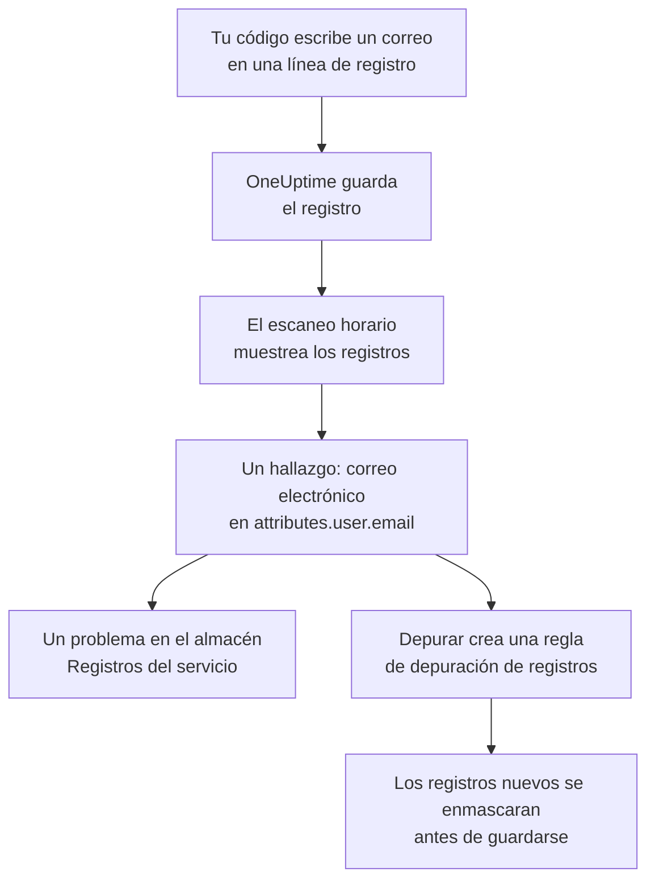

# Datos sensibles en la telemetría

La telemetría contiene todo lo que escribe tu código: una dirección de correo electrónico en una línea de registro, un número de tarjeta en un atributo de span, un token en una traza de pila, la pregunta de un cliente en un prompt. Seguridad de datos trata los registros, las trazas, las excepciones y las conversaciones de IA de cada servicio, y las sesiones de cada aplicación RUM, como almacenes de datos propios. Los muestrea cada hora, encuentra datos sensibles en ellos igual que en un bucket, y **Depurar** convierte un hallazgo en una regla de depuración que enmascara esos datos en la ingesta a partir de entonces.

No hay nada que configurar: la telemetría de cada servicio se escanea cada hora, salvo que **Escanear telemetría** esté desactivado en los ajustes del proyecto.

:::cards
- [Qué se lee](#qué-se-lee): Los atributos, cuerpos, mensajes y prompts de cada señal.
- [Cómo muestrea un escaneo](#cómo-muestrea-un-escaneo): Las entradas más recientes de cada servicio, cada hora.
- [Depurar](#depurar): Enmascara un hallazgo en la ingesta, con un clic.
- [Qué cuenta como depurado](#qué-cuenta-como-depurado): Cuándo una regla de depuración ya cubre un hallazgo.
:::

## Cómo funciona

Un hallazgo que cubre una regla de depuración se marca como depurado: lo que queda de esos datos son datos antiguos que esperan a que termine su retención, no una fuga que sigue activa. Las dos comprobaciones de telemetría solo cuentan lo que ninguna regla cubre, así que su problema se resuelve en cuanto cada hallazgo está depurado (consulta [Comprobaciones de telemetría](/docs/data-security/checks-and-issues#telemetría)).

## Qué se lee

| Almacén | Qué se lee | Adónde apunta un hallazgo |
| --- | --- | --- |
| Registros | Cada atributo, y el cuerpo | `attributes.<key>`, `body` |
| Trazas | Cada atributo de span, y los atributos de cada evento de span | `attributes.<key>`, `events.<event>.<key>` |
| Excepciones | El mensaje, la traza de pila y los atributos | `message`, `stackTrace`, `attributes.<key>` |
| Conversaciones de IA | Los prompts y las respuestas de cada llamada de IA, bajo las claves en las que los ponen las convenciones de GenAI, y todos los demás atributos | La clave en la que están, como `gen_ai.input.messages` o `gen_ai.prompt[].content` |
| Reproducciones de sesiones | Los atributos de los spans y los registros de una aplicación RUM, los atributos de sus sesiones, los rasgos que `identify()` dio a sus usuarios y la referencia de usuario que se le indicó | `spans.attributes.<key>`, `logs.attributes.<key>`, `sessions.attributes.<key>`, `sessions.identifiedUserTraits.<key>`, `sessions.identifiedUserLabel` |

Las claves numeradas se agrupan en una sola ubicación: `gen_ai.prompt.3.content` es `gen_ai.prompt[].content`, así que los veinte mensajes de un chat son un solo hallazgo, no veinte. Los atributos que añade el propio OneUptime, que empiezan por `oneuptime.`, no se leen.

### Por qué nunca se lee la grabación de una reproducción

La grabación de una reproducción de sesión contiene el texto de las páginas que vieron las personas. Verla requiere un permiso propio, y un hallazgo extraído de ella mostraría texto de página enmascarado a todos los que pueden leer Seguridad de datos. Por eso una reproducción se lee solo por sus atributos: los spans, los registros y los detalles de la sesión que acompañan a la grabación. El grabador ya enmascara en el navegador lo que graba, y las reglas de depuración de registros también se aplican a las grabaciones (consulta [Reproducción de sesiones](/docs/telemetry/session-replay)).

### Conversaciones de IA

El prompt de una llamada de IA lleva todo el chat anterior al mensaje más reciente de la persona, así que se leen hasta 16.384 caracteres de cada valor de una llamada de IA. Cuando las conversaciones de IA contienen datos sensibles, ocurren dos cosas más: el proveedor de IA al que fueron las llamadas pasa a ser un flujo de esos datos, y [Se están enviando datos sensibles a un proveedor de IA](/docs/data-security/checks-and-issues#ia) falla en el almacén.

Las conversaciones de una [herramienta de IA de la empresa](/docs/telemetry/ai-company-tools) se dejan fuera. Solo los roles Project Owner y Project Admin pueden leerlas, y un hallazgo aparece donde lo ve todo el que lee Seguridad de datos, así que los spans de esos servicios nunca se leen, y sus conversaciones de IA figuran como no leídas.

## Cómo muestrea un escaneo

Cada hora se leen las entradas más recientes de la última hora de cada señal, y se clasifican campo a campo como las de cualquier otro almacén (consulta [Campos y columnas](/docs/data-security/data-types#campos-y-columnas)):

| Límite | Valor |
| --- | --- |
| Entradas de cada servicio y señal | **Tamaño de la muestra de telemetría**, 500 por defecto, nunca más de 1.000 |
| Servicios o aplicaciones RUM leídos por señal | Los 200 con más actividad |
| Entradas en una lectura | 5.000, repartidas entre los servicios; 500 para las llamadas de IA |
| Caracteres del cuerpo de un registro, de un mensaje de excepción o de una traza de pila | 8.192 |
| Caracteres del valor de un atributo | 4.096 |
| Caracteres de un valor de una llamada de IA | 16.384 |
| Atributos de una entrada | 128; 64 para una llamada de IA |
| Eventos de un span, y atributos de un evento | 16 y 32 |
| Ubicaciones de un almacén | 500 |

Cada valor se recorta en la propia base de datos, así que ningún valor largo sale de ella, y cada lectura se detiene a los 30 segundos. Una lectura que falla es una advertencia en los almacenes para los que era; el escaneo continúa con la siguiente.

Para dejar algo fuera, añádelo a las **Exclusiones del escaneo** del almacén: una ubicación nombrada entera (`attributes.http.url`), todo lo que hay bajo una (`attributes.http`), o una clave de atributo nombrada sola (`http.url`).

## Depurar

**Depurar** en un hallazgo crea la regla de depuración que oculta ese tipo de datos en esa ubicación a partir de entonces, o señala la regla habilitada que ya lo hace:

:::steps
### Abre el hallazgo

Abre el almacén de telemetría (por ejemplo, los **Registros** de un servicio) y el hallazgo.

### Pulsa Depurar

Haz clic en **Depurar**. OneUptime crea una regla de depuración de registros para los registros y los registros de una aplicación RUM, y una regla de depuración de trazas para los spans, las excepciones y las llamadas de IA, sobre la parte de la entrada en la que está el hallazgo.

### Corrige también el código

La regla enmascara los datos nuevos antes de guardarlos. Los datos ya guardados se quedan hasta que termina su retención, así que corrige el código que los escribe: el hallazgo nombra el servicio y el atributo.
:::

La regla se nombra por lo que oculta, como «Data Security: Email address in attributes.user.email», y aparece junto a tus demás reglas de depuración (consulta [Filtros de descarte y reglas de depuración](/docs/telemetry/drop-filters-and-scrub-rules#depurar-datos-sensibles)). Es una de estas:

| Hallazgo | Regla que crea Depurar |
| --- | --- |
| Dirección de correo electrónico, número de tarjeta, número de la Seguridad Social de EE. UU., número de teléfono o dirección IP | El patrón integrado de ese tipo. Los números de tarjeta, los números de la Seguridad Social y los números de teléfono se enmascaran, y el resto se oculta por completo. |
| Un valor bajo una clave que parece sensible, como `password` o `token` | Una regla de **Claves de atributos sensibles**, que oculta el valor completo de cada atributo de ese tipo |
| Cualquier otro tipo de datos que un patrón pueda encontrar | Una regla de **Expresión regular personalizada** creada a partir de los propios patrones del tipo de datos, que oculta cada valor con su forma |

Algunos hallazgos no se pueden depurar con una regla, y **Depurar** dice por qué:

- Un tipo de datos encontrado solo por los nombres de campo, como el nombre de una persona: ningún patrón puede encontrarlo. Cambia el nombre del atributo a una clave que oculte una regla de claves sensibles, o deja de enviarlo.
- Un tipo de datos que solo se distingue de otros valores por las palabras que lo rodean, como un número de ruta bancaria: una regla ocultaría mucho más que ese tipo de datos.
- Una marca de documento: ocultar la palabra no ocultaría el documento.
- Uno de tus propios tipos de datos: añade tú mismo una regla de depuración personalizada con su patrón.
- Los propios detalles de una sesión (`sessions.*`): la ingesta de reproducciones de sesiones no ejecuta reglas de depuración.

**Depurar** crea la regla en tu nombre, con tus propios permisos: pueden pulsarlo los roles Project Owner y Project Admin, y también un equipo que pueda crear reglas de depuración de registros, y reglas de depuración de trazas para los spans, las excepciones y las llamadas de IA.

## Qué cuenta como depurado

Un hallazgo se marca como depurado solo cuando la ingesta le aplicaría una regla habilitada y la regla encontraría su tipo de datos:

- **Las entradas correctas.** Las reglas de registros cubren los registros y los registros de una aplicación RUM. Las reglas de trazas cubren los spans, las excepciones y las llamadas de IA: una excepción es una copia del evento de excepción de su span, así que las reglas que depuran eventos también la depuran a ella.
- **La parte correcta.** Los **Campos a depurar** de la regla incluyen la parte de la entrada en la que está el hallazgo, o la regla los deja en su valor por defecto.
- **Un patrón que encuentra el tipo.** Un **Tipo de patrón** integrado encuentra su propio tipo de datos: **Dirección de correo electrónico** encuentra direcciones de correo electrónico, **Número de tarjeta de crédito** números de tarjeta, **SSN (número de la Seguridad Social)** números de la Seguridad Social de EE. UU., **Número de teléfono** números de teléfono y **Dirección IP** direcciones IP. **Claves de atributos sensibles** cubre cada valor bajo una clave que parece sensible, sea cual sea el valor.
- **Tus propios patrones personalizados nunca cuentan.** Una **Expresión regular personalizada** cubre un hallazgo solo cuando es exactamente el patrón que crea **Depurar** para su tipo. Un hallazgo solo conserva muestras enmascaradas, sobre las que no se puede probar ningún patrón, así que OneUptime no podría demostrar que tu patrón oculta los datos, y un hallazgo marcado como depurado por error es una fuga que nadie mira.

Una regla desactivada, o que no depura nada, nunca cuenta. La cobertura se vuelve a calcular después de cada escaneo, así que una regla que añadas o quites a mano cambia lo que está marcado como depurado en menos de una hora.

## Próximos pasos

:::cards
- [Filtros de descarte y reglas de depuración](/docs/telemetry/drop-filters-and-scrub-rules): Cada opción de las reglas de depuración, y las reglas que escribes tú mismo.
- [Comprobaciones y problemas de Seguridad de datos](/docs/data-security/checks-and-issues): Las dos comprobaciones de telemetría y las comprobaciones de IA.
- [Flujos de datos, acceso y residencia](/docs/data-security/flows-access-residency): Los proveedores de IA y los hosts a los que tus servicios envían datos.
:::
