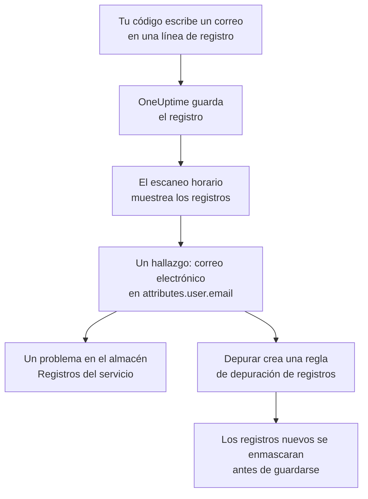

# Datos sensibles en la telemetría

La telemetría contiene todo lo que escribe tu código: una dirección de correo electrónico en una línea de registro, un número de tarjeta en un atributo de span, un token en una traza de pila, la pregunta de un cliente en un prompt, la dirección IP de un usuario en la etiqueta de una métrica. Seguridad de datos trata los registros, las trazas, las métricas, las excepciones y las conversaciones de IA de cada servicio, y las sesiones de cada aplicación RUM, como almacenes de datos propios. Los muestrea cada hora, encuentra datos sensibles en ellos igual que en un bucket, y **Depurar** convierte un hallazgo en una regla que oculta esos datos en la ingesta a partir de entonces, en el servicio donde se encontraron.

No hay nada que configurar: la telemetría de cada servicio se escanea cada hora, salvo que **Escanear telemetría** esté desactivado en los ajustes del proyecto. Para dejar fuera los registros, las trazas u otra de las señales de un servicio, desactiva **Escanear contenido** en los **Ajustes** de ese almacén: desde el siguiente escaneo, no se lee nada de ello.

:::cards
- [Qué se lee](#qué-se-lee): Los atributos, cuerpos, mensajes y prompts de cada señal.
- [Cómo muestrea un escaneo](#cómo-muestrea-un-escaneo): Las entradas más recientes de cada servicio, cada hora.
- [Depurar](#depurar): Oculta un hallazgo en la ingesta, en el servicio donde se encontró.
- [Contenido por su cuenta](#contenido-por-su-cuenta): Un secreto oculto sin que nadie pulse nada, donde está demostrado que es seguro.
- [Descartar esta métrica](#descartar-esta-métrica): Deja de almacenar las métricas cuyos nombres contienen datos sensibles.
- [Qué cuenta como depurado](#qué-cuenta-como-depurado): Cuándo una regla de depuración ya cubre un hallazgo.
:::

## Cómo funciona

Un hallazgo que cubre una regla de depuración se marca como depurado: lo que queda de esos datos son datos antiguos que esperan a que termine su retención, no una fuga que sigue activa. Las dos comprobaciones de telemetría solo cuentan lo que ninguna regla cubre, así que su problema se resuelve en cuanto cada hallazgo está depurado (consulta [Comprobaciones de telemetría](/docs/data-security/checks-and-issues#telemetría)).

## Qué se lee

| Almacén | Qué se lee | Adónde apunta un hallazgo |
| --- | --- | --- |
| Registros | Cada atributo, y el cuerpo | `attributes.<key>`, `body` |
| Trazas | Cada atributo de span, y los atributos de cada evento de span | `attributes.<key>`, `events.<event>.<key>` |
| Excepciones | El mensaje, la traza de pila y los atributos | `message`, `stackTrace`, `attributes.<key>` |
| Conversaciones de IA | Los prompts y las respuestas de cada llamada de IA, bajo las claves en las que los ponen las convenciones de GenAI, y todos los demás atributos | La clave en la que están, como `gen_ai.input.messages` o `gen_ai.prompt[].content` |
| Reproducciones de sesiones | Los atributos de los spans y los registros de una aplicación RUM, los atributos de sus sesiones, los rasgos que `identify()` dio a sus usuarios y la referencia de usuario que se le indicó | `spans.attributes.<key>`, `logs.attributes.<key>`, `sessions.attributes.<key>`, `sessions.identifiedUserTraits.<key>`, `sessions.identifiedUserLabel` |
| Métricas | Cada atributo de un punto de datos, incluidos los de su recurso, y los nombres de las métricas | `attributes.<key>`, `attributes.resource.<key>`, `name` |

Las claves numeradas se agrupan en una sola ubicación: `gen_ai.prompt.3.content` es `gen_ai.prompt[].content`, así que los veinte mensajes de un chat son un solo hallazgo, no veinte. Los atributos que añade el propio OneUptime, que empiezan por `oneuptime.`, no se leen.

### Métricas

Los atributos de una métrica son las etiquetas de sus series. Son los mismos en cada punto de datos de una serie, así que una métrica que escribe mil puntos por minuto puede contener solo tres valores, y una etiqueta que expone el correo electrónico de un usuario añade una serie, no un punto. Por eso una métrica se muestrea por sus series, no por sus puntos:

- **Un punto de cada serie.** Cada métrica se lee en el minuto más reciente en el que escribió durante la última hora: un punto de datos de cada una de hasta 100 series de ese minuto, sin importar con qué frecuencia se envíe la métrica, así que una serie con mucha actividad nunca desplaza a una tranquila. Un valor se clasifica una sola vez, por muchas series que lo repitan, así que un hallazgo cuenta los valores distintos en su ubicación.
- **Las métricas nuevas primero, luego el resto por turnos.** Qué métricas escribió un servicio, y cuándo escribió cada una por primera vez en el último día, se sabe por la agregación por minuto que mantiene la tabla de métricas, nunca por sus puntos. Cada escaneo lee las métricas con más actividad de un servicio, las que más probablemente tienen muchas series. Después vienen las métricas que empezó a escribir en las últimas 2 horas, porque una fuga nueva suele venir de código nuevo, y luego las siguientes de sus demás métricas, en un orden fijo, desde donde se detuvo el último escaneo. Las métricas nuevas ocupan como máximo la mitad de esos turnos, así que las demás siempre conservan los suyos.
- **Cada métrica en un tiempo fijo.** Un escaneo da a cada servicio 10 de sus lecturas, menos cuando el proyecto tiene más de 10 servicios. Las lecturas que un servicio deja sin usar, porque tiene menos métricas, van una a una a los servicios que aún tienen métricas esperando su turno, así que ninguna se desperdicia y ningún servicio recibe menos que su parte. Las 5 métricas de más actividad de un servicio ocupan 5 de sus lecturas, y el resto lee sus demás métricas por turnos: en un servicio de M métricas que recibe r lecturas por turnos, cada una se lee al menos una vez cada M ÷ r horas, redondeando hacia arriba. Son 60 horas para un servicio de 300 métricas que solo recibe sus 5 propias, y 11 horas cuando otros dos servicios de 300 métricas comparten su proyecto, porque cada uno recibe entonces 28 o 29. Mientras siga empezando métricas nuevas cada hora, es como máximo el doble.
- **El rango propio de cada métrica.** Las métricas se leen juntas, cada una por su propio rango de la clave primaria de la tabla. Una métrica cuyo minuto más reciente contiene más de 16.384 puntos, como una etiquetada con el correo electrónico de cada usuario, se lee por separado, y la lectura se detiene en sus primeros puntos, así que no cuesta más que cualquier otra métrica.

Un hallazgo nombra el atributo, como `attributes.user.email`, o `name` para los datos del nombre de una métrica. Sus entradas son los puntos de datos en los que se encontró: cada una muestra su métrica y el valor del atributo, enmascarado, y se abre en **Métricas** sobre esa métrica, agrupada por ese atributo. Cuando el nombre de una métrica contiene datos sensibles, el nombre también se enmascara, y la entrada abre en su lugar las métricas del servicio.

### Por qué nunca se lee la grabación de una reproducción

La grabación de una reproducción de sesión contiene el texto de las páginas que vieron las personas. Verla requiere un permiso propio, y un hallazgo extraído de ella mostraría texto de página enmascarado a todos los que pueden leer Seguridad de datos. Por eso una reproducción se lee solo por sus atributos: los spans, los registros y los detalles de la sesión que acompañan a la grabación. El grabador ya enmascara en el navegador lo que graba, y las reglas de depuración de registros también se aplican a las grabaciones (consulta [Reproducción de sesiones](/docs/telemetry/session-replay)).

### Conversaciones de IA

El prompt de una llamada de IA lleva todo el chat anterior al mensaje más reciente de la persona, así que se leen hasta 16.384 caracteres de cada valor de una llamada de IA. Cuando las conversaciones de IA contienen datos sensibles, ocurren dos cosas más: el proveedor de IA al que fueron las llamadas pasa a ser un flujo de esos datos, y [Se están enviando datos sensibles a un proveedor de IA](/docs/data-security/checks-and-issues#ia) falla en el almacén.

Las conversaciones de una [herramienta de IA de la empresa](/docs/telemetry/ai-company-tools) se dejan fuera. Solo los roles Propietario del proyecto y Administrador del proyecto pueden leerlas, y un hallazgo aparece donde lo ve todo el que lee Seguridad de datos, así que los spans de esos servicios nunca se leen, y sus conversaciones de IA figuran como no leídas.

## Cómo muestrea un escaneo

Cada hora se leen las entradas más recientes de la última hora de cada señal, y se clasifican campo a campo como las de cualquier otro almacén (consulta [Campos y columnas](/docs/data-security/data-types#campos-y-columnas)):

| Límite | Valor |
| --- | --- |
| Entradas de cada servicio y señal | **Tamaño de la muestra de telemetría**, 500 por defecto, nunca más de 1.000 |
| Servicios o aplicaciones RUM leídos por señal | Los 200 con más actividad |
| Entradas en una lectura | 5.000, repartidas entre los servicios; 500 para las llamadas de IA |
| Caracteres del cuerpo de un registro, de un mensaje de excepción o de una traza de pila | 8.192 |
| Caracteres del valor de un atributo | 4.096 |
| Caracteres de un valor de una llamada de IA | 16.384 |
| Atributos de una entrada | 128; 64 para una llamada de IA |
| Eventos de un span, y atributos de un evento | 16 y 32 |
| Ubicaciones de un almacén | 500 |
| Métricas leídas en un escaneo | 100, repartidas entre los servicios, al menos una de cada uno; 10 de cada servicio, la mitad entre las de más actividad y la otra mitad entre las nuevas y las demás, por turnos, y las lecturas que un servicio deja sin usar van por turnos a los demás |
| Una métrica nueva | Una cuyo primer punto de las últimas 24 horas llegó en las últimas 2 horas |
| Series de una métrica | Un punto de datos de cada una, de su minuto más reciente, como máximo 100 |

Cada valor se recorta en la propia base de datos, así que ningún valor largo sale de ella, y cada lectura se detiene a los 30 segundos. Una lectura que falla es una advertencia en los almacenes para los que era; el escaneo continúa con la siguiente.

Para dejar algo fuera, añádelo a las **Exclusiones del escaneo** del almacén: una ubicación nombrada entera (`attributes.http.url`), todo lo que hay bajo una (`attributes.http`), o una clave de atributo nombrada sola (`http.url`).

## Depurar

**Depurar** en un hallazgo crea la regla que oculta ese tipo de datos en esa ubicación a partir de entonces, o señala la regla habilitada que ya lo hace:

:::steps
### Abre el hallazgo

Abre el problema - **Dónde se encontró** enumera cada hallazgo que lo causa - o **Seguridad de datos > En tu telemetría**, donde **Mostrar entradas** abre junto a la lista las entradas en las que se encontró un hallazgo.

### Pulsa Depurar

Haz clic en **Depurar**. Un diálogo dice qué haría la regla antes de crear nada: los registros de quién cambia, qué hace con lo que encuentra y qué lee los valores que ocultaría. Haz clic en **Depurar** en él para crear la regla. OneUptime crea una regla de depuración de registros para los registros y los registros de una aplicación RUM, una regla de depuración de trazas para los spans, las excepciones y las llamadas de IA, sobre la parte de la entrada en la que está el hallazgo, y una regla de canalización de métricas para el atributo de una métrica.

### Corrige también el código

La regla oculta los datos nuevos antes de guardarlos. Los datos ya guardados se quedan hasta que termina su retención, así que corrige el código que los escribe: el hallazgo nombra el servicio y el atributo.
:::

La regla se nombra por lo que oculta, como «Data Security: Email address in log attributes of checkout», o «Data Security: Password or secret in db.password of checkout» para una regla que nombra su atributo, y aparece junto a tus demás reglas de depuración (consulta [Filtros de descarte y reglas de depuración](/docs/telemetry/drop-filters-and-scrub-rules#depurar-datos-sensibles)). Es la regla más estrecha que oculta los datos del hallazgo, la primera de estas que encaja:

| Hallazgo | Regla que crea Depurar |
| --- | --- |
| Dirección de correo electrónico, número de tarjeta, número de la Seguridad Social de EE. UU., número de teléfono o dirección IP | El patrón integrado de ese tipo, enmascarado. Una dirección IP se oculta por completo, o se convierte en hash donde [Eventos de seguridad](/docs/telemetry/security-events) lee esas entradas, para que pueda seguir nombrando la dirección que hay que bloquear. |
| Cualquier otro tipo de datos que un patrón encuentra por sí solo, como un token de GitHub | Una regla de **Expresión regular personalizada** creada a partir de los propios patrones del tipo de datos. Un secreto se oculta por completo. |
| Uno de tus propios tipos de datos, con un patrón | Ese patrón, solo en el atributo en el que se encontró |
| Un tipo de datos que se distingue por las palabras que lo rodean, como un número de ruta bancaria | Su forma, solo en el atributo en el que se encontró |
| Un tipo de datos encontrado por el nombre del campo, como el nombre de una persona bajo `customer_name`, o un valor bajo una clave que nombra un secreto | Una regla de **Atributos indicados**, que oculta el valor completo de ese atributo |
| Un valor bajo una clave que parece sensible, donde nada más estrecho lo oculta | Una regla de **Claves de atributos sensibles**, que oculta el valor completo de cada atributo de ese tipo |
| Cualquier tipo de datos en el atributo de una métrica | Una regla de canalización de métricas **Ocultar atributo** para el servicio, que sustituye por `[REDACTED]` los valores del atributo con la forma del tipo de datos, o cada valor del atributo cuando ningún patrón encuentra el tipo de datos |

### Demostrada en las entradas del hallazgo

Antes de que el diálogo diga qué haría la regla, OneUptime ejecuta cada regla que podría crear sobre las entradas en las que se vio el hallazgo, y sobre las entradas más recientes de su servicio con un valor en ese lugar, con el mismo código que ejecuta la ingesta, y pregunta al escáner qué queda. La primera regla que oculta los datos en cada valor que los contenía, y que cambia como máximo 5 de cada 100 de los demás valores de ese lugar, es la elegida. El diálogo dice en cuántas entradas se ejecutó, cuántos valores contenían los datos y cuántos otros cambió. Un patrón que cambiaría más nunca se ofrece: se ofrece la regla que nombra el atributo, diciendo qué más cambia.

La prueba se guarda con la regla, y la lista de reglas de depuración muestra **Demostrado** en su fila hasta que se cambia la regla. Donde no queda ninguna entrada sobre la que ejecutar una regla, como en una excepción o una reproducción de sesión, o en entradas que ya pasaron su retención, la regla se crea tal como está planeada, y el diálogo lo dice.

Una regla de registros o de trazas es para el servicio donde se encontró el hallazgo: depura los registros o los spans de ese servicio, y los de los demás servicios se quedan como están, así que nada de lo que lee los suyos cambia. La columna **Alcance** de la lista de reglas de depuración dice para qué servicio es una regla. Un hallazgo en las grabaciones de sesión de una aplicación RUM crea una regla para todos los servicios y aplicaciones del proyecto, ya que las reglas de registros también depuran las grabaciones, y el diálogo lo dice. Si el servicio ya no existe, **Depurar** lo dice y no crea ninguna regla.

El diálogo nombra, cada uno como un enlace, los monitores, los paneles con sus widgets, las vistas guardadas, las reglas de grabación y los SLO que leen los valores que la regla ocultaría, y qué les pasa: un filtro sobre un valor oculto deja de coincidir, y una agrupación por él ya no muestra los valores reales. También dice qué perderían los [Eventos de seguridad](/docs/telemetry/security-events) cuando leen esos registros: con las direcciones IP ocultas, sus eventos no pueden nombrar la dirección que hay que bloquear. Lo que no puedes ver se cuenta, nunca se nombra. El diálogo nunca detiene la regla: lo dice, y tú decides. Los formularios de las reglas de depuración muestran lo mismo antes de guardar o activar una regla.

Algunos hallazgos no se pueden depurar con una regla, y **Depurar** dice por qué. El atributo de una métrica siempre se puede depurar, ya que su regla puede ocultar cada valor del atributo:

- Un tipo de datos encontrado solo por los nombres de campo en el cuerpo de un registro, como el nombre de una persona: ninguna regla puede distinguirlo del resto del mensaje. Envíalo como atributo, que oculta una regla de **Atributos indicados**, o deja de enviarlo.
- Todas las reglas probadas ocultaban mucho más que los datos: cada una se ejecutó sobre las entradas en las que se vieron, y cambiaba demasiados valores más. Deja de enviarlos en el código que los escribe.
- Una marca de documento: ocultar la palabra no ocultaría el documento.
- Los propios detalles de una sesión (`sessions.*`): la ingesta de reproducciones de sesiones no ejecuta reglas de depuración.
- El nombre de una métrica (`name`): lo establece el código que crea la métrica, y una regla de canalización solo puede renombrar una métrica entera. Cambia el nombre de la métrica y, en su lugar, envía como atributo lo que varía en su nombre. Mientras tanto, **Descartar esta métrica** puede dejar de almacenar esas métricas.

**Depurar** crea la regla en tu nombre, con tus propios permisos: pueden pulsarlo los roles Propietario del proyecto y Administrador del proyecto, y también un equipo que pueda crear reglas de depuración de registros, reglas de depuración de trazas para los spans, las excepciones y las llamadas de IA, y reglas de canalización de métricas para las métricas.

## Contenido por su cuenta

Mientras la IA de OneUptime trabaja en los problemas de Seguridad de datos (consulta [OneUptime AI en Seguridad de datos](/docs/data-security/ai)), un problema de telemetría se contiene sin que nadie pulse nada, donde está demostrado que es seguro. Para cada lugar que cuenta el problema, la IA de OneUptime planifica la regla que crearía **Depurar**, demostrada de la misma forma, y solo la crea por su cuenta cuando se cumple todo esto:

- **Los datos son un secreto**, como una contraseña, un token o una clave.
- **La regla está demostrada** en las entradas en las que se vieron los datos: ocultó los datos en cada valor que los contenía.
- **No cambia nada más allí**: ninguno de los demás valores de su lugar.
- **Nada lee lo que oculta**: ningún monitor, panel, vista guardada, regla de grabación ni SLO, y nada que necesite Eventos de seguridad.
- **Es para el servicio** en el que se vieron los datos.

Todo lo demás se propone en su lugar, en **Seguridad de datos → IA** y en la página del problema, diciendo cómo se demostró la regla y qué lee lo que ocultaría: datos personales, una regla cuyos valores lee algo, una que cambia otros valores, una para la que no quedaba ninguna entrada en la que ejecutarla, una para todos los servicios, la regla de canalización de una métrica, y cualquier lugar cuya regla anterior una persona deshizo o descartó. Una regla de IA de Seguridad de datos que pone **Contener** en **Automáticamente** para un problema permite que también se oculten por su cuenta datos personales demostrados. Ninguna regla permite que se ejecute por su cuenta un cambio del que no está demostrado que sea seguro.

Donde ninguna de las reglas de **Depurar** puede ocultar los datos, como en uno de tus propios tipos de datos sin patrón, la IA de OneUptime escribe una: un patrón para los datos, o el atributo que hay que ocultar entero. Se le dice el tipo de datos, dónde está, los nombres de los atributos de al lado y las formas de los valores, como `AA-9999` para `AB-1234`, nunca un valor, y lo que escribe se demuestra en las entradas como cualquier otra regla antes de proponerlo o crearlo.

Un cambio que la IA de OneUptime hizo por su cuenta:

- **Está en la cronología del problema**, con las reglas que creó, cómo se demostró cada una, y **Deshacer**, que las elimina. **Seguridad de datos → IA** tiene el mismo **Deshacer**. Un lugar cuya regla deshaces nunca vuelve a contenerse por su cuenta: la IA de OneUptime lo propone en su lugar.
- **Se envía por correo electrónico** a los propietarios del almacén y a los propietarios del servicio.
- **Dice que hay que rotar un secreto.** Ocultar un secreto solo detiene las copias nuevas: el secreto sigue funcionando, y las entradas guardadas antes de la regla lo conservan hasta que termina su retención. La cronología y el correo electrónico dicen dónde se vio.

Los hallazgos nuevos en un servicio cuyo problema ya está abierto se contienen de la misma forma, en cuanto el escaneo de cada hora los encuentra.

## Descartar esta métrica

Ninguna regla saca los datos del nombre de una métrica, así que hasta que se corrija el código que nombra la métrica, los datos siguen llegando. **Descartar esta métrica** en un hallazgo en el nombre de una métrica deja de almacenar las métricas cuyos nombres los contienen, a costa de sus datos, así que solo ocurre cuando lo pides:

- **Las métricas de un servicio.** Crea una regla de canalización de métricas **Descartar** para el servicio del hallazgo: cada punto de datos nuevo de una métrica cuyo nombre contiene ese tipo de datos se descarta antes de almacenarse. Su filtro es el patrón que **Depurar** usa para el tipo, así que un tipo que ningún patrón puede encontrar, como el nombre de una persona, no se puede descartar, y el diálogo dice por qué.
- **Dicho antes de hacerse.** El diálogo dice que esos puntos de datos se pierden para siempre, cuántas de las métricas del servicio escritas en el último día tienen un nombre así, qué las lee y por tanto deja de recibir datos nuevos, que lo ya almacenado se conserva hasta que termine su retención, y cómo deshacerlo. No se descarta nada hasta que marcas que lo entiendes.
- **Qué las lee, y qué le pasa.** El diálogo nombra, cada uno como un enlace, cada monitor, cada panel con sus widgets que leen esas métricas, cada SLO de métrica del servicio y cada regla de grabación de métricas que las lee. Los monitores ya no pueden alertar sobre sus valores, los widgets dejan de mostrar datos nuevos, los SLO dejan de contar eventos nuevos de ellas y las métricas de salida de las reglas de grabación ya no las incluyen. Bajo cada regla de grabación, también nombra lo que lee su métrica de salida, y lo que lee las de esos a su vez, hasta tres métricas de salida más adelante en la cadena. El enlace de un widget abre su panel en ese widget. Lo que no puedes ver se cuenta, pero nunca se nombra.
- **En tu nombre, y registrado.** La regla se crea con tu propio permiso para crear reglas de canalización de métricas: pueden crearla los roles Propietario del proyecto y Administrador del proyecto, y también un equipo que pueda crear reglas de canalización de métricas. Los registros de auditoría guardan quién la creó.
- **Se deshace eliminando la regla.** La regla se nombra por lo que descarta, como «Data Security: drop metrics named with Email address», y aparece junto a tus demás reglas de canalización de métricas en **Métricas → Ajustes → Reglas de canalización**. Elimínala o desactívala, y esas métricas se vuelven a almacenar desde ese momento. Lo descartado mientras tanto no vuelve.

El hallazgo queda entonces marcado como **Descartado**, y cuenta como depurado: ya no se almacena nada más de esos datos.

## Qué cuenta como depurado

Un hallazgo se marca como depurado solo cuando la ingesta le aplicaría una regla habilitada y la regla encontraría su tipo de datos:

- **Las entradas correctas.** Las reglas de registros cubren los registros y los registros de una aplicación RUM. Las reglas de trazas cubren los spans, las excepciones y las llamadas de IA: una excepción es una copia del evento de excepción de su span, así que las reglas que depuran eventos también la depuran a ella.
- **La parte correcta.** Los **Campos a depurar** de la regla incluyen la parte de la entrada en la que está el hallazgo, o la regla los deja en su valor por defecto.
- **El servicio correcto.** Una regla de registros o de trazas para un servicio solo cubre los hallazgos de ese servicio. Una regla sin servicio cubre los de todos los servicios.
- **Un patrón que encuentra el tipo.** Un **Tipo de patrón** integrado encuentra su propio tipo de datos: **Dirección de correo electrónico** encuentra direcciones de correo electrónico, **Número de tarjeta de crédito** números de tarjeta, **SSN (número de la Seguridad Social)** números de la Seguridad Social de EE. UU., **Número de teléfono** números de teléfono y **Dirección IP** direcciones IP. **Claves de atributos sensibles** cubre cada valor bajo una clave que parece sensible, sea cual sea el valor.
- **Una regla demostrada en las entradas del hallazgo.** Una regla que OneUptime creó y demostró en las entradas en las que se vio un hallazgo cubre ese hallazgo, sea cual sea su patrón, mientras siga siendo la regla que se demostró: cambia su patrón, sus atributos, su acción, sus campos o su servicio, y deja de cubrirlo.
- **Una regla de atributos indicados** cubre un hallazgo en un atributo que nombra, o en uno anidado bajo él.
- **Por lo demás, tus propios patrones personalizados nunca cuentan.** Una **Expresión regular personalizada** que escribiste tú cubre un hallazgo solo cuando es exactamente el patrón que crea **Depurar** para su tipo. Un hallazgo solo conserva muestras enmascaradas, sobre las que no se puede probar ningún patrón, así que OneUptime no podría demostrar que tu patrón oculta los datos, y un hallazgo marcado como depurado por error es una fuga que nadie mira.
- **El atributo de una métrica.** Una regla de canalización de métricas **Ocultar atributo** o **Eliminar atributo** sobre la clave de ese atributo, para el servicio del hallazgo o para todo el proyecto, lo cubre cuando no tiene ningún filtro, o tiene exactamente el filtro que crea **Depurar**. Un filtro que escribiste tú nunca cuenta, por la misma razón.
- **El nombre de una métrica.** Una regla de canalización de métricas **Descartar** para el servicio del hallazgo o para todo el proyecto lo cubre cuando tiene exactamente el filtro que crea **Descartar esta métrica**, o ningún filtro, con lo que no almacena ninguna métrica del servicio. Una regla así sin filtro cubre todos los hallazgos en esas métricas.

Una regla desactivada, o que no depura nada, nunca cuenta. La cobertura se vuelve a calcular después de cada escaneo, así que una regla que añadas o quites a mano cambia lo que está marcado como depurado en menos de una hora.

## Próximos pasos

:::cards
- [Filtros de descarte y reglas de depuración](/docs/telemetry/drop-filters-and-scrub-rules): Cada opción de las reglas de depuración, y las reglas que escribes tú mismo.
- [Comprobaciones y problemas de Seguridad de datos](/docs/data-security/checks-and-issues): Las dos comprobaciones de telemetría y las comprobaciones de IA.
- [Flujos de datos, acceso y residencia](/docs/data-security/flows-access-residency): Los proveedores de IA y los hosts a los que tus servicios envían datos.
:::
