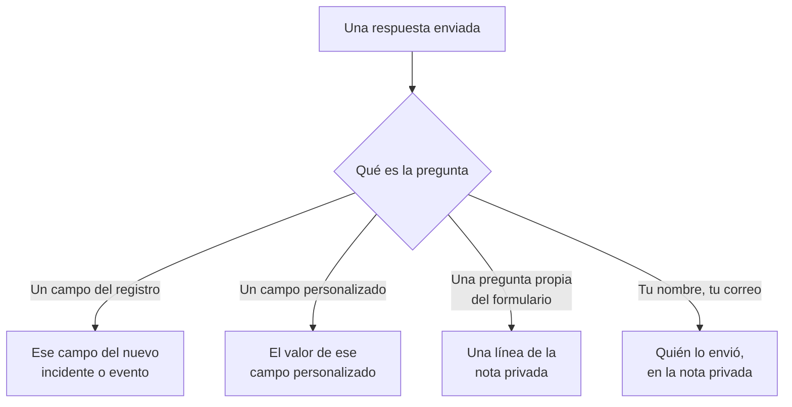

# Crear un formulario

La página **Construir** de un formulario es donde decides qué pregunta y qué aspecto tiene su página. Las preguntas están a la izquierda, en el orden en que las muestra la página pública; **Añadir una pregunta**, a la derecha, lista todo lo que puedes añadir. Encima de las preguntas, plegada, está la [marca](#marca) del formulario: su logotipo y su favicon. Los conjuntos de respuestas con nombre desde los que se puede empezar el formulario — cada uno de los cuales también puede hacer que una pregunta sea obligatoria, opcional u oculta para su propio caso — están en su página **Plantillas**: consulta [Plantillas](#plantillas).

:::cards
- [El editor](#el-editor): Añade, edita, mueve y guarda preguntas.
- [Lo que puedes añadir](#lo-que-puedes-añadir): Tus propias preguntas, los campos del registro, los campos personalizados y el remitente.
- [Preguntas ocultas](#preguntas-ocultas): Las responde una plantilla, nunca la persona que envía.
- [Plantillas](#plantillas): Un formulario, y un enlace, para cada caso que tu equipo notifica a menudo.
:::

## Adónde va cada respuesta

Cada respuesta también se guarda con el envío, en la página **Envíos** del formulario. Un campo que el formulario no pregunta, o que se deja vacío, se rellena con los [ajustes Al enviar](/docs/forms/on-submit) del formulario.

## El editor

:::steps
### Añadir una pregunta

Elige qué añadir en **Añadir una pregunta**. La pregunta nueva se inserta después de la seleccionada, o al final, y queda seleccionada.

### Editarla donde está

Selecciona una tarjeta para editarla: su pregunta, el texto de ayuda, el tipo de respuesta y las opciones, si es obligatoria u oculta, y los botones para duplicarla o eliminarla. **Hecho** la cierra.

### Ponerla en su sitio

Arrastra una tarjeta por su asa para moverla, o usa **Subir** y **Bajar** en la tarjeta seleccionada — en un teléfono, o desde el teclado.

### Guardar el formulario

**Guardar cambios** guarda todos los cambios a la vez. Hasta que guardas, el editor dice **Cambios sin guardar** y ofrece **Descartar cambios**, y el navegador pregunta antes de que salgas de la página.
:::

- **La cabecera del formulario** muestra su nombre y su descripción como los mostrará la página pública. **Editar nombre y descripción** los cambia.
- **Las preguntas** son tarjetas. Cada una muestra la pregunta como la verán las personas, con una insignia que dice a qué está vinculada — **Incidente · Gravedad**, **Campo personalizado · Region**, **Remitente · Correo electrónico**, o su tipo de respuesta para una pregunta propia del formulario. Un asterisco rojo marca una pregunta obligatoria, y una insignia **Oculto**, una [oculta](#preguntas-ocultas).
- **Límites.** Un formulario puede tener hasta 50 preguntas. Las personas que pueden leer un formulario pero no editarlo ven el editor en modo de solo lectura.

## Marca

**Marca**, plegada encima de las preguntas, es el aspecto de la página del formulario: tu logotipo en la parte superior de la página, encima del nombre del formulario, y tu favicon en la pestaña del navegador mientras el formulario está abierto. Hasta que subas los tuyos, el formulario muestra el logotipo y el favicon de OneUptime.

Plegada, la sección lista **Logotipo** y **Favicon** — marcados como configurados en cuanto el formulario tiene los suyos — y dice cuáles de OneUptime siguen vigentes. Despliégala para ver ambos como los muestra la página: el logotipo tal como queda en la parte superior de la página, y el favicon en una pestaña del navegador junto al nombre del formulario, que es el título de la pestaña.

**Editar marca** los cambia en un solo diálogo:

| Campo | Qué es |
| --- | --- |
| **Logotipo** | Se muestra en la parte superior de la página del formulario, encima de su nombre, en lugar del logotipo de OneUptime. Una imagen PNG, JPEG, GIF, WebP o SVG de 512 KB como máximo. Quítalo para volver al logotipo de OneUptime. |
| **Texto alternativo del logotipo** | Lo que dice el logotipo, leído por los lectores de pantalla: normalmente el nombre de tu organización. Se pide en cuanto hay un logotipo. Déjalo vacío y los lectores de pantalla omiten el logotipo — el nombre del formulario va justo después de todos modos. Quitar el logotipo también lo borra. |
| **Favicon** | El icono de la pestaña del navegador mientras el formulario está abierto, en lugar del favicon de OneUptime. Una imagen PNG, JPEG, GIF, WebP, SVG o ICO de 128 KB como máximo; un PNG, SVG o ICO cuadrado funciona mejor. Quítalo para volver al favicon de OneUptime. |

El logotipo conserva la altura del logotipo de OneUptime al que sustituye, y uno ancho se ajusta al ancho de la página. Cada imagen se comprueba al guardarla — desde el panel, la API, Terraform o un flujo de trabajo: debe haberse subido en el propio proyecto del formulario, ser de uno de los tipos anteriores y no superar su límite. Un logotipo que no es una de esas imágenes se rechaza con "The logo must be a PNG, JPEG, GIF, WebP or SVG image.", uno demasiado grande con "The logo must be 512 KB or smaller.", y uno cuya subida ya no existe — o que se subió en otro proyecto — con "The logo's file could not be found. Upload the logo again." Un favicon se rechaza del mismo modo, con "The favicon must be a PNG, JPEG, GIF, WebP, SVG or ICO image.", "The favicon must be 128 KB or smaller." y "The favicon's file could not be found. Upload the favicon again."

**Vista previa** muestra el logotipo como lo hace la página. Las personas que pueden leer un formulario pero no editarlo ven su marca sin **Editar marca**. El logotipo y el favicon solo llegan a la página del formulario dentro del propio formulario — consulta [Compartir y seguridad](/docs/forms/sharing-and-security#qué-protege-un-formulario).

## Lo que puedes añadir

**Añadir una pregunta** lista cuatro grupos: **Preguntas** propias del formulario, **Campos del incidente** o **Campos del mantenimiento programado** de lo que crea el formulario, **Campos personalizados** y **Remitente**.

### Preguntas propias del formulario

| Tipo de respuesta | Lo que da el remitente |
| --- | --- |
| **Respuesta corta** | Una línea de texto. |
| **Párrafo** | Varias líneas de texto. |
| **Texto enriquecido** | Texto con formato y enlaces. |
| **Número** | Un número. |
| **Lista desplegable** | Una opción de una lista. |
| **Selección múltiple** | Cualquier número de opciones de una lista. |
| **Casilla de verificación** | Una casilla que marcar, como una confirmación. |
| **Fecha** | Un día. |
| **Fecha y hora** | Un día y una hora. |

Una lista desplegable o de selección múltiple lista las **Opciones** que le das, cada una con un color opcional (el botón junto a una opción abre un conjunto de colores con nombre, con **Color personalizado** para un código exacto), entre una y 100. Cambiar una pregunta entre **Lista desplegable** y **Selección múltiple** conserva sus opciones; una pregunta que pasa a ser de uno de esos tipos empieza con dos que puedes renombrar, y una que deja de serlo las pierde. **Duplicar** copia una pregunta propia del formulario justo debajo de ella.

Las respuestas a estas preguntas se guardan con el envío y se listan en la nota privada de lo que crea el formulario — no rellenan ningún campo. Para rellenar un campo, añade el propio campo, desde los dos grupos siguientes.

### Campos de lo que crea el formulario

Los campos de un incidente, o de un evento de mantenimiento programado, que un remitente puede responder. La respuesta se convierte en el valor del campo.

| Campo del incidente | Se responde con |
| --- | --- |
| **Título** | Una línea, de hasta 500 caracteres. |
| **Descripción** | Texto enriquecido, de hasta 20.000 caracteres. |
| **Gravedad** | Una de tus gravedades de incidente. |
| **Monitores** | Cualquiera de los monitores que ofreces — los monitores afectados del incidente. |
| **Etiquetas** | Cualquiera de las etiquetas que ofreces. |
| **Inicio del impacto** | Una fecha y una hora: cuándo empezó el problema, según lo recuerda el remitente. |

| Campo del mantenimiento programado | Se responde con |
| --- | --- |
| **Título** | Una línea, de hasta 100 caracteres. |
| **Descripción** | Texto enriquecido, de hasta 20.000 caracteres. |
| **Comienza en** | Una fecha y una hora. Siempre se pregunta y siempre es obligatorio. |
| **Termina en** | Una fecha y una hora posteriores a **Comienza en**. Siempre se pregunta y es obligatorio. |
| **Monitores** | Cualquiera de los monitores que ofreces. |
| **Páginas de estado** | Cualquiera de las páginas de estado que ofreces. |
| **Etiquetas** | Cualquiera de las etiquetas que ofreces. |

Cada campo puede preguntarse una sola vez; la lista marca los que ya están en el formulario con **Añadido**. Un campo que el formulario no pregunta — o que se deja vacío — se rellena con los [ajustes Al enviar](/docs/forms/on-submit) del formulario.

**Opciones ofrecidas.** Una página pública no debe listar todo tu proyecto a desconocidos, así que un campo que se responde eligiendo registros ofrece solo los que tú eliges. **Monitores**, **Etiquetas** y **Páginas de estado** listan exactamente las opciones que ofreces, y no se preguntan hasta que ofreces al menos una. **Gravedad** ofrece todas las gravedades de incidente salvo que la restrinjas, ya que las gravedades no son secretas. Las respuestas fuera de las opciones ofrecidas se rechazan.

### Campos personalizados

Tus campos personalizados de incidente — o de mantenimiento programado, en un formulario de mantenimiento — cada uno una pregunta cuya respuesta se convierte en el valor del campo. La pregunta toma su tipo y sus opciones del campo personalizado, y empieza con su nombre como pregunta y su descripción como texto de ayuda, que puedes cambiar.

Un formulario solo pregunta los campos personalizados que le añades, diga lo que diga **Mostrar al crear**: cada campo que pregunta un formulario muestra su nombre, su descripción y sus opciones a cualquiera que tenga el enlace. Cuando se elimina un campo personalizado, su pregunta se queda en el formulario pero ya no se pregunta, y su tarjeta lo dice — elimina la pregunta. Un campo creado de nuevo con el mismo nombre es un campo nuevo: añádelo otra vez.

Un campo personalizado que copia su valor de un campo personalizado de monitor lo dice en su tarjeta: cuando el incidente o el evento tiene monitores que coinciden en un valor para él, ese valor sustituye la respuesta del remitente.

### Remitente

**Tu nombre** y **Tu correo electrónico** preguntan quién envía. Se guardan con el envío y se nombran en la nota privada, para que tu equipo pueda hacer el seguimiento, y nunca se muestran en el propio incidente o evento. OneUptime nunca envía correos al remitente. Omítelos, o hazlos opcionales, para aceptar envíos anónimos.

El correo debe ser una sola dirección normal, como `ada@example.com` — ni un nombre con la dirección entre corchetes angulares, ni una lista de direcciones. El nombre y el correo tienen hasta 100 caracteres cada uno.

## Las preguntas de un formulario nuevo

Un formulario nuevo empieza con las preguntas que casi siempre debería hacer, para que funcione desde el momento en que se crea: el **Título**, obligatorio; la **Descripción**; en un formulario de mantenimiento, **Comienza en** y **Termina en**; y **Tu nombre** y **Tu correo electrónico**, obligatorios. Su texto está en el idioma de tu panel. Cámbialas, ocúltalas o quítalas como quieras — salvo el inicio y el fin de un evento de mantenimiento, sin los que no se puede programar ningún evento. Cuando tus propias preguntas lo dicen todo, oculta la **Descripción** en lugar de dejar un cuadro en el que nadie debería escribir: consulta [Preguntas ocultas](#preguntas-ocultas).

## Preguntas obligatorias

**Obligatorio** significa que el formulario no puede enviarse sin una respuesta. Una respuesta hecha solo de espacios, tabulaciones o saltos de línea cuenta como ninguna respuesta, y una **Casilla de verificación** obligatoria debe estar marcada. El servidor vuelve a comprobar cada pregunta obligatoria cuando se envía el formulario, así que una solicitud hecha sin la página también debe cumplirlas.

Una pregunta que no es obligatoria puede dejarse vacía: su campo se rellena entonces con los ajustes Al enviar, como si el formulario no la hubiera preguntado.

## Preguntas ocultas

Activa **Oculto** en una tarjeta y la pregunta deja de mostrarse en el formulario. No se le pregunta a nadie, así que nunca es obligatoria, y un envío no puede responderla — ni siquiera se lee de la solicitud. Solo la [plantilla](#plantillas) desde la que empieza un envío la responde, y queda sin respuesta cuando el remitente no empieza desde ninguna plantilla, o empieza desde una que la deja vacía. Una plantilla también puede preguntar una pregunta oculta, para su propio caso: consulta [Cómo pregunta una plantilla cada pregunta](#cómo-pregunta-una-plantilla-cada-pregunta).

Oculta una pregunta cuando su respuesta le corresponde a tu equipo, no al remitente:

- **La descripción del incidente**, cuando las preguntas que añadiste lo dicen todo. Oculta, ya no invita a nadie a escribir ahí; da a cada plantilla el texto estándar que envías para su caso, o deja que los incidentes empiecen sin ella.
- **Un campo personalizado que leen tus flujos de trabajo o reglas**, como un tipo de notificación, fijado por cada plantilla.
- **Una pregunta propia del formulario** cuya respuesta solo necesita tu equipo en la nota privada.

Una pregunta oculta conserva su lugar, su etiqueta y sus ajustes, así que puedes volver a mostrarla cuando quieras. Un campo sin el que no puede crearse el destino del formulario — el **Comienza en** y el **Termina en** de un evento de mantenimiento — no puede ocultarse. La respuesta de una pregunta oculta se comprueba y se guarda exactamente igual que una respuesta escrita, y se conserva con el envío.

## Plantillas

La página **Plantillas** de un formulario contiene conjuntos de respuestas con nombre desde los que se puede empezar el formulario — uno para cada caso que tu equipo notifica a menudo, como **Caída de la aplicación**, **Mantenimiento planificado** o **Servicio restaurado** — para que un formulario, y un enlace, sirvan para todos.

:::steps
### Añadir una plantilla

Haz clic en **Añadir plantilla**. El editor tiene dos partes. **Preguntas** lista cada pregunta del formulario con cómo la pregunta esta plantilla — consulta [Cómo pregunta una plantilla cada pregunta](#cómo-pregunta-una-plantilla-cada-pregunta). **Respuestas** las lista de nuevo, incluidas las ocultas y ninguna obligatoria: rellena lo que la plantilla debe responder, y deja el resto a la persona que envía. Una respuesta a una pregunta que la plantilla no pregunta lo indica debajo — se usa tal cual.

### Elegir la predeterminada

**Predeterminado** la convierte en la plantilla con la que se abre el formulario. Solo una plantilla puede ser la predeterminada, y un formulario cuya única plantilla es la predeterminada es simplemente un formulario rellenado de antemano.

### Compartir su enlace

**Copiar enlace** copia el enlace propio de la plantilla, que abre el formulario rellenado con ella. Consulta [Compartir y seguridad](/docs/forms/sharing-and-security#un-enlace-para-cada-plantilla).
:::

Cada plantilla lista lo que rellena y las preguntas que pregunta a su manera, como **Fecha del mantenimiento programado · Oculto**, y tiene **Editar**, **Duplicar** — una copia justo después de ella, con un nombre como **Caída de la aplicación 2** —, **Subir** y **Bajar**, para el orden en que las lista el formulario, y **Eliminar**.

En la página pública, un formulario con plantillas las lista encima de sus preguntas, bajo **Empezar desde una plantilla**. Elegir una rellena el formulario y hace las preguntas como las pregunta esa plantilla; el remitente aún puede cambiar cualquier respuesta antes de enviar, y elegir otra vuelve a empezar el formulario desde esa. La página se abre con la plantilla que nombra su enlace, si no con la predeterminada, y si no con ninguna. **Vista previa** también lista las plantillas y se abre en la predeterminada.

> [!IMPORTANT]
> Cualquiera que abra el enlace ve el nombre de cada plantilla y sus respuestas a las preguntas que pregunta — así es como la página se rellena sola. Las respuestas de una plantilla a preguntas que no pregunta nunca salen del servidor, así que guarda todo lo interno en una pregunta oculta.

Cada respuesta de cada plantilla se comprueba con su pregunta cuando se guardan las plantillas — una opción que ofrece la pregunta, un registro que ofrece el formulario, un texto que cabe —, igual que cada pregunta que una plantilla pregunta a su manera, y el guardado se rechaza con un mensaje que nombra la plantilla y el problema, venga del panel, de la API o de Terraform. El nombre de una plantilla tiene hasta 100 caracteres y es único en el formulario, y un formulario tiene hasta 50 plantillas. Si más adelante cambias las preguntas, la respuesta de una plantilla a una pregunta que quitaste, o que ya no encaja con ella, simplemente no se usa, y el siguiente guardado de esa plantilla la descarta. Guardar las demás plantillas nunca se rechaza por ello: lo que una plantilla ya tenía no se vuelve a comprobar.

### Cómo pregunta una plantilla cada pregunta

Casos distintos necesitan preguntas distintas: una caída necesita la aplicación afectada y no una ventana de mantenimiento, un mantenimiento planificado necesita la ventana. En lugar de crear un formulario para cada caso, deja que cada plantilla haga las preguntas del formulario a su manera. En las **Preguntas** de una plantilla, cada pregunta tiene uno de estos ajustes:

| Ajuste | Cuando alguien empieza desde la plantilla |
| --- | --- |
| **Predeterminado del formulario** | La pregunta se hace como la hace el formulario — obligatoria, opcional u oculta, como dice su tarjeta en el editor. El selector dice cuál, como **Predeterminado del formulario (Oculto)**, y sigue a la tarjeta cuando la cambias. |
| **Obligatorio** | La pregunta se hace, y el formulario no puede enviarse sin una respuesta. |
| **Opcional** | La pregunta se hace, y puede dejarse vacía. |
| **Oculto** | La pregunta no se hace. La respuesta propia de la plantilla, si tiene una, es la respuesta, como en una pregunta que el formulario oculta. |

Así, un solo formulario de incidente puede servir para ambos casos:

| Pregunta | Caída de la aplicación | Mantenimiento planificado |
| --- | --- | --- |
| Nombre de la aplicación | Obligatorio | Obligatorio |
| Instalaciones afectadas | Obligatorio | Opcional |
| Fecha del mantenimiento programado | Oculto | Obligatorio |

Cada pregunta empieza en **Predeterminado del formulario**, igual que cada pregunta que añadas al formulario más adelante, en cada plantilla. El **Comienza en** y el **Termina en** de un evento de mantenimiento siempre se preguntan y siempre son obligatorios: ninguna plantilla puede cambiarlos. Una plantilla puede ocultar todas las demás preguntas y responderlas ella misma: su enlace es entonces un formulario de un solo botón, **Enviar** — práctico para un caso como **Servicio restaurado**.

La página sigue la plantilla que elige el remitente: elegir otra vuelve a dibujar el formulario con las preguntas de esa plantilla, y **Vista previa** hace lo mismo. El servidor exige a cada envío las preguntas que hace la plantilla que nombra, lo envíe quien lo envíe: una pregunta que la plantilla exige debe responderse, y una que oculta no se lee de la solicitud — se usa la respuesta propia de la plantilla. Un envío que no nombra ninguna plantilla, o que nombra una eliminada desde entonces, se rige por los ajustes propios del formulario. Una pregunta que el formulario oculta solo se muestra a la página pública cuando una plantilla la pregunta.

## Cuando el editor marca una pregunta

Una tarjeta con algo mal dice qué, en ámbar:

| La tarjeta dice | Qué está mal |
| --- | --- |
| **Este campo personalizado se eliminó, así que la pregunta no se hace. Elimina la pregunta.** | La página pública omite la pregunta. |
| **Elige al menos una opción para ofrecer, o la pregunta no se hará.** | Un campo que se responde eligiendo registros no ofrece ninguno: elige los monitores, las etiquetas o las páginas de estado que ofrece. |
| **Añade al menos una opción.** | Una lista desplegable o de selección múltiple no tiene nada que elegir. |
| **Escribe la pregunta.** | La pregunta no tiene texto. |

El formulario no puede guardarse mientras una pregunta tenga uno de los tres últimos: **Guardar cambios** dice qué pregunta y qué está mal, y la vista previa omite esa pregunta. Al guardar también se comprueban las preguntas en conjunto, y el guardado se rechaza con un mensaje que nombra el problema cuando, por ejemplo, dos preguntas piden el mismo campo, o un formulario de mantenimiento no pregunta cuándo empieza y termina el mantenimiento — vengan las preguntas del editor, de la API, de Terraform o de un flujo de trabajo.

## Vista previa

**Vista previa** abre el formulario exactamente como lo ven las personas en su enlace — el mismo logotipo, las mismas preguntas, campos, opciones y comprobaciones, su lista de plantillas, y solo las preguntas que hace la plantilla elegida — y te deja rellenarlo. Nada de lo que escribas ahí se envía: **Enviar** solo comprueba tus respuestas, y **Rellenarlo de nuevo** vuelve a empezar. La vista previa muestra las preguntas tal como están en el editor, guardadas o no, y dice cuándo omite una pregunta marcada.

## Lo que ve el remitente

La página pública muestra el logotipo del formulario — el logotipo de OneUptime hasta que subas el tuyo —, luego el nombre y la descripción del formulario, sus plantillas si tiene alguna, las preguntas que hace — como las hace la plantilla elegida, o las que no oculta cuando no se elige ninguna plantilla — y **Enviar**, y la pestaña del navegador muestra el nombre del formulario y su favicon. Está en el idioma del remitente cuando OneUptime lo tiene — el idioma que eligió por última vez en OneUptime en ese navegador, o si no el que pide su navegador — y en inglés en caso contrario. Tus preguntas, opciones y textos de ayuda se muestran tal como los escribiste.

Después de enviar, la página dice "Gracias: tu respuesta se ha enviado." y da el número de lo que se creó — "Tu número de referencia es INC-42." —, seguido del mensaje de agradecimiento del formulario, si escribiste uno en la página **Compartir**. **Enviar otra respuesta** abre un formulario vacío. El remitente no recibe ningún correo ni tiene forma de volver al incidente o al evento.

## Límites de tamaño

| Respuesta | Límite |
| --- | --- |
| El **Título** de un incidente | 500 caracteres, sin contar los espacios de los extremos. |
| El **Título** de un evento de mantenimiento | 100 caracteres. |
| **Descripción** | 20.000 caracteres. |
| Cualquier otra respuesta de texto | 10.000 caracteres. |
| Una respuesta de selección múltiple | 100 opciones. |
| **Tu nombre**, **Tu correo electrónico** | 100 caracteres cada uno. |

Un envío que supera un límite, omite una respuesta obligatoria o da una respuesta que no encaja con su pregunta se rechaza con un mensaje que dice cuál, y no se crea nada. Las respuestas a preguntas que el formulario no hace se ignoran.

## Próximos pasos

:::cards
- [Lo que crea un envío](/docs/forms/on-submit): Cómo las respuestas y los ajustes Al enviar se convierten en un incidente o un evento de mantenimiento.
- [Compartir y seguridad](/docs/forms/sharing-and-security): Compartir el enlace, un enlace para cada plantilla, y lo que los protege.
- [Configuración y automatización de incidentes](/docs/incidents/settings): Campos personalizados y plantillas de incidente.
:::
