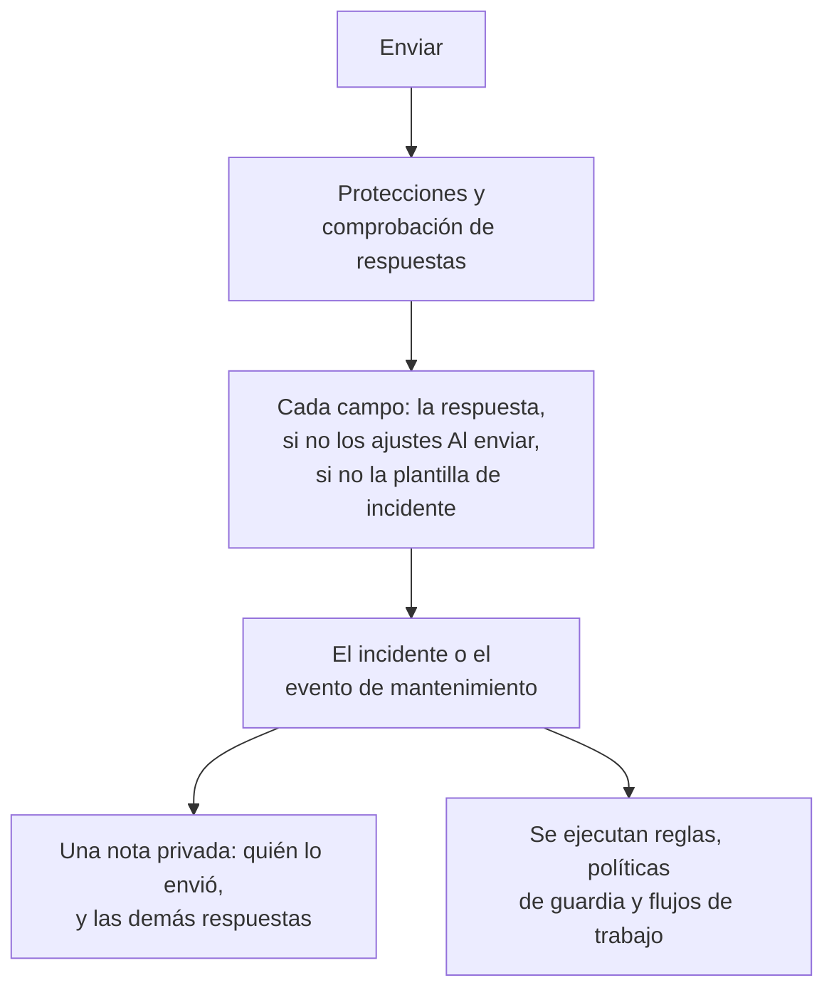

# Lo que crea un envío

Cada envío a través de un formulario crea un registro en tu proyecto: un **incidente** o un **evento de mantenimiento programado**. La página **Al enviar** de un formulario muestra cuál, y cómo se rellena cada campo del registro nuevo — a partir de una respuesta, de un valor predeterminado, de un ajuste que siempre se aplica, o de la plantilla de incidente. **Editar configuración** cambia los valores predeterminados y lo que siempre se aplica.

:::cards
- [Cómo un envío se convierte en un incidente](#cómo-un-envío-se-convierte-en-un-incidente): Cada campo del incidente nuevo, y de dónde sale su valor.
- [Cómo un envío se convierte en un evento de mantenimiento programado](#cómo-un-envío-se-convierte-en-un-evento-de-mantenimiento-programado): Lo mismo, para una solicitud de mantenimiento.
- [Los ajustes Al enviar](#los-ajustes-al-enviar): Valores predeterminados, lo que siempre se adjunta, propietarios y publicación.
- [La nota privada](#la-nota-privada): Quién lo envió, y las respuestas que no guarda ningún campo.
:::

## Qué pasa al enviar

Un envío que no supera una comprobación no crea nada. Consulta [Qué protege un formulario](/docs/forms/sharing-and-security#qué-protege-un-formulario).

## Lo que crea cada envío

La tarjeta **Lo que crea cada envío** guarda la elección que hiciste al crear el formulario:

- **Incidente** — cada envío declara un incidente, así que tu equipo de guardia se entera al momento. Úsalo para notificar problemas.
- **Mantenimiento programado** — cada envío programa un evento de mantenimiento. Úsalo para solicitudes de cambio y de mantenimiento.

Elegir la otra opción te pide confirmación, porque el formulario cambia con ella:

- El título, la descripción, los monitores y las etiquetas siguen vinculados: los dos tipos de registro los tienen.
- Cualquier otra pregunta vinculada — una gravedad, una elección de página de estado, un campo personalizado del tipo anterior — se convierte en una pregunta propia del formulario, con el mismo texto, cuya respuesta se lista en la nota privada.
- Los ajustes Al enviar vuelven a empezar, ya que los ajustes de un incidente y los de un evento son distintos.
- Un formulario que ahora crea eventos de mantenimiento pregunta cuándo empieza y termina el mantenimiento.

Las preguntas se guardan al momento, junto con el cambio. Revísalas en la página **Construir**.

## Cómo un envío se convierte en un incidente

La tarjeta lista cada campo del incidente nuevo y de dónde sale su valor:

| Campo | Sale de |
| --- | --- |
| **Título** | La respuesta a la pregunta **Título**. Cuando el formulario no la hace, o se deja vacía: el **Título predeterminado**, o si no el nombre del formulario. |
| **Descripción** | La respuesta a la pregunta **Descripción**. Cuando no se hace o se deja vacía, la descripción de la plantilla de incidente, si el formulario tiene una plantilla. |
| **Gravedad** | La elección del remitente, cuando el formulario la pide. Si no, el ajuste **Gravedad** del formulario, o si no la gravedad de la plantilla de incidente. |
| **Monitores** | Los monitores que eligió el remitente, junto con los que los ajustes adjuntan siempre. Sin ninguno de los dos, los de la plantilla de incidente. |
| **Etiquetas** | Las etiquetas que eligió el remitente, junto con las que los ajustes añaden siempre. Sin ninguna de las dos, las de la plantilla de incidente. |
| **Inicio del impacto** | La respuesta a **Inicio del impacto**, cuando el formulario la hace. |
| **Plantilla de incidente** | El ajuste **Plantilla de incidente** del formulario. Rellena todo lo que las respuestas y los ajustes dejan sin fijar. |
| **Políticas de guardia** | Las políticas que nombran los ajustes, ejecutadas para cada incidente que declara el formulario. Sin ninguna, las de la plantilla de incidente. |
| **Propietarios** | Las personas y los equipos que nombran los ajustes, junto con los propietarios de la plantilla. Se les avisa de cada incidente. |
| **Campos personalizados** | La respuesta de cada pregunta de campo personalizado — salvo que el campo copie su valor de un campo personalizado de monitor y los monitores del incidente tengan uno; la plantilla rellena el resto. |
| **Páginas de estado** | Nunca se muestra en las páginas de estado, y no se avisa a los suscriptores, hasta que alguien de tu equipo lo publica. |
| **Otras respuestas** | Se listan en una nota privada del incidente, con quién lo envió. |

> [!IMPORTANT]
> **Sin gravedad no hay incidente.** Un incidente necesita una gravedad. Cuando el formulario no pide ninguna y sus ajustes no nombran ninguna — o la que nombraban se eliminó — y su plantilla tampoco fija ninguna, la fila **Gravedad** te avisa, y cada envío se rechaza con "Este formulario no puede crear un incidente porque no tiene gravedad. Avisa al equipo que lo compartió." Elige una gravedad en **Editar configuración**, o una plantilla que fije una.

### La plantilla de incidente

Elige una **Plantilla de incidente** en los ajustes y cada incidente que declara el formulario se declara a partir de ella, del mismo modo en que el servidor aplica una plantilla en cualquier parte — consulta [Cómo se aplica una plantilla](/docs/incidents/settings#cómo-se-aplica-una-plantilla). Las respuestas y los ajustes del formulario van primero, y la plantilla rellena todo lo demás: el estado inicial, la descripción, la gravedad, los recursos afectados, las políticas de guardia, los propietarios, las etiquetas, los valores de los campos personalizados y un cambio de estado de monitor.

> [!WARNING]
> **Cuidado con los monitores.** Declarar un incidente sobre un monitor a través de un formulario afecta al monitor exactamente igual que declararlo a mano: la monitorización activa del monitor se pausa hasta que se resuelve el incidente, y el **Cambiar el estado del monitor a** de una plantilla cambia el estado del monitor al momento — en cada página de estado que lista el monitor, aunque el propio incidente esté oculto. Con un formulario, cualquiera que tenga el enlace puede hacerlo. Adjunta monitores a través de un formulario solo cuando cada envío deba pausarlos.

### Cómo es el incidente

Un incidente declarado a través de un formulario es un incidente normal, con algunos ajustes propios:

- **Oculto en las páginas de estado.** **Visible en la página de estado** está desactivado, igual que **Notificar a suscriptores de la página de estado**. Hasta que un respondedor lo publica, nada del incidente llega a una página de estado ni a un suscriptor — salvo el cambio de estado de monitor de una plantilla, descrito arriba.
- **No lo declara nadie.** El remitente no es un usuario de OneUptime, así que no queda registrado ningún usuario como quien declaró el incidente.
- **Se avisa a sus propietarios.** Los propietarios que nombran los ajustes y la plantilla se añaden en cuanto existen los canales de Slack y Microsoft Teams del incidente, y reciben el aviso — la notificación **Incidente creado** del incidente espera a que sean sus propietarios, para que les llegue a ellos y no a los propietarios del proyecto.
- **Una nota privada registra el envío** — consulta [La nota privada](#la-nota-privada).

Todo lo que se ejecuta para un incidente nuevo se ejecuta también para estos: las reglas de privacidad, de propietarios, de etiquetas, de guardia y de runbooks, las políticas de guardia y los flujos de trabajo **On Create Incident**. Las reglas de guardia coinciden con los incidentes de un formulario como con cualquier otro — también por su título y su descripción, que escribió el remitente.

:::steps
#### Lee lo que escribió el remitente

El título y la descripción se muestran en las páginas de estado una vez que se publica el incidente.

#### Publica el incidente

Activa **Visible en la página de estado** desde la página **Ajustes** del incidente.

#### Avisa a los suscriptores, si deben saberlo

Como el incidente se declaró con **Notificar a suscriptores de la página de estado** desactivado, publicarlo no envía la notificación «incidente creado». Para avisar a los suscriptores, publica una nota pública con **Notificar a suscriptores de la página de estado** marcado — consulta [Publicar una nota pública](/docs/incidents/notes-owners-and-feed#publicar-una-nota-pública).
:::

## Cómo un envío se convierte en un evento de mantenimiento programado

| Campo | Sale de |
| --- | --- |
| **Título** | La respuesta a la pregunta **Título**. Cuando el formulario no la hace, o se deja vacía: el **Título predeterminado**, o si no el nombre del formulario. |
| **Descripción** | La respuesta a la pregunta **Descripción**. |
| **Comienza en**, **Termina en** | Las respuestas a **Comienza en** y **Termina en**, que cada formulario de mantenimiento hace y exige. El fin debe ser posterior al inicio. |
| **Monitores** | Los monitores que eligió el remitente, junto con los que los ajustes adjuntan siempre. |
| **Páginas de estado** | Las páginas de estado que eligió el remitente, junto con las que nombran los ajustes. |
| **Etiquetas** | Las etiquetas que eligió el remitente, junto con las que los ajustes añaden siempre. |
| **Propietarios** | Las personas y los equipos que nombran los ajustes. Son propietarios de cada evento que programa el formulario. |
| **Mostrar en las páginas de estado** | **No** salvo que los ajustes lo activen. |
| **Notificar a los suscriptores** | **No** salvo que los ajustes lo activen. |
| **Campos personalizados** | La respuesta de cada pregunta de campo personalizado — salvo que el campo copie su valor de un campo personalizado de monitor y los monitores del evento tengan uno. |
| **Otras respuestas** | Se listan en una nota privada del evento, con quién lo envió. |

El evento empieza en el estado **Scheduled** de tu proyecto y avanza como cualquier otro: pasa a estar en curso cuando empieza y termina cuando acaba.

Un envío es la solicitud de alguien, y una solicitud se revisa antes de publicarse. Así que, salvo que lo cambies, el evento queda fuera de sus páginas de estado hasta que alguien de tu equipo lo muestra, y no se avisa a sus suscriptores cuando se crea, empieza o termina. **Mostrar en las páginas de estado** y **Notificar a los suscriptores**, en el paso **Publicación** de los ajustes, cambian eso para cada evento que programa el formulario — actívalos solo cuando confíes en todos los que tienen el enlace.

## Los ajustes Al enviar

**Editar configuración** abre los ajustes por pasos: **Siguiente** avanza, y **Guardar cambios** está en el último paso. Cada paso ya está relleno, así que la lista de pasos junto al formulario abre cualquiera de ellos, incluido el último: cambia un ajuste en su paso, luego abre el último paso y guarda.

| Paso | Formulario de incidente | Formulario de mantenimiento |
| --- | --- | --- |
| **Valores predeterminados** | **Título predeterminado**, **Gravedad**, **Plantilla de incidente** | **Título predeterminado** |
| **Asociar siempre** | **Monitores**, **Etiquetas**, **Políticas de guardia** | **Monitores**, **Páginas de estado**, **Etiquetas** |
| **Propietarios** | **Propietarios** | **Propietarios** |
| **Publicación** | — | **Mostrar en las páginas de estado**, **Notificar a los suscriptores** |

**Propietarios** es un solo selector para personas y equipos: **Añadir propietario** abre una sola lista de búsqueda con ambos, y cada elección aparece como una etiqueta que puedes quitar. Todo lo que nombran los ajustes debe pertenecer al proyecto del formulario, y los propietarios deben ser miembros de él. Un registro eliminado después de elegirse se omite cuando se crea un envío, y el resto se sigue aplicando.

## La nota privada

Cada envío deja una nota privada en lo que creó:

> Submitted through the form **Report a Problem** by Ada Lovelace (<ada@example.com>).
>
> **Which office are you in?**\
> Berlin

Nombra el formulario y el remitente — "Submitted anonymously through the form **Report a Problem**." cuando el formulario no preguntó quién es —, luego, cuando el envío empezó desde una de las plantillas del formulario, dice cuál: "Started from the template **Application Outage**." — y después lista las respuestas a las preguntas propias del formulario, cada una bajo su pregunta, en el orden del formulario. Las respuestas a las preguntas vinculadas ya están en el registro: su título, su gravedad, sus campos personalizados. Como es privada, la nota nunca llega a una página de estado, pero se publica en los canales de Slack y Microsoft Teams del registro como cualquier otra nota.

La dirección es un enlace que escribe exactamente a esa dirección — en el panel, en Slack y en el correo a los propietarios.

## Preguntas ocultas y plantillas

Una [pregunta oculta](/docs/forms/building#preguntas-ocultas) se responde desde la [plantilla](/docs/forms/building#plantillas) con la que empezó el envío — nunca desde la solicitud —, y su respuesta va exactamente adonde iría una escrita: una **Descripción** oculta se convierte en la descripción del incidente, un campo personalizado oculto en su valor, una pregunta propia del formulario oculta en una línea de la nota privada. Un envío que no empezó desde ninguna plantilla deja sin respuesta las preguntas ocultas, y sus campos se rellenan con los ajustes Al enviar, como en cualquier pregunta que se deja vacía. Una plantilla eliminada mientras alguien tenía el formulario abierto no detiene su envío: se crea tal como respondió, sin las respuestas ocultas de la plantilla.

Una plantilla puede hacer las preguntas del formulario [a su manera](/docs/forms/building#cómo-pregunta-una-plantilla-cada-pregunta), y el servidor exige al envío las preguntas tal como las hace la plantilla que nombra. Una pregunta que la plantilla oculta se responde desde la plantilla, como una pregunta oculta, aunque el formulario la haga; una que la plantilla hace se lee de la solicitud, aunque el formulario la oculte; y una que la plantilla exige debe responderse, o el envío se rechaza y no se crea nada.

Las respuestas que una plantilla rellenó en la página pasan a ser del remitente en cuanto envía: el servidor toma las respuestas que la solicitud envía para las preguntas que hace la página, dijera lo que dijera la plantilla.

## Texto que escribe un remitente

Un envío va directo a lugares donde el texto puede actuar por sí solo — canales de Slack y Microsoft Teams, el navegador de cada respondedor, los correos de los propietarios — y nadie lo lee antes. Así que, antes de crear el registro:

| Lo que escribe el remitente | Lo que se guarda |
| --- | --- |
| Una mención, como \<!channel\>, \<!here\> o \<@U0123ABC\>, en el título, la descripción o cualquier respuesta de texto | **Las menciones no avisan a nadie.** Todo lo que Slack lee como una mención recibe un carácter invisible después de su corchete de apertura. Se lee igual en todas partes, pero ninguna herramienta de chat actúa sobre ello. |
| Una imagen, en la descripción o en una respuesta **Texto enriquecido** | **Las imágenes se convierten en enlaces.** Cada imagen se convierte en un enlace a la misma dirección, así que no se carga nada desde donde eligió el remitente hasta que un respondedor hace clic en él. |
| Un bloque de código cuyo lenguaje es `mermaid`, escrito como sea | **Los diagramas se convierten en código.** Se guarda como código sin más, así que muestra su texto en lugar de dibujar un diagrama. |
| Sintaxis de imagen o un bloque de diagrama en el título | **El título es texto sin formato.** También reciben el carácter invisible, así que dondequiera que acabe el título — un episodio, un mensaje de chat, una plantilla de nota — no carga nada ni dibuja nada. Los caracteres invisibles cuentan para el límite del título. |

Todo lo demás — los enlaces, el resto del Markdown, las opciones de las listas desplegables, los números, las fechas, una casilla marcada — se guarda tal como lo dio el remitente, y el envío conserva el nombre y el correo del remitente tal como los escribió.

## Próximos pasos

:::cards
- [Crear un formulario](/docs/forms/building): Las preguntas que alimentan estos campos, las preguntas ocultas y las plantillas.
- [Configuración y automatización de incidentes](/docs/incidents/settings): Plantillas de incidente y campos personalizados.
- [Notas, responsables y actividad de incidentes](/docs/incidents/notes-owners-and-feed): Notas privadas, notas públicas y propietarios.
- [Compartir y seguridad](/docs/forms/sharing-and-security): Quién puede enviar, y con qué frecuencia.
:::
