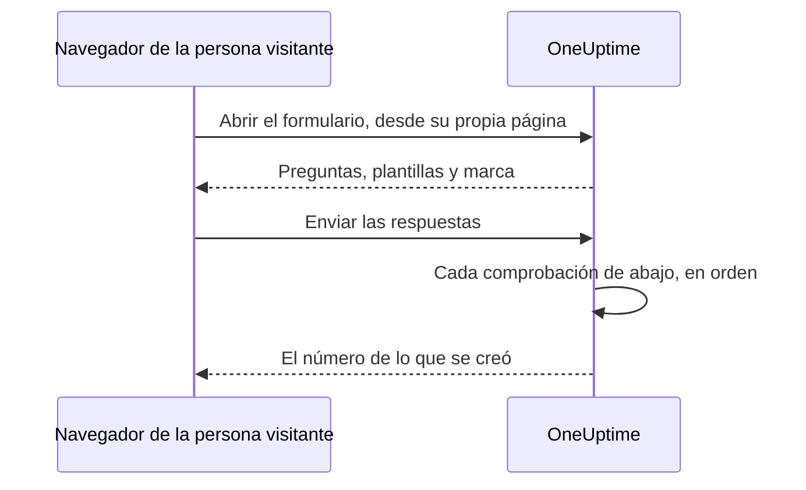

# Compartir y seguridad

Un formulario está abierto a cualquiera que tenga su enlace, y cada envío puede avisar a tu equipo de guardia o poner una ventana de mantenimiento en tu calendario. Esta página trata de la página **Compartir** del formulario — el enlace, desactivar el formulario, el mensaje después de enviar y la lista de IP permitidas — y de cada otra comprobación que pasa una solicitud por el camino.

:::cards
- [Compartir el enlace](#compartir-el-enlace): Cópialo, ábrelo y restablécelo cuando llegue demasiado lejos.
- [Un enlace para cada plantilla](#un-enlace-para-cada-plantilla): Un marcador por caso, un solo formulario detrás de todos.
- [Qué protege un formulario](#qué-protege-un-formulario): Cada comprobación que pasa una solicitud, en orden.
- [Solución de problemas](#solución-de-problemas): Qué significa cada mensaje de la página del formulario, y qué hacer.
:::

## La página Compartir

| Tarjeta | Lo que contiene |
| --- | --- |
| **Estado** | **Acepta envíos** — si el enlace del formulario funciona. |
| **Enlace para compartir** | El enlace, con **Copiar enlace**, **Abrir formulario** y **Restablecer enlace**. |
| **Después de enviar** | El **Mensaje de agradecimiento** que ven las personas cuando envían, bajo el número de lo que creó el formulario. |
| **Acceso** | La **Lista de IP permitidas**. |

## Compartir el enlace

La tarjeta **Enlace para compartir** muestra el enlace del formulario, como `https://oneuptime.com/accounts/form/<share-key>`:

- **Copiar enlace** lo copia.
- **Abrir formulario** abre el formulario en una pestaña nueva, tal como lo ven las personas.
- **Restablecer enlace** da al formulario un enlace nuevo, después de que lo confirmes. El enlace anterior deja de funcionar al momento y muestra el mensaje de no disponible, así que todas las personas con las que lo compartiste necesitan el nuevo. Úsalo cuando un enlace ha llegado más lejos de lo que debía.

Cualquiera que tenga el enlace puede abrir el formulario y enviarlo, sin una cuenta de OneUptime y sin iniciar sesión. Tener la sesión iniciada no cambia nada: OneUptime solo sabe quién envió por el nombre y el correo escritos en el formulario. Así que trata el enlace como un número de teléfono de tu equipo de guardia. Compártelo donde lo encontrarán las personas que deben usarlo — una página de la intranet, un runbook de soporte, un mensaje fijado en un chat — y no en un sitio web público, salvo que quieras envíos de cualquiera.

El enlace lleva una clave aleatoria propia, no el ID del formulario. En una instalación autoalojada se sirve desde tu propio host de OneUptime, y solo funciona en la dirección que configuran `HTTP_PROTOCOL` y `HOST`: si se abre con otro nombre del servidor, o con su dirección IP, las solicitudes del formulario se rechazan como si vinieran de otro sitio web.

Los enlaces a los antiguos formularios de incidente, `/accounts/incident-form/<share-key>`, abren el mismo formulario en su nueva dirección.

### Un enlace para cada plantilla

Cada una de las [plantillas](/docs/forms/building#plantillas) del formulario tiene un enlace propio: el enlace del formulario con `?template=` y el id de la plantilla, como `https://oneuptime.com/accounts/form/<share-key>?template=<template-id>`. **Copiar enlace** en la página **Plantillas** del formulario lo copia. Abre el formulario con esa plantilla rellenada, así que un equipo puede guardar un marcador por caso mientras tú mantienes un solo formulario. Cuando el remitente elige otra plantilla, la dirección de su navegador la sigue, así que el enlace que copia es el formulario tal como lo ve.

El enlace de una plantilla es el enlace del formulario: funciona mientras el formulario está en **Acepta envíos**, y **Restablecer enlace** lo retira junto con el resto. Un enlace que nombra una plantilla que eliminaste abre el formulario como si no nombrara ninguna — con la plantilla predeterminada, si la hay.

### Desactivar un formulario

Para dejar de aceptar envíos sin eliminar el formulario, desactiva **Acepta envíos**. El enlace muestra entonces "Este formulario no está disponible. Es posible que se haya desactivado o que el enlace esté desactualizado.", y la tarjeta **Enlace para compartir** te recuerda que el formulario está desactivado. Vuelve a activarlo y el mismo enlace funciona de nuevo.

### El mensaje de agradecimiento

Después de un envío, la página dice "Gracias: tu respuesta se ha enviado." y da el número de lo que se creó, y luego tu **Mensaje de agradecimiento**, en Markdown. Úsalo para decir qué pasa a continuación, y adónde acudir cuando algo es urgente. Sin él, la página muestra solo el mensaje estándar.

Una imagen en la descripción o el mensaje de agradecimiento del formulario se muestra a todos los que abren el enlace mientras el formulario está en **Acepta envíos**. Desactiva el formulario, o quita la imagen, y la imagen vuelve a ser privada, salvo que algo más que ve todo el mundo la siga conteniendo.

## Qué protege un formulario

Cada solicitud pasa estas comprobaciones, en este orden:

1. La solicitud debe venir de la propia página del formulario, no de otro sitio web — consulta [Solicitudes desde otros sitios web](#solicitudes-desde-otros-sitios-web).
2. Debe estar dentro de los límites de frecuencia.
3. El formulario debe existir, estar en **Acepta envíos** y pertenecer a un proyecto con un plan que incluya formularios.
4. Debe venir de una dirección de la **Lista de IP permitidas**, cuando el formulario tiene una.
5. Un envío debe superar el captcha, cuando la instancia tiene el captcha activado.
6. Cada respuesta debe estar dentro de los límites de tamaño y encajar con su pregunta — consulta [Crear un formulario](/docs/forms/building#límites-de-tamaño).
7. Lo que forman las respuestas y los ajustes debe poder crearse: un incidente necesita una gravedad, un evento un fin posterior a su inicio.
8. Un envío debe caber en la cuota por hora del formulario — consulta [Límites de frecuencia](#límites-de-frecuencia).

El logotipo y el favicon de un formulario forman parte del formulario: se envían dentro de la respuesta que lo abre, en base64, solo una vez superadas las cuatro primeras comprobaciones, y nunca desde una dirección propia. Nadie puede obtenerlos sin el formulario, y ningún archivo puede obtenerse por su id a través de un formulario; los propios archivos siguen siendo privados. Un formulario muestra solo imágenes subidas en su propio proyecto: un archivo de otro proyecto se rechaza al guardar el formulario, y nunca se envía a su página.

### Lista de IP permitidas

Para limitar un formulario a tus propias redes:

:::steps
1. Abre la página **Compartir** del formulario.
2. En la tarjeta **Acceso**, haz clic en **Editar lista de IP permitidas**.
3. Escribe una red por línea y guarda. La tarjeta las lista entonces bajo **Lista de IP permitidas**.
:::

Cada línea es una de estas:

| Entrada | Ejemplo | Nota |
| --- | --- | --- |
| Una dirección IPv4 | `203.0.113.7` | |
| Una dirección IPv6 | `2001:db8::7` | Coincide se escriba como se escriba, en mayúsculas o con sus ceros escritos. |
| Un rango IPv4, en notación CIDR | `10.0.0.0/8` | Los rangos IPv6 no se admiten — lista cada dirección IPv6 en una línea propia. |

Una dirección IPv4 debe escribirse como tal: escrita al modo IPv6, como `::ffff:203.0.113.7`, se rechaza. La lista se comprueba cada vez que se guarda — desde el panel, la API, Terraform o un flujo de trabajo —, y una línea que nunca podría coincidir se rechaza con un mensaje que la nombra. Deja la lista vacía para permitir todas las redes. En cuanto tiene una entrada, se rechaza una solicitud cuya dirección no puede determinarse.

En OneUptime Cloud, fijar la lista de IP permitidas requiere el plan **Scale** — tanto al crear un formulario con una a través de la API como al editarlo —, igual que la lista de IP permitidas de un [panel público](/docs/dashboards/sharing). Vaciarla funciona en todos los planes.

### Solicitudes desde otros sitios web

Un navegador le dice a un servidor qué página envió una solicitud. Cuando la página de otro sitio web hace que el navegador de un visitante abra o envíe un formulario, la solicitud se rechaza con "This form can only be used from its own page." — antes de que ningún límite de frecuencia la cuente, y sea cual sea el enlace, así que la respuesta no dice nada sobre qué formularios existen.

Una solicitud se rechaza cuando su cabecera `Sec-Fetch-Site` está presente y dice algo distinto de `same-origin` o `none`, o cuando su cabecera `Origin` está presente y no es tu dirección de OneUptime — `HTTP_PROTOCOL` y `HOST`, con el puerto cuando `HOST` tiene uno. Un envío también debe mandarse como JSON (`application/json`); uno mandado como campos de formulario de una página web, o como texto sin formato, se rechaza con "The request must be a JSON object holding the form's answers in "data".". Leer un formulario también requiere la cabecera que la página del formulario añade a cada solicitud que hace, `X-OneUptime-Form: 1`: una página no puede hacer que un navegador añada una cabecera sin un script, y el script de otro sitio web que añade una se delata con su `Origin`.

### Límites de frecuencia

Abrir un formulario y enviarlo están limitados por dirección de red, y enviar está limitado también por formulario:

- **Abrir un formulario** — por formulario desde una dirección, y por dirección en todos los formularios, con margen para que toda una oficina abra el enlace a la vez. Superado cualquiera de los dos, la página muestra "Demasiadas solicitudes. Vuelve a intentarlo más tarde." Si no se puede contactar con el limitador de frecuencia, los formularios se siguen abriendo.
- **Enviar, por dirección** — por formulario desde una dirección, y por dirección en todos los formularios. Superado cualquiera de los dos, el remitente ve "Se han enviado demasiados informes desde tu red. Espera unos minutos y vuelve a intentarlo." Todos los que están detrás de una misma dirección — una red de oficina, una puerta de enlace VPN — comparten estos límites, y cada envío cuenta, incluso uno que luego se rechaza por una respuesta incorrecta.
- **Enviar, por formulario** — cuántos registros puede crear un formulario en una hora, desde todas las direcciones juntas, así que incluso los envíos desde muchas direcciones a la vez solo pueden avisarte un número limitado de veces por hora. Solo cuenta un envío que superó todas las demás comprobaciones, justo antes de crearse su registro. Superado, todos ven "Este formulario está recibiendo demasiados envíos en este momento. Vuelve a intentarlo más tarde." hasta que termina la ventana. **Restablecer enlace** empieza el enlace nuevo con una cuota nueva.

Cada límite responde `429` con una cabecera `Retry-After`, en segundos, y la página le dice al remitente cuándo volver a intentarlo. Las ventanas son fijas, no móviles. Si no se puede contactar con el limitador de frecuencia, los envíos se rechazan en lugar de dejarlos pasar sin contar: la API responde `503`, y el remitente ve "No se pueden aceptar envíos en este momento. Vuelve a intentarlo en unos minutos."

En una instalación autoalojada, estas variables de entorno de la app de OneUptime cambian los límites:

| Variable | Valor predeterminado | Lo que fija |
| --- | --- | --- |
| `FORM_RATE_LIMIT_WINDOW_SECONDS` | `60` | La ventana para abrir formularios, en segundos. |
| `FORM_RATE_LIMIT_PER_FORM_AND_IP_PER_WINDOW` | `120` | Cuántas veces puede una dirección abrir un formulario por ventana. |
| `FORM_RATE_LIMIT_PER_IP_PER_WINDOW` | `600` | Cuántas veces puede una dirección abrir formularios por ventana, en todos los formularios. |
| `FORM_SUBMIT_RATE_LIMIT_WINDOW_SECONDS` | `900` | La ventana de los límites de envío por dirección, en segundos. |
| `FORM_SUBMIT_RATE_LIMIT_PER_FORM_AND_IP_PER_WINDOW` | `10` | Envíos a un formulario desde una dirección por ventana. |
| `FORM_SUBMIT_RATE_LIMIT_PER_IP_PER_WINDOW` | `30` | Envíos desde una dirección por ventana, en todos los formularios. |
| `FORM_SUBMIT_RATE_LIMIT_PER_FORM_WINDOW_SECONDS` | `3600` | La ventana del límite por formulario, en segundos. |
| `FORM_SUBMIT_RATE_LIMIT_PER_FORM_PER_WINDOW` | `60` | Registros que puede crear un formulario por ventana, desde todas las direcciones juntas. |

Cada variable también lee su nombre antiguo, con `INCIDENT_FORM_` delante en lugar de `FORM_` — como `INCIDENT_FORM_SUBMIT_RATE_LIMIT_PER_FORM_PER_WINDOW` —, así que una instalación que ajustó los formularios de incidente conserva sus límites; el nombre nuevo gana cuando ambos están fijados. Ni `config.env` ni los valores del chart de Helm los transmiten: añádelos tú mismo al entorno del contenedor `app` — con `app.extraEnv`, o el `extraEnv` de todo el chart, en el chart de Helm, o en un `docker-compose.override.yml` para Docker Compose. `TRUSTED_PROXY_HOPS` decide qué dirección cuentan los límites por dirección.

### Captcha

Cuando tu instancia de OneUptime tiene hCaptcha activado, el formulario muestra un captcha, y un envío que no lo ha superado se rechaza. No hay un ajuste por formulario. Una instalación autoalojada activa el captcha con `CAPTCHA_ENABLED`, `CAPTCHA_SITE_KEY` y `CAPTCHA_SECRET_KEY` — los mismos ajustes que protegen el registro. Sin él, los límites de frecuencia y la lista de IP permitidas soportan la carga.

## Solución de problemas

:::details El enlace dice que el formulario no está disponible
"Este formulario no está disponible. Es posible que se haya desactivado o que el enlace esté desactualizado." La página da la misma respuesta sea cual sea el motivo, así que nunca le dice a un desconocido si un formulario existe:

- **Acepta envíos** está desactivado en la página **Compartir**.
- El enlace se sustituyó con **Restablecer enlace**. Comparte el nuevo.
- El formulario se eliminó.
- En OneUptime Cloud, el proyecto está por debajo del plan **Growth**, o su suscripción está impagada.
- El enlace se cortó al copiarlo.
:::

:::details El formulario solo puede abrirse desde una red permitida
"Este formulario solo se puede abrir desde una red permitida." La dirección del remitente no está en la **Lista de IP permitidas** del formulario: añade su red, o vacía la lista. En una instalación autoalojada detrás de un proxy o un balanceador de carga, comprueba `TRUSTED_PROXY_HOPS` — cuando es demasiado bajo, OneUptime ve la dirección de tu proxy en lugar de la del remitente. La página dice lo mismo cuando el formulario se abrió en otra dirección distinta de la de tu propio OneUptime: abre el enlace exactamente como lo muestra la tarjeta **Enlace para compartir**.
:::

:::details Demasiados envíos
"Se han enviado demasiados informes desde tu red. Espera unos minutos y vuelve a intentarlo." Todos los que están detrás de una misma dirección comparten los límites por dirección, lo que importa durante una caída grande, cuando mucha gente lo notifica a la vez. La página dice cuándo volver a intentarlo. "Este formulario está recibiendo demasiados envíos en este momento. Vuelve a intentarlo más tarde." es en cambio la cuota por formulario: no tiene que ver con la red del remitente, y los avisos se vuelven a aceptar cuando termina la ventana. Si los envíos no son genuinos porque el enlace llegó más lejos de lo que debía, **Restablecer enlace** detiene el enlace anterior al momento.
:::

:::details Los envíos no pueden aceptarse ahora mismo
"No se pueden aceptar envíos en este momento. Vuelve a intentarlo en unos minutos." No se pudo contactar con el limitador de frecuencia, así que los envíos se rechazan en lugar de dejarlos pasar sin contar. Abrir el formulario sigue funcionando. En una instalación autoalojada, comprueba que Valkey, la caché en la que cuenta el limitador de frecuencia, está activo y accesible desde la app de OneUptime.
:::

:::details Este formulario no puede crear un incidente porque no tiene gravedad
El formulario no pide una gravedad, sus ajustes no nombran ninguna — o la que nombraban se eliminó — y su plantilla de incidente tampoco fija ninguna. Elige una gravedad en la página **Al enviar** del formulario. Consulta [Sin gravedad no hay incidente](/docs/forms/on-submit#cómo-un-envío-se-convierte-en-un-incidente).
:::

:::details Se rechaza un envío
El mensaje dice qué está mal: falta una respuesta obligatoria o solo tiene espacios, una respuesta es demasiado larga o no encaja con su pregunta, la dirección de correo no es una sola dirección normal, o una ventana de mantenimiento termina antes de empezar. "La verificación del captcha ha fallado. Vuelve a intentarlo." significa que no se superó el captcha, o que caducó: resuélvelo de nuevo. En una instalación autoalojada en la que todos los envíos fallan el captcha, comprueba que `CAPTCHA_SITE_KEY` y `CAPTCHA_SECRET_KEY` están ambos fijados.
:::

:::details Una pregunta no está en el formulario
El editor marca las preguntas que deja fuera del formulario público — un campo personalizado que se eliminó, por ejemplo —, y **Vista previa** dice cuándo omite una. Consulta [Cuando el editor marca una pregunta](/docs/forms/building#cuando-el-editor-marca-una-pregunta). Una pregunta con la insignia **Oculto** se deja fuera a propósito: solo las plantillas la responden. Consulta [Preguntas ocultas](/docs/forms/building#preguntas-ocultas). Una pregunta también puede estar en el formulario para una plantilla y fuera de él para otra: cada plantilla puede ocultar una pregunta, o hacer una que el formulario oculta. Abre **Editar** de la plantilla y revisa sus **Preguntas**. Consulta [Cómo pregunta una plantilla cada pregunta](/docs/forms/building#cómo-pregunta-una-plantilla-cada-pregunta).
:::

:::details Una plantilla no rellena una pregunta
La respuesta de una plantilla solo se usa mientras sigue encajando con su pregunta: una opción que la pregunta aún ofrece, un registro que el formulario aún ofrece, un texto que no es demasiado largo. Edita la plantilla, responde de nuevo a la pregunta y guárdala. Consulta [Plantillas](/docs/forms/building#plantillas).
:::

:::details El incidente o el evento no está en la página de estado
Es así a propósito: los incidentes de un formulario se declaran ocultos, y los eventos de mantenimiento siguen ocultos salvo que los ajustes de **Publicación** del formulario digan otra cosa. Consulta [Lo que crea un envío](/docs/forms/on-submit).
:::

:::details No se avisó a nadie
El incidente de un formulario ejecuta las políticas de guardia que nombran sus ajustes y su plantilla, y lo que añadan tus reglas de guardia, como cualquier otro incidente. Sin ninguna de ellas, no se avisa a nadie. Añade una política de guardia en la página **Al enviar** del formulario, o escribe una regla de guardia que coincida con sus incidentes — por una etiqueta que el formulario siempre añade, por ejemplo.
:::

## Próximos pasos

:::cards
- [Visión general de los formularios](/docs/forms/index): Para qué sirven los formularios, los permisos y la API.
- [Crear un formulario](/docs/forms/building): Las preguntas, las preguntas ocultas y las plantillas.
- [Lo que crea un envío](/docs/forms/on-submit): El incidente o el evento que crea cada envío.
:::
