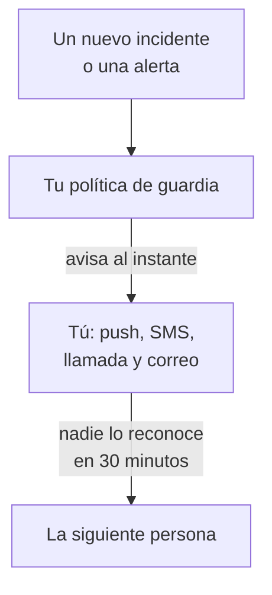

# Recibir avisos por llamada, SMS o push

Al final de esta guía, recibes un aviso en el teléfono por cada nuevo incidente y cada nueva alerta de tu proyecto, por notificación push, SMS o llamada; si nadie lo reconoce en 30 minutos, se avisa a la siguiente persona, y un aviso de prueba que has reconocido demuestra que funciona. La guía sigue la configuración guiada **Avisar a la persona adecuada cuando algo falle** y lleva unos 10 minutos.

## Qué necesitas

- Un proyecto del que seas propietario: solo su propietario puede activar los SMS y las llamadas, y solo su propietario o un administrador puede crear una política de guardia.
- Tu teléfono móvil.
- Los miembros del equipo a los que quieres avisar, ya añadidos al proyecto: [Invitar a personas](/docs/permissions/inviting-people) explica cómo.

:::tabs
@tab OneUptime Cloud
Las notificaciones push son gratuitas en todos los planes. Los SMS y las llamadas se pagan con el saldo del proyecto, que empieza en 0.00 USD, y añadir un número de teléfono envía un SMS, así que antes el saldo debe superar 1.00 USD. Al añadir saldo se hace un cargo en la tarjeta del proyecto. El plan Free admite una sola persona y una sola regla de escalado: solo se te avisa a ti, y el aviso se repite en lugar de llegar a otra persona.
@tab Autoalojado
Tu servidor debe poder enviar correos, SMS y llamadas. Su administrador principal los configura en `/admin/setup`, con una prueba para cada uno, como muestra la [Guía de autoalojamiento](/docs/installation/self-hosting-guide). Las notificaciones push llegan a la app a través del relé push de OneUptime, sin nada que configurar.
:::

## Pasos

:::steps
### Abrir la configuración guiada

En la página **Inicio** de tu proyecto, haz clic en **Configura una política de guardia**, en la lista **Te damos la bienvenida a OneUptime 👋**. La página de inicio de un proyecto nuevo empieza preguntando **¿Qué quieres hacer primero?**: marca **Avisar a la persona adecuada cuando algo falle** y haz clic en **Continuar**. Si el paso no aparece o ya está hecho, pulsa `Ctrl+K` (`Cmd+K` en un Mac), escribe `get paged` y elige **Avisar a la persona adecuada cuando algo falle**.

### Instalar la app en el teléfono

Instala OneUptime On-Call desde el App Store o Google Play e inicia sesión: así la app registra tu teléfono para las notificaciones push. De vuelta en la configuración, haz clic en **Volver a comprobar**: **App móvil o navegador**, en **¿Cómo debemos localizarte?**, ya muestra tu teléfono.

### Activar los SMS y las llamadas

Los proyectos nuevos empiezan con los SMS y las llamadas desactivados. Si eres el propietario del proyecto, haz clic en **Activar SMS y llamadas**; a cualquier otra persona se le indica quién puede hacerlo. En OneUptime Cloud, si el saldo es de 1.00 USD o menos, haz clic en **Añadir saldo**, introduce entre 20 y 1.000 USD en **Importe (USD)** y haz clic en **Recargar**.

### Añadir tu número de teléfono

Escribe tu número de móvil con el prefijo de país en **Tu número de teléfono**, por ejemplo `+15551234567`, y haz clic en **Envíame un código por SMS**. Introduce el código del SMS y haz clic en **Verificar**: ese mismo número también recibe las llamadas de los avisos. Haz clic en **Continuar**. Para recibir avisos solo por la app y por correo, no añadas el número y haz clic en **Continuar** directamente.

### Elegir a quién más se avisa

En **¿Quién más está de guardia?**, ya estás en **Avisados primero**. Haz clic en **Añadir miembros del equipo** para avisar a otras personas contigo y, después, en **Guardar y continuar**. En un proyecto que aún no tiene ninguna política de guardia, esto crea `Default on-call policy`, que avisa a todos con cada nuevo incidente y cada nueva alerta. En un proyecto que ya tiene una, elígela en **Política de guardia** y añade a las personas en **Añadir a la primera regla de escalado**. Si aún no se puede localizar a alguien, el paso se queda abierto en **¿Les llega un aviso?**: haz clic en **Enviar recordatorio de configuración** para esa persona y, después, en **Continuar**.

### Decidir qué pasa si nadie responde

En **¿Y si nadie responde?**, mantén **Avisar a otra persona**, elige a quién en **Avisados después** y deja **Minutos de espera** en `30` o cámbialo. Haz clic en **Guardar y continuar**. En el plan Free, el paso ofrece en su lugar **Volver a avisar a las mismas personas**, con **Veces que se vuelve a avisar** en `2`.

### Enviar un aviso de prueba

En **Enviar un aviso de prueba**, haz clic en **Probar esta política**. Elige una **Gravedad** y haz clic en **Enviar aviso de prueba**. Se avisa a quienes están en la primera regla de escalado de la política, igual que con un incidente real, y cada mensaje dice TEST. No se crea ningún incidente, y no se informa a ninguna página de estado ni a ningún suscriptor.

### Reconocer el aviso de prueba

Abre el enlace del SMS o del correo y reconoce ahí el aviso, o pulsa 1 durante la llamada. La app muestra que el aviso ha llegado, pero no puede reconocer una prueba. Después haz clic en **Hecho** en el cuadro de diálogo y en **Continuar**.
:::

## Comprobar que ha funcionado

- El paso de prueba dice quién reconoció el aviso, cómo y en cuánto tiempo.
- La configuración termina en **Los avisos están configurados**, con lo que se ha guardado: **A quién se avisa**, **Si nadie responde** y **Probado**. Un problema de la propia política, como alguien a quien no puede localizar, aparece en **Requiere atención**.
- En **Inicio**, la lista marca el paso **Configura una política de guardia** como hecho. Si era el último paso, la lista desaparece.

Si la política avisa a otra persona, también puedes ver el escalado: haz clic en **Abrir la política de guardia** en el resumen y, después, en **Probar esta política**. Activa **Recorrer cada nivel de escalado**, envía la prueba y no reconozcas el primer aviso: se avisa a la siguiente persona como mucho 2 minutos después.

## Qué puede salir mal

:::details No aparece el botón Envíame un código por SMS
Los SMS están desactivados o no se pueden enviar, y el paso dice por qué. Solo un propietario del proyecto, o alguien que gestione la facturación, ve **Activar SMS y llamadas**. En OneUptime Cloud, un saldo de 1.00 USD o menos oculta el campo. En un servidor autoalojado que no puede enviar SMS, su administrador principal ve **Configurar SMS y llamadas**, que abre el Admin Dashboard para añadir Twilio, como muestra [Integración de Twilio](/docs/self-hosted/twilio-integration).
:::

:::details Al añadir saldo, dice que no se encontró ningún método de pago
Al añadir saldo se hace un cargo en la tarjeta del proyecto. Añade una en **Ajustes del proyecto → Facturación y facturas → Facturación** con **Añadir método de pago** y vuelve a añadir saldo. Mientras tanto, la app y el correo siguen avisándote.
:::

:::details Autoalojado: se rechaza el número porque no hay ninguna cuenta de Twilio configurada
Solo al administrador principal se le advierte de antemano de que el servidor no puede enviar SMS. Pídele que configure los SMS y las llamadas en `/admin/setup`. Mientras tanto, haz clic en **Continuar**: la app y el correo siguen avisándote.
:::

:::details El código o el aviso de prueba no llega nunca
Comprueba primero el prefijo de país del número. Tras un aviso de prueba, cierra el cuadro de diálogo con **Hecho** y haz clic en **No me ha llegado**: te dice qué comprobar, y **Abrir mis métodos de notificación** muestra todas las formas de localizarte. En un servidor autoalojado, envía un SMS de prueba desde `/admin/setup` y ejecuta `npm run doctor` en el servidor.
:::

## Próximos pasos

:::cards
- [Programaciones de guardia](/docs/on-call/schedules): Organiza turnos, para que cada aviso llegue a quien esté de guardia. En Cloud, desde el plan Growth.
- [Reglas de escalado](/docs/on-call/escalation-rules): Añade niveles, equipos y programaciones a la política.
- [Cómo contactarme](/docs/notifications/on-call-rules): Elige qué método te avisa primero, y cuándo.
- [Publicar una página de estado](/docs/guides/status-page): Cuenta a tus clientes lo que pasa, en tu propio dominio.
:::
