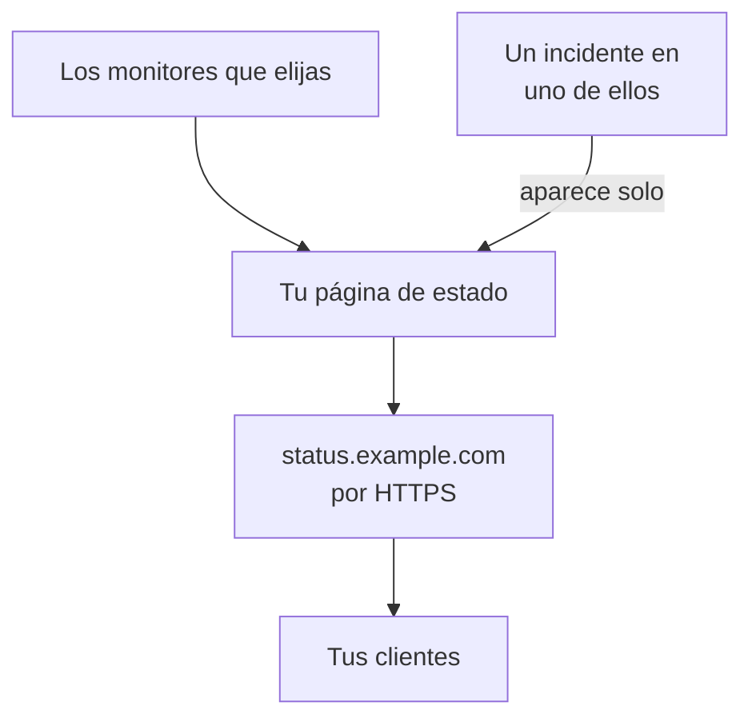

# Publicar una página de estado

Al final de esta guía, tus clientes abren una página de estado en una dirección propia, como `status.example.com`, por HTTPS. Muestra los monitores que elijas con su estado y su tiempo de actividad, y un incidente en uno de ellos aparece en ella por sí solo. La guía sigue la configuración guiada **Publica una página de estado** y después añade tu dominio en **Dominios personalizados**, dentro de la página de estado: unos 15 minutos, más lo que tarde tu proveedor de DNS.

## Qué necesitas

- Al menos un monitor: una página de estado muestra monitores. Si aún no tienes ninguno, la configuración guiada te ofrece antes **Configurar un monitor**.
- El rol de propietario o de administrador del proyecto: crear la página requiere permiso para crear páginas de estado, y añadir tu dominio, permiso para añadir y verificar los dominios del proyecto.
- Un dominio que controles, y acceso a sus registros DNS en tu proveedor de DNS.

:::tabs
@tab OneUptime Cloud
Todos los planes incluyen un dominio personalizado y su certificado SSL gratuito. El plan Free tiene una página de estado por proyecto: si ya tienes una, abre sus **Dominios personalizados** y empieza en el paso que añade tu dominio. Una página de estado nueva es pública; para hacerla privada hace falta el plan Growth.
@tab Autoalojado
Tu servidor necesita un nombre de host propio con un registro A que apunte a él, como `oneuptime.example.com`, y que responda en los puertos 80 y 443. Defínelo como `STATUS_PAGE_CNAME_RECORD` en `config.env` (`statusPage.cnameRecord` en el chart de Helm), en lugar del valor de ejemplo que hay ahí. Los certificados gratuitos también necesitan `LETS_ENCRYPT_ACCOUNT_KEY` (`letsEncrypt.accountKey`): una clave privada creada con openssl y codificada en base64. Reinicia OneUptime después de cambiarlos. **Añadir dominio personalizado** comprueba primero el servidor y muestra lo que aún falta.
:::

## Pasos

:::steps
### Abrir la configuración guiada

En la página **Inicio** de tu proyecto, haz clic en **Publica una página de estado**, en la lista **Te damos la bienvenida a OneUptime 👋**. La página de inicio de un proyecto nuevo empieza preguntando **¿Qué quieres hacer primero?**: marca **Informar a mis clientes con una página de estado** y haz clic en **Continuar**. Si el paso no aparece o ya está hecho, pulsa `Ctrl+K` (`Cmd+K` en un Mac), escribe `status page` y elige **Publica una página de estado**.

### Ponerle nombre y elegir qué muestra

En **Ponle nombre y elige qué muestra**, deja el **Nombre de la página de estado** que te sugiere o escribe uno propio. En **Qué muestra**, marca los monitores que deben ver tus clientes, o haz clic en **Seleccionar todo**. Haz clic en **Crear la página de estado**. Desde este momento, la página es pública en su enlace y muestra solo los monitores que marcaste.

### Mirar lo que ven tus clientes

En **Esto es lo que ven tus clientes**, abre la dirección de **Enlace público**: tus monitores aparecen con su estado. De vuelta en la configuración, haz clic en **Se ve bien**.

### Abrir Dominios personalizados

La configuración termina en un resumen. En **Personalízala (opcional)**, haz clic en **Tu propio dominio**. Se abre **Dominios personalizados** de la página de estado.

### Añadir tu dominio

Haz clic en **Añadir dominio personalizado**. En **Dominio**, escribe la dirección que abrirán tus clientes, como `status.example.com`, y haz clic en **Continuar**. Se abre **Configuración de DNS** con los registros que hay que añadir.

### Añadir los registros DNS

En tu proveedor de DNS, añade cada registro que muestra **Configuración de DNS**, con su **Tipo**, su **Nombre** y su **Valor**: un registro CNAME que apunta la dirección a OneUptime y, la primera vez que el proyecto usa este dominio, un registro TXT que demuestra que el dominio es del proyecto. Si tu proveedor añade el dominio a cada nombre por su cuenta, escribe solo la parte anterior, como `status`, y `@` para el propio dominio.

### Comprobar los registros

Con **Configuración de DNS** abierta, haz clic en **Comprobar ahora**. Debajo de cada registro, indica qué buscó y qué obtuvo. Primero se comprueba el registro TXT: hasta que se encuentra, el dominio no se añade, así que vuelve a hacer clic en **Comprobar ahora** hasta que se encuentre. En cuanto se encuentra el registro CNAME, el cuadro de diálogo dice **Tu registro CNAME está verificado.** y se emite un certificado SSL gratuito, normalmente en menos de 15 minutos.
:::

## Comprobar que ha funcionado

- Abre `https://status.example.com`, cambiándola por tu dirección: tu página de estado se abre sin aviso de certificado.
- En **Dominios personalizados**, el **Estado** del dominio dice **Certificado emitido, se renueva automáticamente.** Durante un rato, aunque la página ya se abra, puede decir **Emitiendo un certificado gratuito, normalmente en menos de 15 minutos.**
- En **Inicio**, la lista marca el paso **Publica una página de estado** como hecho: queda hecho en cuanto una página de estado muestra un monitor. Si era el último paso, la lista desaparece.

No hace falta nada más: OneUptime renueva el certificado por sí mismo. En cuanto el dominio aparece en la lista, OneUptime comprueba su registro CNAME cada 15 minutos y lo verifica cuando el registro está activo, aunque cierres **Configuración de DNS**.

## Qué puede salir mal

:::details El dominio no está en la lista tras cerrar Configuración de DNS
**Configuración de DNS** se cerró antes de que se encontrara su registro TXT, así que el dominio nunca se añadió. Haz clic en **Añadir dominio personalizado**, escribe la misma dirección, haz clic en **Continuar** y después en **Comprobar ahora** hasta que el cuadro de diálogo encuentre los dos registros.
:::

:::details El dominio se queda en «Esperando al DNS»
Abre **Configuración de DNS** desde la fila del dominio y haz clic en **Comprobar ahora**: dice lo que encontró. Comprueba que el nombre del registro es la dirección completa, como `status.example.com`, y que su valor es el que muestra **Configuración de DNS**. Si el nombre responde con una dirección, tiene un registro A o tu proveedor de DNS lo pasa por un proxy: sustituye el registro A, o pon el nombre en DNS only. Para un dominio raíz, como `example.com`, usa el registro ALIAS, ANAME o de aplanamiento de CNAME de tu proveedor.
:::

:::details La columna Estado dice que no se pudo emitir un certificado gratuito
Un registro CAA en tu dominio que no incluye `letsencrypt.org` bloquea el certificado. En un servidor autoalojado, Let's Encrypt debe llegar al servidor por el puerto 80. Corrige la causa: OneUptime sigue intentándolo por su cuenta, y **Comprobar ahora** en **Configuración de DNS** vuelve a pedirlo, como mucho una vez cada 15 minutos por dominio.
:::

:::details Autoalojado: el servidor no está listo para dominios personalizados
**Añadir dominio personalizado** dice **Este servidor aún no está listo para dominios personalizados**, con una línea por cada cosa que aún falta y qué cambiar: los ajustes de [Qué necesitas](#qué-necesitas). Sin `LETS_ENCRYPT_ACCOUNT_KEY`, un dominio verificado dice **Verificado. Usa el HTTPS de tu propio proxy.**: sirve su HTTPS desde tu propio proxy. [Marca y dominios de la página de estado](/docs/status-pages/branding-and-domains#antes-de-empezar) tiene los detalles.
:::

## Próximos pasos

:::cards
- [Marca y dominios de la página de estado](/docs/status-pages/branding-and-domains): Tu logotipo, tus colores, los enlaces de la cabecera y el pie de página.
- [Suscriptores y anuncios](/docs/status-pages/subscribers): Deja que tus clientes se suscriban, y publica anuncios.
- [Visión general del mantenimiento programado](/docs/scheduled-maintenance/index): Informa a tus clientes de los trabajos planificados antes de que empiecen.
- [Recibir avisos por llamada, SMS o push](/docs/guides/paging): Recibe un aviso cuando uno de esos monitores caiga.
:::
