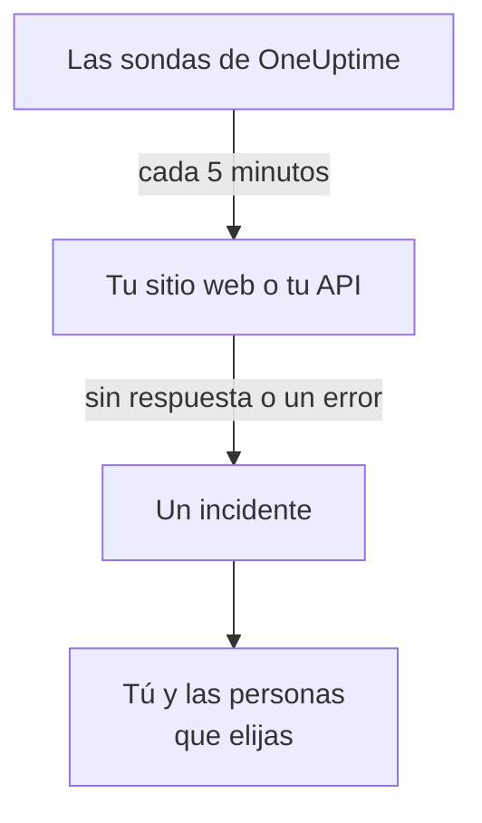

# Saber cuándo tu sitio web o tu API deja de funcionar

Al final de esta guía, OneUptime comprueba tu sitio web o tu API cada 5 minutos y, cuando deja de responder o responde con un error, abre un incidente y te avisa; un aviso de prueba que has reconocido demuestra que el mensaje te llega. La guía sigue la configuración guiada **Saber cuándo cae mi sitio web o mi API** y lleva unos 5 minutos.

## Qué necesitas

- Un proyecto de OneUptime en el que puedas crear monitores: pueden hacerlo un propietario, un administrador o un miembro. Para crear una cuenta y un proyecto, sigue la primera parte del [Inicio rápido](/docs/introduction/quickstart#crear-un-proyecto).
- La dirección que hay que comprobar, como `https://example.com`. Para una API, elige un endpoint que responda a un `GET` simple, sin clave, como un health check: una respuesta como `401` cuenta como caída.

:::tabs
@tab OneUptime Cloud
La dirección se comprueba desde sondas de varias regiones, así que debe ser accesible desde internet. El plan Free admite 10 monitores activos.
@tab Autoalojado
La dirección se comprueba desde la propia sonda de tu servidor, así que debe ser accesible desde ahí. Para recibir correos, el servidor debe poder enviarlos: su administrador principal lo configura en `/admin/setup`, como muestra la [Guía de autoalojamiento](/docs/installation/self-hosting-guide). El administrador principal no pasa a ser propietario de lo que crea, así que, para recibir los correos, se añade a sí mismo en la página **Propietarios** del monitor.
:::

## Pasos

:::steps
### Abrir la configuración guiada

La página **Inicio** de un proyecto nuevo empieza preguntando **¿Qué quieres hacer primero?**: marca **Saber cuándo cae mi sitio web o mi API** y haz clic en **Continuar**. Después haz clic en **Crea tu primer monitor**, en la lista **Te damos la bienvenida a OneUptime 👋**. Si la lista no lo muestra, pulsa `Ctrl+K` (`Cmd+K` en un Mac), escribe `website down` y elige **Saber cuándo cae mi sitio web o mi API**.

### Escribir la dirección

En **¿Qué debemos comprobar?**, escribe la dirección en **Dirección del sitio web o de la API**. Para un endpoint de API, marca **Este es un endpoint de API**. Haz clic en **Empezar a comprobar**: las sondas la comprueban de inmediato, y una frase dice lo que han encontrado. Haz clic en **Continuar**.

### Elegir a quién se avisa

En **¿A quién hay que avisar?**, lo que ves depende del proyecto:

- Si aún no hay ninguna política de guardia ni ninguna regla de guardia, ya estás en **A quién se avisa**. Haz clic en **Añadir miembros del equipo** para incluir a personas que ya están en el proyecto y, después, en **Guardar y continuar**. Esto crea `Default on-call policy`, que avisa a todos con cada nuevo incidente y cada nueva alerta del proyecto.
- Si ya hay una política o una regla de guardia, las propias reglas del proyecto deciden a quién se avisa: haz clic en **Continuar**.
- Si eres miembro, como no puedes configurar los avisos, se te indica que recibirás correos como propietario del monitor: haz clic en **Continuar**.

### Enviarte una prueba

En **Envía una prueba**, haz clic en **Enviarme un aviso de prueba**. Elige una **Gravedad** y haz clic en **Enviar aviso de prueba**. La prueba te llega igual que un aviso real, y cada mensaje dice TEST. No se crea ningún incidente.

### Reconocer el aviso de prueba

Abre el enlace del correo y reconoce ahí el aviso. Un número de teléfono verificado también sirve, una vez que los SMS y las llamadas están activados en el proyecto: abre el enlace del SMS, o pulsa 1 durante la llamada. Después haz clic en **Hecho** en el cuadro de diálogo y en **Continuar**.
:::

## Comprobar que ha funcionado

- La configuración termina en su resumen, con lo que se ha guardado: **Comprobado**, **Cuando se cae**, **A quién se avisa** y **Probado**.
- Haz clic en **Abrir el monitor** y, después, en **Mostrar la cadena**, en su tarjeta **Cuando falla**: muestra la cadena que va del monitor a las personas a las que llega, y dice **Nada detiene la cadena.** cuando nada la detendría.
- En **Inicio**, la lista marca el paso **Crea tu primer monitor** como hecho en cuanto llega la primera comprobación. Si era el último paso, la lista desaparece.

Para configurar otra dirección más adelante, vuelve a abrir la configuración y haz clic en **Comprobar otra dirección**.

## Qué puede salir mal

:::details La primera comprobación no termina nunca
Una frase que dice que ninguna ubicación comprueba la dirección significa que el monitor no tiene ninguna sonda; una que sigue diciendo que está comprobando significa que su sonda no está conectada. Abre **Monitores → Ajustes → Sondas** para ver el estado de cada sonda. En un servidor autoalojado, el administrador principal revisa la sonda del servidor en `/admin/setup`. Después abre el monitor, añádele una sonda conectada y vuelve a abrir la configuración.
:::

:::details El sitio funciona, pero el monitor dice que está caído
El monitor cuenta como caída la falta de respuesta, o una respuesta fuera del rango de 200 a 399. Un cortafuegos que bloquea las sondas parece una falta de respuesta: en OneUptime Cloud, permite las direcciones que indica [Direcciones IP](/docs/configuration/ip-addresses); en un servidor autoalojado, permite la máquina en la que se ejecuta la sonda. Para cambiar la regla, consulta [Monitor de sitio web](/docs/monitor/website-monitor) o [Monitor de API](/docs/monitor/api-monitor).
:::

:::details No se puede reconocer el aviso de prueba
No ha llegado ningún mensaje desde el que reconocerlo, lo que en un servidor autoalojado suele significar que aún no puede enviar correos: el paso lo indica, y su administrador principal ve **Configurar el correo electrónico**. Configúralo y haz clic en **Enviar otra prueba**, o haz clic en **Omitir la prueba** y vuelve más tarde. Tras una prueba, cierra el cuadro de diálogo con **Hecho** y haz clic en **No me ha llegado**: te dice qué comprobar.
:::

## Próximos pasos

:::cards
- [Recibir avisos por llamada, SMS o push](/docs/guides/paging): Recibe avisos en el teléfono, y avisa a la siguiente persona si nadie responde.
- [Publicar una página de estado](/docs/guides/status-page): Muestra el monitor a tus clientes, en tu propio dominio.
- [Criterios y estados](/docs/monitor/criteria-and-statuses): Decide exactamente cuándo un monitor cuenta como caído.
:::
