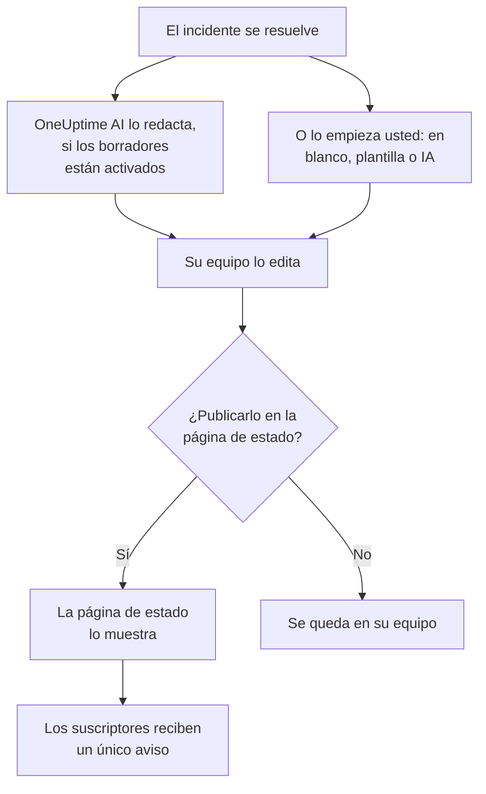

# Informes post mortem

Un post mortem es el informe posterior a un incidente: qué pasó, por qué, qué les costó a sus usuarios y qué cambia a partir de ahora. En OneUptime se escribe en el propio incidente. Puede partir de su propia plantilla o de un borrador de OneUptime AI, y puede publicarse en su página de estado como la última actualización del incidente. Cada post mortem tiene además un estado, y **Incidentes → Informes post mortem** reúne el post mortem de cada incidente, para que vea cuáles siguen pendientes.

:::cards
- [Escribir un post mortem](#escribir-un-post-mortem): En la página Post mortem del incidente, en cinco pasos.
- [Partir de una plantilla o de un borrador de IA](#partir-de-una-plantilla-o-de-un-borrador-de-ia): Su esquema, o uno que rellena OneUptime AI.
- [Publicarlo en su página de estado](#publicarlo-en-su-página-de-estado): Mostrarlo a los clientes y avisar a los suscriptores una vez.
- [Seguir en qué punto está cada post mortem](#seguir-en-qué-punto-está-cada-post-mortem): No iniciado, Borrador, Completado o un estado propio.
- [Ver todos los post mortem](#ver-todos-los-post-mortem): Filtrar por propietario, gravedad y estado para encontrar los pendientes.
- [Post mortem de los episodios](#post-mortem-de-los-episodios): Un solo informe para un grupo de incidentes.
:::

## Cómo se construye un post mortem

Un post mortem tiene tres partes, todas en el incidente: la nota, escrita en Markdown; sus adjuntos, como capturas de pantalla e informes; y si aparece en su página de estado. Están en la página **Post mortem** del incidente, en **Investigación** dentro de su menú lateral. Un post mortem tiene además un estado, que dice hasta dónde ha llegado, y propietarios: los del incidente.

## Escribir un post mortem

:::steps
### Abrir el post mortem

Abra el incidente y haga clic en **Post mortem**, en **Investigación** dentro de su menú lateral. La tarjeta **Post mortem** muestra el **Estado** y los **Propietarios** del post mortem, la nota, los adjuntos y si el post mortem está en la página de estado. **Añadir propietarios**, junto a los propietarios, convierte allí mismo a una persona o un equipo de su proyecto en propietario del incidente.

### Hacer clic en Escribir post mortem

El diálogo **Escribir post mortem** se abre en su primer paso, **Post mortem**. Cuando el post mortem ya está escrito, el botón de la tarjeta es **Editar nota de análisis post mortem**, que abre los mismos pasos.

### Escribir la nota y adjuntar archivos

Escriba la **Nota del análisis post mortem** en Markdown: qué pasó, el impacto, cómo se resolvió y las acciones de seguimiento. Añada capturas de pantalla, informes o cronologías en **Adjuntos del análisis post mortem**.

### Elegir si se publica

Haga clic en **Siguiente**. En el paso **Página de estado**, **Publicar en la página de estado** empieza desactivado, así que el post mortem se queda en su equipo. Para mostrarlo a los clientes, consulte [Publicarlo en su página de estado](#publicarlo-en-su-página-de-estado).

### Guardar el post mortem

Haga clic en **Guardar cambios**. La tarjeta muestra la nota y los adjuntos. El estado del post mortem pasa de **No iniciado** a **Borrador**: consulte [Cómo avanza un post mortem](#cómo-avanza-un-post-mortem).
:::

Cada cambio de la nota queda registrado en el feed del incidente, y se publica en el canal de Slack o de Microsoft Teams del incidente si tiene uno. Mientras el post mortem no esté publicado, ningún suscriptor de la página de estado sabe de él.

Escribir un post mortem requiere el rol Project Owner, Project Admin, Project Member, Incident Admin o Incident Member, o un rol personalizado con el permiso Edit Incident. Quien puede leer el incidente puede leer su post mortem.

## Partir de una plantilla o de un borrador de IA

Dos botones rellenan la nota por usted. Mientras no hay nada escrito, están junto a **Escribir post mortem**: **Empezar con una plantilla**, en cuanto el proyecto tiene una plantilla de post mortem, y **Generar con IA**. Cuando el post mortem ya está escrito, están en el menú **⋯** junto a **Editar nota de análisis post mortem**, como **Aplicar plantilla** y **Generar con IA**. Ambos abren el mismo editor, con la nota rellenada y el resto del post mortem como estaba. No se guarda nada hasta que haga clic en **Guardar cambios**, así que lea la nota y corríjala antes.

### Aplicar una plantilla

**Aplicar plantilla** aparece en cuanto el proyecto tiene una plantilla de post mortem. Las plantillas se crean en **Incidentes → Ajustes → Plantillas de post mortem**: consulte [Plantillas de post mortem](/docs/incidents/settings#plantillas-de-post-mortem). En OneUptime Cloud, las plantillas requieren el plan Growth.

Haga clic en **Empezar con una plantilla**, o en **Aplicar plantilla** en el menú **⋯**, elija una en **Seleccionar plantilla** dentro del diálogo **Aplicar plantilla de análisis post mortem** y haga clic en **Aplicar plantilla**. Si el proyecto solo tiene una plantilla, ya aparece elegida.

### Generarlo con IA

Haga clic en **Generar con IA**. El diálogo **Generar post mortem con IA** ofrece un esquema en **Seleccionar plantilla**: **Standard Postmortem**, **Detailed Technical Postmortem** o **Brief Postmortem**, y después sus propias plantillas de post mortem. **Vista previa de la plantilla** muestra el esquema, y puede cambiarlo antes de generar.

Haga clic en **Generar con IA** al final del diálogo. OneUptime AI lee el incidente (su descripción, su causa raíz y su remediación, su cronología de estados, sus notas públicas y privadas, los mensajes de su canal de Slack o de Microsoft Teams, y lo que se dijo en [sus llamadas](/docs/workspace-connections/video-calls#transcripciones-de-llamadas)) y escribe el post mortem con su esquema. Después el editor se abre con él.

Generarlo requiere que la IA esté activada para el proyecto, en **Ajustes del proyecto → IA → Funciones de IA**, y un proveedor de LLM: consulte [Proveedores de LLM](/docs/ai/llm-provider). También requiere el rol Project Owner o Project Admin, o un rol personalizado con el permiso Edit Incident: otros roles pueden escribir el post mortem, pero no generarlo.

### Dejar que OneUptime AI lo redacte cuando se resuelve un incidente

Con **Redactar un post mortem cuando se resuelve un incidente** activado, OneUptime AI redacta el post mortem cada vez que se resuelve un incidente, lo guarda como nota y lo publica en el feed del incidente para que su equipo lo revise. El interruptor está en **Incidentes → IA → Ajustes**, y viene activado en los proyectos nuevos.

- Nunca sustituye una nota que ya está escrita.
- Nunca escribe en un post mortem ya publicado, donde el borrador llegaría a la página de estado sin revisar.
- Requiere que la IA esté activada para el proyecto, y se detiene durante el día en cuanto el proyecto alcanza sus límites diarios de IA. Consulte [Post mortem automático](/docs/ai/ai-sre#post-mortem-automático).
- Si la transcripción de la llamada del incidente aún está en camino cuando se resuelve el incidente, espera a que OneUptime AI la lea, para que el borrador recoja lo que se dijo en la llamada: hasta seis horas mientras el proveedor prepara la transcripción. Consulte [Grabar y transcribir cada llamada](/docs/workspace-connections/video-calls#grabar-y-transcribir-cada-llamada).

#### Elegir qué incidentes reciben un borrador, y su plantilla

Sin reglas, cada incidente resuelto recibe un borrador, con el esquema estándar de OneUptime AI. Las **Reglas de post mortem**, en **Más ajustes** de la misma página, cambian eso:

- Una regla coincide con **Todos los incidentes**, o con **Solo los incidentes que cumplen las condiciones** sobre monitores, gravedades, etiquetas, etiquetas de monitor, título y descripción, como hace una regla de IA.
- Sus **Plantillas** son las plantillas de post mortem que puede seguir el borrador. Sin ninguna, el borrador sigue el esquema estándar; con una, esa plantilla; con varias, la que OneUptime AI considera que mejor se ajusta al incidente. La publicación del borrador en el feed nombra la plantilla que siguió.
- Su **Proveedor de LLM**, en **Más campos**, es el proveedor con el que OneUptime AI escribe el borrador y elige su plantilla. Si no se elige ninguno, es el proveedor predeterminado del proyecto o, si no hay, el global. La publicación del borrador en el feed nombra el proveedor que eligió una regla, o el que se usó en su lugar y por qué. Consulte [Qué proveedor de LLM usa una regla](/docs/ai/ai-sre#qué-proveedor-de-llm-usa-una-regla).
- Decide la primera regla habilitada que coincide con el incidente, empezando por arriba de la lista: arrastre una regla para cambiar su posición. Un incidente con el que no coincide ninguna regla no recibe borrador, y tampoco ningún incidente mientras no se puedan leer las reglas.
- **Redactar un post mortem cuando se resuelve un incidente** sigue siendo el único interruptor que desactiva los borradores. Las reglas solo deciden los borradores que OneUptime AI escribe por su cuenta: **Generar con IA** ofrece todos los esquemas, digan lo que digan.
- Crear, editar y reordenar reglas requiere el rol Project Owner o Project Admin. En OneUptime Cloud, las plantillas requieren el plan Growth: por debajo de él, las reglas siguen decidiendo qué incidentes reciben un borrador, y cada borrador sigue el esquema estándar.

## Publicarlo en su página de estado

Un post mortem publicado es la última actualización del incidente para sus clientes: la página de estado muestra la nota, destacada en la cronología del incidente, con sus adjuntos para descargar.

:::steps
### Abrir el paso Página de estado

Haga clic en **Editar nota de análisis post mortem** y después en **Siguiente** para llegar al paso **Página de estado**.

### Activar Publicar en la página de estado

Active **Publicar en la página de estado**. Aparecen dos campos más: **Notificar a los suscriptores**, que está activado, y **Análisis post mortem publicado el**, que marca el momento actual.

### Decidir a quién se avisa y cuándo aparece

Desactive **Notificar a los suscriptores** para publicar sin avisar a los suscriptores. Cambie **Análisis post mortem publicado el** para mostrar otra hora junto al post mortem.

### Publicarlo

Haga clic en **Guardar cambios**. La tarjeta muestra ahora **¿Análisis post mortem visible en la página de estado?**, **Notificar a los suscriptores**, **Estado de notificación del suscriptor** y **Análisis post mortem publicado el**.
:::

Lo que decide si los clientes lo ven y si se enteran:

- **El incidente debe estar en la página de estado.** Una página de estado solo muestra un post mortem en un incidente que muestra: **Visible en la página de estado** activado, y el incidente no privado.
- **La nota debe decir algo.** Un post mortem publicado con la nota vacía no se muestra, y no se avisa a nadie.
- **Los suscriptores reciben un único aviso**, la primera vez que la página de estado muestra el post mortem. Guardarlo de nuevo, o editarlo mientras está publicado, actualiza la página sin avisar a nadie. Retirarlo y volver a publicarlo les avisa de nuevo. Uno publicado mientras su incidente está oculto se envía cuando el incidente se hace visible.
- **Notificar a los suscriptores se lee cuando sale la notificación.** Activarlo después de publicar el post mortem no envía nada.

**Estado de notificación del suscriptor** muestra si la notificación salió, y ofrece **Reintentar** cuando falló. Consulte [El post mortem](/docs/status-pages/subscribers#el-análisis-post-mortem) para cada caso, y [Reintentar y reenviar](/docs/status-pages/subscribers#reintentar-y-reenviar).

**Análisis post mortem publicado el** es también el momento en que el post mortem cuenta como publicado para la medición **Tiempo hasta el post mortem**: consulte [Mediciones predefinidas](/docs/incidents/settings#mediciones-listas-para-usar).

## Seguir en qué punto está cada post mortem

El post mortem de cada incidente está en uno de los estados de post mortem del proyecto, que se muestra en **Estado** en la parte superior de su tarjeta **Post mortem**. Un proyecto nuevo tiene cuatro. Un post mortem en **No iniciado** o **Borrador** sigue pendiente; uno en **Completado** o **No necesario**, no:

| Estado | Qué significa | Sigue pendiente |
| --- | --- | --- |
| **No iniciado** | Nadie ha escrito todavía este post mortem. | Sí |
| **Borrador** | El post mortem se está escribiendo. | Sí |
| **Completado** | El post mortem está escrito y terminado. | No |
| **No necesario** | Este incidente no necesita un post mortem. | No |

### Cómo avanza un post mortem

OneUptime mueve un post mortem por sí mismo en tres momentos:

- El post mortem de un incidente nuevo empieza en **No iniciado**, o en **Borrador** cuando el incidente se declara con una nota, o en **Completado** cuando esa nota se publica a la vez.
- La primera nota de un post mortem en **No iniciado** lo mueve a **Borrador**, tanto si alguien la escribe como si aplica una plantilla o la redacta OneUptime AI.
- Publicarlo en la página de estado lo mueve a **Completado**, salvo que ya esté terminado.

Nunca retrocede: vaciar la nota, o retirar el post mortem de la página de estado, deja su estado donde está. Un estado que alguien elige en el mismo guardado siempre se mantiene.

### Moverlo usted mismo

Haga clic en el estado, en la página **Post mortem** del incidente o en su fila de la lista de post mortem, y elija uno en **Mover el post mortem a**. El post mortem se mueve al instante. Mover un post mortem requiere los roles que lo escriben, y cualquiera que pueda leer el incidente ve en qué punto está su post mortem.

### Adaptar los estados a su proceso

Si su proceso tiene un paso propio, como una revisión, añada un estado para él. Abra **Incidentes → Ajustes → Estados de post mortem**, haga clic en **Crear Estado del post mortem** y dele un nombre, como **En revisión**, un color y una descripción. Un estado nuevo se coloca justo encima de **Completado**; arrastre un estado para cambiar su posición.

La posición de un estado decide cómo cuenta, y se muestra en **Cuenta como**: por encima de **Borrador**, **No iniciado**; desde **Borrador** hacia abajo, **En curso**; desde **Completado** hacia abajo, **Hecho**, y ya no queda pendiente. **En revisión**, entre ambos, sigue pendiente; **No necesario**, debajo de **Completado**, no.

**No iniciado**, **Borrador** y **Completado** son predefinidos, porque OneUptime mueve los post mortem a ellos: puede cambiarles el nombre y el color, pero no eliminarlos ni archivarlos, y conservan su orden. Archive un estado que ya no use desde el menú **⋯** de su fila: nadie puede volver a mover un post mortem a él, los post mortem que tiene siguen ahí hasta que alguien los mueva, y la lista sigue filtrando por él. **Estados de post mortem archivados**, plegado bajo la tabla, los muestra, con **Desarchivar** para recuperar uno. Crear, editar y eliminar estados requiere el rol Project Owner, Project Admin o Incident Admin, o un rol personalizado con el permiso correspondiente sobre los estados de post mortem.

## Ver todos los post mortem

**Incidentes → Informes post mortem** reúne el post mortem de cada incidente del proyecto, el más reciente primero, con las columnas **Incidente**, **Título**, **Estado del post mortem**, **Gravedad**, **Propietarios** y **Declarado**. **Ver** en una fila abre la página **Post mortem** del incidente.

Encima de la lista, un mosaico por estado cuenta los post mortem que tiene. Haga clic en un mosaico para ver solo esos, y vuelva a hacer clic para verlos todos.

Filtre la lista con los chips de encima: **Propietario**, una persona o un equipo; **Gravedad**; **Estado del post mortem**; **Estado del incidente**; **Etiquetas**; y **Recursos afectados**. Para ver qué post mortem debe todavía un equipo de sus incidentes más graves, elija el equipo en **Propietario**, la gravedad en **Gravedad**, y **No iniciado** y **Borrador** en **Estado del post mortem**. Los filtros se guardan en la dirección de la página, así que puede guardar la lista en marcadores o compartirla.

Para cambiar muchos a la vez, selecciónelos y abra **Acciones masivas**: **Cambiar estado del post mortem** los mueve todos a un mismo estado, como **No necesario** para los incidentes que no lo necesitan, y **Añadir propietario** y **Quitar propietario** cambian sus propietarios.

## Post mortem de los episodios

Un episodio de incidentes también tiene una página **Post mortem**, en **Investigación**: un solo informe para todos los incidentes del episodio. Haga clic en **Editar análisis post mortem** para escribirlo. **Aplicar plantilla** y **Generar con IA** funcionan como en un incidente, y la IA lee el episodio y sus incidentes miembros.

El post mortem de un episodio es solo la nota: no tiene adjuntos, y ninguna página de estado lo muestra. OneUptime AI no redacta uno por sí mismo cuando se resuelve un episodio. Generarlo requiere el rol Project Owner o Project Admin, o un rol personalizado con el permiso Edit Incident Episode. Tampoco tiene estado, y la lista de post mortem no lo incluye.

Las alertas y los eventos de mantenimiento programado no tienen post mortem.

## A través de la API

Un post mortem es un conjunto de campos del incidente, que se leen y escriben a través de `/api/incident` como el resto del incidente:

| Campo | Qué es |
| --- | --- |
| `postmortemNote` | La nota, en Markdown. |
| `showPostmortemOnStatusPage` | Si el post mortem está publicado en sus páginas de estado. Empieza en `false`. |
| `notifySubscribersOnPostmortemPublished` | Si se avisa a los suscriptores cuando se publica. Empieza en `true`. |
| `postmortemPostedAt` | La hora que muestra la página de estado junto a él. |
| `postmortemStatusId` | El estado del post mortem: uno de los estados del proyecto, en `/api/incident-postmortem-status`. |

Escribir `showPostmortemOnStatusPage` como `true` sobre una `postmortemNote` escrita publica el post mortem, igual que el diálogo. Además mueve el post mortem a **Completado**, salvo que la misma escritura fije `postmortemStatusId`.

## Solución de problemas

:::details Aplicar plantilla no aparece en la tarjeta
El proyecto aún no tiene una plantilla de post mortem, o su rol no puede leerlas. Cree una en **Incidentes → Ajustes → Plantillas de post mortem**. En OneUptime Cloud, las plantillas requieren el plan Growth.
:::

:::details Generar con IA indica que la IA está desactivada, o que le falta el permiso
Active la IA en **Ajustes del proyecto → IA → Funciones de IA**. Generarlo requiere el rol Project Owner o Project Admin, o un rol personalizado con el permiso Edit Incident, incluso para quien puede editar el post mortem.
:::

:::details El post mortem no aparece en la página de estado
Compruebe tres cosas: **Publicar en la página de estado** está activado, la nota no está vacía, y el incidente se muestra en la página de estado (**Visible en la página de estado** activado, y no privado).
:::

:::details No se avisó a los suscriptores del post mortem
**Notificar a los suscriptores** estaba desactivado al publicarlo, o el incidente está oculto: en ese caso se envía en cuanto el incidente se hace visible. **Estado de notificación del suscriptor** en la tarjeta indica cuál fue.
:::

:::details No apareció ningún borrador de IA cuando se resolvió el incidente
El incidente ya tenía una nota, el post mortem ya estaba publicado, ninguna regla de post mortem coincidió con él, o **Redactar un post mortem cuando se resuelve un incidente** está desactivado. La IA debe estar activada para el proyecto, y el proyecto no debe haber alcanzado sus límites diarios de IA. Si la transcripción de la llamada del incidente está en camino, el borrador llega en cuanto OneUptime AI la ha leído.
:::

:::details El estado de un post mortem no cambió al escribir su nota
Solo un post mortem en **No iniciado**, o en un estado propio por encima de **Borrador**, avanza por sí mismo, con su primera nota. Uno en curso o terminado se queda donde está, igual que un estado que alguien eligió en el mismo guardado. Muévalo usted mismo desde su estado: consulte [Moverlo usted mismo](#moverlo-usted-mismo).
:::

## Próximos pasos

:::cards
- [Visión general de los incidentes](/docs/incidents/index): Las demás páginas del incidente, de la declaración a la resolución.
- [Configuración y automatización de incidentes](/docs/incidents/settings): Las plantillas de post mortem y la medición del tiempo hasta el post mortem.
- [Suscriptores y anuncios](/docs/status-pages/subscribers): Todo lo que una página de estado comunica a sus suscriptores.
- [AI SRE](/docs/ai/ai-sre): Lo que OneUptime AI hace por sí mismo después de un incidente.
:::
