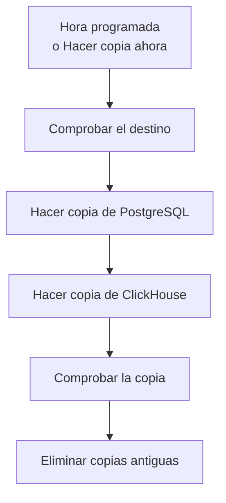

# Copias de seguridad

Haz copias de seguridad de un OneUptime autoalojado en un almacenamiento de tu propiedad, según una programación, y restáuralas desde el Admin Dashboard. Una copia de seguridad contiene PostgreSQL, con tus proyectos, monitores, incidentes, páginas de estado y usuarios, y ClickHouse, con tus logs, trazas y métricas. Las copias se conservan los días que elijas, las más antiguas se eliminan por ti y cualquier copia se puede restaurar en el mismo lugar. Las copias de seguridad forman parte de la Edición Enterprise.

:::cards
- [Configurar copias de seguridad](#configurar-copias-de-seguridad): Elige un destino, pruébalo y define una programación.
- [Destinos](#destinos): Lo que pide cada destino recomendado.
- [Restaurar una copia de seguridad](#restaurar-una-copia-de-seguridad): Qué se reemplaza y cómo se protegen los datos actuales.
- [Mudarse a un servidor nuevo](#mudarse-a-un-servidor-nuevo): Restaura las copias de una instalación en otra.
:::

## Cómo funciona una copia de seguridad



- **Coherente.** PostgreSQL se vuelca en una sola transacción, así que el volcado es la base de datos tal como estaba en un momento dado, mientras OneUptime sigue funcionando. ClickHouse copia cada tabla tal como estaba cuando leyó sus partes.
- **Directo al destino.** La salida de `pg_dump` se envía al almacenamiento a medida que se escribe, y ClickHouse escribe su propia copia en el almacenamiento. No se escribe nada en el disco del servidor, sea cual sea el tamaño de los datos.
- **Comprobada.** Antes de que la copia cuente, `pg_restore` vuelve a leer el volcado desde el destino, y allí se encuentra el registro que ClickHouse guarda de su copia. El SHA-256 del volcado se guarda con la copia, y una restauración lo comprueba antes de reemplazar nada. Una copia que falla o se cancela elimina lo que escribió, así que el destino solo contiene copias completas.
- **Cifrada.** Las copias llegan al almacenamiento por HTTPS, salvo que introduzcas un endpoint `http://`. Amazon S3, Google Cloud Storage, Azure Blob Storage y Cloudflare R2 cifran todo lo que guardan; en otro almacenamiento, activa el cifrado en reposo del bucket. Las credenciales del destino se guardan cifradas y no se vuelven a mostrar.
- **De una en una.** En toda la instalación se ejecuta una sola copia o restauración a la vez. Las demás esperan su turno.

Cada copia de seguridad es una carpeta propia dentro de la carpeta del destino (`oneuptime/backups/` salvo que elijas otra), con el nombre de la hora en que empezó, en UTC:

```text
oneuptime/backups/20261024T020000Z-3f2a9c1b/manifest.json
oneuptime/backups/20261024T020000Z-3f2a9c1b/postgres.dump
oneuptime/backups/20261024T020000Z-3f2a9c1b/clickhouse/
```

`manifest.json` se escribe al final: indica qué contiene la copia y qué versión de OneUptime la hizo.

## Antes de empezar

- **La Edición Enterprise**, con una licencia que incluya las copias de seguridad. Las copias se ejecutan durante el periodo de prueba y el de gracia. Sin licencia no se hace ninguna copia nueva, y restaurar y eliminar copias sigue funcionando. Consulta [Edición Enterprise](/docs/self-hosted/enterprise).
- **Un administrador principal.** Las copias de seguridad se configuran en el Admin Dashboard.
- **Un bucket o contenedor solo para copias de seguridad**, y credenciales que puedan leer, escribir, listar y eliminar en él.
- **Un destino al que también llegue ClickHouse.** ClickHouse escribe su copia en el almacenamiento por sí mismo, así que su red debe llegar al almacenamiento, igual que la de OneUptime.
- **Para restaurar PostgreSQL, un usuario de base de datos que pueda crear bases de datos.** Una restauración escribe en una base de datos nueva junto a la activa. El PostgreSQL que viene con OneUptime se conecta como superusuario, que puede hacerlo.

## Configurar copias de seguridad

:::steps
### Abrir la página de copias de seguridad

En el Admin Dashboard, ve a **Ajustes → Copias de seguridad** y haz clic en **Configurar copias de seguridad**.

### Elegir adónde van las copias

Elige uno de los destinos recomendados. Lo que pide cada uno está en [Destinos](#destinos).

### Rellenar la conexión

Rellena lo que pide el destino. Una carpeta, una región y los ajustes que la mayoría deja como están esperan en **Más campos**, y **Guía de configuración** abre la sección del destino en esta página.

### Probar el destino

Haz clic en **Probar el destino**. OneUptime escribe, lee, lista y elimina un pequeño archivo de prueba, comprueba que `pg_dump` puede copiar tu PostgreSQL y pide a ClickHouse que escriba una copia de prueba de las definiciones de sus tablas. No se guarda nada, y una comprobación que falla indica qué cambiar.

### Elegir cuándo se hacen las copias

Elige **Con qué frecuencia** y la hora en **A las (UTC)**, y para las copias semanales el **Día de la semana**. **Conservar las copias de seguridad (días)** es 30 salvo que lo cambies. Desactiva **Hacer copia también de ClickHouse** para copiar solo PostgreSQL.

### Empezar a hacer copias

Haz clic en **Empezar a hacer copias**. La primera copia se hace a la siguiente hora programada, y **Hacer copia ahora** inicia una al momento.
:::

Después, la página muestra cómo van las copias: cuándo se hizo la última, cuánto ocupó y cuánto tardó, y cuándo se hará la siguiente. Una copia en curso muestra el paso en que está, y **Ver pasos** muestra cada paso mientras se ejecuta.

## Destinos

| Destino | Almacenamiento | Inicia sesión con |
| --- | --- | --- |
| [Amazon S3](#amazon-s3) | Amazon S3 | Una clave de acceso |
| [Cloudflare R2](#cloudflare-r2) | Almacenamiento compatible con S3 | Un token de API de R2 |
| [Backblaze B2](#backblaze-b2) | Almacenamiento compatible con S3 | Una clave de aplicación |
| [Wasabi](#wasabi) | Almacenamiento compatible con S3 | Una clave de acceso |
| [MinIO](#minio) | Almacenamiento compatible con S3 | Una clave de acceso |
| [Google Cloud Storage](#google-cloud-storage) | Google Cloud Storage | Una clave HMAC |
| [Azure Blob Storage](#azure-blob-storage) | Azure Blob Storage | Un token SAS o una clave de acceso |
| [Otro almacenamiento compatible con S3](#otro-almacenamiento-compatible-con-s3) | Almacenamiento compatible con S3 | Una clave de acceso |

Una clave para Amazon S3 u otro almacenamiento compatible con S3 necesita `s3:PutObject`, `s3:GetObject`, `s3:ListBucket`, `s3:DeleteObject` y `s3:AbortMultipartUpload` sobre la carpeta, y nada más:

```json
{
  "Version": "2012-10-17",
  "Statement": [
    {
      "Effect": "Allow",
      "Action": "s3:ListBucket",
      "Resource": "arn:aws:s3:::my-backups"
    },
    {
      "Effect": "Allow",
      "Action": [
        "s3:PutObject",
        "s3:GetObject",
        "s3:DeleteObject",
        "s3:AbortMultipartUpload"
      ],
      "Resource": "arn:aws:s3:::my-backups/oneuptime/backups/*"
    }
  ]
}
```

### Amazon S3

| Campo | Qué escribir |
| --- | --- |
| **Bucket** | El bucket donde se escriben las copias. Úsalo solo para copias de seguridad. |
| **Región** | La región del bucket. Empieza en `us-east-1`. |
| **ID de clave de acceso** | Una clave de acceso con los permisos de arriba. |
| **Clave de acceso secreta** | El secreto de la clave. |
| **Carpeta** | En **Más campos**. Si se deja vacío, las copias van a `oneuptime/backups/`. |

Amazon S3 cifra cada archivo que almacena, y OneUptime se lo pide (SSE-S3) para cada archivo que escribe.

### Cloudflare R2

Escribe como **Endpoint** la dirección de la API S3 de tu cuenta, `https://<account-id>.r2.cloudflarestorage.com`, que está en la configuración del bucket en R2. Después escribe el **Bucket**, y el **ID de clave de acceso** y la **Clave de acceso secreta** de un token de API de R2 que pueda leer y escribir objetos en él. Volver a leer copias desde R2 no cuesta nada.

### Backblaze B2

Escribe como **Endpoint** el endpoint S3 del bucket, que aparece en su página Buckets en Backblaze, por ejemplo `https://s3.us-west-004.backblazeb2.com`. Después escribe el **Bucket**, y el ID y la clave de una clave de aplicación como **ID de clave de acceso** y **Clave de acceso secreta**. La región se obtiene del endpoint.

### Wasabi

Escribe como **Endpoint** la URL del servicio de la región del bucket, por ejemplo `https://s3.us-east-1.wasabisys.com`, y después el **Bucket** y una clave de acceso. La región se obtiene del endpoint.

### MinIO

Escribe como **Endpoint** la dirección de la API S3 de tu servidor MinIO, por ejemplo `https://minio.example.com:9000`, y después el **Bucket** y una clave de acceso cuya política pueda leer, escribir, listar y eliminar en él. Tanto OneUptime como ClickHouse deben llegar a esa dirección.

### Google Cloud Storage

Escribe el **Bucket**, y la **Clave de acceso HMAC** y el **Secreto HMAC** de una cuenta de servicio con el rol Storage Object Admin en el bucket. Crea la clave en la configuración de Cloud Storage, en la pestaña Interoperabilidad. OneUptime y ClickHouse llegan al bucket mediante la API compatible con S3 de Cloud Storage.

### Azure Blob Storage

Escribe la **Cuenta de almacenamiento** y el **Contenedor**, y elige en **Iniciar sesión con** cómo iniciar sesión: un **Token SAS** con permisos de lectura, adición, creación, escritura, eliminación y listado en el contenedor, o una **Clave de acceso** de la cuenta de almacenamiento. Un token SAS se puede limitar al contenedor, así que es la opción más segura. **Nube** y **Carpeta** esperan en **Más campos**.

### Otro almacenamiento compatible con S3

Para Ceph, DigitalOcean Spaces, Hetzner Object Storage y cualquier almacenamiento con una API S3, escribe su dirección S3 como **Endpoint**, y después el **Bucket** y una clave de acceso. **Región**, en **Más campos**, solo hace falta si el almacenamiento la pide. Si se deja vacía, se obtiene del endpoint, o es `us-east-1`.

## Programación y conservación

| Ajuste | Qué hace |
| --- | --- |
| **Con qué frecuencia** | **Cada hora**, **Cada 6 horas**, **Cada 12 horas**, **Todos los días** o **Cada semana**. Todos los días es adecuado para la mayoría de las instalaciones. |
| **A las (UTC)** | La hora a la que empiezan las copias, en UTC, con tu propia hora al lado. Cada 6 o 12 horas cuentan a partir de ella: a las `02:00`, las copias cada 6 horas se hacen a las 02:00, 08:00, 14:00 y 20:00. Las copias cada hora se hacen a la hora en punto. |
| **Día de la semana** | El día en que se hacen las copias semanales. |
| **Conservar las copias de seguridad (días)** | De 1 a 3650 días. 30 salvo que lo cambies. |
| **Hacer copia también de ClickHouse** | Activado salvo que lo desactives. Siempre se hace copia de PostgreSQL. |

Después de cada copia se eliminan, en el destino y de la lista, las copias que empezaron hace más de **Conservar las copias de seguridad (días)**, salvo la copia correcta más reciente, que se conserva por antigua que sea. Así, desactivar las copias o una licencia que caduca nunca te deja sin una copia que restaurar.

**Desactivar las copias de seguridad programadas**, en el menú de la tarjeta de estado, detiene la programación. **Hacer copia ahora** sigue funcionando y no se elimina ninguna copia. **Activar** vuelve a iniciar la programación.

## Restaurar una copia de seguridad

:::warning Qué reemplaza una restauración
Una restauración reemplaza los datos actuales por los de la copia. Se pierde todo lo que haya cambiado desde que se hizo la copia, salvo que primero hagas una copia de los datos actuales.
:::

:::steps
### Elegir la copia

En la tabla **Copias de seguridad**, haz clic en **Restaurar** en la copia a la que quieres volver. OneUptime comprueba primero la copia: que sus archivos están en el destino y sin cambios, qué versión de OneUptime la hizo y que este servidor puede restaurarla.

### Elegir qué restaurar

Marca **PostgreSQL: proyectos, monitores, incidentes, usuarios**, **ClickHouse: logs, trazas, métricas** o ambos. El diálogo muestra cuántos proyectos, usuarios y monitores contiene la copia y cuántos hay ahora.

### Proteger los datos actuales

**Hacer primero una copia de los datos actuales** está marcado: la restauración empieza con una copia de los datos que reemplaza, para que puedas volver a ellos. Desmárcalo solo si tienes otra copia, porque sin ella la restauración no se puede deshacer.

### Confirmar

Escribe `restore` y haz clic en **Restaurar**.
:::

Una restauración se ejecuta paso a paso, y la página muestra cada uno:

| Paso | Qué ocurre |
| --- | --- |
| **Comprobar la copia de seguridad** | Los archivos de la copia están ahí, y esta instalación puede restaurarla. |
| **Hacer copia de los datos actuales** | Una copia de los datos actuales, salvo que lo hayas desmarcado. |
| **Restaurar PostgreSQL** | La copia se restaura en una base de datos nueva junto a la activa, y se comprueba. |
| **Restaurar ClickHouse** | La telemetría activa se aparta, y la de la copia se restaura en su lugar. |
| **Cambiar a los datos restaurados** | La base de datos restaurada toma el nombre de la activa, en un momento. |
| **Actualizar los datos restaurados** | Las migraciones de base de datos de esta versión se ejecutan sobre los datos restaurados. |
| **Limpiar** | Se elimina lo que se apartó. |

OneUptime sigue funcionando con los datos actuales hasta el cambio, y nada de lo que usa cambia antes. Una restauración que falla o se cancela antes del cambio deja todo como estaba, y una que falla durante el cambio vuelve a poner lo que había apartado. La telemetría que llega mientras se restaura ClickHouse no se almacena. Después de restaurar PostgreSQL, es posible que se cierre tu sesión: inicia sesión con una cuenta que esté en la copia.

:::details La restauración dice que la copia se hizo con otro ENCRYPTION_SECRET
Las credenciales que guarda OneUptime, como la clave de un destino, están cifradas con `ENCRYPTION_SECRET`. Configura el `ENCRYPTION_SECRET` con el que se hizo la copia antes de restaurar, o esas credenciales no se podrán leer después.
:::

## Mudarse a un servidor nuevo

:::steps
### Instalar OneUptime en el servidor nuevo

Instala la Edición Enterprise, en la versión que hizo las copias o en una más reciente.

### Configurar el mismo destino

En **Ajustes → Copias de seguridad**, configura el destino donde están tus copias. La página encuentra las copias que ya hay allí y las lista, listas para restaurar. **Buscar copias de seguridad**, en el menú de la tarjeta de estado, vuelve a buscar.

### Restaurar la copia más reciente

Restáurala como se explica arriba. Una copia hecha por una versión anterior de OneUptime se actualiza a esta versión. Una copia hecha por una versión más reciente se puede restaurar cuando actualices.
:::

## Cuando falla una copia

La tarjeta de estado indica **La última copia de seguridad falló**, con el error, y **Ver pasos** muestra el paso en que se detuvo y por qué. Cada administrador principal recibe además un correo, como mucho una vez cada 12 horas mientras las copias sigan fallando. Una restauración fallida siempre se notifica por correo.

## Solución de problemas

:::details ClickHouse no llega al destino
ClickHouse se conecta al almacenamiento por sí mismo. Deja que su red llegue a la dirección del destino, igual que la de OneUptime, y vuelve a probar el destino.
:::

:::details pg_dump no está o es demasiado antiguo
La imagen Enterprise incluye `pg_dump` y `pg_restore` 16, 17 y 18, que copian PostgreSQL 18 y todas las versiones anteriores. En otra imagen, instala las herramientas cliente de PostgreSQL o configura `BACKUP_POSTGRES_BIN_DIR` con el directorio que las contiene. `pg_dump` debe ser al menos tan reciente como tu servidor PostgreSQL.
:::

:::details Restaurar PostgreSQL requiere un cambio
Una restauración crea una base de datos, y el usuario de base de datos de OneUptime debe tener permiso para hacerlo. Ejecuta esto en PostgreSQL como superusuario, con tu `DATABASE_USERNAME` en lugar de `oneuptime`, y vuelve a restaurar:

```sql
ALTER USER oneuptime CREATEDB;
```
:::

:::details Una copia está en un destino anterior
Después de cambiar de destino, las copias hechas en el anterior siguen en la lista, marcadas como **En un destino anterior**. Vuelve a configurar ese destino para restaurar una, o elimínala de la lista: sus archivos se quedan donde están.
:::

## Próximos pasos

:::cards
- [Edición Enterprise](/docs/self-hosted/enterprise): Licencias y lo que añade la Edición Enterprise.
- [Actualización](/docs/installation/upgrading): Haz una copia antes de cada actualización.
- [Docker Compose](/docs/installation/docker-compose): Ejecuta OneUptime en un solo servidor.
:::
