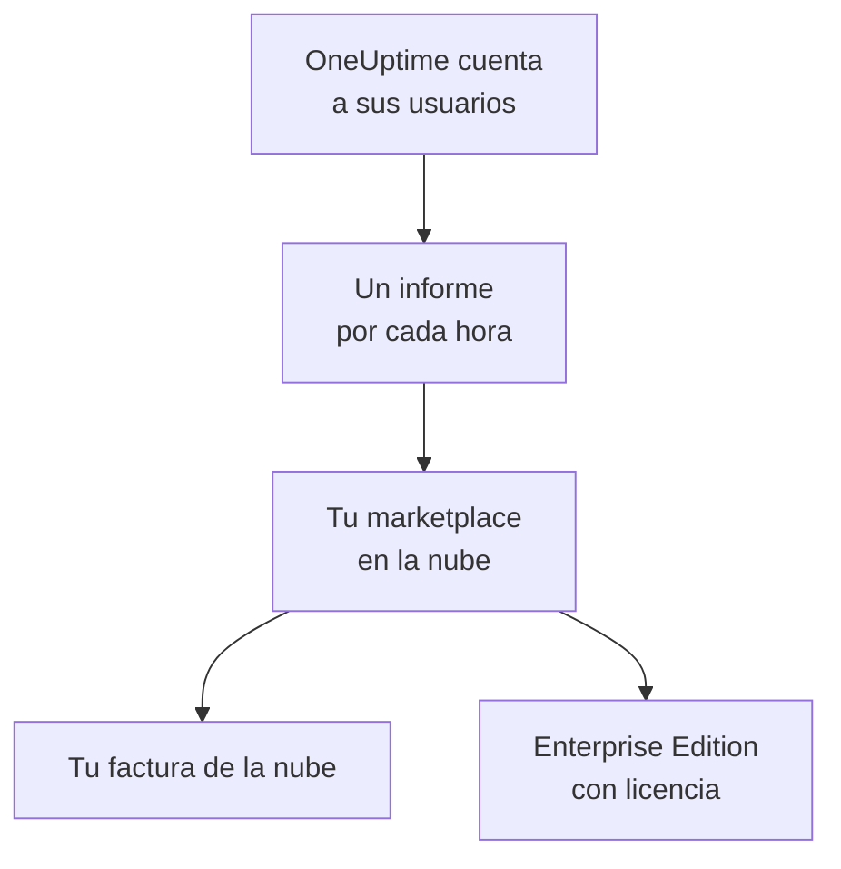

# Marketplaces en la nube

Ejecuta OneUptime Enterprise, comprado en AWS Marketplace, Microsoft Marketplace o Google Cloud Marketplace, en tu propio clúster de Kubernetes. El marketplace te cobra por horas cada usuario de tu instalación en tu factura de la nube, y tu suscripción concede la licencia de la Enterprise Edition: no hay ninguna clave de licencia que activar.

:::cards
- [Instalar OneUptime](#instalar-oneuptime): En Amazon EKS, Azure Kubernetes Service o Google Kubernetes Engine.
- [Cómo funciona la facturación](#cómo-funciona-la-facturación): USD 0.10 por usuario y hora, con un informe cada hora.
- [Actualizaciones](#actualizaciones): Cómo llega una nueva versión a tu clúster.
- [Solución de problemas](#solución-de-problemas): Cuando la etiqueta de edición avisa sobre el marketplace.
:::

## Cómo funciona

OneUptime cuenta a sus usuarios cada 15 minutos y, por cada hora, envía un único informe al marketplace donde lo compraste, con el mayor número de usuarios que vio en esa hora. El marketplace añade la hora a tu factura de la nube. Cada informe que acepta le indica además a OneUptime que tu suscripción está activa, y eso mantiene la licencia de la Enterprise Edition.



| | AWS | Microsoft | Google Cloud |
| --- | --- | --- | --- |
| Oferta | Aún no es pública: [contáctanos](https://oneuptime.com/enterprise/demo) | [OneUptime Enterprise](https://marketplace.microsoft.com/en-us/product/oneupitme.oneuptime-enterprise) | Aún no es pública: [contáctanos](https://oneuptime.com/enterprise/demo) |
| Se ejecuta en | Amazon EKS | Azure Kubernetes Service (AKS) | Google Kubernetes Engine (GKE) |
| Lo instalas con | Helm, desde el registro de la oferta | El portal de Azure | La consola de Google Cloud |
| OneUptime envía los informes con | El rol de IAM de su cuenta de servicio de Kubernetes | La identidad administrada que Azure asigna a la instalación | El secreto de informes que Google Cloud Marketplace crea para el despliegue |
| Versiones nuevas | Actualizas con Helm | Las versiones menores se instalan automáticamente | Actualizas a mano |

## Antes de empezar

- **Un clúster de Kubernetes** en la nube del marketplace, con al menos 3 nodos de 4 vCPU y 16 GiB de memoria, una StorageClass predeterminada y compatibilidad con servicios `LoadBalancer`. OneUptime ejecuta en el clúster su propio PostgreSQL, ClickHouse y Valkey; dimensiónalos con [Dimensionamiento y planificación de capacidad](/docs/installation/sizing).
- **Un nombre de dominio** para OneUptime, como `oneuptime.example.com`, que puedas apuntar al balanceador de carga del clúster.
- **HTTPS saliente** del clúster al marketplace, para que OneUptime pueda informar de sus usuarios: `metering.marketplace.<region>.amazonaws.com` y `sts.<region>.amazonaws.com` en AWS, `marketplaceapi.microsoft.com` en Azure, `servicecontrol.googleapis.com` y `oauth2.googleapis.com` en Google Cloud.

## Instalar OneUptime

### AWS Marketplace

En AWS, OneUptime informa de sus usuarios con un rol de IAM que EKS asigna a su cuenta de servicio de Kubernetes (roles de IAM para cuentas de servicio). AWS Marketplace solo acepta el uso procedente de EKS cuando está firmado de esta forma.

:::steps
1. Suscríbete a OneUptime Enterprise en AWS Marketplace y, después, elige **Continue to Configuration**, selecciona la versión y elige **Continue to Launch**.
2. Asocia un proveedor OIDC de IAM al clúster, si todavía no tiene uno, y crea la cuenta de servicio `oneuptime` con un rol de IAM que tenga la política `AWSMarketplaceMeteringFullAccess`, con los comandos de abajo. Ejecútalos en lugar del comando `eksctl` del paso 1 de las **General launch instructions** de la página de lanzamiento: ese comando asocia un rol que tendrías que crear antes.
3. Inicia sesión con Helm en el registro de la oferta e instala el chart con los comandos del paso 2 de las **General launch instructions**. En el comando `helm install`, establece `serviceAccount.name` en `oneuptime`, `host` en tu nombre de dominio y `httpProtocol` en `https` si hay un certificado delante de OneUptime.
4. [Abre OneUptime](#abrir-oneuptime).
:::

```bash
eksctl utils associate-iam-oidc-provider --cluster <cluster> --approve
eksctl create iamserviceaccount --name oneuptime --namespace oneuptime --cluster <cluster> \
  --attach-policy-arn arn:aws:iam::aws:policy/AWSMarketplaceMeteringFullAccess \
  --approve --override-existing-serviceaccounts
```

Guarda los valores del paso 3 en un archivo y pásalo en cada `helm upgrade`:

```yaml title="values.yaml"
host: oneuptime.example.com
httpProtocol: https
serviceAccount:
  name: oneuptime
```

### Microsoft Marketplace

En Azure, OneUptime es una aplicación de Kubernetes: AKS la instala como una extensión del clúster y le asigna la identidad administrada con la que informa de sus usuarios.

:::steps
1. Abre OneUptime Enterprise en Microsoft Marketplace desde el portal de Azure, o abre tu clúster de AKS y selecciona **Extensions + applications** > **Add**; después elige el plan y selecciona **Create**.
2. Elige la suscripción y el grupo de recursos, y si lo instalas en un clúster de AKS existente o creas uno nuevo.
3. En el paso **OneUptime**, introduce un nombre para la instalación, tu nombre de dominio y su protocolo.
4. Selecciona **Review + create** y después **Create**. La instalación tarda unos minutos; ha terminado cuando **Extensions + applications** muestra su estado de aprovisionamiento como **Succeeded**.
5. [Abre OneUptime](#abrir-oneuptime).
:::

Los medidores personalizados funcionan en clústeres de AKS, no en Kubernetes habilitado para Azure Arc, así que OneUptime Enterprise en Microsoft Marketplace solo se instala en AKS.

### Google Cloud Marketplace

En Google Cloud, Marketplace ejecuta un instalador que despliega OneUptime en el namespace que elijas, junto con un secreto de informes con el que OneUptime informa de sus usuarios.

:::steps
1. Abre OneUptime Enterprise en Google Cloud Marketplace desde la consola de Google Cloud y selecciona **Configure**.
2. Elige el clúster de GKE y el namespace, e introduce un nombre para la instalación, tu nombre de dominio y su protocolo.
3. Selecciona **Deploy**. El despliegue tarda unos minutos; ha terminado cuando la aplicación aparece como lista en **Kubernetes Engine** > **Applications**.
4. [Abre OneUptime](#abrir-oneuptime).
:::

## Abrir OneUptime

OneUptime empieza migrando su base de datos, lo que tarda unos minutos en una instalación nueva. Después apunta tu nombre de dominio a su balanceador de carga:

```bash
kubectl get service --namespace <namespace>
```

El servicio cuyo nombre termina en `-nginx` tiene una `EXTERNAL-IP`: crea para tu nombre de dominio un registro DNS que apunte a esa dirección. Abre el nombre de dominio y regístrate. La primera cuenta de una instalación nueva pasa a ser su administrador maestro, que puede abrir el Admin Dashboard en `/admin`.

En menos de una hora, la etiqueta de edición muestra la Enterprise Edition, con licencia a través de tu marketplace. Los administradores maestros ven la etiqueta de edición en la cabecera del Admin Dashboard y en el pie del Dashboard.

## Cómo funciona la facturación

| Qué | Cómo funciona |
| --- | --- |
| Precio | USD 0.10 por usuario y hora, unos USD 73 por usuario y mes. |
| Quién se cuenta | Todas las personas con una cuenta de OneUptime en la instalación. Los suscriptores de páginas de estado y las personas que inician sesión en una página de estado privada no se cuentan. |
| Cuándo | OneUptime cuenta a sus usuarios cada 15 minutos y, por cada hora, envía un único informe, con el mayor número de usuarios que vio en esa hora. Una hora en la que OneUptime no estaba en marcha no se factura. |
| Dónde | En tu factura de AWS, Azure o Google Cloud, a través del marketplace. |
| No incluido | El propio clúster: tu nube factura como siempre sus nodos, discos y balanceadores de carga. |

Cada instalación se factura por separado, así que también se factura una instalación de preproducción. Para precios anuales, descuentos por volumen o un precio para instalaciones que no son de producción, pide a [sales@oneuptime.com](mailto:sales@oneuptime.com) una oferta privada, que aceptas en el marketplace.

Cuando un informe no se puede enviar, por un problema de red o una caída del marketplace, OneUptime lo vuelve a enviar en su siguiente ejecución. Cada informe lleva una clave para su hora, así que una hora nunca se factura dos veces.

## Cómo funcionan las licencias

Tu suscripción del marketplace es tu licencia. Cada informe que acepta el marketplace concede la licencia de todas las funciones Enterprise, para todos los usuarios, durante las 72 horas siguientes. Una clave de licencia de OneUptime también funciona en la misma instalación: la instalación usa la mejor de las dos.

| Qué ocurre | Qué muestra la etiqueta de edición |
| --- | --- |
| El marketplace acepta los informes de cada hora | La Enterprise Edition, con licencia a través de tu marketplace. |
| No se ha aceptado ningún informe en 72 horas | **Enterprise Edition (fallan los informes al marketplace)**: todas las funciones Enterprise siguen funcionando durante un periodo de gracia de 30 días. |
| El marketplace indica que la instalación no tiene suscripción, o termina el periodo de gracia | **Enterprise Edition (suscripción del marketplace finalizada)**: las funciones Enterprise se detienen, igual que cuando [caduca una licencia](/docs/self-hosted/enterprise#cuando-una-licencia-caduca-o-falta). |

Lo que el marketplace rechaza es una suscripción cancelada o suspendida, o una instalación que no es la que compraste. La monitorización, las alertas, los incidentes, las guardias y las páginas de estado siguen funcionando en todos los casos, y no se elimina nada. Vuelve a suscribirte y el siguiente informe aceptado concederá de nuevo la licencia de la Enterprise Edition, sin reiniciar.

## Actualizaciones

| Marketplace | Cómo llega una nueva versión a tu clúster |
| --- | --- |
| AWS Marketplace | Cada versión nueva de OneUptime se publica como una nueva versión de la oferta. Ejecuta `helm upgrade` con el chart del registro de la oferta, la nueva versión y tu archivo de valores. |
| Microsoft Marketplace | AKS instala por ti las nuevas versiones menores y de parche. Una nueva versión principal espera hasta que la aceptes. Puedes desactivar las actualizaciones automáticas en la página de la instalación, en **Extensions + applications**. |
| Google Cloud Marketplace | Google Cloud Marketplace mantiene un despliegue en la versión que instaló y nunca lo actualiza. Ponte en contacto con el [soporte](https://oneuptime.com/support) antes de pasar un despliegue a una nueva versión. |

OneUptime migra su base de datos cuando arranca la nueva versión. Lee las [notas de actualización](/docs/installation/upgrading) antes de pasar a una nueva versión principal.

Actualiza a través del marketplace. Una instalación del marketplace no se compara con las versiones de OneUptime en GitHub: las versiones que ofrece tu marketplace son a las que debes actualizar.

## Ajustes y escalado

Tu factura no cambia al escalar: OneUptime se factura por usuario. Más réplicas o nodos más grandes solo cambian lo que tu nube factura por el clúster.

| Marketplace | Dónde están tus ajustes |
| --- | --- |
| AWS Marketplace | Tu archivo de valores. Funcionan todos los ajustes del [chart de Helm](https://artifacthub.io/packages/helm/oneuptime/oneuptime), salvo los operadores incluidos. |
| Microsoft Marketplace | Los ajustes de configuración de la instalación, en su página de **Extensions + applications** o con `az k8s-extension update --configuration-settings`. Cada ajuste es un valor del chart, como `autoscaling.enabled=true`. |
| Google Cloud Marketplace | Los campos del formulario de despliegue. Cambia todo lo demás con `kubectl`, en los recursos propios del despliegue. |

- **Escala OneUptime** con los ajustes de réplicas y de escalado automático del chart (`deployment.replicaCount`, `autoscaling.enabled` y los valores propios de cada servicio), y los nodos con el escalador automático de tu clúster.
- **Deja los ajustes del marketplace como los define la oferta**: `enterpriseMarketplace` y, en AWS, `serviceAccount`. Sin ellos, OneUptime no puede enviar informes y la Enterprise Edition se queda sin licencia.
- **Los operadores de KEDA, CloudNativePG y Altinity ClickHouse no están incluidos**, porque un marketplace solo distribuye las imágenes de su oferta. Para tener almacenes de datos de alta disponibilidad, apunta OneUptime a servicios gestionados con `externalPostgres`, `externalRedis` y `externalClickhouse`.

La facturación no depende de cuántas réplicas se ejecuten: solo una ejecución a la vez envía informes, y cada hora tiene un único informe.

## Solución de problemas

:::details La etiqueta de edición muestra Enterprise Edition (fallan los informes al marketplace)
OneUptime no puede enviar informes al marketplace. Cada línea que registra al respecto empieza por `OneUptime Enterprise marketplace billing`; una línea que dice que el uso «cannot be reported» indica qué falta. Las causas habituales:

- **AWS:** la cuenta de servicio `oneuptime` no tiene ningún rol de IAM, o el rol no tiene la política `AWSMarketplaceMeteringFullAccess` (`AWSMarketplaceMeteringRegisterUsage` no basta). Asocia la política al rol, o crea el rol con el comando `eksctl` de la sección [AWS Marketplace](#aws-marketplace) y después reinicia los pods de OneUptime con `kubectl rollout restart deployment --namespace oneuptime`.
- **Azure:** la instalación no es la aplicación de Microsoft Marketplace, por ejemplo porque se instaló con Helm, así que no tiene ninguna identidad ni ningún plan con los que enviar informes. Instálala desde el portal de Azure.
- **Google Cloud:** el secreto de informes del despliegue se eliminó o se sustituyó.
- **Todos los marketplaces:** un firewall o un proxy bloquea el HTTPS saliente que se indica en [Antes de empezar](#antes-de-empezar).

El uso se conserva mientras lo solucionas, y se factura en cuanto OneUptime puede volver a enviar informes. El uso de hace más de 30 días no se factura.
:::

:::details La etiqueta de edición muestra Enterprise Edition (suscripción del marketplace finalizada)
El marketplace rechazó la instalación: la suscripción se canceló o se suspendió, o la instalación no es la que se compró en el marketplace. Revisa la suscripción en el marketplace y vuelve a suscribirte; el siguiente informe aceptado concederá de nuevo la licencia de la Enterprise Edition. La misma etiqueta aparece cuando los informes siguieron fallando durante todo el periodo de gracia.
:::

:::details Los pods se quedan pendientes después de la instalación
Las bases de datos de OneUptime necesitan volúmenes persistentes. Dale al clúster una StorageClass predeterminada: en Amazon EKS, instala el complemento del controlador Amazon EBS CSI.
:::

## Próximos pasos

:::cards
- [Edición Enterprise](/docs/self-hosted/enterprise): Lo que añade la Enterprise Edition y lo que se detiene cuando caduca una licencia.
- [Actualización](/docs/installation/upgrading): Las notas de actualización de cada versión.
- [Dimensionamiento y planificación de capacidad](/docs/installation/sizing): Dimensiona los almacenes de datos para tu telemetría.
- [Arquitectura](/docs/self-hosted/architecture): Lo que se ejecuta en tu clúster.
- [Agente de Kubernetes](/docs/telemetry/kubernetes-agent#instálalo-como-complemento-de-amazon-eks): Gratis también en AWS Marketplace, como complemento de Amazon EKS, para los clústeres que envían sus datos a OneUptime.
:::
