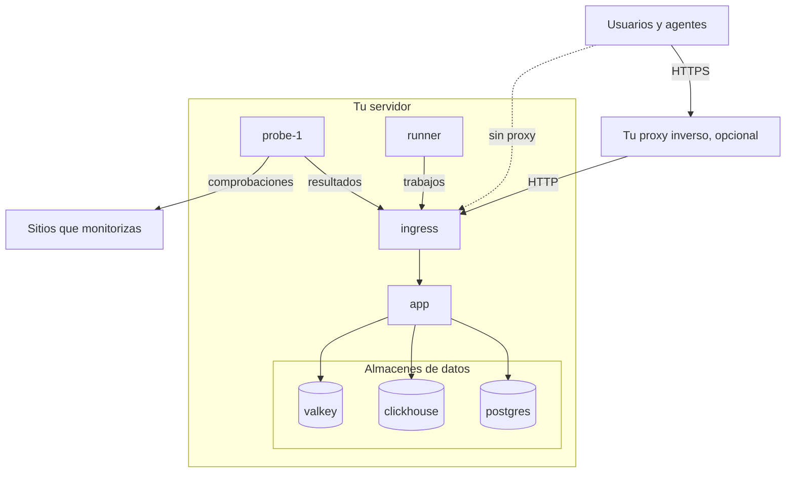

# Docker Compose

Ejecuta una instancia completa y gratuita de OneUptime en un solo servidor Linux con Docker Compose. Esta página te lleva de un servidor recién creado a una instancia en marcha, y después trata HTTPS, el endurecimiento para producción, las copias de seguridad, las actualizaciones y la desinstalación.

:::cards
- [Instalar OneUptime](#instalar-oneuptime): De un servidor recién creado a tu primera cuenta, en seis pasos.
- [Configurar HTTPS](#configurar-https): Deja que OneUptime obtenga un certificado, o pon delante tu propio proxy.
- [Lista de comprobación para producción](#lista-de-comprobación-para-producción): Lo que hay que resolver antes de que llegue el tráfico real.
- [Actualizar OneUptime](#actualizar-oneuptime): Pasa a la última versión.
:::

## Cómo funciona

Docker Compose ejecuta cada parte de OneUptime como un contenedor en tu servidor. Todo el tráfico entra por el contenedor `ingress`, que lo dirige a la `app`. La aplicación guarda sus datos en PostgreSQL, ClickHouse y Valkey. Una sonda incluida ejecuta las comprobaciones de tus monitores y envía los resultados a través del ingress.



| Servicio | Imagen | Qué hace |
| --- | --- | --- |
| `ingress` | `oneuptime/nginx` | Recibe todo el tráfico en los puertos 80 y 443 y lo dirige a la aplicación. Sirve HTTPS cuando OneUptime gestiona el certificado. |
| `app` | `oneuptime/app` | El panel, la API, las páginas de estado, la ingesta de telemetría y los procesos en segundo plano. |
| `probe-1` | `oneuptime/probe` | Una sonda global que ejecuta las comprobaciones de tus monitores. Usa la red del host. |
| `runner` | `oneuptime/runner` | El Runner de la instancia, que ejecuta las correcciones de código con IA. Usa la red del host. |
| `postgres` | `postgres:15` | Configuración y estado: monitores, incidentes, usuarios. Se guarda en el volumen `postgres`. |
| `clickhouse` | `clickhouse/clickhouse-server:26.7` | Telemetría: logs, métricas, trazas y excepciones. Se guarda en el volumen `clickhouse`. |
| `valkey` | `valkey/valkey:9.1-alpine` | Caché y colas. No guarda nada en disco. |

> [!NOTE]
> El servicio `valkey` ejecuta [Valkey](https://valkey.io), el fork con licencia BSD de Redis 7.2, configurado mediante los ajustes `VALKEY_*` de `config.env`. Sirve cualquier servidor que hable el protocolo de Redis: apunta `VALKEY_HOST` a un Redis gestionado si lo prefieres. Estos ajustes se llamaban `REDIS_*` hasta la 13.0.0; los nombres antiguos se siguen leyendo, el contenedor sigue respondiendo al nombre de host `redis` y `npm run update` no los reescribe, así que un `config.env` antiguo no necesita cambios.

Para producción a gran escala, o cuando necesites alta disponibilidad, usa en su lugar el [chart de Helm](https://artifacthub.io/packages/helm/oneuptime/oneuptime) en Kubernetes: Docker Compose ejecuta una sola copia de cada servicio en un solo servidor.

## Requisitos

Elige el tamaño del servidor según lo que vayas a ejecutar en él. La telemetría (logs, métricas, trazas) es lo que determina la memoria y el disco; consulta [Dimensionamiento y planificación de capacidad](/docs/installation/sizing) cuando conozcas tus volúmenes.

| | Recomendado | Mínimo para un homelab |
| --- | --- | --- |
| **Memoria** | 16 GB | 8 GB |
| **CPU** | 8 núcleos | 4 núcleos |
| **Disco** | 400 GB | 20 GB |
| **Sistema** | Ubuntu 22.04, u otro Linux basado en Debian, Ubuntu o RHEL | Lo mismo |
| **Arquitectura** | x86-64 (`amd64`) o ARM (`arm64`) | Lo mismo |

El mínimo para un homelab sirve para uso personal y experimental: hay quien ejecuta OneUptime en una Raspberry Pi.

También necesitas:

- **Docker** con el plugin **Docker Compose v2** (el comando `docker compose`).
- **Git**, para descargar OneUptime.
- **Node.js y npm**, que ejecutan los scripts `npm start` y `npm run update` que envuelven Docker Compose.
- **Puertos 80 y 443** libres en el servidor. La tabla de abajo enumera cada puerto que OneUptime usa en el host.

| Puerto del host | Lo usa | Ajuste | Para qué sirve |
| --- | --- | --- | --- |
| 80 | `ingress` | `ONEUPTIME_HTTP_PORT` | El panel, la API, la ingesta de telemetría y la validación de Let's Encrypt. |
| 443 | `ingress` | `STATUS_PAGE_HTTPS_PORT` | HTTPS para tu instancia cuando OneUptime gestiona el certificado, y para las páginas de estado y paneles en dominios personalizados. |
| 5400 | `postgres` | Definido en `docker-compose.yml` | Permite que `npm run backup` llegue a PostgreSQL. Mantenlo cerrado a Internet. |
| 3874 | `probe-1` | `GLOBAL_PROBE_1_PORT` | El servidor propio de la sonda. Nada fuera del servidor lo necesita. |
| 3876 | `runner` | `ONEUPTIME_RUNNER_PORT` | El servidor propio del Runner. Nada fuera del servidor lo necesita. |

También hay un [vídeo paso a paso](https://youtu.be/j1SWmMW2oL4) de la instalación.

## Instalar OneUptime

:::steps
### Clona la rama release

La rama `release` contiene los archivos de la última versión.

```bash
git clone --depth 1 --single-branch --branch release https://github.com/OneUptime/oneuptime.git
cd oneuptime
```

### Crea config.env

Todos los ajustes de OneUptime están en `config.env`. Parte del ejemplo:

```bash
cp config.example.env config.env
```

### Define el nombre de host

Abre `config.env` y define `HOST` con el nombre de dominio o la dirección IP que se usará para llegar a OneUptime, sin `http://`. Deja `localhost` solo para probar OneUptime en tu propio ordenador.

```ini title="config.env"
HOST=oneuptime.example.com
```

### Genera secretos aleatorios

El archivo de ejemplo trae secretos de marcador que son públicos en GitHub. Sustituye cada uno por su propio valor aleatorio:

```bash
while grep -q "please-change-this-to-random-value" config.env; do
  sed -i "0,/please-change-this-to-random-value/{s/please-change-this-to-random-value/$(openssl rand -hex 32)/}" config.env
done
grep -c "please-change-this" config.env
```

El último comando imprime `0`: no queda ningún marcador. El bucle usa GNU `sed`, que tiene cualquier servidor Linux. Estos son los ajustes que rellena:

| Ajuste | Qué protege |
| --- | --- |
| `ONEUPTIME_SECRET` | Las llamadas entre los propios servicios de OneUptime. |
| `ENCRYPTION_SECRET` | Los secretos que guarda OneUptime, como tokens de integraciones y contraseñas SMTP, y los tokens de inicio de sesión que emite. |
| `DATABASE_PASSWORD`, `CLICKHOUSE_PASSWORD`, `VALKEY_PASSWORD` | Los tres almacenes de datos. |
| `REGISTER_PROBE_KEY` | El registro de sondas en tu instancia. |
| `GLOBAL_PROBE_1_KEY`, `GLOBAL_PROBE_2_KEY` | Las sondas globales que puede ejecutar Docker Compose (`probe-1` se ejecuta de forma predeterminada). |
| `ONEUPTIME_RUNNER_KEY` | El Runner incluido. |

> [!IMPORTANT]
> Define los secretos antes del primer arranque y mantenlos después. PostgreSQL solo toma su contraseña cuando crea su base de datos, y cambiar `ENCRYPTION_SECRET` más adelante hace ilegible cualquier valor cifrado con el anterior.

### Inicia OneUptime

:::tabs
@tab npm
```bash
npm start
```
@tab Docker CLI
```bash
(export $(grep -v '^#' config.env | xargs) && docker compose up --remove-orphans -d)
```
:::

El primer arranque tarda varios minutos: Docker descarga las imágenes y OneUptime crea sus bases de datos. `npm start` espera a que responda cada parte y termina con **OneUptime is up!**

### Crea la primera cuenta

Abre `http://` seguido de tu `HOST` (por ejemplo `http://localhost`) y regístrate. La primera cuenta de una instancia nueva pasa a ser su administrador principal, que puede abrir el Admin Dashboard en `/admin`.

Cualquiera que pueda llegar a la página puede registrarse después de ti. Para impedirlo, abre el Admin Dashboard, ve a **Ajustes > Autenticación** y desactiva **Permitir el registro**. Las personas que invites a un proyecto pueden seguir creando su cuenta.
:::

## Configurar HTTPS

OneUptime sirve HTTP simple hasta que eliges una de las dos formas de añadir HTTPS:

| | Dejar que OneUptime obtenga un certificado | Usar tu propio proxy inverso |
| --- | --- | --- |
| **TLS termina en** | El `ingress` de OneUptime, con un certificado gratuito de Let's Encrypt que renueva él mismo | Tu proxy: Caddy, Nginx o un balanceador de carga |
| **Necesitas** | Un nombre de dominio público que apunte al servidor, y los puertos 80 y 443 accesibles desde Internet | Un proxy y un certificado para tu dominio |
| **Ajustes** | `PROVISION_SSL=true`, `HTTP_PROTOCOL=https` | `PROVISION_SSL=false`, `HTTP_PROTOCOL=https`, `TRUSTED_PROXY_HOPS=2` |
| **Páginas de estado en dominios personalizados** | Funcionan sin configuración adicional | Tu proxy también tiene que servir esos dominios |

Si pones páginas de estado o paneles en dominios personalizados, dejar que OneUptime gestione TLS es la configuración más sencilla: el ingress pide y sirve él mismo los certificados de esos dominios.

### Dejar que OneUptime obtenga un certificado

:::steps
#### Apunta tu dominio al servidor

Crea un registro DNS `A` (o `AAAA` para IPv6) para tu dominio, con la dirección IP pública del servidor como valor.

#### Activa la obtención de certificados

Define estos valores en `config.env`:

```ini title="config.env"
HOST=oneuptime.example.com
PROVISION_SSL=true
HTTP_PROTOCOL=https
```

`HOST` tiene que ser un nombre de dominio: OneUptime no puede obtener un certificado para una dirección IP ni para `localhost`.

#### Reinicia con los nuevos ajustes

```bash
npm start
```

#### Abre tu instancia por HTTPS

Abre `https://oneuptime.example.com`. OneUptime pide el certificado al arrancar y después lo revisa cada hora, y lo renueva cuando quedan menos de 30 días. Hasta que llega el primer certificado, normalmente en pocos minutos, el ingress sirve uno autofirmado temporal y tu navegador te avisa.
:::

### Usar tu propio proxy inverso

Estos pasos ejecutan el proxy en el mismo servidor que OneUptime. Si tu proxy se ejecuta en otra máquina, sáltate el primer paso y apunta el proxy al puerto 80 de este servidor.

:::steps
#### Saca el ingress de los puertos 80 y 443

El proxy necesita los puertos 80 y 443, así que mueve el ingress a otros puertos. La sonda y el Runner usan la red del host y llegan a OneUptime a través de `http://localhost`, así que se mueven con él:

```ini title="config.env"
ONEUPTIME_HTTP_PORT=8080
STATUS_PAGE_HTTPS_PORT=8443
GLOBAL_PROBE_1_ONEUPTIME_URL=http://localhost:8080
ONEUPTIME_RUNNER_ONEUPTIME_URL=http://localhost:8080
```

#### Indica a OneUptime que está detrás de un proxy

```ini title="config.env"
HOST=oneuptime.example.com
HTTP_PROTOCOL=https
PROVISION_SSL=false
TRUSTED_PROXY_HOPS=2
```

`HTTP_PROTOCOL=https` hace que los enlaces que construye OneUptime usen HTTPS. `TRUSTED_PROXY_HOPS=2` cuenta tu proxy y el ingress de OneUptime, de modo que OneUptime lee la dirección real del visitante para las listas de IP permitidas y los límites de tasa. Añade uno por cada proxy adicional que añada datos a `X-Forwarded-For`, como una CDN o un balanceador de carga.

#### Reinicia OneUptime en los nuevos puertos

```bash
(export $(grep -v '^#' config.env | xargs) && docker compose up --remove-orphans -d)
bash Tests/Scripts/status-check.sh localhost:8080
```

`npm start` comprueba `http://localhost` en el puerto 80, donde estará tu proxy, así que comprueba tú mismo el nuevo puerto. El script termina con **OneUptime is up!**

#### Configura el proxy

:::tabs
@tab Caddy
```text title="Caddyfile"
oneuptime.example.com {
	reverse_proxy localhost:8080
}
```
Caddy obtiene y renueva el certificado él mismo, redirige HTTP a HTTPS y deja pasar las conexiones WebSocket. Recarga Caddy después de cambiar el archivo, por ejemplo con `sudo systemctl reload caddy`.
@tab Nginx
```nginx title="/etc/nginx/conf.d/oneuptime.conf"
map $http_upgrade $oneuptime_connection_upgrade {
    default upgrade;
    ""      close;
}

server {
    listen 80;
    server_name oneuptime.example.com;
    return 301 https://$host$request_uri;
}

server {
    listen 443 ssl;
    server_name oneuptime.example.com;

    ssl_certificate     /etc/letsencrypt/live/oneuptime.example.com/fullchain.pem;
    ssl_certificate_key /etc/letsencrypt/live/oneuptime.example.com/privkey.pem;

    # The limits OneUptime's own ingress uses.
    client_max_body_size 50M;
    proxy_read_timeout 300s;
    proxy_send_timeout 300s;

    proxy_http_version 1.1;
    proxy_set_header Host $host;
    proxy_set_header X-Forwarded-For $proxy_add_x_forwarded_for;
    proxy_set_header X-Forwarded-Proto $scheme;
    proxy_set_header Upgrade $http_upgrade;
    proxy_set_header Connection $oneuptime_connection_upgrade;

    location / {
        proxy_pass http://127.0.0.1:8080;
    }

    # MCP clients keep a stream open.
    location /mcp {
        proxy_pass http://127.0.0.1:8080;
        proxy_buffering off;
        proxy_read_timeout 86400s;
        proxy_send_timeout 86400s;
    }
}
```
Las rutas de los certificados son donde Certbot guarda un certificado de Let's Encrypt; usa las rutas de tu propio certificado si viene de otro sitio. Comprueba el archivo y recarga Nginx con `sudo nginx -t && sudo systemctl reload nginx`.
:::

#### Abre tu instancia a través del proxy

Abre `https://oneuptime.example.com`. Deberías ver la página de inicio de sesión de OneUptime, servida con el certificado de tu proxy.
:::

> [!NOTE]
> Detrás de tu propio proxy, envía la telemetría por OTLP/HTTP (`/otlp`). OTLP por gRPC solo llega a OneUptime cuando su propio ingress termina TLS (`PROVISION_SSL=true`).

## Lista de comprobación para producción

Docker Compose ejecuta una sola copia de cada servicio en un solo servidor, lo que encaja con equipos pequeños y homelabs. Antes de confiar en él, repasa esta lista.

| Área | Qué hacer |
| --- | --- |
| **Secretos** | Ningún valor de `config.env` sigue siendo un marcador `please-change-this-to-random-value`. Consulta [Genera secretos aleatorios](#genera-secretos-aleatorios). |
| **HTTPS** | Se llega a OneUptime por HTTPS y `HTTP_PROTOCOL=https` está definido. Consulta [Configurar HTTPS](#configurar-https). |
| **Registros** | Cuando tu equipo ya tenga cuentas, desactiva **Permitir el registro** en **Ajustes > Autenticación** del Admin Dashboard. |
| **Firewall** | Solo los puertos 80 y 443 (y SSH) están abiertos a Internet. PostgreSQL se publica en el puerto 5400 para las copias de seguridad: ciérralo con el firewall de tu proveedor de nube, porque las reglas de `ufw` no se aplican a los puertos que publica Docker. |
| **Copias de seguridad** | PostgreSQL se respalda cada día y las copias salen del servidor. Consulta [Copia de seguridad y restauración](#copia-de-seguridad-y-restauración). |
| **Correo** | Hay un servidor de correo configurado en **Ajustes > Notificaciones > Correos** del Admin Dashboard, para que OneUptime pueda enviar invitaciones y notificaciones. Consulta [SMTP](/docs/emails/smtp). |
| **Disco** | Se vigila el espacio libre. ClickHouse crece con la telemetría que conservas (consulta [Dimensionamiento y planificación de capacidad](/docs/installation/sizing)); el log de cada contenedor está limitado a 1000 MB. |
| **Actualizaciones** | OneUptime se actualiza al menos una vez por semana. Las versiones salen a menudo. Consulta [Actualizar OneUptime](#actualizar-oneuptime). |
| **Alta disponibilidad** | Si la necesitas, pasa al [chart de Helm](https://artifacthub.io/packages/helm/oneuptime/oneuptime) en Kubernetes. |

## Copia de seguridad y restauración

PostgreSQL guarda todo lo que configuras: monitores, incidentes, páginas de estado, usuarios. `npm run backup` lo vuelca en un archivo de la carpeta `Backups`.

:::steps
### Dale al script de copia de seguridad la contraseña de la base de datos

En `config.env`, define `DATABASE_BACKUP_PASSWORD` con el valor de `DATABASE_PASSWORD`. El script lee `config.env` como texto plano, así que el `${DATABASE_PASSWORD}` que trae nunca se rellena.

### Ejecuta la copia de seguridad

```bash
npm run backup
```

Pide tu contraseña de sudo y escribe `Backups/db-<day of the month>.backup`, de modo que las copias diarias sustituyen a las de un mes antes. Ejecútalo al menos una vez al día.

### Copia las copias de seguridad fuera del servidor

Una copia de seguridad en el mismo disco que la base de datos no sobrevive a la pérdida de ese disco.
:::

ClickHouse guarda tu telemetría en el volumen de Docker `oneuptime_clickhouse`, y ningún script lo respalda. Si necesitas conservar esa telemetría, respalda el volumen con una herramienta de ClickHouse como [clickhouse-backup](https://github.com/Altinity/clickhouse-backup), o cópialo con OneUptime detenido.

Para restaurar PostgreSQL, define los valores `DATABASE_RESTORE_*` en `config.env`: `DATABASE_RESTORE_PASSWORD` con el valor de `DATABASE_PASSWORD`, como para las copias de seguridad, y `DATABASE_RESTORE_FILENAME` con la copia que quieres restaurar, por ejemplo `db-31.backup`. Después ejecuta `bash restore.sh`. La base de datos en la que restaura tiene que existir ya; en una instalación en marcha, existe.

> [!CAUTION]
> `restore.sh` elimina de la base de datos de destino cada objeto de la copia de seguridad antes de volver a crearlo. Pregunta antes de empezar; comprueba el nombre de la base de datos que muestra.

## Actualizar OneUptime

Haz primero una copia de seguridad y después ejecuta:

```bash
git checkout release
git pull
npm run update
```

`npm run update` pide tu contraseña de sudo, añade a tu `config.env` los ajustes nuevos de `config.example.env` (tus propios valores se mantienen), descarga las imágenes nuevas y reinicia OneUptime. Igual que `npm start`, termina con **OneUptime is up!**

Pasar a una versión mayor nueva (de la 13 a la 14, por ejemplo) puede requerir más: lee [Actualizar a una nueva versión de OneUptime](/docs/installation/upgrading) antes de empezar.

`APP_TAG=release` en `config.env` descarga siempre la última versión de la Community Edition. Para quedarte en una versión, define `APP_TAG` con su número, por ejemplo `14.0.22`. Para la Enterprise Edition, las etiquetas son `enterprise-release` y `enterprise-14.0.22`.

## Desinstalar OneUptime

Detén OneUptime y elimina sus contenedores y su red:

```bash
npm run down
```

Tus datos se quedan en los volúmenes `oneuptime_postgres` y `oneuptime_clickhouse`, y la carpeta `oneuptime` conserva `config.env` y tus copias de seguridad. Para borrar también los datos:

```bash
(export $(grep -v '^#' config.env | xargs) && docker compose down --volumes --remove-orphans)
```

Después borra la carpeta `oneuptime`.

> [!CAUTION]
> `--volumes` borra para siempre cada monitor, incidente, usuario y toda la telemetría. Haz primero una copia de seguridad si podrías necesitar algo.

## Solución de problemas

:::details Docker dice "permission denied" cuando ejecutas npm start
Tu usuario no puede llegar al daemon de Docker. Añádelo al grupo `docker` y después cierra la sesión y vuelve a iniciarla:

```bash
sudo usermod -aG docker $USER
```
:::

:::details El ingress no puede arrancar porque el puerto 80 o 443 está en uso
Otro programa del servidor, a menudo un servidor web, ocupa el puerto. Detenlo, o mueve el ingress a otros puertos y pon ese programa delante de OneUptime como se describe en [Usar tu propio proxy inverso](#usar-tu-propio-proxy-inverso).
:::

:::details npm start termina con "Maximum retries reached"
La comprobación con la que termina `npm start` se rindió antes de que OneUptime respondiera. El primer arranque puede tardar más de lo que espera la comprobación, mientras se descargan las imágenes y se crean las bases de datos. Mira qué se está ejecutando y lee los logs:

```bash
npm run ps
npm run logs
```

Cuando todos los contenedores estén en marcha, vuelve a ejecutar la comprobación con `npm run status-check`. Si sacaste el ingress del puerto 80, comprueba en su lugar su nuevo puerto: `bash Tests/Scripts/status-check.sh localhost:8080`.
:::

:::details Algunas páginas cargan, pero fallan las actualizaciones en directo o las subidas
Abre OneUptime en la dirección de `HOST`. El ingress dirige las solicitudes por nombre de host: solo `HOST` y `localhost` llegan a toda la aplicación, y cualquier otro nombre, como la dirección IP del servidor, se trata como un dominio de página de estado. Define `HOST` con el nombre que se usa y después ejecuta `npm start`.
:::

:::details El navegador avisa sobre el certificado después de definir PROVISION_SSL
Hasta que Let's Encrypt emite el certificado, el ingress sirve uno autofirmado temporal. Si el aviso sigue más de unos minutos, comprueba que:

- `HOST` es un nombre de dominio, no una dirección IP ni `localhost`.
- El registro DNS del dominio apunta a este servidor.
- El puerto 80 es accesible desde Internet, para que Let's Encrypt pueda validar el dominio.

Cuando falla un pedido, la aplicación registra un error que empieza por `CoreSSL:EnsurePrimaryHostCertificate`, seguido del motivo:

```bash
(export $(grep -v '^#' config.env | xargs) && docker compose logs app) | grep -A 5 CoreSSL
```
:::

:::details La sonda incluida aparece como Desconectado después de mover el puerto del ingress
El Admin Dashboard muestra la sonda en **Ajustes > Monitoreo > Sondas globales**. Llega a OneUptime en `GLOBAL_PROBE_1_ONEUPTIME_URL`, que de forma predeterminada es `http://localhost` (puerto 80). Defínela con el nuevo puerto del ingress, por ejemplo `http://localhost:8080`, define `ONEUPTIME_RUNNER_ONEUPTIME_URL` de la misma forma y reinicia OneUptime.
:::

## Próximos pasos

:::cards
- [Actualizar a una nueva versión de OneUptime](/docs/installation/upgrading): Lo que cada versión mayor necesita de ti.
- [Dimensionamiento y planificación de capacidad](/docs/installation/sizing): Planifica la memoria y el disco para tu telemetría.
- [Arquitectura autoalojada](/docs/self-hosted/architecture): Cómo encajan los componentes.
- [Edición Enterprise](/docs/self-hosted/enterprise): Lo que añade la imagen Enterprise, y su licencia.
:::
