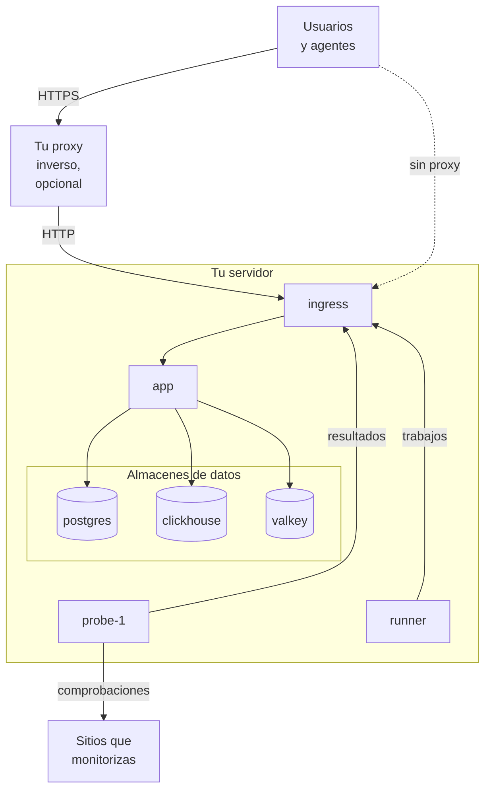

# Docker Compose

Ejecuta una instancia completa y gratuita de OneUptime en un solo servidor Linux con Docker Compose. Esta página te lleva de un servidor recién creado a una instancia en marcha, y después trata HTTPS, el endurecimiento para producción, las copias de seguridad, las actualizaciones y la desinstalación. Para trabajar en el código de OneUptime, consulta [Desarrollo local](/docs/installation/local-development).

:::cards
- [Instalar OneUptime](#instalar-oneuptime): De un servidor recién creado a tu primera cuenta, en cinco pasos.
- [Configurar HTTPS](#configurar-https): Deja que OneUptime obtenga un certificado, o pon delante tu propio proxy.
- [Lista de comprobación para producción](#lista-de-comprobación-para-producción): Lo que hay que resolver antes de que llegue el tráfico real.
- [Actualizar OneUptime](#actualizar-oneuptime): Pasa a la última versión.
:::

## Cómo funciona

Docker Compose ejecuta cada parte de OneUptime como un contenedor en tu servidor. Todo el tráfico entra por el contenedor `ingress`, que lo dirige a la `app`. La aplicación guarda sus datos en PostgreSQL, ClickHouse y Valkey. Una sonda incluida ejecuta las comprobaciones de tus monitores y envía los resultados a través del ingress.



| Servicio | Imagen | Qué hace |
| --- | --- | --- |
| `ingress` | `oneuptime/nginx` | Recibe todo el tráfico en los puertos 80 y 443 y lo dirige a la aplicación. Sirve HTTPS cuando OneUptime gestiona el certificado. |
| `app` | `oneuptime/app` | El panel, la API, las páginas de estado, la ingesta de telemetría y los procesos en segundo plano. |
| `probe-1` | `oneuptime/probe` | Una sonda global que ejecuta las comprobaciones de tus monitores. Usa la red del host. |
| `runner` | `oneuptime/runner` | El Runner de la instancia, que ejecuta las correcciones de código con IA. Usa la red del host. |
| `postgres` | `postgres:15` | Configuración y estado: monitores, incidentes, usuarios. Se guarda en el volumen `postgres`. |
| `clickhouse` | `clickhouse/clickhouse-server:26.7` | Telemetría: logs, métricas, trazas y excepciones. Se guarda en el volumen `clickhouse`. |
| `valkey` | `valkey/valkey:9.1-alpine` | Caché y colas. No guarda nada en disco. |

> [!NOTE]
> El servicio `valkey` ejecuta [Valkey](https://valkey.io), el fork con licencia BSD de Redis 7.2, configurado mediante los ajustes `VALKEY_*` de `config.env`. Sirve cualquier servidor que hable el protocolo de Redis: apunta `VALKEY_HOST` a un Redis gestionado si lo prefieres. Estos ajustes se llamaban `REDIS_*` hasta la 13.0.0; los nombres antiguos se siguen leyendo, el contenedor sigue respondiendo al nombre de host `redis` y `npm run update` no los reescribe, así que un `config.env` antiguo no necesita cambios.

Para producción a gran escala, o cuando necesites alta disponibilidad, usa en su lugar el [chart de Helm](https://artifacthub.io/packages/helm/oneuptime/oneuptime) en Kubernetes: Docker Compose ejecuta una sola copia de cada servicio en un solo servidor.

## Requisitos

Elige el tamaño del servidor según lo que vayas a ejecutar en él. La telemetría (logs, métricas, trazas) es lo que determina la memoria y el disco; consulta [Dimensionamiento y planificación de capacidad](/docs/installation/sizing) cuando conozcas tus volúmenes.

| | Recomendado | Mínimo para un homelab |
| --- | --- | --- |
| **Memoria** | 16 GB | 8 GB |
| **CPU** | 8 núcleos | 4 núcleos |
| **Disco** | 400 GB | 20 GB |
| **Sistema** | Ubuntu 22.04, u otro Linux basado en Debian, Ubuntu o RHEL | Lo mismo |
| **Arquitectura** | x86-64 (`amd64`) o ARM (`arm64`) | Lo mismo |

El mínimo para un homelab sirve para uso personal y experimental: hay quien ejecuta OneUptime en una Raspberry Pi.

También necesitas:

- **Docker** con el plugin **Docker Compose v2** (el comando `docker compose`).
- **Git**, para descargar OneUptime.
- **Node.js y npm**, que ejecutan los scripts `npm start` y `npm run update` que envuelven Docker Compose.
- **Puertos 80 y 443** libres en el servidor. La tabla de abajo enumera cada puerto que OneUptime usa en el host.

| Puerto del host | Lo usa | Ajuste | Para qué sirve |
| --- | --- | --- | --- |
| 80 | `ingress` | `ONEUPTIME_HTTP_PORT` | El panel, la API, la ingesta de telemetría y la validación de Let's Encrypt. |
| 443 | `ingress` | `STATUS_PAGE_HTTPS_PORT` | HTTPS para tu instancia cuando OneUptime gestiona el certificado, y para las páginas de estado y paneles en dominios personalizados. |
| 5400 | `postgres` | Definido en `docker-compose.yml` | Permite que `npm run backup` y `restore.sh` lleguen a PostgreSQL desde el propio servidor. Solo se publica en `127.0.0.1`. |
| 3874 | `probe-1` | `GLOBAL_PROBE_1_PORT` | El servidor propio de la sonda. Nada fuera del servidor lo necesita. |
| 3876 | `runner` | `ONEUPTIME_RUNNER_PORT` | El servidor propio del Runner. Nada fuera del servidor lo necesita. |

También hay un [vídeo paso a paso](https://youtu.be/j1SWmMW2oL4) de la instalación.

## Instalar OneUptime

En un servidor nuevo con Ubuntu, Debian o una distribución basada en RHEL, un solo comando puede hacer por ti los pasos de abajo. Instala Docker, Git y Node.js si faltan, clona la rama release en una carpeta `oneuptime`, te pregunta la dirección que usará la gente y ejecuta `npm start`:

```bash
curl -fsSL https://oneuptime.com/install.sh | bash
```

:::steps
### Clona la rama release

La rama `release` contiene los archivos de la última versión.

```bash
git clone --depth 1 --single-branch --branch release https://github.com/OneUptime/oneuptime.git
cd oneuptime
```

### Crea config.env

Todos los ajustes de OneUptime están en `config.env`. Parte del ejemplo:

```bash
cp config.example.env config.env
```

### Define el nombre de host

Abre `config.env` y define `HOST` con el nombre de dominio o la dirección IP que se usará para llegar a OneUptime, sin `http://`. Deja `localhost` solo para probar OneUptime en tu propio ordenador.

```ini title="config.env"
HOST=oneuptime.example.com
```

### Inicia OneUptime

:::tabs
@tab npm
```bash
npm start
```
@tab Docker CLI
```bash
(export $(grep -v '^#' config.env | xargs) && docker compose up --remove-orphans -d)
```
Antes del primer arranque, sustituye tú mismo los secretos de marcador, como muestra [Genera secretos aleatorios](#genera-secretos-aleatorios): solo `npm start` lo hace por ti.
:::

`npm start` comprueba primero el servidor: Docker, la memoria, el espacio en disco, los puertos que usa OneUptime y `HOST`. Se detiene ante cualquier cosa que impediría que OneUptime funcione, y dice qué cambiar. Después da a cada secreto de marcador de `config.env` su propio valor aleatorio, inicia OneUptime y espera a que responda cada parte. El primer arranque tarda varios minutos, mientras Docker descarga las imágenes y OneUptime crea sus bases de datos. Termina con **OneUptime is up!** y la dirección que debes abrir.

### Crea la primera cuenta

Abre `http://` seguido de tu `HOST` (por ejemplo `http://localhost`) y regístrate. La primera cuenta de una instancia nueva pasa a ser su administrador principal, que puede abrir el Admin Dashboard en `/admin`.

Cualquiera que pueda llegar a la página puede registrarse después de ti. Para impedirlo, abre el Admin Dashboard, ve a **Ajustes > Autenticación** y desactiva **Permitir el registro**. Las personas que invites a un proyecto pueden seguir creando su cuenta.
:::

### Genera secretos aleatorios

`config.example.env` trae cada secreto como un marcador que es público en GitHub. `npm start` da a cada uno su propio valor aleatorio antes de iniciar nada, y nombra los ajustes que rellenó:

| Ajuste | Qué protege |
| --- | --- |
| `ONEUPTIME_SECRET` | Las llamadas entre los propios servicios de OneUptime. |
| `ENCRYPTION_SECRET` | Los secretos que guarda OneUptime, como tokens de integraciones y contraseñas SMTP, y los tokens de inicio de sesión que emite. |
| `DATABASE_PASSWORD`, `CLICKHOUSE_PASSWORD`, `VALKEY_PASSWORD` | Los tres almacenes de datos. |
| `REGISTER_PROBE_KEY` | El registro de sondas en tu instancia. |
| `GLOBAL_PROBE_1_KEY`, `GLOBAL_PROBE_2_KEY` | Las sondas globales que puede ejecutar Docker Compose (`probe-1` se ejecuta de forma predeterminada). |
| `ONEUPTIME_RUNNER_KEY` | El Runner incluido. |
| `GLOBAL_RUNNER_KEY` | El Runner global incluido, que ejecuta los pasos JavaScript de todos los proyectos. |

> [!IMPORTANT]
> Mantén los secretos una vez que OneUptime haya arrancado. PostgreSQL solo toma su contraseña cuando crea su base de datos, y cambiar `ENCRYPTION_SECRET` más adelante hace ilegible cualquier valor cifrado con el anterior. Por eso `npm start` define `DATABASE_PASSWORD` y `ENCRYPTION_SECRET` solo en una instalación nueva, antes de que PostgreSQL cree su base de datos.

Con la Docker CLI, sustituye tú mismo los marcadores antes del primer arranque:

```bash
while grep -q "please-change-this-to-random-value" config.env; do
  sed -i "0,/please-change-this-to-random-value/{s/please-change-this-to-random-value/$(openssl rand -hex 32)/}" config.env
done
grep -c "please-change-this" config.env
```

El último comando imprime `0`: no queda ningún marcador. El bucle usa GNU `sed`, que tiene cualquier servidor Linux.

## Configurar HTTPS

OneUptime sirve HTTP simple hasta que eliges una de las dos formas de añadir HTTPS:

| | Dejar que OneUptime obtenga un certificado | Usar tu propio proxy inverso |
| --- | --- | --- |
| **TLS termina en** | El `ingress` de OneUptime, con un certificado gratuito de Let's Encrypt que renueva él mismo | Tu proxy: Caddy, Nginx o un balanceador de carga |
| **Necesitas** | Un nombre de dominio público que apunte al servidor, y los puertos 80 y 443 accesibles desde Internet | Un proxy y un certificado para tu dominio |
| **Ajustes** | `PROVISION_SSL=true`, `HTTP_PROTOCOL=https` | `PROVISION_SSL=false`, `HTTP_PROTOCOL=https`, `TRUSTED_PROXY_HOPS=2` |
| **Páginas de estado en dominios personalizados** | Funcionan sin configuración adicional | Tu proxy también tiene que servir esos dominios |

Si pones páginas de estado o paneles en dominios personalizados, dejar que OneUptime gestione TLS es la configuración más sencilla: el ingress pide y sirve él mismo los certificados de esos dominios.

Con `HTTP_PROTOCOL=https`, OneUptime construye enlaces HTTPS, mantiene las cookies de inicio de sesión en HTTPS y pide a los navegadores que lleguen a tu `HOST` solo por HTTPS. Un navegador lo respeta durante un año, en todos los puertos de ese nombre, así que si `HOST` alguna vez tiene que responder de nuevo por HTTP simple, define `HSTS_MAX_AGE_SECONDS=0` en `config.env` un tiempo antes: los navegadores olvidan la regla en su siguiente visita.

### Dejar que OneUptime obtenga un certificado

:::steps
#### Apunta tu dominio al servidor

Crea un registro DNS `A` (o `AAAA` para IPv6) para tu dominio, con la dirección IP pública del servidor como valor. Con un registro `AAAA`, activa también IPv6 para OneUptime: consulta [Direcciones de los visitantes](#direcciones-de-los-visitantes).

#### Activa la obtención de certificados

Define estos valores en `config.env`:

```ini title="config.env"
HOST=oneuptime.example.com
PROVISION_SSL=true
HTTP_PROTOCOL=https
```

`HOST` tiene que ser un nombre de dominio: OneUptime no puede obtener un certificado para una dirección IP ni para `localhost`.

#### Reinicia con los nuevos ajustes

```bash
npm start
```

#### Abre tu instancia por HTTPS

Abre `https://oneuptime.example.com`. OneUptime pide el certificado al arrancar y después lo revisa cada hora, y lo renueva cuando quedan menos de 30 días. Hasta que llega el primer certificado, normalmente en pocos minutos, el ingress sirve uno autofirmado temporal y tu navegador te avisa.
:::

### Usar tu propio proxy inverso

Estos pasos ejecutan el proxy en el mismo servidor que OneUptime. Si tu proxy se ejecuta en otra máquina, sáltate el primer paso, apunta el proxy al puerto 80 de este servidor y, con el firewall de tu proveedor de nube, deja que solo el proxy llegue a los puertos 80 y 443: un visitante que llega a OneUptime sin pasar por el proxy puede elegir la dirección con la que OneUptime lo cuenta.

:::steps
#### Saca el ingress de los puertos 80 y 443

El proxy necesita los puertos 80 y 443, así que mueve el ingress a otros puertos, publicados solo en la dirección de loopback `127.0.0.1` de este servidor, para que los visitantes lleguen a OneUptime únicamente a través de tu proxy:

```ini title="config.env"
ONEUPTIME_HTTP_PORT=127.0.0.1:8080
STATUS_PAGE_HTTPS_PORT=127.0.0.1:8443
```

La sonda y el Runner usan la red del host y llegan a OneUptime a través de `http://localhost`. `npm start` los mueve al nuevo puerto del ingress, `http://localhost:8080`, y lo indica.

#### Indica a OneUptime que está detrás de un proxy

```ini title="config.env"
HOST=oneuptime.example.com
HTTP_PROTOCOL=https
PROVISION_SSL=false
TRUSTED_PROXY_HOPS=2
```

`HTTP_PROTOCOL=https` hace que los enlaces que construye OneUptime usen HTTPS. `TRUSTED_PROXY_HOPS=2` cuenta tu proxy y el ingress de OneUptime, de modo que OneUptime lee la dirección real del visitante para las listas de IP permitidas y los límites de tasa. Añade uno por cada proxy adicional que añada datos a `X-Forwarded-For`, como una CDN o un balanceador de carga.

#### Reinicia OneUptime en los nuevos puertos

```bash
npm start
```

`npm start` comprueba OneUptime en su nuevo puerto, `localhost:8080`, y termina con **OneUptime is up!**

#### Configura el proxy

:::tabs
@tab Caddy
```text title="Caddyfile"
oneuptime.example.com {
	reverse_proxy localhost:8080
}
```
Caddy obtiene y renueva el certificado él mismo, redirige HTTP a HTTPS y deja pasar las conexiones WebSocket. Recarga Caddy después de cambiar el archivo, por ejemplo con `sudo systemctl reload caddy`.
@tab Nginx
```nginx title="/etc/nginx/conf.d/oneuptime.conf"
map $http_upgrade $oneuptime_connection_upgrade {
    default upgrade;
    ""      close;
}

server {
    listen 80;
    server_name oneuptime.example.com;
    return 301 https://$host$request_uri;
}

server {
    listen 443 ssl;
    server_name oneuptime.example.com;

    ssl_certificate     /etc/letsencrypt/live/oneuptime.example.com/fullchain.pem;
    ssl_certificate_key /etc/letsencrypt/live/oneuptime.example.com/privkey.pem;

    # The limits OneUptime's own ingress uses.
    client_max_body_size 50M;
    proxy_read_timeout 300s;
    proxy_send_timeout 300s;

    proxy_http_version 1.1;
    proxy_set_header Host $host;
    proxy_set_header X-Forwarded-For $proxy_add_x_forwarded_for;
    proxy_set_header X-Forwarded-Proto $scheme;
    proxy_set_header Upgrade $http_upgrade;
    proxy_set_header Connection $oneuptime_connection_upgrade;

    location / {
        proxy_pass http://127.0.0.1:8080;
    }

    # MCP clients keep a stream open.
    location /mcp {
        proxy_pass http://127.0.0.1:8080;
        proxy_buffering off;
        proxy_read_timeout 86400s;
        proxy_send_timeout 86400s;
    }
}
```
Las rutas de los certificados son donde Certbot guarda un certificado de Let's Encrypt; usa las rutas de tu propio certificado si viene de otro sitio. Comprueba el archivo y recarga Nginx con `sudo nginx -t && sudo systemctl reload nginx`.
:::

Ambos envían `X-Forwarded-Proto`, que le dice a OneUptime que un visitante llegó por HTTPS. Cualquier otro proxy tiene que enviarlo también, o las cookies de inicio de sesión de las páginas de estado y los paneles en tus dominios personalizados no se mantienen en HTTPS.

#### Abre tu instancia a través del proxy

Abre `https://oneuptime.example.com`. Deberías ver la página de inicio de sesión de OneUptime, servida con el certificado de tu proxy.
:::

> [!NOTE]
> Detrás de tu propio proxy, envía la telemetría por OTLP/HTTP (`/otlp`). OTLP por gRPC solo llega a OneUptime cuando su propio ingress termina TLS (`PROVISION_SSL=true`).

## Direcciones de los visitantes

OneUptime cuenta a cada visitante por la dirección desde la que se conecta: los límites de inicio de sesión, los demás límites por dirección y las listas de IP permitidas de las páginas de estado y los paneles la leen todos. Dos configuraciones necesitan un ajuste para que esa dirección sea la del propio visitante:

| Configuración | Ajuste |
| --- | --- |
| Las personas llegan a OneUptime por IPv6, por ejemplo a través de un registro `AAAA` | IPv6 en la red de OneUptime, en `docker-compose.override.yml` |
| Tu propio proxy inverso está delante de OneUptime | `TRUSTED_PROXY_HOPS=2`, con el ingress publicado en `127.0.0.1` (consulta [Usar tu propio proxy inverso](#usar-tu-propio-proxy-inverso)) |

Sin IPv6 en la red de OneUptime, Docker entrega a OneUptime cada visitante que llega por IPv6 desde una dirección propia, y OneUptime los cuenta a todos como un solo visitante: los inicios de sesión fallidos de una persona pueden bloquear a las demás. Activar IPv6 requiere Docker Engine 27 o posterior (`docker version` muestra la tuya).

:::steps
### Activa IPv6

Crea `docker-compose.override.yml` junto a `docker-compose.yml`, o añade esto al que ya tienes; `npm start` y `npm run update` lo leen:

```yaml title="docker-compose.override.yml"
networks:
  oneuptime:
    enable_ipv6: true
```

### Reinicia OneUptime

```bash
npm stop
npm start
```

OneUptime se detiene y vuelve a arrancar con IPv6 en su red. Tus datos se conservan. Docker no puede eliminar una red a la que todavía está conectado un contenedor propio, como un proxy inverso: desconéctalo antes de la red de OneUptime y vuelve a conectarlo después. Si `npm start` se detiene con `has active endpoints`, desconéctalo y vuelve a ejecutar `npm stop` y `npm start`.

### Comprueba la red

```bash
docker network ls --quiet --filter name=_oneuptime | xargs docker network inspect | grep EnableIPv6
```

Muestra `"EnableIPv6": true,`.
:::

Cuando varias personas inician sesión desde una misma dirección de red privada, la página **Estado de OneUptime** del Admin Dashboard lo indica, con el ajuste que lo cambia.

## Lista de comprobación para producción

Docker Compose ejecuta una sola copia de cada servicio en un solo servidor, lo que encaja con equipos pequeños y homelabs. Antes de confiar en él, repasa esta lista.

| Área | Qué hacer |
| --- | --- |
| **Secretos** | Ningún valor de `config.env` sigue siendo un marcador `please-change-this-to-random-value`. Consulta [Genera secretos aleatorios](#genera-secretos-aleatorios), y [Cambia la contraseña de la base de datos](#cambia-la-contraseña-de-la-base-de-datos) para una instalación que arrancó con el marcador en `DATABASE_PASSWORD`. |
| **HTTPS** | Se llega a OneUptime por HTTPS y `HTTP_PROTOCOL=https` está definido. Consulta [Configurar HTTPS](#configurar-https). |
| **Registros** | Cuando tu equipo ya tenga cuentas, desactiva **Permitir el registro** en **Ajustes > Autenticación** del Admin Dashboard. |
| **Firewall** | Solo los puertos 80 y 443 (y SSH) están abiertos a Internet. OneUptime publica el puerto 5400 de PostgreSQL solo en `127.0.0.1`. Cierra cualquier otro puerto que publiques con el firewall de tu proveedor de nube: las reglas de `ufw` no se aplican a los puertos que publica Docker. |
| **Direcciones de los visitantes** | La página **Estado de OneUptime** del Admin Dashboard no indica que varias personas inicien sesión desde una misma dirección. Consulta [Direcciones de los visitantes](#direcciones-de-los-visitantes). |
| **Copias de seguridad** | PostgreSQL se respalda cada día y las copias salen del servidor. Consulta [Copia de seguridad y restauración](#copia-de-seguridad-y-restauración). |
| **Correo** | Hay un servidor de correo configurado en **Ajustes > Notificaciones > Correos** del Admin Dashboard, para que OneUptime pueda enviar invitaciones y notificaciones. Consulta [SMTP](/docs/emails/smtp). |
| **Disco** | Se vigila el espacio libre. ClickHouse crece con la telemetría que conservas (consulta [Dimensionamiento y planificación de capacidad](/docs/installation/sizing)); el log de cada contenedor está limitado a 1000 MB. |
| **Actualizaciones** | OneUptime se actualiza al menos una vez por semana. Las versiones salen a menudo. Consulta [Actualizar OneUptime](#actualizar-oneuptime). |
| **Alta disponibilidad** | Si la necesitas, pasa al [chart de Helm](https://artifacthub.io/packages/helm/oneuptime/oneuptime) en Kubernetes. |

### Cambia la contraseña de la base de datos

PostgreSQL conserva la contraseña con la que se creó, así que cambiar solo `DATABASE_PASSWORD` en `config.env` deja a OneUptime fuera de su base de datos. Para darle una contraseña propia a una instalación que arrancó con el marcador, cámbiala en PostgreSQL y en `config.env` a la vez, y después vuelve a arrancar OneUptime:

```bash
NEW_PASSWORD=$(openssl rand -hex 32) &&
  (export $(grep -v '^#' config.env | xargs) && docker compose exec -T postgres psql -U "$DATABASE_USERNAME" -d "$DATABASE_NAME" -c "ALTER USER \"$DATABASE_USERNAME\" PASSWORD '$NEW_PASSWORD'") &&
  sed -i "s/^DATABASE_PASSWORD=.*/DATABASE_PASSWORD=$NEW_PASSWORD/" config.env
npm start
```

Si definiste `DATABASE_BACKUP_PASSWORD` y `DATABASE_RESTORE_PASSWORD`, dales también el nuevo valor.

## Copia de seguridad y restauración

PostgreSQL guarda todo lo que configuras: monitores, incidentes, páginas de estado, usuarios. `npm run backup` lo vuelca en un archivo de la carpeta `Backups`.

:::steps
### Dale al script de copia de seguridad la contraseña de la base de datos

En `config.env`, define `DATABASE_BACKUP_PASSWORD` con el valor de `DATABASE_PASSWORD`. El script lee `config.env` como texto plano, así que el `${DATABASE_PASSWORD}` que trae nunca se rellena.

### Ejecuta la copia de seguridad

```bash
npm run backup
```

Pide tu contraseña de sudo y escribe `Backups/db-<day of the month>.backup`, de modo que las copias diarias sustituyen a las de un mes antes. Ejecútalo al menos una vez al día.

### Copia las copias de seguridad fuera del servidor

Una copia de seguridad en el mismo disco que la base de datos no sobrevive a la pérdida de ese disco.
:::

Solo el propio servidor llega a PostgreSQL: responde en el puerto 5400 de `127.0.0.1`. Para hacer copias de seguridad desde otra máquina, abre un túnel SSH desde esa máquina y después conéctate a su propio puerto 5400:

```bash
ssh -N -L 5400:127.0.0.1:5400 you@oneuptime.example.com
```

:::details Publica PostgreSQL en una dirección de una red privada
Si una herramienta de tu red privada tiene que llegar a PostgreSQL sin túnel, publícalo también en la dirección del servidor en esa red, en un puerto propio. Crea `docker-compose.override.yml` junto a `docker-compose.yml`; `npm start` y `npm run update` lo leen:

```yaml title="docker-compose.override.yml"
services:
  postgres:
    ports:
      - "10.0.0.5:5401:5432"
```

Pon la dirección privada del propio servidor en lugar de `10.0.0.5`, nunca una pública, y antes dale a PostgreSQL una contraseña propia (consulta [Cambia la contraseña de la base de datos](#cambia-la-contraseña-de-la-base-de-datos)). Después ejecuta `npm start`, y PostgreSQL responderá también en el puerto 5401 de esa dirección.
:::

ClickHouse guarda tu telemetría en el volumen de Docker `oneuptime_clickhouse`, y ningún script lo respalda. Si necesitas conservar esa telemetría, respalda el volumen con una herramienta de ClickHouse como [clickhouse-backup](https://github.com/Altinity/clickhouse-backup), o cópialo con OneUptime detenido.

Para restaurar PostgreSQL, define los valores `DATABASE_RESTORE_*` en `config.env`: `DATABASE_RESTORE_PASSWORD` con el valor de `DATABASE_PASSWORD`, como para las copias de seguridad, y `DATABASE_RESTORE_FILENAME` con la copia que quieres restaurar, por ejemplo `db-31.backup`. Después ejecuta `bash restore.sh`. La base de datos en la que restaura tiene que existir ya; en una instalación en marcha, existe.

> [!CAUTION]
> `restore.sh` elimina de la base de datos de destino cada objeto de la copia de seguridad antes de volver a crearlo. Pregunta antes de empezar; comprueba el nombre de la base de datos que muestra.

## Actualizar OneUptime

Haz primero una copia de seguridad y después ejecuta:

```bash
git checkout release
git pull
npm run update
```

`npm run update` añade a tu `config.env` los ajustes nuevos de `config.example.env` (tus propios valores se mantienen), descarga las imágenes nuevas y reinicia OneUptime. Igual que `npm start`, termina con **OneUptime is up!**

Pasar a una versión mayor nueva (de la 13 a la 14, por ejemplo) puede requerir más: lee [Actualizar a una nueva versión de OneUptime](/docs/installation/upgrading) antes de empezar.

`APP_TAG=release` en `config.env` descarga siempre la última versión de la Community Edition. Para quedarte en una versión, define `APP_TAG` con su número, por ejemplo `14.0.22`. Para la Enterprise Edition, las etiquetas son `enterprise-release` y `enterprise-14.0.22`.

## Desinstalar OneUptime

Detén OneUptime y elimina sus contenedores y su red:

```bash
npm run down
```

Tus datos se quedan en los volúmenes `oneuptime_postgres` y `oneuptime_clickhouse`, y la carpeta `oneuptime` conserva `config.env` y tus copias de seguridad. Para borrar también los datos:

```bash
(export $(grep -v '^#' config.env | xargs) && docker compose down --volumes --remove-orphans)
```

Después borra la carpeta `oneuptime`.

> [!CAUTION]
> `--volumes` borra para siempre cada monitor, incidente, usuario y toda la telemetría. Haz primero una copia de seguridad si podrías necesitar algo.

## Solución de problemas

:::details npm start se detiene antes de iniciar OneUptime
`npm start` comprueba primero el servidor y se detiene ante cualquier cosa que impediría que OneUptime funcione: falta Docker o su plugin de Compose, Docker no está en marcha o tu usuario no puede usarlo, otro programa ocupa un puerto, o `HOST` es una dirección que ningún navegador puede abrir. Cada línea marcada con ✗ dice qué cambiar. Cámbialo y vuelve a ejecutar `npm start`. Si una comprobación se equivoca con tu servidor, arranca sin las comprobaciones:

```bash
ONEUPTIME_SKIP_PREFLIGHT=true npm start
```
:::

:::details Docker dice "permission denied" cuando ejecutas npm start
Tu usuario no puede llegar al daemon de Docker. Añádelo al grupo `docker` y después cierra la sesión y vuelve a iniciarla:

```bash
sudo usermod -aG docker $USER
```
:::

:::details El ingress no puede arrancar porque el puerto 80 o 443 está en uso
Otro programa del servidor, a menudo un servidor web, ocupa el puerto. `npm start` comprueba los puertos antes de iniciar nada, y nombra el contenedor que ocupa uno cuando lo ejecuta Docker. Detén ese programa, o mueve el ingress a otros puertos y pon el programa delante de OneUptime como se describe en [Usar tu propio proxy inverso](#usar-tu-propio-proxy-inverso).
:::

:::details npm start termina con "Maximum retries reached"
La comprobación con la que termina `npm start` se rindió antes de que OneUptime respondiera. El primer arranque puede tardar más de lo que espera la comprobación, mientras se descargan las imágenes y se crean las bases de datos. Mira qué se está ejecutando y lee los logs:

```bash
npm run ps
npm run logs
```

Cuando todos los contenedores estén en marcha, vuelve a ejecutar la comprobación con `npm run status-check`. Comprueba el ingress en el puerto que define `ONEUPTIME_HTTP_PORT`.
:::

:::details El navegador muestra "OneUptime no está configurado para esta dirección"
Abriste OneUptime en una dirección distinta de su `HOST`, como la dirección IP del servidor mientras `HOST` sigue siendo `localhost`. La página muestra la línea `HOST` para la dirección que abriste, con un botón que la copia: pon esa línea en `config.env` y después ejecuta `npm start`. Si abriste la dirección de `HOST` y la página dice que tu proxy no la transmitió, configura el proxy para que transmita el nombre de host que pidió el navegador: Caddy lo hace por defecto, Nginx con `proxy_set_header Host $host;` y Apache con `ProxyPreserveHost On`.
:::

:::details Algunas páginas cargan, pero fallan las actualizaciones en directo o las subidas
Abre OneUptime en la dirección de `HOST`. El ingress dirige las solicitudes por nombre de host: solo `HOST` y `localhost` llegan a toda la aplicación, y cualquier otro nombre, como la dirección IP del servidor, se trata como un dominio de página de estado. Define `HOST` con el nombre que se usa y después ejecuta `npm start`.
:::

:::details Registrarse o iniciar sesión falla con "Page not found"
La página de registro carga, pero el registro falla con `Page not found - /identity/signup` y el inicio de sesión con `Page not found - /identity/login`. La solicitud llegó a OneUptime con un nombre de host distinto de `HOST`, así que el ingress la dirigió como el dominio propio de una página de estado, donde el registro y el inicio de sesión de OneUptime no están disponibles. Comprueba estas dos cosas:

- `HOST` es la dirección que abre la gente, con su puerto si usan uno, como `oneuptime.example.com:8080`. Ejecuta `npm start` después de cambiarlo.
- Un proxy delante de OneUptime transmite el nombre de host que pidió el navegador. Caddy lo hace por defecto, Nginx con `proxy_set_header Host $host;` como en [Usar tu propio proxy inverso](#usar-tu-propio-proxy-inverso), y Apache con `ProxyPreserveHost On`.
:::

:::details El navegador avisa sobre el certificado después de definir PROVISION_SSL
Hasta que Let's Encrypt emite el certificado, el ingress sirve uno autofirmado temporal. Si el aviso sigue más de unos minutos, comprueba que:

- `HOST` es un nombre de dominio, no una dirección IP ni `localhost`.
- El registro DNS del dominio apunta a este servidor.
- El puerto 80 es accesible desde Internet, para que Let's Encrypt pueda validar el dominio.

Cuando falla un pedido, la aplicación registra un error que empieza por `CoreSSL:EnsurePrimaryHostCertificate`, seguido del motivo:

```bash
(export $(grep -v '^#' config.env | xargs) && docker compose logs app) | grep -A 5 CoreSSL
```
:::

:::details La sonda incluida aparece como Desconectado después de mover el puerto del ingress
El Admin Dashboard muestra la sonda en **Ajustes > Monitoreo > Sondas globales**. Llega a OneUptime en `GLOBAL_PROBE_1_ONEUPTIME_URL`, que de forma predeterminada es `http://localhost` (puerto 80). `npm start` la mueve, junto con `ONEUPTIME_RUNNER_ONEUPTIME_URL`, al puerto del ingress mientras apunten a `localhost`. Si las definiste con otra dirección, o iniciaste OneUptime con la Docker CLI, define ambas con el nuevo puerto del ingress, por ejemplo `http://localhost:8080`, y reinicia OneUptime.
:::

## Próximos pasos

:::cards
- [Actualizar a una nueva versión de OneUptime](/docs/installation/upgrading): Lo que cada versión mayor necesita de ti.
- [Dimensionamiento y planificación de capacidad](/docs/installation/sizing): Planifica la memoria y el disco para tu telemetría.
- [Arquitectura autoalojada](/docs/self-hosted/architecture): Cómo encajan los componentes.
- [Edición Enterprise](/docs/self-hosted/enterprise): Lo que añade la imagen Enterprise, y su licencia.
:::
