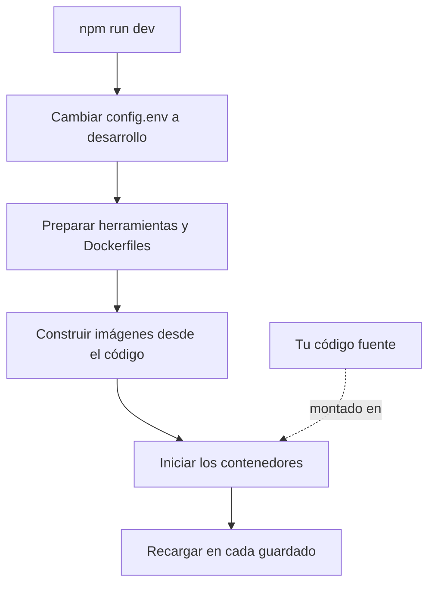

# Desarrollo local

Ejecuta OneUptime desde el código fuente en tu propio equipo para trabajar en él. El entorno de desarrollo construye cada servicio a partir de tu copia del repositorio, monta tu código fuente en los contenedores y los recarga cuando guardas un archivo.

Para ejecutar una versión publicada, usa [Docker Compose](/docs/installation/docker-compose).

## Cómo funciona el entorno de desarrollo

`npm run dev` prepara tu copia del repositorio y luego inicia el stack definido en `Scripts/Dev/docker-compose.dev.yml`:



| Etapa | Qué ocurre |
| --- | --- |
| Cambio a desarrollo | Establece `ENVIRONMENT=development` en `config.env`. |
| Preparación | Pide tu contraseña de sudo, instala las herramientas que faltan (Git, curl, Node.js, Docker, gomplate, ts-node), ejecuta `git pull` en tu rama actual, añade a `config.env` los ajustes nuevos de `config.example.env` y genera un `Dockerfile` a partir de cada `Dockerfile.tpl`. |
| Construcción | Construye una imagen para cada servicio desde el código fuente. La primera construcción tarda un rato. |
| Ejecución | Inicia los contenedores con tu código fuente montado en ellos. |
| Recarga | La App reinicia su API cuando cambia un archivo del servidor y reconstruye los paneles mientras los editas. |

Cuando existe la carpeta `ee/` del repositorio, la App carga desde ella la Enterprise Edition. Establece `ONEUPTIME_EDITION=community` en `config.env` para ejecutar la Community Edition.

## Antes de empezar

| Necesitas | Notas |
| --- | --- |
| **Docker** | Docker Desktop en macOS y Windows, o Docker Engine con el plugin Docker Compose v2 en Linux. |
| **Node.js 26 o posterior, y npm** | La versión que pide el `package.json` del repositorio, y la que usa la CI. |
| **Git** | Para clonar el repositorio. |
| **Acceso sudo** | `npm run dev` pide tu contraseña antes de instalar nada. |
| **Los puertos 80 y 443 libres** | El stack sirve OneUptime en `http://localhost` (puerto 80), y HTTPS en el puerto 443. |

## Iniciar el entorno de desarrollo

:::steps
### Clonar el repositorio

```bash
git clone https://github.com/OneUptime/oneuptime.git
cd oneuptime
```

### Crear config.env

```bash
cp config.example.env config.env
```

Los valores de ejemplo sirven tal cual para el desarrollo. Puedes cambiarlos, pero no hace falta.

### Iniciar el stack

```bash
npm run dev
```

Pide tu contraseña de sudo, luego construye las imágenes e inicia los contenedores en segundo plano. Sigue el arranque de la App con `docker logs -f oneuptime-app-1`.

### Abrir OneUptime

Abre `http://localhost` y regístrate. La primera cuenta se convierte en el administrador maestro, que puede abrir el Admin Dashboard en `http://localhost/admin`.
:::

## Trabajar en el código

Edita los archivos de `packages/` y guarda: los contenedores recogen el cambio.

Antes de abrir un pull request, comprueba tu cambio en tu equipo, fuera de los contenedores. Para ello, instala las dependencias una vez: ejecuta `npm install` en la raíz del repositorio, para ESLint y las herramientas de migración, y luego `npm run install-modules`, que borra y reinstala los `node_modules` de cada paquete y tarda un rato.

:::steps
### Compilar lo que cambiaste

Ejecuta el compilador en cada paquete que cambiaste, por ejemplo en la App:

```bash
cd packages/App
npm run compile
```

### Pasar el linter solo a tus archivos

Desde la raíz del repositorio, pasa los archivos que cambiaste:

```bash
npx eslint --fix packages/App/path/to/File.ts
```

Evita `npm run lint` y `npm run fix-lint`: pasan el linter a todo el repositorio.

### Ejecutar las pruebas que cubren tu cambio

Desde el paquete, ejecuta los archivos de prueba que importan en lugar de toda la suite:

```bash
cd packages/App
npx jest Tests/path/to/YourChange.test.ts
```
:::

### Migraciones de base de datos

| Base de datos | Cómo añadir una migración |
| --- | --- |
| PostgreSQL | Cambia el modelo y luego ejecuta `npm run generate-postgres-migration` en lugar de escribir la migración a mano. Registra el archivo nuevo en `packages/Common/Server/Infrastructure/Postgres/SchemaMigrations/Index.ts`: no se ejecuta hasta que aparece ahí. `npm run check-postgres-schema-drift` muestra cualquier sentencia que todavía falte. |
| ClickHouse | Escribe la migración a mano en `packages/App/FeatureSet/Workers/DataMigrations`, siguiendo las existentes. |

## Referencia

### Comandos

Ejecútalos desde la raíz del repositorio.

| Tarea | Comando |
| --- | --- |
| Iniciar el stack, o aplicar cambios de `config.env` | `npm run dev` |
| Reconstruir las imágenes, tras un cambio de dependencias | `npm run build`, luego `npm run dev` |
| Reconstruir las imágenes desde cero | `npm run force-build-dev`, luego `npm run dev` |
| Listar los contenedores en ejecución | `docker ps` |
| Seguir los registros de un servicio | `docker logs -f oneuptime-app-1` |
| Detener el stack y eliminar sus contenedores | `npm run down` |

`npm run down` conserva tus datos: los volúmenes de PostgreSQL y ClickHouse sobreviven.

### Puertos

El entorno de desarrollo publica los almacenes de datos para que puedas conectarte a ellos con tus propias herramientas. Las contraseñas están en `config.env`.

| Servicio | Dirección | Inicia sesión con |
| --- | --- | --- |
| OneUptime | `http://localhost` | La cuenta que creaste |
| PostgreSQL | `localhost:5400` | Usuario `postgres`, base de datos `oneuptimedb`, contraseña `DATABASE_PASSWORD` |
| ClickHouse | `localhost:8189` (HTTP), `localhost:9034` (nativo) | Usuario `default`, base de datos `oneuptime`, contraseña `CLICKHOUSE_PASSWORD` |
| Valkey | `localhost:6310` | Contraseña `VALKEY_PASSWORD` |

## Solución de problemas

:::details npm run dev se detiene en git pull
`npm run dev` ejecuta `git pull` en tu rama actual antes de construir. Git se niega en una rama sin upstream, o cuando el pull sobrescribiría tus cambios sin confirmar. Configura el upstream de la rama (por ejemplo, subiéndola con `git push -u origin <branch>`) o confirma tu trabajo, y vuelve a ejecutar `npm run dev`.
:::

:::details npm run dev se detiene al instalar una herramienta
Instala tú mismo esa herramienta, por ejemplo gomplate o ts-node, y vuelve a ejecutar `npm run dev`: omite todas las herramientas que ya están instaladas.
:::

:::details Un servicio falla después de cambiar sus dependencias
Las imágenes aún contienen las dependencias antiguas. Reconstrúyelas con `npm run build` y vuelve a iniciar el stack con `npm run dev`. Si no basta, reconstruye desde cero con `npm run force-build-dev`.
:::

:::details El puerto 80 o 443 ya está en uso
Otro programa de tu equipo, a menudo un servidor web local, ocupa el puerto. Detenlo y vuelve a ejecutar `npm run dev`.
:::

## Próximos pasos

:::cards
- [Arquitectura autoalojada](/docs/self-hosted/architecture): Cómo encajan los servicios que acabas de iniciar.
- [Docker Compose](/docs/installation/docker-compose): Ejecutar una versión publicada en un servidor.
- [Referencia de la API](/docs/api-reference/api-reference): Llamar a la API de tu instancia local.
:::
