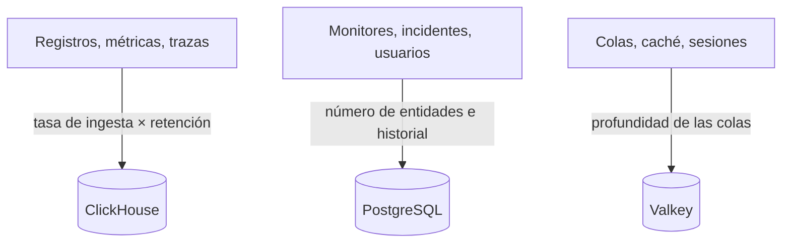

# Dimensionamiento y planificación de capacidad

Planifica la CPU, la memoria y el disco de un OneUptime autoalojado en Kubernetes con el [chart de Helm](https://artifacthub.io/packages/helm/oneuptime/oneuptime). Dimensiona por separado los tres almacenes de datos – **ClickHouse**, **PostgreSQL** y **Valkey** – y la aplicación, parte de uno de los niveles de abajo y ajusta cuando tengas cifras reales.

> [!IMPORTANT]
> Los valores predeterminados del chart no son un dimensionamiento de producción. Los servicios que ejecuta de forma predeterminada no fijan **ninguna solicitud ni límite de CPU o memoria**, y PostgreSQL y ClickHouse reciben volúmenes pequeños de **25 Gi**, para que el chart se instale en cualquier clúster. Para algo más que una prueba, define tú mismo los recursos y el almacenamiento con las cifras de esta página.

¿Usas en cambio la instalación con Docker Compose en un solo servidor? Su dimensionamiento es más sencillo: consulta los [requisitos](/docs/installation/docker-compose#requisitos) (se recomiendan 16 GB de memoria, 8 núcleos y 400 GB de disco).

:::cards
- [Qué hace crecer cada almacén de datos](#qué-hace-crecer-cada-almacén-de-datos): Tres almacenes que crecen con tres cosas distintas.
- [Niveles iniciales](#niveles-iniciales): Puntos de partida pequeño, mediano y grande.
- [Alta disponibilidad](#alta-disponibilidad): Réplicas y conmutación por error para cada almacén.
- [Retención](#la-retención-y-cómo-afecta-al-almacenamiento): El ajuste que multiplica tu disco.
:::

## Dimensiona tu instalación

:::steps
1. Averigua cuánta telemetría envías: los GB de registros, métricas y trazas al día. Mídela en una instalación pequeña si puedes.
2. Decide cuántos días conservarla. La retención multiplica el disco de ClickHouse (consulta [Retención](#la-retención-y-cómo-afecta-al-almacenamiento)).
3. Calcula el disco de ClickHouse con la [fórmula de almacenamiento](#fórmula-de-almacenamiento), y luego el de PostgreSQL y el de Valkey a partir de sus propias secciones.
4. Elige el [nivel inicial](#niveles-iniciales) más cercano a tus cifras y fija su CPU, memoria y almacenamiento en tus valores de Helm.
5. Activa la [alta disponibilidad](#alta-disponibilidad) en los almacenes que la necesiten, y luego observa el uso real y ajusta.
:::

## Qué hace crecer cada almacén de datos

OneUptime necesita tres almacenes de datos en producción. Cada uno crece con algo distinto, así que dimensiónalos por separado.



| Almacén | Qué guarda | Qué determina su tamaño |
| --- | --- | --- |
| **ClickHouse** | Toda la telemetría – registros, métricas, trazas, excepciones, perfiles | La telemetría: **tasa de ingesta × retención**. Es ~95 % de tu almacenamiento y el coste principal. |
| **PostgreSQL** | Configuración y estado – monitores, incidentes, alertas, usuarios, equipos, proyectos, workflows, páginas de estado, paneles | **El número de entidades y el historial**, no el volumen de telemetría. Crece despacio. |
| **Valkey** | Caché, colas de trabajo y sesiones | **La profundidad de las colas y las sesiones activas**. Limitado por la memoria y modesto. No es una fuente de verdad. |

OneUptime nunca necesita almacenamiento de objetos (S3, MinIO) para funcionar, y no mueve la telemetría antigua a un almacenamiento de objetos. Solo lo necesitas si eliges copias de seguridad en almacenamiento de objetos: el plugin Barman Cloud para CloudNativePG, o [clickhouse-backup](https://github.com/Altinity/clickhouse-backup) para ClickHouse. La copia de seguridad de CloudNativePG propia del chart (`postgresOperator.cnpg.backup`) toma instantáneas de volumen y no necesita almacenamiento de objetos. CloudNativePG nunca borra las instantáneas antiguas: elimínalas tú mismo, o no dejarán de crecer.

## ClickHouse – el factor principal

Casi todo tu almacenamiento y buena parte de tu memoria van a ClickHouse, porque allí vive cada línea de registro, punto de métrica, span de traza y excepción.

### Fórmula de almacenamiento

```text
ClickHouse disk ≈ (daily raw telemetry GB ÷ compression) × retention days × replicas × 1.3 (headroom)
```

La compresión depende de la señal:

| Señal | Compresión típica | Qué la cambia |
| --- | --- | --- |
| Registros | Aproximadamente 5:1 | Los registros se comprimen bien. |
| Métricas | Aproximadamente 2:1 | Una alta **cardinalidad** de etiquetas infla el disco y la memoria más rápido que el volumen bruto. Mantén baja la cardinalidad de las etiquetas. |
| Trazas | Entre ambos | Los atributos de span que envías. |

### Ejemplo práctico

Una flota de **10 clústeres**, cada uno con unos 10 nodos y 100 pods que registran a nivel INFO, produce aproximadamente **50–150 GB de registros sin procesar por clúster en 30 días** (unos 1,7–5 GB al día por clúster). En toda la flota, sumando métricas y trazas y tras la compresión, prevé aproximadamente **5–15 GB al día de telemetría comprimida**.

| Retención | Una réplica | 2 réplicas + 30 % de margen |
| --- | --- | --- |
| 30 días | ~150–450 GB | **~0,4–1,2 TB** |
| 90 días | ~0,45–1,35 TB | **~1,2–3,5 TB** |

El almacenamiento crece **de forma lineal con la retención**: una ventana de 90 días cuesta unas tres veces lo que una de 30.

### Memoria y tipo de disco

- **Usa NVMe o SSD.** La telemetría es intensiva en escritura, con ráfagas de lecturas de agregación; ClickHouse sufre en discos giratorios.
- **Dale a ClickHouse memoria de sobra.** Las consultas de agregación consumen mucha memoria. Como regla general, dimensiona la memoria al 25–50 % de tus datos comprimidos *calientes* (consultados recientemente), con un mínimo práctico de 16 GB para cualquier flota de producción real.
- **Vigila la cardinalidad de las métricas.** Es la mayor palanca individual sobre la memoria y el disco de ClickHouse. Impón convenciones de etiquetas de baja cardinalidad allí donde recoges métricas, y observa el número de series activas.

## PostgreSQL – configuración y estado

PostgreSQL guarda tu configuración y tu estado operativo, no la telemetría, así que crece despacio y se mantiene pequeño junto a ClickHouse. Incluso las instalaciones grandes suelen quedarse en decenas de GB. El volumen predeterminado de **25 Gi** basta para instalaciones pequeñas; prevé 50–100 GB para las más grandes, con margen para el historial de incidentes y alertas.

Con muchas réplicas de app, workers y sondas, las conexiones a la base de datos pueden agotarse antes que el almacenamiento. Cada pod abre hasta 50 conexiones de forma predeterminada, y el PostgreSQL incluido admite 500. Justo para esto, el chart incluye un pooler de conexiones **PgBouncer** opcional (`pgbouncer.enabled`): actívalo en instalaciones con muchas réplicas.

## Valkey – caché, colas y sesiones

La capa de caché ejecuta [Valkey](https://valkey.io), el fork de Redis 7.2 con licencia BSD, como caché, cola de trabajo y almacén de sesiones. Cualquier servidor compatible con el protocolo Redis puede sustituirlo, y el dimensionamiento de abajo se aplica igual. Está **limitado por la memoria**, y la persistencia está **desactivada de forma predeterminada**: no es una fuente de verdad y se puede reconstruir. Dimensiónalo según la profundidad de las colas y las sesiones simultáneas; 2–8 GB de memoria cubren la mayoría de las instalaciones. Su política de expulsión es `noeviction`, así que vigila su memoria si las colas se acumulan bajo una carga sostenida.

## Cómputo de la aplicación

Además de los almacenes de datos, dimensiona las cargas de trabajo sin estado. Cada una se ejecuta **sin solicitudes ni límites de recursos** hasta que los fijes, y con una réplica, salvo el telemetry writer, que tiene dos.

| Carga de trabajo | Clave de valores | Crece con |
| --- | --- | --- |
| App: panel, API e ingesta | `app` | Los usuarios, las llamadas a la API y la telemetría entrante |
| Workers, cuando están separados de la app | `worker` | La telemetría y el procesamiento de tareas en segundo plano |
| Sondas | `probes` | El número de monitores activos |
| Pasarela de entrada | `nginx` | El volumen de solicitudes |
| Telemetry writer, cuando está activado | `telemetryWriter` | No con la carga: agrupa cada inserción de telemetría en ClickHouse, así que se dimensiona según lo que ClickHouse puede asumir |

El chart incluye **KEDA**, para que la app, los workers, las sondas y el Runner escalen según su cola de trabajo pendiente. Activa `keda.enabled` junto con el `keda.enabled` propio de cada servicio (por ejemplo, `app.keda.enabled`). En un clúster que todavía no tiene KEDA, la primera instalación necesita una pasada adicional: consulta la [guía de KEDA](https://github.com/OneUptime/oneuptime/blob/master/HelmChart/Docs/Keda.md) del chart. Los servicios que KEDA no gestiona pueden usar en su lugar un escalador automático por CPU o memoria (`autoscaling`).

## Niveles iniciales

Elige como punto de partida el nivel más cercano a tu entorno, luego observa el uso real (`kubectl top pods`, el crecimiento del disco de ClickHouse y PostgreSQL) y ajusta.

- **Pequeño / PoC** – 1–3 clústeres, ≤30 nodos, ≤5 GB/día de telemetría sin procesar, 30 días de retención.
- **Mediano / Flota de producción** – ~10 clústeres, ~100 nodos, 10–30 GB/día de telemetría sin procesar, 30–90 días de retención.
- **Grande / Varias flotas** – 50+ clústeres, 500+ nodos, 100+ GB/día de telemetría sin procesar, 90 días de retención.

| | Pequeño / PoC | Mediano / Flota de producción | Grande / Varias flotas |
| --- | --- | --- | --- |
| **ClickHouse** | 4 vCPU / 16 GB / 200 GB NVMe | 8 vCPU / 32 GB / 1–3 TB NVMe | 16+ vCPU / 64–128 GB / 5–15 TB NVMe, **con shards** |
| **PostgreSQL** | 2 vCPU / 4 GB / 50 GB SSD | 4 vCPU / 8 GB / 100 GB SSD | 8 vCPU / 16–32 GB / 250 GB SSD (+ PgBouncer) |
| **Valkey** | 1 vCPU / 2 GB | 2 vCPU / 4 GB | 4 vCPU / 8–16 GB |
| **Retención prevista** | 30 días | 30–90 días | 90 días |

Estos niveles dimensionan el backend de OneUptime. El agente que instalas en cada clúster monitorizado se trata en la página [Agente de Kubernetes](/docs/telemetry/kubernetes-agent), que también muestra cómo reducir el volumen de datos que envía.

## Alta disponibilidad

Los almacenes de datos integrados del chart se ejecutan de forma predeterminada como **instancias únicas**. Para alta disponibilidad en producción:

| Almacén | Para alta disponibilidad |
| --- | --- |
| **PostgreSQL** | Activa el operador [CloudNativePG](https://cloudnative-pg.io) incluido (`postgresOperator.cnpg.enabled`) con **3 instancias** (`postgresOperator.cnpg.instances`): un primario y dos réplicas en espera activa, con conmutación por error automática. |
| **ClickHouse** | Activa el operador [Altinity](https://github.com/Altinity/clickhouse-operator) incluido (`clickhouseOperator.altinity.enabled`) con **2 o más réplicas por shard** (`clickhouseOperator.altinity.cluster.replicasCount`). Su ClickHouse Keeper incluido se ejecuta en **3 nodos** para el quórum. Añade shards (`shardsCount`) cuando el disco o la memoria de un nodo sea el límite. |
| **Valkey** | El chart no lo replica. Apunta OneUptime a un Redis o Valkey externo gestionado con conmutación por error automática (`externalValkey`). OneUptime se conecta a un solo host y puerto, así que usa el endpoint principal del servicio, no uno en modo clúster. |

> [!WARNING]
> Activar cualquiera de los dos operadores en una instalación existente inicia una base de datos nueva y vacía: ninguno copia los datos de la base de datos de instancia única que sustituye. Migra tus datos como describen las guías del chart – para [PostgreSQL](https://github.com/OneUptime/oneuptime/blob/master/HelmChart/Docs/MigratePostgresStandaloneToOperator.md) y para [ClickHouse](https://github.com/OneUptime/oneuptime/blob/master/HelmChart/Docs/MigrateClickhouseStandaloneToOperator.md).

## La retención y cómo afecta al almacenamiento

La retención de la telemetría es un **TTL de ClickHouse contado en días**. Todas las ediciones tienen el valor predeterminado del proyecto, en **Ajustes del proyecto > Telemetría y APM > Retención de datos** (**Retención predeterminada (días)**); cuando no hay nada configurado, es de 15 días. La [Enterprise Edition](/docs/self-hosted/enterprise) añade anulaciones: por señal (registros, trazas, métricas, perfiles), por severidad del registro y estado de la traza, y por servicio o recurso.

Los registros y las métricas se borran día a día, en la primera medianoche (hora del servidor de ClickHouse) tras el fin de su retención, lo que evita que ClickHouse reescriba cada día de ellos cada pocas horas mientras caduca. Justo antes de medianoche, sigue en disco hasta un día más que la ventana de retención: dimensiona los registros y las métricas para **días de retención + 1**.

Como la retención multiplica el almacenamiento de ClickHouse, decídela antes de dimensionar el disco. OneUptime **no** archiva la telemetría antigua ni la mueve a un almacenamiento de objetos. Para una retención de cumplimiento de varios años, amplía la ventana de retención y dimensiona el almacenamiento de ClickHouse en consecuencia, o exporta a un archivo externo de tu elección.

## Mide antes de comprometerte

El volumen de telemetría varía enormemente según el detalle de los registros de las aplicaciones, el número de namespaces, el intervalo de recogida y si hay registro DEBUG activado en alguna parte. Toma los niveles de arriba como puntos de partida: **recoge datos de tu entorno durante al menos cuatro semanas**, mide los GB reales al día de cada señal y luego dimensiona la retención y el almacenamiento con datos reales.

## Próximos pasos

:::cards
- [Docker Compose](/docs/installation/docker-compose): Requisitos para una instalación en un solo servidor.
- [Arquitectura autoalojada](/docs/self-hosted/architecture): Cómo encajan los componentes.
- [Agente de Kubernetes](/docs/telemetry/kubernetes-agent): El recolector que envía la telemetría de un clúster.
- [Enterprise Edition](/docs/self-hosted/enterprise): Las anulaciones de retención y las demás funciones Enterprise.
:::
