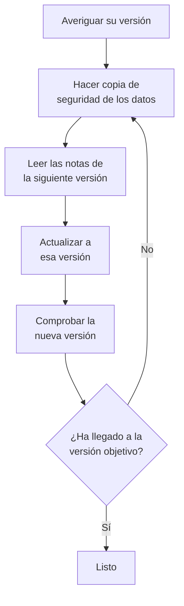

# Actualización

Actualice una instalación autoalojada de OneUptime – con Docker Compose, o con Kubernetes y Helm – a una versión más reciente. Siga el procedimiento de abajo y lea las notas de cada versión principal entre la que ejecuta y la que quiere alcanzar.

:::cards
- [Cómo actualizar](#cómo-actualizar): El procedimiento, para Docker Compose y Kubernetes.
- [Notas de cada versión](#encuentre-las-notas-de-su-versión): Lo que cada versión principal le pide, de un vistazo.
- [Imágenes de la Community Edition y la Enterprise Edition](#imágenes-de-la-community-edition-y-la-enterprise-edition): Qué imagen ejecutar a partir de la 14.
- [Actualización de OneUptime 13 → 14](#actualización-de-oneuptime-13-14): La versión principal más reciente.
:::

## Cómo actualizar

Tres reglas hacen que una actualización sea segura:

- **Actualice de una versión principal en una** (por ejemplo 6 → 7 → 8). No se salte ninguna versión principal.
- **Sáltese las versiones menores y de parche como quiera** (por ejemplo 8.1 → 8.4), siempre que siga sus notas de versión.
- **Haga una copia de seguridad antes de cada actualización**, y compruebe que puede restaurarla.



:::steps
### Averigüe su versión actual

Como administrador maestro, abra la etiqueta de edición en el encabezado del panel de administración: **This installation** muestra la versión que ejecuta. La instancia también la indica en `/version`:

```bash
curl http://localhost/version
```

Sustituya `http://localhost` por la dirección de su instancia. La respuesta es JSON, como `{"version":"14.0.22","commit":"..."}`.

### Haga una copia de seguridad de sus datos

Haga una copia de seguridad de PostgreSQL, y de ClickHouse si necesita su telemetría. En Docker Compose, consulte [Copia de seguridad y restauración](/docs/installation/docker-compose#copia-de-seguridad-y-restauración). En Kubernetes, use sus instantáneas de volúmenes o las copias de seguridad de CloudNativePG del chart.

### Lea las notas de la siguiente versión principal

Las encontrará en [la tabla de abajo](#encuentre-las-notas-de-su-versión). Haga lo que piden antes de actualizar: algunos pasos, como renombrar valores de Helm, deben hacerse primero.

### Ejecute la actualización

:::tabs
@tab Docker Compose
```bash
git checkout release
git pull
npm run update
```
`npm run update` añade los ajustes nuevos a su `config.env` sin cambiar los suyos, descarga las imágenes nuevas y reinicia OneUptime.
@tab Kubernetes
```bash
helm repo update
helm upgrade my-oneuptime oneuptime/oneuptime -f values.yaml
```
Use su propio nombre de release y su propio archivo de valores. El chart ejecuta las migraciones de la base de datos en un Job propio antes de que los pods nuevos atiendan tráfico.
:::

### Compruebe la nueva versión

En Docker Compose, `npm run update` termina con **OneUptime is up!** En Kubernetes, espere a que todos los pods estén `Running` y listos:

```bash
kubectl get pods -n <namespace>
```

Después compruebe de nuevo su versión, como en el primer paso. Si todavía no ha llegado a su versión objetivo, vuelva a [Haga una copia de seguridad de sus datos](#haga-una-copia-de-seguridad-de-sus-datos) y pase a la siguiente versión principal.
:::

### Encuentre las notas de su versión

| Actualización | Lo que debe hacer |
| --- | --- |
| [13 → 14](#actualización-de-oneuptime-13-14) | Elegir una edición. Las instalaciones de Docker Compose que definen `IS_ENTERPRISE_EDITION=true` pasan a `APP_TAG=enterprise-release`. Activar una licencia en la edición Enterprise. Volver a guardar los monitores IPv6 Ping, Port y SSL. |
| [12 → 13](#actualización-de-oneuptime-12-13) | Normalmente nada: Redis pasa a ser Valkey, y los nombres antiguos de los ajustes siguen funcionando. ¿Ejecuta Docker Compose a mano? Añada `--remove-orphans`. ¿Usa una caché propia? Lea [Si gestiona su propia caché](#si-gestiona-su-propia-caché). |
| [11 → 12](#actualización-de-oneuptime-11-12) | Volver a desplegar los Runbook Agents como Runners. En Docker Compose, definir `ONEUPTIME_RUNNER_KEY`. En Helm, renombrar `aiAgent:` a `runner:`. Volver a conceder los permisos de Runner que las claves de API tenían directamente. |
| [10 → 11](#actualización-de-oneuptime-10-11) | SCIM y los ajustes de cumplimiento de equipos requieren la edición Enterprise. Para conservar su historial de telemetría, renombre las tablas antiguas de ClickHouse antes de actualizar. |
| [9 → 10](#actualización-de-oneuptime-9-10) | Nada. |
| [8 → 9](#actualización-de-oneuptime-8-9) | En Helm, quitar las sobreescrituras de `oneuptimeIngress` de sus valores. |
| [7 → 8](#actualización-de-oneuptime-7-8) | En Helm, pasar a la nueva estructura de valores para Postgres, Redis y ClickHouse. Hacer antes una copia de seguridad. |

## Imágenes de la Community Edition y la Enterprise Edition

OneUptime distribuye ahora la aplicación en dos imágenes. La **Community Edition** es de código abierto bajo la licencia Apache 2.0 e incluye el inicio de sesión único SAML y OIDC, el SSO global y «Require SSO for login». La **Enterprise Edition** añade los módulos Enterprise del directorio `ee/` del repositorio: SCIM, cumplimiento de equipos, registros de auditoría y los paneles Health Enterprise del panel de administración. Antes de este cambio, ambas ediciones ejecutaban el mismo código, e `IS_ENTERPRISE_EDITION` decidía qué funciones estaban activadas. Ahora decide la imagen, y la imagen Community no contiene el directorio `ee/`.

La página [Edición Enterprise](/docs/self-hosted/enterprise) tiene la comparación completa de funciones, los detalles de licencia y lo que ocurre cuando cambia de edición.

### Qué hacer antes de actualizar

- **Community Edition sin SCIM:** nada. Actualice como siempre.
- **Helm con `image.type: enterprise-edition`:** nada. El chart ya descarga las imágenes `enterprise-`, que ahora contienen los módulos Enterprise.
- **Docker Compose con `IS_ENTERPRISE_EDITION=true`:** pase a la imagen Enterprise al actualizar definiendo `APP_TAG=enterprise-release` (o `enterprise-<version>`) en `config.env`. `APP_TAG=release` es la imagen Community, e `IS_ENTERPRISE_EDITION=true` ya no activa nada. `npm run update` hace este cambio por usted mientras `IS_ENTERPRISE_EDITION=true` (`release` pasa a `enterprise-release`, un `13.0.7` fijado pasa a `enterprise-13.0.7`) e imprime lo que cambió. La aplicación ahora **se niega a arrancar** cuando `IS_ENTERPRISE_EDITION=true` está definido en la imagen Community, en lugar de detener en silencio el aprovisionamiento SCIM y el registro de auditoría. El error dice qué definir: `APP_TAG=enterprise-<version>` para conservar la edición Enterprise, o `IS_ENTERPRISE_EDITION=false` para ejecutar la edición Community.
- **Imagen Community con SCIM ya configurado:** el aprovisionamiento SCIM se detiene con esta actualización, incluido el desaprovisionamiento. Pase a la imagen Enterprise para conservarlo. Si no, lea [Cambiar de Enterprise a Community](/docs/self-hosted/enterprise#cambiar-de-enterprise-a-community) antes de actualizar. Explica qué se detiene y a quién eliminar primero. Para ejecutar la edición Community, defina también `IS_ENTERPRISE_EDITION=false`. El inicio de sesión único no se ve afectado: la imagen Community también lo sirve.

Su configuración nunca se borra, y cambiar de edición no necesita ninguna migración en ninguna dirección.

### Licencias después de la actualización

La edición Enterprise comprueba ahora su licencia:

- **Una instalación con clave de licencia** sigue funcionando. Comprueba la licencia con OneUptime al arrancar y una vez al día. Si la licencia caduca, todo sigue funcionando durante un periodo de gracia de 30 días, y después ocurre lo mismo que en una instalación sin licencia.
- **Una instalación sin licencia**, por ejemplo una que ejecutaba la edición Enterprise solo con `IS_ENTERPRISE_EDITION=true`, obtiene una prueba de 14 días desde el primer arranque de esta versión. **Si usa SCIM o el registro de auditoría, active una licencia antes de que termine la prueba.** Después de la prueba, el aprovisionamiento SCIM se detiene y el registro de auditoría deja de grabar. La configuración Enterprise pasa además a ser de solo lectura y los paneles Health Enterprise quedan bloqueados. El inicio de sesión único no se ve afectado. Todo se reanuda, sin reiniciar, en cuanto active una licencia. La prueba es para evaluación: el uso en producción de la edición Enterprise requiere una suscripción a OneUptime Enterprise. Consulte [Cuando una licencia caduca o falta](/docs/self-hosted/enterprise#cuando-una-licencia-caduca-o-falta).
- **Las instalaciones aisladas de la red** pueden activar con un token de licencia firmado en lugar de una clave. Consulte [Activación sin conexión](/docs/self-hosted/enterprise#activación-sin-conexión-instalaciones-aisladas-de-la-red).

### Clientes de OneUptime Cloud

Para usted no cambia nada. OneUptime Cloud ejecuta la edición Enterprise, y su plan sigue decidiendo qué funciones recibe: SSO, OIDC, SCIM y cumplimiento de equipos desde el plan Scale, y registros de auditoría en el plan Enterprise. Los proyectos del plan Scale ven ahora los ajustes de SSO, OIDC, SCIM y cumplimiento de equipos que antes mostraban una invitación a mejorar el plan.

### Cambios en la API y los endpoints

- `GET /api/global-config/license` solo devuelve la clave de licencia, el token de licencia, la lista de instancias, el ID de la instancia y los detalles de versión a los administradores maestros. El resto de los llamadores reciben la edición y el estado de la licencia.
- Las instalaciones autoalojadas ya no sirven los endpoints del servidor de licencias bajo `/api/enterprise-license/`. Solo oneuptime.com los usa.
- Los endpoints de SCIM mantienen sus rutas exactas en la edición Enterprise, así que la configuración del proveedor de identidad no cambia. En la edición Community devuelven `404`. En la edición Enterprise rechazan las peticiones mientras la licencia está vencida (después de la prueba o del periodo de gracia), y vuelven a responder en cuanto se activa una licencia.
- Los endpoints de SSO y OIDC (las URL de inicio de sesión y ACS de SAML, las URI de redirección de OIDC y los endpoints del SSO global) mantienen sus rutas exactas y los sirven ambas ediciones en cualquier estado de la licencia.

## Actualización de OneUptime 13 → 14

OneUptime 14 divide la aplicación en dos ediciones, y la imagen que descargue decide cuál ejecuta. La **Community Edition** (Apache-2.0, las etiquetas `release` y `<version>`) incluye SAML SSO, OpenID Connect, el SSO global y «Require SSO for login». No contiene el directorio `ee/` del repositorio, así que el aprovisionamiento SCIM, los ajustes de cumplimiento de equipos, los registros de auditoría, los paneles **Health** del panel de administración y la **Query Console** del panel de administración no están en esa imagen en absoluto. La **Enterprise Edition** (las etiquetas `enterprise-release` y `enterprise-<version>`) los contiene, y comprueba una licencia Enterprise mientras se ejecuta, algo que OneUptime 13 nunca hizo. El inicio de sesión único no depende de esa licencia.

[Imágenes de la Community Edition y la Enterprise Edition](#imágenes-de-la-community-edition-y-la-enterprise-edition), más arriba, es la referencia de este cambio: qué contiene cada edición, qué definir en cada forma de despliegue y qué hace la licencia. Esta sección es la actualización en sí. Actualice desde la 13 – si todavía está en la 12, haga primero 12 → 13.

No se borra nada en ninguna de las dos ediciones. El inicio de sesión único funciona igual en ambas: su configuración de SSO y OIDC y sus ajustes de «Require SSO for login» se conservan tal como están. Su configuración de SCIM y los registros de auditoría grabados hasta ahora siguen en la base de datos. La edición Community simplemente no los sirve, y cambiar de edición no necesita ninguna migración en ninguna dirección.

### Lo que tiene que hacer

1. **Decida qué edición ejecuta esta instalación.** Si usa aprovisionamiento SCIM, ajustes de cumplimiento de equipos o registros de auditoría, o quiere los paneles **Health** del panel de administración, esa es la edición Enterprise. Si no, aquí no hay nada que decidir: la edición Community es lo que ya tiene, e incluye SAML SSO y OpenID Connect.
2. **En Helm, indique la edición en su archivo de valores:** `image.type: enterprise-edition` (el valor predeterminado es `community-edition`). No toque `image.tag` – el chart añade el prefijo `enterprise-` por sí mismo, así que `image.tag: release` descarga `oneuptime/app:enterprise-release`. Este valor no es nuevo. Si ya ejecuta `enterprise-edition`, no hay nada que cambiar: la etiqueta que ya descarga ahora contiene `ee/`.
3. **En Docker Compose, defina `APP_TAG=enterprise-release`** (o `enterprise-<version>` para fijar una versión) en `config.env`. `APP_TAG=release` es la imagen Community. Esto es lo único que detiene una instalación de la 13: en la 13, una instalación Enterprise con Compose era `APP_TAG=release` más `IS_ENTERPRISE_EDITION=true`, y esa combinación ahora **se niega a arrancar** en lugar de levantarse como edición Community con el aprovisionamiento SCIM y el registro de auditoría detenidos en silencio. `npm run update` reescribe `APP_TAG` por usted mientras `IS_ENTERPRISE_EDITION=true` (`release` pasa a `enterprise-release`, un `13.0.8` fijado pasa a `enterprise-13.0.8`) e imprime lo que cambió. Si en su lugar descarga las imágenes a mano, defina antes `APP_TAG` usted mismo.
4. **En la edición Enterprise, active una licencia.** Una instalación sin licencia obtiene una prueba de 14 días, contada desde su primer arranque de la edición Enterprise – en una actualización, ese es el día en que actualiza, no el día en que instaló OneUptime por primera vez. Un administrador maestro la activa desde la etiqueta de edición en el encabezado del panel de administración; las instalaciones aisladas de la red activan con un token firmado. Consulte [Licencias](/docs/self-hosted/enterprise#licencias).
5. **Si esta instalación va a ejecutar la edición Community mientras su proveedor de identidad da de baja a los usuarios mediante SCIM, revise quién tiene acceso antes de actualizar.** El desaprovisionamiento SCIM se detiene, así que las personas que elimine en su proveedor de identidad conservan sus cuentas de OneUptime y, a menos que «Require SSO for login» se les aplique, cualquiera que todavía llegue al buzón de una de esas cuentas puede fijar una contraseña con «He olvidado mi contraseña» e iniciar sesión. Elimine primero a esos usuarios: [Cambiar de Enterprise a Community](/docs/self-hosted/enterprise#cambiar-de-enterprise-a-community).
6. **Si monitoriza direcciones IPv6 con monitores Ping, Port o SSL, vuelva a guardar esos monitores después de actualizar.** Los destinos guardados antes de la 14 pueden haberse almacenado truncados – consulte [Monitores IPv6 Ping, Port y SSL](#monitores-ipv6-ping-port-y-ssl).

### Ediciones: qué cambió y qué no

| | Hasta la 13 | Desde la 14 |
| --- | --- | --- |
| Código Enterprise | en todas las imágenes; `IS_ENTERPRISE_EDITION=true` lo activaba | en `ee/`, y solo en las imágenes `enterprise-` |
| Selector en Helm | `image.type` | `image.type` – igual, pero ahora las imágenes son distintas |
| Selector en Compose | `IS_ENTERPRISE_EDITION=true` | `APP_TAG=enterprise-release` |
| Licencia Enterprise | nunca se comprobaba en ejecución | se comprueba al arrancar y una vez al día |
| Endpoints de SSO y OIDC | las mismas rutas en ambas ediciones | las mismas rutas en ambas ediciones, sea cual sea el estado de la licencia |
| Endpoints de SCIM | las mismas rutas en ambas ediciones | las mismas rutas en Enterprise; `404` en Community |
| Su configuración Enterprise | almacenada, aplicada | almacenada en ambos casos, aplicada en Enterprise |

Se ejecuta una migración: una columna `enterpriseEditionFirstSeenAt` que admite nulos en la tabla `GlobalConfig`, de una sola fila, así que es instantánea. No hay ninguna migración de ClickHouse, no se elimina nada y cambiar de edición no necesita migración en ninguna dirección.

### El calendario de la licencia en la edición Enterprise

- **Una instalación sin licencia** ejecuta una prueba de 14 días, contada desde el primer arranque de la edición Enterprise. Durante ella funcionan todas las funciones Enterprise, y la etiqueta de edición avisa antes de que termine. La prueba es para evaluación: el uso en producción de la edición Enterprise requiere una suscripción bajo la OneUptime Enterprise License.
- **Una licencia que caduca** obtiene un periodo de gracia de 30 días desde su fecha de caducidad, durante el cual funcionan todas las funciones Enterprise y la etiqueta de edición avisa.
- **Después de la prueba, o después de ese periodo de gracia**, y hasta que se active una licencia: las peticiones SCIM de su proveedor de identidad se rechazan y el registro de auditoría deja de grabar. La configuración Enterprise pasa a ser de solo lectura – puede seguir consultándola y borrándola, y restablecer un token de portador SCIM, que es lo que necesita un incidente – y los paneles Health y la Query Console del panel de administración quedan bloqueados.
- **No se borra nada y la monitorización principal nunca se ve afectada.** Monitores, alertas, incidentes, guardias, páginas de estado y telemetría quedan fuera de la licencia, y también el inicio de sesión: el inicio de sesión por SSO y OIDC, «Require SSO for login» y el inicio de sesión con contraseña de todos los usuarios, administradores maestros incluidos, funcionan igual en cualquier estado de la licencia. Activar una licencia restaura el aprovisionamiento SCIM y el registro de auditoría con la configuración que ya tiene, sin reiniciar.
- **Una clave de licencia que ya tenga se acepta**, como licencia «unverified»: su fecha de caducidad y su límite de puestos vienen de lo que el servidor de licencias ya comunicó a esta instalación, y recibe el mismo periodo de gracia de 30 días tras esa caducidad. Las licencias emitidas de ahora en adelante van firmadas y las verifica la propia aplicación. Esta actualización no necesita una clave nueva.
- **Una clave cuya caducidad esta instalación nunca registró** sigue funcionando durante la prueba en lugar de detenerse. El servidor de licencias escribe la clave y la fecha de caducidad por separado, así que una instalación puede tener una clave cuya caducidad nunca se le comunicó. Esa instalación se trata exactamente como una sin licencia: todas las funciones Enterprise funcionan durante la prueba de 14 días, contada desde el primer arranque de la edición Enterprise, y después de la prueba se detienen las mismas cosas que arriba. El límite de puestos no se aplica mientras la licencia está en este estado, porque el registro de licencia que tiene esta instalación ya está incompleto. Que un administrador maestro reactive la licencia desde la etiqueta de edición, o que la sincronización diaria de licencias recupere la caducidad desde oneuptime.com, la restaura sin reiniciar.

La tabla completa de estados está en [Cuando una licencia caduca o falta](/docs/self-hosted/enterprise#cuando-una-licencia-caduca-o-falta).

### Docker Compose: elegir la etiqueta de imagen

```bash
git checkout release # Please make sure you're on release branch.
git pull
npm run update
```

- **`npm run update` mueve `APP_TAG` mientras `IS_ENTERPRISE_EDITION=true`**, a la imagen Enterprise de la misma versión, e imprime lo que cambió. Conserva sus comentarios y comillas, deja en paz un `APP_TAG` que ya es una etiqueta `enterprise-` y no cambia nada en una segunda ejecución.
- **Descargar las imágenes a mano se salta eso**, y la aplicación se detiene entonces al arrancar con un error que nombra exactamente qué definir: `APP_TAG=enterprise-<version>` para conservar la edición Enterprise, o `IS_ENTERPRISE_EDITION=false` para ejecutar la edición Community.
- **Para pasar a la edición Community a propósito**, defina `APP_TAG=release` e `IS_ENTERPRISE_EDITION=false`. Lea antes el punto 5 de arriba si su proveedor de identidad da de baja a los usuarios mediante SCIM.
- Nada más en `config.env` tiene que cambiar para esta versión.

### Helm: elegir el tipo de imagen

```bash
helm repo update
helm upgrade my-oneuptime oneuptime/oneuptime -f values.yaml
```

- **Una instalación que ya usa `image.type: enterprise-edition` no necesita cambiar valores.** El chart antepone el prefijo a la etiqueta desde hace tiempo; lo nuevo es que las imágenes `enterprise-` contienen `ee/`. La licencia se le aplica desde esta versión, según el calendario de arriba.
- **`image.tag: release` es el valor predeterminado**, así que un chart que se quedó en la etiqueta flotante pasa a la 14 en su próxima actualización sin ningún cambio de valores. Si esa instalación tiene SCIM configurado con `community-edition`, defina `image.type: enterprise-edition` en la misma actualización.
- **El chart sigue emitiendo `IS_ENTERPRISE_EDITION`**, derivado de `image.type` para que ambos no puedan discrepar nunca. No controla nada. Forzarlo a `true` mediante `extraEnv` en una imagen Community solo hace que la aplicación se niegue a arrancar. No defina nunca `ONEUPTIME_EDITION` a través del chart.
- **Las sondas del chart vuelven a respetar `probes.<key>.allowPrivateNetworkMonitors`** ([#3879](https://github.com/OneUptime/oneuptime/issues/3879)). Nada cambia a menos que lo defina – sigue siendo `false` por defecto – y se aplica a los monitores de todos los proyectos de la instancia, porque las sondas del chart son sondas globales. Loopback, link-local y `169.254.169.254` siguen bloqueados sea cual sea el valor.

### Otros cambios en la 14

Estos cambios modifican cómo se comporta OneUptime después de la actualización, y la mayoría no requieren nada por su parte. Léalos si usa roles personalizados o claves de API formados por permisos sueltos, estados propios de incidentes, alertas o mantenimientos, Terraform o la API, SSO, o las aplicaciones de Slack y Microsoft Teams.

:::details Leer los demás cambios de la 14
- **La ingesta OTLP confirma un lote solo cuando la cola lo ha aceptado.** La 13 respondía primero `200` y encolaba después, así que un lote que la cola rechazaba se perdía en silencio. La 14 responde en su lugar `503` con `Telemetry queue unavailable. Please retry.`, y el endpoint gRPC devuelve `UNAVAILABLE`; ambos se pueden reintentar, y los exportadores reintentan. Esto se aplica a registros, métricas, trazas y perfiles. No hace falta hacer nada, pero los reintentos de los exportadores y la contrapresión de la cola son ahora visibles donde antes desaparecían datos – conviene saberlo si dimensiona la capacidad de ingesta.
- **Los paneles Health y la Query Console del panel de administración requieren la edición Enterprise**, junto con las alertas de estado de PostgreSQL y Valkey. En la 13 venían solo con `IS_ENTERPRISE_EDITION=true`, así que es una pérdida visible para una instalación Community que los usaba. La monitorización de capacidad de ClickHouse y su depuración, el estado de las migraciones, las sondas globales y el paquete de soporte están en ambas ediciones.
- **Los monitores HTTPS que llegan a una dirección IP a través del proxy de una sonda vuelven a funcionar.** La sonda enviaba la IP como nombre de servidor TLS, que no es un nombre de servidor válido y que Node rechaza de plano, así que un monitor sobre `https://<private IP>` desde una sonda global con `PROBE_ALLOW_PRIVATE_NETWORK_MONITORS` fallaba en el handshake. La sonda omite ahora el nombre de servidor para un destino IP y comprueba el certificado contra la propia IP. Los destinos por nombre de host no cambian.
- **La CLI `oneuptime` informa de su versión real** con `--version` en lugar de un marcador.
- **Una alerta o un episodio nuevo empieza en el estado que nombra su creación.** La API, Terraform (`current_alert_state_id`, `current_incident_state_id`) y los flujos de trabajo pueden nombrar el estado en el que empieza una alerta, un episodio de alertas o un episodio de incidentes, como hace el campo **Estado inicial** del panel. Antes, ese estado se sustituía por el estado de creación del proyecto; una configuración de Terraform que lo fijaba recibía un valor distinto del que había planificado. Una creación que no nombra ningún estado sigue empezando en el estado de creación, y un estado de otro proyecto se rechaza. Consulte [El estado en el que empieza un registro nuevo](/docs/api-reference/api-reference).
- **Un registro creado ya reconocido o resuelto no avisa a nadie.** Un incidente, una alerta o un episodio creado en un estado posterior – mediante **Estado inicial**, el estado inicial de una plantilla, la API, Terraform o un flujo de trabajo – ya no ejecuta sus políticas de guardia; su feed lo indica en su lugar. Uno creado resuelto tampoco se agrupa ya en un episodio, ni se remedia, ni lo investiga OneUptime AI, ni recibe un canal de Slack o de Microsoft Teams, y un incidente creado resuelto deja en paz el estado y la monitorización de sus monitores y no inicia ningún SLA. Uno creado reconocido inicia su SLA ya marcado como respondido. Los registros creados en el estado de creación, como todos los que abre un monitor, no cambian. Consulte [Declarado ya reconocido o resuelto](/docs/incidents/declaring-incidents#declarado-ya-reconocido-o-resuelto).
- **Un estado posterior a su estado resuelto cuenta como resuelto en todas partes.** Un incidente, una alerta o un episodio en un estado que usted colocó después del estado resuelto – un estado **Closed** debajo de **Resuelto**, por ejemplo – contaba como resuelto en unos sitios y como abierto en otros. Todos ellos aplican ahora una sola regla: el estado resuelto del proyecto, y cada estado posterior, es resuelto. Los registros en un estado así salen de las listas **Incidentes activos** y **Alertas activas** y de sus contadores del menú lateral, de las listas de incidentes y alertas de los paneles, de los episodios activos y de las listas de registros abiertos de la aplicación móvil; los resúmenes de Slack y Microsoft Teams los cuentan como resueltos, y las cronologías de las páginas de estado muestran una fila así como resuelta. Un monitor o una regla de tasa de consumo de SLO cuyo incidente o alerta está en un estado así abre uno nuevo la próxima vez que se dispara, donde antes tomaba el anterior por todavía abierto. Mover un incidente directamente a un estado así lo resuelve como lo hace **Resuelto**, y moverlo desde **Resuelto** ya no reabre un episodio ni inicia un SLA nuevo para el incidente. Los proyectos cuyos estados propios están todos por encima del estado resuelto no notan ningún cambio. Consulte [La lista de incidentes activos](/docs/incidents/states-and-severities#la-lista-de-incidentes-activos).
- **Un estado posterior a su estado de reconocimiento cuenta como reconocido en todas partes.** Un incidente, una alerta o un episodio en un estado que usted colocó entre sus estados de reconocimiento y de resolución – un estado **Investigating** debajo de **Reconocido**, por ejemplo – ya detenía los avisos de guardia, pero la aplicación móvil y Microsoft Teams seguían ofreciendo **Acknowledge** para él, y reconocer una alerta o un episodio en ese estado (desde Teams, Slack o una página de guardia) lo devolvía a **Reconocido**. Todos ellos aplican ahora una sola regla: el estado de reconocimiento del proyecto, cada estado posterior y un estado resuelto cuentan como reconocidos. **Acknowledge** ya no se ofrece en ningún sitio para un registro así, y reconocerlo se rechaza ("... is already acknowledged.") en lugar de hacerlo retroceder; un responsable que reconoce su aviso para él simplemente completa el aviso. Mover un registro directamente a un estado así marca ahora el SLA del incidente como respondido – donde antes seguía sin responder hasta que el incidente se resolvía, lo que podía incumplir el objetivo de respuesta – y cuenta como su reconocimiento en el tiempo hasta el reconocimiento de la vista general, la métrica **Time to Acknowledge**, las mediciones y el MTTA de los resúmenes de Slack y Microsoft Teams. Un registro resuelto sin haber sido reconocido cuenta ahora como reconocido en el momento en que se resolvió, como ya mostraba la vista general. Los filtros de lista **Reconocido** muestran también los registros en esos estados, y el atributo `isAcknowledgedState` de la métrica **Time in State** es `true` para ellos. Los proyectos cuyos estados propios están todos por encima del estado de reconocimiento no notan ningún cambio. Consulte [Qué hace el reconocimiento](/docs/incidents/states-and-severities#qué-hace-reconocer).
- **Los episodios recorren sus estados según la regla que siguen los incidentes y las alertas.** Un episodio de incidentes o de alertas podía volver hacia arriba en su lista de estados – un episodio resuelto devuelto a **Reconocido**, por ejemplo – desde la cronología de estados del panel, Slack, Microsoft Teams, la API o Terraform, y el cambio pasaba a sus incidentes o alertas. Ahora un cambio a un estado anterior en el orden al estado actual del episodio se rechaza con el error que recibe un incidente ("Episode cannot transition to Acknowledged state from Resolved state because Acknowledged is before Resolved in the order of incident states."), y nada cambia. La opción **Reabrir episodios resueltos recientemente** de una regla de agrupación sigue reabriendo un episodio, como cambio propio de OneUptime. Para corregir un estado puesto por error, borre su fila de la cronología de estados del episodio, como en un incidente; el episodio vuelve al estado de su última fila restante, y borrar la fila que lo resolvió borra su hora de resolución. Un episodio mueve cada uno de sus incidentes o alertas solo adonde se movería el suyo propio: uno que ya está en ese estado, o más allá, se queda donde está.
- **Una escritura del estado actual de un registro sigue la misma regla.** Actualizar el estado actual de un incidente, una alerta, un episodio o un evento de mantenimiento programado mediante la API o Terraform (`currentIncidentStateId`, `currentAlertStateId`, `currentScheduledMaintenanceStateId`) se rechaza antes de guardar nada cuando hace retroceder el registro en su lista, con el mismo error. Antes, la escritura llegaba al registro y la cronología de estados la rechazaba después, dejando el registro en un estado que su cronología nunca tuvo. Escribir el estado de un episodio de incidentes lo registra ahora en la cronología de estados del episodio y mueve sus incidentes, como ya hacía la escritura del estado de un episodio de alertas. Un plan de Terraform que fija un estado anterior falla en el apply; fije los estados en su orden, o cambie el estado con una fila de la cronología de estados.
- **Change State en Slack y Microsoft Teams ofrece solo los estados a los que un registro puede pasar a continuación.** Un registro en el último estado que puede alcanzar recibe la respuesta "There is no later state to move this incident to." en lugar de un formulario en el que se rechazaría cualquier opción. El menú **Cambiar el estado a** del encabezado del panel aplica la misma regla.
- **El error para un evento de mantenimiento programado que se hace retroceder en su lista se lee como los demás:** "Scheduled Maintenance cannot transition to Scheduled state from Ongoing state because Scheduled is before Ongoing in the order of scheduled maintenance states." (antes decía `ScheduledMaintenance` y `scheduledMaintenance states`). Un script que comparaba el texto antiguo necesita el nuevo. Consulte [El orden es una restricción real](/docs/incidents/states-and-severities#el-orden-es-una-restricción-real-no-una-preferencia-de-visualización).
- **Resolver un incidente devuelve solo los monitores que retiene.** OneUptime registra ahora si un incidente retiene el estado de sus monitores. Un incidente ya resuelto una vez y luego reabierto ya no devuelve sus monitores a operativos cuando se resuelve de nuevo, así que un estado que recibieron entretanto – de sus sondas, de un mantenimiento o puesto a mano – se mantiene; cambiar sus monitores, o el estado en el que los pone, mientras está abierto hace que los retenga de nuevo. Los incidentes de antes de la actualización devuelven sus monitores en su siguiente resolución, como siempre. Consulte [Qué hace la resolución](/docs/incidents/states-and-severities#qué-hace-resolver).
- **El episodio de un incidente o de una alerta lo fijan solo los miembros del episodio.** `incidentEpisodeId` y `alertEpisodeId` (y las relaciones `incidentEpisode` y `alertEpisode`) son de solo lectura. La API, Terraform (`incident_episode_id`, `alert_episode_id`), las herramientas MCP y los flujos de trabajo podían escribirlos sin añadir el registro al episodio: la vista general del episodio listaba entonces un incidente o una alerta que su página **Miembros** no tenía, y uno creado con un episodio fijado nunca se agrupaba. Una creación o actualización que envía uno se rechaza ahora, con un mensaje que remite a los miembros del episodio: añada el registro con `POST /api/incident-episode-member` (o `/api/alert-episode-member`) y borre ese miembro para sacarlo, y la referencia al episodio lo sigue. La lectura no cambia. Una configuración de Terraform que fija `incident_episode_id` o `alert_episode_id` debe quitarlo en cuanto actualice el proveedor, que ahora solo los lee; los recursos `oneuptime_incident_episode_member` y `oneuptime_alert_episode_member` gestionan la pertenencia. Consulte [El episodio en el que está un incidente o una alerta](/docs/api-reference/api-reference).
- **Las nuevas reglas de escalado de llamadas entrantes suenan 20 segundos, no 30.** Muchos teléfonos envían una llamada sin respuesta al buzón de voz en menos de 30 segundos, y un buzón que contesta termina la llamada ahí en lugar de pasarla a la regla siguiente. El campo **Duración del timbre (en segundos)** del panel, la API (`escalateAfterSeconds`) y el proveedor de Terraform (`escalate_after_seconds`) empiezan ahora una regla nueva en 20. Las reglas que ya existen conservan su tiempo de timbre: la actualización solo cambia el valor predeterminado de la columna. Una configuración de Terraform que omite `escalate_after_seconds` planificará `30 -> 20` para las reglas que gestiona en cuanto actualice el proveedor; fije `escalate_after_seconds = 30` para mantener 30. Consulte [Política de llamadas entrantes](/docs/on-call/incoming-call-policy).
- **Los resúmenes de Slack y Microsoft Teams mantienen su hora del día cuando cambia la hora.** Un resumen tiene ahora una zona horaria, y su programación se lee con ese reloj. Hasta ahora se leía en UTC, así que un resumen fijado para las 09:00 en Berlín salía allí a las 08:00 cuando se atrasaba la hora. La actualización da a cada resumen existente la zona horaria del perfil de su creador, el reloj que el panel le mostraba, o UTC cuando no tiene un creador con una (lo creó una clave de API), que es en lo que se leía hasta ahora. Ningún próximo envío se mueve durante la actualización; desde su próximo envío, un resumen que se había desviado una hora vuelve a la hora del día de su primer resumen, y un resumen mensual del 29 al 31 ya no se desliza al 28. La API y Terraform (`timezone`) aceptan un nombre de zona horaria IANA; un resumen creado sin ella toma la zona horaria del perfil de su creador, o UTC cuando lo crea una clave de API, y un nombre que no es una zona horaria se rechaza. Consulte [Resúmenes](/docs/workspace-connections/slack#resúmenes).
- **La entrada «actualizado» del feed de un incidente o de una alerta registra solo lo que cambió.** Guardar la tarjeta **Detalles del incidente** tras cambiar solo el título, o un cliente de API, un flujo de trabajo o un script que volvía a escribir un incidente o una alerta tal cual, añadía una entrada que repetía el título, la descripción, la causa raíz, las notas de remediación y las etiquetas que tenía – publicada también en los canales de Slack y Microsoft Teams del incidente o de la alerta –, y cada escritura que llevaba las etiquetas o el interruptor **Enviar recordatorios** reiniciaba el intervalo de recordatorio aunque nada cambiara, así que un incidente editado a menudo iba aplazando sus recordatorios. Ahora cada línea se escribe para un valor que cambió, y nada para un guardado que no cambió nada; la regla de recordatorio se vuelve a aplicar, y el intervalo se reinicia, solo cuando cambian la gravedad o las etiquetas o se cambia **Enviar recordatorios**. El texto que se lee igual cuenta como igual (salvo los finales de línea y los espacios alrededor), y las etiquetas como el mismo conjunto en cualquier orden. Las alertas registran ahora también una causa raíz cambiada en su propia página, que antes perdían salvo que el título cambiara con ella, y una descripción, una causa raíz o unas notas de remediación que se vaciaron. Quitar todas las etiquetas se registra como "All labels removed.". Consulte [Qué registra el feed](/docs/incidents/notes-owners-and-feed#qué-registra-el-feed).
- **La entrada «actualizado» del feed de un evento de mantenimiento programado o de un monitor también registra solo lo que cambió.** Guardar la tarjeta **Detalles del mantenimiento** o **Recursos afectados** de un evento, o los detalles de un monitor, sin cambiar nada, o un cliente de API, un flujo de trabajo, Terraform o un script que volvía a escribir un evento o un monitor tal cual, añadía una entrada que repetía el título (el nombre de un monitor), la ventana, la descripción, los recordatorios, las páginas de estado, los recursos afectados y las etiquetas que tenía – publicada también en sus canales de Slack y Microsoft Teams –, y cada escritura que llevaba las etiquetas de un evento o su interruptor **Enviar recordatorios** reiniciaba su intervalo de recordatorio. Ahora cada línea se escribe para un valor que cambió, y nada para un guardado que no cambió nada; la regla de recordatorio de un evento se vuelve a aplicar solo cuando cambian sus etiquetas o se cambia **Enviar recordatorios**. Una hora cuenta como igual cuando nombra el mismo instante, se escriba como se escriba, y los recordatorios, las páginas de estado, los recursos afectados y las etiquetas como el mismo conjunto en cualquier orden. Vaciar la descripción, los recordatorios, las páginas de estado o las etiquetas de un evento, o la descripción o las etiquetas de un monitor, se registra ahora, y el nombre, la descripción y los nombres de etiqueta de un monitor se muestran tal como se escribieron en lugar de leerse como Markdown. Un evento movido de **Programado** directamente a un estado propio colocado entre **En curso** y **Finalizado** empieza ahora como lo hace **En curso**: sus monitores pasan a su **Cambiar el estado del monitor a**, donde hasta ahora se quedaban como estaban. Consulte [Eventos de mantenimiento programado](/docs/status-pages/subscribers#eventos-de-mantenimiento-programado).
- **Un evento de mantenimiento en un estado propio anterior a En curso empieza a su hora, y se lista como próximo.** Un evento de mantenimiento programado movido de **Programado** a un estado propio colocado por encima de **En curso** – un paso "Confirmed", por ejemplo – nunca se iniciaba en su **Comienza en**: sus monitores no se ponían en mantenimiento y no se avisaba a sus propietarios ni a sus suscriptores, hasta que alguien lo movía a mano. También desaparecía de los próximos eventos de sus páginas de estado y de sus feeds RSS y Atom, del mantenimiento programado de la aplicación de Microsoft Teams, y se descartaban los recordatorios de sus suscriptores antes del evento. Ahora empieza a su hora como un evento que se dejó en **Programado**, y hasta entonces se lista y se recuerda como uno por venir. Un evento en un estado así cuyo inicio ya pasó se inicia en el minuto siguiente a la actualización – y se finaliza un minuto después si su **Termina en** también pasó –, avisando a sus propietarios y suscriptores como en cualquier inicio y fin; así que, antes de actualizar, mueva o borre cualquier evento así que se haya quedado atrás. Un estado propio colocado antes de **Programado** – un borrador o un paso de aprobación – queda en manos de una persona, como antes. Lo acompañan cuatro cambios más pequeños. Cada cambio de estado de un evento calcula al momento el estado de los sitios de red que cubre, también cuando retrocede porque se borró de su **Cronología de estados** la entrada del estado en el que está, donde hasta ahora un retroceso esperaba al barrido de cinco minutos. Un evento está completado en **Completado** y en cada estado propio colocado después – "Archived": los recordatorios de sus propietarios ya no se vuelven a planificar para él tras un cambio de regla de recordatorio, Microsoft Teams lo trata como cerrado cuando busca reacciones que convertir en notas, y su feed y la cronología de la página de estado lo marcan como hecho. La tarjeta **Mediciones** del evento trata un evento en un estado propio colocado después de **Finalizado** como terminado, como hace su encabezado, y «la entrada en el estado finalizado» y «la entrada en el estado completado» son los pasos a un estado en el que el evento está terminado o completado, así que un evento completado directamente desde **En curso** registra ahí su fin. Y un estado con más de una de las cuatro marcas integradas se lee ahora igual en el encabezado del evento que en el servidor. Los proyectos sin estados propios solo ven los cambios de los sitios de red y de las mediciones. Consulte [Eventos de mantenimiento programado](/docs/status-pages/subscribers#eventos-de-mantenimiento-programado).
- **Un evento de mantenimiento en un estado propio posterior a En curso cuenta como en curso en todas partes.** Un evento de mantenimiento programado movido de **En curso** a un estado propio colocado por encima de **Finalizado** – un paso "Verifying", por ejemplo – mantenía sus monitores en mantenimiento, pero nada más lo tomaba por en curso: la vista general de sus páginas de estado lo omitía por completo, los sitios de red y las series de telemetría que cubre dejaban de estar silenciados, las alertas de tasa de consumo de SLO de sus monitores se disparaban, las listas **En curso** de **Mantenimiento programado** e **Inicio**, sus insignias del menú y el mosaico **Mantenimiento en curso** lo omitían, la aplicación de Microsoft Teams no lo listaba, y nada lo finalizaba en su **Termina en**: se quedaba en ese estado, con sus monitores en mantenimiento, hasta que alguien lo movía. Todos ellos aplican ahora una sola regla: un evento está en curso en el estado en curso y en cada estado propio colocado entre **En curso** y **Finalizado**. Un evento así se finaliza en su **Termina en** como uno en curso, avisando a sus suscriptores si **Cuando termina el evento** está activado, así que un evento que se quedó en "Verifying" pasado su fin se finaliza en el minuto siguiente a la actualización. Un estado propio colocado después de **Finalizado** – "Reviewing" – es terminado: mover a él un evento desde **En curso** o "Verifying" lo finaliza ahora como lo hace **Finalizado**, donde hasta ahora sus monitores se quedaban en mantenimiento para siempre, y el encabezado del evento ya no ofrece **Marcar como Finalizado** para él. Un estado colocado antes de **En curso** sigue esperando al inicio. Mover a mano un evento a un estado propio que lo inicia o lo finaliza lanza **Notificar a suscriptores de la página de estado** como lo harían **Marcar como En curso** o **Marcar como Finalizado**. La página de eventos programados de la página de estado y sus feeds RSS y Atom listan también un evento en curso que empezó antes de la ventana de historial de la página. Los proyectos cuyos estados propios están todos antes de **En curso** no notan ningún cambio. Lo acompañan tres correcciones más pequeñas: mover el **Comienza en** de un evento mueve con él su primer recordatorio cuando su regla de recordatorio espera al inicio; quitar su último recurso afectado aparte de los monitores se registra en su feed como "No other affected resources."; y un **Comienza en** o un **Termina en** escrito sin zona horaria se compara como UTC, tal como se guarda, así que un servidor que no funciona en UTC ya no registra un cambio que no lo era. Consulte [Eventos de mantenimiento programado](/docs/status-pages/subscribers#eventos-de-mantenimiento-programado).
- **Volver a guardar un secreto tal cual no cambia nada.** Un secreto de monitor, una variable de flujo de trabajo, un secreto o una credencial de runbook, la clave de API de un proveedor de LLM, un secreto de cliente OIDC y los demás valores que OneUptime guarda cifrados se cifran de nuevo en cada guardado, así que un guardado que devolvía uno sin cambios parecía un cambio: ejecutaba los flujos de trabajo **On Update** del registro, enviaba el registro a los paneles abiertos y añadía una entrada al registro de auditoría. Un valor escrito de nuevo tal cual cuenta ahora como sin cambios; un valor nuevo sigue haciendo las tres cosas y sigue guardándose cifrado.
- **En OneUptime Cloud, las claves de API dejan de funcionar por debajo de su plan, y SCIM solo quita personas.** Las claves de API de un proyecto necesitan **Growth** y sus conexiones SCIM – las del proyecto y las de sus páginas de estado – necesitan **Scale**. Hasta ahora seguían funcionando después de terminar una prueba o de pasar el proyecto a un plan inferior. Ahora cada petición hecha con una de las claves de API del proyecto – la API REST, Terraform, la CLI, los clientes MCP conectados con una clave de API – se rechaza con `402` y un mensaje que nombra el plan, y cada petición SCIM que añadiría o cambiaría personas o grupos se rechaza con `402` en el formato de error de SCIM. SCIM sigue desactivando, borrando y quitando personas en todos los planes, así que quien se va sigue perdiendo su acceso. No se borra nada: vuelven a funcionar por completo tal como están en cuanto el proyecto vuelve al plan, en menos de un minuto. Los propietarios del proyecto reciben un correo cuando un cambio de plan las detiene, y los propietarios de los proyectos que ya estaban por debajo de estos planes reciben un único correo tras esta actualización que dice qué se detuvo y cómo volver a activarlo. **Ajustes del proyecto** > **Facturación** indica cuántas detiene o limita un plan inferior. Las personas que inician sesión, los clientes MCP conectados iniciando sesión, las claves de ingesta de telemetría, las claves de sonda y las claves de agente no se ven afectados, y las instalaciones autoalojadas (sin planes) no notan ningún cambio. Consulte [Claves de API y SCIM por debajo de su plan](/docs/api-reference/api-reference).
- **Un interruptor escrito como texto es el interruptor que se guarda, y un guardado que no cambia nada no inicia nada.** La API, Terraform y los flujos de trabajo pueden enviar un campo de activado/desactivado como texto o como número: `"true"`, `"yes"`, `"on"`, `"1"` o `1` para activado, `"false"`, `"no"`, `"off"`, `"0"` o `0` para desactivado. La base de datos siempre los guardó como activado o desactivado, pero el propio OneUptime leía el texto: un evento de mantenimiento programado enviado con `"isVisibleOnStatusPage": "true"` aparecía en su página de estado con sus imágenes privadas, así que no cargaban allí, y un monitor enviado con `"isArchived": "false"` seguía sin archivar pero quedaba marcado con quién lo archivó y cuándo. Ahora cada uno de esos valores es el activado o desactivado que guarda la base de datos, en todos los sitios donde OneUptime lo lee. Un valor que la base de datos no puede guardar, como `"maybe"`, `""` o `2`, se rechaza con `400` y un mensaje que nombra el campo (`isEnabled must be true or false.`) en lugar de con un error del servidor; eso incluye `""` en las opciones de alerta e incidente de una regla de tasa de consumo de SLO, que antes se leía como su valor predeterminado. Volver a escribir un registro con los valores que ya tiene – un interruptor desactivado enviado como desactivado, un recuento de 0 como 0, las mismas etiquetas en otro orden – ya no inicia sus flujos de trabajo **On Update**, ni envía una actualización en vivo, ni añade una entrada al registro de auditoría, y una entrada de un cambio real lista solo los campos que cambiaron. El **Listen on** de un flujo de trabajo escucha ahora solo los campos que cambia una actualización, y escucha cada cambio en ellos: uno que escucha un interruptor también se ejecuta cuando el interruptor se desactiva, algo que antes se le escapaba. Consulte [Interruptores](/docs/api-reference/api-reference).
- **Los Runners se han trasladado de los Ajustes del proyecto a Runbooks.** Los Runners están ahora en **Runbooks → Agentes de runbook** (`…/runbooks/runners`) y las credenciales de Runner en **Runbooks → Agentes de runbook → Credenciales** (`…/runbooks/runner-credentials`), junto a los runbooks cuyos pasos ejecutan. Las URL antiguas `…/settings/runners` y `…/settings/runner-credentials` redirigen, así que los marcadores siguen funcionando. No cambia nada más: los Runners conservan sus ID, claves, capacidades y permisos, y siguen ejecutando las correcciones de código con IA y los comandos de remediación con IA. Una imagen de Runner anterior a esta versión todavía escribe "Project Settings > Runners" en sus mensajes de registro; léalo como Runbooks → Agentes de runbook.
- **Las actualizaciones en vivo terminan con el inicio de sesión que las abrió, y piden lo que pide cada petición.** Las actualizaciones en vivo de una página abierta – los contadores del encabezado, los registros en vivo, el chat de IA – se detienen ahora cuando termina su inicio de sesión: al cerrar sesión, cambiar la contraseña, ser bloqueado o caducar el token de acceso de 15 minutos. Un minuto antes de que caduque el token, la página renueva su inicio de sesión y se reconecta sola, así que sus actualizaciones en vivo continúan; un inicio de sesión que no se puede renovar lleva a la persona a la página de inicio de sesión, como antes. Un proyecto que exige SSO, o una instancia que lo exige, solo da actualizaciones en vivo a páginas con sesión iniciada mediante SSO, y envía a una página sin ella a iniciar sesión con SSO, como ya hacían sus peticiones – incluidas las páginas ya abiertas cuando se activa el requisito. Un cambio en los permisos de alguien, un bloqueo o dejar de ser administrador maestro llega al momento a sus páginas abiertas, en cada servidor de aplicación y no solo en el que hizo el cambio: cada servidor de aplicación mantiene una conexión más a Valkey, suscrita al canal `oneuptime:realtime:access-changes`. Cuando ese canal no es accesible, un servidor se pone al día en 30 segundos para los permisos, en un minuto para un bloqueo y en los 15 minutos del token de acceso para una sesión o un inicio de sesión con SSO recién exigido. Consulte [Usuarios, equipos y permisos](/docs/permissions/index).
- **Desactivar el proveedor de SSO de un proyecto, o borrarlo, termina los inicios de sesión que concedió.** Donde se exige SSO, las personas que iniciaron sesión con un proveedor SAML u OIDC que se desactiva o se borra tienen que volver a iniciar sesión con SSO en su siguiente petición, sus páginas abiertas dejan de recibir actualizaciones en vivo, y los clientes MCP que conectaron con ese inicio de sesión tienen que volver a conectarse. Volver a activar el proveedor no recupera esos inicios de sesión, y un proveedor que ya está desactivado cuando actualiza cuenta como desactivado en la actualización. Un certificado o un secreto de cliente nuevo mantiene la sesión de todos. Mientras un proyecto exige SSO, su último proveedor, y el proveedor que exige, no se pueden desactivar ni borrar hasta que se desactive "Require SSO for Login"; cuando todo el servidor exige SSO, el último proveedor de un proyecto no se puede desactivar ni borrar hasta que haya otro activado. Consulte [SSO](/docs/identity/sso#desactivar-o-eliminar-un-proveedor).
- **Los proveedores de SSO globales y los de las páginas de estado terminan sus inicios de sesión de la misma forma, y activar "Require SSO for Login" necesita un proveedor.** Desactivar un proveedor SAML u OIDC global, o borrarlo, termina los inicios de sesión que concedió, como hace el proveedor de un proyecto, y volver a activarlo no los recupera; un proveedor global que ya está desactivado cuando actualiza cuenta como desactivado en la actualización. Un cambio en un proveedor global o en sus proyectos vinculados que dejaría a un proyecto que exige SSO – por sí mismo o porque lo exige todo el servidor – sin un proveedor con el que iniciar sesión se rechaza, nombrando los proyectos. Activar "Require SSO for Login", para un proyecto o para todo el servidor, se rechaza mientras ningún proveedor fuera a iniciar la sesión de las personas allí; el mensaje dice qué configurar primero. Desactivar el proveedor de SSO u OIDC de una página de estado, o borrarlo, cierra la sesión de los usuarios privados que inició, y una página de estado que exige SSO ya no mantiene las sesiones iniciadas con contraseña. Los usuarios privados a los que solo inició sesión el SSO vuelven a iniciar sesión una vez después de la actualización. Consulte [SSO global](/docs/identity/global-sso#desactivar-o-eliminar-un-proveedor) y [Páginas de estado](/docs/status-pages/index#sso-y-oidc).
- **Crear un proyecto también sigue las reglas del SSO, y los cambios que permiten iniciar sesión llegan al momento a cada servidor de aplicación.** Mientras todo el servidor exige SSO para iniciar sesión, crear un proyecto necesita un proveedor de SSO global que esté activado e inicie la sesión de las personas en todos los proyectos, ya que un proyecto nuevo todavía no tiene proveedor propio; sin él, crear un proyecto se rechaza, y el mensaje pide a un administrador del servidor que active uno. Los administradores maestros pueden seguir creando proyectos. Un proyecto creado con "Require SSO for Login" ya activado necesita lo mismo. Activar un proveedor o la vinculación de un proveedor global, levantar la restricción de un proveedor global a sus proyectos vinculados y desactivar "Require SSO for Login", para un proyecto o para todo el servidor, llegan ahora al momento a cada servidor de aplicación, como ya hacían los cambios que terminan inicios de sesión, en lugar de cuando caduca un minuto después la respuesta en caché de otro servidor. Solo cuando dos cambios del mismo ajuste se guardan exactamente en el mismo momento puede un servidor de aplicación tardar todavía hasta un minuto en seguirlos. Consulte [SSO](/docs/identity/sso#exigir-sso-en-tu-proyecto) y [SSO global](/docs/identity/global-sso#imponer-sso).
- **Volver a guardar "Require SSO for Login" activado se comprueba como activarlo.** Un guardado que envía "Require SSO for Login" activado – para un proyecto o para todo el servidor – o que nombra el proveedor que exige un proyecto se comprueba ahora aunque el ajuste ya tenga ese valor, como hacen la API, Terraform y otras herramientas que envían todos los ajustes en cada guardado. Mientras ningún proveedor fuera a iniciar la sesión de las personas allí, o el proveedor que exige un proyecto esté desactivado, un guardado así se rechaza con el mensaje que da activarlo, cambie lo que cambie además: active primero un proveedor, o desactive el ajuste. Desactivarlo y vaciar el proveedor exigido nunca se rechazan. Consulte [SSO](/docs/identity/sso#exigir-sso-en-tu-proyecto).
- **Un registro que usted no puede leer ya no se puede cambiar ni borrar, y un cambio por ID que no alcanza nada lo dice.** Un cambio o un borrado – desde el panel, la API, Terraform, las herramientas MCP o un flujo de trabajo – alcanza ahora solo los registros que su llamador puede leer, y un registro leído a través de otro solo a través de un registro que su llamador puede leer. Los roles que trae OneUptime funcionan como antes: cada uno de los que pueden cambiar o borrar un tipo de registro puede leerlo, los roles de alertas siguen viendo con qué incidentes están vinculadas sus alertas, los roles de telemetría siguen leyendo las reglas de canalización de métricas y los source maps, y todos siguen leyendo el registro de las notificaciones que se les enviaron. Lo que cambia es para los roles personalizados y las claves de API formados por permisos sueltos:
  - Un permiso para cambiar o borrar un tipo de registro necesita otro para leerlo: `EditProjectIncident` sin un permiso para leer incidentes no cambia ningún incidente. Un rol cuyas lecturas se limitan a algunas etiquetas o propietarios cambia y borra solo esos registros, por amplios que sean sus permisos de edición o borrado, y un bloqueo de la lectura quita también el cambio y el borrado.
  - Un registro leído a través de otro – las notas de un incidente o de una alerta, los anuncios y dominios de una página de estado, las reglas de escalado de una política de guardia y similares – necesita un permiso para leer ese otro registro: `ReadIncidentInternalNote` sin uno para leer incidentes ya no alcanza ninguna nota, donde antes alcanzaba las notas de todos los incidentes. Un bloqueo con etiquetas sobre la lectura de incidentes deja fuera las notas de los incidentes que las llevan.
  - Cambiar o borrar un registro por su ID (`PUT` o `DELETE /api/<resource>/<id>`, y las rutas `update-item` y `delete-item`) responde `404` cuando el registro no existe o el llamador no puede leerlo, y `422` cuando el llamador puede leerlo pero no cambiarlo. Un borrado respondía antes `200` sin borrar nada, y una actualización `422` en ambos casos. Terraform interpreta un `404` en un destroy como ya eliminado.

  Dé a un rol personalizado o a una clave de API el permiso de lectura junto a cada permiso de edición o borrado, y el permiso de lectura del padre junto al de una nota o un anuncio. Una clave de API con Project Admin lee ahora también los proveedores de SSO y OIDC del proyecto que ya podía cambiar. Consulte [Cambiar o borrar un registro que no puede leer](/docs/api-reference/api-reference) y [Usuarios, equipos y permisos](/docs/permissions/index).
- **Un registro leído a través de otro solo se crea bajo un registro que su creador puede leer.** Las notas, la cronología de estados y el feed de un incidente, una alerta, un episodio o un evento de mantenimiento programado, los anuncios, dominios, grupos y propietarios de una página de estado, las reglas de escalado de una política de guardia y los demás registros leídos a través de otro se crean – desde el panel, la API, Terraform o las herramientas MCP – solo bajo uno que el llamador puede leer, según la regla que sigue su lectura: las etiquetas o los propietarios que alcanza el permiso de lectura del llamador, menos lo que quita un bloqueo con etiquetas sobre su lectura. Uno que el llamador no puede leer se rechaza como si no existiera, con el `400` que nombra el campo y el ID, y no se escribe nada. Un incidente, una alerta o un episodio privado solo los acepta de sus propietarios, directamente o a través de un equipo, y de los propietarios y administradores del proyecto. Un anuncio se crea solo en páginas de estado que el llamador puede leer, en cada una de ellas, y un llamador cuyo permiso para leer páginas de estado solo alcanza algunas nombra al menos una. Los roles que trae OneUptime funcionan como antes, y también un rol personalizado o una clave de API que lee en todo el proyecto los registros bajo los que crea. Lo que cambia es para los formados por permisos sueltos: `CreateIncidentInternalNote` sin un permiso para leer incidentes ya no crea ninguna nota, donde antes podía añadir una a cualquier incidente, y con `ReadProjectIncident` limitado a algunas etiquetas o al alcance **Propios** añade notas solo a esos incidentes. El historial de estados de un monitor sigue la misma regla: un incidente que alguien declara o edita cambia el estado de los monitores que esa persona puede leer y deja los demás como están. Dé a un rol personalizado o a una clave de API el permiso de lectura del registro bajo el que crea junto a cada uno de esos permisos de creación. Consulte [Registros que nombra una petición](/docs/api-reference/api-reference) y [Usuarios, equipos y permisos](/docs/permissions/index).
- **Un registro que se mueve bajo otro, o que recibe más registros en una lista, solo recibe registros que quien lo cambia puede leer, y un permiso para crear restringido a etiquetas o al alcance Propios rige también el registro que crea.** Un cambio que mueve un registro leído a través de otro – un anuncio puesto en más páginas de estado, una regla movida a otro servicio – sigue la regla que sigue una creación: cada registro que añade como padre debe ser uno que el llamador puede leer, o el cambio se rechaza con el `400` que nombra el campo y el ID, y no se escribe nada. Los registros que lista una creación o un cambio – los monitores de un incidente, los servicios de una alerta, las páginas de estado de un evento de mantenimiento programado – se atienen al permiso del llamador para leer ese tipo de registro cuando tiene uno, y en cualquier caso a un bloqueo con etiquetas sobre su lectura. Lo que un cambio deja donde está, como padre o en una lista, no se vuelve a comprobar. Un permiso para crear restringido a etiquetas solo crea registros que llevan una de sus etiquetas – para un registro sin etiquetas propias, registros bajo uno que lleve una – salvo que otro permiso para crear ese tipo de registro alcance todo el proyecto, y un bloqueo con etiquetas sobre un permiso para crear rechaza un registro que lleve una de sus etiquetas; ambos casos se rechazan con un `422` que nombra las etiquetas. Un permiso para crear con alcance **Propios** solo crea un monitor, una página de estado u otro registro con propietarios propios para una persona, que pasa a ser su propietaria, y una nota solo en un incidente que esa persona o uno de sus equipos posee. Los roles y las claves de API cuyos permisos alcanzan todo el proyecto funcionan como antes; dé a uno restringido a etiquetas una de esas etiquetas en cada registro que crea. Los propietarios elegidos al crear un monitor, un incidente, una alerta, un evento de mantenimiento programado, una página de estado o una plantilla, y la primera regla de escalado elegida al crear una política de guardia, se añaden para su creador aunque su propio permiso de lectura no alcance el registro nuevo. Una elección que su permiso para añadirla no alcanza – restringido a etiquetas que el registro nuevo no lleva, por ejemplo – rechaza la creación, y no se guarda nada. Consulte [Registros que nombra una petición](/docs/api-reference/api-reference) y [Usuarios, equipos y permisos](/docs/permissions/index).
- **El único registro que nombra una escritura, y un cambio de las etiquetas de un registro, también se atienen a los permisos del llamador.** El único registro que nombra una creación o un cambio en un campo propio – el monitor de una alerta, el monitor que muestra un recurso de una página de estado, el servicio de un presupuesto de costes, el incidente al que está vinculada una ejecución de runbook – sigue la regla que siguen los registros que lista una escritura, bajo cualquiera de sus dos nombres: uno fuera del permiso del llamador para leer ese tipo de registro, o que lleva una etiqueta que quita un bloqueo sobre su lectura, se rechaza con el `400` que nombra el campo y el ID, y no se escribe nada. Un cambio solo lo comprueba cuando nombra otro registro. Las sondas globales y los agentes de IA de OneUptime siguen abiertos a todos los proyectos. Los registros que un servicio rellena para su llamador – los monitores, páginas de estado y políticas de guardia que una plantilla de incidente añade a un incidente declarado a partir de ella – se comprueban igual, antes de guardar nada y antes de que el incidente reciba su número. Un cambio de las etiquetas que lleva un registro lo mantiene dentro del permiso del llamador para cambiarlo: restringido a etiquetas, el registro conserva una de ellas, y un bloqueo con etiquetas sobre su cambio rechaza darle una de sus etiquetas; ambos casos se rechazan con un `422` que nombra las etiquetas. Un creador cuyo permiso para crear solo alcanza lo que posee pasa a ser el propietario justo después del guardado, antes de que le ocurra nada más al registro, y si eso falla el registro se vuelve a quitar y la creación se rechaza con un `500`. Los propietarios de monitores, incidentes, alertas, eventos de mantenimiento programado y sus plantillas se leen ahora a través del registro que poseen, como los de una página de estado y un servicio. Los roles y las claves de API cuyos permisos alcanzan todo el proyecto funcionan como antes; dé a un rol personalizado o a una clave de API restringidos a etiquetas la lectura de los registros que nombran. Consulte [Registros que nombra una petición](/docs/api-reference/api-reference) y [Usuarios, equipos y permisos](/docs/permissions/index).
- **Lo que alcanzan una suscripción, el Ejecutar ahora de una regla, una lista de proveedores de LLM y la aprobación de un plan de IA se queda dentro de lo que tienen permitido.**
  - Una suscripción a una página de estado solo nombra recursos de su propia página de estado. Un alta o un cambio en la página de estado solo nombra los recursos que muestra la página, así que no uno cuyo monitor está archivado, y una creación o un cambio por parte del equipo, una clave de API o un flujo de trabajo solo nombra recursos de la página del suscriptor; cualquier otro recurso se rechaza con el `400` que nombra el campo y el ID, como uno que no existe. Un cambio solo pregunta por los recursos que añade, así que una suscripción conserva lo que ya nombra. Una suscripción guardada antes de esto que nombra un recurso de otra página se deja como está: solo se le avisa de los eventos a través de los recursos de su propia página, como siempre.
  - **Ejecutar ahora** en las reglas de asignación de sitio, de etiquetas de dispositivo y de importación automática de una red requiere permisos que alcancen todo el proyecto, como lo requiere el **Ejecutar ahora** de cualquier otra regla: editar la regla, y `EditNetworkDevice` – o, para una regla de importación automática, `CreateNetworkDevice`, y `CreateProjectMonitor` cuando la regla tiene una plantilla de monitor. Un permiso restringido a etiquetas o a los recursos propios se rechaza con un `422`, igual que un bloqueo con etiquetas de un equipo sobre los recursos que cambia una ejecución, para el **Ejecutar ahora** de cada regla: la ejecución cambiaría también los recursos que llevan esas etiquetas. Dé a un rol o a una clave de API que ejecute reglas estos permisos con alcance sobre todos los recursos del proyecto.
  - Los proveedores de LLM solo los leen los miembros del proyecto que pueden leer sus ajustes (`ProjectOwner`, `ProjectAdmin`, `ProjectMember`, `Viewer`, `SettingsAdmin`, `SettingsMember`, `SettingsViewer` y `ReadProjectLlm`); una petición sin sesión iniciada recibe un `401`. La lista de proveedores de LLM globales en **Ajustes del proyecto → IA → Proveedores de LLM** muestra su nombre, su descripción y su precio a cualquiera con sesión iniciada.
  - Aprobar un plan de comandos de IA con un comando SSH requiere permiso para leer las credenciales de runbook (`ReadRunbookCredential`, o `ProjectOwner` o `ProjectAdmin`), como lo requiere nombrar una credencial en un paso de runbook; sin él, la aprobación se rechaza con un `422` y no se ejecuta nada. Guardar una regla de autorremediación que deja a OneUptime AI ejecutar sus comandos sin preguntar – OneUptime AI componiendo comandos, **Corregir sin preguntar** y una lista de comandos permitidos – requiere el mismo permiso cuando el guardado activa eso (incluido activar una regla así) o añade patrones a la lista de permitidos o Runners. Las reglas que ya funcionan así siguen funcionando, y restringirlas o desactivar eso no requiere nada más. Activar **Ejecuta comandos de remediación con IA** para un Runner que tiene credenciales SSH requiere el mismo permiso; un Runner que ya los ejecuta sigue haciéndolo. `ProjectMember` y los roles de runbook aprueban esos planes en cuanto se añade `ReadRunbookCredential` a su equipo.
  Consulte [Dejar que los suscriptores elijan recursos y tipos de eventos](/docs/status-pages/subscribers#dejar-que-los-suscriptores-elijan-recursos-y-tipos-de-eventos), [Ejecutar reglas sobre recursos existentes](/docs/configuration/run-rules-now#antes-de-empezar) y [Usuarios, equipos y permisos](/docs/permissions/index).
- **Quién es propietario de un recurso, y una configuración con credenciales, solo los nombra quien puede leerlos.** Los propietarios de cada recurso – políticas y calendarios de guardia, grupos de monitores, paneles, políticas de llamadas entrantes, flujos de trabajo, runbooks, sondas, hosts y clústeres, SLO y el resto – se listan, leen, añaden y quitan ahora a través del recurso que poseen, como los de un monitor, una página de estado y un servicio: un rol o una clave de API restringidos a etiquetas alcanzan los propietarios de los recursos que llevan sus etiquetas, un bloqueo con etiquetas sobre la lectura del recurso deja fuera a sus propietarios, y un permiso solo sobre los propietarios no alcanza ninguno. Los propietarios de las políticas de llamadas entrantes toman ahora los roles propios de la política (`SettingsAdmin`, `SettingsMember`, `SettingsViewer`) en lugar de los de guardia. Una creación o un cambio que nombra un servidor SMTP, un proveedor de llamadas y SMS, una credencial de runbook, unas credenciales SNMP, una conexión de videollamada o una clave de API – el servidor SMTP o el proveedor de llamadas y SMS de una página de estado, el proveedor de una política de llamadas entrantes, la credencial que un clúster de Kubernetes da a OneUptime AI, las credenciales SNMP de un dispositivo de red o de un sitio, la conexión de una videollamada, la clave de un permiso de clave de API, la credencial de los pasos SSH y Kubernetes de un runbook – requiere un permiso para leer ese tipo de ajuste, y si no se rechaza con el `400` que nombra el campo y el ID; un cambio que conserva el ajuste que ya nombra un registro no se comprueba. Un rol que edita páginas de estado pero no puede leer los servidores SMTP ni los proveedores de llamadas y SMS del proyecto, como `StatusPageAdmin`, ya no elige uno para una página de estado; quien escribe un runbook necesita `ReadRunbookCredential` para nombrar una credencial en un paso. Buscar números para comprar, y listar los números que posee un proveedor de llamadas y SMS, requieren la misma lectura del proveedor que nombran. Dónde se compró un proyecto – su revendedor, su plan de revendedor y su licencia – lo fija solo OneUptime: una creación de un proyecto que envía `resellerId`, `resellerPlanId`, `resellerLicenseId` o sus relaciones se rechaza con un `400` que nombra el campo, como ya ocurría con un cambio de ellos. Consulte [Registros que nombra una petición](/docs/api-reference/api-reference) y [Usuarios, equipos y permisos](/docs/permissions/index).
- **Cada concesión y cada alcance restringen lo que alcanzan, y la lectura por ID de un registro que no puede leer responde `404`.** La misma regla se aplica ahora en los sitios a los que todavía no llegaba:
  - Leer un registro por su ID (`POST /api/<resource>/<id>/get-item`) responde `404` cuando el registro no existe, está en otro proyecto o es uno que el llamador no puede leer – la misma respuesta para cada caso, como ya da un cambio o un borrado por ID. Antes respondía `200` con el cuerpo vacío. El panel muestra un registro así como no encontrado, como antes. Las herramientas MCP responden con un error de no encontrado que remite a la herramienta de lista, y la CLI termina con el código `3`. El proveedor de Terraform quita de su estado un recurso que ya no puede leer al refrescar, y el siguiente plan lo vuelve a crear: dé a la clave de API que usa Terraform los permisos, y las etiquetas, para leer cada recurso que gestiona (consulte [Solución de problemas](/docs/terraform/troubleshooting#a-resource-leaves-the-state-and-the-next-apply-creates-it-again)).
  - Un permiso **All Operational Resources** restringido a etiquetas (`ReadAllOperationalResources`, `EditAllOperationalResources`, `DeleteAllOperationalResources`) alcanzaba cada monitor, incidente, página de estado y demás recursos operativos del proyecto, fueran cuales fueran sus etiquetas. Ahora alcanza los que llevan una de sus etiquetas, como hace el permiso propio de cada recurso restringido a las mismas etiquetas, y un bloqueo con etiquetas sobre él quita de lo que concede los recursos que llevan esas etiquetas. Un equipo o una clave de API que necesita todos los recursos tiene el permiso con alcance **Todos**.
  - Cuando un rol solo puede leer incidentes con alcance **Propios**, los registros leídos a través de un incidente – sus notas, su cronología de estados, su feed y similares – son los de los incidentes que poseen sus personas o sus equipos, para leer, cambiar y borrar por igual, sea cual sea el alcance del permiso sobre los propios registros. Lo mismo vale para alertas, episodios, mantenimientos programados, monitores, políticas de guardia, páginas de estado y cualquier otro registro a través del cual se leen otros: las notas de un episodio, o los anuncios de una página de estado, alcanzaban antes los de todos los episodios o páginas de estado.
  - Borrar telemetría – registros, trazas, métricas, excepciones, perfiles y grabaciones de sesión – se atiene a los recursos cuya telemetría el llamador puede tanto leer como borrar, menos los que quita un bloqueo con etiquetas, y se hace en un proyecto cada vez: una petición sobre todos los proyectos del llamador se rechaza. Un borrado de una fila por su ID que no alcanza nada responde `404`, o `422` cuando el llamador puede leer la fila pero no borrarla.
  - Los proveedores de inicio de sesión SAML y OIDC de una página de estado los leen `ProjectOwner`, `ProjectAdmin`, `ProjectMember`, `Viewer` y los permisos **Read Status Page SSO** y **Read Status Page OIDC**, y ya no cada miembro que puede leer la página de estado. La propia página de inicio de sesión de la página de estado no se ve afectada.

  Consulte [Leer un registro por su ID](/docs/api-reference/api-reference) y [Usuarios, equipos y permisos](/docs/permissions/index).
- **Runbook Member ejecuta runbooks y no construye ninguno.** `RunbookMember` podía crear y borrar runbooks, Runners y sus propietarios, aunque no editarlos. Ahora abre runbooks y sus ejecuciones y los ejecuta – inicia una ejecución, completa u omite sus pasos, la cancela – y no crea, cambia ni borra ninguno de ellos: dé `RunbookAdmin` a las personas que construyen runbooks. Además, un rol solo ejecuta los runbooks que alcanzan sus etiquetas y su alcance de recursos propios, leídos con la concesión propia de ese rol: antes, un `RunbookMember` limitado a algunas etiquetas podía ejecutar cualquier runbook del proyecto, desde la página del runbook, su API o aprobando una sugerencia de remediación. **Ejecutar ahora** está bloqueado, con el motivo en su descripción emergente, para quien no puede ejecutar runbooks. `WorkflowMember` ya no añade ni quita los propietarios de un flujo de trabajo. Consulte [Permisos](/docs/runbooks/configuration#permisos).
- **Los roles de facturación hacen lo que dicen.** `BillingViewer` lee las páginas y los registros de facturación del proyecto – el plan y la suscripción, las facturas, el uso, los saldos, los créditos de IA, los métodos de pago y los datos de contacto de facturación – y no cambia nada. `BillingMember` además descarga facturas y cambia los datos de contacto de facturación, y `BillingAdmin` hace lo que hace `BillingMember` y activa o desactiva los SMS, las llamadas telefónicas, WhatsApp y Telegram. Antes, un equipo o una clave de API con solo `BillingViewer` o `BillingMember` no podía leer nada de eso, y la página de facturación fallaba para todos menos los propietarios. **Manage Billing** ahora también lee y paga facturas. Cambiar el plan, los métodos de pago o los saldos, y pagar facturas, sigue requiriendo `ProjectOwner` o **Manage Billing**: esos botones están bloqueados para todos los demás, indicando quién puede.
- **Los correos a los propietarios siguen los bloqueos de equipo.** Los correos que reciben los propietarios de un proyecto – cambios de plan, el corte por plan, límites y créditos de IA, saldos bajos – van a los miembros que tienen `ProjectOwner`, y ya no a alguien a quien un equipo se lo bloquea. Una invitación pendiente no es pertenencia.
- **La descripción de cada rol dice lo que hace el rol.** Las descripciones del selector de roles se han comprobado con los permisos de cada rol. Las que prometían más de lo que hace el rol – las claves de API, equipos, etiquetas, SSO y dominios de `SettingsAdmin`, las canalizaciones y claves de ingesta de `TelemetryAdmin`, las sondas y secretos de `MonitorAdmin`, el SSO de `StatusPageAdmin` – dicen ahora lo que hace, y las que decían demasiado poco, como el «can view most resources» de `ProjectMember`, dicen lo que cambia. Ningún otro rol ha perdido nada de lo que podía hacer: solo `RunbookMember` y `WorkflowMember`, más arriba. **Create Team** ya no se ofrece a `ProjectMember`, `SettingsAdmin` y `SettingsMember`: el nombre de un equipo requiere `ProjectAdmin` o **Create Team**, así que nunca pudieron crear uno.
- **Conectar Slack, Microsoft Teams o GitHub cuando no termina dice por qué, en la página desde la que empezó.** Una conexión que fallaba al terminar – un intercambio de token que Slack rechazó, una lectura o una escritura que falló – podía dejar el navegador esperando sin ninguna respuesta; una conexión de Slack o GitHub rechazada terminaba en una página de error vacía, y las de Microsoft Teams y GitHub podían mostrar lo que había respondido Microsoft o GitHub. Ahora el navegador vuelve siempre a la página desde la que empezó la conexión – Slack o Microsoft Teams en los ajustes del proyecto o en sus propios ajustes de usuario, GitHub en los repositorios de código –, que dice, en su idioma, que no se conectó y por qué, con su botón de conectar justo ahí. Lo que respondió el proveedor solo está en el registro del servidor. Un enlace que ya no se puede usar lleva a `/dashboard/connect-return`, que abre la página del proveedor en el proyecto que tiene abierto. Nada que configurar: las URL de redirección de la aplicación de Slack, del registro de aplicación de Microsoft y de la GitHub App siguen siendo las mismas. Consulte [Slack](/docs/self-hosted/slack-integration#solución-de-problemas), [Microsoft Teams](/docs/self-hosted/microsoft-teams-integration#la-conexión-no-terminó) y [GitHub](/docs/self-hosted/github-integration#solución-de-problemas).
- **Un administrador del servidor no está sujeto a ningún plan dentro de un proyecto.** Donde la facturación está activada, una petición que un administrador del servidor hacía en un proyecto a través de las rutas propias de la API – una notificación de prueba, iniciar una conexión de GitHub – estaba sujeta al plan del proyecto, mientras que crear registros nunca lo estuvo. Ahora rige una sola regla en todas partes: un administrador del servidor que actúa en un proyecto no está sujeto a ningún plan, y todos los demás al del proyecto. Las instalaciones con la facturación desactivada, lo predeterminado en las autoalojadas, no notan ningún cambio.
- **Cambiar un estado requiere el permiso de la cronología de estados, y nada más.** Un incidente, una alerta, un episodio o un evento de mantenimiento programado cambia de estado, y un monitor cambia de estado, mediante una fila nueva en su cronología de estados, y el registro toma después el estado nuevo. Esa segunda escritura se hacía con sus propios permisos, así que un rol personalizado con **Create Incident State Timeline** pero sin **Edit Incident** – o un equipo con un bloqueo sobre **Edit Incident** – veía su cambio registrado en la cronología y rechazado en el incidente, que conservaba su estado anterior. OneUptime escribe ahora él mismo el estado del registro en cuanto se permite la fila de la cronología, así que esos roles cambian estados. Si usaba un bloqueo sobre la edición para impedir que un equipo cambiara estados, bloquee en su lugar el permiso de creación de la cronología de estados. Una nota publicada con un cambio sigue requiriendo el permiso propio de la nota. Un cambio de estado que falló después de empezar tampoco retiene ya el siguiente cambio del mismo registro: el siguiente sigue adelante al momento, donde antes esperaba unos diez segundos y luego seguía adelante sin el bloqueo que impide que dos cambios se crucen. Consulte [Cambiar un estado](/docs/permissions/index#cambiar-un-estado).
- **Reconocer alertas al declarar un incidente requiere lo que requiere reconocerlas en cualquier otro sitio.** Declarar un incidente a partir de alertas con la casilla de reconocerlas marcada – `acknowledgeAlertsToLink` en la API – requería **Edit Alert** además de **Create Alert State Timeline** por cada alerta reconocida, más que reconocer las mismas alertas una a una en sus propias páginas. Ahora solo requiere **Create Alert State Timeline**, restringido por sus etiquetas, sus propietarios y la privacidad de cada alerta como en la página de la alerta, así que un rol personalizado con ese permiso pero sin **Edit Alert** – o un equipo con un bloqueo sobre **Edit Alert** – reconoce las alertas al declarar. Un bloqueo sobre **Create Alert State Timeline** sigue impidiéndoselo a un equipo, y los roles integrados no notan ningún cambio. La casilla del panel pide lo mismo, y Terraform no declara incidentes a partir de alertas, así que ahí no cambia nada. Consulte [Reconocer las alertas al declarar](/docs/incidents/linked-alerts#reconocer-las-alertas-al-declarar).
- **Los números de teléfono de una política de llamadas entrantes siguen los roles de la política.** Buscar números – `POST /api/notification/phone-number/search` y `/list-owned` – requiere permiso para leer las políticas de llamadas entrantes y para leer las configuraciones de llamadas y SMS, así que **Viewer** y los roles **Settings** pueden buscar números ahora, y un rol personalizado con solo **Read Incoming Call Policy**, al que antes se dejaba entrar y luego se le decía que no se encontró la configuración, se rechaza con "Looking up phone numbers needs permission to read incoming call policies and call and SMS settings." Comprar, vincular y liberar un número – `/purchase`, `/assign-existing` y `/release` – requieren permiso para editar las políticas de llamadas entrantes, que **Settings Admin** y **Settings Member** tienen ahora aquí, como en la propia política. Un bloqueo de un equipo sin etiquetas sobre cualquiera de los dos permisos lo quita, donde antes se ignoraba. Los botones **Añadir número de teléfono** y **Liberar** del panel siguen en pantalla, bloqueados, para cualquiera a quien la API rechazaría. Comprar un número sigue cargándose a su propia cuenta de Twilio y no requiere ningún permiso de facturación. Terraform no gestiona números de teléfono, así que ahí no cambia nada. Consulte [Quién puede añadir y liberar números de teléfono](/docs/on-call/incoming-call-policy#quién-puede-añadir-y-liberar-números-de-teléfono).
- **Los formularios de Slack y Microsoft Teams actúan como el miembro de OneUptime que los usa.** `/incident` y `/maintenance` de Slack, las tarjetas `create incident` y `create maintenance` de Microsoft Teams, y los selectores de **Execute On-Call Policy** listaban todas las gravedades, monitores, estados de monitor, políticas de guardia y etiquetas del proyecto, y `/incident` de Slack estaba abierto a cualquiera del espacio de trabajo, conectado o no. Ahora a alguien cuya cuenta de chat no está conectada a OneUptime se le pide que la conecte, a alguien que no puede declarar un incidente, crear un evento o ejecutar una política se le dice antes de que se abra ningún formulario, cada lista contiene solo lo que ese miembro puede leer, y el envío se hace con los propios permisos del miembro: un registro que no puede leer, o uno de otro proyecto, se rechaza como uno que el proyecto no tiene, y no se crea nada. Las vistas de monitores y de políticas de guardia de Teams leen también como el miembro, y escalar una política desde una tarjeta requiere permiso para ejecutar una. Ningún ajuste del proyecto devuelve la declaración desde Slack sin una cuenta conectada. La API REST y Terraform no cambian. Consulte [Slack](/docs/workspace-connections/slack#crear-incidentes-y-mantenimientos-desde-slack) y [Microsoft Teams](/docs/workspace-connections/microsoft-teams#crear-incidentes-y-mantenimientos-desde-microsoft-teams).
- **Los botones de Slack y Microsoft Teams actúan como el miembro de OneUptime que los pulsa.** **Acknowledge**, **Resolve**, **Change State**, **Mark as Ongoing**, **Mark as Complete**, **Add Note** y **Execute On-Call Policy** en incidentes, alertas, episodios y eventos de mantenimiento programado, y las notas guardadas desde un mensaje con una reacción, hacen ahora el cambio que hace el panel para la misma acción, con los propios permisos del miembro, y se lo atribuyen. Un miembro que no puede hacer ese cambio en OneUptime, un registro fuera de sus etiquetas o de otro proyecto y un cambio que el plan del proyecto no incluye se rechazan, y nada cambia. **Acknowledge** y **Resolve** de Microsoft Teams requerían permiso para editar el incidente o la alerta; como el panel de estado del panel, ahora requieren permiso para cambiar su estado (**Create Incident State Timeline**, **Create Alert State Timeline**), así que revise los roles personalizados que tienen uno de los dos y no el otro. **Change State** lista solo los estados que el miembro puede leer. **Escalate** de Teams ejecuta su política para el incidente, la alerta o el episodio del que trata su tarjeta, y una tarjeta que no trata de ninguno recibe una respuesta en su lugar. Ejecutar una política de guardia archivada, desde **Ejecutar política de guardia** de un registro o también mediante la API, no avisa a nadie, y su registro de ejecución dice por qué, como ya hacía declarar un incidente con una. Consulte [Slack](/docs/workspace-connections/slack#actuar-sobre-incidentes-alertas-y-eventos-desde-slack) y [Microsoft Teams](/docs/workspace-connections/microsoft-teams#actuar-sobre-incidentes-alertas-y-eventos-desde-microsoft-teams).
- **Las acciones de Ask AI se hacen como la persona que preguntó.** Reconocer o resolver un incidente o una alerta, avisar a una política de guardia, ejecutar un runbook, cambiar la gravedad de un incidente, iniciar una investigación de IA y escribir código en un repositorio desde Ask AI hacen ahora el cambio que hace el panel para la misma acción, con los propios permisos, etiquetas y propietarios de quien pregunta, y se lo atribuyen. Reconocer y resolver requerían permiso para editar el incidente o la alerta; como el panel de estado del panel, ahora requieren permiso para cambiar su estado (**Create Incident State Timeline**, **Create Alert State Timeline**). Avisar requería permiso para editar incidentes y ahora requiere permiso para ejecutar políticas de guardia (**Create On-Call Duty Policy Execution Log**), y ejecutar un runbook requería permiso para editar runbooks y ahora requiere permiso para iniciar ejecuciones de runbook (**Create Runbook Execution**), así que revise los roles personalizados que tienen el permiso anterior y no el nuevo. Una acción rechazada no cambia nada, y Ask AI dice por qué. Las respuestas de la IA en Slack y Microsoft Teams, y las investigaciones autónomas de IA, no hacen ninguna de estas acciones. Consulte [Ask AI](/docs/ai/ask-ai#actions-are-made-as-you).
- **Una credencial SSH llega a un Runner que ejecuta los comandos de OneUptime AI solo a través de alguien que puede leer las credenciales de runbook.** Crear una credencial de runbook SSH con un Runner que tiene **Ejecuta comandos de remediación con IA** activado, o añadir un Runner así a una, requiere ahora permiso para leer las credenciales de runbook (`ReadRunbookCredential`, o `ProjectOwner` o `ProjectAdmin`), como ya lo requiere activar ese interruptor para un Runner que tiene credenciales SSH; sin él, el guardado se rechaza con un `422` que nombra el Runner. Las credenciales conservan los Runners que tenían asignados antes de la actualización, y quitar Runners, guardar una credencial con los Runners que tiene y las credenciales de Kubernetes no requieren nada más. Crear una credencial así y activar el interruptor por parte de alguien sin ese permiso se guardan de uno en uno en un proyecto: un guardado así que espera demasiado a otro, o que no puede llegar a Valkey, se rechaza con un `400` que pide volver a intentarlo en un momento. Guardar un Runner sin cambiar su interruptor – editar su descripción, por ejemplo – nunca espera ni necesita Valkey, lo guarde quien lo guarde. Los pasos de un flujo de trabajo actúan como Project Admin, pero nunca se les presta la lectura de las credenciales de runbook ni de ningún otro ajuste con credenciales: un paso que dejaría a los comandos de OneUptime AI usar una credencial de runbook, o que nombra un servidor SMTP, un proveedor de llamadas y SMS, unas credenciales SNMP, una conexión de videollamada, una clave de API o una credencial de runbook, se rechaza, y su registro de ejecución dice que una persona que puede leerlos tiene que hacer el cambio. Actualización de 14.0.26 a 14.0.31: esas versiones preguntaban en su lugar por la persona que guardó por última vez los pasos de un flujo de trabajo, registrada en una columna de solo lectura `lastSavedByUserId` de los flujos de trabajo. Esa columna se elimina al arrancar, la API y Terraform ya no la devuelven, y un paso se rechaza sea quien sea quien guardó el flujo de trabajo. Consulte [Runners que ejecutan los comandos de OneUptime AI](/docs/runbooks/credentials#runners-que-ejecutan-los-comandos-de-oneuptime-ai) y [Qué pueden hacer los pasos de un flujo de trabajo](/docs/workflows/configuration#qué-pueden-hacer-los-pasos-de-un-flujo-de-trabajo).
- **Los parámetros adicionales de un proveedor de LLM se leen como su clave de API, y su URL base solo la cambian quienes pueden leerlos.** Los **Parámetros adicionales** de un proveedor se envían al proveedor con cada petición y pueden llevar un token o una cabecera, así que ahora solo los leen los propietarios y administradores del proyecto (`ProjectOwner`, `ProjectAdmin`), como ya ocurría con la **Clave de API**. Los demás miembros, y las claves de API con sus roles, reciben un `422` cuando piden `additionalParams`; pueden leer en su lugar el nuevo campo de solo lectura `hasAdditionalParams`, que dice si hay parámetros guardados y se calcula a partir de ellos en cada lectura. Los miembros que pueden editar un proveedor pueden seguir sustituyendo su clave de API y sus parámetros. La clave de API y los parámetros se envían a la **URL base** del proveedor, así que cambiar `baseUrl` requiere ahora también `ProjectOwner` o `ProjectAdmin`; cualquier otro recibe un `422` que nombra quién puede cambiarla. El proveedor de Terraform y el servidor MCP dejan fuera lo que una clave de API no puede leer, así que una clave de API de Terraform que gestiona `additional_params` o `base_url` necesita `ProjectOwner` o `ProjectAdmin`. Todo el que lee un proveedor lee su **URL base**, así que no ponga en ella claves ni tokens. Consulte [Quién puede ver un proveedor](/docs/ai/llm-provider#configuración-de-un-proveedor-llm).
- **Las sondas y los agentes de IA solo los leen los miembros de su proyecto.** Leer las sondas o los agentes de IA de un proyecto requiere un rol que pueda leerlos, como **Viewer**, **Settings Viewer**, **Read Probe** o **Read AI Agent** (y los roles de monitor, para las sondas), y una petición sin un usuario con sesión iniciada ni una clave de API se responde con un `401`. Quien puede leer, crear o editar monitores, las sondas de un monitor, dispositivos de red, sus escaneos de descubrimiento o sitios de red lee lo que muestra un selector de sondas de las sondas del proyecto – nombre, descripción, icono, estado y si los monitores nuevos empiezan con ella –, pero no la clave, la versión, las etiquetas ni el informe de captura de paquetes de una sonda. La clave de una sonda queda reservada a los propietarios y administradores del proyecto. Las listas de sondas globales y de agentes de IA globales solo responden a usuarios con sesión iniciada.
- **Una actualización o un borrado nombra su proyecto.** La actualización o el borrado de registros de un proyecto por parte de un usuario con sesión iniciada que no nombra ningún proyecto (sin cabecera `tenantid`), o que pregunta en todos sus proyectos (la cabecera `is-multi-tenant-query`), se rechaza con un `400` que dice que se pase el ID del proyecto. Una petición así fallaba antes con un `500`. Las claves de API actúan en su propio proyecto, y el panel y la aplicación móvil siempre envían el proyecto con un cambio, así que ninguno de los dos se ve afectado. Consulte [Los cambios se hacen en un proyecto cada vez](/docs/api-reference/api-reference).
- **Una sentencia de base de datos que la aplicación deja de esperar se cancela.** Cuando una sentencia supera `DATABASE_QUERY_TIMEOUT_MS` (35 segundos por defecto), la aplicación ahora la cancela en la base de datos y cierra la conexión en la que se ejecutaba, en lugar de solo abandonarla. Detrás de PgBouncer, una sentencia así seguía ejecutándose, y una creación de la que formaba parte podía confirmarla la siguiente petición que usara esa conexión, después de que a la primera se le hubiera dicho que falló. Una petición cuya sentencia dura tanto espera ahora hasta 5 segundos más a que la base de datos confirme la cancelación, y luego falla como antes. El PgBouncer del chart rechaza ahora una sentencia que esperó 30 segundos en su cola a una conexión de servidor libre (`pgbouncer.queryWaitTimeoutSeconds`; el valor predeterminado propio de PgBouncer es de 120 segundos), así que nunca empieza después de que la aplicación la haya abandonado. Si gestiona su propio PgBouncer o un endpoint con agrupación gestionado, fije su `query_wait_timeout` por debajo de `DATABASE_QUERY_TIMEOUT_MS`, y mantenga `statement_timeout` definido en el rol de base de datos de la aplicación: sigue terminando una sentencia cuya cancelación no llega a la base de datos. Un cambio en los ajustes de inicio de sesión SSO, o en los Runners y credenciales que puede usar OneUptime AI, cuya escritura se canceló devuelve ahora su bloqueo al momento en lugar de retener otros cambios así hasta un minuto.
- Consulte [Cambios en la API y los endpoints](#cambios-en-la-api-y-los-endpoints), más arriba, para los endpoints que se movieron o se restringieron, incluidos `GET /api/global-config/license` y los endpoints del servidor de licencias que las instalaciones autoalojadas ya no sirven.
:::

### Los pasos de un flujo de trabajo actúan como Project Admin

Los pasos Find, Create, Update y Delete de un flujo de trabajo, y sus desencadenadores On Create, On Update y On Delete, actuaban hasta ahora como el propio OneUptime: no se les aplicaba ninguna comprobación de permisos, columnas ni plan. Ahora actúan como **Project Admin** del proyecto del flujo de trabajo, con el plan del proyecto. Consulte [Qué pueden hacer los pasos de un flujo de trabajo](/docs/workflows/configuration#qué-pueden-hacer-los-pasos-de-un-flujo-de-trabajo).

Qué cambia para un flujo de trabajo existente:

- Un paso que concedía a un equipo o a una clave de API un permiso que un Project Admin no tiene – **Project Owner**, la facturación o el borrado del proyecto, o cualquier permiso fuera de los de un Project Admin – se rechaza, igual que un paso que añade a alguien a un equipo con más permisos que un Project Admin, como el equipo de propietarios.
- Un paso que editaba o borraba una entrada del feed, escribía un registro de notificaciones, fijaba un valor que OneUptime guarda para sí mismo (un CNAME verificado, los interruptores de protección de un equipo, el rol principal del incidente, los campos de notificación y de recordatorio, quién está de guardia ahora, los resultados de un SLO, el token de restablecimiento de contraseña de un usuario privado…) o movía un registro a otro padre se rechaza. La lista está en esa página.
- Un paso **Create One Incident** que declaraba a partir de una plantilla enviando `createdIncidentTemplateId` se rechaza. Elija en su lugar la plantilla en el ajuste **Incident Template** del paso, y quite `createdIncidentTemplateId` de su **JSON Object**. El paso declara entonces el incidente a partir de la plantilla como lo hace el panel – todo lo que fija el paso gana, un estado incluido –, añade los propietarios de la plantilla y registra la plantilla. El registro de ejecución de un paso que todavía envía la columna remite al ajuste. Consulte [Declarar un incidente a partir de una plantilla](/docs/workflows/components#declarar-un-incidente-a-partir-de-una-plantilla).
- Un paso que consulta quién creó una sonda o un agente de IA se rechaza.
- Un paso que nombra un servidor SMTP, un proveedor de llamadas y SMS, unas credenciales SNMP, una conexión de videollamada, una clave de API o una credencial de runbook se rechaza – uno que fija el servidor SMTP de una página de estado, por ejemplo, o que concede un permiso a una clave de API. A un paso nunca se le presta la lectura de los ajustes con credenciales: una persona que puede leerlos tiene que hacer ese cambio. Un paso que conserva el que ya nombra un registro, o que lo vacía, no se rechaza.
- En OneUptime Cloud, un paso que crea o cambia lo que el plan del proyecto no incluye se rechaza con el plan que necesita, como lo hace el panel.
- Un paso Update ya no escribe el proyecto: un registro se queda en su proyecto, como antes.

Un paso rechazado toma su salida **Error** sin hacer el cambio rechazado, y su registro de ejecución nombra el paso y el motivo (un paso Create Many se detiene en el registro rechazado y conserva los que creó antes). Después de actualizar, revise las **Ejecuciones** de sus flujos de trabajo en busca de pasos rechazados.

Lo que no cambia: la API, Terraform y el servidor MCP ya sometían a sus llamadores a estas comprobaciones, y lo siguen haciendo, así que para ellos no cambia nada. Los pasos de un flujo de trabajo que hablan con otros sistemas (API, correo, chat, Custom Code, IA) no se ven afectados. Quién puede editar o ejecutar un flujo de trabajo no cambia.

El registro de auditoría registra ahora los cambios que hacen los pasos de un flujo de trabajo y nombra el flujo de trabajo, con el nombre que tenía en ese momento. Antes eran eventos del sistema, registrados solo cuando **Almacenar eventos del sistema** estaba activado. Las dos columnas nuevas del registro de auditoría, `workflowId` y `workflowName`, se añaden al arrancar; las entradas escritas antes de la actualización se leen como antes.

Las acciones de Slack y Microsoft Teams también están sujetas al plan del proyecto: avisar a una política de guardia desde el chat en un plan que no incluye las guardias se rechaza con el plan que necesita, como en el panel.

### Monitores IPv6 Ping, Port y SSL

Un destino de Ping o Port pegado con espacios alrededor – que es lo que da copiar una dirección de un looking glass o de la configuración de un router – se guardaba truncado: `2001:518:2800:9::2 ` se convertía en el host `2001` con el puerto `518`. Ambas mitades son válidas, así que nada fallaba y no se mostraba ningún error; el monitor simplemente vigilaba un host que nadie escribió. Las direcciones IPv4 nunca se vieron afectadas, porque no tienen dos puntos por donde partir. La 14 corrige el análisis, junto con los monitores Ping IPv6 en sondas macOS y FreeBSD que fallaban al instante y de forma permanente (y se notificaban como caídas reales) y los monitores SSL IPv6 que fallaban con `ENOTFOUND`.

No hay migración para los destinos ya guardados, así que **vuelva a abrir cada monitor IPv6 Ping, Port y SSL después de actualizar y guárdelo de nuevo**, y compruebe el destino que muestra. Cuente con que los monitores que fallaban de forma permanente en sondas macOS o FreeBSD empiecen a decir la verdad, lo que puede resolver incidentes o abrir otros nuevos.

### Chart del agente de Kubernetes: el agente de IA de Kubernetes

El chart `kubernetes-agent` ejecuta ahora por defecto el **Agente de IA de Kubernetes**: un pod pequeño y de solo lectura (`component=ai-agent`, imagen `oneuptime/kubernetes-ai-agent`) que permite a OneUptime AI ejecutar `kubectl` mientras investiga un incidente o una alerta en ese clúster. Sustituye al Runner dentro del clúster que instalaba `aiAccess.enabled=true`. No tiene relación con el AI Agent retirado en OneUptime 12 ([Si ejecutaba el AI Agent independiente](#si-ejecutaba-el-ai-agent-independiente)).

- **Actualice el servidor de OneUptime antes que el chart.** El agente de IA necesita una API que los servidores anteriores no tienen. Frente a uno de ellos, registra "This OneUptime server does not have the Kubernetes AI agent API" y lo reintenta cada 5 minutos – y la actualización del chart ya ha quitado el Runner anterior dentro del clúster. Hasta que pueda actualizar el servidor, instale la versión del chart que le corresponde (`--version <your OneUptime version>`).
- **Replique la imagen en su espejo, o desactívela, si sus actualizaciones esperan.** La actualización del chart añade un pod que descarga `docker.io/oneuptime/kubernetes-ai-agent`. Si sus nodos descargan a través de un espejo o de una lista de imágenes permitidas y actualiza con `--wait` o `--atomic`, con Terraform o con Flux, replique la imagen y fije `aiAgent.image.repository` (y `aiAgent.imagePullSecrets` para un registro privado), o pase `--set aiAgent.enabled=false`. Si no, el pod nunca queda listo, la actualización agota el tiempo de espera y `--atomic` revierte toda la release.
- **Los ajustes de `aiAccess` se mantienen.** El acceso de escritura, la lista de espacios de nombres, el interruptor de operaciones sobre nodos y `aiAccess.extraEnv` se siguen aplicando hasta que fije el valor `aiAgent.*` correspondiente, que siempre gana. `aiAccess.enabled=false` no desactiva el agente de IA – lo hace `--set aiAgent.enabled=false` –, y `aiAccess.image` y `aiAccess.resources` no se mantienen.
- **Los ajustes de IA de los clústeres se conservan**, con dos cambios que hace la actualización del servidor: un clúster cuyo Runner alguien había desvinculado o borrado (el Runner dentro del clúster o cualquier otro) empieza con el acceso a kubectl desactivado, y **Automático** u **Omitir aprobación** en un clúster cuyo proyecto nunca activó **Enable AI Command Execution** pasa a ser **Pedir aprobación**.
- **Para volver a una versión anterior del chart, use `helm rollback`**, no `helm upgrade --version <older version>`: el esquema de un chart anterior rechaza los valores de `aiAgent` guardados en la release. Durante la semana siguiente a la actualización, la reversión recupera el Runner dentro del clúster, que se reconecta solo una vez que el agente de IA se ha detenido. Después, OneUptime puede haber quitado el Runner anterior, y el revertido no se usa hasta que lo vuelva a vincular al clúster con la API o Terraform (el **Runner de acceso de IA** del clúster; pueden hacerlo un Project Owner, un Project Admin o **Edit Auto Remediation Rule**), o hasta que vuelva a actualizar el chart.

```bash
helm repo update
helm upgrade kubernetes-agent oneuptime/kubernetes-agent \
  --namespace oneuptime-agent --reset-then-reuse-values \
  --set aiAgent.enabled=true
```

Use su propio nombre de release y su propio espacio de nombres si son distintos. La sección [Actualizar el agente](/docs/telemetry/kubernetes-agent#actualizar-el-agente) de la página del agente de Kubernetes tiene los detalles, y [AI SRE – Acceso al clúster](/docs/ai/ai-sre#cluster-access-let-oneuptime-ai-run-kubectl) explica qué puede hacer el agente y cómo dejarle corregir lo que encuentra.

### Lo que puede hacer la IA se define en el agente de IA

La investigación y las correcciones en un clúster de Kubernetes o en un recurso de infraestructura son ahora ajustes propios del agente de IA – `aiAgent.investigation` y `aiAgent.fixes` del chart, o `ONEUPTIME_AI_INVESTIGATION` y `ONEUPTIME_AI_FIXES` donde se ejecuta el agente de IA de un recurso. El agente los comunica, OneUptime los aplica y la página del agente de IA los muestra en solo lectura: **Cambiar** muestra el comando de cada opción en lugar de guardar nada.

- **Los ajustes que eligió se quedan.** Un clúster o un recurso cuyos ajustes de IA eligió alguien en la página de su agente de IA los conserva hasta que la configuración de su agente los nombre. Un agente o un chart anteriores a esta versión no comunican nada, y la página los fija como antes.
- **Una configuración que los nombra gana.** OneUptime rechaza entonces un cambio hecho en cualquier otro sitio – la página del agente de IA, la API, Terraform – hasta que la configuración deje de nombrarlos. La lista de comandos permitidos sigue en la página.
- **Nada elegido todavía: los valores predeterminados del agente.** Investigación activada, y correcciones en **Pedir aprobación** cuando el agente tiene acceso de escritura, si no **Desactivado**.
- Un clúster cuyos comandos de IA se ejecutan a través de un Runner que usted vinculó conserva sus ajustes en la página.

[AI SRE – Acceso al clúster](/docs/ai/ai-sre#cluster-access-let-oneuptime-ai-run-kubectl) y [Agentes de IA de infraestructura](/docs/ai/infrastructure-ai-agents#what-ai-may-do-set-by-the-agent) tienen los comandos.

### Habilitar IA es el único interruptor de IA

**Ajustes del proyecto → Funciones de IA** tenía tres interruptores. **Enable Auto-Remediation** y **Enable AI Command Execution (for Runners)** han desaparecido: la autorremediación y los comandos de IA en los Runners se ejecutan siempre que **Habilitar IA** está activado. Desactivar **Habilitar IA** los detiene junto con todas las demás funciones de IA, incluidas las reglas de autorremediación que inician un runbook sin IA. Un proyecto que ya tiene **Habilitar IA** desactivado deja por tanto de ejecutar esas reglas después de la actualización; active **Habilitar IA** para conservarlas.

Los dos interruptores retenían algunas correcciones. Para que nada empiece a cambiar sus sistemas sin una persona cuando desaparecen, la actualización del servidor pasa esas correcciones a preguntar primero:

- En un proyecto que había desactivado **Enable Auto-Remediation**, las reglas **Totalmente automático** pasan a **Sugerir**, y los clústeres y recursos en **Automático** u **Omitir aprobación** pasan a **Pedir aprobación**.
- En un proyecto que nunca activó **Enable AI Command Execution**, las reglas **Totalmente automático** que dejan a la IA componer comandos pasan a **Sugerir**. Un clúster de Kubernetes al que la IA llega a través de un Runner que usted le vinculó (con una credencial de Kubernetes) pasa de **Automático** u **Omitir aprobación** a **Pedir aprobación**. Los clústeres a los que se llega a través del agente de IA de Kubernetes conservan su modo, y también los recursos: nunca necesitaron ese interruptor.

No se desactiva nada. Las reglas, los clústeres y los recursos que uno de los interruptores mantenía callados empiezan a proponer correcciones, y cada corrección sigue esperando a una persona. Para mantener la autorremediación fuera de un proyecto, desactive **Habilitar IA**, o desactive **Corregir automáticamente los incidentes nuevos** y **Corregir automáticamente las alertas nuevas** (Incidentes o Alertas → IA → Ajustes; consulte [Corregir incidentes y alertas nuevos tiene un interruptor propio](#corregir-incidentes-y-alertas-nuevos-tiene-un-interruptor-propio)). Los clientes de API y las configuraciones de Terraform que fijan `enableAutoRemediation` o `enableAiCommandExecution` (`enable_auto_remediation` o `enable_ai_command_execution` en Terraform) deberían dejar de fijarlos.

### Los proyectos nuevos empiezan con todas las funciones de IA activadas

Un proyecto creado después de la actualización empieza con todas las funciones de IA activadas, no solo la investigación automática de incidentes y alertas: los borradores de postmortem (Incidentes → IA → Ajustes), y AI Insights con sus pull requests de corrección y el archivado automático de las excepciones de denegación esperada (IA → Análisis → Ajustes). Los pull requests que abre OneUptime AI para incidentes y alertas forman parte de la corrección, que empieza desactivada; consulte [Los interruptores de pull request forman parte de la corrección](#los-interruptores-de-pull-request-forman-parte-de-la-corrección).

Los proyectos que ya existen conservan sus ajustes; la actualización no activa nada. Activado tampoco significa en marcha: cada función sigue necesitando un proveedor de LLM (y créditos de IA en OneUptime Cloud), y las que abren pull requests necesitan un repositorio conectado y un Runner con la capacidad de corrección de código. Desactive cualquiera de ellas en su página de ajustes, o todas con **Habilitar IA**.

Un proyecto creado mediante la API que fija uno de estos campos a `false` lo mantiene desactivado. El valor predeterminado del proveedor de Terraform para estos atributos sigue siendo `false`, así que un proyecto creado con Terraform empieza con ellos desactivados salvo que su configuración los fije a `true`.

### La IA no tiene límites por defecto

Cada límite del trabajo que la IA hace por su cuenta es ahora opcional, y un límite que nadie ha fijado no se aplica. Donde un proyecto existente dejó vacío uno de estos ajustes, antes recibía un valor predeterminado y ahora no recibe ningún límite:

| Ajuste | Antes | Ahora |
| --- | --- | --- |
| **Gravedad mínima para investigar** (alertas) | Los dos niveles de gravedad más altos del proyecto | Todas las gravedades |
| **Tiempo de espera para reinvestigar (minutos)** (incidentes y alertas) | 30 minutos | Sin espera: se investigan todos los incidentes y alertas |
| **Máximo de investigaciones de incidentes simultáneas**, **Máximo de investigaciones de alertas simultáneas** | 3, y un valor que usted fijaba se limitaba a 1–25 | Sin límite: cada investigación empieza al momento |
| **Límite diario de tareas de corrección de IA para incidentes**, **Límite diario de tareas de corrección de IA para alertas** | 25 por día UTC | Sin límite |
| El trabajo de la IA fuera de incidentes y alertas: la clasificación de análisis, y las tareas de corrección para excepciones, análisis y rendimiento | 3 ejecuciones a la vez, 25 tareas de corrección por día UTC | Sin límite |
| **Máximo de pull requests de corrección abiertas** (la página **Ajustes** de un repositorio) | 5 | Sin tope |

Los valores que un proyecto ya fijó se conservan exactamente, y no se migra nada. Funcionan como antes, salvo que un tope de simultaneidad ya no se limita a 25: puede ser cualquier número a partir de 1. Las investigaciones solo esperan un hueco libre en una vía que tiene tope, y una en espera sigue caducando a los 30 minutos. 0 sigue pausando donde lo hacía: un límite diario de tareas de corrección de 0 pausa las tareas de corrección de esa vía, y un **Máximo de pull requests de corrección abiertas** de 0 bloquea los pull requests de corrección de IA en ese repositorio. Una espera sigue limitada a 1440 minutos como máximo (un día).

Para mantener los límites anteriores, fíjelos usted mismo: **Gravedad mínima para investigar**, la espera, los topes de simultaneidad y los límites diarios de tareas de corrección en **Incidentes → IA → Ajustes** y **Alertas → IA → Ajustes**, y **Máximo de pull requests de corrección abiertas** en la página **Ajustes** de cada repositorio. El trabajo de la IA fuera de incidentes y alertas no tiene ajuste, así que se ejecuta sin estos límites. Nada cambia para **Límite diario de tokens de IA para incidentes** y **Límite diario de tokens de IA para alertas** (0 sigue pausando esa vía) ni para el límite de tiempo de una investigación: ya estaban sin fijar por defecto, lo que significa sin límite.

Las páginas de IA también han cambiado en los menús laterales de Incidentes y Alertas. La sección **IA** de cada menú, justo después de **Episodios** y plegada hasta que la abre, contiene todo lo que OneUptime AI hace para ese tipo de señal: **Análisis** y **Registros**, que son nuevas, después **Ajustes**, la página que se llamaba **Investigación**, y **Reglas de autorremediación**, la página que se llamaba **Remediación**. Sus direcciones pasaron de `…/settings/ai` y `…/settings/auto-remediation-rules` a `…/ai/settings` y `…/ai/auto-remediation-rules`. Las direcciones anteriores abren las páginas nuevas, así que los marcadores siguen funcionando.

### Los AI Logs reciben un índice para los límites diarios de IA

Los límites diarios de IA de un proyecto (**Ajustes del proyecto → Funciones de IA → Más ajustes**) y los límites diarios de tokens de incidentes y alertas suman los AI Logs del día antes de cada llamada a la IA. Hasta ahora eso leía todos los AI Logs que el proyecto había escrito nunca, y una instalación autoalojada los guarda todos. La actualización añade un índice a los AI Logs (`LlmLog`), sobre el proyecto y la hora de cada llamada, así que cada comprobación lee solo los del día. La página de los AI Logs también lista más rápido los registros de un proyecto.

No hay nada que hacer: el índice se construye en línea durante la actualización (`CREATE INDEX CONCURRENTLY`), y las llamadas a la IA siguen funcionando mientras se construye. En una tabla de AI Logs grande, esto tarda unos minutos. La construcción espera como mucho dos minutos detrás de una sola transacción larga, como una copia de seguridad, y dura como mucho quince. Si no puede terminar, la actualización termina igualmente, los límites siguen funcionando sin el índice, y el registro lo dice y explica cómo construirlo. Ejecute esto en la base de datos de OneUptime, fuera de una transacción, en cualquier momento:

```sql
CREATE INDEX CONCURRENTLY IF NOT EXISTS "IDX_LLM_LOG_PROJECT_CREATED_AT"
  ON "LlmLog" ("projectId", "createdAt");
```

Si el registro dice que quedó una copia sin terminar (INVALID), elimínela primero con `DROP INDEX CONCURRENTLY IF EXISTS "IDX_LLM_LOG_PROJECT_CREATED_AT";`. Eso ocurre cuando una copia de seguridad se ejecuta durante la actualización: la copia de seguridad retiene la tabla hasta que termina. Un índice que construya así antes de actualizar se conserva tal cual.

En Helm con `migrate.hook: true`, `helm upgrade` espera a las migraciones, por defecto durante 5 minutos. Si su tabla de AI Logs es muy grande, ejecute esta actualización con `--timeout 20m`.

### Corregir incidentes y alertas nuevos tiene un interruptor propio

**Incidentes → IA → Ajustes** y **Alertas → IA → Ajustes** tienen cada uno un interruptor nuevo, **Corregir automáticamente los incidentes nuevos** y **Corregir automáticamente las alertas nuevas**. Mientras está desactivado, no se corrige nada nuevo de ese tipo: ninguna corrección de clúster de Kubernetes o de host, y ninguna regla de autorremediación. Empieza desactivado, también para los proyectos nuevos, porque deja a OneUptime AI cambiar su infraestructura. **Habilitar IA** sigue desactivando toda la IA de una vez.

La actualización mantiene a cada proyecto corrigiendo lo que corregía antes:

- El interruptor está activado para los incidentes (o las alertas) en un proyecto que tenía una regla de autorremediación habilitada para ellos, o las correcciones activadas para alguno de sus clústeres de Kubernetes o hosts. En todos los demás está desactivado.
- Con reglas configuradas, ahora solo se corrigen los incidentes que coinciden con una de ellas. Hasta ahora, OneUptime AI corregía todos los incidentes de los clústeres y hosts a los que estaba vinculado, dijeran lo que dijeran las reglas, así que un proyecto con reglas habilitadas y correcciones activadas para un clúster o un host recibe una regla más, **Fix every incident with OneUptime AI** (o **Fix every alert with OneUptime AI**), que coincide con todos y deja a OneUptime AI corregirlos. Bórrela para corregir solo lo que coincide con sus otras reglas.
- Una regla de autorremediación hace ahora tres preguntas: qué incidentes (sus condiciones), **Corregir con** (**OneUptime AI** o **Runbooks**) y **Aprobación** (**Preguntar antes de corregir** o **Corregir sin preguntar**). Una regla existente sin ajuste de IA es una regla de **Runbooks** y ejecuta sus runbooks como antes; una que dejaba a la IA componer comandos o elegir un runbook lo sigue haciendo. Sus demás ajustes (la lista de comandos permitidos, los Runners de comandos, la ventana de verificación y la resolución automática) se conservan, y se fijan mediante la API o Terraform: el panel ya no los muestra.
- Las reglas pasaron de una página propia a **Más ajustes** en la página de ajustes de IA, junto a las nuevas **Reglas de investigación**, que acotan qué incidentes (o alertas) se investigan; sin ninguna, se investigan todos. `…/ai/auto-remediation-rules` y `…/settings/auto-remediation-rules` abren la página de ajustes de IA.

Los clientes de API y las configuraciones de Terraform pueden activar la corrección con `enableAutomaticIncidentRemediation` y `enableAutomaticAlertRemediation` del proyecto (`enable_automatic_incident_remediation` y `enable_automatic_alert_remediation` en Terraform), e indicar con qué corrige una regla en su `remediationAction` (`OneUptimeAI` o `Runbooks`). Una regla creada sin indicarlo, con runbooks y sin ajuste de IA, es una regla de **Runbooks**, como se habría ejecutado antes.

### Los interruptores de pull request forman parte de la corrección

**Abrir un pull request de corrección cuando una investigación encuentra un cambio de código** y **Abrir un pull request que añade la telemetría que falta** (Incidentes o Alertas → IA → Ajustes) están ahora bajo **Corregir automáticamente los incidentes nuevos** (o **Corregir automáticamente las alertas nuevas**). Solo se muestran mientras la corrección está activada; activar la corrección activa los dos, y desactivarla desactiva los dos. Mientras la corrección está activada, cualquiera de los dos se puede desactivar por separado.

Qué cambia después de la actualización:

- Un pull request solo se abre por sí solo mientras la corrección está activada además de su propio interruptor. Un proyecto que tenía activado un interruptor de pull request y la corrección desactivada deja de abrir esos pull requests por sí solo. Active la corrección para recuperarlos. Para impedir que OneUptime AI cambie sus clústeres o hosts, mantenga **Correcciones** desactivado en sus páginas de **Agente de IA** (el valor predeterminado) y no añada ninguna regla de autorremediación.
- La actualización no cambia ningún ajuste guardado. Un interruptor de pull request que estaba activado bajo una corrección desactivada sigue activado y espera; la página de ajustes lo muestra en cuanto se activa la corrección, y activar la corrección lo activa de todos modos.
- Un proyecto nuevo empieza con los interruptores de pull request desactivados, como la corrección. Las investigaciones, los borradores de postmortem y AI Insights siguen empezando activados.
- **Abrir PR de corrección a partir de este análisis** en una investigación no cambia: no necesita ninguno de los dos interruptores.

Los clientes de API y las configuraciones de Terraform conservan sus campos (`enableAutomaticIncidentCodeFixes`, `enableIncidentInstrumentationFixTasks`, `enableAutomaticAlertCodeFixes`, `enableAlertInstrumentationFixTasks`, o `enable_automatic_incident_code_fixes` y los demás en Terraform). El servidor guarda lo que escriben, y no activa ni desactiva los campos de pull request con `enableAutomaticIncidentRemediation` (o el campo de las alertas): fije los tres en una sola petición para activar la corrección con sus pull requests.

### Verificar la edición y la licencia

- La **etiqueta de edición en el encabezado del panel de administración** nombra la edición que se está ejecutando y, en la edición Enterprise, también el estado de la licencia.
- **Compose:** `docker compose images` lista las etiquetas que ejecuta – en la edición Enterprise, cada imagen de OneUptime lleva el prefijo `enterprise-`.
- **Helm:** `kubectl get pods -n <namespace> -o jsonpath='{..image}'` muestra las imágenes que ejecutan los pods; se aplica la misma regla del prefijo.
- Los endpoints de SCIM distinguen los dos casos: `404` significa que esta imagen no contiene `ee/` (la edición Community), mientras que `402` o `403` significa que la edición Enterprise se está ejecutando con una licencia que requiere atención.

### Volver a la 13

- Ambas ediciones y ambas versiones leen los mismos datos, y el único cambio de esquema es una columna que admite nulos y que la 13 ignora, así que revertir las imágenes no requiere ningún trabajo en la base de datos.
- **Docker Compose:** vuelva a poner `APP_TAG` en la etiqueta de la 13 que ejecutaba (`13.0.8` o `enterprise-13.0.8`) y ejecute `npm run update`. En la 13 es `IS_ENTERPRISE_EDITION=true` lo que activa las funciones Enterprise, así que vuelva a ponerlo si lo tenía.
- **Helm:** `helm rollback my-oneuptime`, o fije `image.tag` en `13.0.8`.
- Ejecutar la 14 no toca su configuración Enterprise, así que una reversión la encuentra como estaba.

> [!TIP]
> En la edición Enterprise, active la licencia el mismo día en que actualiza en lugar de al final de la prueba. La activación es lo que mantiene en marcha el aprovisionamiento SCIM y el registro de auditoría, y la prueba se cuenta desde esta actualización, no desde la fecha de su instalación original.

## Actualización de OneUptime 12 → 13

OneUptime 13 sustituye Redis por [Valkey](https://valkey.io) como motor de caché y colas incluido. Redis 7.4 abandonó la licencia BSD y la mayoría de los colaboradores originales de Redis se pasaron a Valkey, un fork de Redis 7.2 que habla el mismo protocolo. Nada por encima del socket ha cambiado – y puede seguir apuntando OneUptime a un Redis real, o a un servicio gestionado compatible con Redis, si lo prefiere.

Todo lo que configura lleva ahora ese nombre: los ajustes son `VALKEY_*`, los valores de Helm son `valkey:` / `externalValkey:` y los objetos de Kubernetes son `<release>-valkey*`. **Todos los nombres antiguos siguen funcionando**, así que un `config.env` o un `values.yaml` sin tocar se actualiza y sigue funcionando. No hay ninguna configuración que deba editar ni datos que migrar – la caché no es una fuente de verdad, y Postgres y ClickHouse quedan intactos.

Lo que debe hacer depende de cómo lo haya desplegado:

- **Docker Compose:** actualice como siempre, con una opción que importa – consulte [Actualización con Docker Compose](#actualización-con-docker-compose).
- **Helm:** no hay que cambiar valores, pero el pod de la caché se recrea y vuelve vacío – consulte [Actualización con Helm](#actualización-con-helm).
- **Apunta OneUptime a una caché que gestiona usted mismo** (Redis gestionado, ElastiCache, Memorystore, su propio Valkey): lea [Si gestiona su propia caché](#si-gestiona-su-propia-caché). Es la única configuración que puede dejar de llegar a su servidor sin avisar.
- **Tiene paneles, alertas, políticas de red o scripts basados en los nombres de los objetos de Kubernetes:** esos nombres cambian – consulte [Actualización con Helm](#actualización-con-helm).

### Qué cambió y qué no

| | Hasta la 12 | Desde la 13 |
| --- | --- | --- |
| Motor | `redis:7.0.12` | `valkey/valkey:9.1-alpine` |
| Ajustes | `REDIS_*` | `VALKEY_*` – `REDIS_*` se sigue leyendo |
| Servicio de Compose | `redis` | `valkey` – sigue respondiendo al nombre de host `redis` |
| Valores de Helm | `redis:`, `externalRedis:` | `valkey:`, `externalValkey:` – las claves antiguas se siguen aplicando |
| Objetos de Kubernetes | `<release>-redis`, `<release>-redis-master` | `<release>-valkey`, `<release>-valkey-master` |
| Secret generado | `redis-password` en `<release>-redis` | `valkey-password` en `<release>-valkey` |
| Secret de la caché externa | `<release>-external-redis` | `<release>-external-valkey` |

Los diez ajustes renombrados son `VALKEY_HOST`, `VALKEY_PORT`, `VALKEY_DB`, `VALKEY_USERNAME`, `VALKEY_PASSWORD`, `VALKEY_IP_FAMILY`, `VALKEY_TLS_CA`, `VALKEY_TLS_CERT`, `VALKEY_TLS_KEY` y `VALKEY_TLS_SENTINEL_MODE`. Cuando un ajuste está presente con ambas grafías, la aplicación prefiere la versión `VALKEY_*`. El chart de Helm resuelve el conflicto al revés: una clave heredada `redis:` gana al nuevo valor predeterminado, de modo que un archivo de valores que nunca tocó se comporta exactamente igual que antes.

**La caché se reinicia una vez**, en ambas formas de despliegue, porque el contenedor se sustituye. No guarda nada en disco (`appendonly no`, `save ""`), así que vuelve en frío: los valores en caché desaparecen y los trabajos de BullMQ en espera, diferidos o en backoff se pierden. Los trabajos repetibles y los cron se vuelven a registrar solos al reconectar. Actualice en un momento tranquilo si le importa la telemetría en curso o los reintentos de flujos de trabajo.

### Actualización con Docker Compose

Basta con la actualización habitual:

```bash
git checkout release # Please make sure you're on release branch.
git pull
npm run update
```

- **Use `--remove-orphans` si ejecuta Compose a mano.** `npm run update` y `npm run start` ya lo pasan, y es lo que elimina el antiguo contenedor `redis`. Si deja ese contenedor en marcha, dos contenedores responden al nombre de host `redis` – las conexiones caen al azar en el obsoleto.
- **Su `config.env` no se reescribe.** `npm run update` normalmente añade cualquier ajuste que encuentre en `config.example.env` y falte en su archivo, pero reconoce estos diez como renombrados y deja sus valores – incluida su `REDIS_PASSWORD` – exactamente donde están. Imprime cuáles ha conservado.
- Renombrar sus propias claves a `VALKEY_*` es opcional y puede hacerse más tarde sin riesgo. Defina una sola grafía por ajuste.
- **Si define variables de caché en un `docker-compose.override.yml`, renómbrelas a `VALKEY_*`.** El archivo base ahora fija `VALKEY_HOST` a partir de su `REDIS_HOST`, y la aplicación lee primero `VALKEY_HOST`, así que una sobreescritura que solo fije `REDIS_HOST` ya no gana.

### Actualización con Helm

```bash
helm repo update
helm upgrade my-oneuptime oneuptime/oneuptime -f values.yaml
```

- **No hace falta cambiar valores.** `redis:` y `externalRedis:` siguen funcionando – lo que defina bajo ellos se superpone a los nuevos valores predeterminados de `valkey:` / `externalValkey:` – y `helm upgrade` imprime un aviso `DEPRECATED VALUES` con las claves antiguas que ha encontrado. Renómbrelas cuando le venga bien.
- **No se rota nada.** El chart lee la contraseña de su Secret `<release>-redis` existente y la traslada a `<release>-valkey`, en lugar de generar una nueva.
- **Ambos Secrets antiguos se conservan.** `<release>-redis` y, si aporta su propia caché, `<release>-external-redis` llevan la anotación `helm.sh/resource-policy: keep`, así que se quedan atrás con copias ya sin uso. Bórrelos cuando la actualización se haya asentado – pero lea antes [Volver atrás](#volver-a-la-12).
- **Los nombres de los objetos cambian.** Actualice todo lo que dependa de `<release>-redis` o `<release>-redis-master`: paneles de Grafana, reglas de alerta, NetworkPolicies, ServiceMonitors, trabajos de copia de seguridad.
- El Service también se publica con su nombre anterior, `<release>-redis-master`, para que los pods que todavía no se han renovado se reconecten solos en lugar de no resolver nada durante todo el despliegue. Ponga `valkey.legacyServiceAlias: false` para retirarlo cuando todas las cargas de trabajo se hayan renovado.
- **Si tenía `persistence.enabled: true`**, el nuevo StatefulSet reclama un volumen nuevo `data-<release>-valkey-0`. El antiguo `data-<release>-redis-0` nunca contuvo nada, así que bórrelo para dejar de pagarlo.

### Si gestiona su propia caché

Apuntar OneUptime a una caché que él no ejecuta sigue estando plenamente soportado, y el servidor del otro lado puede ser Valkey, Redis o un servicio gestionado compatible con Redis. Lo que cambia es el nombre del bloque que lo configura.

- Renombre `externalRedis:` a `externalValkey:` en su archivo de valores. Es opcional – la clave antigua se sigue aplicando – pero es lo que documenta ahora el chart.
- El chart vuelve a generar el Secret con el nombre nuevo, `<release>-external-valkey`. El antiguo `<release>-external-redis` se conserva y ya no se actualiza, así que si alguno de sus propios manifiestos lo referencia por nombre, rediríjalo.
- **Las sobreescrituras con `extraEnv` dejan de llegar a la caché – y esto falla en silencio.** Si apunta a una caché gestionada con `extraEnv: [{name: REDIS_HOST, ...}]` en lugar del bloque `externalValkey:`, su entrada sigue ganando el hueco de `REDIS_HOST`, pero la aplicación lee primero `VALKEY_HOST` – y el chart lo fija en su propia caché dentro del clúster. Su sobreescritura está en la especificación del pod y se ignora. Renombre esas entradas a `VALKEY_*`, o mueva los ajustes a `externalValkey:`, que es la vía soportada. `helm upgrade` avisa de las entradas `extraEnv` de todo el chart; no puede ver las listas `<service>.extraEnv` de cada servicio, así que revíselas usted. El equivalente en Compose es un archivo de sobreescritura que solo fija `REDIS_HOST`.

### Verificar la actualización

- **Panel de administración → Estado de OneUptime → Valkey** debe mostrar «Connected», con una cifra de memoria. Es la misma comprobación de accesibilidad que usan los correos de aviso de estado.
- **Compose:** `docker compose ps` muestra un servicio `valkey` y ningún contenedor `redis`.
- **Helm:** `kubectl get pods,svc -n <namespace>` muestra `<release>-valkey-0` en Running y el Service `<release>-valkey-master`. Ejecute `helm get notes my-oneuptime` para volver a ver los avisos de obsolescencia que imprimió la actualización.
- Para mirar más a fondo, `HelmChart/Public/diagnose.sh` informa de la memoria de la caché, los desalojos y la conectividad, y entiende tanto los nombres de objeto antiguos como los nuevos.

### Volver a la 12

- **Helm:** `helm rollback` funciona, porque el chart de la 12 encuentra en su sitio el Secret `<release>-redis` que él mismo creó y reutiliza su contraseña. Por eso se conservan los Secrets antiguos – no los borre hasta estar seguro de que se queda en la 13.
- **Docker Compose:** mantenga la grafía `REDIS_*` en `config.env` hasta estar seguro. OneUptime 12 solo lee `REDIS_*`, así que volver atrás con un `config.env` cuyas claves renombró deja la caché sin contraseña configurada, y arranca abierta en la red de Compose con la aplicación incapaz de autenticarse. Mantener ambas grafías, con valores idénticos, también funciona.
- Volver atrás reinicia de nuevo la caché, con el mismo coste de arranque en frío.

### Nombres que siguen siendo Redis a propósito

No son descuidos, y ninguno requiere que haga nada:

- **La API mantiene su forma.** `components.redis` y `summary.redis` en la respuesta de estado de la instancia, la ruta `/api/admin/health/redis` y el valor de motor `redis` en la Query Console de administración son claves de protocolo, no texto visible. Todo lo que tenga programado contra ellas sigue funcionando.
- **Vocabulario del protocolo Redis:** `redis-cli`, el campo `redis_version` de `INFO` y la referencia de memoria almacenada con la que se comparan las notificaciones de estado. Renombrar esa clave descartaría el historial de cada instancia.
- **El nombre de host predeterminado sigue siendo `redis`**, para manifiestos escritos a mano e instalaciones con un simple `docker run`. Solo se usa cuando no están definidos ni `VALKEY_HOST` ni `REDIS_HOST`, algo que nunca ocurre en nuestros propios Compose y Helm.
- Los nombres de clases internas y de columnas de Postgres, que nadie ve y cuyo renombrado costaría una migración.

## Actualización de OneUptime 11 → 12

OneUptime 12 fusiona dos componentes en uno. El **Runbook Agent** (el contenedor que instalaba en sus propios hosts para ejecutar los pasos de los runbooks) y el **AI Agent** (el servicio que trabajaba en las correcciones de código con IA) son ahora un único componente: el **OneUptime Runner**, que se distribuye como la imagen Docker `oneuptime/runner`. Las imágenes antiguas `oneuptime/runbook-agent` y `oneuptime/ai-agent` ya no se construyen ni se publican – las etiquetas existentes se pueden seguir descargando, pero nunca recibirán otra actualización.

Un Runner es un contenedor instalado que puede tener varias **capacidades**, activadas por Runner en el panel: **Ejecuta runbooks** (activada por defecto), **Ejecuta correcciones de código con IA** (desactivada por defecto) y **Ejecuta comandos de remediación con IA** (desactivada por defecto). Los cambios de capacidades se adoptan en el siguiente latido del Runner – no hace falta reiniciar. Consulte [Runners](/docs/runbooks/agents) para ver cómo funciona el componente en el día a día.

Lo que debe hacer depende de cómo lo haya desplegado:

- **Todos:** lea [Qué ocurre automáticamente](#qué-ocurre-automáticamente) y [Páginas del panel que se han movido](#páginas-del-panel-que-se-han-movido).
- **Instaló Runbook Agents en sus hosts:** vuelva a desplegarlos con la imagen nueva – consulte [Vuelva a desplegar sus Runbook Agents](#vuelva-a-desplegar-sus-runbook-agents).
- **Docker Compose:** cambios de nombre de variables de entorno más **un paso relevante para la seguridad** – consulte [Despliegues con Docker Compose](#despliegues-con-docker-compose).
- **Helm:** un cambio de nombre en el archivo de valores que falla la validación si se omite – consulte [Despliegues con Helm](#despliegues-con-helm).
- **Claves de API a las que se concedieron directamente permisos de agente:** vuelva a concedérselos – consulte [Permisos: los equipos se migran, las claves de API no](#permisos-los-equipos-se-migran-las-claves-de-api-no).

### Qué ocurre automáticamente

Ningún trabajo manual en la base de datos. En el primer arranque, la v12 ejecuta una migración que:

- Renombra las tablas y columnas de Postgres (`RunbookAgent` → `Runner`, `RunbookAgentJob` → `RunnerJob`, además de las tablas de propietarios, de etiquetas y de unión correspondientes). Los ID, las claves y el historial de trabajos de los Runners no se tocan – es un cambio de nombre, no un nuevo registro.
- Migra cada concesión de permisos de **equipo** de los nombres de permiso antiguos `…RunbookAgent…` a los nuevos nombres `…Runner…`, así que los roles de equipo siguen funcionando sin reasignarlos. (Las concesiones directas a claves de API son la excepción – vea más abajo.)

La API también sigue siendo compatible:

- Las peticiones a `/api/runbook-agent`, `/api/runbook-agent-job`, `/api/runbook-agent-owner-team` y `/api/runbook-agent-owner-user` se reescriben en el servidor a sus equivalentes `/runner…`, así que los scripts existentes siguen funcionando.
- La ruta de ingesta de los agentes `/runbook-agent-ingest` se sigue sirviendo junto a la nueva `/runner-ingest`, así que **los contenedores Runbook Agent que todavía no ha vuelto a desplegar siguen enviando latidos y ejecutando pasos de Bash y JavaScript** contra un servidor v12. Cada uno registra en el servidor un aviso de obsolescencia que nombra el agente que se debe volver a desplegar.

### Vuelva a desplegar sus Runbook Agents

Sus agentes existentes siguen ejecutando los pasos de Bash y JavaScript sin cambios, así que esto no bloquea la actualización – pero hágalo poco después:

- **Los pasos SSH y Kubernetes (nuevos en la v12) fallan en los agentes antiguos.** El servidor no impide que los agentes antiguos los reclamen: un agente que sigue en la imagen `runbook-agent` reclamará un trabajo SSH o Kubernetes y lo hará fallar con `Unsupported step type` – normalmente en mitad de un incidente, cuando se ejecuta el runbook. Vuelva a desplegar el agente **antes** de escribir pasos SSH o Kubernetes dirigidos a él.
- La imagen antigua no recibe más actualizaciones de ningún tipo.

Volver a desplegar significa volver a ejecutar el comando de instalación con la imagen nueva y los nombres de variable nuevos. El ID y la clave del agente **no cambian** (la misma fila de la base de datos) – cambie los nombres y conserve los valores:

```bash
docker rm -f oneuptime-runbook-agent

docker run --name oneuptime-runner --restart unless-stopped \
  -e ONEUPTIME_RUNNER_ID=<agent-id> \
  -e ONEUPTIME_RUNNER_KEY=<agent-key> \
  -e ONEUPTIME_URL=https://oneuptime.yourdomain.com \
  -d oneuptime/runner:release
```

(O abra el Runner en **Runbooks → Agentes de runbook** y use **Mostrar instrucciones de configuración** para obtener un comando ya rellenado.)

Si ajustó el agente con variables de entorno, renómbrelas – la imagen nueva **ignora en silencio** los nombres antiguos:

| Antiguo (Runbook Agent) | Nuevo (Runner) |
| --- | --- |
| `RUNBOOK_AGENT_ID` | `ONEUPTIME_RUNNER_ID` |
| `RUNBOOK_AGENT_KEY` | `ONEUPTIME_RUNNER_KEY` |
| `RUNBOOK_AGENT_POLL_INTERVAL_MS` | `ONEUPTIME_RUNNER_POLL_INTERVAL_MS` |
| `RUNBOOK_AGENT_HEARTBEAT_INTERVAL_MS` | `ONEUPTIME_RUNNER_HEARTBEAT_INTERVAL_MS` |
| `RUNBOOK_AGENT_JOB_HEARTBEAT_INTERVAL_MS` | `ONEUPTIME_RUNNER_JOB_HEARTBEAT_INTERVAL_MS` |
| `RUNBOOK_AGENT_CONCURRENCY` | `ONEUPTIME_RUNNER_CONCURRENCY` |

### Si ejecutaba el AI Agent independiente

La página **Ajustes → IA → Agentes de IA** ha desaparecido y la imagen `oneuptime/ai-agent` ya no se construye. Si había instalado usted mismo un contenedor AI Agent, sustitúyalo por un Runner:

:::steps
1. Cree un Runner en **Runbooks → Agentes de runbook** e instálelo con el comando que da **Mostrar instrucciones de configuración**.
2. Active en él **Ejecuta correcciones de código con IA**. El cambio se aplica en el siguiente latido.
:::

Las credenciales antiguas de AI Agent siguen arrancando la imagen nueva `oneuptime/runner` gracias a un mecanismo heredado (solo correcciones de código, con un aviso registrado que le pide crear un Runner de verdad) – trátelo como un puente durante la migración, no como un destino.

### Despliegues con Docker Compose

El servicio de Compose `ai-agent` ahora es `runner`. Si actualiza con el flujo habitual `npm run update`, las variables nuevas se añaden automáticamente a su `config.env` y la pila arranca – pero lea el aviso sobre la clave más abajo. Los cambios de nombre, si gestiona `config.env` o las sobreescrituras a mano:

| Antiguo | Nuevo |
| --- | --- |
| `AI_AGENT_KEY` | `ONEUPTIME_RUNNER_KEY` |
| `AI_AGENT_ONEUPTIME_URL` | `ONEUPTIME_RUNNER_ONEUPTIME_URL` |
| `AI_AGENT_PORT` | `ONEUPTIME_RUNNER_PORT` |
| `DISABLE_TELEMETRY_FOR_AI_AGENT` | `DISABLE_TELEMETRY_FOR_RUNNER` |
| `ENABLE_PROFILING_FOR_AI_AGENT` | `ENABLE_PROFILING_FOR_RUNNER` |

Las líneas antiguas `AI_AGENT_*` pueden quedarse en `config.env`; ya nada las lee.

**Importante – fije `ONEUPTIME_RUNNER_KEY` a un valor aleatorio.** La fusión de la plantilla la añade con el marcador literal `please-change-this-to-random-value`; su valor anterior de `AI_AGENT_KEY` **no** se traslada. Esta clave registra el Runner de toda la instancia y autentica el protocolo de corrección de código con IA – incluida la emisión de tokens de acceso a repositorios –, así que dejar el marcador públicamente conocido es un agujero de seguridad. Antes de arrancar la v12, fíjela a un valor aleatorio largo (reutilizar su valor anterior de `AI_AGENT_KEY` está bien).

**Elimine el contenedor huérfano `ai-agent`.** `npm start` ejecuta Compose con `--remove-orphans` y lo limpia. Si ejecuta `docker compose up -d` a mano, añada `--remove-orphans` (o elimine el contenedor antiguo con `docker rm -f`) – si no, el AI Agent antiguo sigue en marcha y sigue reclamando trabajo de corrección de código junto al nuevo Runner.

### Despliegues con Helm

- Renombre el bloque `aiAgent:` de sus valores sobrescritos a `runner:`. Todas las subclaves (`enabled`, `replicaCount`, `resources`, `keda`, etc.) siguen igual. Es una ruptura total: el esquema del chart rechaza las claves desconocidas, así que `helm upgrade` **falla la validación** mientras quede un bloque `aiAgent:`.
- Los nombres de las cargas de trabajo pasan de `<release>-ai-agent` a `<release>-runner` – actualice todo lo que dependa de los nombres antiguos (paneles, alertas, políticas de red).
- La clave del secret de la release pasa de `ai-agent-key` a `runner-key`. Al actualizar se genera una clave nueva y el Runner dentro del clúster se vuelve a registrar solo, así que no hay nada que hacer salvo que algo externo hiciera referencia al valor anterior del secret.
- Sin cambios a propósito: la métrica de escalado de KEDA se sigue llamando `oneuptime_ai_agent_queue_size` – no la renombre en sus escaladores personalizados.

### Permisos: los equipos se migran, las claves de API no

Se renombraron doce permisos (`CreateRunbookAgent` → `CreateRunner`, `EditRunbookAgent` → `EditRunner`, `DeleteRunbookAgent` → `DeleteRunner`, `ReadRunbookAgent` → `ReadRunner`, y los mismos cuatro verbos para `…RunbookAgentOwnerTeam` → `…RunnerOwnerTeam` y `…RunbookAgentOwnerUser` → `…RunnerOwnerUser`). Las concesiones que se tienen a través de **equipos** se migran automáticamente. Las concesiones asignadas **directamente a una clave de API** no – una clave que tenía uno de estos doce permisos pierde ese acceso después de la actualización. Vuelva a conceder en el panel los nuevos permisos `…Runner…` a esas claves. Las familias de permisos `RunbookSecret`, `RunbookCredential` y `RunbookExecution` mantuvieron sus nombres.

Además, la v12 cierra un hueco: iniciar una ejecución de runbook requiere ahora un llamador autenticado con `ProjectOwner`, `ProjectAdmin`, `ProjectMember`, `CreateRunbookExecution`, `RunbookAdmin` o `RunbookMember` – avanzar o cancelar una también acepta `EditRunbookExecution`. Ya no funciona el inicio sin autenticar, y los roles de solo lectura (por ejemplo `RunbookViewer`) ya no pueden iniciar ejecuciones – la automatización por API que inicia runbooks necesita `CreateRunbookExecution`.

### Páginas del panel que se han movido

No hay redirecciones desde las URL antiguas – actualice los marcadores y los enlaces de sus wikis internos:

| Página | Ubicación anterior | Ubicación nueva |
| --- | --- | --- |
| Runners (antes «Agents») | Runbooks → Ajustes → Agentes (`…/runbooks/settings/agents`) | Ajustes → Runners (`…/settings/runners`) |
| Credenciales de Runner | Runbooks → Ajustes → Credenciales (`…/runbooks/settings/credentials`) | Ajustes → Credenciales de Runner (`…/settings/runner-credentials`) |
| Agentes de IA | Ajustes → IA → Agentes de IA (`…/settings/ai-agents`) | Eliminada – la sustituyen los Runners con la capacidad **Ejecuta correcciones de código con IA** |

Los secretos de runbook siguen donde estaban, en Runbooks → Ajustes → Secretos.

Ahí es donde estaban las páginas en la 12 y la 13. En la 14 las dos páginas de Runner se movieron de nuevo, a **Runbooks → Agentes de runbook** (`…/runbooks/runners`) y **Runbooks → Agentes de runbook → Credenciales** (`…/runbooks/runner-credentials`); las URL de la 12 y la 13 de la tabla redirigen allí. Consulte [Otros cambios en la 14](#otros-cambios-en-la-14).

### Nuevo en la 12, nada que activar por accidente

La v12 añade comandos de remediación compuestos por la IA: la IA puede proponer un plan de comandos y entregarlo a un Runner para que lo ejecute. Todo ello está desactivado por defecto y lo sigue estando hasta que usted dé su consentimiento dos veces – el ajuste **AI command execution** a nivel de proyecto y la capacidad **Ejecuta comandos de remediación con IA** por Runner deben estar ambos activados, y solo participan los runbooks y las reglas que configure para ello. La actualización no cambia nada aquí.

> [!TIP]
> Como en toda actualización de versión principal, haga una copia de seguridad de Postgres antes de actualizar (volver a la v11 significa restaurar esa copia), pruebe antes en un entorno de staging y actualice paso a paso – 11 → 12, sin saltarse versiones principales anteriores.

## Actualización de OneUptime 10 → 11

OneUptime 11 trae dos cambios que requieren su atención antes de actualizar:

1. **El aprovisionamiento SCIM y los ajustes de cumplimiento de equipos pasaron a la edición Enterprise** – si los usa en una compilación Community autoalojada, lea esto primero.
2. **El almacenamiento de telemetría de ClickHouse se ha reconstruido** – importa si quiere conservar la telemetría histórica.

Esta página explica ambos – qué cambia, quién tiene que actuar y (para la reconstrucción de la telemetría) cada consulta necesaria para migrar el historial.

### SCIM y los ajustes de cumplimiento de equipos requieren ahora la edición Enterprise

En la v11, las siguientes funciones de gestión de accesos pasaron a la **OneUptime Enterprise Edition** y ya no forman parte de la compilación gratuita y de código abierto (Community):

- **Aprovisionamiento de usuarios SCIM** – de proyectos y de páginas de estado
- **Ajustes de cumplimiento de equipos**

SAML SSO, OpenID Connect (OIDC) y el SSO global (de toda la instancia), tanto para el inicio de sesión en proyectos como en páginas de estado, forman parte de la edición Community – consulte [Imágenes de la Community Edition y la Enterprise Edition](#imágenes-de-la-community-edition-y-la-enterprise-edition).

**Lo que verá después de actualizar:** si configuró SCIM o ajustes de cumplimiento de equipos en una compilación de la edición Community, las páginas de ajustes muestran una invitación a mejorar en lugar del formulario de configuración, y la configuración ya no se puede cambiar. Su configuración existente se **conserva en la base de datos** – no se borra nada – y vuelve a funcionar en cuanto la instancia ejecute la edición Enterprise.

**Disponibilidad:**

- **Autoalojado:** requiere la compilación de la **Enterprise Edition**.
- **OneUptime Cloud:** requiere el plan **Scale** (o superior).

**Si depende de SCIM y aloja usted mismo**, escriba a [support@oneuptime.com](mailto:support@oneuptime.com) para obtener una licencia de la Enterprise Edition, mencione que actualizó de la v10 a la v11, y le ayudaremos a ponerlo de nuevo en marcha. Si su equipo está a mitad de la actualización y esto bloquea el aprovisionamiento, contacte con nosotros antes de actualizar producción para que lo planifiquemos con usted.

### Qué cambia en la v11 (almacenamiento de telemetría)

La telemetría (registros, trazas, métricas, excepciones, perfiles, registros de monitores, registros de auditoría) pasa a tablas nuevas de ClickHouse con particionado por tiempo, códecs de compresión por columna y las nuevas columnas del modelo de entidades:

| Tabla antigua | Tabla nueva |
| --- | --- |
| `LogItemV2` | `LogItemV3` |
| `MetricItemV2` | `MetricItemV3` |
| `SpanItemV2` | `SpanItemV3` |
| `ExceptionItemV2` | `ExceptionItemV3` |
| `ProfileItemV2` | `ProfileItemV3` |
| `ProfileSampleItemV2` | `ProfileSampleItemV3` |
| `MonitorLogV2` | `MonitorLogV3` |
| `AuditLogV1` | `AuditLogV2` |

Se renombran dos columnas en todas las tablas de telemetría: `serviceId` → `primaryEntityId` y `serviceType` → `primaryEntityType`. Es un cambio de nombre estricto – **si consulta directamente la API de análisis de OneUptime con filtros `serviceId`/`serviceType`, actualícelos a los nombres nuevos.** Los paneles, los monitores y las alertas dentro de OneUptime se migran automáticamente.

El corte es **solo hacia delante**: las tablas nuevas empiezan vacías, toda la telemetría ingerida después de la actualización llega a ellas de inmediato, y el historial se va rellenando de forma natural con el tiempo. Las tablas antiguas se **eliminan automáticamente** durante la actualización para liberar su espacio en disco – si quiere conservar la opción de llevar el historial hacia delante, renómbrelas **antes** de actualizar ([Antes de actualizar, renombre las tablas antiguas](#antes-de-actualizar-renombre-las-tablas-antiguas)).

> [!IMPORTANT]
> **¿Ya está en la 11.0.0 o la 11.0.1?** Esas versiones conservaban las tablas antiguas (se vaciaban mediante el TTL, y la copia se podía ejecutar «en cualquier momento después de la actualización»). Cualquier actualización posterior **las elimina al arrancar**. Si todavía quiere la copia del historial y aún no la ha hecho, renombre las tablas antiguas ([Antes de actualizar, renombre las tablas antiguas](#antes-de-actualizar-renombre-las-tablas-antiguas)) antes de aplicar la actualización.

### Quién tiene que hacer algo

- **Instalaciones nuevas:** nada que hacer.
- **Actualizaciones que no necesitan la telemetría anterior en la interfaz:** nada que hacer. Las páginas de telemetría simplemente muestran datos desde el momento de la actualización; las tablas antiguas se eliminan durante la actualización.
- **Actualizaciones que quieren ver la telemetría anterior:** renombre las tablas antiguas **antes** de la actualización ([Antes de actualizar, renombre las tablas antiguas](#antes-de-actualizar-renombre-las-tablas-antiguas)) y después ejecute la copia manual en cualquier momento.

Como siempre: actualice las versiones principales paso a paso (10 → 11, sin saltarse ninguna), y haga copias de seguridad de Postgres y ClickHouse antes de actualizar.

### Opcional: llevar el historial de telemetría hacia delante

El primer paso se ejecuta **antes de la actualización**; cada paso siguiente se ejecuta **después de que la actualización haya arrancado por completo** (las tablas nuevas y sus vistas materializadas deben existir). Conéctese directamente en su host de ClickHouse – el protocolo nativo no tiene tiempos de espera HTTP, así que las sentencias de varias horas no son un problema:

```bash
clickhouse-client --database oneuptime
```

Conviene saberlo antes de empezar:

- La copia es segura mientras OneUptime está en marcha. La telemetría nueva se escribe en las tablas nuevas de forma independiente; el historial copiado se rellena por detrás.
- Cuente con horas a gran escala (cientos de GB).
- Cada sentencia de abajo lleva un `insert_deduplication_token`, y las tablas nuevas incluyen una ventana de deduplicación – así que **volver a ejecutar una sentencia que falló a medias es seguro** (los bloques ya insertados se omiten, también en los agregados de métricas), siempre que la vuelva a ejecutar pronto. Con una ingesta en vivo intensa, la ventana (los últimos 10.000 bloques insertados por tabla) acaba desalojando los tokens antiguos.
- Copiar las métricas reconstruye además automáticamente los agregados precalculados de los paneles (cada fila copiada vuelve a alimentar las vistas materializadas de los agregados) – eso hace que la copia de métricas sea más lenta que las demás; ejecútela la última.

:::details La copia, paso a paso
:::steps
#### Antes de actualizar, renombre las tablas antiguas

La actualización elimina las tablas antiguas al arrancar, así que primero ponga fuera de su alcance las que quiera copiar. Detenga OneUptime (reduzca el despliegue a cero) para que nada escriba en ellas ni pueda recrearlas, y después renómbrelas – `RENAME TABLE` es una operación de metadatos instantánea, y `IF EXISTS` permite que el lote omita las tablas que su instalación nunca tuvo (los despliegues anteriores a mediados de la 10.0.x pueden no tener `AuditLogV1` o algunas tablas `…V2` en absoluto – no hay historial de ese tipo que copiar):

```sql
RENAME TABLE IF EXISTS LogItemV2 TO LogItemV2_backup;
RENAME TABLE IF EXISTS MetricItemV2 TO MetricItemV2_backup;
RENAME TABLE IF EXISTS SpanItemV2 TO SpanItemV2_backup;
RENAME TABLE IF EXISTS ExceptionItemV2 TO ExceptionItemV2_backup;
RENAME TABLE IF EXISTS ProfileItemV2 TO ProfileItemV2_backup;
RENAME TABLE IF EXISTS ProfileSampleItemV2 TO ProfileSampleItemV2_backup;
RENAME TABLE IF EXISTS MonitorLogV2 TO MonitorLogV2_backup;
RENAME TABLE IF EXISTS AuditLogV1 TO AuditLogV1_backup;
RENAME TABLE IF EXISTS MetricItemAggMV1mByHost TO MetricItemAggMV1mByHost_backup;
```

Después actualice y deje que OneUptime arranque por completo antes de continuar.

> [!WARNING]
> Si vuelve a la v10 después de renombrar (la v10 recrea al arrancar tablas vacías con los nombres antiguos), vuelva a poner a las tablas `_backup` sus nombres originales antes de reiniciar la v10 – si no, la telemetría ingerida durante la reversión cae en las tablas recreadas y se elimina en la siguiente actualización.

#### Liste las particiones de origen

Cada tabla antigua tiene como mucho 16 particiones. Para cada tabla de origen:

```sql
SELECT DISTINCT _partition_id FROM LogItemV2_backup ORDER BY _partition_id;
```

#### Genere la sentencia de copia

Los conjuntos de columnas pueden variar ligeramente entre instalaciones (los despliegues antiguos pueden no tener columnas añadidas recientemente), así que genere la sentencia a partir de su esquema real en lugar de copiar una fija. Fije `src` y `dst` en la cláusula `WITH` a uno de los pares de tablas de la tabla de arriba (el origen lleva el sufijo `_backup` del primer paso), y ejecute:

```sql
WITH 'LogItemV2_backup' AS src, 'LogItemV3' AS dst
SELECT concat(
  'INSERT INTO ', dst, ' (`', arrayStringConcat(groupArray(name), '`, `'), '`)',
  ' SELECT ', arrayStringConcat(groupArray(selectExpr), ', '),
  ' FROM ', src,
  ' WHERE _partition_id = ''{PARTITION}''',
  ' ORDER BY ', (SELECT sorting_key FROM system.tables WHERE database = currentDatabase() AND name = dst), ', _id',
  ' SETTINGS max_execution_time = 0, max_partitions_per_insert_block = 0, insert_deduplication_token = ''v3copy:', dst, ':{PARTITION}'', deduplicate_blocks_in_dependent_materialized_views = 1'
) AS copy_sql
FROM (
  SELECT name,
    multiIf(name = 'primaryEntityId', 'serviceId', name = 'primaryEntityType', 'serviceType', name) AS srcName,
    if(srcName = name, concat('`', name, '`'), concat('`', srcName, '` AS `', name, '`')) AS selectExpr,
    position
  FROM system.columns
  WHERE database = currentDatabase() AND table = dst
    AND srcName IN (SELECT name FROM system.columns WHERE database = currentDatabase() AND table = src)
  ORDER BY position
);
```

La sentencia generada copia solo las columnas que comparten ambas tablas (las columnas nuevas toman sus valores predeterminados), renombra `serviceId`/`serviceType` al vuelo, ordena las filas de forma determinista para que un reintento produzca bloques idénticos y deduplicables, y levanta los límites de tiempo de ejecución y de número de particiones que necesita una sentencia de este tamaño.

#### Ejecútela, partición a partición

Tome la sentencia generada y sustituya `{PARTITION}` (aparece dos veces – en el `WHERE` y en el token) por cada ID de partición que listó. Ejecute las sentencias de una en una, y después liste, genere y ejecute de nuevo para cada par de tablas.

> [!NOTE]
> Si una tabla de origen no existía en su instalación, el primer paso la omitió, y listar sus particiones falla con `UNKNOWN_TABLE` – simplemente omita el par; no hay historial de ese tipo que copiar.

Si una sentencia falla a medias, vuelva a ejecutar pronto la **misma** sentencia – los bloques ya confirmados se deduplican. Si la vuelve a ejecutar mucho más tarde, compare antes el número de filas ([Verifique la copia](#verifique-la-copia)).

#### Opcional: copie los agregados de métricas por host

Las filas de métricas en bruto copiadas reconstruyen automáticamente los agregados a nivel de servicio, pero no el agregado **por host** (las filas antiguas no tienen clave de entidad de host). La tabla de agregados antigua que renombró en el primer paso es la única fuente de este historial; llévelo hacia delante calculando la clave nueva a partir del nombre de host:

```sql
INSERT INTO MetricItemAggMV1mByHostV2 (projectId, name, hostEntityKey, bucketTime, valueSumState, valueCountState, valueMinState, valueMaxState, retentionDate)
SELECT
  projectId,
  name,
  substring(lower(hex(SHA256(concat(projectId, '|host|host.name=', lower(trimBoth(hostIdentifier)))))), 1, 16) AS hostEntityKey,
  bucketTime,
  valueSumState,
  valueCountState,
  valueMinState,
  valueMaxState,
  retentionDate
FROM MetricItemAggMV1mByHost_backup
ORDER BY projectId, name, hostIdentifier, bucketTime, _id
SETTINGS max_execution_time = 0, insert_deduplication_token = 'v3copy:MetricItemAggMV1mByHostV2:all';
```

El `ORDER BY` importa: hace que un reintento produzca bloques de inserción idénticos para que el token de deduplicación pueda reconocerlos. Sin él, un reintento podría omitirse en silencio o contarse dos veces. (Caso límite: los nombres de host que contienen `\`, `|` o `=` – caracteres no válidos en un nombre de host según la RFC 1123 – calcularían una clave distinta de la de la aplicación; ignórelo salvo que sepa que tiene hosts así.)

#### Verifique la copia

Compare los totales por par de tablas (la tabla nueva también contiene filas posteriores a la actualización, así que debería ser mayor o igual que la antigua):

```sql
SELECT
  (SELECT count() FROM LogItemV2_backup) AS old_rows,
  (SELECT count() FROM LogItemV3) AS new_rows;
```

#### Elimine las copias de seguridad

Las tablas renombradas conservan su TTL de retención, así que se vacían y encogen solas – pero en cuanto esté satisfecho con la copia, elimínelas para liberar el disco de inmediato:

```sql
DROP TABLE IF EXISTS LogItemV2_backup SETTINGS max_table_size_to_drop = 0;
DROP TABLE IF EXISTS MetricItemV2_backup SETTINGS max_table_size_to_drop = 0;
DROP TABLE IF EXISTS SpanItemV2_backup SETTINGS max_table_size_to_drop = 0;
DROP TABLE IF EXISTS ExceptionItemV2_backup SETTINGS max_table_size_to_drop = 0;
DROP TABLE IF EXISTS ProfileItemV2_backup SETTINGS max_table_size_to_drop = 0;
DROP TABLE IF EXISTS ProfileSampleItemV2_backup SETTINGS max_table_size_to_drop = 0;
DROP TABLE IF EXISTS MonitorLogV2_backup SETTINGS max_table_size_to_drop = 0;
DROP TABLE IF EXISTS AuditLogV1_backup SETTINGS max_table_size_to_drop = 0;
DROP TABLE IF EXISTS MetricItemAggMV1mByHost_backup SETTINGS max_table_size_to_drop = 0;
```

(`max_table_size_to_drop = 0` levanta la protección de borrado de 50 GB del servidor para esa sola sentencia.)
:::
:::

> [!TIP]
> Como en toda actualización de versión principal, pruebe antes en un entorno de staging y confirme que la telemetría llega a las tablas nuevas antes de confiar en la copia en producción.

## Actualización de OneUptime 9 → 10

Ningún cambio requiere acción manual: siga [Cómo actualizar](#cómo-actualizar).

## Actualización de OneUptime 8 → 9

El chart de Helm ya no crea un recurso Ingress de Kubernetes. OneUptime incluye un contenedor de pasarela de entrada que ya termina el TLS, gestiona los dominios de las páginas de estado y enruta el tráfico de la plataforma, así que ya no hace falta un controlador de entrada en el clúster.

- Quite cualquier sobreescritura de `oneuptimeIngress` de sus archivos `values.yaml` personalizados antes de actualizar. Esas claves ahora se ignoran y provocarán errores de validación si se quedan.
- Asegúrese de que `nginx.service.type` refleja cómo quiere exponer la pasarela de entrada incluida (por ejemplo `LoadBalancer`, `NodePort` o `ClusterIP` con un balanceador de carga externo).
- Compruebe que los registros DNS de las páginas de estado o de los hosts principales siguen apuntando al Service o al balanceador de carga que está delante de la pasarela de entrada de OneUptime.
- Después de actualizar, confirme que los certificados TLS se siguen renovando a través de la pasarela integrada y que los dominios de las páginas de estado se resuelven correctamente.

## Actualización de OneUptime 7 → 8

Si ejecuta en Kubernetes, hay cambios incompatibles importantes:

- Ya no usamos charts de Bitnami para Postgres, Redis y ClickHouse debido a los [cambios de licencia de Bitnami](https://github.com/bitnami/charts/issues/35164)
- Estos cambios no son compatibles con versiones anteriores. Debe seguir la nueva estructura del `values.yaml` del chart de Helm.
- Haga una copia de seguridad de sus datos (Postgres, ClickHouse y cualquier volumen persistente) antes de actualizar.

> [!TIP]
> Pruebe antes la actualización en un entorno de staging. Confirme que sus cargas de trabajo están sanas y que los datos están intactos antes de actualizar producción.

## Siguientes pasos

:::cards
- [Docker Compose](/docs/installation/docker-compose): Instalar, hacer copias de seguridad y actualizar una instancia en un solo servidor.
- [Edición Enterprise](/docs/self-hosted/enterprise): Las ediciones, la licencia y cómo cambiar de una a otra.
- [Dimensionamiento y planificación de capacidad](/docs/installation/sizing): Planificar los recursos antes de que su instalación crezca.
- [Arquitectura](/docs/self-hosted/architecture): Cómo encajan los componentes.
:::
