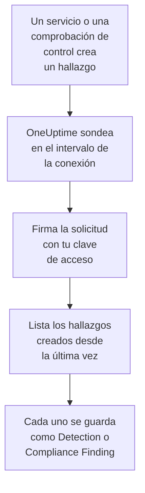

# AWS Security Hub

Importa los hallazgos de [AWS Security Hub](https://aws.amazon.com/security-hub/) en los eventos de seguridad de OneUptime: los hallazgos de GuardDuty, Inspector, Macie e IAM Access Analyzer, las comprobaciones de controles propias de Security Hub y los hallazgos de los productos de socios. Allí los buscas junto a tus logs, trazas y métricas, los correlacionas con todas las demás fuentes y avisas a la guardia de los que importan. OneUptime los lee con una clave de acceso que tú creas, autorizada para una única acción de solo lectura, y no cambia nada en AWS. No hay ningún agente, regla de EventBridge ni exportación a S3 que configurar.

:::cards
- [Configurar la conexión](#configurar-la-conexión): Una política de IAM, una clave de acceso y el formulario de la conexión.
- [Qué se importa](#qué-se-importa): Cómo cada hallazgo se convierte en un evento de seguridad.
- [Cómo funciona el sondeo](#cómo-funciona-el-sondeo): La ventana que lee cada sondeo, y por qué se solapa 30 minutos con la anterior.
- [Solución de problemas](#solución-de-problemas): Qué significa cada error y qué cambiar.
:::

## Cómo funciona



Cada minuto, OneUptime sondea cada conexión habilitada cuyo intervalo de sondeo ha pasado. Un sondeo llama a `GetFindings` de Security Hub en tu región, firmando la solicitud con [Signature Version 4](https://docs.aws.amazon.com/IAM/latest/UserGuide/reference_sigv-create-signed-request.html), para los hallazgos creados desde el último sondeo. Guarda cada uno como un evento [OCSF](https://schema.ocsf.io/): una comprobación de control como un Compliance Finding (clase `2003`), y cualquier otro hallazgo como un Detection Finding (clase `2004`). Las reglas de detección, los monitores y los paneles lo tratan entonces como un evento de seguridad de cualquier otra fuente.

## Antes de empezar

- En OneUptime, el rol Project Owner, Project Admin o Security Admin. Los roles Security Member y Security Viewer pueden ver las conexiones y su historial de ejecuciones, pero no cambiarlas.
- Una cuenta de AWS con Security Hub habilitado en la región que conectas. Security Hub es regional: una conexión lee los hallazgos que una cuenta tiene en una región.
- Para leer los hallazgos de todas las cuentas y regiones a través de una sola conexión, la cuenta de administrador delegado de Security Hub, en su región de origen, con la [agregación entre regiones](https://docs.aws.amazon.com/securityhub/latest/userguide/finding-aggregation.html) activada. **Security Hub → Settings → Regions** muestra la región de origen.
- HTTPS saliente de la aplicación y los workers de OneUptime hacia `securityhub.<region>.amazonaws.com`, o `securityhub.<region>.amazonaws.com.cn` en China, y un reloj correcto en sus hosts: AWS rechaza una solicitud firmada con más de 5 minutos de desfase.

## Configurar la conexión

La conexión firma sus solicitudes con una clave de acceso de IAM. La identidad de la clave necesita una sola acción, `securityhub:GetFindings`, y nada más: la conexión nunca cambia un hallazgo.

:::steps
### Permitir leer los hallazgos

En la [consola de IAM](https://console.aws.amazon.com/iam/), abre **Policies → Create policy**, elige **JSON** y pega esta política. Ponle un nombre, por ejemplo `OneUptimeSecurityHubRead`:

```json
{
  "Version": "2012-10-17",
  "Statement": [
    {
      "Effect": "Allow",
      "Action": "securityhub:GetFindings",
      "Resource": "*"
    }
  ]
}
```

`GetFindings` no se puede limitar a un recurso, así que `Resource` se queda en `*`. La política administrada `AWSSecurityHubReadOnlyAccess` también funciona, pero permite más.

### Crear una clave de acceso

1. Abre **Users → Create user**, ponle nombre al usuario, por ejemplo `oneuptime-security-hub`, deja desactivado el acceso a la consola y adjunta la política. Para los hallazgos de otras cuentas, hazlo en la cuenta de administrador delegado.
2. Abre el usuario, luego **Security credentials → Access keys → Create access key**, y elige **Third-party service**.
3. Copia el **ID de clave de acceso** y la **Clave de acceso secreta**. AWS solo muestra el secreto una vez.

### Añadir la conexión en OneUptime

Abre **Productos → Eventos de seguridad → Conexiones** (`/dashboard/{projectId}/security-events/connections`), haz clic en **Añadir conexión**, elige **AWS Security Hub** y haz clic en **Siguiente**. Rellena los ajustes de la tabla de abajo, haz clic en **Siguiente** y pega el secreto en **Clave de acceso secreta**.

### Probarla antes de guardar

Haz clic en **Probar esta configuración** en **Probar antes de guardar**. La prueba firma una solicitud con los valores del formulario, sin guardar nada, así que una clave equivocada o un permiso que falta aparece antes de que exista la conexión. Después haz clic en **Siguiente**, dale un **Nombre** a la conexión y créala.
:::

| Ajuste | Qué introducir |
| --- | --- |
| **Región** | El código de la región, por ejemplo `us-east-1`, `eu-central-1` o `us-gov-west-1`: para los hallazgos de otras cuentas, la región de origen de la cuenta de administrador. |
| **ID de clave de acceso** | El ID de la clave: de 16 a 128 letras o cifras, normalmente 20, que empiezan por `AKIA`, o por `ASIA` para credenciales temporales. |
| **Clave de acceso secreta** | El secreto de la clave. Se cifra, la API nunca lo devuelve y nunca se vuelve a mostrar. Sustitúyelo con **Actualizar credenciales** en la conexión. |
| **Session token** | Solo para credenciales temporales, que lo necesitan: una clave `ASIA` se rechaza sin él, y una clave `AKIA` se rechaza con él. |

Las credenciales temporales de `aws sts assume-role` o `aws sts get-session-token` caducan, tras 12 horas como mucho para un rol asumido, y el sondeo se detiene hasta que pegues unas nuevas con **Actualizar credenciales**. Una clave de larga duración con esta política acotada, rotada según tu propio calendario, sigue sondeando sin intervención. Para pasar de credenciales temporales a una clave de larga duración, escribe la clave nueva en **Actualizar credenciales** y activa **Remove the stored Session token**.

El paso **Sondeo** también tiene una **Descripción** opcional, el **Intervalo de sondeo (minutos)**, un número entero de `1` a `1440` que empieza en `5`, y **Habilitado**, que empieza activado.

## Qué se importa

Cada hallazgo se convierte en un evento, con el proveedor `Amazon Web Services` y el producto `AWS Security Hub`. Un hallazgo con un objeto `Compliance`, una comprobación de control frente a un estándar como AWS Foundational Security Best Practices o CIS, se convierte en un Compliance Finding (clase OCSF `2003`). Cualquier otro hallazgo se convierte en un Detection Finding (clase OCSF `2004`).

| Campo del hallazgo | Columna de OneUptime |
| --- | --- |
| `Id`, un ARN para los hallazgos que crea AWS | UID del evento, que también sirve para descartar duplicados |
| `CreatedAt`, si no `UpdatedAt`, si no `FirstObservedAt` | Hora del evento |
| `Title` | Nombre de la regla |
| `GeneratorId`, como el tipo de hallazgo de GuardDuty o el ID del control | ID de la regla |
| `Title`, si no `Description` | Mensaje |
| `Severity.Label`, si no un tramo de `Severity.Normalized` | Gravedad |
| `Workflow.Status`: `NEW`, `NOTIFIED`, `RESOLVED` o `SUPPRESSED`, si no el antiguo `WorkflowState` | Estado |
| `Types` bajo `TTPs/`: `TTPs/Initial Access/...` se convierte en `TA0001` | Tácticas y técnicas de MITRE ATT&CK |
| El usuario de IAM de un recurso de clave de acceso o de usuario, `Network.SourceIpV4` o `SourceIpV6`, `Process.Name` o `Process.Path` | Usuario, IP y proceso del actor |
| `Process.Name` y `Process.Path` | Nombre y ruta del proceso. Un hallazgo no indica ni la línea de comandos ni el proceso padre. |
| El ID de instancia de un recurso `AwsEc2Instance`, `Network.DestinationIpV4` o `DestinationIpV6`, `Network.DestinationPort`, el primer `Resources[].Id` | Host, IP, puerto y recurso del destino |
| Esos, cada `Resources[].Id`, `AwsAccountId`, los dominios de la red, los nombres de malware y los valores de inteligencia de amenazas | Observables |
| El hallazgo entero, aplanado en claves con puntos, como `Compliance.Status` y `Remediation.Recommendation.Url` | `attributes` |

Cuando un hallazgo no tiene `Severity.Label`, decide `Severity.Normalized`: `0` es Informational, de `1` a `39` Low, de `40` a `69` Medium, de `70` a `89` High, y de `90` a `100` Critical. Un hallazgo que Security Hub actualiza más tarde, con un nuevo `Workflow.Status` o un control que ahora pasa, conserva su `Id`, así que no se vuelve a importar: el evento conserva el hallazgo tal como era al importarse.

## Cómo funciona el sondeo

Cada sondeo lista los hallazgos creados en su ventana, de más antiguos a más nuevos, 100 por página, y sigue `NextToken` hasta leer toda la ventana:

```text
POST https://securityhub.{region}.amazonaws.com/findings
    {"Filters": {"CreatedAt": [{"Start": "{window start}", "End": "{window end}"}]},
     "SortCriteria": [{"Field": "CreatedAt", "SortOrder": "asc"}],
     "MaxResults": 100}
```

- **La hora de creación es el cursor.** Los hallazgos se listan por `CreatedAt`, nunca por `FirstObservedAt`. GuardDuty crea un hallazgo cuando ha visto suficiente actividad, y una comprobación de control cuando Security Hub comprueba el recurso por primera vez, horas o días después de que empezara la actividad. Un cursor sobre la hora de observación se los saltaría.
- **El primer sondeo mira 24 horas atrás**, para que una conexión nueva muestre enseguida sus hallazgos recientes.
- **Cada sondeo posterior empieza 30 minutos antes del cursor guardado.** `CreatedAt` lo fija el servicio que encontró el problema, y el hallazgo llega a Security Hub más tarde: GuardDuty envía los hallazgos nuevos en menos de cinco minutos, y una entrega fallida a través de EventBridge se reintenta durante hasta 24 horas. El solapamiento lee esos hallazgos en el siguiente sondeo. Uno que llega más de 30 minutos después de su `CreatedAt` puede quedar detrás del cursor: importa su intervalo de tiempo para recuperarlo.
- **Un sondeo lee como mucho 24 horas más allá del cursor.** Una conexión cuyo cursor se quedó atrás se pone al día en una serie de ventanas de 24 horas, y su **Salud** indica **Catching up**.
- **Los duplicados se descartan por el `Id` del hallazgo** dentro del proyecto, para que el solapamiento, una ventana reintentada y una importación nunca guarden un hallazgo dos veces.

### Cuando una ventana contiene más de lo que un sondeo puede leer

Un sondeo envía como mucho 20 solicitudes de 100 hallazgos: 2.000 hallazgos. Cuando una ventana contiene más, la ejecución es **Parcial**, con un aviso como este:

```text
Stopped after 20 findings requests (the per-run request limit) before the window was fully read. The last finding read was created at 2026-09-14T08:12:44.000Z.
```

Los hallazgos se leen de más antiguos a más nuevos, así que OneUptime mueve el cursor a la hora de creación del último hallazgo leído, y el siguiente sondeo empieza ahí, sin el solapamiento de 30 minutos, con la misma longitud de ventana. Una cuenta con mucha actividad se pone al día unos 2.000 hallazgos por sondeo, en lugar de volver a leer los mismos. El solapamiento vuelve cuando el cursor ha avanzado 30 minutos más allá de ese punto.

Cuando una ejecución no consigue avanzar en absoluto más allá del cursor guardado, por ejemplo porque los 30 minutos de solapamiento por sí solos contienen más de 2.000 hallazgos, OneUptime acorta la ventana en su lugar:

1. **Reducir.** El siguiente sondeo lee una ventana de la mitad de largo, desde el mismo punto de partida, y sigue reduciéndola a la mitad hasta que una ventana se lee entera, hasta un minuto. El aviso de la ejecución lo dice: `This window holds more records than one poll can read; the next poll reads a {n} minute window from the same starting point.`
2. **Volver a crecer.** Cuando una ventana se lee entera, la siguiente vuelve a ser el doble de larga, hasta 24 horas.
3. **Pasar más allá de un único minuto.** Si incluso un minuto contiene más de lo que un sondeo puede leer, el sondeo lo pasa de largo, para que sigan llegando los hallazgos más nuevos, y el solapamiento de los sondeos posteriores ya no vuelve a él. La ejecución sigue siendo **Parcial**, y **Último error** indica `More records were created in the one minute from {cursor} to {end} than one poll can read. Polling moved past this minute so newer records keep arriving; use Import this time range in Diagnostics on this minute to recover what one run can read.` Importa ese minuto con **Importar este intervalo de tiempo** para recuperar lo que una ejecución puede leer.

Una ejecución que falla del todo, con un error de AWS, conserva el cursor y la longitud de ventana, y el siguiente sondeo vuelve a leer la misma ventana. La única excepción es una solicitud que agotó el tiempo: el cursor se queda, pero la siguiente ventana es la mitad de larga, porque una ventana demasiado pesada para responder a tiempo agotaría el tiempo en cada intento. Cambiar el **Intervalo de sondeo (minutos)** no cambia nada de esto: decide cada cuánto empieza un sondeo, no dónde empieza su ventana.

### Ejecutar, previsualizar e importar a demanda

Haz clic en **Diagnósticos** en una conexión para ver sus ejecuciones recientes y trabajar con ella a mano. Quien puede cambiar la conexión puede iniciar estas acciones; quien puede verla puede leer el historial.

- **Ejecutar ahora** inicia un sondeo de inmediato, con el cursor habitual, incluso cuando la conexión no está **Habilitado**.
- **Preview findings** lee un intervalo de tiempo de hasta 7 días y no importa nada.
- **Importar este intervalo de tiempo** importa un intervalo de hasta 7 días, después de que lo confirmes, sin mover el cursor. Los hallazgos ya importados se omiten.
- **Copiar diagnósticos** en una ejecución copia su informe para soporte. Nunca incluye credenciales.

## Probar conexión

**Probar conexión** en la fila de una conexión, y **Probar esta configuración** en el formulario, se ejecutan en el proceso de la API, no en un worker en segundo plano, para que una prueba responda incluso cuando el problema son los workers. Hace estas comprobaciones, en orden:

| Comprobación | Qué comprueba |
| --- | --- |
| **Configuración** | Cada ajuste está presente y bien formado. No se contacta con nada cuando esto falla. |
| **Authenticate with AWS** | AWS acepta una solicitud `GetFindings` firmada para un hallazgo creado en las últimas 24 horas. AWS comprueba la firma antes que la política de IAM, así que un rechazo de la política sigue pasando esta comprobación: la clave es correcta. |
| **Read findings** | Security Hub responde a esa solicitud: la identidad puede llamar a `securityhub:GetFindings`, y Security Hub está habilitado en la región. |
| **Findings available to import** | Cuántos hallazgos se crearon en las últimas 24 horas y en los últimos 7 días, una página de 100 cada uno, así que `100+` significa más. Ninguno en 7 días es un aviso, no un fallo. |
| **Background workers**, **Poll scheduler**, **Security event storage** | El lado del propio OneUptime: un proceso toma los trabajos de la cola Worker, el trabajo de sondeo se ejecuta cada minuto y el almacén de eventos de seguridad responde. |
| **Sondeo programado** | Para una conexión guardada: el sondeo está activado, ninguna ejecución está atascada esperando a un worker y los sondeos se ejecutan a tiempo. |

Cada solicitud de una prueba tiene un plazo de 20 segundos. Una prueba nunca importa nada ni mueve el cursor, y cada comprobación que falla dice qué cambiar.

## Solución de problemas

El **Último error** de la conexión guarda el mensaje de error completo, con las credenciales ocultas, tras un prefijo que nombra el paso que falló. Cuando una conexión tiene un error, selecciona **Ver error** en su columna **Acciones** para leerlo, y **Copiar error** en el cuadro de diálogo para copiarlo. Cada mensaje empieza por `AWS Security Hub findings request`; lee lo que sigue.

:::details Último error dice `failed (HTTP 401)` o `failed (HTTP 403)`
AWS rechazó la solicitud. El mensaje cita el código de error de AWS, o las propias palabras de AWS cuando no envió ningún código:

- `AccessDeniedException`, o `is not authorized to perform`: la clave es correcta, pero su identidad no puede llamar a `securityhub:GetFindings`. Adjunta la política de [Configurar la conexión](#configurar-la-conexión). Un límite de permisos o una política de control de servicios también puede denegarlo.
- `InvalidAccessException`, o `is not subscribed to AWS Security Hub`: Security Hub no está habilitado para esta cuenta en esta **Región**, o la cuenta no es su administradora allí.
- `InvalidSignatureException` o `SignatureDoesNotMatch`, o `The request signature we calculated does not match`: la **Clave de acceso secreta** no pertenece al **ID de clave de acceso**. Crea una clave de acceso nueva y guárdala con **Actualizar credenciales**.
- `UnrecognizedClientException` o `InvalidClientTokenId`, o `The security token included in the request is invalid`: AWS no conoce el **ID de clave de acceso**. Está mal escrito, eliminado, desactivado o es de otra partición, o es una clave temporal sin su **Session token**.
- `ExpiredTokenException`, o `The security token included in the request is expired`: las credenciales temporales caducaron. Emite unas nuevas, o cambia a una clave de larga duración.
- `RequestTimeTooSkewed` o `RequestExpired`, o `Signature expired`: el reloj de los hosts de OneUptime tiene más de 5 minutos de desfase. Corrige NTP en los hosts de la aplicación y de los workers.
- Ningún código: AWS no dijo si lo rechazó la clave o la política. Comprueba primero la clave, luego la política.
:::

:::details Último error dice `failed (HTTP ...)` con otro estado
- `HTTP 404`: ningún endpoint de Security Hub respondió en esta **Región**. Compárala con el menú de regiones de la consola de AWS: `us-east-1`, no `us-east1` ni `N. Virginia`.
- `HTTP 429`: la cuenta alcanzó el límite de Security Hub, 3 solicitudes `GetFindings` por segundo en una región. El siguiente sondeo lo vuelve a intentar. Si sigue pasando, busca otra herramienta u otra conexión que lea la misma cuenta y región.
- `HTTP 5xx`: Security Hub tuvo un problema por su parte. El siguiente sondeo lo vuelve a intentar.
- `HTTP 400`: Security Hub rechazó la consulta, que construye OneUptime, no tus ajustes. Envía el mensaje al soporte de OneUptime.
:::

:::details Último error dice `returned`, `timed out` o `Could not reach data source`
- `returned a non-JSON body` o `returned an unrecognized response shape`: respondió algo distinto de Security Hub, por ejemplo la página de inicio de sesión de un proxy o una pasarela que reescribe las respuestas. Se notifica en lugar de tomarse como una ventana vacía, para que el cursor nunca pase de largo hallazgos que nadie leyó.
- `timed out after 60 seconds with no response`, o `failed: Could not reach data source`: la solicitud no obtuvo respuesta. Los endpoints de Security Hub son públicos, así que revisa el DNS, los cortafuegos y los proxies entre la aplicación y los workers de OneUptime y `securityhub.<region>.amazonaws.com`.
:::

:::details Último sondeo indica Never y Último error está vacío
Ningún sondeo ha terminado para esta conexión. Ejecuta **Probar conexión**: sus comprobaciones **Background workers** y **Poll scheduler** nombran la causa. En una instalación autoalojada, la causa habitual es `DISABLE_QUEUE_WORKERS=true` en la aplicación, sin un despliegue de workers aparte que tome los trabajos: ponlo en `false`, o ejecuta el despliegue de workers (Helm: `worker.enabled: true`).
:::

:::details Una ejecución es Parcial
- `Stopped after 20 findings requests`: la ventana contenía más que los 2.000 hallazgos que lee una ejecución. No se pierde nada: el siguiente sondeo empieza después del último hallazgo leído. Una conexión que sigue **Parcial** sondeo tras sondeo se está poniendo al día con un atraso, y su **Último sondeo** y su **Último evento importado** siguen avanzando. Si nunca se pone al día, la cuenta crea más de 2.000 hallazgos por intervalo de sondeo: acorta el **Intervalo de sondeo (minutos)**.
- `More records were created in the one minute from ... than one poll can read`: el sondeo pasó de largo ese minuto. Impórtalo con **Importar este intervalo de tiempo** en **Diagnósticos**. Una importación lee tanto como un sondeo.
:::

:::details La prueba pasa, pero no se importa nada
Lee **Findings available to import** en el informe de la prueba. `0` en los últimos 7 días significa que Security Hub no creó ningún hallazgo en esta cuenta y región: comprueba que GuardDuty, Inspector o un estándar de seguridad está activado allí. Para ver los hallazgos de otras cuentas y regiones, conecta la cuenta de administrador en su región de origen.
:::

:::details Un hallazgo de la consola de Security Hub nunca llegó
Compara su `CreatedAt` con su `ProcessedAt`, cuando Security Hub lo recibió. Un hallazgo que llegó más de 30 minutos después de su `CreatedAt` puede quedar detrás del cursor: importa su `CreatedAt` con **Importar este intervalo de tiempo**.
:::

## Qué obtienes

- **Búsqueda.** Filtra los hallazgos por gravedad, estado, regla, cuenta, recurso o cualquier observable en el explorador de eventos de seguridad, junto a todas las demás fuentes.
- **Correlación.** Los usuarios, instancias, IP, ARN de recursos e ID de cuenta de cada hallazgo se indexan como observables, así que una búsqueda encuentra todo lo que los menciona.
- **Reglas de detección.** Reglas Sigma que se ejecutan según una programación sobre tus eventos de seguridad, y abren alertas que avisan a la guardia.
- **Monitores.** Los monitores de eventos de seguridad cuentan los eventos que coinciden, por ejemplo los hallazgos críticos nuevos de GuardDuty o los controles fallidos, y abren incidentes o alertas por encima de un umbral.

Los eventos de seguridad se facturan como el resto de tu telemetría, por GB ingerido. Consulta los [precios](https://oneuptime.com/pricing).

## Próximos pasos

:::cards
- [Eventos de seguridad](/docs/telemetry/security-events): Busca, correlaciona y alerta sobre lo que importas.
- [Okta System Log](/docs/integrations/okta): Importa también los inicios de sesión de tu proveedor de identidad.
- [Roles](/docs/permissions/reference#roles): Lo que pueden ver y cambiar los roles Security.
- [Descripción general de integraciones](/docs/integrations/index): Las otras herramientas que puedes conectar.
:::
