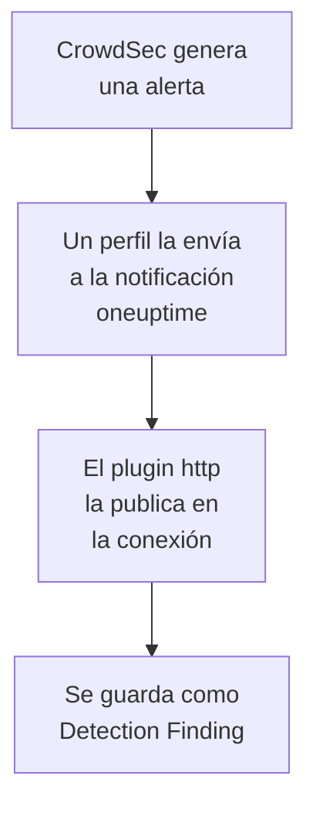

# CrowdSec

Recibe las alertas de [CrowdSec](https://www.crowdsec.net/) en los eventos de seguridad de OneUptime a medida que CrowdSec las genera, y bloquea con CrowdSec las direcciones de la lista de bloqueo de tu proyecto. El propio plugin de notificaciones de CrowdSec envía cada alerta a una conexión de CrowdSec, que abre casos a partir de las detecciones de CrowdSec. Una vez que activas el bloqueo, OneUptime banea cada dirección que bloqueas a través de la Local API de CrowdSec, y cada bouncer que la lee bloquea la dirección.

:::cards
- [Configurar la conexión](#configurar-la-conexión): Una conexión, y la notificación que le envía las alertas de CrowdSec.
- [Qué se recibe](#qué-se-recibe): Cómo cada alerta de CrowdSec se convierte en un evento de seguridad.
- [Bloquear direcciones con CrowdSec](#bloquear-direcciones-con-crowdsec): Banea en CrowdSec las direcciones de tu lista de bloqueo.
- [Leer las listas de bloqueo de CrowdSec](#leer-las-listas-de-bloqueo-de-crowdsec): Las listas que sirve la CrowdSec Console, como feed de inteligencia de amenazas.
- [Solución de problemas](#solución-de-problemas): Qué significa cada error y qué cambiar.
:::

## Cómo funciona



La Local API de CrowdSec entrega cada alerta que un perfil envía a una notificación al plugin de esa notificación. La notificación de la conexión usa el plugin `http` de CrowdSec: publica la alerta, en el JSON propio de CrowdSec, en la ingesta de eventos de seguridad con tu clave de ingesta, nombrando la conexión. OneUptime la guarda como un evento [OCSF](https://schema.ocsf.io/) Detection Finding (clase `2004`), la contrasta con tus reglas de detección y abre un caso a partir de cada una de las detecciones propias de CrowdSec que alcanza el nivel de **Abrir casos desde** de la conexión. No se sondea nada: una alerta llega segundos después de que CrowdSec la genere.

## Antes de empezar

- En OneUptime, el rol Propietario del proyecto, Administrador del proyecto o Administrador de seguridad. Los roles Miembro de seguridad y Visor de seguridad pueden ver las conexiones, pero no cambiarlas.
- CrowdSec 1.5 o posterior, con su Local API y el plugin de notificaciones `http` que incluye. Esta página está escrita con CrowdSec v1.8.2.
- HTTPS saliente desde el host que ejecuta la Local API de CrowdSec hacia tu OneUptime.
- Para bloquear también direcciones: una Local API a la que OneUptime pueda llegar, y una máquina para OneUptime (consulta [Bloquear direcciones con CrowdSec](#bloquear-direcciones-con-crowdsec)).

## Configurar la conexión

:::steps
### Añadir la conexión en OneUptime

Abre **Productos → Eventos de seguridad → Conexiones** (`/dashboard/{projectId}/security-events/connections`), haz clic en **Añadir conexión**, elige **CrowdSec** y haz clic en **Siguiente**. Para recibir solo alertas, deja vacíos todos los ajustes de la tabla de abajo; para bloquear también direcciones, rellénalos.

### Probarla antes de guardar

Haz clic en **Probar esta configuración** en **Probar antes de guardar**. Sin una Local API configurada, la prueba lo indica y no contacta con nada; con una, llega a la Local API e inicia sesión como la máquina, y no guarda nada. Luego haz clic en **Siguiente**, da a la conexión un **Nombre** en el paso **Alertas**, elige el valor de **Abrir casos desde** y créala.

### Guardar la notificación en el host de CrowdSec

Crear la conexión abre su **Enviar alertas**, que vuelves a abrir desde la fila de la conexión. En **Elige una clave de ingesta**, elige una clave y luego guarda la notificación que muestra, con tu clave y tu conexión ya rellenadas, en el host que ejecuta la Local API de CrowdSec:

```yaml title="/etc/crowdsec/notifications/oneuptime.yaml"
type: http
name: oneuptime

# info or quieter: at debug, CrowdSec logs each request's headers.
log_level: info

format: |
  {{.|toJson}}

url: https://oneuptime.com/security-events/v1/ingest?connection=YOUR_CONNECTION_ID&format=crowdsec
method: POST
headers:
  Content-Type: application/json
  x-oneuptime-token: YOUR_INGESTION_TOKEN
```

### Enviarle las alertas de tus perfiles

En `/etc/crowdsec/profiles.yaml`, añade `oneuptime` a las `notifications` de cada perfil cuyas alertas deba recibir OneUptime y, después, recarga CrowdSec:

```yaml title="/etc/crowdsec/profiles.yaml"
notifications:
  - oneuptime
```

```bash
sudo systemctl reload crowdsec
```

### Enviar una alerta de prueba

```bash
sudo cscli notifications test oneuptime
```

**Enviar alertas** indica cuándo llega, y **Ver alertas** la abre en los eventos de seguridad. Es un evento de gravedad Informational y no abre ningún caso.
:::

| Ajuste | Qué introducir |
| --- | --- |
| **URL de la Local API** | Solo para bloquear direcciones: donde OneUptime llega a la Local API de CrowdSec, como `https://crowdsec.example.com:8080`. Usa `https` siempre que la conexión cruce una red. |
| **ID de máquina** | Solo para bloquear direcciones: la máquina con la que OneUptime inicia sesión, añadida en el host de CrowdSec con `sudo cscli machines add oneuptime --auto -f -`. |
| **Bloquear direcciones con CrowdSec** | Desactivado en una conexión nueva. Activado, banea en CrowdSec las direcciones y los rangos de tu lista de bloqueo, y necesita los otros tres ajustes (consulta [Bloquear direcciones con CrowdSec](#bloquear-direcciones-con-crowdsec)). |
| **Contraseña de la máquina** | Solo para bloquear direcciones: la contraseña que `cscli` mostró para la máquina. Se cifra, la API nunca la devuelve y no se vuelve a mostrar. Sustitúyela con **Actualizar credenciales** en la conexión. |

El paso **Alertas** también tiene una **Descripción** opcional, y **Habilitado**, que empieza activado. Una conexión que no está habilitada conserva como eventos las alertas que recibe, y no abre ningún caso a partir de ellas.

En un contenedor, la notificación va en la carpeta montada en `/etc/crowdsec/notifications/`, y un reinicio del contenedor la lee. Una instalación de Kubernetes la declara en sus valores de Helm en `config.notifications`, con `profiles.yaml` al lado en `config`.

## Qué se recibe

Cada alerta que envía CrowdSec se convierte en un evento Detection Finding (clase OCSF `2004`), con el proveedor y el producto `CrowdSec`:

| Campo de CrowdSec | Columna de OneUptime |
| --- | --- |
| `uuid`, o un hash de una alerta que no lo tiene | UID del evento, que también sirve para descartar duplicados |
| `stop_at`, o `start_at` | Hora del evento |
| `scenario` | ID de la regla, y el nombre de la regla: el título del escenario en el CrowdSec Hub, o su nombre |
| `source.ip`, o `source.value` de una alerta `Ip` | IP principal |
| `target_fqdn` o `target_host` de la alerta o de sus eventos, o si no, la `machine` que nombran sus eventos | Host de destino |
| `target_user`, `target_uri` | Usuario y recurso de destino |
| El `type` de la primera decisión | Estado: `Blocked` para un baneo, `Challenge` para un captcha, `Logged` sin decisión o en modo de simulación |
| El comportamiento del escenario | Gravedad, y sus tácticas y técnicas de MITRE ATT&CK |
| Todo lo demás, como `source.cn`, `source.as_name` y `events_count` | `attributes`: los campos de la alerta aplanados en claves con puntos, sus 10 primeros eventos completos, y la lectura de OneUptime en `crowdsec.` |

Una alerta de CrowdSec no tiene gravedad propia, así que OneUptime la toma de lo que detecta el escenario, tal como lo etiqueta el CrowdSec Hub (`ssh:bruteforce`, `http:exploit`):

| Comportamiento | Gravedad |
| --- | --- |
| Un exploit, como una CVE o lo que bloqueó el componente AppSec, o lo que hace un atacante una vez dentro | High |
| Fuerza bruta, denegación de servicio, fraude, un inicio de sesión imposible, o un comportamiento que OneUptime no sabe clasificar | Medium |
| Escaneos, sondeos, rastreos, bots, spam y cambios de auditoría en la nube | Low |
| Los escenarios de prueba propios de CrowdSec | Informational |

Con **Abrir casos desde** en **Alta y superior**, los exploits de CrowdSec abren casos, y sus baneos cotidianos de escáneres y de quienes adivinan contraseñas se quedan como eventos para tus reglas de detección. Solo las detecciones propias de CrowdSec abren casos. Una decisión que alguien añadió con `cscli` o en la Console de CrowdSec, una dirección de una lista de bloqueo de CrowdSec, la alerta de prueba y los propios baneos de OneUptime que vuelven son Informational y no abren ninguno. Una alerta enviada dos veces, como hace `cscli notifications reinject`, se guarda una sola vez.

## Bloquear direcciones con CrowdSec

Activa **Bloquear direcciones con CrowdSec** en una conexión, y las direcciones y los rangos de la [lista de bloqueo](/docs/telemetry/security-cases#lista-de-bloqueo) de tu proyecto se banean en CrowdSec. Cada bouncer que lee su Local API, como sus bouncers de firewall, nginx y Traefik, los bloquea allí donde se ejecuta, igual que bloquea los propios baneos de CrowdSec. Los bloqueos pasan por las mismas aprobaciones, los mismos límites de la respuesta automática y el mismo **Levantar** que en cualquier otro lugar donde se aplica tu lista de bloqueo.

El interruptor está desactivado en una conexión nueva. Para activarlo:

1. En el host de CrowdSec, añade una máquina para OneUptime; el comando muestra su contraseña:

   ```bash
   sudo cscli machines add oneuptime --auto -f -
   ```

2. Deja que OneUptime llegue a la Local API, que escucha en `127.0.0.1:8080` salvo que se le indique otra cosa: configura `api.server.listen_uri` en el `config.yaml` de CrowdSec, sírvela por TLS o detrás de un proxy `https`, y deja pasar las direcciones de OneUptime por tu firewall.
3. Edita la conexión, rellena **URL de la Local API** e **ID de máquina**, pon la contraseña en **Contraseña de la máquina**, activa **Bloquear direcciones con CrowdSec** y guarda. **Probar conexión** comprueba entonces que la máquina inicia sesión y lee los baneos de OneUptime, sin cambiar nada.

Cómo se crea un baneo, y cómo termina:

- Cada bloqueo es una decisión de baneo, creada como la crea `cscli decisions add`, con el escenario `oneuptime/blocklist`. CrowdSec la guarda como una decisión manual, así que nunca se comparte con la Central API de CrowdSec, salvo que compartas las decisiones manuales. OneUptime solo lee y elimina sus propios baneos, nunca uno que creó una persona o CrowdSec.
- Un bloqueo con final es un baneo hasta exactamente ese final, y CrowdSec lo levanta entonces por sí solo, pueda OneUptime llegar a él o no. Un bloqueo hasta que se levante es un baneo de 7 días, que se renueva cuando quedan 3 días o menos, así que un baneo que OneUptime ya no mantiene termina en una semana.
- **Levantar** elimina el baneo en la siguiente pasada, en menos de un minuto. Un baneo eliminado en CrowdSec, con `cscli decisions delete` o un vaciado, se vuelve a crear en la siguiente pasada mientras dure el bloqueo.
- Una dirección o un rango de una de las listas de permitidos de CrowdSec nunca se banea: el bloqueo lo muestra como no aplicado allí, nombrando la lista de permitidos, y un baneo ya creado se elimina en cuanto una lista de permitidos contiene la dirección.
- Las direcciones propias de tu proyecto, como tus **Proxies de confianza**, balanceadores de carga y redes perimetrales, nunca se bloquean en ningún sitio, tampoco en CrowdSec.
- CrowdSec solo banea: allí no se aplica un desafío, y no se le envía un dominio, una URL ni un archivo.

Cuando no se puede llegar a la Local API, nada cambia en CrowdSec: los baneos que tiene se quedan, y terminan cuando terminan. **Aplicado en** en la **Lista de bloqueo** dice cuándo tuvo CrowdSec cada bloqueo por última vez, y OneUptime lo vuelve a intentar tras 1 minuto y luego espera el doble cada vez, hasta 30 minutos. Un bloqueo nuevo espera hasta que se pueda crear.

## Leer las listas de bloqueo de CrowdSec

La CrowdSec Console sirve las listas de bloqueo a las que se suscribe tu organización como una integración Raw IP List: una dirección por línea, protegida por usuario y contraseña. Un [feed de inteligencia de amenazas](/docs/telemetry/threat-intelligence) las lee y coteja tus eventos con ellas:

1. En la CrowdSec Console, crea una integración Raw IP List, con la agregación de IP desactivada: OneUptime coteja direcciones, no rangos. Copia su endpoint, su usuario y su contraseña.
2. En OneUptime, abre **Productos → Eventos de seguridad → Detecciones → Inteligencia de amenazas**, haz clic en **Crear Feed de inteligencia de amenazas** y elige **Lista de indicadores**.
3. Pega el endpoint como **URL de la lista**, elige **Usuario y contraseña** en **Inicio de sesión** y pega ambos. En el plan Community de CrowdSec, que permite una descarga al día, pon **Intervalo de sondeo (minutos)** en `1440`.

Las listas son de CrowdSec: puedes usarlas en tus propias herramientas, pero no redistribuirlas. OneUptime no ofrece ninguna lista propia.

## Probar conexión

**Probar conexión** en la fila de una conexión, y **Probar esta configuración** en el formulario, se ejecutan en el proceso de la API, no en un worker en segundo plano. Hacen estas comprobaciones, en orden:

| Comprobación | Qué comprueba |
| --- | --- |
| **Configuración** | Los ajustes están o todos vacíos o todos rellenados, y bien formados. No se contacta con nada cuando esto falla. |
| **Reach CrowdSec's Local API** | `GET /health` responde. Sin una Local API configurada, la comprobación dice que la conexión solo recibe alertas, y las tres siguientes no se ejecutan. |
| **Sign in to the Local API** | `POST /v1/watchers/login` acepta la máquina y su contraseña. |
| **Read CrowdSec's allowlists** | `GET /v1/allowlists` responde, y cuántas direcciones y rangos contienen. Una Local API anterior a la 1.6.8, que no las tiene, pasa. |
| **Block with CrowdSec** | Solo con **Bloquear direcciones con CrowdSec** activado: la máquina puede volver a leer los baneos de OneUptime, y cuántos están en vigor. La comprobación no cambia nada. |
| **Background workers**, **Security event storage** | El lado del propio OneUptime: un proceso toma los trabajos de la cola Worker, que guardan lo que envía CrowdSec, y el almacén de eventos de seguridad responde. |
| **Alerts received** | Para una conexión guardada: cuándo llegó la última alerta. Ninguna todavía es un aviso, que explica cómo enviar una alerta de prueba. |

Una prueba nunca banea ni elimina nada. **Copiar informe** copia la lista de comprobaciones como JSON, sin la contraseña ni tokens.

## Solución de problemas

La **Salud** de la conexión muestra **Esperando alertas** hasta que llega la primera alerta, y luego **Recibiendo alertas**, tarde lo que tarde la siguiente; **Casos en pausa** significa que la conexión no está habilitada. CrowdSec escribe lo que respondió el plugin en su propio log, `/var/log/crowdsec.log`, como `HTTP server returned non 200 status code`.

:::details No llega ninguna alerta
- Ejecuta `sudo cscli notifications list`: `oneuptime` debe aparecer, y estar activa en un perfil. Una notificación que ningún perfil nombra no envía nada.
- `401`: la clave de ingesta en `x-oneuptime-token` falta, es incorrecta o ha caducado, y `422`: está desactivada. Elige una clave en **Enviar alertas** y vuelve a copiar la notificación.
- `400`: la dirección no nombra ninguna conexión de CrowdSec de este proyecto. Copia la dirección desde **Enviar alertas** de la conexión: termina con el ID de la conexión.
- Nada en absoluto en el log: el host de CrowdSec no puede llegar a tu OneUptime. Comprueba su HTTPS saliente, y su proxy.
:::

:::details Probar conexión falla en Reach CrowdSec's Local API
`CrowdSec Local API health check could not be completed` significa que nada respondió: la Local API escucha en `127.0.0.1` de forma predeterminada, así que OneUptime no puede llegar a ella hasta que `api.server.listen_uri` y tu firewall lo permitan. Un aviso de que responde por `http` significa que la contraseña de la máquina cruza la red sin cifrar: sirve la Local API por TLS, o pon un proxy `https` delante.
:::

:::details Probar conexión falla en Sign in to the Local API
`CrowdSec Local API login failed (HTTP 401)` termina con lo que hay que hacer: comprueba el ID de la máquina y la contraseña con `sudo cscli machines list`, valida una máquina que aún no está validada con `sudo cscli machines validate oneuptime`, o añade una máquina que inicie sesión con contraseña. Guarda una contraseña nueva con **Actualizar credenciales**.
:::

:::details Un bloqueo no se aplica en CrowdSec
Pasa el cursor sobre su **Aplicado en**: nombra una lista de permitidos que contiene la dirección, un desafío que CrowdSec no aplica, o el error de la Local API. Mientras no se puede llegar a la Local API, OneUptime sigue intentándolo, y los baneos que CrowdSec ya tiene siguen en vigor.
:::

:::details CrowdSec envía sus alertas, pero no se guarda ninguna
Lo que envía CrowdSec lo guardan los workers en segundo plano: en una instalación autoalojada con `DISABLE_QUEUE_WORKERS=true` en la aplicación y sin un despliegue de workers aparte, las alertas se reciben y nunca se guardan. **Probar conexión** lo muestra como una comprobación **Background workers** fallida. Ponlo en `false`, o ejecuta el despliegue de workers (Helm: `worker.enabled: true`).
:::

## Próximos pasos

:::cards
- [Eventos de seguridad](/docs/telemetry/security-events): Busca, correlaciona y alerta sobre lo que envía CrowdSec.
- [Casos de seguridad](/docs/telemetry/security-cases): Trabaja los casos que abren las detecciones de CrowdSec, y bloquea desde ellos.
- [Inteligencia de amenazas](/docs/telemetry/threat-intelligence): Coteja tus eventos con las listas de bloqueo de CrowdSec.
- [Descripción general de integraciones](/docs/integrations/index): Las demás herramientas que puedes conectar.
:::
