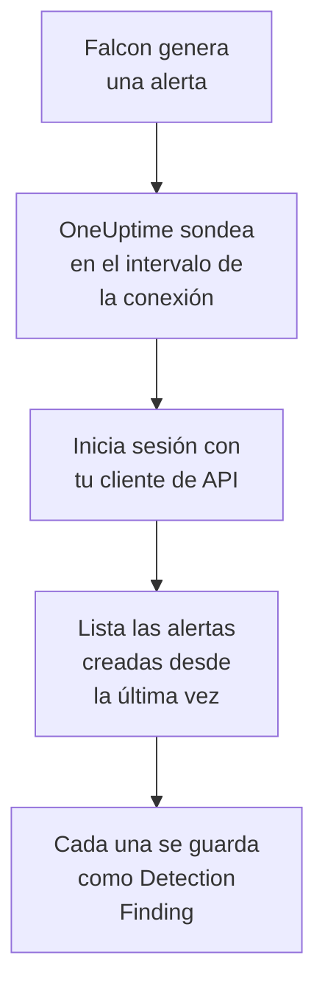

# CrowdStrike Falcon

Importa las alertas de [CrowdStrike Falcon](https://www.crowdstrike.com/platform/), de las detecciones de endpoints, identidades y nube, en los eventos de seguridad de OneUptime. Allí las buscas junto a tus logs, trazas y métricas, las correlacionas con todas las demás fuentes y avisas a la guardia de las que importan. OneUptime las lee mediante la Alerts API de Falcon con un cliente de API que tú creas, y nunca escribe en Falcon.

:::cards
- [Configurar la conexión](#configurar-la-conexión): Un cliente de API con un único ámbito y el formulario de la conexión.
- [Qué se importa](#qué-se-importa): Cómo cada alerta de Falcon se convierte en un evento de seguridad.
- [Cómo funciona el sondeo](#cómo-funciona-el-sondeo): La ventana que lee cada sondeo, y lo que le hace un CID con mucha actividad.
- [Solución de problemas](#solución-de-problemas): Qué significa cada error y qué cambiar.
:::

## Cómo funciona



Cada minuto, OneUptime sondea cada conexión habilitada cuyo intervalo de sondeo ha pasado. Un sondeo inicia sesión en tu nube de Falcon con el ID y el secreto del cliente de API, pide a la Alerts API las alertas creadas desde el último sondeo y guarda cada una como un evento [OCSF](https://schema.ocsf.io/) Detection Finding (clase `2004`). Las reglas de detección, los monitores y los paneles lo tratan entonces como un evento de seguridad de cualquier otra fuente.

## Antes de empezar

- En OneUptime, el rol Project Owner, Project Admin o Security Admin. Los roles Security Member y Security Viewer pueden ver las conexiones y su historial de ejecuciones, pero no cambiarlas.
- Un ID de cliente de Falcon (CID) y un usuario de la consola de Falcon que pueda gestionar clientes de API: el rol Falcon Administrator, o un rol personalizado con el permiso API clients and keys.
- HTTPS saliente de la aplicación y los workers de OneUptime hacia el host de API de tu nube de Falcon, que aparece en **Falcon cloud** más abajo.

## Configurar la conexión

:::steps
### Crear un cliente de API

1. En la consola de Falcon, abre **Support and resources → API clients and keys** y selecciona **Create API client**.
2. Ponle un nombre, por ejemplo `OneUptime security events`. En **API scopes**, activa **Alerts → Read** y deja desactivados todos los demás ámbitos: la conexión nunca escribe en Falcon.
3. Crea el cliente. Falcon muestra una sola vez su ID de cliente, su secreto y su URL base. Copia los tres ahora: el secreto se puede restablecer más tarde, pero no se vuelve a mostrar.

### Encontrar tu nube de Falcon

La URL base que mostró Falcon te dice en qué nube está tu CID. La página **API clients and keys** también la muestra, junto a cada cliente. Un cliente de una nube es rechazado por las demás.

| URL base que muestra Falcon | Nube de Falcon |
| --- | --- |
| `https://api.crowdstrike.com` | US-1 |
| `https://api.us-2.crowdstrike.com` | US-2 |
| `https://api.eu-1.crowdstrike.com` | EU-1 |
| `https://api.laggar.gcw.crowdstrike.com` | US-GOV-1 |

### Añadir la conexión en OneUptime

Abre **Productos → Eventos de seguridad → Conexiones** (`/dashboard/{projectId}/security-events/connections`), haz clic en **Añadir conexión**, elige **CrowdStrike Falcon** y haz clic en **Siguiente**. Rellena los ajustes de la tabla de abajo, haz clic en **Siguiente** y pega el secreto en **Secreto del cliente**.

### Probarla antes de guardar

Haz clic en **Probar esta configuración** en **Probar antes de guardar**. La prueba inicia sesión y lee alertas con los valores del formulario, y no guarda nada, así que una nube equivocada o un ámbito que falta aparecen antes de que exista la conexión. Luego haz clic en **Siguiente**, da a la conexión un **Nombre** y créala.
:::

| Ajuste | Qué introducir |
| --- | --- |
| **ID de cliente** | El ID del cliente de API, tal como lo mostró Falcon al crear el cliente. |
| **Falcon cloud** | La nube de tu CID: **US-1 (api.crowdstrike.com)**, **US-2 (api.us-2.crowdstrike.com)**, **EU-1 (api.eu-1.crowdstrike.com)** o **US-GOV-1 (api.laggar.gcw.crowdstrike.com)**. Cada solicitud va al host de API de esa nube. |
| **Secreto del cliente** | El secreto del cliente de API. Se cifra, la API nunca lo devuelve y no se vuelve a mostrar. Sustitúyelo con **Actualizar credenciales** en la conexión. |

El paso **Sondeo** también tiene una **Descripción** opcional, el **Intervalo de sondeo (minutos)**, un número entero de `1` a `1440` que empieza en `5`, y **Habilitado**, que empieza activado. Una conexión que no está habilitada se puede probar igualmente, y sondear a mano.

## Qué se importa

La conexión lee las alertas de Falcon: lo que la consola de Falcon lista en **Endpoint security → Endpoint detections** y **Next-Gen SIEM → Alerts**, de cada producto que las genera. Cada alerta se convierte en un evento Detection Finding (clase OCSF `2004`), con el proveedor `CrowdStrike` y el producto `Falcon`:

| Campo de Falcon | Columna de OneUptime |
| --- | --- |
| `composite_id` | UID del evento, que también sirve para descartar duplicados |
| `created_timestamp` | Hora del evento |
| `display_name`, o `name` | Nombre de la regla |
| `pattern_id` | ID de la regla |
| `description`, o el nombre de la regla | Mensaje |
| `severity_name`, o `severity` de 0 a 100 | Gravedad |
| `status`, como `new`, `in_progress` o `closed` | Estado |
| `tactic_id`, `technique_id` | Tácticas y técnicas de MITRE ATT&CK |
| `device.hostname`, `device.local_ip`, `user_name`, `filename` o `cmdline` | Host, IP, usuario y proceso principales |
| `filename`, `filepath` y `cmdline`; `parent_details.filename`, `parent_details.filepath` y `parent_details.cmdline` | Nombre, ruta y línea de comandos del proceso; nombre, ruta y línea de comandos del proceso padre |
| `device.hostname`, `device.local_ip`, `device.external_ip`, `user_name`, `sha256` | Observables |
| Todo lo demás, como `device.platform_name`, `falcon_host_link`, `product` y `timestamp` | `attributes`, aplanado en claves con puntos |

La hora del evento es, a propósito, cuando Falcon creó la alerta: la hora del comportamiento que hay detrás, `timestamp`, queda en `attributes.timestamp`.

## Cómo funciona el sondeo

- **La hora de creación es el cursor.** Las alertas se listan por `created_timestamp`, nunca por la hora del comportamiento que hay detrás. Falcon puede generar una alerta mucho después de la actividad que describe, y un cursor sobre la hora de actividad se saltaría cada una de esas alertas.
- **El primer sondeo mira 24 horas atrás**, para que una conexión nueva muestre enseguida sus alertas recientes.
- **Cada sondeo posterior empieza 1 minuto antes del cursor guardado**, para que nunca se pierda una alerta creada en el límite entre dos ventanas.
- **Un sondeo lee como mucho 24 horas más allá del cursor.** Una conexión cuyo cursor se quedó atrás se pone al día en una serie de ventanas de 24 horas.
- **Los duplicados se descartan por `composite_id`** dentro del proyecto, para que el solapamiento y una ventana reintentada nunca guarden una alerta dos veces.
- **Cada ventana cuesta** una solicitud de token, que se conserva durante la vida del token, y luego una consulta de alertas y una obtención de alertas por cada 1.000 alertas, cada una con su propio tiempo de espera.

### Cuando una ventana contiene más de lo que un sondeo puede leer

Un sondeo envía como mucho 20 solicitudes. Con una solicitud de token y dos solicitudes por cada 1.000 alertas, lee como mucho 9.000 alertas. Cuando una ventana contiene más, la ejecución es **Parcial**, con un aviso como este:

```text
Stopped after 19 requests before reading the whole window. Alerts are read oldest first; every alert created before 2026-09-14T08:12:44.995Z was read.
```

La consulta de alertas está ordenada por `created_timestamp`, de más antiguas a más nuevas, así que OneUptime mueve el cursor a la hora de creación de la última alerta leída, y el siguiente sondeo empieza ahí, con la misma longitud de ventana, desde el desplazamiento `0`. Un CID con mucha actividad se pone al día unas 9.000 alertas por sondeo, en lugar de volver a leer las mismas. Las alertas creadas en ese mismo instante se leen dos veces, y la comprobación de duplicados descarta la segunda copia.

La consulta de alertas de Falcon no puede paginar más allá de 10.000 resultados (`limit` más `offset`). El límite de solicitudes detiene una ejecución en 9.000 alertas, antes de ese techo. Si alguna vez el techo detiene una lectura, se trata igual: la ejecución es **Parcial**, el cursor pasa a la última alerta leída y la siguiente consulta vuelve a empezar desde el desplazamiento `0`.

Cuando una ejecución no consigue avanzar en absoluto más allá del cursor guardado, por ejemplo porque más de 9.000 alertas comparten el minuto de solapamiento, OneUptime acorta la ventana en su lugar:

1. **Reducir.** El siguiente sondeo lee una ventana de la mitad de largo, desde el mismo punto de partida, y sigue reduciéndola a la mitad hasta que una ventana se lee entera, hasta un minuto. El aviso de la ejecución lo dice: `This window holds more records than one poll can read; the next poll reads a {n} minute window from the same starting point.`
2. **Volver a crecer.** Cuando una ventana se lee entera, la siguiente vuelve a ser el doble de larga, hasta 24 horas.
3. **Pasar más allá de un único minuto.** Si incluso un minuto contiene más de lo que un sondeo puede leer, el sondeo lo pasa de largo, para que sigan llegando las alertas más nuevas. La ejecución sigue siendo **Parcial**, y **Último error** indica `More records were created in the one minute from {cursor} to {end} than one poll can read. Polling moved past this minute so newer records keep arriving; use Import this time range in Diagnostics on this minute to recover what one run can read.` Importa ese minuto con **Importar este intervalo de tiempo** para recuperar lo que una ejecución puede leer.

Una ejecución que falla del todo, con un error de Falcon, conserva el cursor y la longitud de ventana, y el siguiente sondeo vuelve a leer la misma ventana. La única excepción es una solicitud que agotó el tiempo: el cursor se queda, pero la siguiente ventana es la mitad de larga, porque una ventana demasiado pesada para responder a tiempo agotaría el tiempo en cada intento. Cambiar el **Intervalo de sondeo (minutos)** no cambia nada de esto: decide cada cuánto empieza un sondeo, no dónde empieza su ventana.

### Ejecutar, previsualizar e importar a demanda

Haz clic en **Diagnósticos** en una conexión para ver sus ejecuciones recientes y trabajar con ella a mano. Quien puede cambiar la conexión puede iniciar estas acciones; quien puede verla puede leer el historial.

- **Ejecutar ahora** inicia un sondeo de inmediato, con el cursor habitual, incluso cuando la conexión no está **Habilitado**.
- **Preview alerts** lee un intervalo de tiempo de hasta 7 días y no importa nada.
- **Importar este intervalo de tiempo** importa un intervalo de hasta 7 días, después de que lo confirmes, sin mover el cursor. Las alertas ya importadas se omiten.
- **Copiar diagnósticos** en una ejecución copia su informe para soporte. Nunca incluye credenciales.

## Probar conexión

**Probar conexión** en la fila de una conexión, y **Probar esta configuración** en el formulario, se ejecutan en el proceso de la API, no en un worker en segundo plano, para que una prueba responda incluso cuando el problema son los workers. Hace estas comprobaciones, en orden:

| Comprobación | Qué comprueba |
| --- | --- |
| **Configuración** | **ID de cliente**, **Falcon cloud** y **Secreto del cliente** están presentes y bien formados. No se contacta con nada cuando esto falla. |
| **Authenticate with CrowdStrike Falcon** | `POST /oauth2/token` con el ID y el secreto del cliente de API, en el host de tu nube, devuelve un token. |
| **Read alerts from the Falcon Alerts API** | Se acepta una consulta de alertas de una sola alerta (`limit=1`) sobre las últimas 24 horas, lo que demuestra el ámbito **Alerts → Read**. |
| **Alerts available to import** | Cuántas alertas se crearon en las últimas 24 horas y en los últimos 7 días. Ninguna en 7 días es un aviso, no un fallo: el sondeo importa las alertas nuevas a medida que Falcon las crea. |
| **Background workers**, **Poll scheduler**, **Security event storage** | El lado del propio OneUptime: un proceso toma los trabajos de la cola Worker, el trabajo de sondeo se ejecuta cada minuto y el almacén de eventos de seguridad responde. |
| **Sondeo programado** | Para una conexión guardada: el sondeo está activado, ninguna ejecución está atascada esperando a un worker y los sondeos se ejecutan a tiempo. |

Cada solicitud de una prueba tiene un plazo de 20 segundos. Una prueba nunca importa nada ni mueve el cursor, y cada comprobación que falla dice qué cambiar. **Copiar informe** copia la lista de comprobaciones como JSON, sin credenciales ni tokens.

## Solución de problemas

El **Último error** de la conexión, y cada comprobación que falla, guardan el mensaje de error completo, con las credenciales ocultas, tras un prefijo que nombra el paso que falló. Cuando una conexión tiene un error, selecciona **Ver error** en su columna **Acciones** para leerlo, y **Copiar error** en el cuadro de diálogo para copiarlo. Lee primero el prefijo.

:::details Último error empieza por `CrowdStrike Falcon token request`
- `CrowdStrike Falcon token request failed (HTTP 401)` o `(HTTP 403)`: Falcon rechazó el ID y el secreto del cliente de API, antes de contactar con la Alerts API. Comprueba que **Falcon cloud** es la nube de tu CID, ya que aquí se rechaza un cliente de otra nube, que **ID de cliente** es el del cliente y que **Secreto del cliente** es el secreto emitido con él. Si se perdió el secreto, restablécelo en la consola de Falcon y guárdalo con **Actualizar credenciales**.
- `CrowdStrike Falcon token request returned ...`: Falcon respondió con algo inutilizable, un cuerpo que no es JSON o sin `access_token`. Suele ser un proxy o una pasarela en medio, no las credenciales.
:::

:::details Último error empieza por `CrowdStrike Falcon alerts`
- `CrowdStrike Falcon alerts query failed (HTTP 403)`: el token se aceptó, pero el cliente de API no tiene el ámbito **Alerts → Read**. Actívalo para el cliente en **API clients and keys** y guarda. Se aplica al siguiente token, así que vuelve a probar al cabo de un minuto.
- `CrowdStrike Falcon alerts query failed (HTTP 401)`: la Alerts API rechazó el token, lo que casi siempre significa que **Falcon cloud** no es la nube que emitió el cliente.
- `CrowdStrike Falcon alerts query failed (HTTP 429)` o `CrowdStrike Falcon alerts fetch failed (HTTP 429)`: Falcon está limitando la frecuencia de este cliente de API. El cliente HTTP de OneUptime no conserva las cabeceras de respuesta en un error, así que el mensaje suele terminar con `the X-RateLimit-RetryAfter header was not available` en lugar de citarla. Los sondeos programados lo vuelven a intentar solos. Si sigue pasando, da a OneUptime un cliente de API propio, en lugar de uno compartido con otras herramientas.
- `CrowdStrike Falcon alerts query failed (HTTP 400)`: Falcon rechazó la consulta. La conexión envía un filtro FQL fijo sobre `created_timestamp`, así que copia el informe y envíalo al soporte de OneUptime.
- `CrowdStrike Falcon alerts query returned ...` o `CrowdStrike Falcon alerts fetch returned ...`: Falcon respondió `200`, con un cuerpo que no es JSON o con una forma que la conexión no conoce. Se notifica en lugar de tomarse como una ventana vacía, para que el cursor nunca pase de largo alertas que nadie leyó.
- `CrowdStrike Falcon alerts fetch failed (HTTP ...)`: las alertas se listaron, pero su obtención falló, por los mismos motivos que la consulta. Un `403` aquí significa que el ámbito se quitó entre las dos llamadas.
:::

:::details Último error dice que la solicitud no se pudo completar
`CrowdStrike Falcon token request could not be completed`, `CrowdStrike Falcon alerts query could not be completed` y `CrowdStrike Falcon alerts fetch could not be completed` significan que no volvió nada: un tiempo de espera agotado, un fallo de DNS o tráfico saliente bloqueado. Revisa el HTTPS saliente de la aplicación y los workers de OneUptime hacia el host de API de tu nube, como `api.crowdstrike.com`.
:::

:::details Último error nombra una nube desconocida
`CrowdStrike Falcon cloud "..." is not one of us-1, us-2, eu-1, us-gov-1` significa que la nube guardada no es una de las que conoce la conexión. Edita la conexión y elige una nube de la lista.
:::

:::details Una ejecución es Parcial
- `Stopped after 19 requests before reading the whole window`: la ventana contenía más que las 9.000 alertas que lee una ejecución. No se pierde nada: el siguiente sondeo empieza después de la última alerta leída. Una conexión que sigue **Parcial** sondeo tras sondeo se está poniendo al día con un atraso, y su **Último sondeo** y su **Último evento importado** siguen avanzando. La cuenta puede pasar un poco de 19 cuando el token se renovó durante la ejecución.
- `Falcon returned alerts out of created_timestamp order, so this run cannot name a point to resume from.`: la consulta ignoró el orden de más antiguas a más nuevas, así que la ejecución no puede mover el cursor a su última alerta, y el siguiente sondeo lee en su lugar una ventana más corta. Si se repite, envía el informe de la ejecución al soporte de OneUptime.
- `More records were created in the one minute from ... than one poll can read`: el sondeo pasó de largo ese minuto. Impórtalo con **Importar este intervalo de tiempo** en **Diagnósticos**. Una importación lee tanto como un sondeo.
:::

:::details Último sondeo indica Never y Último error está vacío
No se ha ejecutado ningún sondeo, así que nada ha llegado a Falcon. **Probar conexión** lo muestra como una comprobación **Background workers** o **Poll scheduler** fallida. En una instalación autoalojada, la causa habitual es `DISABLE_QUEUE_WORKERS=true` en la aplicación, sin un despliegue de workers aparte que tome los trabajos: ponlo en `false`, o ejecuta el despliegue de workers (Helm: `worker.enabled: true`).
:::

:::details La prueba pasa, pero no aparece ningún evento
Lee **Alerts available to import**: un aviso ahí significa que Falcon no creó ninguna alerta en los últimos 7 días, así que todavía no hay nada que importar. Si no, abre **Diagnósticos**, revisa la ventana y las cuentas del último sondeo, y usa **Ver eventos de este intervalo de tiempo** en una ejecución para abrir el intervalo de tiempo de las alertas que importó.
:::

## Qué obtienes

- **Búsqueda.** Filtra las alertas de Falcon por gravedad, estado, táctica de MITRE, host, usuario o cualquier observable en el explorador de eventos de seguridad, junto a los logs y métricas de ese host.
- **Correlación.** Los nombres de host, IP, usuarios y hashes de archivo de cada alerta se indexan como observables, así que una búsqueda encuentra todo lo que menciona un host en todas las fuentes.
- **Reglas de detección.** Reglas Sigma que se ejecutan según una programación sobre tus eventos de seguridad, y abren alertas que avisan a la guardia.
- **Monitores.** Los monitores de eventos de seguridad cuentan los eventos que coinciden, y abren incidentes o alertas por encima de un umbral.

Los eventos de seguridad se facturan como el resto de tu telemetría, por GB ingerido. Consulta los [precios](https://oneuptime.com/pricing).

## Próximos pasos

:::cards
- [Eventos de seguridad](/docs/telemetry/security-events): Busca, correlaciona y alerta sobre lo que importas.
- [Microsoft Defender XDR](/docs/integrations/microsoft-defender-xdr): Importa también las alertas de las cargas de trabajo de Defender de Microsoft.
- [Roles](/docs/permissions/reference#roles): Lo que pueden ver y cambiar los roles Security.
- [Descripción general de integraciones](/docs/integrations/index): Las demás herramientas que puedes conectar.
:::
