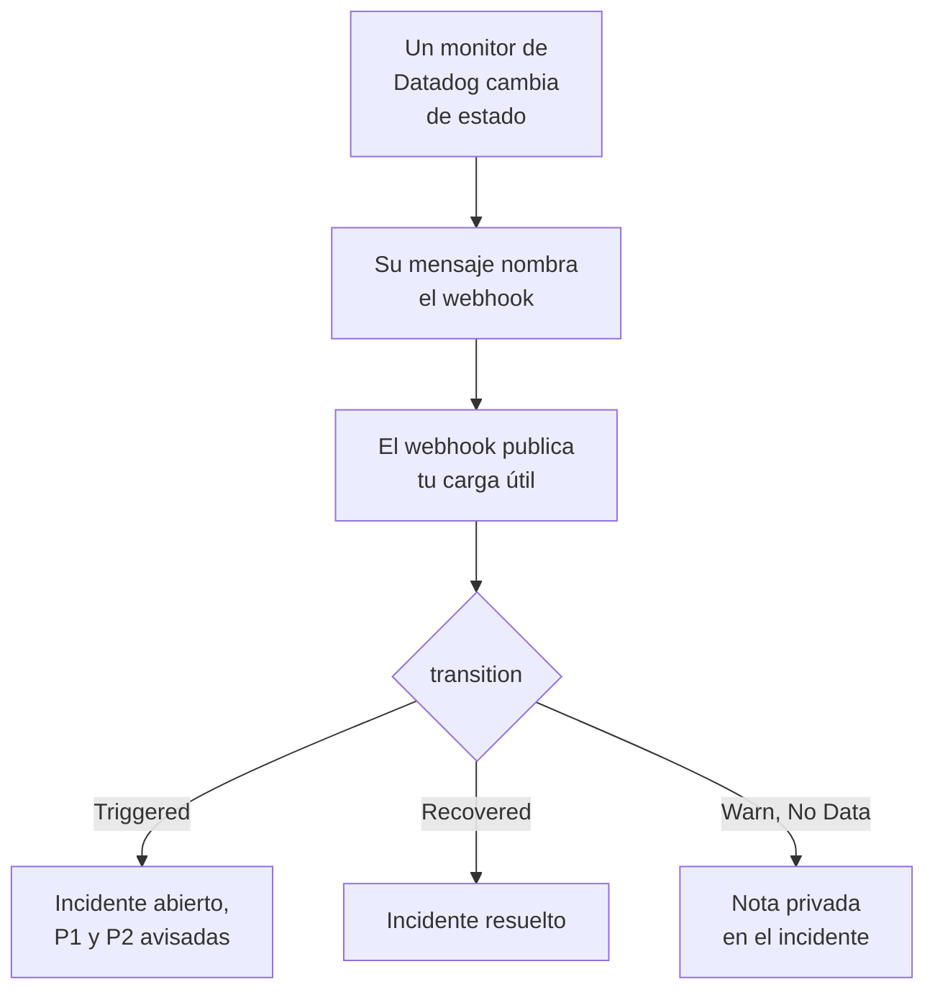

# Datadog

Envía las alertas de los monitores de [Datadog](https://www.datadoghq.com) a OneUptime, para que cada una se convierta en un incidente o una alerta, avise a tu equipo de guardia cuando es urgente y se resuelva cuando el monitor de Datadog se recupera. Datadog envía sus alertas mediante su [integración Webhooks](https://docs.datadoghq.com/integrations/webhooks/), así que no hay nada que instalar en ninguno de los dos lados.

:::cards
- [Elegir cómo recibe OneUptime las alertas](#elegir-cómo-recibe-oneuptime-las-alertas): Una plantilla de flujo de trabajo o un monitor de solicitudes entrantes.
- [Empezar con la plantilla](#empezar-con-la-plantilla): Elige a quién avisar, copia la URL y mira qué hace cada alerta.
- [Recibir alertas con un monitor](#recibir-alertas-con-un-monitor): Un incidente por alerta, resuelto con la recuperación.
- [Configurar Datadog](#configurar-datadog): Un webhook y los monitores que lo notifican.
- [Solución de problemas](#solución-de-problemas): Cuando las alertas no llegan o los incidentes siguen abiertos.
:::

## Cómo funciona



Un monitor de Datadog notifica a los webhooks que menciona su mensaje cuando cambia de estado: cuando se dispara, avisa, se recupera o no tiene datos. El cuerpo JSON del webhook lo escribes tú, con las [variables de plantilla](https://docs.datadoghq.com/integrations/webhooks/#usage) de Datadog, así que esta guía te da uno que nombra cada alerta y dice qué le ha pasado.

## Antes de empezar

- Una cuenta de Datadog en la que puedas configurar integraciones y editar monitores.
- En OneUptime, permiso para crear flujos de trabajo, o monitores si eliges esa vía. En OneUptime Cloud, los flujos de trabajo necesitan el plan **Growth** o superior.

## Elegir cómo recibe OneUptime las alertas

Configura primero OneUptime: te da la URL a la que envía Datadog.

| Camino | Úsalo cuando |
| --- | --- |
| La plantilla de flujo de trabajo (recomendado) | Quieres cada alerta como un incidente o una alerta con una gravedad que sale de la prioridad del monitor, con aviso a la guardia para P1 y P2, con las advertencias anotadas en él, y resuelto en la recuperación. No hay nada que construir. |
| Un monitor de solicitudes entrantes | Quieres incidentes sin flujo de trabajo, en cualquier plan, y un monitor cuyo estado sigue a Datadog. |

Ambos reciben el mismo JSON del mismo webhook, así que puedes empezar con uno y pasar al otro más tarde cambiando una URL en Datadog.

## Empezar con la plantilla

El diálogo **Crear un flujo de trabajo** tiene dos plantillas de Datadog, en **Datadog** de su lista de categorías: **Declare an incident when a Datadog monitor triggers**, y **Create an alert when a Datadog monitor triggers** para alertas. Ambas hacen lo mismo, cada una con su propio tipo de registro.

:::steps
1. Ve a **Flujos de trabajo** y haz clic en **Crear flujo de trabajo**. En **O empieza con una plantilla**, elige **Datadog** en la lista de categorías, haz clic en **Declare an incident when a Datadog monitor triggers**, o en **Create an alert when a Datadog monitor triggers**, y luego en **Usar esta plantilla**.
2. En **Who to page for P1 and P2 monitors**, elige las políticas de guardia a las que avisar, o ninguna para no avisar a nadie, y haz clic en **Crear flujo de trabajo**. El flujo de trabajo se abre en el **Constructor**, desactivado.
3. Haz clic en el disparador **Webhook**, luego en **Copiar URL**, y guarda la URL para Datadog.
4. Activa **Habilitado** en la parte superior del **Constructor**. Un flujo de trabajo desactivado responde a Datadog con `400`.
:::

Después [configura Datadog](#configurar-datadog) para que envíe sus alertas a esa URL. El paso `read-event-1` del flujo de trabajo se abre con la misma configuración, para cuando vuelvas a él en el **Constructor**.

### Qué hace el flujo de trabajo

Tras el disparador **Webhook**, el paso **Check With JavaScript** `read-event-1` lee el `transition` que envía Datadog, e **Incident From Another Tool**, o **Alert From Another Tool** en la plantilla de alertas, hace lo que significa, por la clave de ciclo de la alerta. Datadog guarda esa clave desde que una alerta se dispara hasta que se recupera, y la próxima vez que se dispara la clave es nueva, así que cada vez tiene su propio incidente. El incidente guarda la clave en su campo personalizado `datadogAlertCycleKey`.

| Transición | Qué hace el flujo de trabajo |
| --- | --- |
| `Triggered`, `Re-Triggered` | Declara un incidente titulado `Datadog: <monitor>`, con la gravedad a la que corresponde la prioridad del monitor, fuera de tus páginas de estado. Su descripción enlaza la alerta en Datadog y muestra la prioridad, el host, el alcance y el mensaje del monitor. Una notificación de una alerta que ya tiene su incidente no abre un segundo, y no avisa a nadie otra vez. |
| `Recovered` | Resuelve el incidente de la alerta, salvo que ya esté resuelto. El motivo queda en su línea de tiempo. |
| `Warn`, `Re-Warn`, `No Data`, `Re-No Data` | Añade una nota privada al incidente de la alerta, diciendo cuál es ahora el estado del monitor. |
| `Renotify` | Nada: la alerta sigue abierta. |

Una advertencia o una recuperación de una alerta sin incidente no cambia nada. Todo lo demás, como una solicitud de otra herramienta, se deja tal cual: `read-event-1` toma **No**, y los **Pasos** de la ejecución dicen por qué. Nada vuelve a Datadog: él mismo resuelve sus alertas cuando la señal se recupera, y eso es lo que resuelve el incidente.

### Prioridades y avisos

Un incidente nuevo avisa a las políticas de guardia que elegiste cuando su monitor es P1 o P2, o no tiene prioridad. P3, P4 y P5 abren un incidente y no avisan a nadie. En un proyecto nuevo, las prioridades se asignan a estas gravedades de incidente y de alerta:

| Prioridad de Datadog | Incidente | Alerta | Guardia |
| --- | --- | --- | --- |
| P1 | Critical Incident | High | Avisada |
| P2 | Critical Incident | High | Avisada |
| Sin prioridad | Critical Incident | High | Avisada |
| P3 | Major Incident | Low | No avisada |
| P4 | Minor Incident | Low | No avisada |
| P5 | Minor Incident | Low | No avisada |

Con gravedades propias, P1, P2 y sin prioridad van a tu más grave, P3 a la del medio, y P4 y P5 a tu menos grave.

- Para asignar una prioridad a una de las tuyas por su nombre, edita `SEVERITY_BY_NAME` en el paso `read-event-1`, como `{ P3: 'Minor Incident' }`.
- Para avisar también con P3, pon **Compare with** del paso `if-page-1` **If / Else** a `3`.

## Recibir alertas con un monitor

Un [monitor de solicitudes entrantes](/docs/monitor/incoming-request-monitor) te da una URL, y sus criterios deciden qué hace cada alerta.

:::steps
### Crear el monitor

Ve a **Monitores** y haz clic en **Crear monitor**. Elige **Solicitud entrante** en **Tipo de monitor**, llámalo `Datadog` y haz clic en **Siguiente**.

### Declarar un incidente por cada alerta

En el paso **Criterios**, abre el primer criterio, el que marca el monitor como fuera de línea. Configura su filtro como **Cuerpo de la solicitud**, **Contiene**, `"transition":"Triggered"`. Este criterio ya declara un incidente cuando su filtro coincide. Completa el incidente:

- **Título del incidente**: `{{requestBody.title}}`.
- **Descripción del incidente**, en **Descripción**: `{{requestBody.body}}` y luego `Datadog: {{requestBody.link}}` en una línea propia.
- **Gravedad**: la gravedad de incidente que deben tener estas alertas.
- **Políticas de guardia**, en **Guardia**: las políticas a las que avisar.
- **Resolver incidente automáticamente**, en **Más campos**: déjalo activado, como viene. Sin él, las recuperaciones se ignoran y los incidentes siguen abiertos.

### Abrir un incidente por alerta

En el mismo criterio, abre **Ajustes** y activa **Agrupa incidentes y alertas por un campo de la carga útil**. Complétalo como se indica abajo, para que cada alerta tenga su propio incidente y su recuperación lo resuelva:

| Campo | Valor |
| --- | --- |
| **Abrir un incidente separado para cada…** | `requestBody.alert_key` |
| **Campo que indica la recuperación** | `requestBody.transition` |
| **Valor que significa recuperado** | `Recovered` |

### Volver a poner el monitor en línea

Abre el segundo criterio, el que marca el monitor como en línea, y configura su filtro como **Cuerpo de la solicitud**, **Contiene**, `"transition":"Recovered"`.

### Copiar la URL

Haz clic en **Crear monitor**. La página **Vista general** del monitor muestra su **URL de latido**. Cópiala para Datadog:

```text
https://oneuptime.com/heartbeat/<secret key>
```

Una instalación autoalojada tiene su propio host en lugar de `oneuptime.com`.
:::

La carga útil de abajo pone en `alert_key` el ID del monitor de Datadog y las etiquetas del grupo que alertó, para que cada grupo de un monitor de alertas múltiples tenga su propio incidente y la recuperación de ese grupo lo resuelva. Un monitor que se vuelve a disparar o vuelve a notificar mientras su incidente está abierto no abre un segundo. Consulta [Recibir alertas de otro sistema](/docs/monitor/incoming-request-monitor#recibir-alertas-de-otro-sistema) para ver qué hace cada ajuste.

> [!NOTE]
> Una notificación **Warn** o **No Data** no abre ningún incidente con estos filtros. Para que también te avisen de las advertencias, haz clic en **Añadir criterios**, da al nuevo criterio el filtro **Cuerpo de la solicitud**, **Contiene**, `"transition":"Warn"`, un incidente con su propia **Gravedad** y los mismos ajustes de agrupación, y luego arrástralo por encima del primer criterio. Los criterios se comprueban desde arriba, y decide el primero que coincide.

## Configurar Datadog

:::steps
### Añadir el webhook

En Datadog, abre el [mosaico de la integración Webhooks](https://app.datadoghq.com/integrations/webhooks) e instálala si aún no está instalada. Añade un webhook con estos ajustes y guárdalo:

- **Name**: `oneuptime`. Los monitores mencionan el webhook con este nombre, como `@webhook-oneuptime`.
- **URL**: la URL que copiaste de OneUptime.
- **Payload**:

  ```json
  {
    "alert_key": "$ALERT_ID $ALERT_SCOPE",
    "alert_cycle_key": "$ALERT_CYCLE_KEY",
    "transition": "$ALERT_TRANSITION",
    "alert_priority": "$ALERT_PRIORITY",
    "title": "$EVENT_TITLE",
    "body": "$TEXT_ONLY_MSG",
    "host": "$HOSTNAME",
    "scope": "$ALERT_SCOPE",
    "priority": "$PRIORITY",
    "link": "$LINK"
  }
  ```

### Mencionar el webhook en tus monitores

En cada monitor de Datadog que deba avisar a través de OneUptime, añade `@webhook-oneuptime` al mensaje de notificación del monitor y guarda el monitor. Datadog envía entonces a OneUptime las alertas y recuperaciones de ese monitor.
:::

| Variable | Lo que Datadog pone en ella |
| --- | --- |
| `$ALERT_ID` | El ID del monitor de Datadog que alertó. |
| `$ALERT_SCOPE` | Las etiquetas del grupo que alertó, como `host:web-1`. |
| `$ALERT_CYCLE_KEY` | Un ID que sigue igual desde que una alerta se dispara hasta que se recupera. |
| `$ALERT_TRANSITION` | Lo que pasó: `Triggered`, `Re-Triggered`, `Warn`, `Recovered`, `No Data` o `Renotify`, entre otros. |
| `$ALERT_PRIORITY` | La prioridad del monitor de Datadog, de `P1` a `P5`, o nada para un monitor sin ella. |
| `$EVENT_TITLE` | El título del evento, como `[Triggered] High CPU`. |
| `$TEXT_ONLY_MSG` | El mensaje del monitor, sin Markdown. |
| `$LINK` | Un enlace al evento en Datadog. |

Una carga útil sirve para los dos caminos: la plantilla va por `alert_cycle_key` y `alert_priority`, y el monitor por `alert_key`. Déjalos todos y podrás cambiar más tarde modificando solo la URL.

## Probarlo

Envía una alerta a la URL que copiaste, como haría Datadog:

```bash
curl -X POST "<url>" \
  -H "Content-Type: application/json" \
  -d '{
    "alert_key": "1234 host:web-1",
    "alert_cycle_key": "7151157925468446720",
    "transition": "Triggered",
    "alert_priority": "P1",
    "title": "[Triggered] High CPU",
    "body": "CPU is above 90% on web-1.",
    "host": "web-1",
    "scope": "host:web-1",
    "priority": "normal",
    "link": "https://app.datadoghq.com/event/event?id=1"
  }'
```

Con la plantilla, se abre un incidente titulado `Datadog: High CPU`, y se avisa a las políticas de guardia que elegiste. Con el monitor, se abre un incidente titulado `[Triggered] High CPU`. Envía la misma solicitud con `transition` en `Recovered` y el incidente se resuelve.

Luego prueba desde Datadog: abre un monitor que mencione el webhook, haz clic en **Test Notifications** y envía su notificación **Alert**. Para ver que llegó, abre **Registros → Ejecuciones** del flujo de trabajo, o la línea de tiempo del monitor de OneUptime.

## Solución de problemas

:::details No llega nada a OneUptime
- Comprueba que el mensaje del monitor de Datadog menciona `@webhook-oneuptime`, escrito como se llama el webhook.
- El monitor responde `200` de inmediato, antes de comprobar nada, incluso con una clave secreta errónea. Mira la línea de tiempo del monitor para ver si llegan las alertas.
- Un flujo de trabajo desactivado responde `400`. Activa **Habilitado** en la parte superior de su **Constructor**.
:::

:::details El flujo de trabajo se ejecuta, pero no abre nada
Abre la ejecución en **Registros → Ejecuciones**. La entrada `read-event-1` de sus **Pasos** dice por qué tomó **No**.

- `Datadog named no alert cycle key`: añade `"alert_cycle_key": "$ALERT_CYCLE_KEY"` a la carga útil del webhook en Datadog.
- `Datadog named no transition`: añade `"transition": "$ALERT_TRANSITION"` a la carga útil del webhook en Datadog.
:::

:::details No se avisa a la guardia
- Solo avisan los monitores P1 y P2 y los monitores sin prioridad. Consulta [Prioridades y avisos](#prioridades-y-avisos).
- Una notificación de una alerta que ya tiene su incidente no avisa a nadie otra vez.
- Si no se eligió a nadie en el diálogo **Crear un flujo de trabajo**, el flujo de trabajo no tiene ningún paso que avise.
:::

:::details Los incidentes se abren pero nunca se resuelven
- El monitor de Datadog también debe notificar al webhook sus recuperaciones. Un mensaje que menciona el webhook solo para las alertas, dentro de una condición, no envía ninguna recuperación.
- Con la plantilla, abre la ejecución de la recuperación en **Registros → Ejecuciones**: su último paso dice por qué. El `alert_cycle_key` de la recuperación debe ser el de la alerta, así que deja `$ALERT_CYCLE_KEY` tal como está en la carga útil.
- Con el monitor, el incidente del criterio necesita **Resolver incidente automáticamente**, en **Más campos**.
- **Valor que significa recuperado** debe ser exactamente `Recovered`. La comparación distingue mayúsculas y minúsculas.
- El `alert_key` de la recuperación debe ser el de la alerta: deja `$ALERT_ID $ALERT_SCOPE` tal como está en la carga útil.
:::

:::details Un campo muestra el nombre de una variable, o nada
Datadog solo rellena las variables que aplican al evento. Envía una notificación de prueba y mira lo que llegó: en la línea de tiempo del monitor, o para un flujo de trabajo en **Registros → Ejecuciones**.
:::

:::details Todas las alertas de un monitor se juntan en un incidente
Con el monitor, cada grupo necesita su propio `alert_key`. Comprueba que la carga útil lo forma con `$ALERT_ID` y `$ALERT_SCOPE`, y que la ruta de agrupación es `requestBody.alert_key`.
:::

## Seguridad

- **Trata la URL como una contraseña.** Quien la tenga puede abrir incidentes. Si se filtra, restablécela: **Restablecer URL** en el disparador **Webhook** del flujo de trabajo, o **Restablecer clave secreta de solicitud entrante** en la página **Ajustes** del monitor. Después actualiza la **URL** del webhook en Datadog.
- **Los enlaces van a Datadog.** La plantilla enlaza una alerta solo en un sitio de Datadog, diga lo que diga una solicitud, y escribe lo que envió Datadog como texto.
- **¿Autoalojado?** Datadog envía los webhooks desde internet, así que tu OneUptime debe ser accesible desde allí por HTTPS.

## Próximos pasos

:::cards
- [Plantillas de flujo de trabajo](/docs/workflows/authoring): Crea un flujo de trabajo a partir de una plantilla y cámbialo en el Constructor.
- [Monitor de solicitudes entrantes](/docs/monitor/incoming-request-monitor): Cada ajuste del monitor que recibe tus alertas.
- [New Relic](/docs/integrations/new-relic): La misma plantilla, para New Relic.
- [Reglas de escalado](/docs/on-call/escalation-rules): Decide a quién avisa una política de guardia, y cuándo.
- [Descripción general de integraciones](/docs/integrations/index): Las demás herramientas que puedes conectar.
:::
