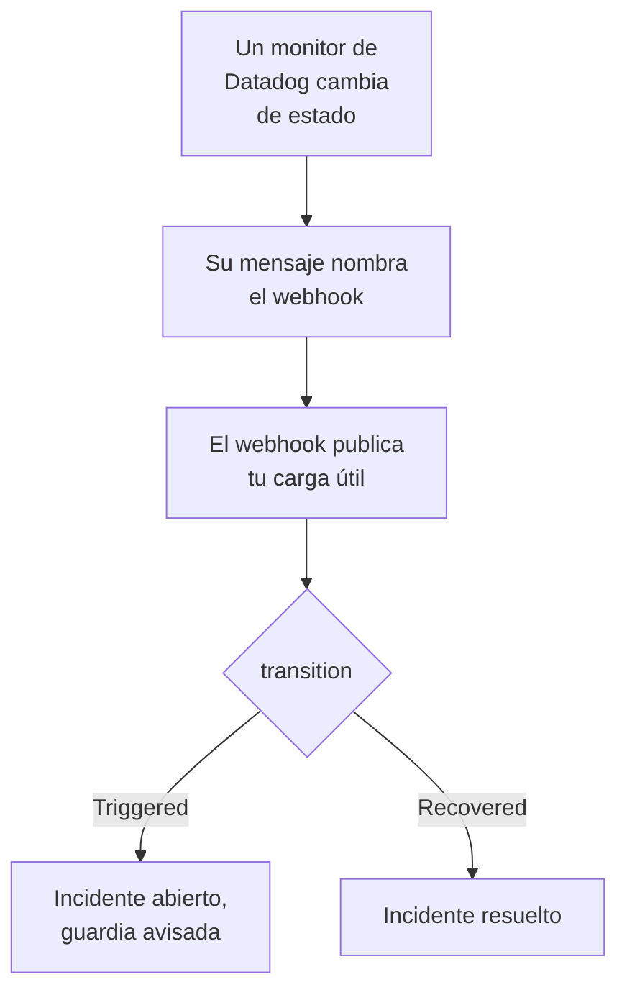

# Datadog

Envía las alertas de los monitores de [Datadog](https://www.datadoghq.com) a OneUptime, para que cada alerta se convierta en un incidente que avisa a tu equipo de guardia y se resuelva cuando el monitor de Datadog se recupera. Datadog envía sus alertas mediante su [integración Webhooks](https://docs.datadoghq.com/integrations/webhooks/), así que no hay nada que instalar en ninguno de los dos lados.

:::cards
- [Elegir cómo recibe OneUptime las alertas](#elegir-cómo-recibe-oneuptime-las-alertas): Un monitor de solicitudes entrantes o un flujo de trabajo propio.
- [Recibir alertas con un monitor](#recibir-alertas-con-un-monitor): Un incidente por alerta, resuelto con la recuperación.
- [Configurar Datadog](#configurar-datadog): Un webhook y los monitores que lo notifican.
- [Solución de problemas](#solución-de-problemas): Cuando las alertas no llegan o los incidentes siguen abiertos.
:::

## Cómo funciona



Un monitor de Datadog notifica a los webhooks que menciona su mensaje cuando cambia de estado: cuando se dispara, avisa, se recupera o no tiene datos. El cuerpo JSON del webhook lo escribes tú, con las [variables de plantilla](https://docs.datadoghq.com/integrations/webhooks/#usage) de Datadog, así que esta guía te da uno que nombra cada alerta y dice qué le ha pasado.

## Antes de empezar

- Una cuenta de Datadog en la que puedas configurar integraciones y editar monitores.
- En OneUptime, permiso para crear monitores, o flujos de trabajo si eliges ese camino.

## Elegir cómo recibe OneUptime las alertas

Configura primero OneUptime: te da la URL a la que envía Datadog.

| Camino | Úsalo cuando |
| --- | --- |
| Un monitor de solicitudes entrantes (recomendado) | Quieres que cada alerta sea un incidente que avisa a la guardia y se resuelve cuando el monitor de Datadog se recupera. No hay nada que construir. |
| Un flujo de trabajo con un disparador Webhook | Necesitas tu propia lógica: filtrar alertas, transformarlas o llamar antes a otros sistemas. Un flujo de trabajo declara un incidente por cada alerta que recibe, y no lo resuelve con la recuperación. |

Ambos reciben el mismo JSON del mismo webhook, así que puedes empezar con uno y pasar al otro más tarde cambiando una URL en Datadog.

## Recibir alertas con un monitor

Un [monitor de solicitudes entrantes](/docs/monitor/incoming-request-monitor) te da una URL, y sus criterios deciden qué hace cada alerta.

:::steps
### Crear el monitor

Ve a **Monitores** y haz clic en **Crear monitor**. Elige **Solicitud entrante** en **Tipo de monitor**, llámalo `Datadog` y haz clic en **Siguiente**.

### Declarar un incidente por cada alerta

En el paso **Criterios**, abre el primer criterio, el que marca el monitor como fuera de línea. Configura su filtro como **Cuerpo de la solicitud**, **Contiene**, `"transition":"Triggered"`. Este criterio ya declara un incidente cuando su filtro coincide. Completa el incidente:

- **Título del incidente**: `{{requestBody.title}}`.
- **Descripción del incidente**, en **Descripción**: `{{requestBody.body}}` y luego `Datadog: {{requestBody.link}}` en una línea propia.
- **Gravedad**: la gravedad de incidente que deben tener estas alertas.
- **Políticas de guardia**, en **De guardia**: las políticas a las que avisar.
- **Resolver incidente automáticamente**, en **Más campos**: déjalo activado, como viene. Sin él, las recuperaciones se ignoran y los incidentes siguen abiertos.

### Abrir un incidente por alerta

En el mismo criterio, abre **Ajustes** y activa **Agrupa incidentes y alertas por un campo de la carga útil**. Complétalo como se indica abajo, para que cada alerta tenga su propio incidente y su recuperación lo resuelva:

| Campo | Valor |
| --- | --- |
| **Abrir un incidente separado para cada…** | `requestBody.alert_key` |
| **Campo que indica la recuperación** | `requestBody.transition` |
| **Valor que significa recuperado** | `Recovered` |

### Volver a poner el monitor en línea

Abre el segundo criterio, el que marca el monitor como en línea, y configura su filtro como **Cuerpo de la solicitud**, **Contiene**, `"transition":"Recovered"`.

### Copiar la URL

Haz clic en **Crear monitor**. La página **Vista general** del monitor muestra su **URL de latido**. Cópiala para Datadog:

```text
https://oneuptime.com/heartbeat/<secret key>
```

Una instalación autoalojada tiene su propio host en lugar de `oneuptime.com`.
:::

La carga útil de abajo pone en `alert_key` el ID del monitor de Datadog y las etiquetas del grupo que alertó, para que cada grupo de un monitor de alertas múltiples tenga su propio incidente y la recuperación de ese grupo lo resuelva. Un monitor que se vuelve a disparar o vuelve a notificar mientras su incidente está abierto no abre un segundo. Consulta [Recibir alertas de otro sistema](/docs/monitor/incoming-request-monitor#recibir-alertas-de-otro-sistema) para ver qué hace cada ajuste.

> [!NOTE]
> Una notificación **Warn** o **No Data** no abre ningún incidente con estos filtros. Para que también te avisen de las advertencias, haz clic en **Añadir criterios**, da al nuevo criterio el filtro **Cuerpo de la solicitud**, **Contiene**, `"transition":"Warn"`, un incidente con su propia **Gravedad** y los mismos ajustes de agrupación, y luego arrástralo por encima del primer criterio. Los criterios se comprueban desde arriba, y decide el primero que coincide.

## Configurar Datadog

:::steps
### Añadir el webhook

En Datadog, abre el [mosaico de la integración Webhooks](https://app.datadoghq.com/integrations/webhooks) e instálala si aún no está instalada. Añade un webhook con estos ajustes y guárdalo:

- **Name**: `oneuptime`. Los monitores mencionan el webhook con este nombre, como `@webhook-oneuptime`.
- **URL**: la URL que copiaste de OneUptime.
- **Payload**:

  ```json
  {
    "alert_key": "$ALERT_ID $ALERT_SCOPE",
    "transition": "$ALERT_TRANSITION",
    "title": "$EVENT_TITLE",
    "body": "$TEXT_ONLY_MSG",
    "host": "$HOSTNAME",
    "priority": "$PRIORITY",
    "link": "$LINK"
  }
  ```

### Mencionar el webhook en tus monitores

En cada monitor de Datadog que deba avisar a través de OneUptime, añade `@webhook-oneuptime` al mensaje de notificación del monitor y guarda el monitor. Datadog envía entonces a OneUptime las alertas y recuperaciones de ese monitor.
:::

| Variable | Lo que Datadog pone en ella |
| --- | --- |
| `$ALERT_ID` | El ID del monitor de Datadog que alertó. |
| `$ALERT_SCOPE` | Las etiquetas del grupo que alertó, como `host:web-1`. |
| `$ALERT_TRANSITION` | Lo que pasó: `Triggered`, `Re-Triggered`, `Warn`, `Recovered`, `No Data` o `Renotify`, entre otros. |
| `$EVENT_TITLE` | El título del evento, como `[Triggered] High CPU`. |
| `$TEXT_ONLY_MSG` | El mensaje del monitor, sin Markdown. |
| `$LINK` | Un enlace al evento en Datadog. |

## Probarlo

Envía una alerta a OneUptime, como haría Datadog:

```bash
curl -X POST "https://oneuptime.com/heartbeat/<secret key>" \
  -H "Content-Type: application/json" \
  -d '{
    "alert_key": "1234 host:web-1",
    "transition": "Triggered",
    "title": "[Triggered] High CPU",
    "body": "CPU is above 90% on web-1.",
    "host": "web-1",
    "priority": "normal",
    "link": "https://app.datadoghq.com/event/event?id=1"
  }'
```

Se abre un incidente titulado `[Triggered] High CPU`. Envía la misma solicitud con `transition` en `Recovered` y el incidente se resuelve.

Luego prueba desde Datadog: abre un monitor que mencione el webhook, haz clic en **Test Notifications** y envía su notificación **Alert**. Mira la línea de tiempo del monitor de OneUptime para ver que llegó.

## Recibir alertas con un flujo de trabajo

Usa un [flujo de trabajo](/docs/workflows/index) cuando necesites tus propios pasos entre Datadog y el incidente.

:::steps
### Crear el flujo de trabajo

Ve a **Flujos de trabajo**, haz clic en **Crear flujo de trabajo** y luego en **Empezar desde cero**. Llámalo `Datadog alerts` y haz clic en **Crear flujo de trabajo**.

### Añadir el disparador Webhook

Haz clic en el bloque discontinuo **Elige qué inicia este flujo de trabajo** y elige **Webhook**. Haz clic en el disparador, luego en **Copiar URL**, y usa esa URL en el webhook de Datadog.

### Comprobar que el monitor se disparó

Haz clic en **Añadir componente**, añade un bloque **If / Else** y conecta a él el punto **Out** del disparador. Configura **Value to check** como `{{local.components.webhook-1.returnValues.request-body.transition}}`, **Comparison** como **is equal to** y **Compare with** como `Triggered`.

### Declarar el incidente

Añade un bloque **Create One Incident** y conecta a él el lado **Yes** del bloque **If / Else**. En **Incident Template**, elige una plantilla que fije la gravedad y las políticas de guardia a las que avisar (consulta [Plantillas de incidente](/docs/incidents/settings#plantillas-de-incidente)). En **JSON Object**, indica lo que viene de Datadog:

```json
{
  "title": "{{local.components.webhook-1.returnValues.request-body.title}}",
  "description": "{{local.components.webhook-1.returnValues.request-body.body}}\nDatadog: {{local.components.webhook-1.returnValues.request-body.link}}"
}
```

Sin plantilla, **JSON Object** también debe contener `incidentSeverityId`, el ID de una de las gravedades de incidente del proyecto.

### Activar el flujo de trabajo

Activa **Habilitado** en la parte superior del **Constructor**. Un flujo de trabajo desactivado responde a Datadog con `400`.
:::

Cada notificación `Triggered` declara un incidente nuevo. Una recuperación toma el lado **No** del bloque **If / Else**, donde no hay nada conectado, así que la ejecución termina ahí. Para un incidente por alerta, resuelto con la recuperación, usa el monitor.

## Solución de problemas

:::details No llega nada a OneUptime
- Comprueba que el mensaje del monitor de Datadog menciona `@webhook-oneuptime`, escrito como se llama el webhook.
- El monitor responde `200` de inmediato, antes de comprobar nada, incluso con una clave secreta errónea. Mira la línea de tiempo del monitor para ver si llegan las alertas.
- Un flujo de trabajo desactivado responde `400`. Activa **Habilitado** en la parte superior de su **Constructor**.
:::

:::details Los incidentes se abren pero nunca se resuelven
- El monitor de Datadog también debe notificar al webhook sus recuperaciones. Un mensaje que menciona el webhook solo para las alertas, dentro de una condición, no envía ninguna recuperación.
- El incidente del criterio necesita **Resolver incidente automáticamente**, en **Más campos**.
- **Valor que significa recuperado** debe ser exactamente `Recovered`. La comparación distingue mayúsculas y minúsculas.
- El `alert_key` de la recuperación debe ser el de la alerta: deja `$ALERT_ID $ALERT_SCOPE` tal como está en la carga útil.
:::

:::details Un campo muestra el nombre de una variable, o nada
Datadog solo rellena las variables que aplican al evento. Envía una notificación de prueba y mira lo que llegó: en la línea de tiempo del monitor, o para un flujo de trabajo en **Registros → Ejecuciones**.
:::

:::details Todas las alertas de un monitor se juntan en un incidente
Cada grupo necesita su propio `alert_key`. Comprueba que la carga útil lo forma con `$ALERT_ID` y `$ALERT_SCOPE`, y que la ruta de agrupación es `requestBody.alert_key`.
:::

## Seguridad

- **Trata la URL como una contraseña.** Quien la tenga puede abrir incidentes. Si se filtra, restablécela: **Restablecer clave secreta de solicitud entrante** en la página **Ajustes** del monitor, o **Restablecer URL** en el disparador **Webhook** del flujo de trabajo. Después actualiza la **URL** del webhook en Datadog.
- **¿Autoalojado?** Datadog envía los webhooks desde internet, así que tu OneUptime debe ser accesible desde allí por HTTPS.

## Próximos pasos

:::cards
- [Monitor de solicitudes entrantes](/docs/monitor/incoming-request-monitor): Cada ajuste del monitor que recibe tus alertas.
- [Prometheus Alertmanager](/docs/integrations/prometheus-alertmanager): La misma configuración, para Alertmanager.
- [Reglas de escalado](/docs/on-call/escalation-rules): Decide a quién avisa una política de guardia, y cuándo.
- [Descripción general de integraciones](/docs/integrations/index): Las demás herramientas que puedes conectar.
:::
