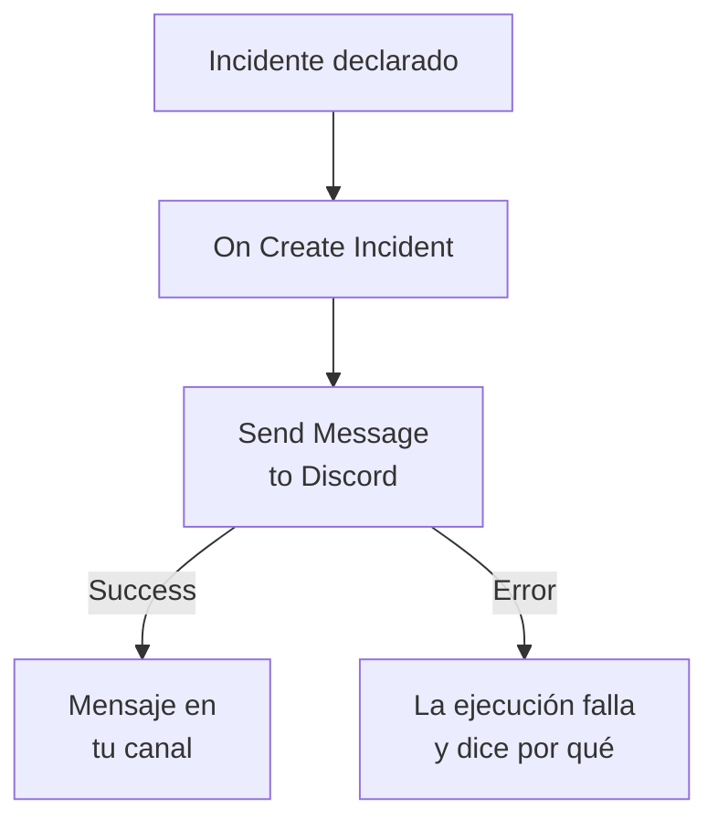

# Discord

Publica un mensaje en un canal de [Discord](https://discord.com) cuando se abre un incidente, para que quienes siguen ese canal se enteren al momento. El paso de flujo de trabajo **Send Message to Discord** de OneUptime publica a través del webhook del canal, y una plantilla lista para usar crea todo el flujo de trabajo por ti. Esta integración es **saliente**: OneUptime publica en el canal y no lee lo que se dice allí.

:::cards
- [Cómo funciona](#cómo-funciona): Lo que hace el flujo de trabajo cuando se abre un incidente.
- [Configuración](#configurar-la-integración): Un webhook en Discord y después el flujo de trabajo: desde la plantilla o desde cero.
- [Consejos](#consejos): Formato, mensajes largos y más eventos.
- [Solución de problemas](#solución-de-problemas): Qué significan los errores del paso y qué cambiar.
:::

## Cómo funciona



El paso publica el **Message Text** en el webhook del canal. Toma su salida **Success** cuando Discord acepta el mensaje, y su salida **Error**, con el motivo de Discord, cuando Discord lo rechaza. Sin nada conectado a **Error**, como en la plantilla, una ejecución que no pudo publicar falla, y sus **Pasos** dicen por qué.

## Antes de empezar

- En Discord, el permiso **Manage Webhooks** en el canal.
- En OneUptime, el derecho a crear flujos de trabajo y variables. En OneUptime Cloud, los flujos de trabajo necesitan el plan **Growth** o superior.

## Configurar la integración

:::steps
### Crear un webhook en Discord

1. En Discord, abre los ajustes del canal con **Edit Channel**, luego **Integrations → Webhooks**, y selecciona **New Webhook**.
2. Ponle un nombre, por ejemplo `OneUptime`, y comprueba que publica en el canal correcto.
3. Selecciona **Copy Webhook URL**.

Quien tenga la URL puede publicar en el canal, así que guárdala tan bien como una contraseña.

### Crear el flujo de trabajo

Empieza desde la plantilla, que crea todo el flujo de trabajo por ti, o desde cero.

:::tabs
@tab Desde la plantilla
1. Abre **Flujos de trabajo** y haz clic en **Crear flujo de trabajo**.
2. Escribe `Discord` en **Buscar plantillas…**, haz clic en **Tell Discord when an incident opens** y después en **Usar esta plantilla**.
3. Deja el nombre **Notify Discord on new incident** o cámbialo, y haz clic en **Siguiente**.
4. Pega la URL en **Discord Webhook URL** y haz clic en **Crear flujo de trabajo**.

El flujo de trabajo se abre en el **Constructor** con dos pasos: **On Create Incident** y **Send Message to Discord**, que publica el número, el título, la gravedad y el estado del incidente. La URL se guarda como la variable secreta `discordWebhookUrl` del flujo de trabajo.
@tab Desde cero
1. Guarda la URL como variable global secreta: ve a **Flujos de trabajo → Variables globales**, haz clic en **Crear Variable del flujo de trabajo**, ponle el nombre `DISCORD_WEBHOOK_URL` y haz clic en **Siguiente**. Pega la URL en **Contenido**, activa **Secreto** y haz clic en **Crear Variable del flujo de trabajo**.
2. Ve a **Flujos de trabajo**, haz clic en **Crear flujo de trabajo**, elige **Empezar desde cero**, ponle nombre al flujo de trabajo y haz clic en **Crear flujo de trabajo**.
3. En el **Constructor**, haz clic en **Elige qué inicia este flujo de trabajo** y elige **On Create Incident** en **Populares**. Haz clic en el disparador: sus **Fields to pass on** empiezan con **Título**, así que haz clic en **Añadir campo** y elige los demás campos que muestra tu mensaje, por ejemplo **Número de incidente con prefijo**.
4. Haz clic en **Añadir componente**, busca `discord` y haz clic en **Send Message to Discord**. Conecta la salida **Success** del disparador a este paso.
5. Haz clic en el paso nuevo. En **Discord Incoming Webhook URL**, haz clic en **{ }** y elige `DISCORD_WEBHOOK_URL` en **Variables globales**. En **Message Text**, escribe el mensaje e inserta los campos del incidente con **{ }**.
:::

Un mensaje hecho desde cero lee los campos del incidente con referencias como estas:

```text
🚨 **Incident {{local.components.incident-on-create-1.returnValues.model.incidentNumberWithPrefix}} declared**
**Title:** {{local.components.incident-on-create-1.returnValues.model.title}}
```

### Activarlo y probarlo

Activa el interruptor **Habilitado** en la parte superior del **Constructor**. A partir de ahí, cada incidente nuevo se publica en el canal.

Para probarlo sin abrir un incidente, haz clic en **Ejecutar flujo de trabajo** y elige un incidente que ya tengas en **Incidente**: se muestran los más recientes, y al escribir su número o parte de su título encuentras otro. Haz clic en **Ejecutar flujo de trabajo manualmente** y confirma con **Ejecutar**. El panel **Ejecución del flujo de trabajo** sigue la ejecución, y el mensaje aparece en el canal. Si el paso toma **Error** en su lugar, la ejecución falla, y la entrada del paso en **Pasos** dice por qué: consulta [Solución de problemas](#solución-de-problemas).
:::

## Consejos

- **Dar formato con el Markdown de Discord.** El texto se envía tal como se escribe, así que el Markdown de Discord funciona en él: los asteriscos alrededor de una palabra la ponen en negrita, y una URL aparece como un enlace.
- **Tener en cuenta el límite de 2.000 caracteres.** Discord acepta mensajes de hasta 2.000 caracteres. Uno más largo se recorta, y termina con "… (truncated — see OneUptime for the full text)", en lugar de rechazarse.
- **Publicar más que incidentes nuevos.** Crea otro flujo de trabajo sobre **On Update Incident** para los cambios de estado, o sobre **On Create Alert** para las alertas, con el mismo paso. Para publicar solo algunos incidentes, pon un bloque **If / Else** antes del paso.
- **Solo las direcciones de Discord.** El paso publica en una URL `https` de `discord.com` o `discordapp.com`, y no sigue redirecciones, así que una URL que apunta a cualquier otro sitio detiene la ejecución.

## Solución de problemas

Cuando el paso toma **Error**, la ejecución falla, y la entrada del paso en los **Pasos** de la ejecución da el motivo de Discord.

:::details Discord responde "Unknown Webhook" o "Invalid Webhook Token"
El webhook se eliminó, o la URL se copió mal. Crea un webhook nuevo y sustituye la URL: en el flujo de trabajo de la plantilla, la variable `discordWebhookUrl`; en un flujo de trabajo propio, el contenido de `DISCORD_WEBHOOK_URL`.
:::

:::details Discord responde "You are being rate limited"
Discord limita cada cuánto puede publicar un webhook. Una ráfaga de incidentes puede alcanzar ese límite: publica menos mensajes, por ejemplo solo para algunas gravedades.
:::

:::details La ejecución se detiene con "Discord Webhook URL must be an https URL on discord.com or discordapp.com"
**Discord Incoming Webhook URL** contiene algo distinto de un webhook de Discord, o la variable que lee está vacía. Vuelve a pegar la URL de **Copy Webhook URL**.
:::

## Próximos pasos

:::cards
- [Componentes de flujo de trabajo](/docs/workflows/components#discord): Cada ajuste del paso y qué significan sus salidas.
- [Telegram](/docs/integrations/telegram): La misma idea, en un chat de Telegram.
- [Ejecuciones de flujo de trabajo](/docs/workflows/runs-and-logs): Lee qué hizo cada ejecución del flujo de trabajo.
- [Descripción general de integraciones](/docs/integrations/index): El patrón saliente y las demás herramientas que puedes conectar.
:::
