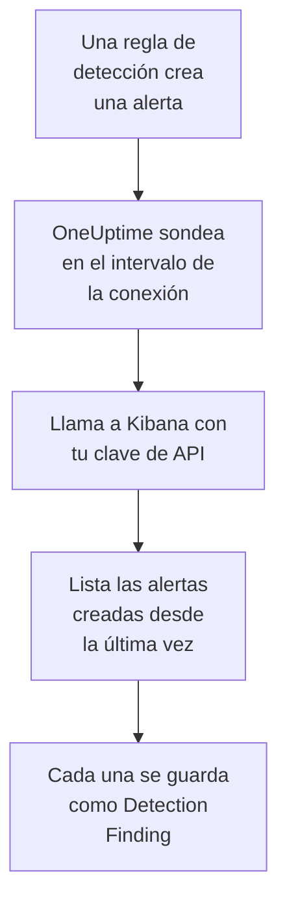

# Elastic Security

Importa las alertas de detección que generan tus reglas de [Elastic Security](https://www.elastic.co/security) en los eventos de seguridad de OneUptime. Allí las buscas junto a tus logs, trazas y métricas, las correlacionas con todas las demás fuentes y avisas a la guardia de las que importan. OneUptime las lee mediante la API del motor de detección de Kibana con una clave de API que tú creas, y no cambia nada en Elastic.

:::cards
- [Configurar la conexión](#configurar-la-conexión): Una clave de API, sus privilegios y el formulario de la conexión.
- [Qué se importa](#qué-se-importa): Cómo cada alerta de detección se convierte en un evento de seguridad.
- [Cómo funciona el sondeo](#cómo-funciona-el-sondeo): La ventana que lee cada sondeo, y lo que le hace un espacio con mucha actividad.
- [Solución de problemas](#solución-de-problemas): Qué significa cada error y qué cambiar.
:::

## Cómo funciona



Cada minuto, OneUptime sondea cada conexión habilitada cuyo intervalo de sondeo ha pasado. Un sondeo pide a Kibana las alertas de detección creadas en tu espacio desde el último sondeo, 1.000 cada vez, y guarda cada una como un evento [OCSF](https://schema.ocsf.io/) Detection Finding (clase `2004`). Cuentan todos los tipos de regla: consulta personalizada, umbral, EQL, coincidencia de indicadores, aprendizaje automático y términos nuevos. Las reglas de detección, los monitores y los paneles tratan entonces las alertas como eventos de seguridad de cualquier otra fuente.

## Antes de empezar

- En OneUptime, el rol Project Owner, Project Admin o Security Admin. Los roles Security Member y Security Viewer pueden ver las conexiones y su historial de ejecuciones, pero no cambiarlas.
- Elastic Security 8.x o posterior, en Elastic Cloud o en tu propio stack de Elastic, con reglas de detección que se ejecutan en un espacio de Kibana.
- Un acceso a Kibana que pueda ver las alertas de detección de ese espacio: los privilegios de índice `read` y `view_index_metadata` sobre `.alerts-security.alerts-<space-id>`, y un privilegio de la función Security de Kibana que le permita leer allí las alertas.
- Un Kibana al que OneUptime pueda llegar por HTTPS. OneUptime Cloud se conecta desde internet, así que Kibana necesita una dirección pública, como la que tienen los despliegues de Elastic Cloud: las direcciones privadas se rechazan. Un OneUptime autoalojado se conecta desde sus contenedores de aplicación y de workers, y puede llegar a un Kibana de tu red privada, salvo que `DATA_SOURCE_BLOCK_PRIVATE_ADDRESSES` sea `true`.

## Configurar la conexión

:::steps
### Crear una clave de API

1. En Kibana, abre **Stack Management → API keys** y selecciona **Create API key**.
2. Ponle un nombre, por ejemplo `oneuptime-security-events`. Una clave tiene los privilegios del usuario que la crea, salvo que le des menos: solo necesita los de arriba.
3. Elige cuándo caduca, o nunca. Una clave que caduca detiene la conexión hasta que la sustituyas.
4. Crea la clave y copia su valor **Base64**, que Kibana solo muestra una vez. No el ID de la clave, ni el par `id:api_key`.

### Encontrar el ID de tu espacio

Las alertas se guardan por espacio. Abre el espacio donde se ejecutan tus reglas: su ID es la parte de la dirección de Kibana después de `/s/`, por ejemplo `security` en `https://kibana.example.com/s/security/app/security`. El espacio predeterminado no tiene parte `/s/` y no necesita ningún ID.

### Añadir la conexión en OneUptime

Abre **Productos → Eventos de seguridad → Conexiones** (`/dashboard/{projectId}/security-events/connections`), haz clic en **Añadir conexión**, elige **Elastic Security** y haz clic en **Siguiente**. Rellena los ajustes de la tabla de abajo, haz clic en **Siguiente** y pega la clave en **Clave de API**.

### Probarla antes de guardar

Haz clic en **Probar esta configuración** en **Probar antes de guardar**. La prueba se autentica y lee alertas con los valores del formulario, sin guardar nada, así que un espacio equivocado o un privilegio que falta aparece antes de que exista la conexión. Después haz clic en **Siguiente**, dale un **Nombre** a la conexión y créala.
:::

| Ajuste | Qué introducir |
| --- | --- |
| **Kibana URL** | La dirección desde la que se sirve Kibana, por ejemplo `https://kibana.example.com` o `https://<deployment>.kb.<region>.cloud.es.io`. Sin ruta: ni `/app/security`, ni `/api`, ni la parte `/s/<space>`. |
| **Kibana space** | El ID del espacio, no su nombre: letras, cifras, guiones y guiones bajos. Déjalo vacío para el espacio predeterminado. |
| **Clave de API** | El valor **Base64** de la clave, por sí solo: OneUptime añade él mismo el esquema `ApiKey`. Se cifra, la API nunca lo devuelve y nunca se vuelve a mostrar. Sustitúyelo con **Actualizar credenciales** en la conexión. |

El paso **Sondeo** también tiene una **Descripción** opcional, el **Intervalo de sondeo (minutos)**, un número entero de `1` a `1440` que empieza en `5`, y **Habilitado**, que empieza activado.

## Qué se importa

Cada alerta de detección se convierte en un evento Detection Finding (clase OCSF `2004`), con el proveedor `Elastic` y el producto `Elastic Security`:

| Campo de la alerta | Columna de OneUptime |
| --- | --- |
| `_id`, el ID de la alerta | UID del evento, que también sirve para descartar duplicados |
| `kibana.alert.original_time`, si no `kibana.alert.start`, si no `@timestamp` | Hora del evento |
| `kibana.alert.rule.name` | Nombre de la regla |
| `kibana.alert.rule.uuid`, si no `kibana.alert.rule.rule_id` | ID de la regla |
| `kibana.alert.reason`, si no el nombre de la regla, si no `kibana.alert.rule.description` | Mensaje |
| `kibana.alert.severity`, si no un tramo de `kibana.alert.risk_score` | Gravedad |
| `kibana.alert.workflow_status`: `open`, `acknowledged` o `closed` | Estado |
| `kibana.alert.rule.threat`, subtécnicas incluidas | Tácticas y técnicas de MITRE ATT&CK |
| `user.name`, `host.name`, `source.ip` o `host.ip`, `process.name` o `process.executable` | Usuario, host, IP y proceso del actor |
| `process.name`, `process.executable` y `process.command_line`; `process.parent.name`, `process.parent.executable` y `process.parent.command_line` | Nombre, ruta y línea de comandos del proceso; nombre, ruta y línea de comandos del proceso padre |
| `user.target.name`, `destination.domain`, `destination.ip`, `destination.port`, `file.path` | Usuario, host, IP, puerto y recurso del destino |
| Esos, y `related.*`, `dns.question.name`, `url.domain` y los hashes de archivos | Observables |
| La alerta entera, aplanada en claves con puntos, con `_index` y `_id` | `attributes` |

La hora de una alerta es, a propósito, la de la actividad de la que trata. Su `@timestamp`, cuando la regla la creó, es lo que lee el sondeo, así que una alerta creada hoy sobre la actividad de ayer aparece en la fecha de ayer en el explorador de eventos de seguridad. Cuando una alerta no tiene gravedad, decide su puntuación de riesgo: desde `74` Critical, desde `48` High, desde `22` Medium, y por debajo Low.

## Cómo funciona el sondeo

Cada sondeo lista las alertas creadas en su ventana, de más antiguas a más nuevas, 1.000 por página. En un espacio que no sea el predeterminado, la ruta empieza por `/s/{Kibana space}`:

```text
POST {Kibana URL}/api/detection_engine/signals/search
    {"query": {"range": {"@timestamp": {"gte": "{window start}", "lt": "{window end}"}}},
     "size": 1000, "sort": [{"@timestamp": "asc"}]}
```

- **La hora de creación es el cursor.** Las alertas se listan por su propio `@timestamp`, cuando la ejecución de la regla las creó, nunca por la hora de la actividad de la que tratan. Una regla que se ejecuta cada hora crea alertas sobre una actividad de hasta una hora de antigüedad, y un cursor sobre la hora de actividad se las saltaría todas.
- **El primer sondeo mira 24 horas atrás**, para que una conexión nueva muestre enseguida sus alertas recientes.
- **Cada sondeo posterior empieza 1 minuto antes del cursor guardado**, para que nunca se pierda una alerta creada en el límite entre dos ventanas.
- **Un sondeo lee como mucho 24 horas más allá del cursor.** Una conexión cuyo cursor se quedó atrás se pone al día en una serie de ventanas de 24 horas, y su **Salud** indica **Catching up**.
- **Los duplicados se descartan por el `_id` de la alerta** dentro del proyecto, para que el solapamiento, una ventana reintentada y una importación nunca guarden una alerta dos veces.

La búsqueda de alertas de Kibana acepta un tamaño y un orden, pero no un token de página. Por eso OneUptime pagina moviendo el inicio del intervalo a la última alerta de cada página, y deja fuera, por `_id`, las alertas que ya leyó en ese instante. Una ejecución de regla suele marcar muchas alertas con la misma hora, y ese grupo se lee página a página, ninguna dos veces y ninguna saltada.

### Cuando una ventana contiene más de lo que un sondeo puede leer

Un sondeo lee como mucho 10.000 alertas, en como mucho 20 solicitudes. Cuando una ventana contiene más, la ejecución es **Parcial**, con un aviso como este:

```text
Stopped after collecting 10000 alerts; the window holds more.
```

Las alertas se leen de más antiguas a más nuevas, así que OneUptime mueve el cursor a la hora de creación de la última alerta leída, y el siguiente sondeo empieza ahí, con la misma longitud de ventana. Un espacio con mucha actividad se pone al día 10.000 alertas por sondeo, en lugar de volver a leer las mismas. Las alertas creadas en ese mismo instante se leen dos veces, y la comprobación de duplicados descarta la segunda copia.

Los ID que se dejan fuera viajan en cada solicitud, y Kibana limita el tamaño de una solicitud. Cuando más alertas comparten un mismo instante de las que una solicitud puede dejar fuera, unas 7.800, la ejecución se detiene ahí como **Parcial**, con un aviso que nombra el instante.

Cuando una ejecución no consigue avanzar en absoluto más allá del cursor guardado, OneUptime acorta la ventana en su lugar:

1. **Reducir.** El siguiente sondeo lee una ventana de la mitad de largo, desde el mismo punto de partida, y sigue reduciéndola a la mitad hasta que una ventana se lee entera, hasta un minuto. El aviso de la ejecución lo dice: `This window holds more records than one poll can read; the next poll reads a {n} minute window from the same starting point.`
2. **Volver a crecer.** Cuando una ventana se lee entera, la siguiente vuelve a ser el doble de larga, hasta 24 horas.
3. **Pasar más allá de un único minuto.** Si incluso un minuto contiene más de lo que un sondeo puede leer, el sondeo lo pasa de largo, para que sigan llegando las alertas más nuevas. La ejecución sigue siendo **Parcial**, y **Último error** indica `More records were created in the one minute from {cursor} to {end} than one poll can read. Polling moved past this minute so newer records keep arriving; use Import this time range in Diagnostics on this minute to recover what one run can read.` Importa ese minuto con **Importar este intervalo de tiempo** para recuperar lo que una ejecución puede leer.

Una ejecución que falla del todo, con un error de Kibana, conserva el cursor y la longitud de ventana, y el siguiente sondeo vuelve a leer la misma ventana. La única excepción es una solicitud que agotó el tiempo: el cursor se queda, pero la siguiente ventana es la mitad de larga, porque una ventana demasiado pesada para responder a tiempo agotaría el tiempo en cada intento. Cambiar el **Intervalo de sondeo (minutos)** no cambia nada de esto: decide cada cuánto empieza un sondeo, no dónde empieza su ventana.

### Ejecutar, previsualizar e importar a demanda

Haz clic en **Diagnósticos** en una conexión para ver sus ejecuciones recientes y trabajar con ella a mano. Quien puede cambiar la conexión puede iniciar estas acciones; quien puede verla puede leer el historial.

- **Ejecutar ahora** inicia un sondeo de inmediato, con el cursor habitual, incluso cuando la conexión no está **Habilitado**.
- **Preview alerts** lee un intervalo de tiempo de hasta 7 días y no importa nada.
- **Importar este intervalo de tiempo** importa un intervalo de hasta 7 días, después de que lo confirmes, sin mover el cursor. Las alertas ya importadas se omiten.
- **Copiar diagnósticos** en una ejecución copia su informe para soporte. Nunca incluye credenciales.

## Probar conexión

**Probar conexión** en la fila de una conexión, y **Probar esta configuración** en el formulario, se ejecutan en el proceso de la API, no en un worker en segundo plano, para que una prueba responda incluso cuando el problema son los workers. Hace estas comprobaciones, en orden:

| Comprobación | Qué comprueba |
| --- | --- |
| **Configuración** | Cada ajuste está presente y bien formado. No se contacta con nada cuando esto falla. |
| **Authenticate with Kibana** | `/api/status` de Kibana responde completo. Kibana también responde, con menos, a quien no ha autenticado, así que una respuesta corta hace fallar esta comprobación. |
| **Read detection alerts** | Se puede leer una alerta creada en las últimas 24 horas. Eso demuestra los privilegios y el espacio. |
| **Alerts available to import** | Cuántas alertas se crearon en las últimas 24 horas y en los últimos 7 días, con `+` donde Elasticsearch contó solo una parte. Ninguna en 7 días es un aviso, no un fallo. |
| **Background workers**, **Poll scheduler**, **Security event storage** | El lado del propio OneUptime: un proceso toma los trabajos de la cola Worker, el trabajo de sondeo se ejecuta cada minuto y el almacén de eventos de seguridad responde. |
| **Sondeo programado** | Para una conexión guardada: el sondeo está activado, ninguna ejecución está atascada esperando a un worker y los sondeos se ejecutan a tiempo. |

Cada solicitud de una prueba tiene un plazo de 20 segundos. Una prueba nunca importa nada ni mueve el cursor, y cada comprobación que falla dice qué cambiar.

## Enviar eventos de seguridad a Elastic Security

OneUptime también puede enviar lo que encuentra a Elasticsearch, como documentos Elastic Common Schema (ECS) en un flujo de datos, para que las alertas, cronologías y reglas de detección de Elastic Security vean las detecciones de OneUptime junto a las tuyas. Una detección es un documento con `event.kind` `alert`, y cualquier otro evento tiene `event.kind` `event`.

:::steps
### Crear una clave de API que pueda escribir

En Kibana, abre **Stack Management → API keys**, haz clic en **Create API key**, dale los privilegios de abajo y copia su valor **Encoded**.

### Añadir el destino

Abre **Productos → Eventos de seguridad → Conexiones**. En **Enviar a tu SIEM**, haz clic en **Añadir destino**, elige Elastic Security en **SIEM** y haz clic en **Siguiente**. Rellena la **URL de Elasticsearch**, el endpoint de Elasticsearch del despliegue y no el de Kibana, y pega la clave en **Clave de API**. **Flujo de datos** es opcional: si queda vacío, los documentos van a `logs-oneuptime.security-default`, que Elasticsearch crea en la primera escritura.

### Enviar un evento de prueba y empezar a enviar

Haz clic en **Enviar un evento de prueba**: llega un documento al flujo de datos. Después, en **Qué enviar**, deja **Solo detecciones** o elige **Todos los eventos de seguridad**, y haz clic en **Empezar a enviar**.
:::

Los privilegios de la clave, para el flujo de datos por defecto:

```json title="oneuptime-writer-role.json"
{
  "oneuptime-writer": {
    "indices": [
      {
        "names": [
          "logs-oneuptime.security-*"
        ],
        "privileges": [
          "create_doc",
          "auto_configure"
        ]
      }
    ]
  }
}
```

- Los documentos van en lotes de hasta 500, cada uno con el id propio de su evento, así que un evento enviado dos veces se guarda una sola vez.
- Un documento que Elasticsearch no puede mapear se deja fuera y se nombra en **Ver error**, y uno que no puede aceptar por ahora (`429`) se vuelve a enviar.
- Las alertas que OneUptime importó de Elastic Security nunca se le devuelven.

## Solución de problemas

El **Último error** de la conexión guarda el mensaje de error completo, con las credenciales ocultas, tras un prefijo que nombra el paso que falló. Cuando una conexión tiene un error, selecciona **Ver error** en su columna **Acciones** para leerlo, y **Copiar error** en el cuadro de diálogo para copiarlo. Lee primero el prefijo.

:::details Último error empieza por `Elastic Security status request`
- `Elastic Security status request failed (HTTP ...)`: Kibana rechazó la solicitud de estado.
  - `HTTP 401`: Kibana no aceptó la clave de API. No es el valor **Base64**, o caducó o se invalidó. Crea una clave nueva y guárdala con **Actualizar credenciales**.
  - `HTTP 404`: la **Kibana URL** tiene una ruta, o no es Kibana.
  - `HTTP 503`: Kibana se declara no disponible, normalmente porque no puede llegar a Elasticsearch.
  - `HTTP 3xx`: Kibana redirigió la solicitud, y las redirecciones se rechazan. Usa la dirección desde la que se sirve Kibana.
- `Elastic Security status request returned ...`: respondió algo distinto de Kibana, por ejemplo una página de inicio de sesión o un proxy.
- Cuando solo falla la prueba, diciendo que Kibana `answered without authenticating the request`, la clave no llegó a Kibana. Comprueba que es el valor **Base64**, y que ningún proxy delante de Kibana quita la cabecera `Authorization`.
:::

:::details Último error empieza por `Elastic Security alerts search`
- `Elastic Security alerts search failed (HTTP ...)`: Kibana rechazó la búsqueda de alertas.
  - `HTTP 403`: la clave inicia sesión, pero no puede leer las alertas del espacio. Dale los privilegios de [Antes de empezar](#antes-de-empezar).
  - `HTTP 404`: ningún espacio tiene ese ID de **Kibana space**, o Elastic Security no está habilitado en él.
  - `HTTP 429` o `HTTP 5xx`: Kibana o Elasticsearch está limitando las solicitudes o fallando. El siguiente sondeo lo vuelve a intentar.
- `Elastic Security alerts search returned ...`: Kibana respondió `200`, pero sin una página de alertas legible, por ejemplo con su propio error. El mensaje lo cita. Se notifica en lugar de tomarse como una ventana vacía, para que el cursor nunca pase de largo alertas que nadie leyó.
:::

:::details Último error termina en `did not complete`
`Elastic Security alerts search did not complete`, y lo mismo para la solicitud de estado, significa que la solicitud no obtuvo respuesta: un tiempo de espera agotado, un nombre que no se resuelve, una conexión rechazada, o una dirección privada rechazada. Comprueba que la aplicación de OneUptime y los workers pueden llegar a Kibana, con el esquema y el puerto correctos. Tras un tiempo de espera agotado, el siguiente sondeo lee una ventana de la mitad de larga.
:::

:::details Último sondeo indica Never y Último error está vacío
Ningún sondeo ha terminado para esta conexión. Ejecuta **Probar conexión**: sus comprobaciones **Background workers** y **Poll scheduler** nombran la causa. En una instalación autoalojada, la causa habitual es `DISABLE_QUEUE_WORKERS=true` en la aplicación, sin un despliegue de workers aparte que tome los trabajos: ponlo en `false`, o ejecuta el despliegue de workers (Helm: `worker.enabled: true`).
:::

:::details Una ejecución es Parcial
- `Stopped after collecting 10000 alerts; the window holds more`: la ventana contenía más que las 10.000 alertas que lee una ejecución. No se pierde nada: el siguiente sondeo empieza después de la última alerta leída. Una conexión que sigue **Parcial** sondeo tras sondeo se está poniendo al día con un atraso, y su **Último sondeo** y su **Último evento importado** siguen avanzando. Si nunca se pone al día, el espacio crea más de 10.000 alertas por intervalo de sondeo: acorta el **Intervalo de sondeo (minutos)**.
- `More records were created in the one minute from ... than one poll can read`: el sondeo pasó de largo ese minuto. Impórtalo con **Importar este intervalo de tiempo** en **Diagnósticos**. Una importación lee tanto como un sondeo.
:::

:::details La prueba pasa, pero no se importa nada
Lee **Alerts available to import** en el informe de la prueba. `0` en los últimos 7 días significa que ninguna regla creó una alerta en ese espacio: comprueba que allí hay reglas habilitadas, y que **Kibana space** es el espacio donde se ejecutan. Si hay alertas, amplía el intervalo de tiempo en el explorador de eventos de seguridad: las alertas aparecen en la hora de su actividad, que puede ser muy anterior a su creación.
:::

## Qué obtienes

- **Búsqueda.** Filtra las alertas por gravedad, estado, regla, técnica de MITRE ATT&CK, usuario, host o cualquier observable en el explorador de eventos de seguridad, junto a todas las demás fuentes.
- **Correlación.** Los usuarios, hosts, IP, dominios y hashes de cada alerta se indexan como observables, así que una búsqueda encuentra todo lo que los menciona.
- **Reglas de detección.** Reglas Sigma que se ejecutan según una programación sobre tus eventos de seguridad, y abren alertas que avisan a la guardia.
- **Monitores.** Los monitores de eventos de seguridad cuentan los eventos que coinciden, por ejemplo las alertas críticas nuevas, y abren incidentes o alertas por encima de un umbral.

Los eventos de seguridad se facturan como el resto de tu telemetría, por GB ingerido. Consulta los [precios](https://oneuptime.com/pricing).

## Próximos pasos

:::cards
- [Eventos de seguridad](/docs/telemetry/security-events): Busca, correlaciona y alerta sobre lo que importas.
- [Splunk Enterprise Security](/docs/integrations/splunk): Importa también los eventos notables de un search head de Splunk.
- [Roles](/docs/permissions/reference#roles): Lo que pueden ver y cambiar los roles Security.
- [Descripción general de integraciones](/docs/integrations/index): Las otras herramientas que puedes conectar.
:::
