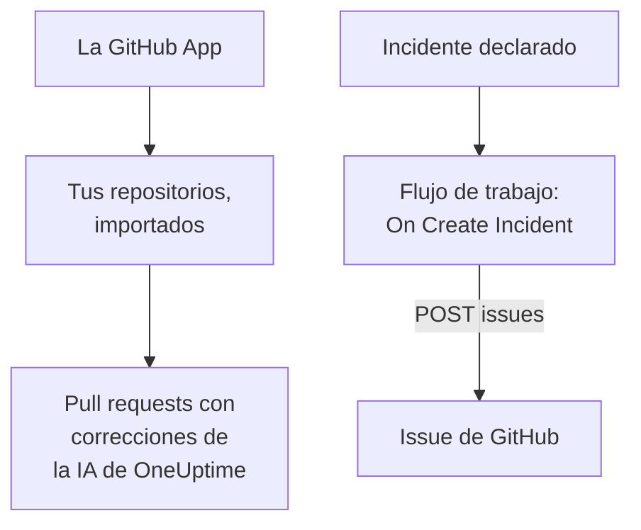

# GitHub

OneUptime trabaja con [GitHub](https://github.com) de dos maneras. Conecta tus repositorios mediante la GitHub App de OneUptime, y la IA de OneUptime abre pull requests que corrigen lo que encuentra, y responde cuando la mencionas en un issue o en una pull request. O crea un flujo de trabajo que abra un issue de GitHub por cada incidente, para que el trabajo de seguimiento quede registrado en el repositorio al que pertenece el servicio.

:::cards
- [Elegir cómo conectar](#elegir-cómo-conectar): La GitHub App o un flujo de trabajo, y qué hace cada uno.
- [Conectar tus repositorios](#conectar-tus-repositorios): La GitHub App, para pull requests con correcciones.
- [Abrir un issue por cada incidente](#abrir-un-issue-de-github-por-cada-incidente): Un flujo de trabajo, dos bloques.
- [Solución de problemas](#solución-de-problemas): Cuando GitHub rechaza una solicitud.
:::

## Cómo funciona



Las dos son independientes, y puedes usar una, la otra o ambas. La GitHub App trabaja en los repositorios en los que la instalas. El flujo de trabajo solo necesita un token, y llama a la [API REST](https://docs.github.com/en/rest/issues/issues#create-an-issue) de GitHub como a cualquier otra API.

## Elegir cómo conectar

| Manera | Qué hace | Qué necesita |
| --- | --- | --- |
| La GitHub App | Importa tus repositorios. La IA de OneUptime abre en ellos pull requests que corrigen excepciones, trazas lentas y las causas que encuentran sus investigaciones, y responde a las menciones en issues y pull requests. | Una organización o cuenta en la que instalar la app. En OneUptime Cloud, el plan **Growth**. |
| Un flujo de trabajo | Abre un issue de GitHub por cada incidente, en el repositorio que elijas. | Un token de GitHub que pueda crear issues, y un flujo de trabajo de dos bloques. |

## Conectar tus repositorios

Abre **Productos → Código** y haz clic en **Conectar GitHub**. GitHub pregunta dónde instalar la app y qué repositorios puede usar. Cada repositorio de la instalación se importa, y se mantiene al día cuando añades repositorios a la instalación o los quitas.

Si la app ya está instalada en la cuenta, para otro proyecto o directamente desde GitHub, haz clic en **Conectar una instalación existente**, debajo de **Conectar GitHub**, en lugar de volver a instalarla. Para ello hace falta una cuenta de GitHub que administre la instalación: el propietario de una cuenta personal, o alguien con permiso de administrador en cada repositorio al que la instalación puede acceder, como lo tiene un propietario de la organización.

Una instancia autoalojada necesita primero una GitHub App propia: [Integración con GitHub](/docs/self-hosted/github-integration) muestra cómo crearla. A partir de ahí, la IA abre pull requests en tus repositorios desde [Código](/docs/ai/ai-agent), y la página [GitHub App](/docs/ai/github-app) muestra lo que hace la app cuando la mencionas en un issue o en una pull request.

## Antes de empezar

El resto de esta página construye el flujo de trabajo. Necesita:

- Un token de GitHub que pueda crear issues en el repositorio: un token de acceso personal de grano fino para ese repositorio, con el permiso **Issues** en **Read and write**, o un token clásico con el scope `repo`. Crea uno en los [ajustes de tokens](https://github.com/settings/tokens) de GitHub.
- En OneUptime, permiso para crear flujos de trabajo y variables globales. En OneUptime Cloud, los flujos de trabajo necesitan el plan **Growth** o superior.

## Guardar el token

:::steps
1. Ve a **Flujos de trabajo → Variables globales** y haz clic en **Crear Variable del flujo de trabajo**.
2. Ponle el nombre `GITHUB_TOKEN` y haz clic en **Siguiente**.
3. Pega el token en **Contenido**, activa **Secreto** y haz clic en **Crear Variable del flujo de trabajo**.
:::

Una variable secreta se sustituye por `[REDACTED]` en los registros de ejecución, así que el token nunca aparece en una ejecución.

## Abrir un issue de GitHub por cada incidente

:::steps
### Crear el flujo de trabajo

Ve a **Flujos de trabajo**, haz clic en **Crear flujo de trabajo** y luego en **Empezar desde cero**. Ponle el nombre `Incidents to GitHub` y haz clic en **Crear flujo de trabajo**.

### Añadir el disparador

Haz clic en el bloque discontinuo **Elige qué inicia este flujo de trabajo** y elige **On Create Incident**. Haz clic en el disparador: sus **Fields to pass on** empiezan con **Título**, así que haz clic en **Añadir campo** y elige **Descripción** y **Número de incidente con prefijo**.

### Abrir el issue

Haz clic en **Añadir componente**, añade un bloque **API Post (JSON)** y conecta a él el punto **Success** del disparador. Pon su **URL** en `https://api.github.com/repos/your-org/your-repo/issues`, con el propietario y el nombre de tu repositorio. En **Más campos**, pon sus **Request Headers** en:

```json
{
  "Authorization": "Bearer {{global.variables.GITHUB_TOKEN}}",
  "Accept": "application/vnd.github+json",
  "X-GitHub-Api-Version": "2022-11-28"
}
```

Y su **Request Body** en:

```json
{
  "title": "{{local.components.incident-on-create-1.returnValues.model.title}}",
  "body": "{{local.components.incident-on-create-1.returnValues.model.description}}\n\nOpened by OneUptime for incident {{local.components.incident-on-create-1.returnValues.model.incidentNumberWithPrefix}}.",
  "labels": ["incident"]
}
```

### Probarlo y luego activarlo

Haz clic en **Ejecutar flujo de trabajo**, elige un incidente de prueba en **Incidente** y ejecútalo. El paso **API Post (JSON)** muestra una respuesta `201` con el nuevo issue, con su `number` y su `html_url`. Después activa **Habilitado** en la parte superior del **Constructor**.
:::

El issue sigue abierto cuando el incidente se resuelve, porque el trabajo de seguimiento suele durar más que el incidente. Para tickets que se mantienen al día con el incidente en ambos sentidos, consulta [Jira](/docs/integrations/jira).

## Consejos

- **GitHub Enterprise Server.** Envía la solicitud a tu servidor en su lugar: `https://your-github-host/api/v3/repos/your-org/your-repo/issues`. Un servidor en una dirección de red privada necesita un OneUptime autoalojado cuyo administrador lo permita: consulta [Acceso de red saliente](/docs/workflows/configuration#acceso-de-red-saliente).
- **Asígnalo.** Añade `"assignees": ["octocat"]` o `"milestone": 3` al cuerpo. GitHub descarta sin avisar las etiquetas, los asignados y los hitos cuando el token no puede hacer push al repositorio.
- **Solo algunos incidentes.** Pon un bloque **If / Else** entre el disparador y el bloque de API, y abre issues solo en su lado **Yes**, por ejemplo para una gravedad.

## Solución de problemas

El paso **API Post (JSON)** toma **Error** cuando GitHub rechaza la solicitud. Sus **Response Status** y **Response Body** en la ejecución dicen por qué.

:::details GitHub responde 401
El token es incorrecto, caducó o se revocó. Crea uno nuevo y sustituye el contenido de `GITHUB_TOKEN`.
:::

:::details GitHub responde 403
El token no puede crear issues allí: un token de grano fino sin **Issues** en **Read and write** para este repositorio, un token que tu organización no ha aprobado, o un token clásico no autorizado para el inicio de sesión único de tu organización. Un 403 cuyo cuerpo habla de un límite de frecuencia significa que el token envió demasiadas solicitudes: espera, o abre issues para menos incidentes.
:::

:::details GitHub responde 404
El propietario o el repositorio de la **URL** es incorrecto, o el token no puede ver el repositorio. GitHub responde 404, y no 403, para un repositorio privado que un token no puede ver.
:::

:::details GitHub responde 410 o 422
- `410`: los issues están desactivados en los ajustes del repositorio.
- `422`: GitHub no puede leer el cuerpo. Comprueba que es JSON válido, que `title` está definido, y que `labels` y `assignees` son listas.
:::

## Próximos pasos

:::cards
- [GitHub App](/docs/ai/github-app): Pide a la IA de OneUptime un cambio, una nueva versión o una revisión desde el propio GitHub.
- [GitLab](/docs/integrations/gitlab): El mismo flujo de trabajo, para issues de GitLab.
- [Componentes de flujo de trabajo](/docs/workflows/components#api): Cada ajuste de los bloques de API.
- [Descripción general de integraciones](/docs/integrations/index): Los patrones detrás de cada integración.
:::
