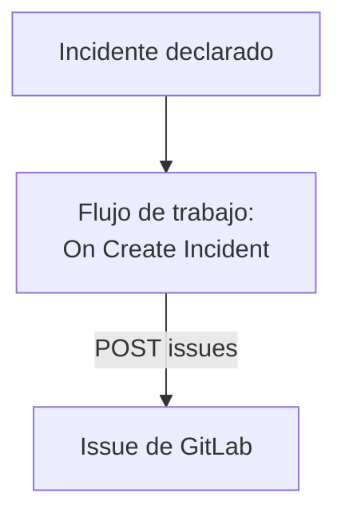

# GitLab

Abre un issue de [GitLab](https://gitlab.com) por cada incidente de OneUptime, para que el trabajo de seguimiento quede registrado en el proyecto al que pertenece el servicio. Un flujo de trabajo llama a la [API de issues](https://docs.gitlab.com/api/issues/#new-issue) de GitLab, en GitLab.com o en un GitLab propio.

:::cards
- [Guardar el token](#guardar-el-token): Mantén el token de GitLab fuera de tus flujos de trabajo.
- [Abrir un issue por cada incidente](#abrir-un-issue-de-gitlab-por-cada-incidente): Un flujo de trabajo, dos bloques.
- [Consejos](#consejos): Un GitLab propio, rutas de proyecto y asignados.
- [Solución de problemas](#solución-de-problemas): Cuando GitLab rechaza una solicitud.
:::

> [!NOTE]
> La IA de OneUptime también trabaja en repositorios de GitLab: conéctalos en Código con un token de acceso y abrirá un merge request para cada corrección. Consulta [Conectar un repositorio](/docs/ai/ai-agent#conectar-un-repositorio).

## Cómo funciona



El flujo de trabajo se ejecuta una vez por cada incidente nuevo. Su bloque **API Post (JSON)** envía el título y la descripción del incidente a los issues del proyecto, firmados con un token de acceso.

## Antes de empezar

- El ID del proyecto de GitLab. En la página de resumen del proyecto, selecciona el menú de acciones, los tres puntos verticales, y luego **Copy project ID**.
- Un token de acceso de GitLab con el scope `api`, para un usuario o bot cuyo rol en el proyecto pueda crear issues: un token de acceso de proyecto, de grupo o personal. Créalo en **Settings → Access tokens** en el proyecto, el grupo o tus ajustes de usuario.
- En OneUptime, permiso para crear flujos de trabajo y variables globales. En OneUptime Cloud, los flujos de trabajo necesitan el plan **Growth** o superior.

## Guardar el token

:::steps
1. Ve a **Flujos de trabajo → Variables globales** y haz clic en **Crear Variable del flujo de trabajo**.
2. Ponle el nombre `GITLAB_TOKEN` y haz clic en **Siguiente**.
3. Pega el token en **Contenido**, activa **Secreto** y haz clic en **Crear Variable del flujo de trabajo**.
:::

Una variable secreta se sustituye por `[REDACTED]` en los registros de ejecución, así que el token nunca aparece en una ejecución.

## Abrir un issue de GitLab por cada incidente

:::steps
### Crear el flujo de trabajo

Ve a **Flujos de trabajo**, haz clic en **Crear flujo de trabajo** y luego en **Empezar desde cero**. Ponle el nombre `Incidents to GitLab` y haz clic en **Crear flujo de trabajo**.

### Añadir el disparador

Haz clic en el bloque discontinuo **Elige qué inicia este flujo de trabajo** y elige **On Create Incident**. Haz clic en el disparador: sus **Fields to pass on** empiezan con **Título**, así que haz clic en **Añadir campo** y elige **Descripción** y **Número de incidente con prefijo**.

### Abrir el issue

Haz clic en **Añadir componente**, añade un bloque **API Post (JSON)** y conecta a él el punto **Success** del disparador. Pon su **URL** en `https://gitlab.com/api/v4/projects/12345678/issues`, con el ID de tu proyecto en lugar de `12345678`. En **Más campos**, pon sus **Request Headers** en:

```json
{
  "PRIVATE-TOKEN": "{{global.variables.GITLAB_TOKEN}}"
}
```

Y su **Request Body** en:

```json
{
  "title": "{{local.components.incident-on-create-1.returnValues.model.title}}",
  "description": "{{local.components.incident-on-create-1.returnValues.model.description}}\n\nOpened by OneUptime for incident {{local.components.incident-on-create-1.returnValues.model.incidentNumberWithPrefix}}.",
  "labels": "incident,oneuptime"
}
```

### Probarlo y luego activarlo

Haz clic en **Ejecutar flujo de trabajo**, elige un incidente de prueba en **Incidente** y ejecútalo. El paso **API Post (JSON)** muestra una respuesta `201` con el nuevo issue, con su `iid` y su `web_url`. Después activa **Habilitado** en la parte superior del **Constructor**.
:::

El bloque envía JSON, así que no necesita ninguna cabecera `Content-Type`. GitLab crea las etiquetas que aún no conoce, así que `incident` y `oneuptime` no necesitan ninguna preparación. El issue sigue abierto cuando el incidente se resuelve, porque el trabajo de seguimiento suele durar más que el incidente.

## Consejos

- **Un GitLab propio.** Envía la solicitud a tu servidor en su lugar: `https://gitlab.example.com/api/v4/projects/12345678/issues`. Un servidor en una dirección de red privada necesita un OneUptime autoalojado cuyo administrador lo permita: consulta [Acceso de red saliente](/docs/workflows/configuration#acceso-de-red-saliente).
- **La ruta del proyecto en lugar de su ID.** La ruta funciona en lugar del ID, con su `/` escrita como `%2F`: `projects/your-group%2Fyour-project/issues`. La URL se envía exactamente como está escrita, así que codifícala tú.
- **Asígnalo.** Añade `"assignee_ids": [42]` o `"due_date": "2026-12-31"` al cuerpo, o `"confidential": true` para mostrarlo solo a los miembros del proyecto.
- **Solo algunos incidentes.** Pon un bloque **If / Else** entre el disparador y el bloque de API, y abre issues solo en su lado **Yes**, por ejemplo para una gravedad.

## Solución de problemas

El paso **API Post (JSON)** toma **Error** cuando GitLab rechaza la solicitud. Sus **Response Status** y **Response Body** en la ejecución dicen por qué.

:::details GitLab responde 401
El token es incorrecto, caducó o se revocó. Crea uno nuevo y sustituye el contenido de `GITLAB_TOKEN`.
:::

:::details GitLab responde 403
El token no tiene el scope `api`, o el rol de su usuario en el proyecto no puede crear issues. El cuerpo nombra `insufficient_scope` cuando es el scope.
:::

:::details GitLab responde 404
El ID del proyecto de la **URL** es incorrecto, o el token no puede ver el proyecto. GitLab responde 404, y no 403, para un proyecto privado que un token no puede ver.
:::

:::details GitLab responde 400
GitLab no puede leer el cuerpo: falta `title`, o un campo tiene el tipo equivocado. El cuerpo nombra el campo.
:::

## Próximos pasos

:::cards
- [GitHub](/docs/integrations/github): El mismo flujo de trabajo para GitHub, y la GitHub App.
- [Componentes de flujo de trabajo](/docs/workflows/components#api): Cada ajuste de los bloques de API.
- [Ejecuciones de flujo de trabajo](/docs/workflows/runs-and-logs): Lee lo que cada solicitud envió y recibió.
- [Descripción general de integraciones](/docs/integrations/index): Los patrones detrás de cada integración.
:::
