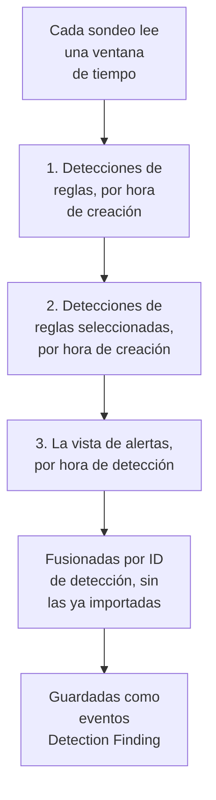

# Google SecOps

Lleva las alertas y detecciones de [Google SecOps](https://cloud.google.com/security/products/security-operations) (antes Chronicle) a los eventos de seguridad de OneUptime. Allí las buscas junto a tus logs, trazas y métricas, las correlacionas con todas las demás fuentes y avisas a la guardia de las que importan.

:::cards
- [Elegir cómo conectar](#elegir-cómo-conectar): Un webhook de un playbook de SOAR, el conector gestionado o el reenvío de UDM.
- [Configurar el conector gestionado](#configurar-el-conector-gestionado): Una clave de cuenta de servicio y el formulario de la conexión.
- [Cómo sondea el conector](#cómo-sondea-el-conector): Tres lecturas de cada ventana, y sus presupuestos.
- [Solución de problemas](#solución-de-problemas): Qué dice Último error y qué hacer.
- [Enviar eventos de seguridad a Google SecOps](#enviar-eventos-de-seguridad-a-google-secops): Las detecciones de OneUptime, en Google SecOps.
:::

## Elegir cómo conectar

| Camino | Qué llega | Úsalo cuando |
| --- | --- | --- |
| Un webhook de un playbook de SOAR | Cada alerta que publica un playbook, en segundos | Ejecutas playbooks de SOAR y quieres sus alertas en OneUptime sin sondeo. |
| El conector gestionado | Las alertas, y las detecciones de reglas si lo eliges, sondeadas en un intervalo | Quieres que OneUptime las recoja por ti, sin nada que configurar en SecOps. |
| El reenvío de eventos UDM | Eventos UDM sin procesar, para búsqueda y correlación completas | Ya exportas eventos UDM y los quieres todos. |

Cada camino normaliza lo que llega a [OCSF](https://schema.ocsf.io/), el Open Cybersecurity Schema Framework en el que OneUptime guarda cada evento de seguridad, para que las reglas de detección y los paneles funcionen igual sea cual sea la fuente.

## Antes de empezar

- Para el conector gestionado, en OneUptime, el rol Project Owner, Project Admin o Security Admin. Los roles Security Member y Security Viewer pueden leer las conexiones, pero no crearlas.
- Para el webhook y el reenvío de UDM, una clave de ingesta: abre **Ajustes del proyecto → Telemetría y APM → Claves de ingesta** y haz clic en **Crear clave de ingesta**.
- Para el conector gestionado, permiso para crear una cuenta de servicio de Google Cloud en el proyecto al que está vinculada tu instancia de SecOps.

## Enviar alertas desde un playbook de SOAR

Los playbooks de SOAR de Google SecOps pueden publicar alertas en cualquier endpoint HTTP. Dirige uno a la ingesta de eventos de seguridad de OneUptime.

:::steps
### Añadir una acción HTTP request

En tu playbook de SOAR de SecOps, añade una acción **HTTP request** que se ejecute con las alertas nuevas.

### Dirigirla a OneUptime

Pon su **Method** en `POST` y su **URL** en `https://oneuptime.com/security-events/v1/ingest`, o `https://<your-host>/security-events/v1/ingest` en una instalación autoalojada. Añade estas cabeceras:

```text
Content-Type: application/json
x-oneuptime-token: <your telemetry ingestion key>
```

Envía el JSON de la alerta como **Body**. Una detección, los datos de la regla con los eventos UDM coincidentes en `collectionElements`, se reconoce sola, se guarda como un evento Detection Finding, y los usuarios, hosts e IP de sus eventos coincidentes se conservan como observables.

### Comprobar que llegan las alertas

Ejecuta el playbook. Sus alertas aparecen en **Productos → Eventos de seguridad** en segundos.
:::

## Reenviar eventos UDM

Para búsqueda y correlación completas, reenvía los propios eventos UDM, por ejemplo desde una canalización de exportación de BigQuery, una Cloud Function o cualquier reenviador que ya ejecutes:

```bash
curl -X POST "https://oneuptime.com/security-events/v1/ingest?format=udm" \
  -H "Content-Type: application/json" \
  -H "x-oneuptime-token: <your telemetry ingestion key>" \
  -d '{
    "events": [
      {
        "metadata": {
          "event_type": "USER_LOGIN",
          "event_timestamp": "2026-08-21T10:00:00Z",
          "vendor_name": "Google",
          "product_name": "Google SecOps"
        },
        "principal": { "user": { "userid": "alice" }, "ip": ["203.0.113.7"] },
        "target": { "hostname": "vpn-gw-01" },
        "security_result": [{ "severity": "HIGH", "action": ["BLOCK"] }]
      }
    ]
  }'
```

- `format` puede ser `udm`, `ocsf`, `google-secops-alert` o `generic`. Si lo omites, el formato se detecta evento por evento.
- El cuerpo puede ser un evento, una lista de eventos o `{ "events": [...] }`.
- `x-oneuptime-service-name` nombra el servicio de telemetría al que pertenecen los eventos. Sin él, pertenecen al servicio que lleva el nombre del producto de la carga útil.

## Configurar el conector gestionado

OneUptime sondea las detecciones y alertas de tu inquilino en un intervalo, sin configuración de SOAR. Google SecOps es un proveedor de Security Event Connections, así que se crea, se prueba, se sondea y se diagnostica en la misma página y de la misma manera que cualquier otro conector gestionado.

:::steps
### Crear una clave de cuenta de servicio

En Google Cloud, crea una cuenta de servicio en el proyecto al que está vinculada tu instancia de SecOps y concédele el rol **Chronicle API Viewer** (`roles/chronicle.viewer`). Ese rol incluye los permisos `legacySearchDetections`, `legacySearchCuratedDetections`, `countAllCuratedRuleSetDetections` y `legacyFetchAlertsView` con los que lee el conector.

En la pestaña **Keys** de la cuenta de servicio, añade una clave de tipo **JSON** y descárgala. Pegas el archivo entero en la conexión. Su `token_uri` debe ser una URL `https` en un host de Google, como ya lo es una clave descargada de Google Cloud.

### Encontrar la región y el nombre de recurso de la instancia

En Google SecOps, abre **SIEM Settings → Profile**. El nombre de recurso de la instancia tiene la forma `projects/{project}/locations/{location}/instances/{instance}`, donde el componente de la instancia es el ID de la instancia de SecOps; un nombre visible de conexión o un nombre de cuenta de servicio no lo sustituye. La región es el endpoint regional que sirve esa ubicación, y debe coincidir con el segmento locations del nombre de recurso de la instancia, o la conexión se rechaza al guardarla.

### Añadir la conexión

Abre **Productos → Eventos de seguridad → Conexiones** (`/dashboard/{projectId}/security-events/connections`), selecciona **Añadir conexión**, elige **Google SecOps** y rellena el formulario con los ajustes de la tabla de abajo.

### Probar antes de guardar

Selecciona **Probar esta configuración** en **Probar antes de guardar** antes de guardar. La prueba se ejecuta con los valores del formulario sin guardar nada, así que una clave mal formada, un rol que falta o una instancia equivocada se detectan antes de que exista la conexión. En el formulario de edición, el mismo botón prueba la **Región**, el **Nombre de recurso de la instancia** y el **Data to import** que se ven en pantalla con la clave guardada; un campo de credenciales que se deja en blanco conserva la clave guardada. Cuando algo de lo probado difiere de lo que la conexión tiene guardado, incluida una clave recién introducida, no se registra ninguna fila en el historial de ejecuciones, porque la conexión aún no tiene esos ajustes.
:::

| Ajuste | Dónde encontrarlo | Obligatorio |
| --- | --- | --- |
| **Región** | El endpoint regional de Google SecOps (`us`, `europe`, `asia-southeast1`, ...) que coincide con la ubicación de tu nombre de recurso de instancia. No hay valor por defecto, para que un inquilino fuera de EE. UU. no pueda guardar por accidente el endpoint equivocado. | Sí |
| **Nombre de recurso de la instancia** | En Google SecOps, **SIEM Settings → Profile**: `projects/{project}/locations/{location}/instances/{instance}`. | Sí |
| **Cerrar las alertas cuando se cierra su caso** | En el último paso del formulario, desactivado hasta que lo actives. Activado, cerrar un caso cierra sus alertas de Google SecOps: consulta [Cerrar las alertas cuando se cierra su caso](#cerrar-las-alertas-cuando-se-cierra-su-caso). | No |
| **JSON de la cuenta de servicio** | Google Cloud, la pestaña **Keys** de la cuenta de servicio. Pega el archivo de clave JSON entero. Solo escritura: cifrado en reposo, la API nunca lo devuelve y nunca se vuelve a mostrar en la página. Usa **Actualizar credenciales** en la conexión para rotarlo. | Sí |
| **Data to import** | Las **Alertas** siempre se importan, porque la API de alertas de Google siempre las devuelve. Selecciona **Detecciones** para importar también las coincidencias de reglas que no generaron una alerta. Esto no reenvía eventos UDM sin procesar: reenvíalos tú, como arriba. | Alertas siempre |

El paso de sondeo del formulario pide un **Nombre**, una **Descripción** opcional, el ajuste **Habilitado** de la conexión y el **Intervalo de sondeo (minutos)**: un número entero de `1` a `1440`, `5` por defecto. Cualquier valor fuera de ese rango se rechaza al guardar.

Las detecciones nuevas se importan como eventos Detection Finding atribuidos a un servicio de telemetría `Google SecOps`.

## Leer la salud de la conexión

La lista de conexiones muestra **Nombre**, **Proveedor** (con la selección Data to import de la conexión debajo), **Estado** (Enabled o Disabled), **Salud**, **Intervalo (minutos)**, **Último sondeo**, **Último sondeo correcto** y **Último evento importado**. Cuando una conexión tiene un error, **Ver error** aparece en su columna **Acciones**, junto a **Probar conexión**, **Ejecutar ahora**, **Diagnósticos**, **Editar** y **Actualizar credenciales**. Enabled significa que el sondeo automático está configurado. Último sondeo registra un intento; una ventana vacía correcta no demuestra que se haya importado una detección concreta.

**Salud** indica **Last poll succeeded** solo cuando ya se ha importado un evento. Hasta entonces, una conexión que funciona indica **Polling, no events imported yet**, el estado que hay que investigar con Probar conexión. Los demás estados son **No records returned**, **Partial import**, **Catching up**, **Last poll failed**, **Poll overdue**, **Schedule paused** y **Esperando el primer sondeo**; pasa el cursor sobre un estado para ver qué significa.

> [!NOTE]
> El conector usa las API heredadas de detecciones y alertas `v1alpha` de Chronicle, que Google publica como pre-GA. Cuando un sondeo falla, el campo **Último error** de la conexión guarda el mensaje de error completo, con las credenciales ocultas, tras un prefijo que nombra el paso que falló, incluido el caso en que Chronicle responde `200` y pone el rechazo dentro del cuerpo. Selecciona **Ver error** en la columna **Acciones** de la conexión para leer el mensaje, y luego **Copiar error** en el cuadro de diálogo para copiarlo para soporte.

## Cómo sondea el conector



Una vez por minuto, un worker en segundo plano pone en cola un sondeo para cada conexión habilitada cuyo intervalo ha pasado desde su último sondeo. Cada sondeo es una ejecución en el historial de la conexión, que ejecuta un worker. Lee una ventana de tiempo de tres maneras y fusiona los resultados por ID de detección, para que un registro que devuelve más de una pasada se guarde una sola vez:

1. **Detecciones de reglas por hora de creación.** `legacy:legacySearchDetections` con `ruleId=-` (cada revisión de cada regla) y `listBasis=CREATED_TIME`, siguiendo `nextPageToken` hasta que la página es la última.
2. **Detecciones de reglas seleccionadas por hora de creación.** `legacy:legacySearchCuratedDetections`, de la misma manera, una vez por regla seleccionada (escrita por Google). Ese endpoint acepta un único ID de regla seleccionada (`ur_...`) y no tiene comodín de «todas las reglas», así que la pasada llama primero a `:countAllCuratedRuleSetDetections` para la semana anterior a la ventana hasta su final, y busca en cada regla seleccionada que produjo detecciones. Una regla seleccionada que no se ha disparado esa semana no tiene nada que importar. Un inquilino sin acceso a las reglas seleccionadas responde a esta pasada con `400`, `403` o `404`; eso se registra como un aviso en la ejecución, no como un fallo.
3. **La vista de alertas por hora de detección.** `legacy:legacyFetchAlertsView`, que cubre las alertas de telemetría, las alertas de SOAR y las alertas de inteligencia automática además de las alertas de reglas. El endpoint no tiene paginación, así que una respuesta que Google limita se divide en ventanas más pequeñas y se vuelve a leer.

La vista de alertas solo puede filtrar por hora de detección, y Google a menudo hace legible una alerta mucho después de su hora de detección (retraso de ingesta, reglas programadas, reejecuciones sobre datos tardíos). Por eso un sondeo programado también **recorre la vista de alertas en las 24 horas anteriores a su ventana**, solo alertas, registrado como la comprobación **Read late alerts by detection time**. Los registros ya importados se omiten, así que las repeticiones de ese recorrido aparecen en **Already imported**. El recorrido se hace en la medida de lo posible: cuando Google lo limita, se agota su presupuesto o falla, la ejecución recibe un aviso, pero el sondeo no queda como Parcial ni Fallido y el cursor avanza igualmente, porque el día al que vuelve ya lo leyeron sondeos anteriores.

Sondear por **hora de creación** es todo el diseño. Una regla de Google SecOps se ejecuta según una programación (cada 10 minutos, cada hora, cada día), y la detección que crea lleva un `detectionTime` que es el final de la ventana de tiempo de la regla o la hora del evento coincidente, mientras que `createdTime` es cuando el motor de detección la produjo realmente. Una detección creada a las 10:05 para una ventana que termina a las 09:00 tiene una hora de detección que ya está detrás de un cursor que pasó de las 09:00 hace varios sondeos, así que un conector que sondea por hora de detección nunca la ve, ni tampoco ningún evento que llegue tarde. Leer por hora de creación hace que cada sondeo pregunte «qué ha creado Google desde la última vez que miré», que es la pregunta que tiene respuesta. Cada ejecución registra su retraso de creación, cuántos registros obtenidos se crearon más de un intervalo de sondeo (más un minuto) después de su hora de detección, y la mayor diferencia, para que el efecto sea visible en Diagnósticos.

El primer sondeo de una conexión nueva mira **24 horas** atrás por hora de creación. Cada sondeo posterior continúa desde el cursor guardado de la conexión con un solapamiento de **1 minuto**; un registro creado en el límite de una ventana lo leen ambos sondeos y se guarda una vez, porque los sondeos omiten los eventos ya guardados con el mismo identificador de origen. Cada sondeo programado lee como mucho **24 horas** más allá del cursor, así que una conexión con un cursor guardado más antiguo se pone al día en ventanas consecutivas de 24 horas (Salud indica **Catching up**) en lugar de descartar las detecciones intermedias. Usa **Importar este intervalo de tiempo** en Diagnósticos para los registros creados antes de la primera ventana de 24 horas.

### Cuando una ventana contiene más de lo que un sondeo puede leer

El conector da a cada sondeo presupuestos fijos: la pasada de detecciones de reglas tiene **20** páginas de búsqueda, la pasada de reglas seleccionadas hasta **200** solicitudes (el recuento más al menos una página por cada regla seleccionada que se disparó la semana pasada, primero las reglas más activas), la vista de alertas y su recorrido de alertas tardías comparten **16** solicitudes, y toda la lectura se detiene tras **4 minutos**. La pasada de reglas seleccionadas no empieza ninguna regla seleccionada más una vez gastado el 60 % de ese tiempo, para que la vista de alertas se ejecute igualmente. Cuando un sondeo no puede buscar en todas las reglas seleccionadas activas, registra un aviso que dice cuántas no se buscaron en lugar de retener el cursor, porque una ventana más corta seguiría teniendo todas esas reglas por buscar. Una pasada que un presupuesto detuvo a medias se registra como una comprobación de aviso que nombra el presupuesto (por ejemplo `Read rule detections by created time was stopped by the request budget after 20 requests.`), y una pasada que el presupuesto nunca dejó empezar es una comprobación omitida con el mismo motivo en los avisos de la ejecución, nunca un éxito. Una ventana con más detecciones que eso no se puede leer en un sondeo, y el sondeo nunca vuelve a leer la misma ventana para siempre:

1. **Reducir.** Los endpoints de búsqueda de Google devuelven primero las detecciones más nuevas, así que un sondeo que se detiene pronto no tiene un punto desde el que continuar. El sondeo se registra como **Parcial**, el cursor se queda donde estaba y el siguiente sondeo lee una ventana de la mitad de largo desde el mismo punto de partida, con el aviso `This window holds more records than one poll can read; the next poll reads a {n} minute window from the same starting point.` La reducción a la mitad sigue hasta un minuto, hasta que una ventana cabe.
2. **Volver a crecer.** Cada sondeo completo duplica la siguiente ventana, hasta el máximo de 24 horas, para que una ráfaga cueste unos pocos sondeos cortos en lugar de una conexión lenta para siempre.
3. **Pasar más allá de un único minuto.** Si incluso un minuto contiene más detecciones de las que un sondeo puede leer, el sondeo mueve el cursor más allá de ese minuto para que sigan llegando las detecciones más nuevas. La ejecución es **Parcial** y el mismo texto encabeza **Último error**: `More records were created in the one minute from {start} to {end} than one poll can read. Polling moved past this minute so newer records keep arriving; use Import this time range in Diagnostics on this minute to recover what one run can read.` Para recuperar lo que una ejecución puede leer, abre **Diagnósticos**, elige un intervalo personalizado que cubra ese minuto (los campos del intervalo usan tu hora local; el mensaje está en UTC) y ejecuta **Importar este intervalo de tiempo**; una importación tiene los mismos límites por ejecución que un sondeo. Las detecciones ya importadas se omiten.

Un sondeo Parcial también guarda sus avisos en **Último error**, donde se quedan hasta que un sondeo completo los borra. Un sondeo que falla del todo (un error, no demasiados registros) conserva su cursor y su longitud de ventana y se reintenta en el siguiente ciclo. La única excepción es una solicitud que agotó el tiempo: el siguiente sondeo lee una ventana de la mitad de largo desde el mismo punto de partida (`The source did not answer in time for this window; the next poll reads a {n} minute window from the same starting point.`), porque una ventana demasiado pesada para responder a tiempo agotaría el tiempo en cada reintento. Acortar el intervalo de sondeo no cambia nada de esto: la ventana la deciden el cursor y el resultado del último sondeo, no la frecuencia de los sondeos.

## Probar conexión

**Probar conexión**, en la fila de la conexión o en **Diagnósticos**, se ejecuta de forma síncrona en el proceso de la API. No necesita un worker en segundo plano, y justo por eso puede decirte cuándo no hay ningún worker en marcha. La lista de comprobaciones:

1. **Configuración**: cada campo está presente y bien formado: una **Región** compatible que coincide con la ubicación de la instancia, un **Nombre de recurso de la instancia** con la forma correcta y una clave **JSON de la cuenta de servicio** con `client_email`, una `private_key` legible y un `token_uri` de Google. No se contacta con nada si esto falla.
2. **Authenticate with Google**: la clave se cambia por un token de acceso en el endpoint OAuth de Google, antes de contactar con Chronicle.
3. **Read rule detections**, **Read curated rule detections** y **Read the alerts view**: una sonda de un registro para cada pasada sobre las últimas 24 horas. La comprobación de reglas seleccionadas lee los recuentos de las reglas seleccionadas de los últimos 7 días y sondea la regla seleccionada con más detecciones; si ninguna regla seleccionada se disparó esa semana, pasa sin nada que sondear. Una lectura de reglas seleccionadas respondida con `400`, `403` o `404` es un aviso, porque puede que el inquilino simplemente no tenga acceso a las reglas seleccionadas.
4. **Detections available to import**: lo que tiene Google con la selección **Data to import** guardada y con la otra (solo Alertas, o Alertas y **Detecciones**) en las últimas 24 horas y los últimos 7 días: el recuento de coincidencias de la vista de alertas y una página de búsqueda por hora de creación por intervalo, indicado como un número o como `1000+`. Cuando la selección guardada no tiene nada pero la otra sí, la comprobación avisa: tus reglas crean detecciones, pero las alertas no están habilitadas en ellas. Edita la conexión y selecciona **Detecciones** en **Data to import**, o habilita las alertas en las reglas de Google SecOps.
5. **Background workers**, **Poll scheduler** y **Security event storage**: si algún proceso está consumiendo la cola Worker de OneUptime, si el trabajo de sondeo de cada minuto está registrado y si el almacén de eventos de seguridad responde a la misma búsqueda de duplicados que hace el sondeo antes de cada inserción, para que una base de datos analítica rota falle aquí con un nombre en lugar de una hora más tarde como error de sondeo.
6. **Sondeo programado** (solo conexiones guardadas): si el sondeo está habilitado, si una ejecución en cola está atascada esperando a un worker y si la conexión se sondea según lo programado.

Cada solicitud de una prueba tiene un plazo de 20 segundos. Las pruebas no tocan el cursor de sondeo ni el almacén de eventos. Una conexión guardada que se prueba con sus ajustes guardados recibe una fila del historial de ejecuciones de tipo test, y los detalles de la fila muestran la misma lista de comprobaciones.

## Previsualizar, ejecutar e importar a demanda

Abre **Diagnósticos** en una conexión para ver las ejecuciones recientes y manejar el conector. Los propietarios del proyecto, los administradores del proyecto y los administradores de seguridad pueden iniciar operaciones. Los miembros y lectores de seguridad pueden leer el historial.

- **Ejecutar ahora** pone en cola un sondeo de inmediato, con el cursor y la ruta de ingesta normales, incluso cuando el sondeo programado está deshabilitado. Los estados en cola y en ejecución siguen visibles mientras el worker ejecuta la solicitud. Si una ejecución sigue en cola, comprueba que haya workers procesando la cola Worker; la comprobación **Background workers** de Probar conexión dice si algún proceso lo hace.
- **Preview detections** lee un intervalo de tiempo elegido sin importar ni cambiar el cursor. Usa la última hora, 24 horas, 7 días o un intervalo personalizado de hasta 7 días. El intervalo coincide con la vista de alertas de SecOps, que lee por hora de detección, y las dos pasadas de búsqueda leen las detecciones creadas en él además de las detecciones cuya hora de detección cae en él, así que previsualizar el día de ayer muestra también detecciones creadas ayer sobre eventos más antiguos. La vista previa muestra por separado la hora de detección y la hora de creación. Los resultados siguen la selección **Data to import** guardada de la conexión.
- **Importar este intervalo de tiempo** importa el intervalo elegido, después de que lo confirmes, sin mover el cursor de sondeo. También es la forma de recuperar un minuto que el sondeo pasó de largo, como se describe arriba. Previsualiza primero el intervalo. Los sondeos e importaciones repetidos omiten los eventos ya guardados con el mismo identificador de origen en el proyecto. Las importaciones pueden activar las reglas de detección y los monitores configurados, igual que el sondeo programado.

Los detalles de cada ejecución muestran la **Ventana solicitada (UTC)**, la selección **Data to import** de la conexión y cinco recuentos:

| Recuento | Qué cuenta |
| --- | --- |
| **Returned by Google SecOps** | Los registros que Google devolvió en las tres pasadas, tras fusionarlos por ID. |
| **Imported into OneUptime** | Las filas escritas en el almacén de eventos. |
| **Already imported** | Los registros omitidos porque el mismo identificador de origen ya está guardado en este proyecto; el solapamiento de 1 minuto y las reejecuciones hacen que esto sea normal. |
| **Rejected** | Los objetos devueltos que no son detecciones de Google SecOps. Se cuentan y se avisa de ellos, nunca se reintentan y no retienen el cursor. |
| **Fallido** | Los registros que no se pudieron normalizar. Un sondeo los reintenta en una ventana más corta. |

Los **Detalles del proveedor** añaden el **Time basis read**, los registros **Returned by each pass** (detecciones de reglas, detecciones de reglas seleccionadas y la vista de alertas) y el **Creation lag**. Siguen las comprobaciones, una por pasada, los avisos y detecciones de muestra. Los detalles de un sondeo programado también muestran la **Ventana leída por este sondeo** y lo que **El próximo sondeo programado lee**, y un sondeo Parcial dice si mantuvo su punto de partida y redujo la siguiente ventana, o si pasó más allá de un único minuto que nombra. **Éxito**, **No records returned**, **Parcial** y **Fallido** son resultados distintos.

Usa **Ver eventos de este intervalo de tiempo** en una ejecución para abrir el intervalo de tiempo de evento de las detecciones que devolvió. Si no, una detección creada hoy con la hora de detección de ayer puede quedar oculta por un filtro de eventos recientes. El historial de ejecuciones conserva los fallos después de que un sondeo completo posterior borre Último error. Usa **Copiar diagnósticos** cuando contactes con soporte; las credenciales de la cuenta de servicio y los tokens nunca se incluyen.

## ¿Por qué no veo eventos?

Revisa estos puntos en orden. Cada uno se distingue del siguiente en **Diagnósticos** o con **Probar conexión**.

1. **Data to import.** Por defecto solo se importan las **Alertas**, y una detección de regla solo es una alerta cuando las alertas están habilitadas en la regla en Google SecOps. Un inquilino cuyas reglas crean detecciones sin alertas sondea vacío, con razón, para siempre. Ejecuta **Probar conexión**: la comprobación **Detections available to import** cuenta con y sin **Detecciones** y lo dice cuando seleccionarlas añadiría registros. Edita la conexión y selecciona **Detecciones** en **Data to import**, o habilita las alertas en las reglas.
2. **Frecuencia de ejecución de las reglas y latencia de detección.** Las detecciones se crean cuando se ejecuta la regla, lo que puede ser hasta una hora o un día después de los eventos que describen. El conector sondea por hora de creación, así que llegan en el primer sondeo después de que Google las cree, no en su hora de detección. Una regla que acabas de habilitar aún no ha creado nada, y un inquilino tranquilo no tiene nada que crear. La comprobación de disponibilidad indica cuántas detecciones se crearon en las últimas 24 horas y 7 días; cero con y sin **Detecciones** significa que Google aún no tiene nada que OneUptime pueda importar.
3. **Lee los recuentos de la última ejecución.** En Diagnósticos, **Returned by Google SecOps** con cero en **Imported into OneUptime** y un recuento **Already imported** que coincide es el conector funcionando como está diseñado: esas detecciones las importó un sondeo anterior. Los registros **Rejected** son objetos que devolvió Google y que no son detecciones en absoluto.
4. **¿Hay algún sondeo en marcha?** Último sondeo con `Never` y un Último error vacío significa que ningún sondeo ha terminado para esta conexión. Probar conexión informa de **Background workers** (procesos que consumen la cola Worker), **Poll scheduler** (el registro del programador de cada minuto) y **Sondeo programado** (la programación propia de esta conexión, incluido un sondeo atrasado o una ejecución atascada en cola). Consulta la entrada de solución de problemas de abajo para los ajustes de despliegue que lo causan.
5. **Busca en el lugar correcto.** Los eventos se guardan con su hora de detección, que puede ser horas o días anterior al momento en que se crearon e importaron, así que un filtro de «última hora» en Eventos de seguridad oculta una detección importada hace un minuto sobre algo de ayer. Usa **Ver eventos de este intervalo de tiempo** en una ejecución de Diagnósticos: abre el intervalo de tiempo de evento de las detecciones que devolvió esa ejecución.

## Cómo se fija la gravedad

Google SecOps guarda la gravedad de una detección en distintos lugares según quién escribió la regla, y OneUptime los lee en este orden, usando el primero que nombra una gravedad:

1. **La gravedad propia de Google** (`detection[].severity`). Google la fija en las reglas seleccionadas, como Applied Threat Intelligence y los conjuntos de reglas seleccionadas.
2. **La gravedad de la alerta** (la `severity` de la Collection), para las alertas de SOAR y los cuerpos de webhook.
3. **La gravedad `meta` de la regla.** Para una regla YARA-L personalizada, Google deja `detection[].severity` vacío y devuelve la sección `meta` de la regla como `ruleLabels`. OneUptime lee la etiqueta `severity`, que es el valor que muestra el panel de reglas de Google SecOps. Se reconocen Info, Informational, Low, Medium, High y Critical, en mayúsculas o minúsculas.
4. **El resultado `$risk_score` de la regla**, si la regla no fija ninguna gravedad, clasificado con los [rangos recomendados por Google](https://docs.cloud.google.com/chronicle/docs/yara-l/outcome-syntax): 90–100 Critical, 80–89 High, 50–79 Medium, 20–49 Low, 1–19 Informational. OneUptime solo usa una puntuación que fija la propia regla. Ignora el `riskScore` que Google rellena para las reglas que no lo tienen (40 para las reglas que generan alertas, 15 en otro caso), porque ese valor por defecto no dice nada de lo grave que es la detección.

Una detección que ninguno de estos clasifica se muestra como Unknown. Para clasificar una regla personalizada, añade una gravedad a su sección `meta` en Google SecOps, por ejemplo `severity = "High"`, o fija `$risk_score` en su sección `outcome`. Las detecciones que la regla crea a partir de entonces se importan con esa gravedad.

## Cerrar las alertas cuando se cierra su caso

Con **Cerrar las alertas cuando se cierra su caso** activado, cerrar un [caso de seguridad](/docs/telemetry/security-cases#cerrar-un-caso) cierra las alertas de Google SecOps de las que vino. Cada alerta se marca como cerrada con el veredicto del caso, un True Positive como malicioso y un False Positive o Benign Positive como no malicioso, junto con la nota de cierre del caso y un enlace de vuelta al caso. La cronología del caso dice cuántas alertas se cerraron.

- La cuenta de servicio necesita `chronicle.legacies.legacyUpdateAlert`, que tiene el rol `roles/chronicle.editor`. El rol `roles/chronicle.viewer` lee alertas pero no puede cerrarlas, y un `403` lo indica en el caso.
- Una alerta que Google SecOps ya no tiene se omite. Cuando no se puede llegar a Google SecOps, OneUptime lo reintenta durante una hora aproximadamente y luego escribe en el caso lo que no pudo cerrar.

## Vigila tus otros eventos en busca de sus indicadores

Un [feed de inteligencia de amenazas](/docs/telemetry/threat-intelligence#cómo-se-lee-google-secops) cuyo **Origen** es **Google SecOps** lee, a través de esta conexión, los indicadores que la inteligencia de amenazas de Google SecOps encontró en sus eventos, y vigila el resto de los eventos de tu proyecto en busca de ellos: los inicios de sesión, los flujos de red y los eventos de endpoints que Google SecOps nunca vio.

## Enviar eventos de seguridad a Google SecOps

OneUptime también puede enviar lo que encuentra a Google SecOps, para que el SIEM en el que trabaja su equipo vea las detecciones de OneUptime junto a las suyas. Cada evento de seguridad se importa como evento UDM, con su gravedad, sus etiquetas de MITRE ATT&CK y la regla que lo encontró:

| Evento de seguridad | Tipo de evento UDM |
| --- | --- |
| Un inicio de sesión | `USER_LOGIN` |
| Un proceso iniciado, abierto, inyectado o finalizado | `PROCESS_LAUNCH`, `PROCESS_OPEN`, `PROCESS_INJECTION`, `PROCESS_TERMINATION` |
| Un proceso que elevó sus privilegios | `PROCESS_PRIVILEGE_ESCALATION` |
| Cualquier otra actividad de proceso | `PROCESS_UNCATEGORIZED` |
| Una conexión de red | `NETWORK_CONNECTION` |
| Todo lo demás, o un evento sin los campos que necesita su tipo | `GENERIC_EVENT` |

En un evento de proceso, `principal` es el proceso que actuó y `target`, el proceso sobre el que actuó: en un inicio, el proceso padre y el proceso que inició.

:::steps
### Crear una clave que pueda importar eventos

En Google Cloud, cree una cuenta de servicio en el proyecto al que está vinculada su instancia de SecOps y asígnele un rol con el permiso `chronicle.events.import`, como **Chronicle API Editor** (`roles/chronicle.editor`). En su pestaña **Keys**, añada una clave de tipo **JSON** y descárguela.

### Añadir el destino

Abre **Productos → Eventos de seguridad → Conexiones**. En **Enviar a tu SIEM**, haz clic en **Añadir destino**, elige Google SecOps en **SIEM** y haz clic en **Siguiente**. Elige la **Región**, rellena el **Nombre de recurso de la instancia** como para el conector anterior y pega la clave en **JSON de la cuenta de servicio**.

### Enviar un evento de prueba

Haga clic en **Enviar un evento de prueba**. Un `GENERIC_EVENT` del producto `OneUptime Security Events` va a Google SecOps con la configuración del formulario, y no se guarda nada. Aparece en Google SecOps en pocos minutos.

### Elegir qué enviar

En **Qué enviar**, deje **Solo detecciones**, es decir, lo que encontraron sus reglas y su inteligencia de amenazas y las alertas que generaron sus productos conectados, o elija **Todos los eventos de seguridad**. Haga clic en **Empezar a enviar**.
:::

- Un destino envía los eventos que llegan desde el momento en que se guarda, nunca el historial del proyecto, y envía los nuevos cada minuto.
- Las alertas que OneUptime importó de Google SecOps nunca se le devuelven.
- Cuando Google SecOps no responde o rechaza un lote, el destino conserva su posición y vuelve a intentarlo en la siguiente ejecución. Su **Estado** indica **Fallando**, y **Ver error** muestra lo que respondió Google SecOps.

## Solución de problemas

:::details Las detecciones de reglas personalizadas muestran la gravedad Unknown mientras que las seleccionadas están clasificadas
La regla no fija ninguna gravedad. Añade `severity = "Low"`, `"Medium"`, `"High"` o `"Critical"` a la sección `meta` de la regla, o fija `$risk_score` en su sección `outcome` (consulta [Cómo se fija la gravedad](#cómo-se-fija-la-gravedad)). Las versiones anteriores a este cambio también ignoraban la gravedad `meta` de una regla personalizada; actualizar vuelve a clasificar las detecciones que importaron esas versiones, con las etiquetas de regla guardadas con cada detección.
:::

:::details Las alertas aparecen en Google SecOps pero nunca en OneUptime
Actualiza a una versión que lea las detecciones de reglas seleccionadas de una regla seleccionada en una y que recorra la vista de alertas en busca de alertas tardías. Las versiones anteriores enviaban `ruleId=-` a `legacySearchCuratedDetections`, que no tiene comodín, así que Google respondía a cada búsqueda de reglas seleccionadas con un éxito vacío; y leían la vista de alertas solo en los pocos minutos de hora de detección del propio sondeo, así que una alerta que Google hacía legible más tarde nunca se veía. Ambas cosas parecían una conexión sana y tranquila. Tras actualizar, usa **Importar este intervalo de tiempo** en Diagnósticos para importar los últimos 7 días.
:::

:::details Google devuelve cero registros
Revisa en Diagnósticos la ventana de tiempo exacta, la base de tiempo y la selección **Data to import** guardada, y ejecuta Probar conexión para leer los recuentos de disponibilidad con y sin **Detecciones**. Una coincidencia de regla sin alerta necesita la casilla **Detecciones**. Previsualiza un periodo que cubra tanto su hora de detección como su hora de creación. El primer sondeo programado mira 24 horas atrás por hora de creación; usa **Importar este intervalo de tiempo** para registros más antiguos.
:::

:::details Salud indica Partial import
Abre la última ejecución en **Diagnósticos** y lee sus avisos; los mismos avisos están en Último error. `This window holds more records than one poll can read; ...` significa que el sondeo está reduciendo su ventana desde el mismo punto de partida y no hace falta hacer nada: vuelve a crecer cuando los sondeos se completan. `More records were created in the one minute from ...` significa que el sondeo pasó de largo ese minuto; impórtalo con **Importar este intervalo de tiempo** para recuperar las detecciones que omitió. Un aviso que dice que una pasada la detuvo, o no se ejecutó por, el presupuesto de solicitudes o el presupuesto de tiempo del sondeo nombra la pasada que se cortó. Acortar el intervalo de sondeo no cambia la ventana. Un Último error vacío no demuestra por sí solo una cobertura completa.
:::

:::details Salud indica Poll overdue
Los sondeos programados no se ejecutan a tiempo. Revisa la cola de workers y ejecuta Probar conexión para ver las comprobaciones **Background workers** y **Sondeo programado**.
:::

:::details Estado indica Disabled
El sondeo programado omite la conexión. Los usuarios autorizados pueden seguir probando, previsualizando, ejecutando un sondeo con **Ejecutar ahora** o importando desde Diagnósticos.
:::

:::details Último sondeo indica `Never` y Último error está vacío
Ningún sondeo ha terminado para esta conexión. Abre **Diagnósticos**: cuando su historial de ejecuciones no contiene ningún sondeo, o solo uno atascado en cola, el worker en segundo plano no ha ejecutado el trabajo de sondeo en absoluto, así que nada ha llegado nunca a Chronicle. En despliegues autoalojados, la causa habitual es `DISABLE_QUEUE_WORKERS=true` en el contenedor de la aplicación sin un despliegue de workers aparte que vacíe las colas. Pon `DISABLE_QUEUE_WORKERS=false` (el valor por defecto de `config.example.env` con el que se distribuye Docker Compose), o ejecuta el despliegue de workers dedicado (Helm: `worker.enabled: true`, que es `false` por defecto). Probar conexión lo indica como una comprobación **Background workers**, **Poll scheduler** o **Sondeo programado** fallida. Un sondeo que se ejecutó pero se detuvo antes de llegar a la conexión es en cambio una ejecución fallida en ese historial: `Another poll or import for this source is still running in this project` significa que otro sondeo o importación de Google SecOps de este proyecto tenía el bloqueo del origen, y la conexión se vuelve a poner en cola en el siguiente ciclo. Un programador que ni siquiera pudo poner en cola un sondeo escribe `Scheduler could not queue a poll:` y el motivo en Último error.
:::

:::details Último error tiene contenido
Se intentó un sondeo y algo en él falló, un sondeo no pudo leer toda su ventana o el programador no pudo poner en cola un sondeo. Para un sondeo fallido, el campo guarda el mensaje de error completo con las credenciales ocultas. Cuando una conexión tiene un error, selecciona **Ver error** en su columna **Acciones** para abrir el mensaje completo, y luego **Copiar error** en el cuadro de diálogo para copiarlo para soporte. El campo se borra en el siguiente sondeo completo, lo que también quita la acción **Ver error**; el historial de ejecuciones lo conserva. Lee primero el prefijo. Un mensaje que empieza por `More records were created in the one minute from` es ese minuto omitido y no un fallo; consulta **Salud indica Partial import** arriba. Solo cuatro prefijos llevan un estado HTTP, así que un mensaje sin estado no prueba un fallo del lado de OneUptime:

- `Google token exchange failed (HTTP ...)`: la credencial de la cuenta de servicio se rechazó en el endpoint OAuth de Google, antes de contactar siquiera con Chronicle. Suele ser una clave mal formada, revocada o de otro proyecto.
- `Google token exchange returned ...`: ese mismo endpoint OAuth respondió, pero con algo inutilizable: sin `access_token`, o un cuerpo que no es JSON. Sigue siendo antes de Chronicle, y suele ser un proxy o una pasarela en medio y no la clave en sí.
- `Google SecOps detections search failed (HTTP ...)`: el propio Chronicle rechazó la búsqueda por hora de creación (`legacySearchDetections` o `legacySearchCuratedDetections`). Un `403` suele significar que a la cuenta de servicio le falta el rol **Chronicle API Viewer** en el proyecto al que está vinculada la instancia; en la pasada de reglas seleccionadas, un `400`, `403` o `404` se rebaja a aviso porque puede que el inquilino simplemente no tenga acceso a las reglas seleccionadas.
- `Google SecOps detections search returned ...`: Chronicle respondió `200` a la búsqueda, pero el cuerpo no era una página de detecciones legible: vacío, no JSON o con una forma que el analizador no reconoce. Se notifica en lugar de contarse como una ventana tranquila, para que el cursor no pueda avanzar más allá de lo que se perdió.
- `Google SecOps curated rule detection counts failed (HTTP ...)`: Chronicle rechazó `countAllCuratedRuleSetDetections`, la llamada que nombra las reglas seleccionadas en las que busca la pasada de reglas seleccionadas. Un `400`, `403` o `404` se rebaja a aviso por el mismo motivo que la búsqueda de reglas seleccionadas; cualquier otra cosa hace fallar el sondeo.
- `Google SecOps curated rule detection counts returned ...`: Chronicle respondió `200` a los recuentos de reglas seleccionadas, pero el cuerpo estaba vacío, no era JSON o tenía una forma que el analizador no reconoce. Se notifica en lugar de leerse como «ninguna regla seleccionada se disparó», para que las detecciones de reglas seleccionadas no se omitan en silencio.
- `Google SecOps alerts fetch failed (HTTP ...)`: el propio Chronicle rechazó la solicitud a la vista de alertas. Un `403` suele significar que a la cuenta de servicio le falta el rol **Chronicle API Viewer** en el proyecto al que está vinculada la instancia; un `404` suele significar que el nombre de recurso de la instancia apunta a otra instancia, o que el prefijo de región no es uno que sirva Chronicle.
- `Google SecOps alerts fetch returned ...`: Chronicle respondió `200`, pero el cuerpo no era un flujo legible de alertas de detección: vacío, no JSON o con una forma que el analizador no reconoce. Se notifica a propósito en lugar de contarse como una ventana vacía: tratar un cuerpo que no pudo leer como «sin alertas» haría avanzar el cursor más allá de lo que se perdió.
- `Google SecOps alerts query was rejected by Chronicle on an HTTP 200`: Chronicle aceptó la solicitud, la ejecutó y rechazó la consulta dentro del cuerpo que devolvió (`validSnapshotQuery` o `validBaselineQuery` en false, o `queryValidationErrors`). Es el rechazo de Google, y no hay ningún estado HTTP en él.
- `timed out after 60 seconds with no response`: ni el endpoint OAuth de Google ni Chronicle respondieron antes de que el cliente se rindiera (una prueba de conexión usa un plazo de 20 segundos por solicitud e indica la misma frase con ese número). No volvió nada, así que el mensaje no culpa a ningún lado; revisa la salida de red del worker de OneUptime además del inquilino.
- Un mensaje que no coincide con nada de lo anterior no vino de Google. Uno que empieza con el nombre de un campo, `Region`, `Instance resource name` o `Service account JSON`, significa que los ajustes guardados no pasan la validación: edita la conexión, o sustituye la clave con **Actualizar credenciales**. Una conexión traída del conector anterior de Google SecOps cuyos ajustes guardados ya no pasan las reglas actuales acaba aquí hasta que se edita. En otro caso, el fallo fue del lado de OneUptime: normalmente las detecciones llegaron y lo que falló fue escribirlas en el almacén de telemetría.
:::

:::details Último error cita `Unknown name "pageSize": Cannot bind query parameter`
El mensaje dice `Google SecOps alerts fetch failed (HTTP 400)` e identifica un parámetro de solicitud no admitido en la vista de alertas. La versión **13.0.0** de origen ya sustituyó `pageSize` por `alertListOptions.maxReturnedAlerts` en ese endpoint. Si este error sigue apareciendo, inspecciona las imágenes reales de la aplicación y de los workers, incluidas las compilaciones personalizadas y los workers desplegados por separado. Rotar la clave de la cuenta de servicio no corrige un parámetro de consulta no admitido. Un intercambio de token OAuth correcto confirma que se aceptó la credencial; el rechazo del parámetro por sí solo no demuestra autenticación ni autorización.
:::

### Una solicitud de alertas sigue devolviendo `400 INVALID_ARGUMENT`

Un intercambio de token OAuth correcto confirma que Google aceptó la credencial de la cuenta de servicio. No confirma el nombre de recurso de la instancia de SecOps ni el permiso para leer esa instancia. Una respuesta genérica `Request contains an invalid argument` no identifica qué argumento falló.

La versión **13.0.0** de origen ya usa `alertListOptions.maxReturnedAlerts` en la vista de alertas. Si un despliegue que indica esa versión sigue enviando `pageSize` ahí, revisa las imágenes reales que usa cada worker que sondea, incluidos los workers desplegados por separado y las compilaciones personalizadas.

1. Revisa las **versiones de las imágenes de la aplicación y de los workers en ejecución**. Actualizar un archivo de código del conector en local o volver a subir el JSON de la cuenta de servicio no actualiza un contenedor desplegado. Despliega una imagen que contenga la corrección del conector en cada aplicación o worker dedicado que ejecute el trabajo de sondeo. Si compilas tu propia imagen, vuelve a compilarla con el código corregido y despliega una etiqueta nueva e inmutable; reiniciar un pod con la imagen antigua no basta.
2. Verifica la solicitud a la vista de alertas con la [referencia de la API de Google](https://docs.cloud.google.com/chronicle/docs/reference/rest/v1alpha/projects.locations.instances.legacy/legacyFetchAlertsView). Usa `timeRange.startTime`, `timeRange.endTime`, `snapshotQuery=` (un valor vacío incluye todos los estados de alerta), `alertListOptions.maxReturnedAlerts` e `includeNonAlertingDetections` fijado de forma explícita a partir de la selección **Data to import** guardada. No debe enviar `pageSize` ni `pageToken` a ese endpoint. Las dos pasadas por hora de creación usan [`legacySearchDetections`](https://docs.cloud.google.com/chronicle/docs/reference/rest/v1alpha/projects.locations.instances.legacy/legacySearchDetections) y `legacySearchCuratedDetections`, donde `ruleId`, `listBasis`, `alertState`, `pageSize` y `pageToken` son los parámetros documentados, y sus fallos llevan en cambio el prefijo de la búsqueda de detecciones. `legacySearchCuratedDetections` siempre recibe un único ID de regla seleccionada, nunca `-`. No lo sustituyas por un filtro que excluya las alertas cerradas, porque así se pierden detecciones.
3. Compara el recurso completo `projects/{project}/locations/{location}/instances/{instance}` con los valores de los ajustes de tu inquilino de Google SecOps. El componente de la instancia debe ser el ID de la instancia de SecOps; un nombre visible de conexión o un nombre de cuenta de servicio no lo sustituye. Confirma que el endpoint regional coincide con la ubicación de la instancia.
4. Espera al siguiente intervalo de sondeo configurado cuando termine el despliegue. **Último sondeo** debería avanzar y **Último error** debería borrarse en un sondeo completo. Si la ventana contiene detecciones, deberían aparecer en **Productos → Eventos de seguridad**; una ventana tranquila puede ingerir legítimamente cero eventos.

Si el mismo error persiste, abre **Ver error** desde la columna **Acciones** de la conexión, usa **Copiar error** en el cuadro de diálogo y da a soporte ese mensaje, la etiqueta o el digest de la imagen, la región y el nombre de recurso de la instancia. Las credenciales del mensaje registrado están ocultas; no envíes por separado la clave privada de la cuenta de servicio, la aserción JWT ni el token de acceso. Los errores registrados antes de actualizar pueden estar ya truncados; un sondeo fallido posterior registra el mensaje completo. Un sondeo fallido conserva su ventana para reintentarla, y un sondeo Parcial reduce su siguiente ventana o pasa más allá de un único minuto que nombra en Último error. La puesta al día programada procesa hasta 24 horas por ejecución.

## Actualizar desde el conector anterior de Google SecOps

Google SecOps tenía su propia tarjeta de conexiones, su API y su sondeador. Ahora es un proveedor de Security Event Connections, y la actualización mueve por ti las conexiones existentes.

- **Las conexiones se mueven automáticamente.** Cuando la versión actualizada ejecuta sus migraciones de datos, cada conexión de Google SecOps se copia en Security Event Connections con el proveedor `google-secops`. Conserva su ID, su nombre, su **Región**, su **Nombre de recurso de la instancia**, su clave de cuenta de servicio, su estado **Habilitado**, su intervalo de sondeo, su selección **Data to import**, su cursor de sondeo, Último sondeo, Último sondeo correcto, Último evento importado y Último error, así que el sondeo continúa donde se detuvo. El conector conserva la identidad `Google` / `Google SecOps` con la que importaba el anterior, así que las detecciones ya importadas cuentan como **Already imported** en lugar de guardarse dos veces.
- **El historial reciente de ejecuciones viene con ellas.** Las 500 ejecuciones más recientes de cada conexión se copian en su historial de ejecuciones en **Diagnósticos**. Una ejecución que aún estaba en cola o en marcha se copia como fallida con `This operation was still in progress when Google SecOps moved to Security Event Connections, so its outcome was not recorded here. Check the imported security events before running it again.`
- **Las filas anteriores se deshabilitan, no se borran.** Así, un worker antiguo que siga en marcha durante un despliegue gradual no puede sondear la misma instancia una segunda vez. Volver a una versión con el conector anterior exige habilitar de nuevo esas filas.
- **Una conexión que no se puede mover se queda donde estaba.** Una sin clave guardada, o cuya clave no se puede descifrar con el `ENCRYPTION_SECRET` de este servidor, se omite y se nombra en el registro del worker; vuelve a añadirla en **Productos → Eventos de seguridad → Conexiones**. Una cuyos ajustes guardados ya no pasan la validación actual se mueve igualmente, y sus sondeos fallan con un mensaje que nombra el campo hasta que la edites. Una que interrumpió un error pasajero de la base de datos se mueve cuando la migración vuelve a ejecutarse en el siguiente arranque de un worker, y el sondeo continúa desde su cursor copiado.
- **Las rutas de la API cambiaron.** Las rutas `/google-secops-connection` y `/google-secops-connection-run`, incluidas `/google-secops-connection/test` y `/google-secops-connection/:connectionId/run`, se sustituyen por `/security-event-connection` y `/security-event-connection-run` con el proveedor `google-secops`; las operaciones son `/security-event-connection/test` y `/security-event-connection/:connectionId/run`. Los campos de nivel superior anteriores pasan a `config` y `secrets`:

  ```json
  {
    "data": {
      "name": "Google SecOps production",
      "provider": "google-secops",
      "config": {
        "region": "us",
        "instanceResourceName": "projects/{project}/locations/{location}/instances/{instance}"
      },
      "secrets": {
        "serviceAccountJson": "<the service account key file, as a JSON string>"
      },
      "alertingOnly": true,
      "pollIntervalInMinutes": 5,
      "isEnabled": true
    }
  }
  ```

  `alertingOnly` es lo contrario del anterior `includeNonAlertingDetections`: ponlo en `false` para importar también las **Detecciones**. `secrets` es de solo escritura, como lo era `serviceAccountJson`.

- **Los eventos llevan un atributo de conexión nuevo.** Las detecciones importadas antes del traslado conservan el atributo `oneuptime.google_secops.connection_id`. Las detecciones importadas después llevan `oneuptime.security_connection.id` (con `oneuptime.security_connection.provider` en `google-secops`), como todo conector gestionado. Ambos contienen el mismo ID de conexión, así que filtra por los dos para buscar a través de la actualización. **Ver eventos de este intervalo de tiempo** en una ejecución traída usa el atributo con el que se escribieron sus eventos.

## Qué obtienes

- **Búsqueda.** Filtra los eventos por gravedad, clase OCSF, actor, destino o cualquier observable en el explorador de eventos de seguridad.
- **Correlación.** Los usuarios, hosts, IP y dominios de cada evento se indexan como observables, así que una búsqueda encuentra todo lo que menciona un host, junto a los logs y métricas de ese host.
- **Reglas de detección.** Reglas Sigma que se ejecutan según una programación sobre tus eventos de seguridad, abren alertas que avisan a la guardia y escriben eventos Detection Finding.
- **Monitores.** Los monitores de eventos de seguridad cuentan los eventos que coinciden, y abren incidentes o alertas por encima de un umbral.
- **Paneles e IA.** Widgets de eventos de seguridad en los paneles, entre ellos una vista de flujo Sankey, y las herramientas de IA `search_security_events` y `security_event_summary` para preguntas en lenguaje natural.

Los eventos de seguridad se facturan como el resto de tu telemetría, por GB ingerido. Consulta los [precios](https://oneuptime.com/pricing).

## Próximos pasos

:::cards
- [Eventos de seguridad](/docs/telemetry/security-events): Busca, correlaciona y alerta sobre lo que importas.
- [Microsoft Sentinel](/docs/integrations/microsoft-sentinel): Importa también los incidentes de un área de trabajo de Sentinel.
- [Roles](/docs/permissions/reference#roles): Lo que pueden ver y cambiar los roles Security.
- [Descripción general de integraciones](/docs/integrations/index): Las demás herramientas que puedes conectar.
:::
