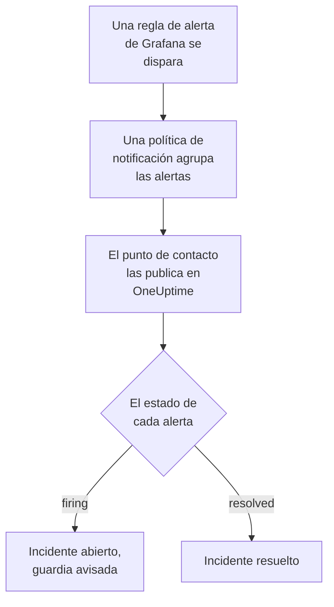

# Grafana

Envía las alertas de [Grafana](https://grafana.com) a OneUptime, para que cada alerta que se dispara se convierta en un incidente que avisa a tu equipo de guardia y se resuelva cuando la alerta se recupera. Grafana envía sus alertas a través de un punto de contacto webhook, así que no hay nada que instalar en ninguno de los dos lados.

:::cards
- [Elegir cómo recibe OneUptime las alertas](#elegir-cómo-recibe-oneuptime-las-alertas): Un monitor de solicitudes entrantes o un flujo de trabajo propio.
- [Recibir alertas con un monitor](#recibir-alertas-con-un-monitor): Un incidente por alerta, resuelto con la recuperación.
- [Configurar Grafana](#configurar-grafana): Un punto de contacto webhook y la política que lo usa.
- [Solución de problemas](#solución-de-problemas): Cuando las alertas no llegan o los incidentes siguen abiertos.
:::

## Cómo funciona



Las políticas de notificación de Grafana agrupan las alertas que se disparan, y un punto de contacto webhook publica cada grupo como una notificación JSON. Tiene la misma forma que una notificación de [Prometheus Alertmanager](/docs/integrations/prometheus-alertmanager): un `status`, una lista `alerts` en la que cada alerta tiene su propio `status` y su `fingerprint`, y los `commonLabels` y `commonAnnotations` que comparten sus alertas. Grafana añade un `title` y un `message` escritos para personas.

## Antes de empezar

- Grafana 9 o posterior, con Grafana Alerting, el predeterminado desde Grafana 9. Debe poder llegar a tu OneUptime por HTTPS.
- En OneUptime, permiso para crear monitores, o flujos de trabajo si eliges ese camino.

## Elegir cómo recibe OneUptime las alertas

Configura primero OneUptime: te da la URL a la que envía Grafana.

| Camino | Úsalo cuando |
| --- | --- |
| Un monitor de solicitudes entrantes (recomendado) | Quieres que cada alerta sea un incidente que avisa a la guardia y se resuelve cuando la alerta se recupera. No hay nada que construir. |
| Un flujo de trabajo con un disparador Webhook | Necesitas tu propia lógica: filtrar alertas, transformarlas o llamar antes a otros sistemas. Un flujo de trabajo abre un incidente por notificación, no por alerta, y no lo resuelve con la recuperación. |

Ambos reciben el mismo JSON del mismo punto de contacto, así que puedes empezar con uno y pasar al otro más tarde cambiando una URL en Grafana.

## Recibir alertas con un monitor

Un [monitor de solicitudes entrantes](/docs/monitor/incoming-request-monitor) te da una URL, y sus criterios deciden qué hace cada notificación.

:::steps
### Crear el monitor

Ve a **Monitores** y haz clic en **Crear monitor**. Elige **Solicitud entrante** en **Tipo de monitor**, llámalo `Grafana` y haz clic en **Siguiente**.

### Declarar un incidente por cada alerta disparada

En el paso **Criterios**, abre el primer criterio, el que marca el monitor como fuera de línea. Configura su filtro como **Cuerpo de la solicitud**, **Contiene**, `"status":"firing"`. Este criterio ya declara un incidente cuando su filtro coincide. Completa el incidente:

- **Título del incidente**: `{{requestBody.commonLabels.alertname}}`.
- **Descripción del incidente**, en **Descripción**: `{{requestBody.message}}`, el texto que Grafana escribe para la notificación.
- **Gravedad**: la gravedad de incidente que deben tener estas alertas.
- **Políticas de guardia**, en **De guardia**: las políticas a las que avisar.
- **Resolver incidente automáticamente**, en **Más campos**: déjalo activado, como viene. Sin él, las recuperaciones se ignoran y los incidentes siguen abiertos.

### Abrir un incidente por alerta

En el mismo criterio, abre **Ajustes** y activa **Agrupa incidentes y alertas por un campo de la carga útil**. Complétalo como se indica abajo, para que cada alerta tenga su propio incidente y su recuperación lo resuelva:

| Campo | Valor |
| --- | --- |
| **Abrir un incidente separado para cada…** | `requestBody.alerts[*].fingerprint` |
| **Campo que indica la recuperación** | `requestBody.alerts[*].status` |
| **Valor que significa recuperado** | `resolved` |

### Volver a poner el monitor en línea

Abre el segundo criterio, el que marca el monitor como en línea, y configura su filtro como **Cuerpo de la solicitud**, **Contiene**, `"status":"resolved"`.

### Copiar la URL

Haz clic en **Crear monitor**. La página **Vista general** del monitor muestra su **URL de latido**. Cópiala para Grafana:

```text
https://oneuptime.com/heartbeat/<secret key>
```

Una instalación autoalojada tiene su propio host en lugar de `oneuptime.com`.
:::

Cada alerta de una notificación abre su propio incidente, hasta el **Máximo de incidentes por solicitud** (`100` salvo que lo cambies), y el `status` propio de cada alerta decide cuándo se resuelve su incidente. El `fingerprint` de Grafana identifica una alerta por sus etiquetas, así que es el valor por el que agrupar. Consulta [Recibir alertas de otro sistema](/docs/monitor/incoming-request-monitor#recibir-alertas-de-otro-sistema) para ver qué hace cada ajuste.

> [!WARNING]
> No agrupes por una etiqueta que comparten todas las alertas de una notificación. La política de notificación predeterminada de Grafana agrupa las alertas por `grafana_folder` y `alertname`, así que todas las alertas de una notificación tienen el mismo `alertname`: agrupar por `requestBody.alerts[*].labels.alertname` junta toda la notificación en un incidente.

`{{requestBody.commonLabels.alertname}}` y `{{requestBody.message}}` describen toda la notificación, que con la política predeterminada es una sola regla de alerta. La clave de agrupación también es una variable, `{{fingerprint}}`, pero es un hash que no le dice nada a quien responde. Consulta [Plantillas de incidentes y alertas](/docs/monitor/incident-alert-templating) para ver todas las variables que puedes usar.

## Configurar Grafana

:::steps
### Añadir un punto de contacto webhook

En Grafana, ve a **Alerting → Contact points** y haz clic en **+ Add contact point**. En Grafana 11 y posteriores, **Alerting** está en **Alerts & IRM**, y **Contact points** es una pestaña de **Notification configuration**.

Llama al punto de contacto `OneUptime`, elige **Webhook** en **Integration** y pega en **URL** la URL que copiaste. Deja **HTTP Method** en `POST` y haz clic en **Save contact point**.

### Enviarle las alertas

Ve a **Alerting → Notification policies**. Pon `OneUptime` como punto de contacto de la política predeterminada, o añade una política hija que coincida con las alertas que debe recibir OneUptime, con `OneUptime` como punto de contacto.
:::

Grafana envía `Content-Type: application/json`, que el monitor necesita para leer los campos de una notificación. El ajuste **Max Alerts** del punto de contacto limita las alertas de una notificación: déjalo en `0`, sin límite, o como mucho en el **Máximo de incidentes por solicitud** del monitor.

## Probarlo

1. En Grafana, abre el punto de contacto `OneUptime` y haz clic en **Test**. Grafana envía una alerta de prueba disparada, y se abre un incidente en OneUptime. Una alerta de prueba nunca se recupera, así que resuelve ese incidente a mano.
2. Deja que se dispare una regla de alerta real, por ejemplo bajando su umbral un momento, y mira cómo se abre su incidente y luego se resuelve cuando vuelves a poner el umbral.

## Recibir alertas con un flujo de trabajo

Usa un [flujo de trabajo](/docs/workflows/index) cuando necesites tus propios pasos entre Grafana y el incidente.

:::steps
### Crear el flujo de trabajo

Ve a **Flujos de trabajo**, haz clic en **Crear flujo de trabajo** y luego en **Empezar desde cero**. Llámalo `Grafana alerts` y haz clic en **Crear flujo de trabajo**.

### Añadir el disparador Webhook

Haz clic en el bloque discontinuo **Elige qué inicia este flujo de trabajo** y elige **Webhook**. Haz clic en el disparador, luego en **Copiar URL**, y usa esa URL en el punto de contacto de Grafana.

### Comprobar que la notificación se dispara

Haz clic en **Añadir componente**, añade un bloque **If / Else** y conecta a él el punto **Out** del disparador. Configura **Value to check** como `{{local.components.webhook-1.returnValues.request-body.status}}`, **Comparison** como **is equal to** y **Compare with** como `firing`.

### Declarar el incidente

Añade un bloque **Create One Incident** y conecta a él el lado **Yes** del bloque **If / Else**. En **Incident Template**, elige una plantilla que fije la gravedad y las políticas de guardia a las que avisar (consulta [Plantillas de incidente](/docs/incidents/settings#plantillas-de-incidente)). En **JSON Object**, indica lo que viene de Grafana:

```json
{
  "title": "{{local.components.webhook-1.returnValues.request-body.title}}",
  "description": "{{local.components.webhook-1.returnValues.request-body.message}}"
}
```

Sin plantilla, **JSON Object** también debe contener `incidentSeverityId`, el ID de una de las gravedades de incidente del proyecto.

### Activar el flujo de trabajo

Activa **Habilitado** en la parte superior del **Constructor**. Un flujo de trabajo desactivado responde a Grafana con `400`.
:::

Una ejecución gestiona una notificación, así que declara un solo incidente, sea cual sea el número de alertas de la notificación. Una notificación `resolved` toma el lado **No** del bloque **If / Else**, donde no hay nada conectado, así que la ejecución termina ahí. Para un incidente por alerta, resuelto con la recuperación, usa el monitor.

## Solución de problemas

:::details No llega nada a OneUptime
- Haz clic en **Test** en el punto de contacto: Grafana muestra un error cuando no puede llegar a la URL. El registro del servidor de Grafana tiene los detalles.
- El monitor responde `200` de inmediato, antes de comprobar nada, incluso con una clave secreta errónea. Mira la línea de tiempo del monitor para ver si llegan las notificaciones.
- Un flujo de trabajo desactivado responde `400`. Activa **Habilitado** en la parte superior de su **Constructor**.
:::

:::details Los incidentes se abren pero nunca se resuelven
- El incidente del criterio necesita **Resolver incidente automáticamente**, en **Más campos**.
- **Campo que indica la recuperación** debe ser `requestBody.alerts[*].status`, y **Valor que significa recuperado** exactamente `resolved`. La comparación distingue mayúsculas y minúsculas.
- Las rutas de agrupación deben empezar por `requestBody.`, y solo el primer `[*]` de una ruta lee una lista. Una ruta que incumple cualquiera de las dos reglas no coincide con nada, sin ningún error.
:::

:::details Un solo incidente para una notificación llena de alertas
Agrupaste por una etiqueta que es igual para todas las alertas de una notificación, como `alertname` con la política predeterminada. Agrupa por `requestBody.alerts[*].fingerprint` en su lugar.
:::

:::details El incidente muestra una referencia en lugar de un valor
Una referencia a un campo que la notificación no tiene se deja tal como está escrita, llaves incluidas. Compara el nombre del campo con lo que envió Grafana: para un flujo de trabajo, abre la ejecución en **Registros → Ejecuciones** y compárala con lo que recibió el disparador.
:::

La guía de [Prometheus Alertmanager](/docs/integrations/prometheus-alertmanager#solución-de-problemas) cubre más casos, y también se aplican a las notificaciones de Grafana.

## Seguridad

- **Trata la URL como una contraseña.** Quien la tenga puede abrir incidentes. Si se filtra, restablécela: **Restablecer clave secreta de solicitud entrante** en la página **Ajustes** del monitor, o **Restablecer URL** en el disparador **Webhook** del flujo de trabajo. Después actualiza la **URL** del punto de contacto en Grafana.
- **¿Autoalojado?** Deja que Grafana llegue a tu OneUptime por HTTPS a través de tu cortafuegos.

## Próximos pasos

:::cards
- [Monitor de solicitudes entrantes](/docs/monitor/incoming-request-monitor): Cada ajuste del monitor que recibe tus alertas.
- [Prometheus Alertmanager](/docs/integrations/prometheus-alertmanager): La misma configuración, con un interruptor de hombre muerto para tus alertas.
- [Monitor de métricas](/docs/monitor/metrics-monitor): Alerta sobre las mismas métricas en el propio OneUptime.
- [Descripción general de integraciones](/docs/integrations/index): Las demás herramientas que puedes conectar.
:::
