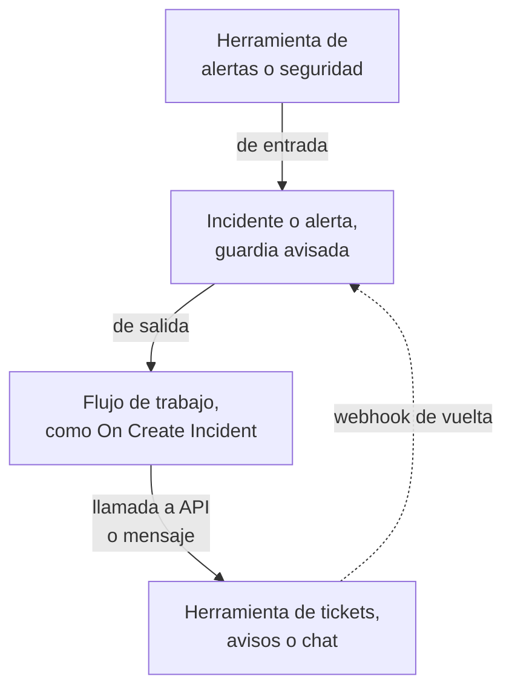

# Descripción general de integraciones

OneUptime funciona con las herramientas que tu equipo ya usa. Las herramientas de alertas abren incidentes en él, y él abre tickets, avisos de guardia y mensajes de chat en otras herramientas. Algunas herramientas se conectan desde un formulario y otras desde una plantilla de flujo de trabajo lista para usar. Cualquier otra herramienta con un webhook o una API se conecta mediante un flujo de trabajo que construyes tú.

:::cards
- [Elegir cómo conectar](#elegir-cómo-conectar): Las cuatro formas de integrarse y cuándo usar cada una.
- [Catálogo](#catálogo): Cada herramienta con una guía, agrupada por lo que hace.
- [Construir tu propia integración](#construir-tu-propia-integración): Los patrones de entrada y de salida, para cualquier otra herramienta.
- [Proteger las credenciales](#proteger-las-credenciales): Las variables secretas y las cabeceras que espera cada herramienta.
:::

## Cómo funcionan las integraciones

Cada integración mueve datos en un sentido o en ambos. **De entrada**: otra herramienta avisa a OneUptime de que algo va mal, y OneUptime abre un incidente o una alerta y avisa al equipo de guardia. **De salida**: algo ocurre en OneUptime, y un flujo de trabajo avisa a otra herramienta: crea un ticket, avisa a alguien o publica un mensaje.



Una integración bidireccional, como Jira o Dynamics 365, usa los dos sentidos: un flujo de trabajo envía el incidente hacia fuera, y otro, iniciado por el webhook de la otra herramienta, trae los cambios de vuelta.

## Elegir cómo conectar

| Forma | Ideal para | Ejemplos |
| --- | --- | --- |
| Una conexión integrada | Herramientas a las que OneUptime se conecta por sí mismo. Rellenas un formulario y no hay nada que construir. | [Slack](/docs/workspace-connections/slack), [Microsoft Teams](/docs/workspace-connections/microsoft-teams), las conexiones de [Eventos de seguridad](/docs/telemetry/security-events) |
| Una plantilla de flujo de trabajo | Herramientas de tickets, sincronizadas en ambos sentidos, problemas de monitorización, informes de incidentes de seguridad y mensajes de chat. Eliges una plantilla y rellenas unos pocos ajustes. | [Jira](/docs/integrations/jira), [Microsoft Dynamics 365](/docs/integrations/microsoft-dynamics-365), [Huntress](/docs/integrations/huntress), [Zabbix](/docs/integrations/zabbix) |
| Un monitor de solicitudes entrantes | Herramientas de alertas que envían un webhook. Obtienes un incidente por alerta, avisado a la guardia y resuelto cuando la alerta se recupera, sin flujo de trabajo. | [Zabbix](/docs/integrations/zabbix), [Prometheus Alertmanager](/docs/integrations/prometheus-alertmanager), [Grafana](/docs/integrations/grafana) |
| Un flujo de trabajo que construyes tú | Cualquier herramienta con un webhook o una API REST, y cualquier lógica propia. | [PagerDuty](/docs/integrations/pagerduty), [Opsgenie](/docs/integrations/opsgenie), [ServiceNow](/docs/integrations/servicenow) |

Empieza por arriba de la tabla: cuanto más arriba está una forma, menos hay que mantener.

## Catálogo

### Herramientas de monitorización y alertas

| Herramienta | Sentido | Qué hace |
| --- | --- | --- |
| [Zabbix](/docs/integrations/zabbix) | Ambos | Convierte los problemas de Zabbix en incidentes o alertas, los resuelve en la recuperación y reconoce o cierra los problemas desde OneUptime. |
| [Prometheus Alertmanager](/docs/integrations/prometheus-alertmanager) | De entrada | Convierte las notificaciones de Alertmanager en incidentes. |
| [Grafana](/docs/integrations/grafana) | De entrada | Convierte las alertas de Grafana en incidentes. |
| [Datadog](/docs/integrations/datadog) | De entrada | Convierte las alertas de los monitores de Datadog en incidentes. |

### Herramientas de seguridad

| Herramienta | Sentido | Qué hace |
| --- | --- | --- |
| [Huntress](/docs/integrations/huntress) | De entrada | Avisa a la guardia de los informes de incidentes de Huntress y resuelve el incidente cuando el informe se cierra. |
| [Google SecOps](/docs/integrations/google-secops) | Ambos | Trae las detecciones y los indicadores de Google SecOps a Eventos de seguridad, y le envía lo que OneUptime encuentra. |
| [Microsoft Sentinel](/docs/integrations/microsoft-sentinel) | Ambos | Trae los incidentes de Microsoft Sentinel a Eventos de seguridad, y le envía lo que OneUptime encuentra. |
| [Microsoft Defender XDR](/docs/integrations/microsoft-defender-xdr) | De entrada | Trae las alertas de Microsoft Defender XDR a Eventos de seguridad. |
| [CrowdStrike Falcon](/docs/integrations/crowdstrike-falcon) | De entrada | Trae las alertas de CrowdStrike Falcon a Eventos de seguridad. |
| [Splunk Enterprise Security](/docs/integrations/splunk) | Ambos | Trae los eventos notables de Splunk a Eventos de seguridad, y le envía lo que OneUptime encuentra. |
| [Elastic Security](/docs/integrations/elastic-security) | Ambos | Trae las alertas de detección de Elastic Security a Eventos de seguridad, y le envía lo que OneUptime encuentra. |
| [AWS Security Hub](/docs/integrations/aws-security-hub) | De entrada | Trae los hallazgos de AWS Security Hub a Eventos de seguridad. |
| [Okta System Log](/docs/integrations/okta) | De entrada | Trae los inicios de sesión, los cambios de cuenta y las detecciones de amenazas de Okta a Eventos de seguridad. |
| [Microsoft Entra ID](/docs/integrations/microsoft-entra-id) | De entrada | Trae los inicios de sesión y los cambios de directorio de Microsoft Entra ID, y el registro de auditoría de Microsoft 365, a Eventos de seguridad. |
| [Google Workspace](/docs/integrations/google-workspace) | De entrada | Trae los inicios de sesión, los cambios de administración y las detecciones de Google Workspace a Eventos de seguridad. |

### Tickets y gestión de servicios de TI

| Herramienta | Sentido | Qué hace |
| --- | --- | --- |
| [Jira](/docs/integrations/jira) | Ambos | Abre una incidencia de Jira por cada incidente o alerta, y trae de vuelta los cambios de estado y los comentarios. |
| [Microsoft Dynamics 365](/docs/integrations/microsoft-dynamics-365) | Ambos | Abre un caso de Dynamics 365 por cada incidente o alerta, y trae de vuelta los cambios de estado y las notas. |
| [ServiceNow](/docs/integrations/servicenow) | De salida | Abre un incidente de ServiceNow por cada incidente de OneUptime y lo resuelve con el incidente. |
| [GitHub](/docs/integrations/github) | De salida | Abre una issue de GitHub para un incidente. |
| [GitLab](/docs/integrations/gitlab) | De salida | Abre una issue de GitLab para un incidente. |

### Herramientas de avisos

| Herramienta | Sentido | Qué hace |
| --- | --- | --- |
| [PagerDuty](/docs/integrations/pagerduty) | De salida | Dispara un incidente de PagerDuty por cada incidente de OneUptime y lo resuelve con el incidente. |
| [Opsgenie](/docs/integrations/opsgenie) | De salida | Crea una alerta de Opsgenie por cada incidente de OneUptime y la cierra con el incidente. |

### Herramientas de chat

| Herramienta | Sentido | Qué hace |
| --- | --- | --- |
| [Slack](/docs/workspace-connections/slack) | Ambos | Una conexión integrada: canales de incidentes, acciones desde Slack y guardias. |
| [Microsoft Teams](/docs/workspace-connections/microsoft-teams) | Ambos | Una conexión integrada: canales de incidentes, acciones desde Teams y guardias. |
| [Mattermost](/docs/workflows/components#mattermost) | De salida | Publica las novedades de los incidentes en un canal de Mattermost. |
| [Discord](/docs/integrations/discord) | De salida | Publica las novedades de los incidentes en un canal de Discord. |
| [Telegram](/docs/integrations/telegram) | De salida | Envía un mensaje a un chat de Telegram cuando se dispara una alerta. |
| [IRC](/docs/integrations/irc) | De salida | Publica las novedades de los incidentes en un canal de IRC. |

> [!TIP]
> Slack y Microsoft Teams también tienen pasos de flujo de trabajo. Usa la conexión integrada para los canales de incidentes y las guardias, y un paso de flujo de trabajo cuando solo necesites un mensaje en un canal.

### Plataformas de alojamiento

| Herramienta | Sentido | Qué hace |
| --- | --- | --- |
| [Vercel](/docs/integrations/vercel) | De entrada | Añade OneUptime desde el Vercel Marketplace: trazas, logs, monitores de disponibilidad y una página de estado para tus proyectos de Vercel. |

## Migrar desde otra herramienta

Para dejar otra herramienta de guardias, de disponibilidad o de páginas de estado, trae a tu equipo en lugar de conectar las dos. **Ajustes del proyecto → Avanzado → Importar desde otra herramienta** lee tu cuenta con una clave de API, te muestra lo que encontró y crea lo que marques. Cada herramienta tiene una guía:

- Herramientas de guardias e incidentes: [Opsgenie](/docs/moving-to-oneuptime/opsgenie), [PagerDuty](/docs/moving-to-oneuptime/pagerduty), [incident.io](/docs/moving-to-oneuptime/incident-io), [Splunk On-Call](/docs/moving-to-oneuptime/splunk-on-call) y [Grafana OnCall](/docs/moving-to-oneuptime/grafana-oncall).
- Herramientas de disponibilidad y de páginas de estado: [UptimeRobot](/docs/moving-to-oneuptime/uptimerobot), [Atlassian Statuspage](/docs/moving-to-oneuptime/atlassian-statuspage), [Better Stack](/docs/moving-to-oneuptime/better-stack), [Pingdom](/docs/moving-to-oneuptime/pingdom), [StatusCake](/docs/moving-to-oneuptime/statuscake) y [Uptime Kuma](/docs/moving-to-oneuptime/uptime-kuma).

## Construir tu propia integración

Una herramienta sin guía encaja igualmente en uno de dos patrones. Si puede enviar un webhook, usa el patrón de entrada. Si tiene una API REST, usa el patrón de salida. Ambos son flujos de trabajo: consulta [Visión general de los flujos de trabajo](/docs/workflows/index) para empezar.

### De entrada: otra herramienta envía datos a OneUptime

Para una herramienta de alertas, empieza con un [monitor de solicitudes entrantes](/docs/monitor/incoming-request-monitor#recibir-alertas-de-otro-sistema): abre un incidente por alerta y lo resuelve con la recuperación, sin nada que construir. Construye un flujo de trabajo cuando necesites una lógica propia:

:::steps
1. Abre **Flujos de trabajo**, haz clic en **Crear flujo de trabajo** y luego en **Empezar desde cero**. Ponle nombre al flujo de trabajo y haz clic en **Crear flujo de trabajo**.
2. Haz clic en el bloque discontinuo **Elige qué inicia este flujo de trabajo** y elige **Webhook**. Haz clic en el disparador y luego en **Copiar URL**.
3. En la otra herramienta, envía su webhook a esa URL como `POST` con `Content-Type: application/json`.
4. Añade los bloques que actúan sobre él. Leen la solicitud con referencias como `{{local.components.webhook-1.returnValues.request-body.status}}`: un bloque **If / Else** para comprobar un campo y luego **Create One Incident** para declarar un incidente.
5. Activa **Habilitado** en la parte superior del **Constructor**, envía una prueba desde la otra herramienta y abre **Registros → Ejecuciones** para ver lo que llegó.
:::

La URL es la única credencial, así que trátala como una contraseña. Consulta [Webhook](/docs/workflows/triggers#webhook).

### De salida: OneUptime envía datos a otra herramienta

:::steps
1. Guarda la clave de API de la herramienta como variable global secreta, como se muestra [más abajo](#proteger-las-credenciales).
2. Crea un flujo de trabajo, haz clic en el bloque discontinuo y elige un disparador de evento, como **On Create Incident**. Haz clic en el disparador: sus **Fields to pass on** empiezan con **Título**, así que haz clic en **Añadir campo** y elige los demás campos que quieres enviar, como **Descripción**.
3. Haz clic en **Añadir componente** y añade un bloque **API Post (JSON)**. Conecta a él el punto **Success** del disparador.
4. Rellena su **URL**, sus **Request Headers** con la cabecera `Authorization` y su **Request Body** con los campos del incidente, como `{{local.components.incident-on-create-1.returnValues.model.title}}`.
5. Haz clic en **Ejecutar flujo de trabajo**, elige un incidente en **Incidente** y ejecútalo. Una ejecución de prueba envía de verdad la solicitud. Después, activa **Habilitado**.
:::

Cuando la herramienta necesita los datos con otra forma, añade un bloque [Run Custom JavaScript](/docs/workflows/components#custom-code) entre los dos. La receta es la misma para Zendesk, New Relic, AWS (a través de SNS), StatusCake y todas las demás: solo cambian la URL y el cuerpo.

## Proteger las credenciales

Nunca pegues una clave de API ni un token en un bloque. Guárdalo una vez como variable global secreta:

:::steps
1. Ve a **Flujos de trabajo → Variables globales** y haz clic en **Crear Variable del flujo de trabajo**.
2. Ponle un nombre, como `JIRA_AUTH`, y haz clic en **Siguiente**.
3. Pega la clave en **Contenido**, activa **Secreto** y haz clic en **Crear Variable del flujo de trabajo**.
:::

Cualquier bloque la lee como `{{global.variables.JIRA_AUTH}}`. El contenido de una variable no se puede volver a leer una vez guardado, y el de una variable secreta se sustituye por `[REDACTED]` en los registros de ejecución. Para los tokens que caducan, como los de Microsoft Entra ID, una [variable OAuth 2.0](/docs/workflows/variables#variables-oauth-20-tokens-que-se-renuevan-solos) obtiene uno nuevo por sí sola. Consulta [Variables de flujo de trabajo](/docs/workflows/variables#variables-globales).

### Chuleta de autenticación

La mayoría de las integraciones de salida ponen la clave en una cabecera de la solicitud. Las formas habituales:

| Esquema | Qué enviar | Lo usa |
| --- | --- | --- |
| Token Bearer | `Authorization: Bearer {{global.variables.TOKEN}}` | GitHub y la mayoría de las API modernas |
| Autenticación Basic | `Authorization: Basic {{global.variables.BASE64_USER_PASS}}` | Jira Cloud, ServiceNow |
| Cabecera de clave de API | `Authorization: GenieKey {{global.variables.OPSGENIE_KEY}}` | Opsgenie |
| Cabecera de token privado | `PRIVATE-TOKEN: {{global.variables.GITLAB_TOKEN}}` | GitLab |
| Clave en el cuerpo | `routing_key` en el cuerpo JSON | Events API de PagerDuty |
| Credenciales de cliente OAuth 2.0 | `Authorization: Bearer {{local.variables.dynamicsAccessToken}}`, de una variable OAuth 2.0 | Microsoft Dynamics 365 |

Para la autenticación Basic, codifica `username:password`, o `email:api_token`, una vez, y guarda el resultado como secreto. En macOS o Linux:

```bash
printf '%s' 'you@example.com:your_api_token' | base64 | tr -d '\n'
```

Usa `printf`, no `echo`: `echo` añade un salto de línea, que se codifica con el resto y estropea las credenciales. `tr` mantiene un resultado largo en una sola línea.

## Instalaciones autoalojadas

Un OneUptime autoalojado llama a otras herramientas desde tu red, y otras herramientas lo llaman desde la suya:

- **De salida:** las solicitudes de los flujos de trabajo a direcciones de red privada se rechazan salvo que un administrador las permita. Consulta [Acceso de red saliente](/docs/workflows/configuration#acceso-de-red-saliente).
- **De entrada:** los webhooks de una herramienta deben llegar a tu OneUptime por HTTPS, así que una herramienta en la nube necesita una dirección pública a la que llamar.
- **Las integraciones integradas** tienen cada una una guía de configuración: [Slack](/docs/self-hosted/slack-integration), [Microsoft Teams](/docs/self-hosted/microsoft-teams-integration), [GitHub](/docs/self-hosted/github-integration), [Twilio](/docs/self-hosted/twilio-integration), [SendGrid Inbound Email](/docs/self-hosted/sendgrid-inbound-email) y [Push Notifications](/docs/self-hosted/push-notifications).

## Próximos pasos

:::cards
- [Visión general de los flujos de trabajo](/docs/workflows/index): Cómo se ejecutan los flujos de trabajo y cómo construir el primero.
- [Monitor de solicitudes entrantes](/docs/monitor/incoming-request-monitor): Recibe alertas de cualquier herramienta sin flujo de trabajo.
- [Jira](/docs/integrations/jira): Una integración bidireccional completa, a partir de plantillas.
- [Variables de flujo de trabajo](/docs/workflows/variables): Pasa datos entre bloques y mantén los secretos fuera de ellos.
:::
