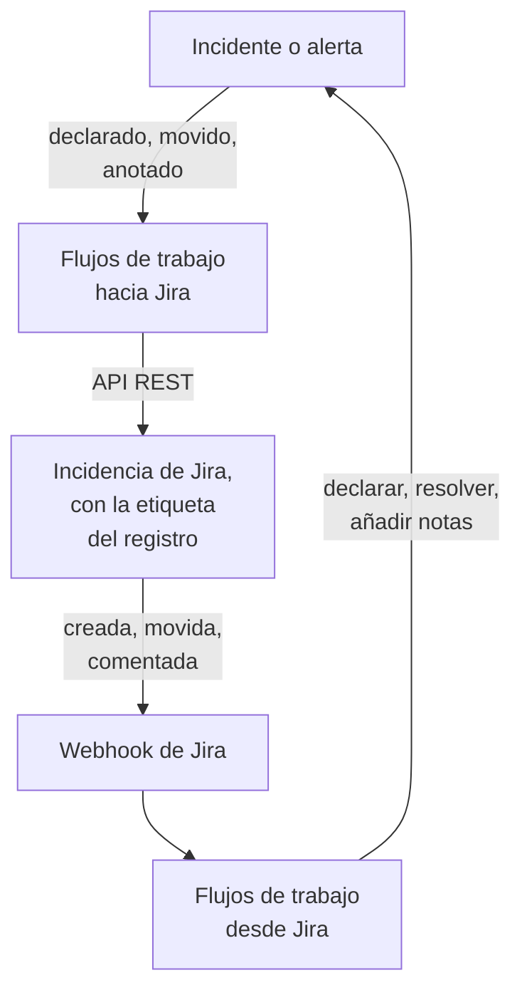

# Jira

Mantén las incidencias de [Jira](https://www.atlassian.com/software/jira) al día con tus incidentes y alertas de OneUptime, en ambos sentidos. Unas plantillas de flujo de trabajo listas para usar abren una incidencia por cada incidente o alerta, la mueven a medida que avanza el registro y copian las notas en ella como comentarios. Otras declaran incidentes a partir de incidencias nuevas y traen de vuelta los cambios de estado, los comentarios y las ediciones. No hay ningún plugin: los flujos de trabajo llaman a la API REST de Jira, y Jira llama a sus URL de webhook.

:::cards
- [Empezar con una plantilla](#empezar-con-una-plantilla): Las 17 plantillas, qué piden y cómo configurarlas.
- [Cómo funcionan las plantillas](#cómo-funcionan-las-plantillas): Cómo incidencias y registros siguen vinculados, sin bucles.
- [Construirlo tú mismo](#construirlo-tú-mismo): Cada sentido a mano, para cuando una plantilla no encaja.
- [Solución de problemas](#solución-de-problemas): Qué significan las respuestas de Jira.
:::

> [!NOTE]
> Atlassian está renombrando cosas en Jira Cloud: un **proyecto** es ahora un **espacio** en gran parte de la interfaz, y una **incidencia** es un **elemento de trabajo**. Los sitios usan ambas palabras, así que donde el término importa encontrarás las dos aquí.

## Cómo funciona



Cada plantilla es un pequeño flujo de trabajo, así que tomas solo los sentidos que quieras, para incidentes, alertas o ambos. Las plantillas de OneUptime → Jira parten de un evento en OneUptime y llaman a la API REST de Jira. Las plantillas de Jira → OneUptime parten de un webhook de Jira. Todas encuentran los registros de las demás por dos etiquetas en la incidencia.

Todo lo de esta página está escrito para **Jira Cloud**. [Jira Data Center](#jira-data-center) enumera lo que cambia en un Jira autogestionado.

## Antes de empezar

- Un sitio de Jira Cloud, como `https://your-domain.atlassian.net`, y un proyecto donde crear las incidencias.
- Un usuario de Jira para la integración y un token de API para él. Dale al usuario **Browse Projects**, **Create Issues**, **Edit Issues**, **Add Comments** y **Transition Issues** en el proyecto.
- Un administrador de Jira, para registrar los webhooks que necesitan las plantillas de Jira → OneUptime.
- En OneUptime, permiso para crear flujos de trabajo. En OneUptime Cloud, los flujos de trabajo necesitan el plan **Growth** o superior.

## Empezar con una plantilla

El diálogo **Crear un flujo de trabajo** tiene 17 plantillas de Jira, en **Jira** dentro de su lista de categorías: nueve para incidentes y luego ocho para alertas, cada grupo bajo su propio encabezado. Comparten una convención, etiquetas en la incidencia de Jira, así que cualquier combinación de ellas funciona en conjunto.

### Plantillas para incidentes

| Plantilla | Qué hace | Qué pide |
| --- | --- | --- |
| **OneUptime → Jira** | | |
| Create a Jira issue when an incident is declared | Abre una incidencia por cada incidente nuevo y le añade el ID del incidente como etiqueta. Los incidentes declarados desde Jira, y los incidentes privados, se omiten. | API URL, API token, project key, issue type, OneUptime URL |
| Move the Jira issue when the incident is acknowledged or resolved | Hace avanzar la incidencia vinculada: a un estado In Progress cuando se reconoce el incidente, y a un estado Done cuando se resuelve. Nunca la hace retroceder. | API URL, API token |
| Copy incident private notes to the Jira issue | Publica cada nota privada nueva como comentario en la incidencia vinculada, como comentario interno en Jira Service Management. | API URL, API token |
| Copy incident public notes to the Jira issue | Publica cada nota pública nueva como comentario en la incidencia vinculada. | API URL, API token |
| Comment on the Jira issue when the incident is edited | Cuando cambian el título, la gravedad, la descripción, la causa raíz o las notas de corrección del incidente, publica cómo está ahora el incidente, como comentario interno en Jira Service Management. | API URL, API token |
| **Jira → OneUptime** | | |
| Declare an incident when a Jira issue is created | Declara un incidente por cada incidencia nueva, fuera de tus páginas de estado, con una gravedad elegida según la prioridad de la incidencia, y luego etiqueta la incidencia para vincular ambas. | Site URL, API URL, API token y un webhook de Jira para **Issue created** |
| Acknowledge or resolve the incident when its Jira issue moves | Reconoce el incidente cuando su incidencia vinculada pasa a un estado In Progress, y lo resuelve cuando la incidencia pasa a un estado Done. | Un webhook de Jira para **Issue updated** |
| Add Jira comments to the incident as private notes | Copia cada comentario de una incidencia vinculada en el incidente, como nota privada. | Site URL, API URL, API token y un webhook de Jira para **Comment created** |
| Add Jira issue changes to the incident as private notes | Anota cada edición de una incidencia vinculada, como la prioridad, la persona asignada o el resumen, en el incidente como nota privada. Los cambios de estado quedan para la plantilla de arriba. | Site URL y un webhook de Jira para **Issue updated** |

### Plantillas para alertas

Las plantillas para alertas hacen los mismos trabajos para las alertas. Hay una menos, porque las alertas no tienen notas públicas. [Qué cambia para las alertas](#qué-cambia-para-las-alertas) enumera el resto.

| Plantilla | Qué hace | Qué pide |
| --- | --- | --- |
| **OneUptime → Jira** | | |
| Create a Jira issue when an alert is created | Abre una incidencia por cada alerta nueva, incluida cada alerta que genera un monitor, y le añade el ID de la alerta como etiqueta. Las alertas creadas desde Jira, y las alertas privadas, se omiten. | API URL, API token, project key, issue type, OneUptime URL |
| Move the Jira issue when the alert is acknowledged or resolved | Hace avanzar la incidencia vinculada: a un estado In Progress cuando se reconoce la alerta, y a un estado Done cuando se resuelve. Nunca la hace retroceder. | API URL, API token |
| Copy alert private notes to the Jira issue | Publica cada nota privada nueva como comentario en la incidencia vinculada, como comentario interno en Jira Service Management. | API URL, API token |
| Comment on the Jira issue when the alert is edited | Cuando cambian el título, la gravedad, la descripción, la causa raíz o las notas de corrección de la alerta, publica cómo está ahora la alerta, como comentario interno en Jira Service Management. | API URL, API token |
| **Jira → OneUptime** | | |
| Create an alert when a Jira issue is created | Crea una alerta por cada incidencia nueva, con una gravedad elegida según la prioridad de la incidencia, y luego etiqueta la incidencia para vincular ambas. | Site URL, API URL, API token y un webhook de Jira para **Issue created** |
| Acknowledge or resolve the alert when its Jira issue moves | Reconoce la alerta cuando su incidencia vinculada pasa a un estado In Progress, y la resuelve cuando la incidencia pasa a un estado Done. | Un webhook de Jira para **Issue updated** |
| Add Jira comments to the alert as private notes | Copia cada comentario de una incidencia vinculada en la alerta, como nota privada. | Site URL, API URL, API token y un webhook de Jira para **Comment created** |
| Add Jira issue changes to the alert as private notes | Anota cada edición de una incidencia vinculada, como la prioridad, la persona asignada o el resumen, en la alerta como nota privada. Los cambios de estado quedan para la plantilla de arriba. | Site URL y un webhook de Jira para **Issue updated** |

Ninguna de las plantillas de OneUptime → Jira envía a Jira un incidente marcado como [**Incidente privado**](/docs/incidents/declaring-incidents#paso-1-detalles-del-incidente), ni una alerta marcada como **Alerta privada**: ni el registro, ni su estado, ni sus notas, ni sus ediciones, salvo que lo actives. Consulta [Limitaciones](#limitaciones).

### Qué cambia para las alertas

Cada plantilla para alertas está construida como su gemela para incidentes, paso a paso. Donde las alertas difieren de los incidentes, también difieren las plantillas:

- **Sin notas públicas.** Las alertas solo tienen notas privadas, así que cada comentario que publican las plantillas para alertas es un comentario interno en Jira Service Management.
- **Sin página de estado.** Una alerta nunca llega a una página de estado, así que **Create an alert when a Jira issue is created** escribe la gravedad, el título, la descripción y `customFields.jiraIssueKey`, y nada más.
- **Dos gravedades, así que Medium pasa a Low.** Un proyecto nuevo tiene dos gravedades de alerta, High y Low, mientras que tiene tres gravedades de incidente. La plantilla de creación reparte las prioridades de Jira entre las gravedades que tiene el proyecto. Con las dos predeterminadas, Highest, High, Critical y Blocker pasan a High, y cualquier otra prioridad pasa a Low, Medium y Major incluidas. Para enviar Medium a High, cambia `medium: 1` por `medium: 0` en `PRIORITY_RANK` en el script `prepare-alert-1`.
- **Enlaces y etiquetas de las alertas.** La incidencia enlaza a `/dashboard/<project id>/alerts/<alert id>` y lleva la etiqueta `oneuptime-alert-<alert id>`.
- **Los números dicen qué numeran.** Con el prefijo predeterminado `#`, una alerta y un incidente pueden ser ambos `#12`, así que las plantillas escriben `Alert #12` o `Incident #12`. Un número con su propio prefijo, como `ALT-12`, se escribe tal cual.
- **Alertas privadas.** Una alerta marcada como **Alerta privada**, a mano o por una regla de privacidad de alertas, queda fuera de Jira salvo que pongas `SYNC_PRIVATE_ALERTS` en `true`.

**Los monitores generan alertas por sí solos, y pueden generar muchas.** **Create a Jira issue when an alert is created** abre una incidencia por cada una. Salvo que cada alerta merezca un ticket, pon una condición delante del paso de Jira. Para abrir incidencias solo para las alertas High:

1. Abre el **Constructor** del flujo de trabajo y añade un bloque **If / Else**.
2. Pon **Value to check** en `{{local.components.alert-on-create-1.returnValues.model.alertSeverity.name}}`, **Comparison** en **is equal to** y **Compare with** en `High`.
3. Quita la línea de `alert-on-create-1` a `prepare-issue-1` arrastrando su extremo fuera del punto (consulta [Ordenar](/docs/workflows/authoring#ordenar-el-lienzo)). Conecta el **Success** del disparador al bloque **If / Else**, y su **Yes** a `prepare-issue-1`.

Una alerta que toma el lado **No** termina ahí la ejecución, y no se abre ninguna incidencia para ella.

### Qué piden las plantillas

El paso **Configurar** del asistente de creación pide hasta cinco valores. Las tablas de arriba muestran cuáles necesita cada plantilla.

- **Jira Site URL** — la dirección en la que abres Jira, como `https://your-domain.atlassian.net`. En Jira Data Center, su URL base, como `https://jira.example.com:8443` o `https://example.com/jira`. Las plantillas que traen Jira a OneUptime enlazan la incidencia en la descripción o la nota que escriben, y ese enlace va siempre a este sitio, diga lo que diga el evento. Por eso el campo acepta la dirección de un sitio y nada más: un esquema, un host, un puerto si lo hay y, en Data Center, la ruta bajo la que se ejecuta Jira. Rechaza la dirección de una página del sitio, una consulta o un nombre de usuario, y dice qué escribir en su lugar. Una barra al final no es problema. Si la variable se vacía más adelante, la incidencia se nombra sin enlace.
- **Jira API URL** — adonde envía el flujo de trabajo sus solicitudes a Jira: tu sitio, como `https://your-domain.atlassian.net`, sin barra al final. Con un token de API con ámbitos, lo que incluye cualquier token de cuenta de servicio, usa en su lugar `https://api.atlassian.com/ex/jira/<cloudId>`. Tu `cloudId` está en el JSON de `https://your-domain.atlassian.net/_edge/tenant_info`. Con un token clásico, es la misma dirección que la **Jira Site URL**, así que en las plantillas que piden ambas, el asistente la rellena a partir de la **Jira Site URL** hasta que escribas en ella.
- **Jira API Token (base64 of email:token)** — no el token solo, sino el correo electrónico de la cuenta y el token codificados juntos, que es como Jira Cloud acepta la autenticación Basic. [Crear el token de API](#crear-el-token-de-api) muestra cómo. Los tokens caducan, por defecto un año después de crearse, así que apunta la fecha en algún sitio.
- **Jira Project Key** — el proyecto (espacio) donde se crean las incidencias nuevas: el `OPS` de `OPS-123`.
- **Jira Issue Type** — el tipo de incidencia que se crea, escrito exactamente como está en ese proyecto, como `Task`, `Bug` o `Incident`.
- **OneUptime URL** — la dirección en la que abres OneUptime: `https://oneuptime.com`, o tu propio host. La descripción de la incidencia enlaza con ella de vuelta al incidente o la alerta.

### Crear el token de API

:::steps
1. Crea un token para un usuario de Jira dedicado, una cuenta de Atlassian corriente que solo usa la integración, en lugar de para una persona: las incidencias y los comentarios se atribuyen al propietario del token. Inicia sesión como ese usuario y crea el token en [id.atlassian.com/manage-profile/security/api-tokens](https://id.atlassian.com/manage-profile/security/api-tokens). Un token clásico (**Create API token**) funciona con la URL de tu sitio. Un token con ámbitos (**Create API token with scopes**) solo funciona con la dirección `api.atlassian.com` de arriba. Los ámbitos clásicos `read:jira-work` y `write:jira-work` cubren todas las llamadas que hacen las plantillas.
2. Codifica el correo electrónico de esa cuenta y el token:

   ```bash
   printf '%s' 'jira-bot@example.com:your_api_token' | base64 | tr -d '\n'
   ```

   Usa `printf`, no `echo`: `echo` añade un salto de línea, que se codifica con el resto, y Jira deja de aceptar las credenciales. En la URL de tu sitio eso rara vez aparece como un `401` (consulta [Limitaciones](#limitaciones)). `tr` mantiene la salida en una línea: el `base64` de GNU en Linux corta cada 76 caracteres, y un token actual es lo bastante largo como para cortarse.

3. Pega la salida en **Jira API Token (base64 of email:token)**.
:::

Una **cuenta de servicio** de Atlassian también funciona. Un administrador de la organización la crea, junto con su token, en [admin.atlassian.com](https://admin.atlassian.com) en **Directory → Service accounts**. Ese token siempre tiene ámbitos, así que **Jira API URL** debe ser la dirección `https://api.atlassian.com/ex/jira/<cloudId>` (la **Jira Site URL** sigue siendo tu sitio), y el correo electrónico que codificas es el de la propia cuenta de servicio. Dale a la cuenta de servicio los permisos de proyecto indicados arriba, como harías con cualquier usuario.

### Crear los flujos de trabajo

:::steps
1. Abre **Flujos de trabajo → Crear flujo de trabajo**. En **O empieza con una plantilla**, elige **Jira** en la lista de categorías, o escribe `Jira` en **Buscar plantillas…**, y haz clic en la plantilla que quieras. Se abre y muestra lo que hace y los ajustes que pedirá. Haz clic en **Usar esta plantilla**.
2. **Nombre** se rellena a partir de la plantilla. Cámbialo si quieres.
3. **Configurar** pide los valores de arriba. Se guardan como variables propias del flujo de trabajo, en **Variables del flujo de trabajo** dentro de su menú. El token de API se guarda como secreto: se oculta en **Registros → Ejecuciones** y solo va en la cabecera `Authorization` de las llamadas a Jira.
4. Haz clic en **Crear flujo de trabajo**. Todo flujo de trabajo se crea desactivado: activa **Habilitado** en la parte superior de su **Constructor**.
:::

Empieza con **Create a Jira issue when an incident is declared**, o con **Create a Jira issue when an alert is created** para las alertas: cada otra plantilla de OneUptime → Jira del mismo tipo encuentra la incidencia por la etiqueta que añade esta. Actívala, declara un incidente de prueba o crea una alerta de prueba, y abre **Registros → Ejecuciones** del flujo de trabajo. El último paso de la ejecución debería decir `✅ Created Jira issue` y nombrar la nueva incidencia.

Cada flujo de trabajo guarda su propia copia de estos valores. Cuando sustituyas el token, actualiza `jiraBasicAuthToken` en **Variables del flujo de trabajo** en cada flujo de trabajo de Jira que lo pidió. Si Jira cambia de dirección, actualiza `jiraSiteUrl` y `jiraBaseUrl` de la misma manera.

### Conectar las plantillas de webhook

Las plantillas de Jira → OneUptime, cuatro para incidentes y cuatro para alertas, parten de un [disparador Webhook](/docs/workflows/triggers#webhook), así que hay que decirle a Jira adónde enviar sus eventos. Hazlo en este orden:

1. Crea el flujo de trabajo y **actívalo primero**. Un flujo de trabajo desactivado responde a Jira con `400`, y Jira no reintenta una entrega rechazada con un `4xx`. Los eventos enviados antes de activarlo se pierden, no se ponen en cola.
2. Abre el **Constructor** del flujo de trabajo, haz clic en el bloque disparador **Webhook** (`webhook-1`) y haz clic en **Copiar URL** en la parte superior de sus ajustes. La URL tiene este aspecto:

   ```text
   https://<your OneUptime host>/workflow/trigger/<webhook secret key>
   ```

3. En Jira, ve a **Settings → System → WebHooks** (en **Advanced**) y haz clic en **Create a WebHook**. Pega la URL, marca el evento de la tabla de abajo, en **Issue related events**, e introduce un filtro JQL para que solo lo disparen las incidencias de tu proyecto. Deja **Exclude body** sin marcar: el flujo de trabajo lo lee todo del cuerpo.

| Plantilla | Evento de Jira | Filtro JQL |
| --- | --- | --- |
| **Incidentes** | | |
| Declare an incident when a Jira issue is created | **Issue created** | `project = OPS AND (labels is EMPTY OR labels != oneuptime)` |
| Acknowledge or resolve the incident when its Jira issue moves | **Issue updated** | `project = OPS` |
| Add Jira comments to the incident as private notes | **Comment created** | `project = OPS` |
| Add Jira issue changes to the incident as private notes | **Issue updated** | `project = OPS` |
| **Alertas** | | |
| Create an alert when a Jira issue is created | **Issue created** | `project = OPS AND (labels is EMPTY OR labels != oneuptime)` |
| Acknowledge or resolve the alert when its Jira issue moves | **Issue updated** | `project = OPS` |
| Add Jira comments to the alert as private notes | **Comment created** | `project = OPS` |
| Add Jira issue changes to the alert as private notes | **Issue updated** | `project = OPS` |

Sustituye `OPS` por la clave de tu proyecto. El filtro de las dos plantillas que crean un registro evita que les lleguen siquiera las incidencias que abrió OneUptime: las omitirían de todos modos, pero un evento que nunca llega no cuesta ninguna ejecución. `labels != oneuptime` por sí solo también descartaría cualquier incidencia sin etiquetas, por eso está `labels is EMPTY`. Las demás plantillas solo actúan sobre incidencias vinculadas, así que `project = OPS AND labels = oneuptime` es un filtro más estricto para ellas.

Cada flujo de trabajo tiene su propia URL, así que cada uno necesita su propio webhook de Jira. Dos plantillas sobre **Issue updated** significan dos webhooks, y cuatro si también usas las versiones para alertas.

**¿Usas las dos plantillas que crean un registro?** **Declare an incident when a Jira issue is created** y **Create an alert when a Jira issue is created** escuchan ambas **Issue created**. Cada una consulta a Jira las etiquetas de la incidencia antes de crear nada, pero las dos entregas llegan a la vez, así que una incidencia nueva puede recibir a la vez un incidente y una alerta. Regístralas para incidencias distintas, por proyecto o por tipo de incidencia:

```text
project = OPS AND issuetype = Incident AND (labels is EMPTY OR labels != oneuptime)
project = OPS AND issuetype = Alert AND (labels is EMPTY OR labels != oneuptime)
```

Usa tipos de incidencia que existan en tu proyecto, escritos como los escribe Jira.

Antes de confiar en ello:

- **Jira solo llama por HTTPS, en sus puertos permitidos.** OneUptime Cloud cumple. Una instalación autoalojada debe ser accesible desde internet por HTTPS en un puerto de la lista de Jira.
- **Quien tenga la URL puede disparar el flujo de trabajo.** Los webhooks de Jira no llevan nada que un flujo de trabajo pueda verificar, así que la URL es el único secreto. Quien la tenga puede declarar incidentes o crear alertas (las plantillas que crean un registro preguntan a Jira si la incidencia que nombran existe y aún no está vinculada, pero toman el título, la descripción y la prioridad de la solicitud) y puede mover o anotar los incidentes y alertas cuyo ID o clave de incidencia de Jira conozca. Lo que diga una solicitud así se escribe como texto (consulta [Limitaciones](#limitaciones)), y el enlace a la incidencia va al sitio que nombra tu **Jira Site URL**, diga lo que diga la solicitud. Guarda la URL solo en Jira. Si se filtra, haz clic en el disparador **Webhook** en el **Constructor** del flujo de trabajo, haz clic en **Restablecer URL** y pega la URL nueva en el webhook de Jira. La URL antigua deja de funcionar al instante.
- **Cada evento es una ejecución.** En OneUptime Cloud, cada entrega cuenta para las ejecuciones de flujos de trabajo de tu plan, incluidas las que una plantilla omite. El filtro JQL mantiene bajo ese número. Consulta [Límites del plan](/docs/workflows/configuration#límites-del-plan).

### Comprobar que funciona

Cada plantilla termina con un paso **Log** que dice qué pasó, así que el último paso de una ejecución en **Registros → Ejecuciones** es el lugar donde mirar:

- `✅` — hizo su trabajo y nombra la incidencia, el incidente o la alerta.
- `ℹ️` — omitió el evento a propósito y dice por qué: la incidencia no está vinculada a un registro de este tipo, la nota vino de Jira, el registro es privado o el nuevo estado no tiene ningún estado de Jira asignado.
- `❌` — falló una llamada. Para una llamada a Jira, la línea incluye la respuesta de Jira.
- `⚠️` — una plantilla que crea un registro a partir de una incidencia de Jira lo creó, pero Jira no aceptó las etiquetas de vínculo, así que las demás plantillas aún no pueden encontrarlo. Añade las etiquetas a mano.

Una ejecución omitida termina igualmente como **Ejecutado**. Las omisiones son normales: la mayoría de los eventos de Jira no son de los que actúa una plantilla concreta. Consulta [Ejecuciones de flujo de trabajo](/docs/workflows/runs-and-logs).

## Cómo funcionan las plantillas

### Cómo siguen vinculados los dos lados

Jira guarda el vínculo. Una incidencia que pertenece a un incidente o a una alerta lleva dos etiquetas:

- `oneuptime`, que marca la incidencia como vinculada.
- `oneuptime-incident-<incident id>` para un incidente, o `oneuptime-alert-<alert id>` para una alerta, que nombra el registro. El ID es la última parte de la dirección del registro en el panel: `/dashboard/<project id>/incidents/<incident id>`.

Las dos plantillas que crean una incidencia añaden ambas etiquetas al abrirla, y las dos plantillas que crean un registro a partir de una incidencia de Jira las añaden en cuanto existe el registro. Todas las demás plantillas cruzan de un lado a otro gracias a ellas: las de OneUptime → Jira buscan en Jira la etiqueta del registro, y las de Jira → OneUptime leen el ID del registro en las etiquetas de la incidencia. Así que no las renombres ni las quites. Para vincular una incidencia abierta a mano, añade tú mismo las dos etiquetas, pero solo cuando el registro aún no tenga incidencia.

**Una incidencia está vinculada a un incidente o a una alerta, nunca a ambos.** Las plantillas que crean un registro omiten cualquier incidencia que lleve `oneuptime`, o una etiqueta que empiece por `oneuptime-incident-` o `oneuptime-alert-`, y las plantillas de un tipo ignoran las incidencias vinculadas al otro. Cuando vincules una incidencia a mano, dale una sola etiqueta de registro, no una de cada.

**Un registro tiene una sola incidencia.** Las plantillas que publican en una incidencia o la mueven solo actúan cuando exactamente una incidencia lleva la etiqueta del registro. Clonar una incidencia en Jira copia sus etiquetas, así que el clon de una incidencia vinculada reclama el mismo registro. A partir de ahí esas plantillas se detienen, y cada ejecución termina con una omisión que nombra ambas incidencias:

```text
More than one Jira issue is labelled oneuptime-incident-<id> (OPS-17, OPS-30). A cloned issue copies the label: remove it from every issue except the one filed for the incident.
```

El otro sentido no tiene esa comprobación: los cambios de estado, los comentarios y las ediciones del clon llegan al registro como si se hubieran hecho en el original. Así que, cuando clones una incidencia vinculada, quita ambas etiquetas del clon.

Los incidentes y las alertas creados desde Jira también guardan la clave de la incidencia en `customFields.jiraIssueKey`, escrita al crearlos. Así saben las plantillas que crean una incidencia que el registro ya tiene una.

### Cómo evitan bucles las plantillas

Cada escritura en un sentido es un evento en el otro: un comentario publicado en Jira vuelve como un webhook **Comment created**, y una nota añadida en OneUptime dispara el disparador de notas. Tres cosas detienen el eco:

- **Marcadores en el texto.** Cada comentario que las plantillas publican en Jira empieza por `Synced from OneUptime`. Cada nota escrita desde Jira, y la causa raíz de cada cambio de estado hecho desde Jira, empieza por `Synced from Jira`. Cada sentido omite el texto que lleva el marcador del otro lado, incluso en un comentario que alguien escribió citando uno.
- **Etiquetas en las incidencias nuevas.** Las incidencias que abrió OneUptime llevan la etiqueta `oneuptime`, y las plantillas que crean un registro las omiten. Preguntan a Jira por las etiquetas de la incidencia antes de crear nada, en lugar de fiarse del evento. Los registros creados desde Jira llevan `customFields.jiraIssueKey`, y las plantillas que crean una incidencia los omiten.
- **Los estados solo avanzan, en ambos lados.** Las plantillas de estado escriben una fila nueva en la cronología de estados del registro, como hace el botón **Resolver**, y siempre hacia un estado posterior. Las plantillas de transición tampoco hacen retroceder nunca una incidencia. Así, cuando un lado resuelve, el otro se encuentra ya terminado y no cambia nada.

Conserva los marcadores cuando edites las plantillas. Son las constantes `FROM_ONEUPTIME` y `FROM_JIRA` del bloque auxiliar al principio de cada script. Un comentario o una nota escritos sin su marcador se copian de vuelta al instante.

### Cómo elige un estado la plantilla de transición

Jira no tiene ninguna llamada «mover a Done». Una incidencia avanza mediante una transición, y las transiciones que tiene dependen de su flujo de trabajo y de su estado. Así que **Move the Jira issue when the incident is acknowledged or resolved**, y su gemela para alertas, leen las transiciones abiertas para la incidencia y eligen una según el estado al que lleva:

- **Solo hacia delante.** Jira clasifica los estados en tres categorías, To Do, In Progress y Done, y la plantilla nunca elige una transición hacia una categoría anterior a la de la incidencia, ni siquiera para un estado nombrado en `STATE_TO_JIRA_STATUS`. Reconocer un incidente cuya incidencia ya está en Done termina con `Jira issue OPS-17 is already Done, so it was not moved back to an In Progress status.`
- **Primero los nombres habituales.** Para un registro resuelto, gana un estado llamado Done, Resolved, Closed, Complete, Completed o Fixed. Para uno reconocido, gana In Progress o Work in Progress. Un estado con otro nombre en la categoría correcta se usa cuando es el único que encaja.
- **Nunca una suposición que abandone el trabajo.** Un estado cuyo nombre suene a Canceled, Declined, Rejected, Won't Do, Duplicate, Obsolete, Waiting, Pending, Escalated, On Hold o Blocked nunca se elige salvo que `STATE_TO_JIRA_STATUS` lo nombre. Así, una solicitud de Jira Service Management que puede pasar a Resolved o a Canceled pasa a Resolved.
- **Dos caminos al mismo estado.** Cuando dos transiciones llevan a un mismo estado, toma la que no tiene pantalla.

Cuando aun así queda la duda, no mueve nada y dice por qué: dos estados encajan igual de bien, o ninguna de las transiciones es de las que puede elegir por su cuenta.

```text
Jira issue OPS-17 could move to Released or Deployed for a Done status. Name the one to use in STATE_TO_JIRA_STATUS.
Jira issue OPS-17 has no transition from In Review to a Done status that can be chosen without naming it in STATE_TO_JIRA_STATUS.
```

Entonces nombra el estado en `STATE_TO_JIRA_STATUS`, al principio del script `plan-transition-1`, según los nombres de tus estados de OneUptime. Un estado listado ahí mueve la incidencia a ese estado de Jira por su nombre, sea cual sea su categoría, siempre que no sea hacia atrás:

```javascript
const STATE_TO_JIRA_STATUS = {
  Resolved: "Resolved",
  Acknowledged: "In Progress",
};
```

### Cambiar lo que hace una plantilla

Abre el **Constructor** del flujo de trabajo y haz clic en el bloque que quieras cambiar. Los ajustes que más probablemente querrás tocar son constantes cerca del principio de un script, el **JavaScript Code** de un bloque **Run Custom JavaScript**, justo debajo del bloque auxiliar común. Las versiones para incidentes y para alertas de una plantilla guardan las mismas constantes en los mismos bloques:

| Constante | Plantilla y bloque | Qué controla |
| --- | --- | --- |
| `STATE_TO_JIRA_STATUS` | Move the Jira issue when the incident (or alert) is acknowledged or resolved — `plan-transition-1` | Asigna un nombre de estado de OneUptime a un nombre de estado de Jira, como `{ Resolved: 'Resolved', Acknowledged: 'In Progress' }`. Los estados no listados van por su significado: reconocido mueve la incidencia a un estado In Progress, resuelto a uno Done, y cualquier otro estado se omite. Nombra un estado aquí cuando el registro de la ejecución te lo pida — consulta [Cómo elige un estado la plantilla de transición](#cómo-elige-un-estado-la-plantilla-de-transición). |
| `PREFERRED_STATUS`, `NEVER_GUESS` | Move the Jira issue when the incident (or alert) is acknowledged or resolved — `plan-transition-1` | Los nombres de estado que la plantilla prefiere cuando va por significado, y los que nunca elige salvo que `STATE_TO_JIRA_STATUS` los nombre. Ambos son expresiones regulares que se comparan con el nombre del estado, sin distinguir mayúsculas. |
| `SYNC_PRIVATE_INCIDENTS` | Cada plantilla de incidentes de OneUptime → Jira — `prepare-issue-1`, `plan-transition-1` o `build-comment-1` | `false` deja fuera de Jira los incidentes marcados como **Incidente privado**: no se abre ninguna incidencia para ellos, su incidencia no se mueve, y no se publican ni sus notas ni sus ediciones. Ponla en `true` para enviarlos de todos modos. Cada plantilla tiene su propia copia, así que ponla en cada plantilla que deba enviarlos. |
| `SYNC_PRIVATE_ALERTS` | Cada plantilla de alertas de OneUptime → Jira — `prepare-issue-1`, `plan-transition-1` o `build-comment-1` | Lo mismo para las alertas marcadas como **Alerta privada**: `false` las deja fuera de Jira de las mismas maneras, y `true` las envía de todos modos. Ponla en cada plantilla de alertas que deba enviarlas. |
| `JIRA_STATUS_TO_STATE` | Acknowledge or resolve the incident (or alert) when its Jira issue moves — `decide-state-1` | Asigna un nombre de estado de Jira a un nombre de estado de OneUptime, como `{ 'In Review': 'Monitoring' }`. Los estados no listados van por la categoría de estado de Jira: In Progress reconoce el incidente o la alerta, Done lo resuelve, y To Do no corresponde a nada. |
| `PRIORITY_RANK` | Declare an incident when a Jira issue is created — `prepare-incident-1`; Create an alert when a Jira issue is created — `prepare-alert-1` | Asigna una prioridad de Jira, escrita en minúsculas, a `0` (tu gravedad más grave), `1` o `2` (la menos grave), con las intermedias repartidas por el rango. Las prioridades no listadas quedan en medio. Con las dos gravedades de alerta que tiene un proyecto nuevo, `0` es High y tanto `1` como `2` son Low, así que Medium pasa a Low salvo que lo cambies a `medium: 0`. |
| `EVENTS` | Add Jira comments to the incident (or alert) as private notes — `read-comment-1` | Los eventos de comentario que se convierten en notas. Añade `'comment_updated'` para copiar también las ediciones — cada edición se convierte en una nota nueva — y marca también **Comment updated** en el webhook de Jira. |
| `IGNORED_FIELDS` | Add Jira issue changes to the incident (or alert) as private notes — `read-changes-1` | Los campos de Jira, en minúsculas, cuyos cambios no merecen una nota. Un cambio se descarta cuando el ID o el nombre de su campo está en la lista, que es como `'rank'` atrapa Rank, un campo personalizado que llega con un ID como `customfield_10019`. El estado está en la lista porque de él se encarga la plantilla de estado. |

Los nombres de estado usados como claves deben escribirse exactamente como se llaman, mayúsculas incluidas. Evita `{{` en el código: un script se rellena como cualquier otro ajuste antes de ejecutarse, así que dos llaves de apertura seguidas se leerían como una referencia.

Para enviar más campos en las incidencias nuevas, edita el **Request Body** del bloque `create-issue-1` de las plantillas que crean una incidencia. Contiene el proyecto, el tipo, el resumen, las etiquetas y la descripción de la incidencia, y puedes añadir una prioridad, componentes, una persona asignada o campos personalizados dentro de `fields`, con las formas que describe [Rellenar más campos](#rellenar-más-campos). Conserva ambas etiquetas. El texto del resumen y de la descripción está en el script `prepare-issue-1`. La descripción da la gravedad, el estado y la descripción del registro, y luego su causa raíz y sus notas de corrección cuando las tiene: un monitor las rellena cuando genera un incidente o una alerta, y a menudo lo explican.

Las notas privadas y los comentarios de edición se marcan como internos con la entrada `properties`, `sd.public.comment`, del **Request Body** de su bloque `post-comment-1`. Solo Jira Service Management la lee. Bórrala solo si los clientes deben ver esos comentarios.

### Limitaciones

- **Solo Jira Cloud.** Las plantillas llaman a la API REST v3 de Jira Cloud con autenticación Basic. Data Center no tiene v3 y acepta un token de acceso personal como `Bearer`, así que cada bloque de API necesita los cambios de [Jira Data Center](#jira-data-center): rutas `/rest/api/2/...`, cadenas simples en lugar de cuerpos en Atlassian Document Format, y la cabecera. Los bloques `find-issue-1` son los que más cambian: Data Center no tiene `/search/jql`, así que deben hacer un `POST` a `/rest/api/2/search` en su lugar.
- **Los incidentes declarados desde Jira son discretos.** Se crean ocultos en tus páginas de estado, sin avisar a los suscriptores de las páginas de estado, porque el texto de una incidencia no se escribió para clientes. Para mostrar uno, activa **Visible en la página de estado** en la página **Ajustes** del incidente (consulta [Mantener un incidente fuera de la página de estado](/docs/incidents/states-and-severities#mantener-un-incidente-fuera-de-la-página-de-estado)), o cambia `isVisibleOnStatusPage` y `shouldStatusPageSubscribersBeNotifiedOnIncidentCreated` en el bloque `create-incident-1` de la plantilla.
- **Los incidentes y alertas privados se quedan en OneUptime.** Las plantillas de OneUptime → Jira los omiten, y cada omisión lo dice en **Registros → Ejecuciones**. Para enviarlos de todos modos, pon `SYNC_PRIVATE_INCIDENTS` o `SYNC_PRIVATE_ALERTS` en `true`. Hacer privado un registro más adelante detiene la sincronización a partir de ese momento, pero no retira lo que Jira ya tiene. Las plantillas de Jira → OneUptime no lo comprueban, así que los comentarios, las ediciones y los cambios de estado de una incidencia vinculada siguen llegando a un registro privado.
- **Nada retrocede.** Reabrir una incidencia de Jira no cambia nada en OneUptime, y un estado de la categoría To Do no corresponde a ningún estado. Consulta [El orden es una restricción real](/docs/incidents/states-and-severities#el-orden-es-una-restricción-real-no-una-preferencia-de-visualización). Las plantillas de transición tampoco mueven nunca una incidencia a una categoría de estado anterior.
- **Cada alerta recibe una incidencia.** Salvo las alertas privadas, la plantilla de alertas que crea incidencias abre una por cada alerta, incluida cada una que genera un monitor. [Qué cambia para las alertas](#qué-cambia-para-las-alertas) muestra cómo añadir una condición.
- **Los primeros segundos pueden no encontrar la incidencia.** La búsqueda de Jira se pone al día un momento después de que cambie una incidencia, así que una nota, un cambio de estado o una edición en los primeros segundos tras crearse un registro puede no encontrar la incidencia nueva y terminar con la omisión `No Jira issue is labelled …`. Esa ejecución no se reintenta. Lo mismo ocurre justo después de crearse un registro desde Jira, hasta que se añaden sus etiquetas.
- **Privado y público significan cosas distintas en Jira.** En un proyecto de Jira Service Management, las notas privadas y los comentarios de edición, que llevan la causa raíz y la corrección, se convierten en comentarios internos, mientras que las notas públicas de un incidente se convierten en comentarios que el cliente puede ver. En cualquier otro tipo de proyecto, todos son comentarios normales que puede leer cualquiera que vea la incidencia.
- **Los comentarios de edición siguen a los guardados, no a los cambios.** Los formularios de detalles de incidentes y alertas envían el título y la gravedad cada vez que se guardan, así que guardar uno tras cambiar solo sus etiquetas, o su ajuste privado, también publica un comentario, con los mismos valores que el anterior. El disparador entrega al flujo de trabajo el registro tal como está ahora, no lo que cambió.
- **El formato no pasa al otro lado.** Las notas se publican en Jira como texto sin formato, así que el Markdown llega con sus caracteres tal cual. El texto enriquecido de Jira llega a OneUptime como el marcado wiki que envían los webhooks de Jira, como `*bold*`, y se lee exactamente como se escribió: una imagen, un enlace, HTML, un diagrama o una mención de chat como `<!channel>` escritos en una incidencia, un comentario, un estado o un nombre se muestran como sus caracteres y no hacen nada, porque un unidor de palabras invisible va detrás del carácter que los iniciaría. Una copia del texto conserva el unidor. El enlace a la incidencia va al sitio que nombra la **Jira Site URL** del flujo de trabajo. Un flujo de trabajo conserva los scripts con los que se creó, así que uno creado a partir de una versión anterior de una plantilla escribe el texto como lo hacía esa versión: vuelve a crearlo a partir de su plantilla para obtener esto.
- **Los flujos de trabajo creados antes de la Jira Site URL enlazan la incidencia al sitio que nombra el evento.** Un flujo de trabajo conserva los scripts y ajustes con los que se creó, así que un flujo de trabajo de creación desde incidencia, de comentarios o de cambios de incidencia hecho antes de que su plantilla pidiera la **Jira Site URL** sigue tomando el sitio del enlace de la dirección de la incidencia en el evento. Para enlazar a tu propio sitio, vuelve a crear el flujo de trabajo a partir de su plantilla, que pide la **Jira Site URL**. Activa el nuevo flujo de trabajo, pega su URL de webhook en el webhook de Jira en lugar de la antigua (cada flujo de trabajo tiene su propia URL) y luego elimina el flujo de trabajo antiguo.
- **Un token incorrecto o caducado rara vez lo dice.** En la URL de tu sitio, Jira responde a una llamada que no puede autenticar como respondería a un visitante anónimo, no con un `401`. Así que un token incorrecto o caducado aparece como el `The target project doesn't exist or you don't have permission to create issues in it` de la plantilla de creación (un `400`), como `Issue does not exist or you do not have permission to see it` (un `404`), o como la omisión `No Jira issue is labelled oneuptime-incident-<id>, or the Jira credentials cannot see it.` Un `401` a secas es sobre todo lo que responde la dirección `api.atlassian.com`. Para probar el valor, envíalo a `/rest/api/3/myself`: responde con el nombre y el correo electrónico de la cuenta cuando el valor funciona, y `401` cuando no.

  ```bash
  curl -H 'Authorization: Basic <the encoded value>' https://your-domain.atlassian.net/rest/api/3/myself
  ```

- **El mismo evento puede llegar dos veces.** Jira reintenta una entrega que falló con un error del servidor o agotó el tiempo. Si OneUptime ya había empezado la ejecución, las plantillas de comentarios y de cambios de incidencia añaden una segunda nota. Las plantillas que crean un registro no crean un segundo: primero preguntan a Jira por las etiquetas de la incidencia, y para cuando llega un reintento, la primera ejecución ya ha etiquetado la incidencia. Eso no sirve cuando la primera ejecución creó el registro pero Jira rechazó las etiquetas: la ejecución termina con una línea `⚠️`, y debes añadir las etiquetas a mano.

## Construirlo tú mismo

Las plantillas cubren los casos habituales. Para construir un sentido tú mismo, o cambiarlo más allá de sus constantes, esta sección construye los dos sentidos a mano, para incidentes. [Hacer lo mismo para las alertas](#hacer-lo-mismo-para-las-alertas) lo traslada a las alertas.

### Guardar las credenciales de Jira

Jira Cloud acepta autenticación Basic construida con el correo electrónico de la cuenta y un token de API, codificados juntos, como en [Qué piden las plantillas](#qué-piden-las-plantillas).

1. Ve a **Flujos de trabajo → Variables globales** y haz clic en **Crear Variable del flujo de trabajo**. Ponle el nombre `JIRA_AUTH`, pega el valor codificado en **Contenido**, activa **Secreto** y créala.
2. Crea una segunda variable, `JIRA_URL`, con `https://your-domain.atlassian.net` sin barra al final, y deja **Secreto** desactivado.

Cualquier bloque puede entonces enviar `Basic {{global.variables.JIRA_AUTH}}` como su cabecera `Authorization`, y el token nunca aparece en el flujo de trabajo ni en sus ejecuciones. Con un token con ámbitos, `JIRA_URL` es en su lugar `https://api.atlassian.com/ex/jira/<cloudId>`, y cada ruta de abajo cuelga de ella sin cambios.

Los tokens caducan al cabo de un año por defecto y no se renuevan. Para no tener que sustituir uno a mano, una organización con la gestión centralizada de usuarios de Atlassian puede dar a una cuenta de servicio una [credencial OAuth 2.0](https://support.atlassian.com/user-management/docs/create-oauth-2-0-credential-for-service-accounts/): un ID de cliente y un secreto que un flujo de trabajo intercambia por un token de corta duración, como hace la página de [Microsoft Dynamics 365](/docs/integrations/microsoft-dynamics-365).

### Abrir una incidencia de Jira por cada incidente

:::steps
1. Crea desde cero un flujo de trabajo llamado `Incidents to Jira`. Haz clic en el bloque discontinuo y añade el disparador **On Create Incident**. Sus **Fields to pass on** empiezan con **Título**: haz clic en **Añadir campo** y elige **Descripción** y **Número de incidente**. El ID siempre se transmite. Deja su **Identificador** como `incident-on-create-1`.
2. Haz clic en **Añadir componente**, añade un bloque **API Post (JSON)** y conecta a él el punto **Success** del disparador. Pon su **Identificador** en `create-issue`, su **URL** en `{{global.variables.JIRA_URL}}/rest/api/3/issue` y, en **Más campos**, sus **Request Headers** en `{"Authorization": "Basic {{global.variables.JIRA_AUTH}}", "Accept": "application/json"}`.
3. Pon su **Request Body** en la incidencia, y sustituye `OPS` y `Bug` por la clave de tu proyecto y un tipo de incidencia de ese proyecto:

   ```json
   {
     "fields": {
       "project": { "key": "OPS" },
       "issuetype": { "name": "Bug" },
       "summary": "OneUptime #{{local.components.incident-on-create-1.returnValues.model.incidentNumber}}: {{local.components.incident-on-create-1.returnValues.model.title}}",
       "labels": ["oneuptime"],
       "description": {
         "type": "doc",
         "version": 1,
         "content": [
           {
             "type": "paragraph",
             "content": [
               {
                 "type": "text",
                 "text": "{{local.components.incident-on-create-1.returnValues.model.description}}"
               }
             ]
           }
         ]
       }
     }
   }
   ```

4. Activa **Habilitado**, declara un incidente de prueba y abre **Registros → Ejecuciones**. El paso `create-issue` muestra un `201` y un cuerpo con el `id`, la `key` y el `self` de la nueva incidencia.
:::

La descripción parece pesada porque la API v3 de Jira Cloud acepta el texto enriquecido en **Atlassian Document Format**, un árbol de documento en lugar de una cadena. El cuerpo de arriba contiene el documento válido más pequeño: un párrafo con un nodo de texto. Lo mismo vale para `environment` y los campos personalizados de texto de varias líneas. Un bloque posterior lee la nueva clave como `{{local.components.create-issue.returnValues.response-body.key}}`.

### Rellenar más campos

Dentro de `fields`, puedes añadir:

- **Prioridad**: `"priority": { "id": "20000" }`, con un ID de prioridad de tu sitio.
- **Persona asignada**: `"assignee": { "id": "<accountId>" }`. Jira Cloud identifica a las personas por su ID de cuenta de Atlassian.
- **Etiquetas**: `"labels": ["oneuptime", "sev1"]`, una lista de cadenas sin espacios.
- **Componentes**: `"components": [{ "id": "10000" }]`.
- **Campos personalizados**: `"customfield_10034": "..."`, por el ID propio del campo. Una lista de selección única acepta `{"value": "red"}`, y un campo de texto de varias líneas un documento como la descripción.

Pregunta a Jira qué necesita un proyecto en lugar de adivinar. La primera llamada enumera los tipos de incidencia de un proyecto, y la segunda los campos de uno de ellos, cuáles son obligatorios y sus ID `customfield_NNNNN`:

```bash
curl -u 'you@example.com:your_api_token' \
  'https://your-domain.atlassian.net/rest/api/3/issue/createmeta/OPS/issuetypes'

curl -u 'you@example.com:your_api_token' \
  'https://your-domain.atlassian.net/rest/api/3/issue/createmeta/OPS/issuetypes/10001'
```

### Llevar el ID del incidente a Jira

Cada mitad de una sincronización bidireccional necesita que un sistema guarde el ID del otro. Guarda el ID del incidente en la incidencia: así Jira lo devuelve con cada evento, y el flujo de trabajo de entrada lo lee de la solicitud. Ponlo en una etiqueta, la misma que usan las [plantillas](#cómo-siguen-vinculados-los-dos-lados), para que tus flujos de trabajo y las plantillas encuentren las incidencias de los demás:

```json
"labels": ["oneuptime", "oneuptime-incident-{{local.components.incident-on-create-1.returnValues.model._id}}"]
```

Un administrador de Jira puede añadir en su lugar un campo personalizado de texto corto, llamado por ejemplo OneUptime Incident ID, que rellenas como `"customfield_10050": "{{local.components.incident-on-create-1.returnValues.model._id}}"`. Es más fácil de leer de vuelta que una etiqueta.

Para dar a todos en Jira un camino de vuelta, añade después de `create-issue` un bloque **API Post (JSON)** que publique un enlace remoto en `{{global.variables.JIRA_URL}}/rest/api/3/issue/{{local.components.create-issue.returnValues.response-body.key}}/remotelink`:

```json
{
  "globalId": "system=https://oneuptime.com&id={{local.components.incident-on-create-1.returnValues.model._id}}",
  "object": {
    "url": "https://oneuptime.com/dashboard/{{local.components.incident-on-create-1.returnValues.model.projectId.value}}/incidents/{{local.components.incident-on-create-1.returnValues.model._id}}",
    "title": "OneUptime incident #{{local.components.incident-on-create-1.returnValues.model.incidentNumber}}"
  }
}
```

Para esto, en los **Fields to pass on** del disparador, haz clic en **Añadir campo** y elige **ID del proyecto**, y conserva el `.value`: una columna que contiene el ID de otro registro llega como `{"_type": "ObjectID", "value": "..."}`. El `globalId` hace que la llamada se pueda repetir sin riesgo: Jira actualiza el enlace que lo lleva en lugar de añadir un segundo.

### Comentar y hacer la transición a medida que avanza el incidente

Constrúyelo como un segundo flujo de trabajo, para que un fallo aquí nunca impida abrir incidencias.

:::steps
1. Crea un flujo de trabajo llamado `Incident updates to Jira`, con el disparador **On Update Incident**. En **Fields to watch**, haz clic en **Añadir campo** y elige **Estado actual del incidente**. En **Fields to pass on**, haz clic en **Añadir campo**, abre **Estado actual del incidente** y elige **Nombre**.
2. Añade un bloque **If / Else**: **Value to check** `{{local.components.incident-on-update-1.returnValues.model.currentIncidentState.name}}`, **Comparison** **is equal to**, **Compare with** `Resolved`, o el nombre de tu estado resuelto.
3. Después de su lado **Yes**, encuentra la incidencia con un bloque **API Post (JSON)** cuyo **Identificador** sea `find-issue`, que publique en `{{global.variables.JIRA_URL}}/rest/api/3/search/jql`:

   ```json
   {
     "jql": "project = OPS AND labels = \"oneuptime-incident-{{local.components.incident-on-update-1.returnValues.model._id}}\"",
     "fields": ["key"],
     "maxResults": 1
   }
   ```

4. Lee el ID de la incidencia como `{{local.components.find-issue.returnValues.response-body.issues[0].id}}`, y úsalo en las llamadas de abajo.
:::

Envía la JQL en el cuerpo en lugar de ponerla en la URL: una URL se envía exactamente como está escrita, sin codificarla por ti, y la JQL está llena de espacios, comillas y signos `=`. Una consulta debe estar acotada, por eso está la cláusula `project =`. En Cloud el endpoint es `/rest/api/3/search/jql`; el antiguo `/rest/api/3/search` ya no existe.

- **Comentario**: un bloque **API Post (JSON)** a `{{global.variables.JIRA_URL}}/rest/api/3/issue/<id>/comment`, con un documento como su `body`: `{"body": {"type": "doc", "version": 1, "content": [{"type": "paragraph", "content": [{"type": "text", "text": "Resolved in OneUptime."}]}]}}`.
- **Transición**: un bloque **API Get (JSON)** sobre `{{global.variables.JIRA_URL}}/rest/api/3/issue/<id>/transitions` enumera las transiciones abiertas desde el estado de la incidencia, cada una con un `id`, un `name` y el estado al que lleva, `to`. Un bloque **API Post (JSON)** a la misma URL con `{"transition": {"id": "31"}}` ejecuta una, y responde `204`.

Un ID de transición pertenece al flujo de trabajo de Jira de la incidencia, así que un administrador de Jira que edite ese flujo puede romper uno escrito a mano. Leer la lista en el momento de la ejecución, como hacen las plantillas, lo evita.

### Recibir los cambios de Jira

Primero construye el flujo de trabajo que recibe:

1. Crea un flujo de trabajo llamado `Jira to OneUptime`, con el disparador **Webhook**.
2. Abre el **Constructor** del flujo de trabajo, haz clic en el disparador **Webhook** y haz clic en **Copiar URL** en la parte superior de sus ajustes. La URL tiene este aspecto:

   ```text
   https://oneuptime.com/workflow/trigger/<webhook secret key>
   ```

   Una instalación autoalojada usa su propio host. Trata la URL como una contraseña: quien la tenga puede iniciar el flujo de trabajo. Si se filtra, haz clic en **Restablecer URL** en el mismo lugar, y la URL antigua deja de funcionar al instante.

3. Desde el disparador, añade un bloque **Update One Incident**. Pon su **Query** en `{"_id": "{{local.components.webhook-1.returnValues.request-body.oneuptimeIncidentId}}"}`, y su **Data (JSON Object)** en el cambio, como un nuevo `currentIncidentStateId`. Un bloque **Find One Incident State** con la consulta `{"name": "Resolved"}` te da ese ID como `{{local.components.incident-state-find-one-1.returnValues.model._id}}`.

Actívalo y luego haz que Jira lo llame, desde una regla de automatización o desde un webhook:

:::tabs
@tab Automation rule
1. En Jira, abre la automatización del proyecto: **Space settings → Automation**, o **Project settings → Automation** en los sitios más antiguos. Para varios proyectos, usa **Settings → System → Global automation**.
2. Crea una regla con el disparador **Work item transitioned** (**Issue transitioned** en los sitios más antiguos), configurada para ejecutarse cuando el estado pase a **Done**. El disparador **Work item updated** deja fuera los cambios de estado.
3. Añade la acción **Send web request**: **Web request URL** la URL del flujo de trabajo, **HTTP method** `POST`, una cabecera `Content-Type: application/json` y un cuerpo **Custom data**:

   ```json
   {
     "oneuptimeIncidentId": "{{issue.customfield_10050}}",
     "issueKey": "{{issue.key}}",
     "status": "{{issue.status.name}}"
   }
   ```

   Con una etiqueta en lugar de un campo personalizado, envía `"labels": "{{issue.labels}}"` y extrae el ID con un bloque **Run Custom JavaScript**.

4. Activa la regla y mueve una incidencia de prueba a Done. Revisa el registro de auditoría de la regla en Jira, y **Registros → Ejecuciones** en OneUptime.

Para asegurarte de que una solicitud viene de tu regla, añade una segunda cabecera, `X-OneUptime-Secret`, con un valor que te inventes, y usa en ella la opción **Hide** de la acción. En el flujo de trabajo, pon un bloque **If / Else** antes de la actualización: **Value to check** `{{local.components.webhook-1.returnValues.request-headers.x-oneuptime-secret}}`, **Comparison** **is equal to** y **Compare with** el mismo valor, guardado en una variable global secreta.

Send web request solo llama a los puertos 80, 8080, 443, 6017, 8443, 8444, 7990, 8090, 8085, 8060, 8900 y 9900. Jira Cloud cuenta las ejecuciones de reglas contra una cuota mensual que depende de tu plan, así que una regla en cada transición de un proyecto con mucho movimiento acaba sumando.
@tab Jira webhook
1. Como administrador de Jira, ve a **Settings → System → WebHooks** (en **Advanced**) y haz clic en **Create a WebHook**.
2. Pega la URL del flujo de trabajo, marca **Issue updated** e introduce un filtro JQL, como `project = OPS AND labels = oneuptime`.
3. En el flujo de trabajo, lee la carga útil propia de Jira: `issue` contiene la incidencia, y `changelog.items` contiene cada campo cambiado, antes y después. Para un cambio de estado, toma el elemento cuyo `field` es `status`. Un bloque **Run Custom JavaScript** es la forma más fácil de leerlo.

Un webhook puede llevar un secreto, y entonces Jira firma el cuerpo en una cabecera `X-Hub-Signature`. Un flujo de trabajo no puede comprobarla, porque el disparador Webhook entrega un cuerpo ya leído como JSON. Jira reintenta una entrega fallida hasta cinco veces, así que el flujo de trabajo debe soportar recibir el mismo evento dos veces.
:::

En cualquier caso, la URL del flujo de trabajo es una credencial: guárdala en Jira y restablécela si se filtra.

### Hacer lo mismo para las alertas

Empieza con las plantillas para alertas de [Empezar con una plantilla](#empezar-con-una-plantilla). Para construir a mano un flujo de trabajo de alertas, sigue los pasos de arriba con la versión para alertas de cada bloque y campo:

| Incidente | Alerta |
| --- | --- |
| **On Create Incident** (`incident-on-create-1`) | **On Create Alert** (`alert-on-create-1`) |
| **On Update Incident** (`incident-on-update-1`) | **On Update Alert** (`alert-on-update-1`) |
| **On Create Incident Internal Note** | **On Create Alert Internal Note** |
| **On Create Incident Public Note** | Ninguno: las alertas no tienen notas públicas |
| `incidentNumber`, `currentIncidentState`, `incidentSeverity` | `alertNumber`, `currentAlertState`, `alertSeverity` |
| **Find One Incident State** | **Find One Alert State** |
| **Update One Incident** | **Update One Alert** |
| Etiqueta `oneuptime-incident-<incident id>` | Etiqueta `oneuptime-alert-<alert id>` |
| `/dashboard/<project id>/incidents/<incident id>` | `/dashboard/<project id>/alerts/<alert id>` |

Un flujo de trabajo tiene exactamente un disparador, así que los incidentes y las alertas necesitan un flujo de trabajo cada uno. Para hacer el mismo trabajo de Jira para ambos, constrúyelo una vez en un flujo de trabajo con un disparador **Manual**, e inícialo desde ambos con un bloque **Execute Workflow**.

## Jira Data Center

Jira autogestionado funciona de la misma manera con un puñado de sustituciones. Jira Server llegó al fin de su soporte en febrero de 2024, así que Data Center es el destino autogestionado.

| Cloud | Data Center |
| --- | --- |
| `/rest/api/3/...` | `/rest/api/2/...`: no hay v3 en Data Center |
| `POST /rest/api/3/search/jql` para buscar con JQL | `POST /rest/api/2/search`: no hay `/search/jql` en Data Center. El cuerpo conserva `jql`, `fields` y `maxResults`; envía `expand` como lista, `["transitions"]` |
| `description` como documento en Atlassian Document Format | `description` como cadena simple en marcado wiki |
| `Authorization: Basic base64(email:api_token)` | `Authorization: Bearer <personal access token>` |
| Token de API de id.atlassian.com | **Profile → Personal access tokens → Create token** en tu propia cuenta de Jira |
| Acción de automatización **Send web request** | Acción de automatización **Send outgoing web request** |

Así, el bloque que crea la incidencia pasa a ser un `POST` a `/rest/api/2/issue`, con una descripción simple:

```json
{
  "fields": {
    "project": { "key": "OPS" },
    "issuetype": { "name": "Bug" },
    "summary": "OneUptime #123: Checkout is down",
    "description": "Plain text goes straight in here."
  }
}
```

Otras diferencias que hay que prever:

- **La Jira Site URL es tu URL base**, tal como la muestra **Administration → System → General configuration**, con su puerto y la ruta bajo la que se ejecuta Jira: `https://jira.example.com:8443` o `https://example.com/jira`. Las plantillas enlazan una incidencia en `<base URL>/browse/<key>`. El campo acepta una ruta de un solo segmento, como `/jira`, y rechaza una más larga, que sería la dirección de una página de Jira y no su URL base.
- **Los tokens de acceso personal** existen desde Jira Core y Jira Software 8.14 y Jira Service Management 4.15. Caducan, por defecto a los 365 días. La autenticación Basic con contraseña sigue funcionando, pero unos pocos inicios de sesión fallidos activan un CAPTCHA que bloquea la cuenta para la API REST hasta que alguien lo resuelve en un navegador. Prefiere un token.
- **La automatización viene integrada** a partir de Jira Data Center 10.0. Antes era la aplicación Automation for Jira, instalada aparte.
- **La entrega de webhooks es asíncrona** a partir de Data Center 10.0, así que los eventos pueden llegar desordenados. Haz que el flujo de trabajo que los recibe lo tenga en cuenta.

## Solución de problemas

Abre primero el paso que falla en **Registros → Ejecuciones**. Jira responde con un cuerpo JSON que nombra lo que rechazó, y el bloque de API lo guarda en `response-body`.

:::details 401 Unauthorized
Vuelve a codificar `email:api_token` con `printf`, no `echo`, y actualiza el token: un salto de línea al final es la causa habitual. Después comprueba que la cuenta del token puede crear incidencias en el proyecto. En Data Center, comprueba que envías `Bearer`, no `Basic`. En la URL de un sitio de Cloud, unas credenciales incorrectas suelen parecerse más al caso siguiente.
:::

:::details Jira dice que un proyecto o una incidencia que existe no existe, o una búsqueda no encuentra nada
En la URL de un sitio de Cloud esto suele deberse a las credenciales, no a los datos: Jira responde a una llamada que no puede autenticar como respondería a un visitante anónimo. Envía el valor codificado a `/rest/api/3/myself`, como muestra [Limitaciones](#limitaciones). Si responde `401`, vuelve a codificarlo o sustituye el token. Si responde con la cuenta correcta, a esa cuenta le falta un permiso en el proyecto: **Browse Projects** para ver sus incidencias, **Create Issues** para crear una.
:::

:::details 400 Bad Request que nombra un campo
El tipo de incidencia no existe en el proyecto, o el proyecto tiene un campo obligatorio que no estás enviando. Ejecuta las llamadas `createmeta` de [Rellenar más campos](#rellenar-más-campos) para ese proyecto y ese tipo de incidencia, y compara. Un `400` sobre `description` significa que la API v3 de Cloud recibió una cadena en lugar de un documento en Atlassian Document Format.
:::

:::details 404 Not Found
Comprueba la URL base y la versión de la API: `/rest/api/3/...` en Cloud, `/rest/api/2/...` en Data Center.
:::

:::details 429 Too Many Requests
Jira está limitando la velocidad a la que lo llamas. La respuesta lleva `Retry-After`, en segundos. Las escrituras en una misma incidencia tienen un límite estricto, así que un flujo de trabajo que comenta y hace una transición seguidas puede alcanzarlo. Pon un bloque **Sleep** entre las llamadas, o mueve el trabajo masivo a un flujo de trabajo programado.
:::

:::details La llamada de transición responde 400
El ID de transición no está abierto desde el estado actual de la incidencia. Obtén `/transitions` para esa incidencia y usa un ID de la respuesta.
:::

:::details Jira muestra que la regla o el webhook se ejecutó, pero no llega nada a OneUptime
Comprueba primero el puerto: Jira solo llama a sus puertos permitidos. Después envía tú mismo una solicitud a la URL del flujo de trabajo con `curl`, y búscala en **Registros → Ejecuciones**. Si la tuya llega y la de Jira no, el problema está del lado de Jira. Si la ejecución está ahí pero rechazada, comprueba que el flujo de trabajo está activado.
:::

:::details El flujo de trabajo se ejecuta, pero el incidente no cambia
Un bloque **Update One Incident** informa `Items Updated: 0` cuando su consulta no encontró nada, y eso es un éxito, no un error. Comprueba que el ID de la solicitud es de verdad el del incidente de OneUptime, y que consultas `_id`.
:::

:::details Una referencia aparece tal cual en una incidencia de Jira
Una referencia que no se resuelve se envía tal como está escrita, llaves incluidas, en lugar de vaciarse. En la pestaña **Pasos** de la ejecución, el ajuste en el que estaba aparece marcado como **No se resolvió**: normalmente un identificador de bloque mal escrito o una variable renombrada.
:::

## Próximos pasos

:::cards
- [Microsoft Dynamics 365](/docs/integrations/microsoft-dynamics-365): La misma sincronización bidireccional para los casos de Dynamics 365.
- [Variables de flujo de trabajo](/docs/workflows/variables): Los secretos, y cómo leer los valores de un bloque desde el siguiente.
- [Configuración y seguridad del flujo de trabajo](/docs/workflows/configuration): La seguridad de los webhooks, el acceso de red saliente y los límites del plan.
- [Descripción general de integraciones](/docs/integrations/index): Las otras herramientas que puedes conectar.
:::
