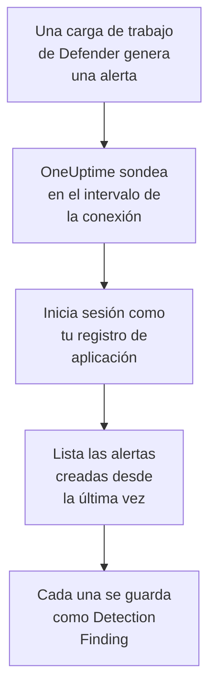

# Microsoft Defender XDR

Importa las alertas de cada carga de trabajo de [Microsoft Defender XDR](https://learn.microsoft.com/en-us/defender-xdr/), de endpoints, identidades, correo y aplicaciones en la nube, en los eventos de seguridad de OneUptime. Allí las buscas junto a tus logs, trazas y métricas, las correlacionas con todas las demás fuentes y avisas a la guardia de las que importan. OneUptime las lee mediante la API de seguridad de Microsoft Graph con un registro de aplicación que tú creas: no hace falta ningún agente, playbook ni área de trabajo de Sentinel.

:::cards
- [Configurar la conexión](#configurar-la-conexión): Un registro de aplicación, un permiso y el formulario de la conexión.
- [Qué se importa](#qué-se-importa): Cómo cada alerta de Defender se convierte en un evento de seguridad.
- [Cómo funciona el sondeo](#cómo-funciona-el-sondeo): La ventana que lee cada sondeo, y lo que le hace un inquilino con mucha actividad.
- [Solución de problemas](#solución-de-problemas): Qué significa cada error y qué cambiar.
:::

## Cómo funciona



Cada minuto, OneUptime sondea cada conexión habilitada cuyo intervalo de sondeo ha pasado. Un sondeo inicia sesión en Microsoft Entra ID como tu registro de aplicación, pide a Microsoft Graph las alertas creadas desde el último sondeo ([List alerts_v2](https://learn.microsoft.com/en-us/graph/api/security-list-alerts_v2)) y guarda cada una como un evento [OCSF](https://schema.ocsf.io/) Detection Finding (clase `2004`). Las reglas de detección, los monitores y los paneles lo tratan entonces como un evento de seguridad de cualquier otra fuente.

## Antes de empezar

- En OneUptime, el rol Project Owner, Project Admin o Security Admin. Los roles Security Member y Security Viewer pueden ver las conexiones y su historial de ejecuciones, pero no cambiarlas.
- Un inquilino de Microsoft Entra con una licencia de Microsoft Defender XDR: cualquier carga de trabajo de Defender incorporada al portal de Microsoft Defender, como Defender for Endpoint, for Identity, for Office 365 o for Cloud Apps.
- Un rol de Entra que pueda registrar aplicaciones, como Administrador de aplicaciones, y un Administrador global o un Administrador de roles con privilegios para conceder el consentimiento de administrador.
- HTTPS saliente de la aplicación y los workers de OneUptime hacia `login.microsoftonline.com` y `graph.microsoft.com`, o hacia `login.microsoftonline.us` y `graph.microsoft.us` para Azure Government.

## Configurar la conexión

La conexión inicia sesión con el [flujo de credenciales de cliente de OAuth 2.0](https://learn.microsoft.com/en-us/entra/identity-platform/v2-oauth2-client-creds-grant-flow): como aplicación, nunca como persona, con un único permiso de aplicación.

:::steps
### Registrar una aplicación

1. Inicia sesión en el [portal de Azure](https://portal.azure.com) y abre **Microsoft Entra ID**.
2. Ve a **App registrations → New registration**. Llámala `OneUptime Security Events`, deja **Supported account types** en **Accounts in this organizational directory only**, deja vacío el URI de redirección y selecciona **Register**.
3. En la página **Overview** de la aplicación, copia el **ID de aplicación (cliente)** y el **ID de directorio (tenant)**.

### Permitirle leer alertas

1. Ve a **API permissions → Add a permission → Microsoft Graph → Application permissions**, elige `SecurityAlert.Read.All` y selecciona **Add permissions**. Es el permiso con menos privilegios que la llamada [List alerts_v2](https://learn.microsoft.com/en-us/graph/api/security-list-alerts_v2#permissions) acepta para una aplicación: no añadas `SecurityAlert.ReadWrite.All`.
2. Selecciona **Grant admin consent for** tu inquilino y confirma. El estado del permiso debe indicar **Granted**: sin consentimiento, cada lectura se rechaza con `403`.

### Crear un secreto de cliente

Ve a **Certificates & secrets → Client secrets → New client secret**, elige cuándo caduca y selecciona **Add**. Copia el **Value** del secreto, no su **Secret ID**, antes de salir de la página: no se vuelve a mostrar.

Anota cuándo caduca el secreto. Ese día, el sondeo se detiene con `Microsoft Defender XDR token request failed (HTTP 401)` hasta que lo sustituyas con **Actualizar credenciales**.

### Añadir la conexión en OneUptime

Abre **Productos → Eventos de seguridad → Conexiones** (`/dashboard/{projectId}/security-events/connections`), haz clic en **Añadir conexión**, elige **Microsoft Defender XDR** en **EDR / XDR** y haz clic en **Siguiente**. Rellena los ajustes de la tabla de abajo, haz clic en **Siguiente** y pega el valor del secreto en **Secreto del cliente**.

### Probarla antes de guardar

Haz clic en **Probar esta configuración** en **Probar antes de guardar**. La prueba inicia sesión y lee alertas con los valores del formulario, y no guarda nada, así que un secreto erróneo o un consentimiento que falta aparecen antes de que exista la conexión. Luego haz clic en **Siguiente**, da a la conexión un **Nombre** y créala.
:::

| Ajuste | Dónde encontrarlo |
| --- | --- |
| **ID de directorio (tenant)** | La página **Overview** de la aplicación. El GUID del inquilino, o un dominio verificado como `contoso.onmicrosoft.com`. |
| **ID de aplicación (cliente)** | La página **Overview** de la aplicación. El GUID de la aplicación que tiene `SecurityAlert.Read.All`. |
| **Nube** | **Nube pública de Azure**, que también sirve a Microsoft 365 GCC, o **Azure Government (EE. UU.)** para GCC High (`login.microsoftonline.us` y `graph.microsoft.us`). Microsoft 365 DoD y la nube de 21Vianet en China no son compatibles. |
| **Secreto del cliente** | El **Value** del secreto. Se cifra, la API nunca lo devuelve y no se vuelve a mostrar. Sustitúyelo con **Actualizar credenciales** en la conexión. |

El paso **Sondeo** también tiene una **Descripción** opcional, el **Intervalo de sondeo (minutos)**, un número entero de `1` a `1440` que empieza en `5`, y **Habilitado**, que empieza activado.

## Qué se importa

Cada [alerta](https://learn.microsoft.com/en-us/graph/api/resources/security-alert) de Defender XDR se convierte en un evento Detection Finding (clase OCSF `2004`), con el proveedor `Microsoft` y el producto `Microsoft Defender XDR`, atribuido al servicio de telemetría `Microsoft Defender XDR`:

| Columna OCSF | Campo de la alerta |
| --- | --- |
| `eventUid` | `id`, el ID de la alerta de Graph, que también sirve para descartar duplicados |
| `time` | `firstActivityDateTime`, o `createdDateTime` si no lo hay |
| `message`, `ruleName` | `title` |
| `ruleId` | `detectorId`, o `alertPolicyId` si no lo hay |
| `severityName` | `severity`: `informational`, `low`, `medium` o `high`, y `unknown` queda como Unknown |
| `statusName` | `status`: `new` se convierte en New, `inProgress` en In Progress, `resolved` en Resolved |
| `mitreTechniques` | `mitreTechniques` |
| `mitreTactics` | `categories` o `category`, cuando es una táctica de ATT&CK: `CredentialAccess` se convierte en `TA0006`. Las demás categorías quedan en `attributes`. |
| `principalHost`, `principalUser`, `principalIp`, `principalProcess` | La `evidence` con el rol `source`, `attacker` o `compromised`, o si no la primera de cada tipo |
| `processName`, `processPath`, `processCommandLine`, `parentProcessName`, `parentProcessPath` | La evidencia de proceso de la que sale `principalProcess`: su `imageFile`, `processCommandLine` y `parentProcessImageFile`. Graph no da la línea de comandos del proceso padre. |
| `targetHost`, `targetUser`, `targetIp`, `targetResource` | La `evidence` con un rol de destino, como `destination` o `attacked`. Las URL, los buzones y los recursos en la nube rellenan `targetResource`. |
| `observables` | Cada nombre de host, IP, usuario, nombre de archivo, SHA-1 y SHA-256, URL, dominio, buzón e ID de recurso de `evidence` |
| `attributes` | La alerta completa, aplanada en claves con puntos como `evidence.0.hostName`, `serviceSource` e `incidentId` |

Se importan las alertas de cada `serviceSource`, también las de Microsoft Sentinel una vez que Sentinel está conectado al portal de Defender. Los incidentes no se importan, pero cada alerta conserva su `incidentId` y su `incidentWebUrl` en `attributes`.

## Cómo funciona el sondeo

Cada sondeo lista las alertas creadas en su ventana, 100 por página, y sigue el `@odata.nextLink` de Graph hasta haber leído toda la ventana:

```text
GET https://graph.microsoft.com/v1.0/security/alerts_v2?$filter=createdDateTime ge {start} and createdDateTime lt {end}&$top=100
```

- **La hora de creación es el cursor.** Defender a menudo crea una alerta horas después de su `firstActivityDateTime`, y un cursor sobre la hora de actividad se saltaría cada una de esas alertas.
- **El primer sondeo mira 24 horas atrás**, para que una conexión nueva muestre enseguida sus alertas recientes.
- **Cada sondeo posterior empieza 1 minuto antes del cursor guardado**, para que una alerta creada en el límite entre dos ventanas se lea dos veces y se importe una.
- **Un sondeo lee como mucho 24 horas más allá del cursor.** Una conexión cuyo cursor se quedó atrás, mientras los workers estaban caídos o el inquilino estaba limitado, se pone al día en una serie de ventanas de 24 horas.
- **Los duplicados se descartan por el `id` de la alerta** entre los eventos del proyecto de `Microsoft` / `Microsoft Defender XDR`, para que el solapamiento, una ventana reintentada y una importación nunca guarden una alerta dos veces.
- **Una ejecución fallida no cambia nada.** Tras un error de red, o un estado de error de Graph, el cursor y la longitud de ventana quedan como estaban, y el siguiente sondeo vuelve a leer la misma ventana. La única excepción es una solicitud que agotó el tiempo: el cursor se queda, pero la siguiente ventana es la mitad de larga, porque una ventana demasiado pesada para responder a tiempo agotaría el tiempo en cada intento.

### Cuando una ventana contiene más de lo que un sondeo puede leer

Un sondeo lee como mucho 20 páginas de 100 alertas: 2.000 alertas. Cuando ese límite lo detiene antes del final de su ventana, la ejecución es **Parcial**, con este aviso:

```text
Stopped after 20 alerts requests (the per-run request limit) before reading the whole window. Microsoft Graph lists alerts newest first and documents no way to sort them oldest first, so this run cannot name a point to resume from.
```

[List alerts_v2](https://learn.microsoft.com/en-us/graph/api/security-list-alerts_v2) documenta `$filter`, `$top`, `$skip` y `$count`, pero no `$orderby`, y devuelve primero las alertas más nuevas. Las 2.000 alertas que leyó una ejecución detenida son las más nuevas de su ventana, así que mover el cursor más allá de ellas se saltaría las más antiguas a las que nunca llegó. OneUptime acorta la ventana en su lugar:

1. **Reducir.** El siguiente sondeo lee una ventana de la mitad de largo, desde el mismo punto de partida, y sigue reduciéndola a la mitad hasta que una ventana se lee entera, hasta un minuto. El aviso de la ejecución lo dice: `This window holds more records than one poll can read; the next poll reads a {n} minute window from the same starting point.` Las alertas ya importadas de la ventana más larga se omiten como duplicados.
2. **Volver a crecer.** Cuando una ventana se lee entera, el cursor pasa a su final, y la siguiente ventana vuelve a ser el doble de larga, hasta 24 horas.
3. **Pasar más allá de un único minuto.** Si incluso un minuto contiene más de 2.000 alertas, el sondeo lo pasa de largo, para que sigan llegando las alertas más nuevas. La ejecución sigue siendo **Parcial**, y **Último error** indica `More records were created in the one minute from {cursor} to {end} than one poll can read. Polling moved past this minute so newer records keep arriving; use Import this time range in Diagnostics on this minute to recover what one run can read.` Importa ese minuto con **Importar este intervalo de tiempo** para recuperar lo que una ejecución puede leer.

Una ejecución **Parcial** por otro motivo, como una alerta que no se pudo leer como evento de seguridad, se reintenta de la misma manera, desde el mismo punto de partida. Cambiar el **Intervalo de sondeo (minutos)** no cambia nada de esto: decide cada cuánto empieza un sondeo, no dónde empieza su ventana.

### Ejecutar, previsualizar e importar a demanda

Haz clic en **Diagnósticos** en una conexión para ver sus ejecuciones recientes y trabajar con ella a mano. Quien puede cambiar la conexión puede iniciar estas acciones; quien puede verla puede leer el historial.

- **Ejecutar ahora** inicia un sondeo de inmediato, con el cursor habitual, incluso cuando la conexión no está **Habilitado**.
- **Preview alerts** lee un intervalo de tiempo de hasta 7 días y no importa nada.
- **Importar este intervalo de tiempo** importa un intervalo de hasta 7 días, después de que lo confirmes, sin mover el cursor. Las alertas ya importadas se omiten.
- **Copiar diagnósticos** en una ejecución copia su informe para soporte. Nunca incluye credenciales.

## Probar conexión

**Probar conexión** en la fila de una conexión, y **Probar esta configuración** en el formulario, se ejecutan en el proceso de la API, no en un worker en segundo plano, para que una prueba responda incluso cuando el problema son los workers. Hace estas comprobaciones, en orden:

| Comprobación | Qué comprueba |
| --- | --- |
| **Configuración** | Los cuatro ajustes están presentes y bien formados. No se contacta con nada cuando esto falla. |
| **Authenticate with Microsoft Entra** | Microsoft Entra ID emite un token para Microsoft Graph, en la nube que elegiste. Falla con un secreto erróneo o caducado, un ID de inquilino o de cliente erróneo, o la nube equivocada. |
| **Read alerts from Microsoft Graph** | Se puede leer una alerta creada en las últimas 24 horas (`$top=1`). Un `403` aquí es el permiso `SecurityAlert.Read.All` que falta, el consentimiento de administrador que falta o un inquilino sin Defender XDR. |
| **Alerts available to import** | Cuántas alertas se crearon en las últimas 24 horas y en los últimos 7 días, una página de 100 para cada uno, así que `100+` significa más. Ninguna en 7 días es un aviso, no un fallo. |
| **Background workers**, **Poll scheduler**, **Security event storage** | El lado del propio OneUptime: un proceso toma los trabajos de la cola Worker, el trabajo de sondeo se ejecuta cada minuto y el almacén de eventos de seguridad responde. |
| **Sondeo programado** | Para una conexión guardada: el sondeo está activado, ninguna ejecución está atascada esperando a un worker y los sondeos se ejecutan a tiempo. |

Cada solicitud de una prueba tiene un plazo de 20 segundos. Una prueba nunca importa nada ni mueve el cursor, y cada comprobación que falla dice qué cambiar.

## Solución de problemas

El **Último error** de la conexión guarda el mensaje de error completo, con las credenciales ocultas, tras un prefijo que nombra el paso que falló. Cuando una conexión tiene un error, selecciona **Ver error** en su columna **Acciones** para leerlo, y **Copiar error** en el cuadro de diálogo para copiarlo. Lee primero el prefijo.

:::details Último error empieza por `Microsoft Defender XDR token request`
- `Microsoft Defender XDR token request failed (HTTP ...)`: Microsoft Entra ID se negó a emitir un token, así que nunca se contactó con Graph. El mensaje termina con una pista, según el código `error` de Entra:
  - `invalid_client` (`AADSTS7000215`): el secreto es erróneo, ha caducado o pertenece a otra aplicación. Crea uno nuevo en **Certificates & secrets** y guárdalo con **Actualizar credenciales**.
  - `unauthorized_client` (`AADSTS700016`): el **ID de aplicación (cliente)** no está en ese **ID de directorio (tenant)**, o **Nube** es errónea.
  - `AADSTS90002`: ese inquilino no existe.
  - `invalid_scope`: el ámbito de Graph no existe en la nube que elegiste. Revisa **Nube**.
- `Microsoft Defender XDR token request returned ...`: Microsoft Entra ID respondió con algo inutilizable, un cuerpo que no es JSON o sin `access_token`. Suele ser un proxy o una pasarela en medio, no las credenciales.
- `Microsoft Defender XDR token request did not complete: ...`: no se pudo llegar al punto de conexión de tokens, o no respondió a tiempo. Revisa el HTTPS saliente de la aplicación y los workers de OneUptime hacia `login.microsoftonline.com`, o `login.microsoftonline.us`.
:::

:::details Último error empieza por `Microsoft Defender XDR alerts request`
- `Microsoft Defender XDR alerts request failed (HTTP ...)`: Graph se negó a listar las alertas. El mensaje nombra el código de error de Graph, y una pista:
  - `403` (`Authorization_RequestDenied`): falta `SecurityAlert.Read.All` o su consentimiento de administrador, o el inquilino no tiene licencia de Defender XDR. El consentimiento tarda unos minutos en aplicarse.
  - `401` (`InvalidAuthenticationToken`) después de emitirse un token: **Nube** no suele coincidir con el inquilino.
  - `429` (`TooManyRequests`): Graph está limitando la aplicación, y el siguiente sondeo vuelve a leer la misma ventana. El mensaje no puede citar el `Retry-After` de Graph, porque el cliente HTTP de OneUptime no conserva las cabeceras de respuesta en un error. Si sigue pasando, sube el **Intervalo de sondeo (minutos)**.
  - `5xx`: un problema del lado de Graph. El siguiente sondeo lo vuelve a intentar.
  - `400`: Graph no quiso ejecutar la consulta, que construye OneUptime y no tus ajustes. Copia el mensaje para el soporte de OneUptime.
- `Microsoft Defender XDR alerts request returned ...`: Graph respondió `200`, pero con algo que el conector no podía usar: un cuerpo que no es JSON, ninguna lista `value` o un `@odata.nextLink` que no es un enlace `https://` en el host de Graph de tu nube. Un enlace así se rechaza, para que el token nunca se envíe a otro sitio. Se notifica en lugar de tomarse como una ventana vacía, para que el cursor nunca pase de largo alertas que nadie leyó.
- `Microsoft Defender XDR alerts request did not complete: ...`: no se pudo llegar a Graph, o no respondió a tiempo: 60 segundos para un sondeo, 20 para una prueba. Revisa el HTTPS saliente hacia `graph.microsoft.com`, o `graph.microsoft.us`.
:::

:::details La prueba pasa, pero Último sondeo indica Never
El trabajo de sondeo nunca se ha ejecutado. Lee las comprobaciones **Background workers** y **Poll scheduler**. En una instalación autoalojada, la causa habitual es `DISABLE_QUEUE_WORKERS=true` en la aplicación, sin un despliegue de workers aparte que tome los trabajos: ponlo en `false`, o ejecuta el despliegue de workers (Helm: `worker.enabled: true`, que es `false` por defecto).
:::

:::details Los sondeos funcionan, pero falta una alerta que conoces
Compara el `createdDateTime` de la alerta en el portal de Defender con la ventana de la ejecución en **Diagnósticos**: las ventanas van por hora de creación, no por hora de actividad.

- Una alerta creada antes de que existiera la conexión es más antigua que la primera mirada de 24 horas atrás. Impórtala con **Importar este intervalo de tiempo**.
- Una ejecución **Parcial** se detuvo por el límite de 2.000 alertas. El siguiente sondeo lee una ventana más corta desde el mismo inicio, así que la alerta se importa en cuanto se lee entera una ventana que la contiene.
- Si **Último error** nombra un minuto que el sondeo pasó de largo, importa ese minuto con **Importar este intervalo de tiempo**.
:::

:::details La misma alerta aparece dos veces
No es por el solapamiento de 1 minuto: la segunda lectura cuenta como duplicado y no se guarda. Se importaron dos eventos con el mismo `eventUid` con productos distintos, como la misma alerta que llega también por una conexión de Microsoft Sentinel. Los duplicados se descartan por proveedor y producto.
:::

## Qué obtienes

- **Búsqueda.** Filtra las alertas de Defender por gravedad, estado, técnica de MITRE, host, usuario, IP o cualquier observable en el explorador de eventos de seguridad, junto a los logs y métricas de ese host.
- **Correlación.** La evidencia de cada alerta, sus dispositivos, usuarios, IP, archivos y URL, se indexa como observables, así que una búsqueda encuentra todo lo que menciona un host en todas las fuentes.
- **Reglas de detección.** Reglas Sigma que se ejecutan según una programación sobre tus eventos de seguridad, y abren alertas que avisan a la guardia.
- **Monitores.** Los monitores de eventos de seguridad cuentan los eventos que coinciden, y abren incidentes o alertas por encima de un umbral.

Los eventos de seguridad se facturan como el resto de tu telemetría, por GB ingerido. Consulta los [precios](https://oneuptime.com/pricing).

## Próximos pasos

:::cards
- [Eventos de seguridad](/docs/telemetry/security-events): Busca, correlaciona y alerta sobre lo que importas.
- [Microsoft Sentinel](/docs/integrations/microsoft-sentinel): Importa también los incidentes de un área de trabajo de Sentinel.
- [Roles](/docs/permissions/reference#roles): Lo que pueden ver y cambiar los roles Security.
- [Descripción general de integraciones](/docs/integrations/index): Las demás herramientas que puedes conectar.
:::
