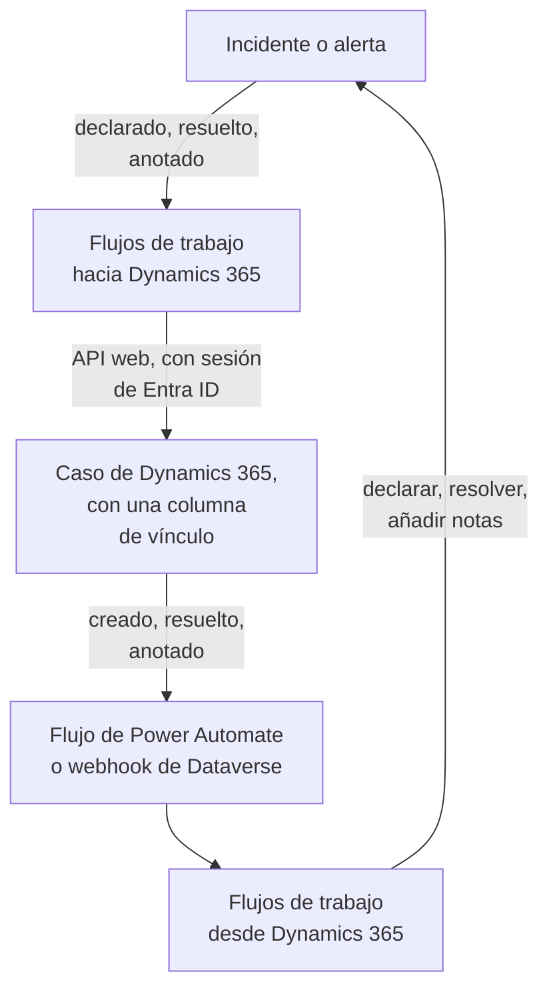

# Microsoft Dynamics 365

Mantén los casos de [Microsoft Dynamics 365](https://www.microsoft.com/dynamics-365) al día con tus incidentes y alertas de OneUptime, en ambos sentidos. Unas plantillas de flujo de trabajo listas para usar abren un caso por cada incidente o alerta, lo cierran cuando el registro se resuelve y copian las notas en él. Otras declaran incidentes a partir de casos nuevos y traen de vuelta las resoluciones y las notas. No hay ningún plugin: los flujos de trabajo llaman a la API web de Dataverse, y Dynamics 365 llama a sus URL de webhook.

:::cards
- [Preparar Dynamics 365](#preparar-dynamics-365): Un registro de aplicación, un usuario de aplicación y una columna de vínculo.
- [Empezar con una plantilla](#empezar-con-una-plantilla): Las 13 plantillas, qué piden y cómo configurarlas.
- [Cómo funcionan las plantillas](#cómo-funcionan-las-plantillas): Cómo casos y registros siguen vinculados, sin bucles.
- [Construirlo tú mismo](#construirlo-tú-mismo): Cada sentido a mano, para cuando una plantilla no encaja.
:::

## Cómo funciona



Cada plantilla es un pequeño flujo de trabajo, así que tomas solo los sentidos que quieras, para incidentes, alertas o ambos. Las plantillas de OneUptime → Dynamics 365 llaman a la API web de Dataverse, con sesión iniciada como aplicación mediante Microsoft Entra ID. Las plantillas de Dynamics 365 → OneUptime se inician cuando un flujo de Power Automate o un webhook de Dataverse las llama. Una columna de texto que añades a la tabla Case vincula cada caso con su registro.

## Antes de empezar

- Un entorno de Dynamics 365 con la tabla **Case**. Los casos vienen de Dynamics 365 Customer Service: un entorno de Dataverse sin él no tiene ninguna tabla `incident` en la que escribir.
- Permiso para registrar una aplicación en **Microsoft Entra ID** y para crear un usuario de aplicación en el entorno. Suelen ser dos administradores distintos.
- En OneUptime, permiso para crear flujos de trabajo. En OneUptime Cloud, los flujos de trabajo necesitan el plan **Growth** o superior.

> [!NOTE]
> Esta página usa los nombres de Dataverse, no las etiquetas de los formularios de Dynamics. Un caso es la tabla `incident`, su colección en una URL es `incidents`, su clave es `incidentid` y su columna de título es `title`. El número de caso que ves es `ticketnumber`.

## Preparar Dynamics 365

Tanto las plantillas como un flujo de trabajo que construyas tú necesitan esto. OneUptime inicia sesión como aplicación, no como persona, con el flujo de credenciales de cliente de OAuth 2.0.

:::steps
### Registrar una aplicación en Microsoft Entra ID

1. Inicia sesión en [Azure Portal](https://portal.azure.com) como administrador del inquilino de tu entorno de Dynamics y abre **Microsoft Entra ID**.
2. Ve a **App registrations → New registration**. Ponle el nombre `OneUptime Integration`, deja **Supported account types** en **Accounts in this organizational directory only** y selecciona **Register**.
3. En la página **Overview** de la aplicación, copia el **Application (client) ID** y el **Directory (tenant) ID**.
4. Ve a **Certificates & secrets → Client secrets → New client secret** y copia el **Value** del secreto, no su ID, antes de salir de la página: no se vuelve a mostrar nunca. Un secreto de cliente dura como máximo 24 meses, así que apunta cuándo caduca.

No añadas permisos de API ni concedas consentimiento de administrador: sin un usuario con sesión iniciada, no hacen nada. Dynamics 365 decide qué puede hacer la aplicación, mediante su usuario de aplicación.

### Crear el usuario de aplicación

1. En el [centro de administración de Power Platform](https://admin.powerplatform.microsoft.com/), selecciona **Manage → Environments** y luego tu entorno.
2. Selecciona **Settings → Users + permissions → Application users**, luego **+ New app user** y **+ Add an app**. Elige el registro y selecciona **Add**.
3. Elige una **Business unit** y luego dale un rol de seguridad personalizado con el icono de edición junto a **Security roles**. En el nivel Organization, el rol necesita:
   - **Case**: Create, Read, Write, Append y Append To.
   - **Note**: Create, Read y Append, para las plantillas de notas.
   - **Activity**: Create, Read y Append, porque cerrar un caso registra una Case Resolution, que es una actividad.
   - **Account**, y **Contact** si los casos se abren a nombre de un contacto: Read y Append To.
4. Selecciona **Save** y luego **Create**.

Un usuario de aplicación solo puede tener un rol personalizado: copia uno existente y recórtalo. Sin este usuario, Microsoft Entra ID sigue emitiendo tokens, pero cada llamada a Dynamics 365 falla con `403` y `0x80072560`, «The user isn't a member of the organization».

### Añadir una columna de vínculo a la tabla Case

Dataverse no tiene nada parecido a las etiquetas de Jira, así que un caso y un registro de OneUptime se encuentran mediante una columna que añades.

1. En [make.powerapps.com](https://make.powerapps.com), elige tu entorno, abre **Tables → Case → Columns** y selecciona **New column**.
2. Ponle el nombre `OneUptime Link`, deja **Data type** en **Single line of text** y guárdala. La longitud máxima predeterminada de 100 es de sobra: las plantillas escriben como mucho 55 caracteres.
3. Abre la nueva columna y copia su **Logical name**, como `new_oneuptimelink`. El prefijo viene del editor de tu solución, así que el tuyo puede ser distinto, como `cr4f2_oneuptimelink`.

Añade la columna al formulario de Case si los agentes deben ver el vínculo.
:::

## Empezar con una plantilla

El diálogo **Crear un flujo de trabajo** tiene 13 plantillas de Dynamics 365, en **Dynamics 365** dentro de su lista de categorías: siete para incidentes y luego seis para alertas, cada grupo bajo su propio encabezado. Comparten la columna de vínculo, así que cualquier combinación de ellas funciona en conjunto.

### Plantillas para incidentes

| Plantilla | Qué hace | Qué pide |
| --- | --- | --- |
| **OneUptime → Dynamics 365** | | |
| Create a Dynamics 365 case when an incident is declared | Abre un caso por cada incidente nuevo, con una prioridad elegida según su gravedad y el ID del incidente en la columna de vínculo. Los incidentes declarados desde Dynamics 365, y los incidentes privados, se omiten. | Los cinco ajustes de Dynamics 365, el cliente de los casos nuevos y la URL de OneUptime |
| Resolve the Dynamics 365 case when the incident is resolved | Cierra el caso vinculado como **Problem Solved** cuando el incidente se resuelve, registrando una Case Resolution como hace resolverlo a mano. Nunca reabre un caso. | Los cinco ajustes de Dynamics 365 |
| Copy incident private notes to the Dynamics 365 case | Añade cada nota privada nueva al caso vinculado como nota. | Los cinco ajustes de Dynamics 365 |
| Copy incident public notes to the Dynamics 365 case | Añade cada nota pública nueva al caso vinculado como nota, para que los agentes puedan contar a los clientes lo que dice la página de estado. | Los cinco ajustes de Dynamics 365 |
| **Dynamics 365 → OneUptime** | | |
| Declare an incident when a Dynamics 365 case is created | Declara un incidente por cada caso nuevo, fuera de tus páginas de estado, con una gravedad elegida según la prioridad del caso, y luego escribe el ID del incidente en la columna de vínculo del caso. | Los cinco ajustes de Dynamics 365, y un flujo o un webhook para los casos nuevos |
| Resolve the incident when its Dynamics 365 case is resolved | Resuelve el incidente cuando su caso vinculado se resuelve. | Los cinco ajustes de Dynamics 365, y un flujo o un webhook para los cambios de estado de los casos |
| Add Dynamics 365 case notes to the incident as private notes | Copia cada nota que un agente añade a un caso vinculado en el incidente, como nota privada. | Los cinco ajustes de Dynamics 365, y un flujo o un webhook para las notas nuevas |

### Plantillas para alertas

Las plantillas para alertas hacen los mismos trabajos para las alertas. Hay una menos, porque las alertas no tienen notas públicas, y **Create an alert when a Dynamics 365 case is created** no escribe ningún ajuste de página de estado, porque una alerta nunca llega a una página de estado.

| Plantilla | Qué hace | Qué pide |
| --- | --- | --- |
| **OneUptime → Dynamics 365** | | |
| Create a Dynamics 365 case when an alert is created | Abre un caso por cada alerta nueva, incluida cada alerta que genera un monitor. Las alertas creadas desde Dynamics 365, y las alertas privadas, se omiten. | Los cinco ajustes de Dynamics 365, el cliente de los casos nuevos y la URL de OneUptime |
| Resolve the Dynamics 365 case when the alert is resolved | Cierra el caso vinculado como **Problem Solved** cuando la alerta se resuelve. | Los cinco ajustes de Dynamics 365 |
| Copy alert private notes to the Dynamics 365 case | Añade cada nota privada nueva al caso vinculado como nota. | Los cinco ajustes de Dynamics 365 |
| **Dynamics 365 → OneUptime** | | |
| Create an alert when a Dynamics 365 case is created | Crea una alerta por cada caso nuevo, con una gravedad elegida según la prioridad del caso, y luego escribe el ID de la alerta en la columna de vínculo del caso. | Los cinco ajustes de Dynamics 365, y un flujo o un webhook para los casos nuevos |
| Resolve the alert when its Dynamics 365 case is resolved | Resuelve la alerta cuando su caso vinculado se resuelve. | Los cinco ajustes de Dynamics 365, y un flujo o un webhook para los cambios de estado de los casos |
| Add Dynamics 365 case notes to the alert as private notes | Copia cada nota que un agente añade a un caso vinculado en la alerta, como nota privada. | Los cinco ajustes de Dynamics 365, y un flujo o un webhook para las notas nuevas |

Ninguna de las plantillas de OneUptime → Dynamics 365 envía a Dynamics 365 un incidente marcado como **Incidente privado**, ni una alerta marcada como **Alerta privada**: ni el registro, ni su estado, ni sus notas, salvo que lo actives. Consulta [Cambiar lo que hace una plantilla](#cambiar-lo-que-hace-una-plantilla).

**Los monitores generan alertas por sí solos, y pueden generar muchas.** **Create a Dynamics 365 case when an alert is created** abre un caso por cada una. Salvo que cada alerta merezca un caso, pon un bloque **If / Else** entre el disparador y el resto del flujo de trabajo, por ejemplo sobre `{{local.components.alert-on-create-1.returnValues.model.alertSeverity.name}}`, y conecta solo su lado **Yes** hacia delante.

### Qué piden las plantillas

El paso **Configurar** del asistente de creación pide hasta siete valores: cada plantilla pide los cinco primeros, los ajustes de Dynamics 365, y las dos plantillas que crean un caso piden además los dos últimos. Comprueba la forma de cada ajuste de Dynamics 365 antes de crear nada y dice qué escribir en su lugar, porque un valor con la forma equivocada no da error en ningún sitio hasta una ejecución.

- **Dynamics 365 Environment URL** — la dirección de tu entorno, como `https://yourorg.crm.dynamics.com`, del [centro de administración de Power Platform](https://admin.powerplatform.microsoft.com/) en **Environments**, tu entorno, **Environment URL**. Solo la dirección: no el endpoint de la API web, que termina en `/api/data/v9.2`, y sin barra al final.
- **Directory (Tenant) ID** — de la página **Overview** del registro de aplicación.
- **Application (Client) ID** — de la misma página.
- **Client Secret Value** — el **Value** del secreto de cliente, de **Certificates & secrets**. No su **Secret ID**, que es un GUID: el asistente rechaza aquí un GUID.
- **Case Link Column** — el nombre lógico de la columna de vínculo, como `new_oneuptimelink`.
- **Customer for New Cases** — solo lo piden las dos plantillas que crean un caso. Cada caso necesita un cliente, y un incidente de OneUptime no tiene ninguno, así que todos los casos nuevos se abren a nombre de uno: pega el ID de una cuenta, o `contacts(<id>)` para un contacto. Abre el registro en Dynamics 365: su ID es la parte que va después de `id=` en la dirección.
- **OneUptime URL** — solo la piden las dos plantillas que crean un caso: la dirección en la que abres OneUptime, como `https://oneuptime.com`. La descripción del caso enlaza con ella de vuelta al incidente o la alerta.

**Cómo inician sesión las plantillas.** El asistente guarda el inquilino, el ID de cliente y el secreto en una sola [variable OAuth 2.0](/docs/workflows/variables#variables-oauth-20-tokens-que-se-renuevan-solos), `dynamicsAccessToken`, en **Variables del flujo de trabajo** del flujo de trabajo: Client Credentials, la URL del token `https://login.microsoftonline.com/<tenant>/oauth2/v2.0/token`, el ámbito `<environment URL>/.default` y el secreto de cliente, enviado en el cuerpo de la solicitud y guardado cifrado. Cada llamada a Dynamics 365 envía `Authorization: Bearer {{local.variables.dynamicsAccessToken}}`. OneUptime obtiene el token la primera vez que un paso lo necesita, obtiene uno nuevo antes de que caduque y lo sustituye por `[REDACTED]` en los registros de ejecución y en las trazas de los pasos.

Para comprobar el inicio de sesión antes de que se ejecute nada, abre **Variables del flujo de trabajo**, haz clic en **Ver** en `dynamicsAccessToken` y haz clic en **Actualizar ahora**. **Access Token Fetched** significa que el registro de aplicación es correcto. Si no, el error de Microsoft Entra ID nombra lo que está mal, como `AADSTS7000215: Invalid client secret provided`.

Cada flujo de trabajo guarda su propia copia. Cuando sustituyas el secreto de cliente, abre `dynamicsAccessToken` en cada flujo de trabajo de Dynamics 365 y usa **Actualizar credenciales**.

### Crear los flujos de trabajo

:::steps
1. Abre **Flujos de trabajo → Crear flujo de trabajo**. En **O empieza con una plantilla**, elige **Dynamics 365** en la lista de categorías, o escribe `Dynamics` en **Buscar plantillas…**, y haz clic en la plantilla que quieras. Se abre y muestra lo que hace y los ajustes que pedirá. Haz clic en **Usar esta plantilla**.
2. **Nombre** se rellena a partir de la plantilla. Cámbialo si quieres.
3. **Configurar** pide los valores de arriba.
4. Haz clic en **Crear flujo de trabajo**. Todo flujo de trabajo se crea desactivado: activa **Habilitado** en la parte superior de su **Constructor**.
:::

Empieza con **Create a Dynamics 365 case when an incident is declared**, o con **Create a Dynamics 365 case when an alert is created** para las alertas: cada otra plantilla de OneUptime → Dynamics 365 del mismo tipo encuentra el caso por el vínculo que escribe esta. Actívala, declara un incidente de prueba o crea una alerta de prueba, y abre **Registros → Ejecuciones** del flujo de trabajo. La ejecución debería terminar como **Ejecutado**, y el **Response Body** de su último paso, `create-case-1`, contiene el `ticketnumber` del nuevo caso, como `CAS-01001-X1Y2Z3`.

### Conectar las plantillas de Dynamics 365 → OneUptime

Las plantillas de Dynamics 365 → OneUptime, tres para incidentes y tres para alertas, parten de un [disparador Webhook](/docs/workflows/triggers#webhook), así que hay que decirle a Dynamics 365 adónde enviar sus eventos. Hazlo en este orden:

1. Crea el flujo de trabajo y **actívalo primero**. Un flujo de trabajo desactivado rechaza las entregas, y no se ponen en cola.
2. Abre el **Constructor** del flujo de trabajo, haz clic en el bloque disparador **Webhook** (`webhook-1`) y haz clic en **Copiar URL** en la parte superior de sus ajustes. La URL tiene este aspecto:

   ```text
   https://<your OneUptime host>/workflow/trigger/<webhook secret key>
   ```

3. Haz que Dynamics 365 publique en ella, desde un flujo de Power Automate o desde un webhook de Dataverse.

Cada plantilla solo necesita saber qué fila cambió. Vuelve a leer esa fila en Dynamics 365 antes de hacer nada, así que nunca toma de la solicitud el título, el estado ni el vínculo de un caso, y le da igual cuál de los dos la envíe.

:::tabs
@tab Power Automate flow
En [Power Automate](https://make.powerautomate.com), crea un **Automated cloud flow** con el disparador **When a row is added, modified or deleted** de **Microsoft Dataverse**, configurado como se indica abajo, con **Scope** en **Organization**. Añade la acción integrada **HTTP**: **Method** `POST`, **URI** la URL del flujo de trabajo, una cabecera `Content-Type: application/json` y el cuerpo de abajo, con el ID de la fila tomado del contenido dinámico del disparador.

| Plantilla | Change type | Table name | Select columns | Body |
| --- | --- | --- | --- | --- |
| Declarar un incidente / crear una alerta cuando se crea un caso | Added | Cases | | `{"PrimaryEntityId": "<Case>"}` |
| Resolver el incidente / la alerta cuando se resuelve su caso | Modified | Cases | `statecode,statuscode` | `{"PrimaryEntityId": "<Case>"}` |
| Añadir las notas del caso al incidente / la alerta como notas privadas | Added | Notes | | `{"PrimaryEntityId": "<Note>"}` |

Para enviar solo algunos casos, usa **Filter rows** del disparador, como `prioritycode eq 1` para los casos de prioridad alta. El cuerpo nombra la fila como `PrimaryEntityId`, como hace un webhook de Dataverse: las plantillas vuelven a leer la propia fila desde Dynamics 365.
@tab Dataverse webhook
Registra la URL con la [Plug-in Registration Tool](https://learn.microsoft.com/en-us/power-apps/developer/data-platform/register-web-hook): **Register New WebHook**, con autenticación **HttpHeader** y una cabecera propia; la URL en sí es el secreto. Después registra en él un paso por cada evento de abajo, con **Event Pipeline Stage of Execution** en **PostOperation** y **Execution Mode** en **Asynchronous**.

| Plantilla | Message | Primary Entity | Filtering Attributes |
| --- | --- | --- | --- |
| Declarar un incidente / crear una alerta cuando se crea un caso | `Create` | `incident` | |
| Resolver el incidente / la alerta cuando se resuelve su caso | `Close`, y `Update` para los cambios de estado hechos por otros | `incident` | `statecode, statuscode` (Update) |
| Añadir las notas del caso al incidente / la alerta como notas privadas | `Create` | `annotation` | |

Resolver un caso genera el mensaje **Close**, no **Update**, por eso esa plantilla necesita ambos. Un webhook publica el contexto de ejecución del plug-in, que nombra la fila en `PrimaryEntityId`, o, para **Close**, en su `IncidentResolution`, y las plantillas la leen de ahí. Un webhook de Dataverse solo llama a los puertos 80 y 443, y no tiene un filtro de filas propio: cada caso nuevo llega a la plantilla de creación, salvo que lo acotes con `ONLY_PRIORITIES`.
:::

Antes de confiar en cualquiera de los dos:

- **Quien tenga la URL puede disparar el flujo de trabajo.** Como las plantillas vuelven a leer cada fila en Dynamics 365, una solicitud solo puede hacer que miren un caso o una nota reales. Aun así, puede hacer que las plantillas de creación actúen sobre un caso que todavía no está vinculado. Guarda la URL solo en el flujo o en el webhook. Si se filtra, haz clic en el disparador **Webhook** en el **Constructor** del flujo de trabajo, haz clic en **Restablecer URL** y pega la URL nueva en el flujo o en el webhook. La URL antigua deja de funcionar al instante.
- **Cada evento es una ejecución**, incluidas las que una plantilla omite. En OneUptime Cloud, cada una cuenta para las ejecuciones de flujos de trabajo de tu plan, y filtrar en el flujo mantiene bajo ese número. Consulta [Límites del plan](/docs/workflows/configuration#límites-del-plan).
- **¿Usas las dos plantillas que crean un registro a partir de un caso?** **Declare an incident when a Dynamics 365 case is created** y **Create an alert when a Dynamics 365 case is created** actúan ambas sobre cada caso que se les envía. Cada una comprueba primero la columna de vínculo, pero dos entregas para un mismo caso nuevo llegan a la vez, así que el caso puede acabar con un incidente y una alerta. Envíales casos distintos, por ejemplo por tipo de caso.

### Comprobar que funciona

Los **Pasos** de cada ejecución dicen qué hizo la plantilla, así que abre la ejecución en **Registros → Ejecuciones** y mira cómo terminó:

- **Ejecutado**: hizo su trabajo, y su último paso nombra el caso, el incidente o la alerta.
- **Ejecutado**, con su paso **Check With JavaScript** en **No**: omitió el evento a propósito, y el paso dice por qué: el caso no está vinculado a un registro de este tipo, la nota vino del otro lado, el registro es privado o el nuevo estado no cierra el caso.
- **Error**: falló un paso, y su entrada en **Pasos** dice por qué. Para una llamada a Dynamics 365, incluye la respuesta de Dynamics 365.
- **Error** en `link-case-1`: una plantilla que crea un registro a partir de un caso lo creó, pero Dynamics 365 no aceptó el vínculo, así que las demás plantillas aún no pueden encontrarlo. Escribe el vínculo a mano en la columna del caso.

Si una ejecución se detiene en el primer paso de Dynamics 365 con `Could not get an OAuth 2.0 access token for {{local.variables.dynamicsAccessToken}}`, los ajustes de inicio de sesión son incorrectos, y el mensaje cita la respuesta de Microsoft Entra ID. Consulta [Qué piden las plantillas](#qué-piden-las-plantillas).

## Cómo funcionan las plantillas

### Cómo siguen vinculados los dos lados

El caso guarda el vínculo. Un caso que pertenece a un incidente tiene `oneuptime-incident-<incident id>` en su columna de vínculo, y uno que pertenece a una alerta tiene `oneuptime-alert-<alert id>`. El ID es la última parte de la dirección del registro en el panel.

Las plantillas que crean un caso lo escriben al abrir el caso, y las plantillas que crean un registro a partir de un caso lo escriben en cuanto existe el registro. Todas las demás plantillas cruzan de un lado a otro gracias a él: las de OneUptime → Dynamics 365 buscan el caso por su vínculo, y las de Dynamics 365 → OneUptime leen el ID del registro en el caso. Para vincular un caso abierto a mano, escribe tú mismo el valor en su columna de vínculo, pero solo cuando el registro aún no tenga caso.

**Un caso está vinculado a un incidente o a una alerta, nunca a ambos.** Una sola columna sirve para los dos tipos. Las plantillas para incidentes ignoran un caso vinculado a una alerta, y al revés, y las plantillas que crean un registro a partir de un caso dejan en paz cualquier caso cuya columna de vínculo contenga algo.

**Un registro tiene un solo caso.** Las plantillas que escriben en un caso solo actúan cuando exactamente un caso contiene el vínculo del registro. Si el vínculo se copia en un segundo caso, se detienen, y cada ejecución termina con una omisión que nombra ambos:

```text
More than one Dynamics 365 case holds the link oneuptime-incident-<id> (CAS-01001-X1Y2Z3, CAS-01002-K4L5M6). Clear it on every case except the one opened for the incident.
```

Los incidentes y las alertas creados a partir de un caso también guardan el ID y el número del caso en `customFields.dynamicsCaseId` y `customFields.dynamicsCaseNumber`, escritos al crearlos. Así saben las plantillas que crean un caso que el registro ya tiene uno.

### Cómo evitan bucles las plantillas

Cada escritura en un sentido es un evento en el otro: una nota añadida a un caso vuelve como una nota nueva, y una nota privada añadida en OneUptime dispara el disparador de notas. Cuatro cosas detienen el eco:

- **Marcadores en el texto.** Cada nota que las plantillas añaden a un caso lleva el título `Synced from OneUptime: …`, igual que el asunto de cada Case Resolution que registran. Cada nota escrita desde Dynamics 365, y la causa raíz de cada cambio de estado hecho desde allí, empieza por `Synced from Dynamics 365`. Cada sentido omite el texto que lleva el marcador del otro lado, incluso en una nota que alguien escribió citando uno.
- **El vínculo desde el primer guardado.** Un caso que abre OneUptime contiene su vínculo desde el momento en que existe, así que cuando vuelve su **Create**, la plantilla que crea un registro a partir de un caso lo encuentra vinculado y no hace nada.
- **`customFields.dynamicsCaseId`.** Un registro creado a partir de un caso lo lleva, y las plantillas que crean un caso omiten esos registros.
- **Los estados solo avanzan, en ambos lados.** Resolver el registro cierra el caso, y el **Close** del caso encuentra entonces el registro ya resuelto. Cuando el caso se resuelve primero, el registro se resuelve, y su actualización encuentra el caso ya cerrado. Un caso ya resuelto o cancelado nunca se reabre.

Conserva los marcadores cuando edites las plantillas. Son las constantes `FROM_ONEUPTIME` y `FROM_DYNAMICS` del bloque auxiliar al principio de cada script.

### Cambiar lo que hace una plantilla

Abre el **Constructor** del flujo de trabajo y haz clic en el bloque que quieras cambiar. Los ajustes que más probablemente querrás tocar son constantes cerca del principio de un script, el **JavaScript Code** de un bloque **Check With JavaScript**, justo debajo del bloque auxiliar común. Las versiones para incidentes y para alertas guardan las mismas constantes en los mismos bloques.

| Constante | Plantilla y bloque | Qué controla |
| --- | --- | --- |
| `SYNC_PRIVATE_INCIDENTS`, `SYNC_PRIVATE_ALERTS` | Cada plantilla de OneUptime → Dynamics 365 — `prepare-case-1`, `plan-case-1`, `build-note-1` | `false` deja los registros privados fuera de Dynamics 365: no se abre ningún caso para ellos, su caso no se cambia y sus notas no se añaden. Ponla en `true` en cada plantilla que deba enviarlos. |
| `SEVERITY_TO_PRIORITY`, `DEFAULT_PRIORITY` | Crear un caso de Dynamics 365 — `prepare-case-1` | Las gravedades del proyecto se reparten entre las prioridades de caso según su orden: la más grave abre un caso High (`1`), la menos grave uno Low (`3`), y las intermedias casos Normal (`2`). Indica una gravedad por su nombre, en minúsculas, para elegir tú su prioridad, como `{ 'major incident': 1 }`. `DEFAULT_PRIORITY` (`2`) es para una gravedad que no está en la lista del proyecto, o para un proyecto que solo tiene una. |
| `CASE_ORIGIN`, `CASE_TYPE` | Crear un caso de Dynamics 365 — `prepare-case-1` | El `caseorigincode` (`3`, Web) y el `casetypecode` (`2`, Problem) del caso nuevo. Para rellenar cualquier otra columna, añádela a `CASE` en el mismo script, con su nombre lógico. |
| `MAX_TITLE_LENGTH`, `MAX_DESCRIPTION_LENGTH` | Crear un caso de Dynamics 365 — `prepare-case-1` | Los límites propios de la tabla Case, 200 y 2000 caracteres. La descripción conserva el enlace de vuelta a OneUptime por mucho que se recorte. Súbelos si tu tabla Case admite más. |
| `RESOLVED_CASE_STATUS` | Resolver el caso de Dynamics 365 — `plan-case-1` | El estado con el que un registro resuelto cierra su caso: `5` es Problem Solved, `1000` Information Provided. |
| `STATE_TO_CASE_STATUS` | Resolver el caso de Dynamics 365 — `plan-case-1` | Cierra el caso con otro estado resuelto en un estado resuelto propio, por el nombre del estado: `{ Closed: 1000 }` lo cierra como Information Provided. Solo resolver el registro cambia su caso: nunca se establece un estado activo como Researching. |
| `PRIORITY_RANK` | Crear a partir de un caso de Dynamics 365 — `prepare-incident-1`, `prepare-alert-1` | Asigna una prioridad de caso (`1` High, `2` Normal, `3` Low) a `0` (tu gravedad más grave), `1` o `2` (la menos grave). Las prioridades no listadas quedan en medio. Con las dos gravedades de alerta que tiene un proyecto nuevo, Normal pasa a Low salvo que cambies `2: 1` por `2: 0`. |
| `ONLY_PRIORITIES` | Crear a partir de un caso de Dynamics 365 — `prepare-incident-1`, `prepare-alert-1` | Vacía, acepta cada caso que envíe el flujo o el webhook. `[1]` crea registros solo para los casos de prioridad alta. |
| `CASE_STATUS_TO_STATE`, `CASE_STATE_TO_STATE_FLAG` | Resolver cuando se resuelve el caso de Dynamics 365 — `decide-state-1` | Un estado de caso, por su nombre, hacia un estado de OneUptime, como `{ Researching: 'Acknowledged' }`. Si no, decide el estado del caso: Resolved resuelve el registro. Añade `2: 'isResolvedState'` para resolverlo también cuando su caso se cancela. |
| `MESSAGES` | Cada plantilla de Dynamics 365 → OneUptime — `read-event-1`, o `prepare-incident-1` y `prepare-alert-1` | Los eventos sobre los que actúa la plantilla. Añade `'Update'` a la lista de la plantilla de notas para copiar también las notas editadas: cada edición se convierte en una nota nueva. |
| `MAX_NOTE_LENGTH` | Las plantillas de notas — `build-note-1`, `read-note-1` | La nota más larga que escribe cada una: 100.000 caracteres hacia Dynamics 365, que es el límite propio de una nota, y 30.000 hacia OneUptime. |

Los nombres de estado usados como claves deben escribirse exactamente como se llaman, mayúsculas incluidas. Evita `{{` en el código: un script se rellena como cualquier otro ajuste antes de ejecutarse, así que dos llaves de apertura seguidas se leerían como una referencia.

### Limitaciones

- **La nube comercial de Microsoft.** La URL del token es `login.microsoftonline.com`. Para las nubes de US Government (GCC High, DoD) o de China, abre `dynamicsAccessToken`, usa **Editar configuración** y cambia la URL del token por el host de inicio de sesión de tu nube, como `login.microsoftonline.us`.
- **Dynamics 365 puede negarse a resolver un caso.** Tus ajustes de Customer Service pueden impedir que se resuelva un caso mientras tenga actividades abiertas o casos secundarios abiertos, y una regla de negocio o un plug-in también pueden rechazarlo. La ejecución falla en `close-case-1`, con el motivo que da Dynamics 365, y el caso se queda como estaba.
- **Los registros y los casos nunca retroceden.** Reabrir un caso no cambia nada en OneUptime, y un registro resuelto nunca se reabre. Un caso ya resuelto o cancelado nunca se reabre para volver a cerrarse.
- **Las notas y las descripciones son texto sin formato.** Una nota escrita en el editor de texto enriquecido de Dynamics 365 llega a OneUptime como el texto que muestra, igual que la descripción de un caso escrita en el editor o tomada de un correo electrónico: los párrafos y los saltos de línea se mantienen, mientras que el formato, las imágenes y los estilos propios del correo se pierden. Una nota de OneUptime llega a Dynamics 365 con sus caracteres tal cual, Markdown incluido. El texto que viene de Dynamics 365 — el título y la descripción de un caso, una nota, los nombres de estados, prioridades, clientes y personas — se lee exactamente como se escribió: una imagen, un enlace, HTML, un diagrama o una mención de chat como `<!channel>` escritos en él se muestran como sus caracteres y no hacen nada, porque un unidor de palabras invisible va detrás del carácter que los iniciaría. Una copia del texto conserva el unidor. Un flujo de trabajo conserva los scripts con los que se creó, así que uno creado a partir de una versión anterior de una plantilla escribe el texto como lo hacía esa versión: vuelve a crearlo a partir de su plantilla para obtener esto. Los archivos adjuntos se quedan en Dynamics 365; la nota en OneUptime nombra el archivo.
- **Las notas editadas no se copian**, solo las nuevas, salvo que añadas `'Update'` a `MESSAGES`.
- **Los incidentes y alertas privados se quedan en OneUptime**, pero las plantillas de Dynamics 365 → OneUptime no lo comprueban: las notas y los cambios de estado de un caso vinculado siguen llegando a un registro privado.
- **Cada caso recibe un registro.** Salvo que filtres el flujo o pongas `ONLY_PRIORITIES`, las plantillas que crean un registro a partir de un caso crean un incidente o una alerta por cada caso nuevo que se les envía. En un entorno de atención al cliente con mucho movimiento, son muchos.
- **El mismo evento puede llegar dos veces.** Un webhook de Dataverse reintenta una vez cuando OneUptime responde `502`, `503` o `504`. Un **Create** reintentado que llega después de que la primera ejecución vinculara el caso se deja en paz. Uno que llega mientras la primera ejecución sigue en curso puede crear un segundo registro.

## Construirlo tú mismo

Las plantillas cubren los casos habituales. Para construir un sentido tú mismo, esta sección construye los dos a mano, para incidentes, después de [Preparar Dynamics 365](#preparar-dynamics-365). [Hacer lo mismo para las alertas](#hacer-lo-mismo-para-las-alertas) lo traslada a las alertas.

### Iniciar sesión con una variable OAuth 2.0

Crea el token una vez, para todos los flujos de trabajo, como [variable OAuth 2.0](/docs/workflows/variables#variables-oauth-20-tokens-que-se-renuevan-solos):

1. Ve a **Flujos de trabajo → Variables globales**, abre el menú **Más** (**⋯**) junto a **Crear Variable del flujo de trabajo** y elige **Crear variable OAuth 2.0**. Ponle el nombre `DYNAMICS_TOKEN`.
2. En **Proveedor**, elige **Microsoft Entra ID**, sustituye `{tenant-id}` en la **URL del token** por tu Directory (tenant) ID y elige **Client Credentials**.
3. En **Credenciales**, introduce el **ID de cliente** y el **Secreto de cliente**. En **Avanzado**, pon el ámbito en `https://yourorg.crm.dynamics.com/.default` y luego crea la variable.

Cualquier bloque envía entonces `Bearer {{global.variables.DYNAMICS_TOKEN}}` en su cabecera `Authorization`. OneUptime obtiene el token, obtiene uno nuevo antes de que caduque y lo mantiene fuera de los registros de ejecución.

El ámbito debe ser la URL de tu entorno seguida de `/.default`. Una URL de entorno incorrecta es la causa habitual de `AADSTS70011: The provided value for the input parameter 'scope' is not valid`.

### Abrir un caso por cada incidente

:::steps
1. Crea desde cero un flujo de trabajo llamado `Incidents to Dynamics 365`. Haz clic en el bloque discontinuo y añade el disparador **On Create Incident**. Sus **Fields to pass on** empiezan con **Título**: haz clic en **Añadir campo** y elige **Descripción** y **Número de incidente**. El ID siempre se transmite.
2. Haz clic en **Añadir componente**, añade un bloque **API Post (JSON)** y conecta a él el punto **Success** del disparador. Pon su **Identificador** en `create-case` y su **URL** en `https://yourorg.crm.dynamics.com/api/data/v9.2/incidents?$select=incidentid,ticketnumber`.
3. En **Más campos**, pon sus **Request Headers** en:

   ```json
   {
     "Authorization": "Bearer {{global.variables.DYNAMICS_TOKEN}}",
     "OData-MaxVersion": "4.0",
     "OData-Version": "4.0",
     "Accept": "application/json",
     "If-None-Match": "null",
     "Prefer": "return=representation"
   }
   ```

4. Pon su **Request Body** en el caso, con el GUID de la cuenta a la que pertenecen tus casos:

   ```json
   {
     "title": "OneUptime #{{local.components.incident-on-create-1.returnValues.model.incidentNumber}}: {{local.components.incident-on-create-1.returnValues.model.title}}",
     "description": "{{local.components.incident-on-create-1.returnValues.model.description}}",
     "caseorigincode": 3,
     "prioritycode": 1,
     "new_oneuptimelink": "oneuptime-incident-{{local.components.incident-on-create-1.returnValues.model._id}}",
     "customerid_account@odata.bind": "/accounts(00000000-0000-0000-0000-000000000000)"
   }
   ```

5. Activa **Habilitado**, declara un incidente de prueba y abre **Registros → Ejecuciones**. El paso `create-case` muestra un `201` y un cuerpo con el nuevo `incidentid` y el `ticketnumber`.
:::

Cada caso necesita un cliente, así que `customerid` es obligatorio. Puede apuntar a una cuenta o a un contacto, por eso escribes `customerid_account@odata.bind` o `customerid_contact@odata.bind`, exactamente así. `Prefer: return=representation` hace que la respuesta sea `201` con el propio caso, para que el siguiente bloque pueda leer `{{local.components.create-case.returnValues.response-body.incidentid}}`. Sin ella, Dynamics 365 responde `204` sin cuerpo.

`new_oneuptimelink` es la columna de vínculo de [Preparar Dynamics 365](#preparar-dynamics-365), con el mismo valor que escriben las plantillas, para que tus flujos de trabajo y las plantillas encuentren los casos de los demás. Usa el nombre lógico de tu columna.

### Asignar la prioridad y el estado

Dynamics 365 trae `severitycode` con una sola opción, así que usa `prioritycode` en su lugar, y ramifica según la gravedad del incidente con un bloque **If / Else** para tener una prioridad por gravedad. Envía estas columnas como números:

| Columna | Valores |
| --- | --- |
| `prioritycode` | `1` High, `2` Normal, `3` Low |
| `caseorigincode` | `1` Phone, `2` Email, `3` Web, `2483` Facebook, `3986` Twitter, `700610000` IoT |
| `casetypecode` | `1` Question, `2` Problem, `3` Request |
| `statecode` | `0` Active, `1` Resolved, `2` Cancelled |
| `statuscode` | `1` In Progress, `2` On Hold, `3` Waiting for Details, `4` Researching, `5` Problem Solved, `6` Cancelled, `1000` Information Provided, `2000` Merged |

`statuscode` se puede personalizar, así que tu entorno puede tener valores propios.

### Resolver el caso cuando se resuelve el incidente

Constrúyelo como un segundo flujo de trabajo, para que un fallo aquí nunca impida abrir casos.

:::steps
1. Crea un flujo de trabajo llamado `Close Dynamics 365 cases`, con el disparador **On Update Incident**. En **Fields to watch**, haz clic en **Añadir campo** y elige **Estado actual del incidente**. En **Fields to pass on**, haz clic en **Añadir campo**, abre **Estado actual del incidente** y elige **Es estado resuelto**.
2. Añade un bloque **If / Else**: **Value to check** `{{local.components.incident-on-update-1.returnValues.model.currentIncidentState.isResolvedState}}`, **Comparison** **is true**.
3. Después de su lado **Yes**, añade un bloque **API Get (JSON)** con el **Identificador** `find-case`, las mismas cabeceras sin `Prefer` y esta **URL**:

   ```text
   https://yourorg.crm.dynamics.com/api/data/v9.2/incidents?$select=incidentid&$filter=new_oneuptimelink%20eq%20'oneuptime-incident-{{local.components.incident-on-update-1.returnValues.model._id}}'
   ```

4. Añade después un bloque **API Post (JSON)** a `https://yourorg.crm.dynamics.com/api/data/v9.2/CloseIncident`, con las mismas cabeceras y este cuerpo:

   ```json
   {
     "IncidentResolution": {
       "@odata.type": "Microsoft.Dynamics.CRM.incidentresolution",
       "subject": "Resolved in OneUptime",
       "incidentid@odata.bind": "/incidents({{local.components.find-case.returnValues.response-body.value[0].incidentid}})"
     },
     "Status": 5
   }
   ```
:::

La URL se envía exactamente como está escrita, así que los espacios de `$filter` se escriben `%20`. Una consulta responde con una lista `value`, y `value[0]` es su primer caso. `Status` es un `statuscode` del estado Resolved: `5` es Problem Solved.

Usa `CloseIncident` para resolver, en lugar de un `PATCH` de `statecode`: registra la Case Resolution que se espera que tenga un caso resuelto, y un `PATCH` se rechaza donde un administrador configuró transiciones de estado. Para cualquier otra cosa, como una prioridad o un título, envía un bloque **API Patch (JSON)** a `https://yourorg.crm.dynamics.com/api/data/v9.2/incidents(<the case id>)` con una cabecera `If-Match: *`, que impide que cree un caso nuevo, y solo las columnas que cambias.

### Recibir los cambios de Dynamics 365

Primero construye el flujo de trabajo que recibe:

1. Crea un flujo de trabajo llamado `Dynamics 365 to OneUptime`, con el disparador **Webhook**.
2. Abre el **Constructor** del flujo de trabajo, haz clic en el disparador **Webhook** y haz clic en **Copiar URL** en la parte superior de sus ajustes. La URL tiene este aspecto:

   ```text
   https://oneuptime.com/workflow/trigger/<webhook secret key>
   ```

   En una instalación autoalojada, la URL lleva tu propio host. Trata la URL como una contraseña: quien la tenga puede iniciar el flujo de trabajo. Si se filtra, haz clic en **Restablecer URL** en el mismo lugar, y la URL antigua deja de funcionar al instante.

3. Añade un bloque **If / Else** que compruebe un secreto compartido antes que nada: **Value to check** `{{local.components.webhook-1.returnValues.request-headers.x-oneuptime-secret}}`, **Comparison** **is equal to**, **Compare with** un valor que te inventes, guardado en una variable global secreta.
4. Después de su lado **Yes**, añade un bloque **Update One Incident**. Pon su **Query** en `{"_id": "{{local.components.webhook-1.returnValues.request-body.oneuptimeIncidentId}}"}`, y su **Data (JSON Object)** en el cambio, como un nuevo `currentIncidentStateId`. Un bloque **Find One Incident State** con la consulta `{"name": "Resolved"}` te da ese ID como `{{local.components.incident-state-find-one-1.returnValues.model._id}}`.

Actívalo y luego haz que Dynamics 365 lo llame:

:::tabs
@tab Power Automate flow
1. En [Power Automate](https://make.powerautomate.com), crea un **Automated cloud flow** con el disparador **When a row is added, modified or deleted** de **Microsoft Dataverse**: **Change type** `Modified`, **Table name** `Cases`, **Scope** `Organization` y **Select columns** `statecode,statuscode`, para que solo se dispare con los cambios de estado.
2. Añade **Get a row by ID** sobre `Cases`, con el ID de la fila del disparador: una actualización solo lleva las columnas que cambiaron.
3. Añade la acción integrada **HTTP**: **Method** `POST`, **URI** la URL del flujo de trabajo, las cabeceras `Content-Type: application/json` y `X-OneUptime-Secret: <your secret>`, y un cuerpo construido a partir de la fila: `oneuptimeIncidentId` es la columna de vínculo sin `oneuptime-incident-`, como `replace(<link column>, 'oneuptime-incident-', '')`, junto a `ticketnumber` y `statecode`.
4. Guarda el flujo y actívalo.

El conector de Microsoft Dataverse es prémium: el propietario del flujo necesita la licencia, y el flujo se detiene si caduca. La entrega suele tardar segundos.
@tab Dataverse webhook
1. Registra la URL del flujo de trabajo con la [Plug-in Registration Tool](https://learn.microsoft.com/en-us/power-apps/developer/data-platform/register-web-hook): **Register New WebHook**, con autenticación **HttpHeader** y la cabecera `X-OneUptime-Secret`.
2. Registra un paso para el mensaje **Update** sobre `incident`, con **Filtering Attributes** limitado a las columnas que necesitas, **PostOperation** y **Asynchronous**.
3. En el flujo de trabajo, lee la carga útil: es el contexto de ejecución del plug-in, en el que `InputParameters` es una lista de pares `{key, value}` y la fila cambiada está en `Target`. Un bloque **Run Custom JavaScript** es la forma más fácil de leerla.

Dataverse solo llama a los puertos 80 y 443, espera 60 segundos una respuesta y reintenta una vez, solo con `502`, `503` y `504`. Una actualización solo lleva las columnas que cambiaron, así que registra una post-imagen para las demás.
:::

### Hacer lo mismo para las alertas

Las alertas funcionan de la misma manera. Cambia el tipo de registro, y no cambia nada más:

| Incidente | Alerta |
| --- | --- |
| **On Create Incident** (`incident-on-create-1`) | **On Create Alert** (`alert-on-create-1`) |
| **On Update Incident** (`incident-on-update-1`) | **On Update Alert** (`alert-on-update-1`) |
| `incidentNumber`, `currentIncidentState`, `incidentSeverity` | `alertNumber`, `currentAlertState`, `alertSeverity` |
| **Find One Incident State** | **Find One Alert State** |
| **Update One Incident** | **Update One Alert** |

Un flujo de trabajo tiene exactamente un disparador, así que los incidentes y las alertas necesitan un flujo de trabajo cada uno. Para hacer el mismo trabajo de Dynamics 365 para ambos, constrúyelo una vez en un flujo de trabajo con un disparador **Manual**, e inícialo desde ambos con un bloque **Execute Workflow**.

## Solución de problemas

Abre primero el paso que falla en **Registros → Ejecuciones**. Los dos endpoints de Microsoft responden con un cuerpo JSON que explica el problema, y el bloque de API lo guarda en `response-body`.

:::details 400 con AADSTS70011, el ámbito no es válido
El ámbito no es la URL de tu entorno seguida de `/.default`. Copia la URL del centro de administración de Power Platform y quita cualquier barra final y cualquier ruta `/api/data/...`.
:::

:::details 401 Unauthorized de Dynamics 365
La cabecera `Authorization` falta o está mal formada. Debe decir `Bearer`, un espacio y luego el token.
:::

:::details 403 Forbidden con 0x80072560
«The user isn't a member of the organization»: falta el usuario de aplicación, o pertenece a otro registro de aplicación. El token está bien. Crea el usuario como en [Preparar Dynamics 365](#preparar-dynamics-365).
:::

:::details 403 Forbidden con un error de privilegio
El usuario de aplicación existe, pero a su rol de seguridad le falta un privilegio que necesita la llamada, como Create, Read o Write sobre **Case**.
:::

:::details 400 Bad Request sobre el cliente
`customerid` es obligatorio. Envía `customerid_account@odata.bind` o `customerid_contact@odata.bind`, exactamente así, con una dirección como `/accounts(<guid>)`.
:::

:::details 404 Not Found en CloseIncident
`CloseIncident` viene con Dynamics 365 Customer Service, no con Dataverse solo. Búscalo en el `$metadata` de tu entorno.
:::

:::details 412 Precondition Failed con DuplicateRecord
Coincidió una regla de detección de duplicados. Acota la regla, o deja de enviar el campo con el que coincide.
:::

:::details 429 Too Many Requests
Los límites de protección del servicio de Dataverse permiten unas 6.000 solicitudes, y 20 minutos de tiempo de ejecución, por usuario en cualquier periodo de cinco minutos. La respuesta lleva `Retry-After`, en segundos. Pon un bloque **Sleep** en un flujo de trabajo que envía ráfagas, o mueve el trabajo a un flujo de trabajo programado.
:::

:::details No llega nada a OneUptime
Envía tú mismo una solicitud a la URL del webhook con `curl` y búscala en **Registros → Ejecuciones**. Si la tuya llega y la de Dynamics 365 no, busca antes en la cadena: el historial de ejecuciones del propio flujo, o los System Jobs fallidos de un webhook de Dataverse.
:::

:::details El flujo de trabajo se ejecuta, pero el incidente no cambia
Un bloque **Update One Incident** informa `Items Updated: 0` cuando su consulta no encontró nada, y eso es un éxito, no un error. Comprueba que el ID de la solicitud es de verdad el del incidente de OneUptime, y que consultas `_id`.
:::

## Próximos pasos

:::cards
- [Jira](/docs/integrations/jira): La misma sincronización bidireccional para las incidencias de Jira.
- [Variables de flujo de trabajo](/docs/workflows/variables#variables-oauth-20-tokens-que-se-renuevan-solos): Las variables OAuth 2.0 y los tokens que mantienen al día.
- [Configuración y seguridad del flujo de trabajo](/docs/workflows/configuration): La seguridad de los webhooks, el acceso de red saliente y los límites del plan.
- [Direcciones IP](/docs/configuration/ip-addresses): Las direcciones salientes de OneUptime, si Dynamics 365 está detrás de una lista de permitidos.
:::
