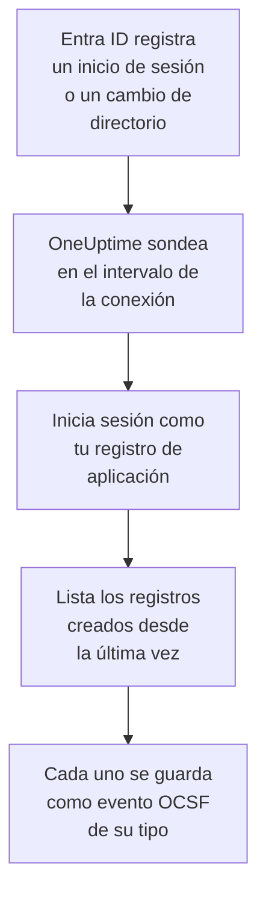

# Microsoft Entra ID

Importa los inicios de sesión y los cambios de directorio de [Microsoft Entra ID](https://learn.microsoft.com/en-us/entra/identity/) en los eventos de seguridad de OneUptime y, si quieres, la actividad de Exchange, SharePoint, OneDrive y Teams del [registro de auditoría de Microsoft 365](https://learn.microsoft.com/en-us/purview/audit-log-activities). Allí los buscas junto a tus logs, trazas y métricas, los correlacionas con todas las demás fuentes y avisas a la guardia de los que importan. OneUptime los lee con un registro de aplicación que tú creas, y no cambia nada en tu inquilino.

:::cards
- [Configurar la conexión](#configurar-la-conexión): Un registro de aplicación, sus permisos y el formulario de la conexión.
- [Qué se importa](#qué-se-importa): Qué registros, y cómo cada uno se convierte en un evento de seguridad.
- [Cómo funciona el sondeo](#cómo-funciona-el-sondeo): La ventana que lee cada sondeo, y por qué se solapa 30 minutos con la anterior.
- [Solución de problemas](#solución-de-problemas): Qué significa cada error y qué cambiar.
:::

## Cómo funciona

Cada minuto, OneUptime sondea cada conexión habilitada cuyo intervalo de sondeo ha pasado. Un sondeo inicia sesión en Microsoft Entra ID como tu registro de aplicación y lee, en este orden, los cambios de directorio ([List directoryAudits](https://learn.microsoft.com/en-us/graph/api/directoryaudit-list)) y los inicios de sesión ([List signIns](https://learn.microsoft.com/en-us/graph/api/signin-list)) registrados desde el último sondeo y, cuando la opción **Registro de auditoría de Microsoft 365** está activada, el contenido nuevo del registro de auditoría ([Office 365 Management Activity API](https://learn.microsoft.com/en-us/office/office-365-management-api/office-365-management-activity-api-reference)). Cada registro se guarda como un evento [OCSF](https://schema.ocsf.io/): un inicio de sesión como un evento Authentication, un rol asignado como un evento User Access Management, un veredicto de phishing como un Detection Finding.

## Antes de empezar

- En OneUptime, el rol Project Owner, Project Admin o Security Admin. Los roles Security Member y Security Viewer pueden ver las conexiones y su historial de ejecuciones, pero no cambiarlas.
- Para los inicios de sesión, Microsoft Entra ID P1 o P2, que incluyen Microsoft 365 E3, E5 y Business Premium: Microsoft Graph solo entrega los inicios de sesión a esos inquilinos. Los cambios de directorio se leen en cualquier inquilino.
- Un rol de Entra que pueda registrar aplicaciones, como Administrador de aplicaciones, y un Administrador global o un Administrador de roles con privilegios para conceder el consentimiento de administrador.
- Para el registro de auditoría de Microsoft 365, la auditoría activada en el inquilino, como lo está por defecto: en el [portal de Microsoft Purview](https://purview.microsoft.com), **Audit** no debe ofrecer **Start recording user and admin activity**.
- HTTPS saliente desde la aplicación y los workers de OneUptime hacia `login.microsoftonline.com`, `graph.microsoft.com` y `manage.office.com`, o hacia `login.microsoftonline.us`, `graph.microsoft.us` y `manage.office365.us` para Azure Government.

## Configurar la conexión

La conexión inicia sesión con el [flujo de credenciales de cliente de OAuth 2.0](https://learn.microsoft.com/en-us/entra/identity-platform/v2-oauth2-client-creds-grant-flow): como aplicación, nunca como persona, con permisos de solo lectura.

:::steps
### Registrar una aplicación

1. Inicia sesión en el [centro de administración de Microsoft Entra](https://entra.microsoft.com) y abre **App registrations**.
2. Selecciona **New registration**. Llámala `OneUptime Security Events`, deja **Supported account types** en **Accounts in this organizational directory only**, deja vacío el URI de redirección y selecciona **Register**.
3. En la página **Overview** de la aplicación, copia el **ID de aplicación (cliente)** y el **ID de directorio (tenant)**.

### Permitirle leer los registros

1. Ve a **API permissions → Add a permission → Microsoft Graph → Application permissions**, elige `AuditLog.Read.All` y selecciona **Add permissions**. Microsoft documenta que su lista de inicios de sesión también puede pedir `Directory.Read.All`: añádelo si los inicios de sesión se rechazan con `403` una vez concedido el consentimiento.
2. Para el registro de auditoría de Microsoft 365, añade un segundo permiso: **Add a permission → Office 365 Management APIs → Application permissions** y luego `ActivityFeed.Read`.
3. Para que los playbooks puedan deshabilitar, habilitar y cerrar la sesión de usuarios (consulta [Contención](/docs/telemetry/security-cases#contención)), añade de la misma forma `User.Read.All`, `User.EnableDisableAccount.All` y `User.RevokeSessions.All`. Microsoft solo deja cambiar la cuenta de un administrador a una aplicación que además tenga el rol Privileged Authentication Administrator.
4. Selecciona **Grant admin consent for** tu inquilino y confirma. El estado de cada permiso debe indicar **Granted**: sin consentimiento, cada lectura se rechaza con `403`.

### Crear un secreto de cliente

Ve a **Certificates & secrets → Client secrets → New client secret**, elige cuándo caduca y selecciona **Add**. Copia el **Value** del secreto, no su **Secret ID**, antes de salir de la página: no se vuelve a mostrar. El día que caduca, el sondeo se detiene con `Microsoft Entra ID token request failed (HTTP 401)` hasta que lo sustituyas con **Actualizar credenciales**.

### Añadir la conexión en OneUptime

Abre **Productos → Eventos de seguridad → Conexiones** (`/dashboard/{projectId}/security-events/connections`), haz clic en **Añadir conexión**, elige **Microsoft Entra ID** en **Identidad** y haz clic en **Siguiente**. Rellena los ajustes de la tabla de abajo, haz clic en **Siguiente** y pega el valor del secreto en **Secreto del cliente**. En el paso **Sondeo**, activa **Registro de auditoría de Microsoft 365** para leerlo también.

### Probarla antes de guardar

Haz clic en **Probar esta configuración** en **Probar antes de guardar**. La prueba inicia sesión y lee cada registro con los valores del formulario, y no guarda nada, así que un secreto erróneo o un consentimiento que falta aparecen antes de que exista la conexión. Luego haz clic en **Siguiente**, da a la conexión un **Nombre** y créala.
:::

| Ajuste | Dónde encontrarlo |
| --- | --- |
| **ID de directorio (tenant)** | La página **Overview** de la aplicación. El GUID del inquilino, o un dominio verificado como `contoso.onmicrosoft.com`. Con **Registro de auditoría de Microsoft 365** activado, el GUID: la Management API solo nombra un inquilino por él. |
| **ID de aplicación (cliente)** | La página **Overview** de la aplicación. El GUID de la aplicación que tiene `AuditLog.Read.All`. |
| **Nube** | **Nube pública de Azure**, o **Azure Government (EE. UU.)** para GCC High (`login.microsoftonline.us`, `graph.microsoft.us` y `manage.office365.us`). |
| **Registro de auditoría de Microsoft 365** | Opcional, desactivado por defecto. Activado, cada sondeo lee también el registro de auditoría de Microsoft 365. La aplicación necesita `ActivityFeed.Read`. |
| **Secreto del cliente** | El **Value** del secreto. Se cifra, la API nunca lo devuelve y no se vuelve a mostrar. Sustitúyelo con **Actualizar credenciales** en la conexión. |

El paso **Sondeo** también tiene una **Descripción** opcional, el **Intervalo de sondeo (minutos)**, un número entero de `1` a `1440` que empieza en `5`, y **Habilitado**, que empieza activado.

## Qué se importa

Cada evento tiene el proveedor `Microsoft` y el producto `Microsoft Entra ID`. Su atributo `entra.log` indica de qué registro vino un inicio de sesión o un cambio, y el `microsoft365.contentType` de un registro de Microsoft 365 su tipo de contenido.

| Registro | Clase OCSF | Gravedad |
| --- | --- | --- |
| Un inicio de sesión que funcionó | Authentication (`3002`), estado `Success` | Informational |
| Un inicio de sesión que espera un segundo paso, como MFA (`50074`, `50076`) o un aviso para cambiar la contraseña | Authentication (`3002`), estado `Interrupted` | Informational: un paso, no un fallo |
| Un inicio de sesión que falló, con el motivo y el código de error de Entra | Authentication (`3002`), estado `Failure` | Low |
| Un inicio de sesión que Identity Protection calificó de riesgo medio o alto | Authentication (`3002`) | Medium o High |
| Un usuario, grupo o rol cambiado, según su categoría | Account Change (`3001`), Group Management (`3006`), User Access Management (`3005`), o Entity Management (`3004`) para el resto | Medium para un rol con privilegios, como Global Administrator; Low para un cambio que falló |

Con **Registro de auditoría de Microsoft 365** activado, se importan de él los registros sobre los que actúa un equipo de seguridad, y el resto, como un archivo abierto o un correo leído, solo se cuenta:

| Registro de Microsoft 365 | Clase OCSF | Gravedad |
| --- | --- | --- |
| Un cmdlet de Exchange, como `New-InboxRule` o `Set-Mailbox`, una regla de bandeja de entrada creada en Outlook, o correo enviado en nombre de otra persona | API Activity (`6003`) | Medium cuando reenvía correo, con `microsoft365.forwardsMail` a `true` |
| Un permiso de buzón concedido, como `Add-MailboxPermission` | User Access Management (`3005`) | Low |
| Un archivo compartido en SharePoint o OneDrive | File Hosting Activity (`6006`) | Low con un invitado o un enlace que cualquiera puede abrir, con `microsoft365.sharedOutside` a `true` |
| Un administrador de colección de sitios añadido o quitado | User Access Management (`3005`) | Low |
| Correo con malware o phishing encontrado por Microsoft Defender for Office 365 | Detection Finding (`2004`) | High para malware, Medium para phishing |
| Una alerta que generó Microsoft 365 | Detection Finding (`2004`) | La de la alerta |
| Una aplicación, un bot o un conector añadido a un equipo | Application Lifecycle (`6002`) | Low |

Las tareas internas de Exchange, ejecutadas con su cuenta del sistema, se dejan fuera salvo que reenvíen correo. Cada evento conserva el registro completo, aplanado en claves con puntos como `status.errorCode` o `Parameters.ForwardTo`, para que una regla lea cualquier campo con el nombre que le da Microsoft. Las reglas de la biblioteca para Entra ID los leen tal como se importan aquí.

Los mismos inicios de sesión y cambios de directorio pueden llegar a OneUptime como logs, exportados por una configuración de diagnóstico de Azure y leídos por [Tus registros](/docs/telemetry/security-events#encontrar-eventos-de-seguridad-en-sus-registros). Cada registro recibe el mismo ID de evento por ambas vías, pero un registro leído por las dos se guarda dos veces: lee Entra ID por una sola vía.

## Cómo funciona el sondeo

- **Los registros se leen según cuándo los registró Entra ID**, `activityDateTime` para un cambio y `createdDateTime` para un inicio de sesión.
- **El primer sondeo mira 24 horas atrás**, para que una conexión nueva muestre enseguida sus registros recientes.
- **Cada sondeo posterior empieza 30 minutos antes del cursor guardado.** Microsoft documenta que ambos registros llegan con minutos de retraso, así que el solapamiento lee un registro retrasado en el siguiente sondeo, y los duplicados se descartan por ID de registro dentro del proyecto.
- **Un sondeo lee como mucho 24 horas más allá del cursor.** Una conexión cuyo cursor se quedó atrás se pone al día en una serie de ventanas de 24 horas.
- **Un inquilino sin Microsoft Entra ID P1 ni P2** importa sus cambios de directorio, y la comprobación **Read sign-ins** de cada ejecución avisa de que no se leyeron los inicios de sesión.
- **Una ejecución fallida no cambia nada.** Tras un error de red, o un estado de error de Graph, el cursor y la longitud de ventana quedan como estaban, y el siguiente sondeo vuelve a leer la misma ventana. La única excepción es una solicitud que agotó el tiempo: el cursor se queda, pero la siguiente ventana es la mitad de larga, porque una ventana demasiado pesada para responder a tiempo agotaría el tiempo en cada intento.

El registro de auditoría de Microsoft 365 se lee según cuándo Microsoft puso a disposición cada blob de contenido, un día cada vez, y no más atrás de los 7 días que Microsoft lo conserva. El primer sondeo suscribe la aplicación a `Audit.Exchange`, `Audit.SharePoint` y `Audit.General`, y Microsoft pone a disposición los primeros registros de una suscripción nueva en un plazo de 12 horas. El registro de auditoría nunca detiene los registros de Entra ID: un permiso que falta es un aviso y la ventana avanza, mientras que un fallo del lado de Microsoft, como `HTTP 503`, deja la ejecución **Parcial** para que la ventana se vuelva a leer.

### Cuando una ventana contiene más de lo que un sondeo puede leer

Cada registro tiene su propio presupuesto: 10 páginas de 500 cambios de directorio, 20 páginas de 500 inicios de sesión y, para el registro de auditoría de Microsoft 365, 120 solicitudes y 10.000 registros. Un sondeo se detiene tras 4 minutos. Cuando un presupuesto detiene un registro antes del final de su ventana, la ejecución es **Parcial**, y su aviso nombra el registro y el presupuesto. Microsoft Graph lista primero los registros más recientes, así que OneUptime acorta la ventana en lugar de mover el cursor más allá de registros a los que nunca llegó:

1. **Reducir.** El siguiente sondeo lee una ventana de la mitad de largo, desde el mismo punto de partida, y sigue reduciéndola a la mitad hasta que una ventana se lee entera, hasta un minuto. El aviso de la ejecución lo dice: `This window holds more records than one poll can read; the next poll reads a {n} minute window from the same starting point.` Los registros ya importados de la ventana más larga se omiten como duplicados.
2. **Volver a crecer.** Cuando una ventana se lee entera, el cursor pasa a su final, y la siguiente ventana vuelve a ser el doble de larga, hasta 24 horas.
3. **Pasar más allá de un único minuto.** Si incluso un minuto contiene más de lo que un sondeo puede leer, el sondeo lo pasa de largo, para que sigan llegando los registros más nuevos. La ejecución sigue siendo **Parcial**, y **Último error** indica `More records were created in the one minute from {cursor} to {end} than one poll can read. Polling moved past this minute so newer records keep arriving; use Import this time range in Diagnostics on this minute to recover what one run can read.` Importa ese minuto con **Importar este intervalo de tiempo** para recuperar lo que una ejecución puede leer.

Cambiar el **Intervalo de sondeo (minutos)** no cambia nada de esto: decide cada cuánto empieza un sondeo, no dónde empieza su ventana.

### Ejecutar, previsualizar e importar a demanda

Haz clic en **Diagnósticos** en una conexión para ver sus ejecuciones recientes y trabajar con ella a mano. Quien puede cambiar la conexión puede iniciar estas acciones; quien puede verla puede leer el historial.

- **Ejecutar ahora** inicia un sondeo de inmediato, con el cursor habitual, incluso cuando la conexión no está **Habilitado**.
- **Preview records** lee un intervalo de tiempo de hasta 7 días y no importa nada.
- **Importar este intervalo de tiempo** importa un intervalo de hasta 7 días, después de que lo confirmes, sin mover el cursor. Los registros ya importados se omiten. Microsoft Entra ID conserva 30 días de inicios de sesión y cambios de directorio con P1 o P2, y 7 días sin ellos.
- **Copiar diagnósticos** en una ejecución copia su informe para soporte. Nunca incluye credenciales.

## Probar conexión

**Probar conexión** en la fila de una conexión, y **Probar esta configuración** en el formulario, se ejecutan en el proceso de la API, no en un worker en segundo plano, para que una prueba responda incluso cuando el problema son los workers. Hace estas comprobaciones, en orden:

| Comprobación | Qué comprueba |
| --- | --- |
| **Configuración** | Cada ajuste está presente y bien formado. No se contacta con nada cuando esto falla. |
| **Authenticate with Microsoft Entra** | Entra ID emite para la aplicación un token para Microsoft Graph, en la nube que elegiste. |
| **Read sign-ins** | Se pueden leer los inicios de sesión de las últimas 24 horas. Un aviso, no un fallo, en un inquilino sin P1 ni P2. |
| **Read directory changes** | Se pueden leer los cambios de directorio de las últimas 24 horas. |
| **Read the Microsoft 365 audit log** | Solo con la opción activada: la Management API responde, y a qué tipos de contenido está suscrita la aplicación. |
| **Records available to import** | Cuántos inicios de sesión y cambios de directorio hay en las últimas 24 horas, como mucho 500 de cada uno, así que `500+` significa más. Ninguno es un aviso. |
| **Background workers**, **Poll scheduler**, **Security event storage** | El lado del propio OneUptime: un proceso toma los trabajos de la cola Worker, el trabajo de sondeo se ejecuta cada minuto y el almacén de eventos de seguridad responde. |
| **Sondeo programado** | Para una conexión guardada: el sondeo está activado, ninguna ejecución está atascada esperando a un worker y los sondeos se ejecutan a tiempo. |

Cada solicitud de una prueba tiene un plazo de 20 segundos. Una prueba nunca importa nada ni mueve el cursor, y cada comprobación que falla dice qué cambiar.

## Solución de problemas

El **Último error** de la conexión guarda el mensaje de error completo, con las credenciales ocultas. Cuando una conexión tiene un error, selecciona **Ver error** en su columna **Acciones** para leerlo, y **Copiar error** en el cuadro de diálogo para copiarlo. Cada mensaje empieza por `Microsoft Entra ID`, nombra después la solicitud que falló y cita el código de error de Microsoft cuando lo hay.

:::details Último error dice `token request failed`
- `HTTP 401` con `invalid_client`: el secreto del cliente es erróneo o caducó. Crea uno nuevo y guárdalo con **Actualizar credenciales**.
- `HTTP 400` que nombra el ID de aplicación (cliente) o el inquilino: comprueba ambos en la página **Overview** de la aplicación, y que la **Nube** sea la del inquilino.
:::

:::details Último error dice `sign-ins request failed (HTTP 403)` o `audit logs request failed (HTTP 403)`
- Código de error `Authorization_RequestDenied`: a la aplicación le falta `AuditLog.Read.All`, o no se concedió el consentimiento. Concede el consentimiento de administrador, espera unos minutos y vuelve a probar. Para los inicios de sesión, concede también `Directory.Read.All`.
- Código de error `Authentication_RequestFromNonPremiumTenantOrB2CTenant`: el inquilino no tiene Microsoft Entra ID P1 ni P2. Los cambios de directorio se siguen importando.
:::

:::details El registro de auditoría de Microsoft 365 no se lee
- `subscriptions request failed (HTTP 401)` o `(HTTP 403)`, con `AF10001`: a la aplicación le falta `ActivityFeed.Read` de las Office 365 Management APIs, o no se concedió el consentimiento.
- De `AF20010` a `AF20013`: la Management API no conoce el **ID de directorio (tenant)**. Usa el GUID del inquilino.
- `subscription start failed` con `AF20023`: un administrador desactivó la suscripción. Un tipo de contenido al que no se puede suscribir se nombra en los avisos de la ejecución, y los demás se siguen leyendo.
- Ningún registro durante horas tras el primer sondeo: Microsoft pone a disposición el primer contenido de una suscripción nueva en un plazo de 12 horas.
:::

:::details Último error dice `did not complete`
La solicitud no obtuvo respuesta: un tiempo agotado, un nombre que no se resuelve o una dirección rechazada. Comprueba que la aplicación y los workers de OneUptime pueden llegar a los hosts de [Antes de empezar](#antes-de-empezar), a través de cualquier proxy que uses.
:::

:::details La prueba pasa, pero Último sondeo indica Never
El trabajo de sondeo nunca se ha ejecutado. Lee las comprobaciones **Background workers** y **Poll scheduler**. En una instalación autoalojada, la causa habitual es `DISABLE_QUEUE_WORKERS=true` en la aplicación, sin un despliegue de workers aparte que tome los trabajos: ponlo en `false`, o ejecuta el despliegue de workers (Helm: `worker.enabled: true`, que es `false` por defecto).
:::

## Próximos pasos

:::cards
- [Eventos de seguridad](/docs/telemetry/security-events): Busca, correlaciona y alerta sobre lo que importas.
- [Registro del sistema de Okta](/docs/integrations/okta): Importa los inicios de sesión de otro proveedor de identidad.
- [Google Workspace](/docs/integrations/google-workspace): Importa los inicios de sesión y los cambios de administración de Google.
- [Descripción general de integraciones](/docs/integrations/index): Las otras herramientas que puedes conectar.
:::
