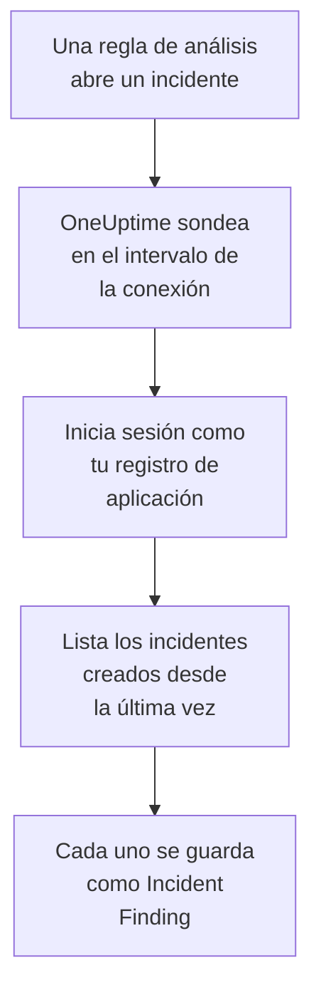

# Microsoft Sentinel

Importa los incidentes que abren tus reglas de análisis de [Microsoft Sentinel](https://learn.microsoft.com/en-us/azure/sentinel/overview) en los eventos de seguridad de OneUptime. Allí los buscas junto a tus logs, trazas y métricas, los correlacionas con todas las demás fuentes y avisas a la guardia de los que importan. OneUptime los lee con un registro de aplicación que tú creas, y no cambia nada en Azure.

:::cards
- [Configurar la conexión](#configurar-la-conexión): Un registro de aplicación, un rol y el formulario de la conexión.
- [Qué se importa](#qué-se-importa): Cómo cada incidente de Sentinel se convierte en un evento de seguridad.
- [Cómo funciona el sondeo](#cómo-funciona-el-sondeo): La ventana que lee cada sondeo, y lo que le hace un área de trabajo con mucha actividad.
- [Solución de problemas](#solución-de-problemas): Qué significa cada error y qué cambiar.
:::

## Cómo funciona



Cada minuto, OneUptime sondea cada conexión habilitada cuyo intervalo de sondeo ha pasado. Un sondeo inicia sesión en Microsoft Entra ID como tu registro de aplicación, pide a Azure Resource Manager los incidentes creados desde el último sondeo y guarda cada uno como un evento [OCSF](https://schema.ocsf.io/) Incident Finding (clase `2005`). Las reglas de detección, los monitores y los paneles lo tratan entonces como un evento de seguridad de cualquier otra fuente.

## Antes de empezar

- En OneUptime, el rol Project Owner, Project Admin o Security Admin. Los roles Security Member y Security Viewer pueden ver las conexiones y su historial de ejecuciones, pero no cambiarlas.
- Un área de trabajo de Log Analytics con Microsoft Sentinel habilitado, en la nube pública de Azure o en Azure Government (US).
- En Microsoft Entra ID, permiso para crear un registro de aplicación y un secreto de cliente.
- En el grupo de recursos que contiene el área de trabajo, permiso para asignar roles, como Propietario o Administrador de acceso de usuario.

## Configurar la conexión

La conexión inicia sesión con el flujo de credenciales de cliente de OAuth 2.0: como aplicación, nunca como persona. Su acceso viene de un rol de Azure, así que el registro de aplicación no necesita permisos de API.

:::steps
### Registrar una aplicación

1. Inicia sesión en el [portal de Azure](https://portal.azure.com) y abre **Microsoft Entra ID**.
2. Ve a **App registrations → New registration**. Llámala `OneUptime Sentinel connector`, deja **Supported account types** en **Accounts in this organizational directory only**, deja vacío el URI de redirección y selecciona **Register**.
3. En la página **Overview** de la aplicación, copia el **Application (client) ID** y el **Directory (tenant) ID**.
4. Ve a **Certificates & secrets → Client secrets → New client secret**, elige cuándo caduca y selecciona **Add**. Copia el **Value** del secreto, no su **Secret ID**, antes de salir de la página: no se vuelve a mostrar.

### Permitirle leer incidentes

1. En el portal de Azure, abre el grupo de recursos que contiene tu área de trabajo de Log Analytics.
2. Selecciona **Access control (IAM) → Add → Add role assignment**.
3. En la pestaña **Role**, elige **Microsoft Sentinel Reader**.
4. En la pestaña **Members**, elige **User, group, or service principal**, haz clic en **Select members** y elige tu registro de aplicación por su nombre.
5. Selecciona **Review + assign**.

El rol permite a la aplicación leer incidentes (`Microsoft.SecurityInsights/incidents/read`) y no escribir nada. Microsoft recomienda asignarlo en el grupo de recursos en lugar de en el área de trabajo, para que cubra también la solución `SecurityInsights` desde la que se sirven los incidentes. Una asignación nueva puede tardar unos minutos en aplicarse.

### Buscar los datos del área de trabajo

Abre el área de trabajo de Log Analytics en el portal de Azure. Su página **Overview** muestra el **Subscription ID**, el **Resource group** y el nombre del área de trabajo. El ID de recurso del área de trabajo contiene los tres:

```text
/subscriptions/{Subscription ID}/resourceGroups/{Resource group}/providers/Microsoft.OperationalInsights/workspaces/{Workspace name}
```

### Añadir la conexión en OneUptime

Abre **Productos → Eventos de seguridad → Conexiones** (`/dashboard/{projectId}/security-events/connections`), haz clic en **Añadir conexión**, elige **Microsoft Sentinel** y haz clic en **Siguiente**. Rellena los ajustes de la tabla de abajo, haz clic en **Siguiente** y pega el valor del secreto en **Secreto del cliente**.

### Probarla antes de guardar

Haz clic en **Probar esta configuración** en **Probar antes de guardar**. La prueba inicia sesión y lee incidentes con los valores del formulario, y no guarda nada, así que un secreto erróneo o un rol que falta aparecen antes de que exista la conexión. Luego haz clic en **Siguiente**, da a la conexión un **Nombre** y créala.
:::

| Ajuste | Dónde encontrarlo |
| --- | --- |
| **Directory (tenant) ID** | La página **Overview** de la aplicación. El GUID del inquilino, o un dominio verificado como `contoso.onmicrosoft.com`. |
| **Application (client) ID** | La página **Overview** de la aplicación. Un GUID. |
| **Subscription ID** | La página **Overview** del área de trabajo. Un GUID. |
| **Resource group** | La página **Overview** del área de trabajo. De 1 a 90 letras, dígitos, guiones bajos, guiones, puntos o paréntesis, sin terminar en punto. |
| **Workspace name** | La página **Overview** del área de trabajo. De 3 a 90 letras, dígitos o guiones, empezando y terminando por una letra o un dígito. |
| **Nube** | **Azure public cloud** (`login.microsoftonline.com`, `management.azure.com`) o **Azure Government (US)** (`login.microsoftonline.us`, `management.usgovcloudapi.net`). |
| **Secreto del cliente** | El **Value** del secreto. Se cifra, la API nunca lo devuelve y no se vuelve a mostrar. Sustitúyelo con **Actualizar credenciales** en la conexión. |

El paso **Sondeo** también tiene una **Descripción** opcional, el **Intervalo de sondeo (minutos)**, un número entero de `1` a `1440` que empieza en `5`, y **Habilitado**, que empieza activado.

## Qué se importa

Cada incidente de Sentinel se convierte en un evento Incident Finding (clase OCSF `2005`, actividad `Create`), atribuido al servicio de telemetría `Microsoft Sentinel`:

| Columna OCSF | Campo del incidente de Sentinel |
| --- | --- |
| `time` | `properties.createdTimeUtc`, cuando Sentinel creó el incidente |
| `eventUid` | `name`, el GUID del incidente, que también sirve para descartar duplicados |
| `message`, `ruleName` | `properties.title` |
| `ruleId` | El GUID de la regla al final de la primera entrada de `properties.relatedAnalyticRuleIds` |
| `severityName` | `properties.severity`: `High`, `Medium`, `Low` o `Informational` |
| `statusName` | `properties.status`: `New`, `Active` o `Closed` |
| `mitreTactics` | `properties.additionalData.tactics`, como IDs de ATT&CK: `Persistence` se convierte en `TA0003` |
| `principalUser` | `properties.owner.userPrincipalName`, o `properties.owner.email` |
| `targetResource` | `properties.incidentUrl`, un enlace al incidente en el portal de Azure |
| `observables` | El UPN, el correo y el ID de objeto del propietario, y el nombre de cada etiqueta |
| `attributes` | El incidente completo, aplanado en claves con puntos como `properties.classification` y `properties.firstActivityTimeUtc` |

Los incidentes cerrados creados en la ventana de un sondeo también se importan. Filtra por `statusName` en el explorador de eventos de seguridad para ver solo los abiertos.

## Cómo funciona el sondeo

Cada sondeo lista los incidentes creados en su ventana, los más antiguos primero, 50 por página, y sigue el `nextLink` de la API hasta haber leído toda la ventana:

```text
GET https://management.azure.com/subscriptions/{sub}/resourceGroups/{rg}/providers/Microsoft.OperationalInsights/workspaces/{ws}/providers/Microsoft.SecurityInsights/incidents
    ?api-version=2024-03-01
    &$filter=(properties/createdTimeUtc ge {windowStart}) and (properties/createdTimeUtc lt {windowEnd})
    &$orderby=properties/createdTimeUtc asc
    &$top=50
```

- **La hora de creación es el cursor.** Una regla de análisis programada que se ejecuta cada hora abre su incidente mucho después de la actividad que detectó, y el `firstActivityTimeUtc` del incidente puede ser horas o días anterior. Un cursor sobre la hora de actividad se saltaría cada uno de esos incidentes. Las horas de actividad quedan en `attributes`, y las muestras de los diagnósticos enseñan ambas.
- **El primer sondeo mira 24 horas atrás**, para que una conexión nueva muestre enseguida sus incidentes recientes.
- **Cada sondeo posterior empieza 1 minuto antes del cursor guardado**, para que nunca se salte un incidente creado en el límite entre dos ventanas.
- **Un sondeo lee como mucho 24 horas más allá del cursor.** Una conexión cuyo cursor se quedó atrás se pone al día en una serie de ventanas de 24 horas, y su **Salud** indica **Catching up**.
- **Los duplicados se descartan por el GUID del incidente** (`name`) dentro del proyecto, para que el solapamiento, una ventana reintentada y una importación nunca guarden un incidente dos veces.

### Cuando una ventana contiene más de lo que un sondeo puede leer

Un sondeo lee como mucho 20 páginas de 50 incidentes: 1.000 incidentes. Cuando ese límite lo detiene antes del final de su ventana, la ejecución es **Parcial**, con un aviso como este:

```text
Stopped after 20 incidents requests (the per-run request limit) before reading the whole window. Incidents are read oldest first; every incident created before 2026-09-14T08:12:44.000Z was read.
```

Los incidentes se leen de los más antiguos a los más nuevos, así que OneUptime mueve el cursor a la hora de creación del último incidente leído, y el siguiente sondeo empieza ahí, con la misma longitud de ventana. Un área de trabajo con mucha actividad se pone al día unos 1.000 incidentes por sondeo, en lugar de volver a leer los mismos. Los incidentes creados en ese mismo instante se leen dos veces, y la comprobación de duplicados descarta la segunda copia.

Cuando una ejecución no consigue avanzar en absoluto más allá del cursor guardado, OneUptime acorta la ventana en su lugar:

1. **Reducir.** El siguiente sondeo lee una ventana de la mitad de largo, desde el mismo punto de partida, y sigue reduciéndola a la mitad hasta que una ventana se lee entera, hasta un minuto. El aviso de la ejecución lo dice: `This window holds more records than one poll can read; the next poll reads a {n} minute window from the same starting point.`
2. **Volver a crecer.** Cuando una ventana se lee entera, la siguiente vuelve a ser el doble de larga, hasta 24 horas.
3. **Pasar más allá de un único minuto.** Si incluso un minuto contiene más de lo que un sondeo puede leer, el sondeo lo pasa de largo, para que sigan llegando los incidentes más nuevos. La ejecución sigue siendo **Parcial**, y **Último error** indica `More records were created in the one minute from {cursor} to {end} than one poll can read. Polling moved past this minute so newer records keep arriving; use Import this time range in Diagnostics on this minute to recover what one run can read.` Importa ese minuto con **Importar este intervalo de tiempo** para recuperar lo que una ejecución puede leer.

Una ejecución que falla del todo, con un error de Microsoft Entra ID o de Azure Resource Manager, conserva el cursor y la longitud de ventana, y el siguiente sondeo vuelve a leer la misma ventana. La única excepción es una solicitud que agotó el tiempo: el cursor se queda, pero la siguiente ventana es la mitad de larga, porque una ventana demasiado pesada para responder a tiempo agotaría el tiempo en cada intento. Cambiar el **Intervalo de sondeo (minutos)** no cambia nada de esto: decide cada cuánto empieza un sondeo, no dónde empieza su ventana.

### Ejecutar, previsualizar e importar a demanda

Haz clic en **Diagnósticos** en una conexión para ver sus ejecuciones recientes y trabajar con ella a mano. Quien puede cambiar la conexión puede iniciar estas acciones; quien puede verla puede leer el historial.

- **Ejecutar ahora** inicia un sondeo de inmediato, con el cursor habitual, incluso cuando la conexión no está **Habilitado**.
- **Preview incidents** lee un intervalo de tiempo de hasta 7 días y no importa nada.
- **Importar este intervalo de tiempo** importa un intervalo de hasta 7 días, después de que lo confirmes, sin mover el cursor. Los incidentes ya importados se omiten.
- **Copiar diagnósticos** en una ejecución copia su informe para soporte. Nunca incluye credenciales.

## Probar conexión

**Probar conexión** en la fila de una conexión, y **Probar esta configuración** en el formulario, se ejecutan en el proceso de la API, no en un worker en segundo plano, para que una prueba responda incluso cuando el problema son los workers. Hace estas comprobaciones, en orden:

| Comprobación | Qué comprueba |
| --- | --- |
| **Configuración** | Cada ajuste está presente y bien formado. No se contacta con nada cuando esto falla. |
| **Authenticate with Microsoft Entra** | Microsoft Entra ID emite para tu registro de aplicación un token para Azure Resource Manager. |
| **Read incidents** | Se puede leer un incidente creado en las últimas 24 horas (`$top=1`). Esto demuestra el rol y los datos del área de trabajo. |
| **Incidents available to import** | Cuántos incidentes se crearon en las últimas 24 horas y en los últimos 7 días, una página de 50 para cada uno, así que `50+` significa más. Ninguno en 7 días es un aviso, no un fallo. |
| **Background workers**, **Poll scheduler**, **Security event storage** | El lado del propio OneUptime: un proceso toma los trabajos de la cola Worker, el trabajo de sondeo se ejecuta cada minuto y el almacén de eventos de seguridad responde. |
| **Sondeo programado** | Para una conexión guardada: el sondeo está activado, ninguna ejecución está atascada esperando a un worker y los sondeos se ejecutan a tiempo. |

Cada solicitud de una prueba tiene un plazo de 20 segundos. Una prueba nunca importa nada ni mueve el cursor, y cada comprobación que falla dice qué cambiar.

## Solución de problemas

El **Último error** de la conexión guarda el mensaje de error completo, con las credenciales ocultas, tras un prefijo que nombra el paso que falló. Cuando una conexión tiene un error, selecciona **Ver error** en su columna **Acciones** para leerlo, y **Copiar error** en el cuadro de diálogo para copiarlo. Lee primero el prefijo.

:::details Último error empieza por `Microsoft Sentinel token request`
- `Microsoft Sentinel token request failed (HTTP ...)`: Microsoft Entra ID se negó a emitir un token, así que nunca se contactó con Azure. El mensaje cita el código de Entra:
  - `AADSTS7000215` o `invalid_client`: el **Secreto del cliente** es erróneo o ha caducado, o es el ID del secreto en lugar de su valor. Crea un secreto nuevo y guárdalo con **Actualizar credenciales**.
  - `AADSTS700016` o `unauthorized_client`: el **Application (client) ID** no está en el **Directory (tenant) ID** indicado. Compara ambos con la página **Overview** de la aplicación.
  - `AADSTS90002` o `HTTP 404`: ese inquilino no existe. El **Directory (tenant) ID** es erróneo, o está en la otra nube: revisa **Nube**.
  - `HTTP 429` o `HTTP 5xx`: Microsoft Entra ID está limitando las solicitudes o no está disponible. El siguiente sondeo lo vuelve a intentar.
- `Microsoft Sentinel token request returned ...`: Microsoft Entra ID respondió con algo inutilizable, por ejemplo un cuerpo que no es JSON o sin `access_token`. Suele ser un proxy o una pasarela en medio.
- `Microsoft Sentinel token request failed:`, sin estado, o `Microsoft Sentinel token request timed out after ... seconds with no response`: la solicitud no obtuvo respuesta. Revisa el DNS, el TLS y el HTTPS saliente de la aplicación y los workers de OneUptime hacia `login.microsoftonline.com`.
:::

:::details Último error empieza por `Microsoft Sentinel incidents list`
- `Microsoft Sentinel incidents list failed (HTTP ...)`: Azure Resource Manager rechazó la solicitud.
  - `HTTP 401`: no aceptó el token. Casi siempre, **Nube** no coincide con el inquilino, o se eliminó el registro de aplicación. Un token que caduca entre dos páginas se renueva y se reintenta una vez por sí solo.
  - `HTTP 403` o `AuthorizationFailed`: la aplicación aún no tiene **Microsoft Sentinel Reader** en el grupo de recursos. Asígnalo y espera unos minutos.
  - `HTTP 404`: ninguna área de trabajo tiene ese **Subscription ID**, ese **Resource group** y ese **Workspace name**, o Microsoft Sentinel no está habilitado en ella. Cópialos de la página **Overview** del área de trabajo.
  - `HTTP 429` o `HTTP 5xx`: Azure Resource Manager está limitando las solicitudes o no está disponible. El siguiente sondeo lo vuelve a intentar.
  - `HTTP 400`: Azure Resource Manager rechazó la solicitud, que construye OneUptime y no tus ajustes. Envía el mensaje al soporte de OneUptime.
- `Microsoft Sentinel incidents list returned ...`: Azure respondió `200`, pero sin una página de incidentes legible, o con un `nextLink` a otro host, que la conexión rechaza para que el token nunca salga de Azure Resource Manager. Se notifica en lugar de tomarse como una ventana vacía, para que el cursor nunca pase de largo incidentes que nadie leyó.
- `Microsoft Sentinel incidents list failed:`, sin estado, o `Microsoft Sentinel incidents list timed out after ... seconds with no response`: la solicitud no obtuvo respuesta. Revisa el HTTPS saliente de los workers de OneUptime hacia `management.azure.com`, o `management.usgovcloudapi.net`.
:::

:::details Último sondeo indica Never y Último error está vacío
Ningún sondeo ha terminado para esta conexión. Ejecuta **Probar conexión**: sus comprobaciones **Background workers** y **Poll scheduler** nombran la causa. En una instalación autoalojada, la causa habitual es `DISABLE_QUEUE_WORKERS=true` en la aplicación, sin un despliegue de workers aparte que tome los trabajos: ponlo en `false`, o ejecuta el despliegue de workers (Helm: `worker.enabled: true`).
:::

:::details Una ejecución es Parcial
- `Stopped after 20 incidents requests (the per-run request limit) before reading the whole window`: la ventana contenía más que los 1.000 incidentes que lee una ejecución. No se pierde nada: el siguiente sondeo empieza después del último incidente leído. Una conexión que sigue **Parcial** sondeo tras sondeo se está poniendo al día con un atraso, y su **Último sondeo** y su **Último evento importado** siguen avanzando.
- `Microsoft Sentinel returned incidents out of creation-time order, so this run cannot name a point to resume from.`: la API ignoró el orden de más antiguos a más nuevos, así que la ejecución no puede mover el cursor a su último incidente, y el siguiente sondeo lee en su lugar una ventana más corta. Si se repite, envía el informe de la ejecución al soporte de OneUptime.
- `More records were created in the one minute from ... than one poll can read`: el sondeo pasó de largo ese minuto. Impórtalo con **Importar este intervalo de tiempo** en **Diagnósticos**. Una importación lee tanto como un sondeo.
:::

:::details La prueba pasa, pero no se importa nada
Lee **Incidents available to import** en el informe de la prueba. `0` en los últimos 7 días significa que las reglas de análisis del área de trabajo no abrieron ningún incidente, lo que no es un fallo de la conexión. En Microsoft Sentinel, comprueba que las reglas están habilitadas y configuradas para crear incidentes.
:::

## Azure Government

Pon **Nube** en **Azure Government (US)**. La conexión inicia sesión entonces en `login.microsoftonline.us` con el ámbito `https://management.usgovcloudapi.net/.default`, y lee los incidentes de `management.usgovcloudapi.net`. Todo lo demás, incluida la asignación del rol, es igual.

## Qué obtienes

- **Búsqueda.** Filtra los incidentes por gravedad, estado, propietario, etiqueta o táctica en el explorador de eventos de seguridad, junto a todas las demás fuentes.
- **Correlación.** El propietario y las etiquetas de cada incidente se indexan como observables, así que una búsqueda encuentra todo lo que los menciona.
- **Reglas de detección.** Reglas Sigma que se ejecutan según una programación sobre tus eventos de seguridad, y abren alertas que avisan a la guardia.
- **Monitores.** Los monitores de eventos de seguridad cuentan los eventos que coinciden, como los nuevos incidentes High, y abren incidentes o alertas por encima de un umbral.

Los eventos de seguridad se facturan como el resto de tu telemetría, por GB ingerido. Consulta los [precios](https://oneuptime.com/pricing).

## Próximos pasos

:::cards
- [Eventos de seguridad](/docs/telemetry/security-events): Busca, correlaciona y alerta sobre lo que importas.
- [Microsoft Defender XDR](/docs/integrations/microsoft-defender-xdr): Importa también las alertas de cada carga de trabajo de Defender.
- [Roles](/docs/permissions/reference#roles): Lo que pueden ver y cambiar los roles Security.
- [Descripción general de integraciones](/docs/integrations/index): Las demás herramientas que puedes conectar.
:::
