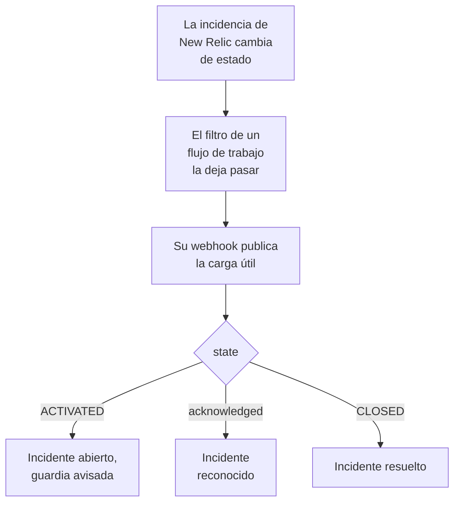

# New Relic

Envía las incidencias de [New Relic](https://newrelic.com) a OneUptime, para que cada una se convierta en un incidente o una alerta que avisa a tu equipo de guardia, se reconoce cuando alguien reconoce la incidencia y se resuelve cuando la incidencia se cierra. New Relic envía sus incidencias mediante un [destino de webhook](https://docs.newrelic.com/docs/alerts/get-notified/notification-integrations/), así que no hay nada que instalar en ninguno de los dos lados.

:::cards
- [Empezar con la plantilla](#empezar-con-la-plantilla): Elige a quién avisar, copia la URL y mira qué hace cada incidencia.
- [Configurar New Relic](#configurar-new-relic): Un destino de webhook y el flujo de trabajo que lo notifica.
- [Probarlo](#probarlo): Envía una incidencia tú mismo y luego una desde New Relic.
- [Solución de problemas](#solución-de-problemas): Cuando las incidencias no llegan o los incidentes siguen abiertos.
:::

## Cómo funciona



Un flujo de trabajo de New Relic elige las incidencias que envía con su filtro, y notifica a un destino de webhook cuando una se activa, se reconoce o se cierra, con una carga útil JSON que rellena New Relic. El ID de la incidencia es como OneUptime encuentra el incidente que abrió.

## Antes de empezar

- Una cuenta de New Relic en la que puedas crear destinos y flujos de trabajo.
- En OneUptime, permiso para crear flujos de trabajo. En OneUptime Cloud, los flujos de trabajo necesitan el plan **Growth** o superior.

## Empezar con la plantilla

Configura OneUptime primero: te da la URL a la que envía New Relic. El diálogo **Crear un flujo de trabajo** tiene dos plantillas de New Relic, en **New Relic** de su lista de categorías: **Declare an incident for each New Relic issue**, y **Create an alert for each New Relic issue** para alertas. Ambas hacen lo mismo, cada una con su propio tipo de registro.

:::steps
1. Ve a **Flujos de trabajo** y haz clic en **Crear flujo de trabajo**. En **O empieza con una plantilla**, elige **New Relic** en la lista de categorías, haz clic en **Declare an incident for each New Relic issue**, o en **Create an alert for each New Relic issue**, y luego en **Usar esta plantilla**.
2. En **Who to page for new New Relic issues**, elige las políticas de guardia a las que avisar, o ninguna para no avisar a nadie, y haz clic en **Crear flujo de trabajo**. El flujo de trabajo se abre en el **Constructor**, desactivado.
3. Haz clic en el disparador **Webhook**, luego en **Copiar URL**, y guarda la URL para New Relic.
4. Activa **Habilitado** en la parte superior del **Constructor**. Un flujo de trabajo desactivado responde a New Relic con `400`.
:::

Después [configura New Relic](#configurar-new-relic) para que envíe sus incidencias a esa URL. El paso `read-event-1` del flujo de trabajo se abre con la misma configuración, para cuando vuelvas a él en el **Constructor**.

### Qué hace el flujo de trabajo

Tras el disparador **Webhook**, el paso **Check With JavaScript** `read-event-1` lee el `state` que envía New Relic, e **Incident From Another Tool**, o **Alert From Another Tool** en la plantilla de alertas, hace lo que significa, por el ID de la incidencia. El incidente guarda el ID en su campo personalizado `newRelicIssueId`.

| Lo que envía New Relic | Qué hace el flujo de trabajo |
| --- | --- |
| `state` es `ACTIVATED` o `CREATED` | Declara un incidente titulado `New Relic: <issue>`, con la gravedad a la que corresponde la prioridad de la incidencia, fuera de tus páginas de estado. Su descripción enlaza la incidencia en New Relic y muestra la prioridad, las entidades, las políticas y las condiciones. Avisa a las políticas de guardia que elegiste. La misma incidencia otra vez, como cuando New Relic la sube a CRITICAL, no abre un segundo incidente, y no avisa a nadie otra vez. |
| `state` es `ACTIVATED` e `isAcknowledged` es `true` | Reconoce el incidente de la incidencia, con lo que la guardia deja de escalarlo. El motivo queda en su línea de tiempo. |
| `state` es `CLOSED` | Resuelve el incidente de la incidencia, salvo que ya esté resuelto. El motivo queda en su línea de tiempo. |

Un reconocimiento o un cierre de una incidencia sin incidente no cambia nada. Todo lo demás, como una solicitud de otra herramienta, se deja tal cual: `read-event-1` toma **No**, y los **Pasos** de la ejecución dicen por qué. Nada vuelve a New Relic: él mismo cierra sus incidencias cuando la señal se recupera, y eso es lo que resuelve el incidente.

### Prioridades y avisos

Cada incidencia nueva avisa a las políticas de guardia que elegiste, sea cual sea su prioridad: New Relic sube una incidencia de HIGH a CRITICAL en el sitio, sobre la misma incidencia, así que esperar a CRITICAL nunca avisaría de una incidencia que se abrió en HIGH y empeoró. Para avisar por menos incidencias, acota el filtro del flujo de trabajo en New Relic: solo lo que lo supera llega a OneUptime. En un proyecto nuevo, las prioridades se asignan a estas gravedades de incidente y de alerta:

| Prioridad de New Relic | Incidente | Alerta | Guardia |
| --- | --- | --- | --- |
| CRITICAL | Critical Incident | High | Avisada |
| HIGH | Major Incident | Low | Avisada |
| MEDIUM | Minor Incident | Low | Avisada |
| LOW | Minor Incident | Low | Avisada |

Con gravedades propias, CRITICAL va a tu más grave, HIGH a la del medio, y MEDIUM y LOW a tu menos grave. Un incidente conserva la gravedad con la que se abrió cuando New Relic sube su incidencia.

Para asignar una prioridad a una de las tuyas por su nombre, edita `SEVERITY_BY_NAME` en el paso `read-event-1`, como `{ HIGH: 'Critical Incident' }`.

## Configurar New Relic

:::steps
### Añadir el destino de webhook

En New Relic, ve a **Alerts → Destinations** y añade un destino **Webhook**. Pon `OneUptime` en **Webhook name** y la URL que copiaste de OneUptime en **Endpoint URL**, y guárdalo. Deja **Use authorization** desactivado: la URL es la única credencial.

### Añadir el flujo de trabajo

Ve a **Alerts → Workflows** y haz clic en **Add a workflow**. Llámalo `OneUptime`. Su filtro decide qué incidencias llegan a OneUptime, como solo las CRITICAL, o las de un equipo.

### Notificar al destino

Añade al flujo de trabajo el destino **Webhook** que creaste. Deja la carga útil que rellena New Relic y añade una línea para `isAcknowledged` después de `state`, para que el incidente se reconozca con su incidencia:

```json
{
  "id": {{ json issueId }},
  "issueUrl": {{ json issuePageUrl }},
  "title": {{ json annotations.title.[0] }},
  "priority": {{ json priority }},
  "impactedEntities": {{ json entitiesData.names }},
  "totalIncidents": {{ json totalIncidents }},
  "state": {{ json state }},
  "isAcknowledged": {{ json isAcknowledged }},
  "trigger": {{ json triggerEvent }},
  "isCorrelated": {{ json isCorrelated }},
  "createdAt": {{ createdAt }},
  "updatedAt": {{ updatedAt }},
  "sources": {{ json accumulations.source }},
  "alertPolicyNames": {{ json accumulations.policyName }},
  "alertConditionNames": {{ json accumulations.conditionName }},
  "workflowName": {{ json workflowName }}
}
```

La línea que hay que añadir es `"isAcknowledged": {{ json isAcknowledged }},`. Luego haz clic en **Update message**.

### Notificar al activarse, reconocerse y cerrarse

Haz clic en los tres puntos del destino y elige **Notify when**. Deja **Activated**, **Acknowledged** y **Closed** activados.

### Activar el flujo de trabajo

Haz clic en **Activate workflow**.
:::

El flujo de trabajo de OneUptime lee estos campos de la carga útil, y deja los demás tal cual:

| Campo | Lo que New Relic pone en él |
| --- | --- |
| `id` | El ID de la incidencia. |
| `issueUrl` | Un enlace a la incidencia en New Relic. |
| `title` | El título de la incidencia. |
| `priority` | Lo urgente que es la incidencia: `CRITICAL`, `HIGH`, `MEDIUM` o `LOW`. |
| `state` | En qué punto está la incidencia: `CREATED`, `ACTIVATED` o `CLOSED`. |
| `isAcknowledged` | `true` cuando alguien reconoce la incidencia en New Relic. |
| `impactedEntities` | Los nombres de las entidades a las que afecta la incidencia. |
| `alertPolicyNames` | Los nombres de las políticas que originan la incidencia. |
| `alertConditionNames` | Los nombres de las condiciones que originan la incidencia. |

## Probarlo

Envía una incidencia a la URL que copiaste, como haría New Relic:

```bash
curl -X POST "<url>" \
  -H "Content-Type: application/json" \
  -d '{
    "id": "7d4a2e1c-3b5f-4c8e-9a1d-2f6b8c0e4a71",
    "issueUrl": "https://radar-api.service.newrelic.com/accounts/1234567/issues/7d4a2e1c-3b5f-4c8e-9a1d-2f6b8c0e4a71?notifier=WEBHOOK",
    "title": "High CPU on checkout-service",
    "priority": "CRITICAL",
    "impactedEntities": ["checkout-service"],
    "state": "ACTIVATED",
    "isAcknowledged": false,
    "alertPolicyNames": ["Production"],
    "alertConditionNames": ["CPU above 90%"]
  }'
```

Se abre un incidente titulado `New Relic: High CPU on checkout-service`, y se avisa a las políticas de guardia que elegiste. Envía la misma solicitud con `isAcknowledged` en `true` y el incidente se reconoce. Envíala con `state` en `CLOSED` y el incidente se resuelve.

Luego prueba desde New Relic: abre el mensaje del webhook del flujo de trabajo y haz clic en **Send test notification**. Para ver que llegó, abre **Registros → Ejecuciones** del flujo de trabajo de OneUptime.

## Solución de problemas

:::details No llega nada a OneUptime
- Comprueba que el flujo de trabajo de New Relic está activo y que su filtro deja pasar la incidencia.
- Comprueba que el **Endpoint URL** del destino es la URL del disparador **Webhook**.
- Un flujo de trabajo desactivado responde `400`. Activa **Habilitado** en la parte superior de su **Constructor**.
:::

:::details El flujo de trabajo se ejecuta, pero no abre nada
Abre la ejecución en **Registros → Ejecuciones**. La entrada `read-event-1` de sus **Pasos** dice por qué tomó **No**.

- `New Relic named no issue ID`: deja la línea `"id": {{ json issueId }},` en la carga útil.
- `is in no state`: deja la línea `"state": {{ json state }},` en la carga útil.
:::

:::details Los incidentes no se reconocen
- La carga útil necesita la línea `"isAcknowledged": {{ json isAcknowledged }},`. Sin ella, se abre un incidente y se resuelve con su incidencia, pero nunca se reconoce.
- El flujo de trabajo de New Relic debe tener **Acknowledged** activado en **Notify when**.
:::

:::details Los incidentes se abren pero nunca se resuelven
- El flujo de trabajo de New Relic debe tener **Closed** activado en **Notify when**.
- Abre la ejecución del cierre en **Registros → Ejecuciones**: su último paso dice por qué. El `id` del cierre debe ser el de la incidencia, así que deja `"id": {{ json issueId }},` tal como está en la carga útil.
:::

:::details Se avisa a la guardia por demasiadas incidencias
Cada incidencia nueva que llega a OneUptime avisa. Acota el filtro del flujo de trabajo en New Relic, para que solo lleguen las incidencias que deben avisar. Consulta [Prioridades y avisos](#prioridades-y-avisos).
:::

:::details No se avisa a la guardia
- Una notificación de una incidencia que ya tiene su incidente no avisa a nadie otra vez, así que una subida a CRITICAL no avisa a nadie.
- Si no se eligió a nadie en el diálogo **Crear un flujo de trabajo**, el flujo de trabajo no tiene ningún paso que avise.
:::

## Seguridad

- **Trata la URL como una contraseña.** Quien la tenga puede abrir incidentes. Si se filtra, haz clic en **Restablecer URL** en el disparador **Webhook** del flujo de trabajo. Después actualiza el **Endpoint URL** del destino en New Relic.
- **Los enlaces van a New Relic.** La plantilla enlaza una incidencia solo en un sitio de New Relic, diga lo que diga una solicitud, y escribe lo que envió New Relic como texto.
- **¿Autoalojado?** New Relic envía los webhooks desde internet, así que tu OneUptime debe ser accesible desde allí por HTTPS.

## Próximos pasos

:::cards
- [Plantillas de flujo de trabajo](/docs/workflows/authoring): Crea un flujo de trabajo a partir de una plantilla y cámbialo en el Constructor.
- [Datadog](/docs/integrations/datadog): La misma plantilla, para monitores de Datadog.
- [Reglas de escalado](/docs/on-call/escalation-rules): Decide a quién avisa una política de guardia, y cuándo.
- [Descripción general de integraciones](/docs/integrations/index): Las demás herramientas que puedes conectar.
:::
