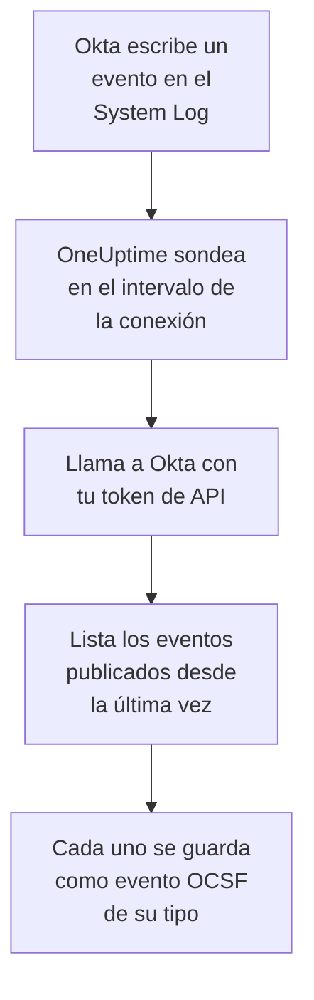

# Registro del sistema de Okta

Importa el [Okta System Log](https://developer.okta.com/docs/reference/system-log-query/) en los eventos de seguridad de OneUptime: inicios de sesión, desafíos de MFA, cambios de cuentas y grupos, y las propias detecciones de amenazas de Okta. Allí los buscas junto a tus logs, trazas y métricas, los correlacionas con todas las demás fuentes y avisas a la guardia de los que importan. OneUptime los lee con un token de API que tú creas, y no cambia nada en Okta.

:::cards
- [Configurar la conexión](#configurar-la-conexión): Un token de API y el formulario de la conexión.
- [Qué se importa](#qué-se-importa): Qué eventos, y cómo cada uno se convierte en un evento de seguridad.
- [Cómo funciona el sondeo](#cómo-funciona-el-sondeo): La ventana que lee cada sondeo, y por qué se solapa 15 minutos con la anterior.
- [Solución de problemas](#solución-de-problemas): Qué significa cada error y qué cambiar.
:::

## Cómo funciona



Cada minuto, OneUptime sondea cada conexión habilitada cuyo intervalo de sondeo ha pasado. Un sondeo pide a Okta los eventos del System Log publicados desde el último sondeo, y guarda cada uno como un evento [OCSF](https://schema.ocsf.io/): un inicio de sesión como un evento Authentication, un cambio de cuenta como un Account Change, y una detección de Okta como un Detection Finding. Las reglas de detección, los monitores y los paneles lo tratan entonces como un evento de seguridad de cualquier otra fuente. Funciona con cada celda de Okta, `okta.com`, `oktapreview.com` y `okta-emea.com`, y con una organización en un dominio personalizado.

## Antes de empezar

- En OneUptime, el rol Project Owner, Project Admin o Security Admin. Los roles Security Member y Security Viewer pueden ver las conexiones y su historial de ejecuciones, pero no cambiarlas.
- Un administrador de Okta que pueda ver el System Log, para crear el token. Un token puede hacer lo que puede su administrador, así que usa un Read-only Administrator: lee el System Log y no cambia nada. Un administrador de solo lectura también ve usuarios, grupos, aplicaciones y ajustes, así que guarda el token tan bien como una contraseña.
- Idealmente, una cuenta de servicio para ese administrador. Okta desactiva un token cuando su administrador se desactiva, y cuando pasa 30 días sin usarse. El sondeo lo usa cada pocos minutos, así que sigue en uso mientras la conexión está habilitada.
- Si tu organización solo acepta llamadas a la API desde una zona de red, una zona que contenga las direcciones desde las que llama OneUptime: en OneUptime Cloud, sus direcciones salientes, y en una instalación autoalojada, la dirección pública de tus hosts de aplicación y de workers.

## Configurar la conexión

:::steps
### Crear un token de API

1. Inicia sesión en la **Admin Console** de Okta como el administrador de solo lectura.
2. Abre **Security → API**, luego la pestaña **Tokens**, y selecciona **Create token**.
3. Ponle un nombre, por ejemplo `OneUptime security events`. Deja **Any IP** en el origen permitido de sus llamadas, salvo que tu organización necesite una zona.
4. Selecciona **Create token** y copia el **Token Value**. Okta solo lo muestra una vez.

Cada token puede usar una parte del límite de frecuencia de la API de la organización, que muestra su fila en la pestaña **Tokens**. Un sondeo hace como mucho 20 solicitudes, así que la parte predeterminada basta de sobra, salvo que otras herramientas usen el mismo token.

### Añadir la conexión en OneUptime

Abre **Productos → Eventos de seguridad → Conexiones** (`/dashboard/{projectId}/security-events/connections`), haz clic en **Añadir conexión**, elige **Okta System Log** y haz clic en **Siguiente**. Rellena los ajustes de la tabla de abajo, haz clic en **Siguiente** y pega el token en **API token**.

### Probarla antes de guardar

Haz clic en **Probar esta configuración** en **Probar antes de guardar**. La prueba inicia sesión y lee eventos con los valores del formulario, sin guardar nada, así que una URL equivocada o un filtro no válido aparece antes de que exista la conexión. Después haz clic en **Siguiente**, dale un **Nombre** a la conexión y créala.
:::

| Ajuste | Qué introducir |
| --- | --- |
| **Okta organization URL** | La dirección en la que inician sesión tus usuarios, por ejemplo `https://acme.okta.com`, `https://acme.oktapreview.com` o `https://login.example.com`. Debe usar `https`, sin ruta. No la dirección `-admin` de la Admin Console, que no sirve la API. |
| **Event filter** | Opcional. Un [filtro del System Log](https://developer.okta.com/docs/reference/core-okta-api/#filter) que elige los eventos que se importan, por ejemplo `eventType sw "user.session" or eventType sw "security"`. Vacío importa las familias de abajo. Como mucho 2.000 caracteres, en una sola línea, y no sobre `published`: OneUptime fija el intervalo de tiempo por sí mismo. |
| **API token** | El valor del token, por sí solo: OneUptime añade él mismo el esquema `SSWS`. Se cifra, la API nunca lo devuelve y nunca se vuelve a mostrar. Sustitúyelo con **Actualizar credenciales** en la conexión. |

El paso **Sondeo** también tiene una **Descripción** opcional, el **Intervalo de sondeo (minutos)**, un número entero de `1` a `1440` que empieza en `5`, y **Habilitado**, que empieza activado.

## Qué se importa

Sin **Event filter**, OneUptime importa las familias de eventos que vigila un equipo de seguridad, por prefijo de `eventType`. Un filtro propio sustituye esta lista, en lugar de ampliarla:

| Prefijo | Eventos |
| --- | --- |
| `user.session` | Inicios y cierres de sesión, acceso a la Admin Console, suplantación |
| `user.authentication` | Resultados de autenticación, inicio de sesión único incluido |
| `user.mfa` | Inscripción, desafíos y restablecimientos de factores |
| `user.account` | Cambios y restablecimientos de contraseña, bloqueos, cambios de perfil y de privilegios |
| `user.lifecycle` | Usuarios creados, activados, suspendidos, desactivados y eliminados |
| `security.` | ThreatInsight, informes de actividad sospechosa y las demás detecciones de Okta |
| `policy.` | Evaluaciones de políticas de inicio de sesión, y cambios de políticas |
| `system.api_token` | Tokens de API creados y revocados |
| `application.user_membership` | Asignaciones de aplicaciones |
| `group.user_membership` | Cambios de pertenencia a grupos |

Cada evento se convierte en un evento OCSF, con el proveedor `Okta` y el producto `Okta System Log`, de la clase que pide su `eventType`:

| `eventType` | Clase OCSF | Actividad |
| --- | --- | --- |
| `user.session.start` | Authentication (`3002`) | `Logon` |
| `user.session.end` | Authentication (`3002`) | `Logoff` |
| `user.authentication.*` | Authentication (`3002`) | `Logon` |
| `user.mfa.*` | Authentication (`3002`) | `Authentication Ticket` |
| Otros eventos `user.session.*` | Authentication (`3002`) | `Other` |
| `user.account.*`, `user.lifecycle.*` | Account Change (`3001`) | La última parte del tipo de evento, por ejemplo `Update Password` |
| `group.*` | Group Management (`3006`) | La última parte del tipo de evento, por ejemplo `Add` |
| `security.*`, y una `policy.evaluate_sign_on` que denegó el acceso | Detection Finding (`2004`) | `Create`, con el tipo de evento como nombre de la regla |
| Todo lo demás | `0`, con el nombre del tipo de evento | La última parte del tipo de evento |

Un evento que no entra en ninguna de estas clases conserva igualmente cada campo, y sigue siendo consultable por cualquiera de ellos. Cada evento rellena estas columnas:

| Campo de Okta | Columna de OneUptime |
| --- | --- |
| `uuid` | UID del evento, que también sirve para descartar duplicados |
| `published`, cuando ocurrió el evento | Hora del evento |
| `displayMessage`, si no el tipo de evento y `outcome.reason` | Mensaje |
| `severity`: `DEBUG` e `INFO` son Informational, `WARN` Medium, `ERROR` High | Gravedad |
| `outcome.result`, como `SUCCESS`, `FAILURE`, `ALLOW` o `DENY` | Estado |
| `actor.alternateId`, si no `actor.displayName`; `client.ipAddress` | Usuario e IP del actor |
| El `alternateId` del `User` en `target` | Usuario de destino |
| El `alternateId` de la `AppInstance` en `target` | Recurso de destino |
| El actor, cada destino y la IP del cliente | Observables |
| El evento entero, aplanado en claves con puntos, como `client.userAgent.browser` y `debugContext.debugData.requestUri` | `attributes` |

Un inicio de sesión fallido o denegado con `INFO` se eleva a Low, para que destaque frente a uno correcto. El System Log no lleva referencias de MITRE ATT&CK, así que esas columnas quedan vacías.

## Cómo funciona el sondeo

Cada sondeo lista los eventos publicados en su ventana, de más antiguos a más nuevos, 1.000 por página, y sigue el enlace `next` que envía Okta hasta la última página:

```text
GET {Okta organization URL}/api/v1/logs?since={window start}&until={window end}&sortOrder=ASCENDING&limit=1000&filter={Event filter}
```

- **La hora de publicación es el cursor.** Un evento del System Log es la propia actividad, así que `published` es a la vez cuando ocurrió y lo que lee el sondeo.
- **El primer sondeo mira 24 horas atrás**, para que una conexión nueva muestre enseguida sus eventos recientes.
- **Cada sondeo posterior empieza 15 minutos antes del cursor guardado.** Okta advierte que una solicitud con una hora de fin puede dejar fuera eventos retrasados, algo que considera raro. El solapamiento los lee en el siguiente sondeo. Uno retrasado más de 15 minutos puede quedar detrás del cursor: importa su intervalo de tiempo para recuperarlo.
- **Un sondeo lee como mucho 24 horas más allá del cursor.** Una conexión cuyo cursor se quedó atrás se pone al día en una serie de ventanas de 24 horas, y su **Salud** indica **Catching up**.
- **Los duplicados se descartan por `uuid`** dentro del proyecto, para que el solapamiento, una ventana reintentada y una importación nunca guarden un evento dos veces.

Un enlace `next` que apunta a cualquier sitio que no sea tu **Okta organization URL** nunca se sigue, porque el token va con cada solicitud.

### Cuando una ventana contiene más de lo que un sondeo puede leer

Un sondeo lee como mucho 10.000 eventos, en como mucho 20 solicitudes. Cuando una ventana contiene más, la ejecución es **Parcial**, con un aviso como este:

```text
Stopped after collecting 10000 events; the window holds more. The last event read was published at 2026-09-14T08:12:44.000Z.
```

Los eventos se leen de más antiguos a más nuevos, así que OneUptime mueve el cursor a la hora de publicación del último evento leído, y el siguiente sondeo empieza ahí, sin el solapamiento de 15 minutos, con la misma longitud de ventana. Una organización con mucha actividad se pone al día 10.000 eventos por sondeo, en lugar de volver a leer los mismos. El solapamiento vuelve cuando el cursor ha avanzado 15 minutos más allá de ese punto.

Cuando una ejecución no consigue avanzar en absoluto más allá del cursor guardado, por ejemplo porque los 15 minutos de solapamiento por sí solos contienen más de 10.000 eventos, OneUptime acorta la ventana en su lugar:

1. **Reducir.** El siguiente sondeo lee una ventana de la mitad de largo, desde el mismo punto de partida, y sigue reduciéndola a la mitad hasta que una ventana se lee entera, hasta un minuto. El aviso de la ejecución lo dice: `This window holds more records than one poll can read; the next poll reads a {n} minute window from the same starting point.`
2. **Volver a crecer.** Cuando una ventana se lee entera, la siguiente vuelve a ser el doble de larga, hasta 24 horas.
3. **Pasar más allá de un único minuto.** Si incluso un minuto contiene más de lo que un sondeo puede leer, el sondeo lo pasa de largo, para que sigan llegando los eventos más nuevos, y el solapamiento de los sondeos posteriores ya no vuelve a él. La ejecución sigue siendo **Parcial**, y **Último error** indica `More records were created in the one minute from {cursor} to {end} than one poll can read. Polling moved past this minute so newer records keep arriving; use Import this time range in Diagnostics on this minute to recover what one run can read.` Importa ese minuto con **Importar este intervalo de tiempo** para recuperar lo que una ejecución puede leer, o restringe el **Event filter**.

Una ejecución que falla del todo, con un error de Okta, conserva el cursor y la longitud de ventana, y el siguiente sondeo vuelve a leer la misma ventana. La única excepción es una solicitud que agotó el tiempo: el cursor se queda, pero la siguiente ventana es la mitad de larga, porque una ventana demasiado pesada para responder a tiempo agotaría el tiempo en cada intento. Cambiar el **Intervalo de sondeo (minutos)** no cambia nada de esto: decide cada cuánto empieza un sondeo, no dónde empieza su ventana.

### Ejecutar, previsualizar e importar a demanda

Haz clic en **Diagnósticos** en una conexión para ver sus ejecuciones recientes y trabajar con ella a mano. Quien puede cambiar la conexión puede iniciar estas acciones; quien puede verla puede leer el historial.

- **Ejecutar ahora** inicia un sondeo de inmediato, con el cursor habitual, incluso cuando la conexión no está **Habilitado**.
- **Preview log events** lee un intervalo de tiempo de hasta 7 días y no importa nada.
- **Importar este intervalo de tiempo** importa un intervalo de hasta 7 días, después de que lo confirmes, sin mover el cursor. Los eventos ya importados se omiten. Okta conserva 90 días de System Log.
- **Copiar diagnósticos** en una ejecución copia su informe para soporte. Nunca incluye credenciales.

## Probar conexión

**Probar conexión** en la fila de una conexión, y **Probar esta configuración** en el formulario, se ejecutan en el proceso de la API, no en un worker en segundo plano, para que una prueba responda incluso cuando el problema son los workers. Hace estas comprobaciones, en orden:

| Comprobación | Qué comprueba |
| --- | --- |
| **Configuración** | Cada ajuste está presente y bien formado. No se contacta con nada cuando esto falla. |
| **Authenticate with Okta** | Okta acepta el token para el System Log, con un evento leído y sin filtro. |
| **Read System Log events** | Se puede leer un evento de las últimas 24 horas a través del filtro que usa el sondeo, el tuyo o el predeterminado, así que un **Event filter** no válido falla aquí y no en el primer sondeo. |
| **Events available to import** | Cuántos eventos se publicaron en las últimas 24 horas y en los últimos 7 días, una página de 1.000 cada uno, así que `1000+` significa más. Ninguno en 7 días es un aviso, no un fallo. |
| **Background workers**, **Poll scheduler**, **Security event storage** | El lado del propio OneUptime: un proceso toma los trabajos de la cola Worker, el trabajo de sondeo se ejecuta cada minuto y el almacén de eventos de seguridad responde. |
| **Sondeo programado** | Para una conexión guardada: el sondeo está activado, ninguna ejecución está atascada esperando a un worker y los sondeos se ejecutan a tiempo. |

Cada solicitud de una prueba tiene un plazo de 20 segundos. Una prueba nunca importa nada ni mueve el cursor, y cada comprobación que falla dice qué cambiar.

## Solución de problemas

El **Último error** de la conexión guarda el mensaje de error completo, con las credenciales ocultas, tras un prefijo que nombra el paso que falló. Cuando una conexión tiene un error, selecciona **Ver error** en su columna **Acciones** para leerlo, y **Copiar error** en el cuadro de diálogo para copiarlo. Cada mensaje empieza por `Okta System Log events request`, y cita el propio código de error de Okta tras el estado; lee lo que sigue.

:::details Último error dice `failed (HTTP 400)`
Okta rechazó los parámetros de la solicitud, `E0000053`. Cuando el token funcionó, casi siempre es el **Event filter**: revisa sus operadores, `eq`, `ne`, `co`, `sw`, `ew`, `pr`, `gt`, `ge`, `lt` y `le`, sus `and` y `or`, y las comillas dobles alrededor de sus valores, o vacíalo para usar las familias predeterminadas. En una importación, también puede significar que el intervalo empieza hace más de 180 días.
:::

:::details Último error dice `failed (HTTP 401)` o `failed (HTTP 403)`
- `HTTP 401`: Okta no aceptó el token, `E0000011`. Se revocó, pasó 30 días sin usarse, o se desactivó con su administrador; o se pegó con `SSWS` o con un carácter de más. Crea un token nuevo como administrador de solo lectura y guárdalo con **Actualizar credenciales**.
- `HTTP 403`: el token inicia sesión, pero su administrador no puede leer el System Log, `E0000006`. Créalo como Read-only Administrator o Super Administrator, y comprueba que su zona de red permite las direcciones desde las que llama OneUptime.
:::

:::details Último error dice `failed (HTTP ...)` con otro estado
- `HTTP 404`: la URL no sirve la API de Okta. Usa la dirección propia de la organización, por ejemplo `https://acme.okta.com`, sin ruta y no la de `-admin`.
- `HTTP 3xx`: Okta redirigió la solicitud, y las redirecciones se rechazan, porque el token va con cada solicitud. Usa la dirección propia de la organización.
- `HTTP 429`: Okta está limitando el token, `E0000047`. El siguiente sondeo lo vuelve a intentar. Si sigue pasando, sube la parte del límite de frecuencia del token en la pestaña **Tokens**, da a OneUptime un token propio, o sondea con menos frecuencia.
- `HTTP 5xx`: Okta falló, o la consulta superó el límite de 30 segundos de Okta, `E0000009`. El siguiente sondeo lo vuelve a intentar; si sigue pasando, consulta [status.okta.com](https://status.okta.com).
:::

:::details Último error dice `returned` o `did not complete`
- `returned a non-JSON body.` o `returned an unrecognized response shape`: respondió algo distinto de la API de Okta, por ejemplo una página de inicio de sesión o un proxy, u Okta respondió con un error. Se notifica en lugar de tomarse como una ventana vacía, para que el cursor nunca pase de largo eventos que nadie leyó.
- `returned a next link outside the Okta organization URL`: un enlace `next` apuntaba a otro sitio, y no se siguió. Okta nunca hace esto: busca un proxy que reescriba las cabeceras.
- `did not complete`: la solicitud no obtuvo respuesta: un tiempo de espera agotado, un nombre que no se resuelve, un certificado en el que OneUptime no confía, o una dirección rechazada. Comprueba que la aplicación y los workers de OneUptime pueden llegar a tu organización por HTTPS, a través del proxy que uses, si lo hay.
:::

:::details Último sondeo indica Never y Último error está vacío
Ningún sondeo ha terminado para esta conexión. Ejecuta **Probar conexión**: sus comprobaciones **Background workers** y **Poll scheduler** nombran la causa. En una instalación autoalojada, la causa habitual es `DISABLE_QUEUE_WORKERS=true` en la aplicación, sin un despliegue de workers aparte que tome los trabajos: ponlo en `false`, o ejecuta el despliegue de workers (Helm: `worker.enabled: true`).
:::

:::details Una ejecución es Parcial
- `Stopped after collecting 10000 events`: la ventana contenía más que los 10.000 eventos que lee una ejecución. No se pierde nada: el siguiente sondeo empieza después del último evento leído. Una conexión que sigue **Parcial** sondeo tras sondeo se está poniendo al día con un atraso, y su **Último sondeo** y su **Último evento importado** siguen avanzando. Si nunca se pone al día, la organización publica más eventos coincidentes de los que cabe en un intervalo de sondeo: restringe el **Event filter**, o acorta el **Intervalo de sondeo (minutos)**.
- `More records were created in the one minute from ... than one poll can read`: el sondeo pasó de largo ese minuto. Impórtalo con **Importar este intervalo de tiempo** en **Diagnósticos**. Una importación lee tanto como un sondeo.
:::

:::details La prueba pasa, pero no se importa nada
Lee **Events available to import** en el informe de la prueba. Con el filtro predeterminado, una organización con usuarios publica inicios de sesión todo el tiempo, así que `0` en los últimos 7 días significa que la URL es un sandbox o una organización sin uso. Con tu propio **Event filter**, significa que el filtro no encontró nada: compáralo con los tipos de evento del System Log de la Admin Console.
:::

## Qué obtienes

- **Búsqueda.** Filtra los inicios de sesión, los resultados de MFA, los cambios de cuentas y las detecciones de Okta por gravedad, estado, usuario, IP o cualquier observable en el explorador de eventos de seguridad, junto a todas las demás fuentes.
- **Correlación.** Los usuarios, aplicaciones e IP de cada evento se indexan como observables, así que una búsqueda encuentra todo lo que hizo un usuario, junto a los propios logs de su aplicación.
- **Reglas de detección.** Reglas Sigma que se ejecutan según una programación sobre tus eventos de seguridad, como los inicios de sesión fallidos por IP o los rechazos de MFA por usuario, y abren alertas que avisan a la guardia.
- **Monitores.** Los monitores de eventos de seguridad cuentan los eventos que coinciden, y abren incidentes o alertas por encima de un umbral.

Los eventos de seguridad se facturan como el resto de tu telemetría, por GB ingerido. Consulta los [precios](https://oneuptime.com/pricing).

## Próximos pasos

:::cards
- [Eventos de seguridad](/docs/telemetry/security-events): Busca, correlaciona y alerta sobre lo que importas.
- [AWS Security Hub](/docs/integrations/aws-security-hub): Importa también los hallazgos de tu nube.
- [Roles](/docs/permissions/reference#roles): Lo que pueden ver y cambiar los roles Security.
- [Descripción general de integraciones](/docs/integrations/index): Las otras herramientas que puedes conectar.
:::
