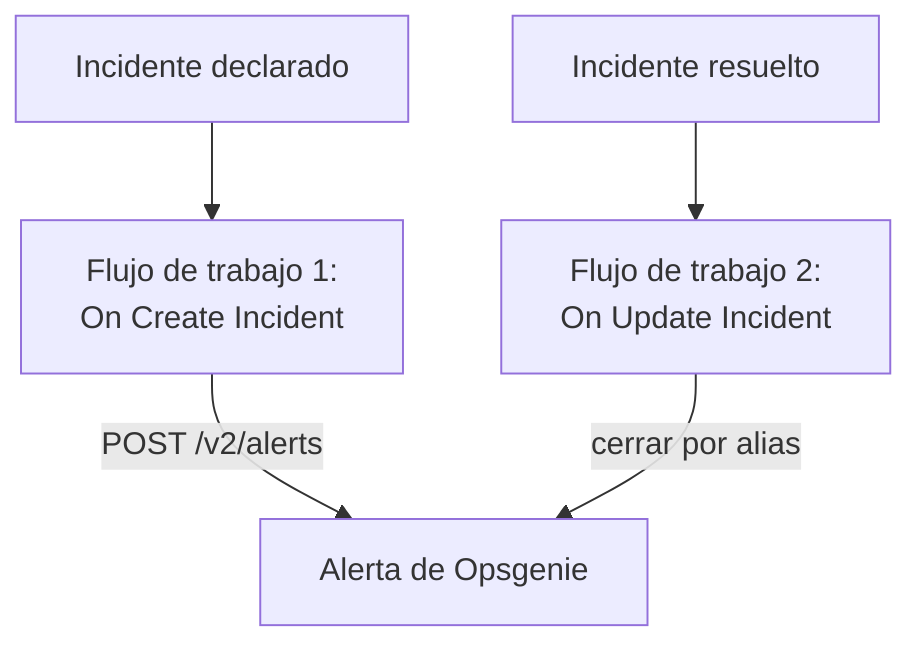

# Opsgenie

Envía los incidentes de OneUptime a [Opsgenie](https://www.atlassian.com/software/opsgenie). Un flujo de trabajo crea una alerta de Opsgenie cuando se declara un incidente de OneUptime, y un segundo flujo la cierra cuando el incidente de OneUptime se resuelve. Úsalo mientras Opsgenie siga avisando a tu equipo y OneUptime vigile tus sistemas.

:::cards
- [Guardar la clave de API](#guardar-la-clave-de-api): Mantén la clave de Opsgenie fuera de tus flujos de trabajo.
- [Crear alertas de Opsgenie](#crear-una-alerta-de-opsgenie-por-cada-incidente): Un flujo de trabajo, dos bloques.
- [Cerrarlas](#cerrar-la-alerta-de-opsgenie): Un segundo flujo de trabajo que sigue el estado del incidente.
- [Solución de problemas](#solución-de-problemas): Cuando Opsgenie rechaza una solicitud.
:::

> [!IMPORTANT]
> Atlassian dejó de vender Opsgenie en junio de 2025 y pone fin a su soporte en abril de 2027. OneUptime también avisa a las personas, con políticas de guardia, calendarios y reglas de escalado. Para traer a tu equipo, consulta [Migrar desde Opsgenie](/docs/moving-to-oneuptime/opsgenie): una importación trae tus usuarios, tus equipos, tus calendarios y tus escalados.

## Cómo funciona



Ambos flujos de trabajo llaman a la [API Alert de Opsgenie](https://docs.opsgenie.com/docs/alert-api). El primero da a la alerta un `alias` formado a partir del ID del incidente de OneUptime, y el segundo cierra la alerta por ese alias.

## Antes de empezar

- Una integración de Opsgenie de tipo **API** y su **API Key**. Añade una en **Settings → Integrations** en Opsgenie, o en las **Integrations** de un equipo para enviar las alertas a ese equipo.
- Tu región de Opsgenie. Las cuentas de Europa, que inician sesión en `app.eu.opsgenie.com`, usan `api.eu.opsgenie.com`. Todas las demás usan `api.opsgenie.com`.
- En OneUptime, permiso para crear flujos de trabajo y variables globales. En OneUptime Cloud, los flujos de trabajo necesitan el plan **Growth** o superior.

## Guardar la clave de API

:::steps
1. Ve a **Flujos de trabajo → Variables globales** y haz clic en **Crear Variable del flujo de trabajo**.
2. Ponle el nombre `OPSGENIE_KEY` y haz clic en **Siguiente**.
3. Pega la clave de API en **Contenido**, activa **Secreto** y haz clic en **Crear Variable del flujo de trabajo**.
:::

Una variable secreta se sustituye por `[REDACTED]` en los registros de ejecución, así que la clave nunca aparece en una ejecución.

## Crear una alerta de Opsgenie por cada incidente

:::steps
### Crear el flujo de trabajo

Ve a **Flujos de trabajo**, haz clic en **Crear flujo de trabajo** y luego en **Empezar desde cero**. Ponle el nombre `Incidents to Opsgenie` y haz clic en **Crear flujo de trabajo**.

### Añadir el disparador

Haz clic en el bloque discontinuo **Elige qué inicia este flujo de trabajo** y elige **On Create Incident**. Haz clic en el disparador: sus **Fields to pass on** empiezan con **Título**, así que haz clic en **Añadir campo** y elige **Descripción**.

### Crear la alerta

Haz clic en **Añadir componente**, añade un bloque **API Post (JSON)** y conecta a él el punto **Success** del disparador. Pon su **URL** en `https://api.opsgenie.com/v2/alerts`, o `https://api.eu.opsgenie.com/v2/alerts` en Europa. En **Más campos**, pon sus **Request Headers** en:

```json
{ "Authorization": "GenieKey {{global.variables.OPSGENIE_KEY}}" }
```

Y su **Request Body** en:

```json
{
  "message": "{{local.components.incident-on-create-1.returnValues.model.title}}",
  "alias": "oneuptime-{{local.components.incident-on-create-1.returnValues.model._id}}",
  "description": "{{local.components.incident-on-create-1.returnValues.model.description}}",
  "priority": "P1",
  "source": "OneUptime"
}
```

### Probarlo y luego activarlo

Haz clic en **Ejecutar flujo de trabajo**, elige un incidente de prueba en **Incidente** y ejecútalo. El paso **API Post (JSON)** muestra una respuesta `202`, y la alerta aparece en Opsgenie un momento después. Después, activa **Habilitado** en la parte superior del **Constructor**.
:::

El esquema de Opsgenie es la palabra `GenieKey`, un espacio y luego la clave. Opsgenie limita `message` a 130 caracteres, y sus prioridades van de `P1` a `P5`: para enviar la de cada incidente, consulta [Asignar las prioridades](#asignar-las-prioridades).

## Cerrar la alerta de Opsgenie

Un flujo de trabajo tiene un solo disparador, así que cerrar requiere un segundo flujo de trabajo, que se inicia cuando cambia el estado de un incidente.

:::steps
### Añadir el disparador On Update Incident

Crea un flujo de trabajo llamado `Close Opsgenie alerts` y elige **On Update Incident** como disparador. En **Fields to watch**, haz clic en **Añadir campo** y elige **Estado actual del incidente**, para que solo se ejecute cuando cambie el estado. En **Fields to pass on**, pide si el nuevo estado es un estado resuelto: haz clic en **Añadir campo**, abre **Estado actual del incidente** y elige **Es estado resuelto**. O haz clic en **Editar como JSON** y reemplaza el JSON por:

```json
{ "_id": true, "currentIncidentState": { "isResolvedState": true } }
```

### Comprobar que el incidente está resuelto

Añade un bloque **If / Else** después del disparador. Pon **Value to check** en `{{local.components.incident-on-update-1.returnValues.model.currentIncidentState.isResolvedState}}` y **Comparison** en **is true**.

### Cerrar la alerta

Añade un bloque **API Post (JSON)** después del lado **Yes**, con los mismos **Request Headers** y esta **URL**:

```text
https://api.opsgenie.com/v2/alerts/oneuptime-{{local.components.incident-on-update-1.returnValues.model._id}}/close?identifierType=alias
```

Pon su **Request Body** en `{ "source": "OneUptime", "note": "Resolved in OneUptime" }`.

### Activarlo

Activa **Habilitado** y luego resuelve un incidente de prueba en OneUptime. Opsgenie cierra su alerta.
:::

`identifierType=alias` indica a Opsgenie que la dirección nombra la alerta por su alias, no por su propio ID.

## Asignar las prioridades

Para enviar la gravedad de cada incidente como prioridad de Opsgenie, añade un bloque **Run Custom JavaScript** entre el disparador y el bloque **API Post (JSON)**.

1. En los **Fields to pass on** del disparador, haz clic en **Añadir campo**, abre **Gravedad del incidente** y elige **Nombre**.
2. Pon los **Arguments** del bloque en `{ "severity": "{{local.components.incident-on-create-1.returnValues.model.incidentSeverity.name}}" }`, y su **JavaScript Code** en:

   ```javascript
   // Your incident severities, by name, to Opsgenie's priorities.
   const PRIORITY = {
     "Critical Incident": "P1",
     "Major Incident": "P2",
     "Minor Incident": "P3",
   };

   return { priority: PRIORITY[args.severity] || "P3" };
   ```

3. En el cuerpo de la solicitud, pon `"priority"` en `"{{local.components.javascript-1.returnValues.returnValue.priority}}"`.

Los nombres de arriba son las tres gravedades con las que empieza un proyecto nuevo. Usa los tuyos si les cambiaste el nombre.

## Solución de problemas

:::details Opsgenie responde 401 o 403
La clave es incorrecta, o pertenece a la otra región. Comprueba que la cabecera contiene `GenieKey`, un espacio y la clave, que la clave es la de una integración **API**, y que el host corresponde a tu región: `api.opsgenie.com` o `api.eu.opsgenie.com`.
:::

:::details El cierre responde 404
Ninguna alerta tiene ese alias. Ambos flujos de trabajo deben formar el alias de la misma manera, `oneuptime-` seguido del `_id` del incidente, y la URL debe terminar en `?identifierType=alias`.
:::

:::details La alerta no aparece nunca, aunque el paso muestra 202
Opsgenie responde `202` antes de procesar la solicitud, así que una solicitud que rechace después sigue mostrando `202`. Busca la solicitud en los registros de Opsgenie para ver por qué se rechazó, por ejemplo una integración desactivada.
:::

:::details El flujo de trabajo nunca se ejecuta
Comprueba que está activado: **Habilitado**, en la parte superior de su **Constructor**. Después abre **Registros → Ejecuciones**: una ejecución que tomó el lado **No** del bloque **If / Else** es una actualización que no era una resolución.
:::

## Próximos pasos

:::cards
- [Migrar desde Opsgenie](/docs/moving-to-oneuptime/opsgenie): Trae a tu equipo, tus calendarios y tus escalados antes del fin de Opsgenie.
- [Reglas de escalado](/docs/on-call/escalation-rules): Avisa a las personas desde el propio OneUptime.
- [PagerDuty](/docs/integrations/pagerduty): Los mismos dos flujos de trabajo para PagerDuty.
- [Descripción general de integraciones](/docs/integrations/index): Los patrones detrás de cada integración.
:::
