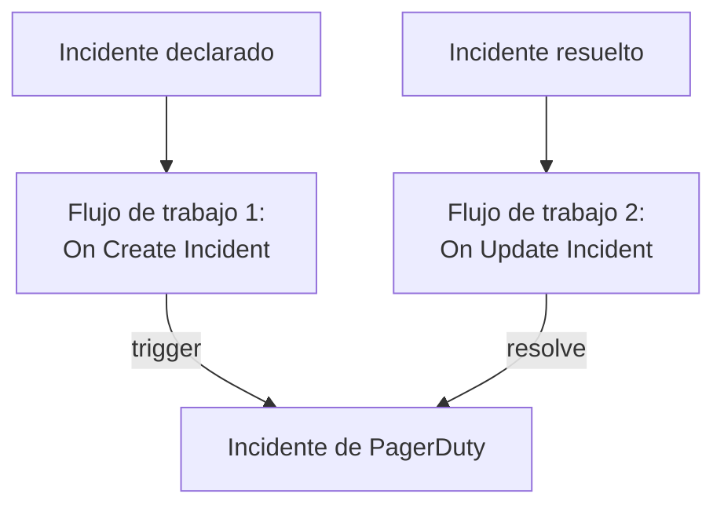

# PagerDuty

Envía los incidentes de OneUptime a [PagerDuty](https://www.pagerduty.com). Un flujo de trabajo dispara un incidente de PagerDuty cuando se declara un incidente de OneUptime, y un segundo flujo lo resuelve cuando el incidente de OneUptime se resuelve. Úsalo cuando PagerDuty avisa a tu equipo y OneUptime vigila tus sistemas.

:::cards
- [Guardar la clave de enrutamiento](#guardar-la-clave-de-enrutamiento): Mantén la clave de PagerDuty fuera de tus flujos de trabajo.
- [Disparar incidentes de PagerDuty](#disparar-un-incidente-de-pagerduty-por-cada-incidente): Un flujo de trabajo, dos bloques.
- [Resolverlos](#resolver-el-incidente-de-pagerduty): Un segundo flujo de trabajo que sigue el estado del incidente.
- [Solución de problemas](#solución-de-problemas): Cuando PagerDuty rechaza un evento.
:::

> [!TIP]
> OneUptime también avisa a las personas, con políticas de guardia, calendarios y reglas de escalado. Para que tu equipo deje PagerDuty, consulta [Migrar desde PagerDuty](/docs/moving-to-oneuptime/pagerduty): una importación trae tus usuarios, tus calendarios y tus políticas de escalado.

## Cómo funciona



Ambos flujos de trabajo llaman a la [Events API v2](https://developer.pagerduty.com/docs/events-api-v2/overview/) de PagerDuty con la misma `dedup_key`, formada a partir del ID del incidente de OneUptime. Esa clave es la que permite a PagerDuty saber que el evento de resolución cierra el incidente que abrió el evento de disparo.

## Antes de empezar

- Un servicio de PagerDuty con una integración de Events API v2. En PagerDuty, abre el servicio, luego **Integrations**, haz clic en **Add an integration** y elige **Events API V2**. Copia su **Integration Key**: la Events API la llama clave de enrutamiento.
- En OneUptime, permiso para crear flujos de trabajo y variables globales. En OneUptime Cloud, los flujos de trabajo necesitan el plan **Growth** o superior.

## Guardar la clave de enrutamiento

:::steps
1. Ve a **Flujos de trabajo → Variables globales** y haz clic en **Crear Variable del flujo de trabajo**.
2. Ponle el nombre `PAGERDUTY_ROUTING_KEY` y haz clic en **Siguiente**.
3. Pega la clave de integración en **Contenido**, activa **Secreto** y haz clic en **Crear Variable del flujo de trabajo**.
:::

Una variable secreta se sustituye por `[REDACTED]` en los registros de ejecución, así que la clave nunca aparece en una ejecución.

## Disparar un incidente de PagerDuty por cada incidente

:::steps
### Crear el flujo de trabajo

Ve a **Flujos de trabajo**, haz clic en **Crear flujo de trabajo** y luego en **Empezar desde cero**. Ponle el nombre `Incidents to PagerDuty` y haz clic en **Crear flujo de trabajo**.

### Añadir el disparador

Haz clic en el bloque discontinuo **Elige qué inicia este flujo de trabajo** y elige **On Create Incident**. Haz clic en el disparador y, en **Fields to pass on**, elige `title` y `description`.

### Enviar el evento de disparo

Haz clic en **Añadir componente**, añade un bloque **API Post (JSON)** y conecta a él el punto **Success** del disparador. Pon su **URL** en `https://events.pagerduty.com/v2/enqueue` y su **Request Body** en:

```json
{
  "routing_key": "{{global.variables.PAGERDUTY_ROUTING_KEY}}",
  "event_action": "trigger",
  "dedup_key": "oneuptime-{{local.components.incident-on-create-1.returnValues.model._id}}",
  "payload": {
    "summary": "{{local.components.incident-on-create-1.returnValues.model.title}}",
    "source": "OneUptime",
    "severity": "critical",
    "custom_details": {
      "description": "{{local.components.incident-on-create-1.returnValues.model.description}}"
    }
  }
}
```

### Probarlo y luego activarlo

Haz clic en **Ejecutar flujo de trabajo**, elige un incidente de prueba en **Incidente** y ejecútalo. El paso **API Post (JSON)** muestra una respuesta `202` con `"status": "success"`, y PagerDuty abre un incidente. Después, activa **Habilitado** en la parte superior del **Constructor**.
:::

El bloque envía JSON, así que no necesita cabecera `Content-Type`. La `severity` de PagerDuty es una de `critical`, `error`, `warning` e `info`: para enviar la de cada incidente, consulta [Asignar las gravedades](#asignar-las-gravedades).

## Resolver el incidente de PagerDuty

Un flujo de trabajo tiene un solo disparador, así que resolver requiere un segundo flujo de trabajo, que se inicia cuando cambia el estado de un incidente.

:::steps
### Añadir el disparador On Update Incident

Crea un flujo de trabajo llamado `Resolve PagerDuty incidents` y elige **On Update Incident** como disparador. En **Fields to watch**, elige `currentIncidentStateId`, para que solo se ejecute cuando cambie el estado. En **Fields to pass on**, pide si el nuevo estado es un estado resuelto:

```json
{ "_id": true, "currentIncidentState": { "isResolvedState": true } }
```

### Comprobar que el incidente está resuelto

Añade un bloque **If / Else** después del disparador. Pon **Value to check** en `{{local.components.incident-on-update-1.returnValues.model.currentIncidentState.isResolvedState}}` y **Comparison** en **is true**.

### Enviar el evento de resolución

Añade un bloque **API Post (JSON)** después del lado **Yes**, con la misma **URL** y este **Request Body**:

```json
{
  "routing_key": "{{global.variables.PAGERDUTY_ROUTING_KEY}}",
  "event_action": "resolve",
  "dedup_key": "oneuptime-{{local.components.incident-on-update-1.returnValues.model._id}}"
}
```

### Activarlo

Activa **Habilitado** y luego resuelve un incidente de prueba en OneUptime. PagerDuty resuelve su incidente.
:::

Comprobar `isResolvedState` en lugar del nombre de un estado sigue funcionando cuando cambias el nombre de tus estados. Consulta [Estados y severidades de incidentes](/docs/incidents/states-and-severities).

## Asignar las gravedades

Para enviar la gravedad de cada incidente, añade un bloque **Run Custom JavaScript** entre el disparador y el bloque **API Post (JSON)**, y lee su respuesta en el cuerpo.

1. En los **Fields to pass on** del disparador, elige también el `name` de la gravedad: `{ "incidentSeverity": { "name": true } }`.
2. Pon los **Arguments** del bloque en `{ "severity": "{{local.components.incident-on-create-1.returnValues.model.incidentSeverity.name}}" }`, y su **JavaScript Code** en:

   ```javascript
   // Your incident severities, by name, to PagerDuty's.
   const SEVERITY = {
     "Critical Incident": "critical",
     "Major Incident": "error",
     "Minor Incident": "warning",
   };

   return { severity: SEVERITY[args.severity] || "info" };
   ```

3. En el cuerpo de la solicitud, pon `"severity"` en `"{{local.components.javascript-1.returnValues.returnValue.severity}}"`.

Los nombres de arriba son las tres gravedades con las que empieza un proyecto nuevo. Usa los tuyos si les cambiaste el nombre.

## Solución de problemas

:::details PagerDuty responde 400
El cuerpo de la respuesta dice qué rechazó PagerDuty, y el paso **API Post (JSON)** de la ejecución lo muestra. Lo habitual es que la clave de enrutamiento no sea una clave de integración de Events API v2: vuelve a copiarla de las **Integrations** del servicio. Un evento sin `summary`, `source` o `severity` también se rechaza.
:::

:::details El evento de resolución no cierra nada
Ambos eventos deben llevar exactamente la misma `dedup_key`. Comprueba que los dos cuerpos la forman con `oneuptime-` seguido del `_id` del incidente, y que el flujo de trabajo de resolución está activado.
:::

:::details El flujo de trabajo nunca se ejecuta
Comprueba que está activado: **Habilitado**, en la parte superior de su **Constructor**. Después abre **Registros → Ejecuciones**: una ejecución que tomó el lado **No** del bloque **If / Else** es una actualización que no era una resolución.
:::

:::details PagerDuty muestra una referencia en lugar de un valor
Una referencia que no se resuelve se envía tal como está escrita, llaves incluidas. Revisa el identificador del bloque, el nombre del campo y el nombre de la variable, que distingue mayúsculas de minúsculas. En la pestaña **Pasos** de la ejecución, un ajuste con una referencia así aparece marcado como **No se resolvió**.
:::

## Próximos pasos

:::cards
- [Migrar desde PagerDuty](/docs/moving-to-oneuptime/pagerduty): Trae a tu equipo, tus calendarios y tus políticas de escalado.
- [Reglas de escalado](/docs/on-call/escalation-rules): Avisa a las personas desde el propio OneUptime.
- [Opsgenie](/docs/integrations/opsgenie): Los mismos dos flujos de trabajo para Opsgenie.
- [Descripción general de integraciones](/docs/integrations/index): Los patrones detrás de cada integración.
:::
