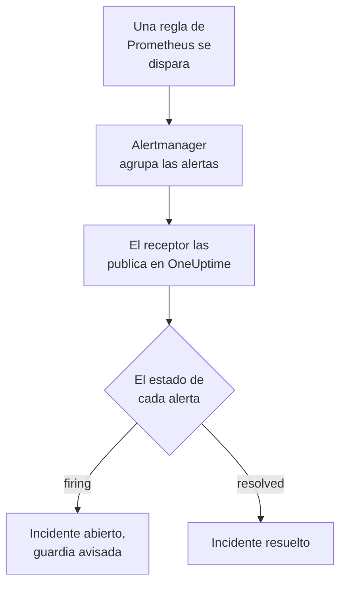

# Prometheus Alertmanager

Envía las alertas de [Prometheus Alertmanager](https://prometheus.io/docs/alerting/latest/alertmanager/) a OneUptime, para que cada alerta que se dispara se convierta en un incidente que avisa a tu equipo de guardia y se resuelva cuando la alerta se recupera. Alertmanager publica sus notificaciones en un receptor webhook, así que no hay nada que instalar en ninguno de los dos lados.

:::cards
- [Elegir cómo recibe OneUptime las alertas](#elegir-cómo-recibe-oneuptime-las-alertas): Un monitor de solicitudes entrantes o un flujo de trabajo propio.
- [Recibir alertas con un monitor](#recibir-alertas-con-un-monitor): Un incidente por alerta, resuelto con la recuperación.
- [Configurar Alertmanager](#configurar-alertmanager): Un receptor webhook y la ruta que lo usa.
- [Solución de problemas](#solución-de-problemas): Cuando las alertas no llegan o los incidentes siguen abiertos.
:::

## Cómo funciona



Prometheus evalúa tus reglas de alerta y envía las alertas que se disparan a Alertmanager. Alertmanager las agrupa por las etiquetas del `group_by` de tu ruta y publica cada grupo en el receptor webhook como una notificación JSON. La lista `alerts` de la notificación contiene todas las alertas del grupo, cada una con su propio `status`, `firing` o `resolved`, sus etiquetas y anotaciones, y un `fingerprint` que la identifica.

## Antes de empezar

- Un Alertmanager cuyo `alertmanager.yml` puedas editar y que pueda llegar a tu OneUptime por HTTPS.
- En OneUptime, permiso para crear monitores, o flujos de trabajo si eliges ese camino.

## Elegir cómo recibe OneUptime las alertas

Configura primero OneUptime: te da la URL a la que envía Alertmanager.

| Camino | Úsalo cuando |
| --- | --- |
| Un monitor de solicitudes entrantes (recomendado) | Quieres que cada alerta sea un incidente que avisa a la guardia y se resuelve cuando la alerta se recupera. No hay nada que construir. |
| Un flujo de trabajo con un disparador Webhook | Necesitas tu propia lógica: filtrar alertas, transformarlas o llamar antes a otros sistemas. Un flujo de trabajo abre un incidente por notificación, no por alerta, y no lo resuelve con la recuperación. |

Ambos reciben el mismo JSON del mismo receptor, así que puedes empezar con uno y pasar al otro más tarde cambiando una URL en `alertmanager.yml`.

## Recibir alertas con un monitor

Un [monitor de solicitudes entrantes](/docs/monitor/incoming-request-monitor) te da una URL, y sus criterios deciden qué hace cada notificación.

:::steps
### Crear el monitor

Ve a **Monitores** y haz clic en **Crear monitor**. Elige **Solicitud entrante** en **Tipo de monitor**, llámalo `Alertmanager` y haz clic en **Siguiente**.

### Declarar un incidente por cada alerta disparada

En el paso **Criterios**, abre el primer criterio, el que marca el monitor como fuera de línea. Configura su filtro como **Cuerpo de la solicitud**, **Contiene**, `"status":"firing"`. Este criterio ya declara un incidente cuando su filtro coincide. Completa el incidente:

- **Título del incidente**: `{{requestBody.commonLabels.alertname}} on {{requestBody.commonLabels.instance}}`.
- **Gravedad**: la gravedad de incidente que deben tener estas alertas.
- **Políticas de guardia**, en **De guardia**: las políticas a las que avisar.
- **Resolver incidente automáticamente**, en **Más campos**: déjalo activado, como viene. Sin él, las recuperaciones se ignoran y los incidentes siguen abiertos.

### Abrir un incidente por alerta

En el mismo criterio, abre **Ajustes** y activa **Agrupa incidentes y alertas por un campo de la carga útil**. Complétalo como se indica abajo, para que cada alerta tenga su propio incidente y su recuperación lo resuelva:

| Campo | Valor |
| --- | --- |
| **Abrir un incidente separado para cada…** | `requestBody.alerts[*].fingerprint` |
| **Campo que indica la recuperación** | `requestBody.alerts[*].status` |
| **Valor que significa recuperado** | `resolved` |

### Volver a poner el monitor en línea

Abre el segundo criterio, el que marca el monitor como en línea, y configura su filtro como **Cuerpo de la solicitud**, **Contiene**, `"status":"resolved"`.

### Copiar la URL

Haz clic en **Crear monitor**. La página **Vista general** del monitor muestra su **URL de latido**. Cópiala para Alertmanager:

```text
https://oneuptime.com/heartbeat/<secret key>
```

Una instalación autoalojada tiene su propio host en lugar de `oneuptime.com`.
:::

`[*]` lee cada alerta de una notificación, así que una notificación de tres alertas puede abrir tres incidentes, hasta el **Máximo de incidentes por solicitud** (`100` salvo que lo cambies). El `status` propio de cada alerta decide qué pasa con su incidente: cuando una alerta de una notificación se resuelve y dos siguen disparándose, solo se cierra el incidente de la alerta resuelta. Consulta [Recibir alertas de otro sistema](/docs/monitor/incoming-request-monitor#recibir-alertas-de-otro-sistema) para ver qué hace cada ajuste.

> [!WARNING]
> Agrupa por un valor que cambie de una alerta a otra dentro de una notificación. El `fingerprint` de Alertmanager es un hash de todo el conjunto de etiquetas de una alerta, así que siempre cambia. Una etiqueta del `group_by` de tu ruta nunca cambia: es lo que pone las alertas en una misma notificación. Agrupar por `requestBody.alerts[*].labels.alertname` con la ruta de abajo junta todas las alertas de una notificación en un incidente, que toma el estado de la primera alerta.

## Nombrar los incidentes

El título de arriba lee etiquetas que comparten todas las alertas de la notificación: `commonLabels` contiene esas etiquetas, y `commonAnnotations` las anotaciones que comparten. Con la ruta de abajo, que agrupa por `alertname` e `instance`, ambas están ahí. En **Descripción**, da al incidente una **Descripción del incidente** como esta:

```text
{{requestBody.commonAnnotations.summary}}

{{requestBody.commonAnnotations.description}}
Severity: {{requestBody.commonLabels.severity}}
Alertmanager: {{requestBody.externalURL}}
```

- La clave de agrupación también es una variable, con el nombre del último segmento de su ruta: `{{fingerprint}}`. Es un hash, así que no le dice nada a quien responde.
- `{{requestBody.alerts[0].annotations.summary}}` lee la primera alerta de la notificación, que no siempre es la alerta para la que se abrió el incidente.
- Una referencia a un campo que la notificación no tiene se deja tal como está escrita, llaves incluidas, en lugar de vaciarse.

Consulta [Plantillas de incidentes y alertas](/docs/monitor/incident-alert-templating) para ver todas las variables que puedes usar.

## Configurar Alertmanager

:::steps
### Añadir un receptor webhook

En `alertmanager.yml`, añade un receptor que envíe a la URL que copiaste y conviértelo en el receptor de la ruta:

```yaml title="alertmanager.yml"
route:
  receiver: oneuptime
  group_by: ["alertname", "instance"]

receivers:
  - name: oneuptime
    webhook_configs:
      - url: "https://oneuptime.com/heartbeat/<secret key>"
        send_resolved: true
```

`send_resolved: true` es el valor por defecto de Alertmanager, escrito para que siga activado: sin él, OneUptime nunca se entera de que una alerta se recuperó. Alertmanager envía `Content-Type: application/json`, que el monitor necesita para leer los campos de una notificación.

### Recargar Alertmanager

Recarga la configuración o reinicia Alertmanager:

```bash
curl -X POST http://localhost:9093/-/reload
```
:::

La ruta mantiene los tiempos por defecto de Alertmanager. Espera `30s` antes de enviar un grupo nuevo (`group_wait`), `5m` antes de volver a enviar un grupo que contiene alertas nuevas (`group_interval`) y `4h` antes de repetir una notificación que no ha cambiado (`repeat_interval`).

## Probarlo

Envía a OneUptime una notificación de dos alertas disparadas, como haría Alertmanager:

```bash
curl -X POST "https://oneuptime.com/heartbeat/<secret key>" \
  -H "Content-Type: application/json" \
  -d '{
    "version": "4",
    "status": "firing",
    "receiver": "oneuptime",
    "groupLabels": { "alertname": "DiskFull", "instance": "web-1" },
    "commonLabels": { "alertname": "DiskFull", "instance": "web-1", "severity": "critical" },
    "commonAnnotations": { "summary": "Disk almost full on web-1" },
    "externalURL": "http://alertmanager:9093",
    "alerts": [
      {
        "status": "firing",
        "labels": { "alertname": "DiskFull", "instance": "web-1", "severity": "critical", "device": "/dev/sda1" },
        "fingerprint": "a1b2c3d4e5f60001"
      },
      {
        "status": "firing",
        "labels": { "alertname": "DiskFull", "instance": "web-1", "severity": "critical", "device": "/dev/sdb1" },
        "fingerprint": "a1b2c3d4e5f60002"
      }
    ]
  }'
```

Se abren dos incidentes, uno por `fingerprint`, cada uno titulado `DiskFull on web-1`. Envía la misma solicitud con cada `status` en `resolved` y ambos se resuelven.

Para probar todo el camino desde Alertmanager, dispara una alerta con `amtool`. Alertmanager la envía tras `group_wait` y luego envía su recuperación cuando la alerta caduca unos minutos después:

```bash
amtool alert add test_alert severity=warning \
  --annotation=summary="Test from Alertmanager" \
  --alertmanager.url=http://localhost:9093
```

## Recibir alertas con un flujo de trabajo

Usa un [flujo de trabajo](/docs/workflows/index) cuando necesites tus propios pasos entre Alertmanager y el incidente.

:::steps
### Crear el flujo de trabajo

Ve a **Flujos de trabajo**, haz clic en **Crear flujo de trabajo** y luego en **Empezar desde cero**. Llámalo `Alertmanager alerts` y haz clic en **Crear flujo de trabajo**.

### Añadir el disparador Webhook

Haz clic en el bloque discontinuo **Elige qué inicia este flujo de trabajo** y elige **Webhook**. Haz clic en el disparador, luego en **Copiar URL**, y usa esa URL en el receptor de `alertmanager.yml`.

### Comprobar que la notificación se dispara

Haz clic en **Añadir componente**, añade un bloque **If / Else** y conecta a él el punto **Out** del disparador. Configura **Value to check** como `{{local.components.webhook-1.returnValues.request-body.status}}`, **Comparison** como **is equal to** y **Compare with** como `firing`.

### Declarar el incidente

Añade un bloque **Create One Incident** y conecta a él el lado **Yes** del bloque **If / Else**. En **Incident Template**, elige una plantilla que fije la gravedad y las políticas de guardia a las que avisar (consulta [Plantillas de incidente](/docs/incidents/settings#plantillas-de-incidente)). En **JSON Object**, indica lo que viene de Alertmanager:

```json
{
  "title": "{{local.components.webhook-1.returnValues.request-body.commonLabels.alertname}}",
  "description": "{{local.components.webhook-1.returnValues.request-body.commonAnnotations.summary}}\nAlertmanager: {{local.components.webhook-1.returnValues.request-body.externalURL}}"
}
```

Sin plantilla, **JSON Object** también debe contener `incidentSeverityId`, el ID de una de las gravedades de incidente del proyecto.

### Activar el flujo de trabajo

Activa **Habilitado** en la parte superior del **Constructor**. Un flujo de trabajo desactivado responde a Alertmanager con `400`.
:::

Una ejecución gestiona una notificación, así que declara un solo incidente, sea cual sea el número de alertas de la notificación. Una notificación `resolved` toma el lado **No** del bloque **If / Else**, donde no hay nada conectado, así que la ejecución termina ahí. Para un incidente por alerta, resuelto con la recuperación, usa el monitor.

## Vigilar el propio Alertmanager

Ninguno de los dos caminos se da cuenta cuando Prometheus o Alertmanager dejan de funcionar: no recibir alertas se parece exactamente a que todo vaya bien. Así que envía una alerta que se dispara siempre a un segundo monitor, que declara un incidente cuando esa alerta deja de llegar. [kube-prometheus-stack](https://github.com/prometheus-community/helm-charts/tree/main/charts/kube-prometheus-stack) incluye una alerta así, llamada `Watchdog`. En un Prometheus simple, añade una regla de alerta llamada `Watchdog` cuya expresión sea siempre verdadera, como `vector(1)`.

:::steps
### Crear el monitor de vigilancia

Crea un segundo monitor de solicitudes entrantes, llamado `Alertmanager watchdog`. Configura el filtro de su primer criterio, el que marca el monitor como fuera de línea, como **Solicitud entrante**, **Not Recieved In Minutes**, `10`, y el filtro de su segundo criterio como **Solicitud entrante**, **Recieved In Minutes**, `10`. El panel escribe ambos así. Copia la **URL de latido** del nuevo monitor.

### Dirigir a él la alerta de vigilancia

Añade un receptor para la URL del monitor de vigilancia y una ruta que le envíe `Watchdog` cada cinco minutos. Una ruta hija se comprueba antes que el receptor de su padre, así que `Watchdog` va al monitor de vigilancia y todas las demás alertas siguen yendo al primero:

```yaml title="alertmanager.yml"
route:
  receiver: oneuptime
  group_by: ["alertname", "instance"]
  routes:
    - receiver: oneuptime-watchdog
      matchers:
        - alertname = "Watchdog"
      group_wait: 0s
      group_interval: 5m
      repeat_interval: 5m

receivers:
  - name: oneuptime
    webhook_configs:
      - url: "https://oneuptime.com/heartbeat/<secret key>"
        send_resolved: true
  - name: oneuptime-watchdog
    webhook_configs:
      - url: "https://oneuptime.com/heartbeat/<watchdog secret key>"
```
:::

Cuando la alerta de vigilancia lleva diez minutos sin llegar, el monitor de vigilancia pasa a fuera de línea y declara un incidente. La siguiente notificación de vigilancia vuelve a poner el monitor en línea y resuelve el incidente.

## Solución de problemas

:::details No llega nada a OneUptime
- Busca en el registro de Alertmanager errores de entrega al receptor.
- El monitor responde `200` de inmediato, antes de comprobar nada, incluso con una clave secreta errónea. Mira la línea de tiempo del monitor para ver si llegan las notificaciones.
- Un flujo de trabajo desactivado responde `400`. Activa **Habilitado** en la parte superior de su **Constructor**.
:::

:::details Los incidentes se abren pero nunca se resuelven
- Comprueba que ningún receptor configure `send_resolved: false`: entonces Alertmanager nunca envía una recuperación.
- El incidente del criterio necesita **Resolver incidente automáticamente**, en **Más campos**.
- **Campo que indica la recuperación** debe ser `requestBody.alerts[*].status`, y **Valor que significa recuperado** exactamente `resolved`. La comparación distingue mayúsculas y minúsculas.
- Las alertas de una notificación por encima del **Máximo de incidentes por solicitud** no se leen en absoluto, así que sus recuperaciones también se pierden.
- Una recuperación omitida en una ráfaga (ver abajo) deja su incidente abierto para siempre: Alertmanager repite las alertas disparadas, pero nunca una recuperación. Resuelve ese incidente a mano.
:::

:::details No se abre ningún incidente
Las rutas de agrupación deben empezar por `requestBody.`, y solo el primer `[*]` de una ruta lee una lista. Una ruta que incumple cualquiera de las dos reglas no coincide con nada, sin ningún error.
:::

:::details Un solo incidente para una notificación llena de alertas
Agrupaste por una etiqueta que es igual para todas las alertas de una notificación, casi siempre una etiqueta del `group_by` de tu ruta. Agrupa por `requestBody.alerts[*].fingerprint` en su lugar.
:::

:::details El incidente muestra una referencia en lugar de un valor
Una referencia a un campo que la notificación no tiene se deja tal como está escrita, llaves incluidas. Las reglas ponen anotaciones distintas, así que usa los campos que ponen tus reglas: en `commonAnnotations`, o en las `annotations` de cada alerta.
:::

:::details Demasiados incidentes
Agrupa tu ruta por menos etiquetas, o sube `group_interval`, para que Alertmanager envíe juntas las alertas relacionadas. Bajar el **Máximo de incidentes por solicitud** limita los incidentes de una notificación, pero las alertas por encima del límite no se leen, así que sus recuperaciones también se pierden.
:::

:::details Se omiten notificaciones durante una ráfaga
Cuando una solicitud más nueva llega a un monitor antes de que se evalúe una anterior, OneUptime evalúa solo la más nueva, para que un único emisor no pueda saturar un monitor. La última notificación de una ráfaga siempre se evalúa, pero una anterior sobre otras alertas puede omitirse, porque Alertmanager envía cada grupo a la misma URL. Sube `group_wait` y `group_interval` para espaciar las notificaciones. En una instalación autoalojada, configura `INCOMING_REQUEST_INGEST_COALESCE_ENABLED=false` en el entorno de la aplicación OneUptime para evaluar cada solicitud.
:::

## Seguridad

- **Trata la URL como una contraseña.** Quien la tenga puede abrir incidentes. Si se filtra, restablécela: **Restablecer clave secreta de solicitud entrante** en la página **Ajustes** del monitor, o **Restablecer URL** en el disparador **Webhook** del flujo de trabajo. Después actualiza la `url` del receptor en `alertmanager.yml`.
- **¿Autoalojado?** Deja que Alertmanager llegue a tu OneUptime por HTTPS a través de tu cortafuegos.

## Próximos pasos

:::cards
- [Monitor de solicitudes entrantes](/docs/monitor/incoming-request-monitor): Cada ajuste del monitor que recibe tus alertas.
- [Grafana](/docs/integrations/grafana): La misma configuración, para las alertas de Grafana.
- [Reglas de escalado](/docs/on-call/escalation-rules): Decide a quién avisa una política de guardia, y cuándo.
- [Descripción general de integraciones](/docs/integrations/index): Las demás herramientas que puedes conectar.
:::
