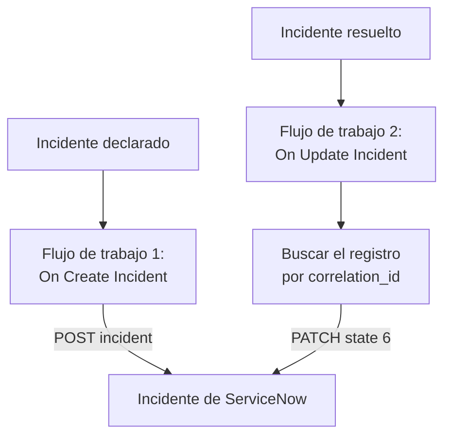

# ServiceNow

Abre un incidente de [ServiceNow](https://www.servicenow.com) por cada incidente de OneUptime y resuélvelo cuando el incidente de OneUptime se resuelva, para que tu centro de servicios siga lo que ve tu monitorización. Dos flujos de trabajo llaman a la [Table API](https://developer.servicenow.com/dev.do#!/reference/api/latest/rest/c_TableAPI) de ServiceNow.

:::cards
- [Guardar las credenciales](#guardar-las-credenciales): Mantén la contraseña de ServiceNow fuera de tus flujos de trabajo.
- [Abrir incidentes de ServiceNow](#abrir-un-incidente-de-servicenow-por-cada-incidente): Un flujo de trabajo, dos bloques.
- [Resolverlos](#resolver-el-incidente-de-servicenow): Encontrar el registro y luego cerrarlo.
- [Solución de problemas](#solución-de-problemas): Cuando ServiceNow rechaza una solicitud.
:::

## Cómo funciona



El primer flujo de trabajo escribe el ID del incidente de OneUptime en el `correlation_id` del registro. El segundo encuentra el registro por ese ID y luego lo resuelve.

## Antes de empezar

- Una instancia de ServiceNow, como `https://your-instance.service-now.com`.
- Un usuario de ServiceNow para la integración que pueda crear y actualizar registros en la tabla `incident`, normalmente con el rol `itil`. Su nombre y su contraseña firman las solicitudes.
- En OneUptime, permiso para crear flujos de trabajo y variables globales. En OneUptime Cloud, los flujos de trabajo necesitan el plan **Growth** o superior.

## Guardar las credenciales

La Table API acepta autenticación Basic: el nombre y la contraseña del usuario, codificados juntos.

:::steps
1. Codifícalos una vez, en macOS o Linux:

   ```bash
   printf '%s' 'integration.user:password' | base64 | tr -d '\n'
   ```

   Usa `printf`, no `echo`: `echo` añade un salto de línea, que se codifica con el resto y estropea las credenciales.

2. En OneUptime, ve a **Flujos de trabajo → Variables globales** y haz clic en **Crear Variable del flujo de trabajo**. Ponle el nombre `SERVICENOW_AUTH` y haz clic en **Siguiente**.
3. Pega el valor codificado en **Contenido**, activa **Secreto** y haz clic en **Crear Variable del flujo de trabajo**.
:::

## Abrir un incidente de ServiceNow por cada incidente

:::steps
### Crear el flujo de trabajo

Ve a **Flujos de trabajo**, haz clic en **Crear flujo de trabajo** y luego en **Empezar desde cero**. Ponle el nombre `Incidents to ServiceNow` y haz clic en **Crear flujo de trabajo**.

### Añadir el disparador

Haz clic en el bloque discontinuo **Elige qué inicia este flujo de trabajo** y elige **On Create Incident**. Haz clic en el disparador: sus **Fields to pass on** empiezan con **Título**, así que haz clic en **Añadir campo** y elige **Descripción**.

### Crear el registro

Haz clic en **Añadir componente**, añade un bloque **API Post (JSON)** y conecta a él el punto **Success** del disparador. Pon su **URL** en `https://your-instance.service-now.com/api/now/table/incident`. En **Más campos**, pon sus **Request Headers** en:

```json
{
  "Authorization": "Basic {{global.variables.SERVICENOW_AUTH}}",
  "Accept": "application/json"
}
```

Y su **Request Body** en:

```json
{
  "short_description": "OneUptime: {{local.components.incident-on-create-1.returnValues.model.title}}",
  "description": "{{local.components.incident-on-create-1.returnValues.model.description}}",
  "urgency": "1",
  "impact": "1",
  "correlation_id": "oneuptime-{{local.components.incident-on-create-1.returnValues.model._id}}"
}
```

### Probarlo y luego activarlo

Haz clic en **Ejecutar flujo de trabajo**, elige un incidente de prueba en **Incidente** y ejecútalo. El paso **API Post (JSON)** muestra una respuesta `201` con el nuevo registro, su `sys_id` y su `number`, como `INC0012345`. Después, activa **Habilitado** en la parte superior del **Constructor**.
:::

`urgency` e `impact` toman `1` para alto, `2` para medio y `3` para bajo, y ServiceNow calcula la prioridad a partir de los dos. Cualquier otra columna de la tabla `incident` puede ir en el cuerpo, con su nombre de columna.

## Resolver el incidente de ServiceNow

Un flujo de trabajo tiene un solo disparador, así que resolver requiere un segundo flujo de trabajo, que se inicia cuando cambia el estado de un incidente.

:::steps
### Añadir el disparador On Update Incident

Crea un flujo de trabajo llamado `Resolve ServiceNow incidents` y elige **On Update Incident** como disparador. En **Fields to watch**, haz clic en **Añadir campo** y elige **Estado actual del incidente**, para que solo se ejecute cuando cambie el estado. En **Fields to pass on**, pide si el nuevo estado es un estado resuelto: haz clic en **Añadir campo**, abre **Estado actual del incidente** y elige **Es estado resuelto**. O haz clic en **Editar como JSON** y reemplaza el JSON por:

```json
{ "_id": true, "currentIncidentState": { "isResolvedState": true } }
```

### Comprobar que el incidente está resuelto

Añade un bloque **If / Else** después del disparador. Pon **Value to check** en `{{local.components.incident-on-update-1.returnValues.model.currentIncidentState.isResolvedState}}` y **Comparison** en **is true**.

### Encontrar el registro

Añade un bloque **API Get (JSON)** después del lado **Yes**, con los mismos **Request Headers** y esta **URL**:

```text
https://your-instance.service-now.com/api/now/table/incident?sysparm_query=correlation_id=oneuptime-{{local.components.incident-on-update-1.returnValues.model._id}}&sysparm_fields=sys_id&sysparm_limit=1
```

### Resolver el registro

Añade un bloque **API Patch (JSON)** después del **Success** del bloque de búsqueda, con los mismos **Request Headers** y esta **URL**:

```text
https://your-instance.service-now.com/api/now/table/incident/{{local.components.api-get-1.returnValues.response-body.result[0].sys_id}}
```

Pon su **Request Body** en:

```json
{
  "state": "6",
  "close_code": "Solution provided",
  "close_notes": "Resolved in OneUptime"
}
```

### Activarlo

Activa **Habilitado** y luego resuelve un incidente de prueba en OneUptime. Su incidente de ServiceNow pasa a Resolved.
:::

`state` `6` es Resolved en los estados de incidente predeterminados de ServiceNow. `close_code` debe ser uno de los códigos de resolución de tu instancia. Muchas instancias no resuelven un incidente sin código de resolución ni notas, así que envía ambos.

## Solución de problemas

:::details ServiceNow responde 401
Las credenciales son incorrectas. Vuelve a codificar `username:password` con `printf`, no `echo`, y sustituye el contenido de `SERVICENOW_AUTH`.
:::

:::details ServiceNow responde 403
El usuario no puede escribir en la tabla `incident`. Dale el rol `itil`, o un rol con los mismos permisos, y comprueba que ninguna regla de control de acceso le bloquea la Table API.
:::

:::details ServiceNow responde 400, o resolver no cambia nada
Un nombre de columna o un valor no encaja con tu instancia: una lista `state` personalizada, o un `close_code` que tu instancia no tiene. Compara con la tabla `incident` en **System Definition → Tables** en ServiceNow, y con el formulario del propio registro.
:::

:::details Resolver responde 404
El paso de búsqueda no encontró ningún registro, así que la URL conservó la referencia tal como está escrita. Comprueba que el primer flujo de trabajo escribió `correlation_id`, y que ambos flujos de trabajo lo forman de la misma manera: `oneuptime-` seguido del `_id` del incidente.
:::

## Próximos pasos

:::cards
- [Jira](/docs/integrations/jira): Una integración bidireccional, mantenida al día con plantillas listas para usar.
- [Componentes de flujo de trabajo](/docs/workflows/components#api): Cada ajuste de los bloques de API.
- [Ejecuciones de flujo de trabajo](/docs/workflows/runs-and-logs): Lee lo que cada solicitud envió y recibió.
- [Descripción general de integraciones](/docs/integrations/index): Los patrones detrás de cada integración.
:::
