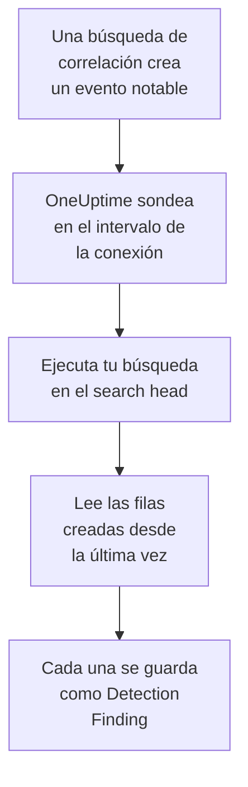

# Splunk Enterprise Security

Importa los eventos notables que crean las búsquedas de correlación de [Splunk Enterprise Security](https://www.splunk.com/en_us/products/enterprise-security.html) en los eventos de seguridad de OneUptime. Allí los buscas junto a tus logs, trazas y métricas, los correlacionas con todas las demás fuentes y avisas a la guardia de los que importan. OneUptime los lee ejecutando una búsqueda en tu search head, como un usuario de Splunk que tú creas, y no cambia nada en Splunk. Como es solo una búsqueda, importa cualquier índice o la salida de cualquier búsqueda guardada, no solo eventos notables.

:::cards
- [Configurar la conexión](#configurar-la-conexión): Un token, un rol y el formulario de la conexión.
- [Qué se importa](#qué-se-importa): Cómo cada fila de la búsqueda se convierte en un evento de seguridad.
- [Cómo funciona el sondeo](#cómo-funciona-el-sondeo): La ventana que lee cada sondeo, y lo que le hace un search head con mucha actividad.
- [Solución de problemas](#solución-de-problemas): Qué significa cada error y qué cambiar.
:::

## Cómo funciona



Cada minuto, OneUptime sondea cada conexión habilitada cuyo intervalo de sondeo ha pasado. Un sondeo ejecuta tu búsqueda mediante la API REST del search head, sobre las filas creadas desde el último sondeo, y guarda cada fila como un evento [OCSF](https://schema.ocsf.io/) Detection Finding (clase `2004`). Las reglas de detección, los monitores y los paneles lo tratan entonces como un evento de seguridad de cualquier otra fuente.

## Antes de empezar

- En OneUptime, el rol Project Owner, Project Admin o Security Admin. Los roles Security Member y Security Viewer pueden ver las conexiones y su historial de ejecuciones, pero no cambiarlas.
- Un search head con Splunk Enterprise 9.0.1 o posterior, o Splunk Cloud Platform. OneUptime habla con su API REST en el puerto de gestión, normalmente `8089`. Splunk Web, en el puerto `8000`, no sirve la API REST.
- Un usuario de Splunk para OneUptime, cuyo rol tenga la capacidad `search` y pueda leer el índice que lee la búsqueda: `notable` para los eventos notables. Los roles `ess_analyst` y `ess_user` de Enterprise Security conceden ambas cosas. La conexión solo lee, así que el rol no necesita nada más.
- Un search head al que OneUptime pueda llegar por HTTPS. OneUptime Cloud se conecta desde internet, así que el search head necesita una dirección pública: las direcciones privadas se rechazan. Un OneUptime autoalojado se conecta desde sus contenedores de aplicación y de workers, y puede llegar a un search head de tu red privada, salvo que `DATA_SOURCE_BLOCK_PRIVATE_ADDRESSES` sea `true`.

## Configurar la conexión

La conexión se autentica con un token de autenticación de Splunk, o con un nombre de usuario y una contraseña.

:::steps
### Crear un token de autenticación

1. En Splunk Web, abre **Settings → Tokens**. Si Splunk dice que la autenticación por token está desactivada, selecciona primero **Enable Token Authentication**.
2. Selecciona **New Token**. En **User**, escribe el usuario de Splunk creado para OneUptime, y en **Audience**, indica para qué sirve el token, por ejemplo `OneUptime security events`.
3. Elige una **Expiration**, o ninguna. Un token que caduca detiene la conexión hasta que lo sustituyas.
4. Selecciona **Create** y copia el token. Splunk solo lo muestra una vez.

Para autenticarte con una contraseña en su lugar, sáltate este paso y ten a mano el nombre y la contraseña del usuario.

### Añadir la conexión en OneUptime

Abre **Productos → Eventos de seguridad → Conexiones** (`/dashboard/{projectId}/security-events/connections`), haz clic en **Añadir conexión**, elige **Splunk Enterprise Security** y haz clic en **Siguiente**. Rellena los ajustes de la tabla de abajo, haz clic en **Siguiente** y pega el token en **Authentication token**, o la contraseña en **Contraseña**.

### Probarla antes de guardar

Haz clic en **Probar esta configuración** en **Probar antes de guardar**. La prueba se autentica y ejecuta tu búsqueda con los valores del formulario, sin guardar nada, así que un puerto equivocado o un rol que falta aparece antes de que exista la conexión. Después haz clic en **Siguiente**, dale un **Nombre** a la conexión y créala.
:::

| Ajuste | Qué introducir |
| --- | --- |
| **Splunk management URL** | La API REST del search head, por ejemplo `https://splunk.example.com:8089`. Debe usar `https`, sin cadena de consulta. Se conserva una ruta, para un proxy inverso que sirva la API bajo una ruta. |
| **Buscar** | La búsqueda que elige qué importar, `index=notable` mientras no la cambies. Restríngela, por ejemplo con `index=notable urgency IN (high, critical)`. OneUptime añade el intervalo de tiempo por sí mismo, así que la búsqueda no puede fijar `earliest` ni `latest`, ni empezar con una barra vertical. Se quita un `search` inicial. |
| **Nombre de usuario** | El nombre del usuario de Splunk, solo si se autentica con contraseña. |
| **Authentication token** | El token del primer paso. Cuando hay un token guardado, es el que se usa, y no el nombre de usuario ni la contraseña. |
| **Contraseña** | La contraseña del usuario de Splunk, solo cuando no se usa ningún token. |

**Authentication token** y **Contraseña** se cifran, la API nunca los devuelve y nunca se vuelven a mostrar. Sustituye uno con **Actualizar credenciales** en la conexión. Para pasar de una forma de autenticación a la otra, escribe la nueva ahí y activa **Remove the stored Authentication token** o **Remove the stored Password**.

El paso **Sondeo** también tiene una **Descripción** opcional, el **Intervalo de sondeo (minutos)**, un número entero de `1` a `1440` que empieza en `5`, y **Habilitado**, que empieza activado.

## Qué se importa

Cada fila que devuelve la búsqueda se convierte en un evento Detection Finding (clase OCSF `2004`), con el proveedor `Splunk` y el producto `Splunk Enterprise Security`. Para un evento notable:

| Campo de Splunk | Columna de OneUptime |
| --- | --- |
| `event_id`, si no `_bkt` y `_cd`, si no un hash de la fila | UID del evento, que también sirve para descartar duplicados |
| `_time`, cuando la búsqueda de correlación creó el evento notable | Hora del evento |
| `rule_name`, si no `search_name`, si no `source` | Nombre de la regla |
| `search_name`, si no `source`, si no `rule_name` | ID de la regla |
| `rule_title`, si no `rule_description`, si no el nombre de la regla | Mensaje |
| `urgency`, si no `severity` | Gravedad |
| `status_label`, si no `status_description`, si no el nombre del estado de revisión que contiene `status` | Estado |
| `annotations.mitre_attack`, y campos como `mitre_technique_id` y `mitre_tactic` | Tácticas y técnicas de MITRE ATT&CK |
| `user` o `src_user`; `src`, `src_ip` o `src_host`; `process`, `process_name` o `parent_process` | Usuario, IP, host y proceso del actor |
| `process_name` o `process_exec`, `process_path` y `process`; `parent_process_name` o `parent_process_exec`, `parent_process_path` y `parent_process` | Nombre, ruta y línea de comandos del proceso; nombre, ruta y línea de comandos del proceso padre |
| `dest_user`; `dest`, `dest_ip` o `dest_host`; `dest_port` | Usuario, IP, host y puerto del destino |
| `file_path`, `url` o `risk_object` | Recurso de destino |
| Cada usuario, host e IP, además de `dvc`, `host`, `file_hash`, `file_name`, `url`, `domain`, `query` y `risk_object` | Observables |
| Cada campo de la fila, por ejemplo `security_domain`, `owner`, `orig_sid` y `_raw` | `attributes`, con el nombre propio del campo |

Una fila de otro índice se importa del mismo modo. Las columnas que sus campos no rellenan quedan vacías, y cada campo sigue siendo consultable en `attributes`.

## Cómo funciona el sondeo

Cada sondeo ejecuta una búsqueda de exportación sobre su ventana, de más antiguas a más nuevas:

```text
POST {Splunk management URL}/services/search/v2/jobs/export
    search=search index=notable | fields * | sort 0 _time | head 10001
    earliest_time={window start}
    latest_time={window end}
    output_mode=json
```

- **La hora de creación es el cursor.** La ventana va sobre `_time`, que para un evento notable es cuando la búsqueda de correlación lo creó, no cuando ocurrió la actividad que encontró. Una búsqueda que se ejecuta cada hora fecha sus eventos notables a la hora de su ejecución, así que ninguno queda detrás del cursor.
- **El primer sondeo mira 24 horas atrás**, para que una conexión nueva muestre enseguida sus eventos notables recientes.
- **Cada sondeo posterior empieza 1 minuto antes del cursor guardado**, para que nunca se pierda una fila creada en el límite entre dos ventanas.
- **Un sondeo lee como mucho 24 horas más allá del cursor.** Una conexión cuyo cursor se quedó atrás se pone al día en una serie de ventanas de 24 horas, y su **Salud** indica **Catching up**.
- **Los duplicados se descartan por `event_id`**, o por los `_bkt` y `_cd` propios de Splunk, dentro del proyecto, para que el solapamiento, una ventana reintentada y una importación nunca guarden una fila dos veces.

Un search head anterior a 9.0.1 responde `404` a la solicitud a `search/v2/jobs/export`. Entonces OneUptime la envía a `search/jobs/export`, que está obsoleto, y la ejecución lo dice en un aviso. Actualiza el search head: las versiones actuales desactivan ese endpoint.

### Cuando una ventana contiene más de lo que un sondeo puede leer

Un sondeo lee como mucho 10.000 filas. Cuando una ventana contiene más, la ejecución es **Parcial**, con un aviso como este:

```text
Stopped after collecting 10000 records; the window holds more. Records are read oldest first, and the last one read was created at 2026-09-14T08:12:44.000Z, where the next poll can resume.
```

La búsqueda ordena la ventana por `_time`, de más antiguas a más nuevas, así que OneUptime mueve el cursor a la hora de creación de la última fila leída, y el siguiente sondeo empieza ahí, con la misma longitud de ventana. Un search head con mucha actividad se pone al día 10.000 filas por sondeo, en lugar de volver a leer las mismas. Las filas creadas en el mismo instante se leen dos veces, y la comprobación de duplicados descarta la segunda copia. Splunk ordena toda la ventana antes de devolver una fila, así que una búsqueda en **Buscar** que encuentra mucho más de lo necesario ralentiza cada sondeo. Mantenla acotada.

Cuando una ejecución no consigue avanzar en absoluto más allá del cursor guardado, OneUptime acorta la ventana en su lugar:

1. **Reducir.** El siguiente sondeo lee una ventana de la mitad de largo, desde el mismo punto de partida, y sigue reduciéndola a la mitad hasta que una ventana se lee entera, hasta un minuto. El aviso de la ejecución lo dice: `This window holds more records than one poll can read; the next poll reads a {n} minute window from the same starting point.`
2. **Volver a crecer.** Cuando una ventana se lee entera, la siguiente vuelve a ser el doble de larga, hasta 24 horas.
3. **Pasar más allá de un único minuto.** Si incluso un minuto contiene más de lo que un sondeo puede leer, el sondeo lo pasa de largo, para que sigan llegando los eventos notables más nuevos. La ejecución sigue siendo **Parcial**, y **Último error** indica `More records were created in the one minute from {cursor} to {end} than one poll can read. Polling moved past this minute so newer records keep arriving; use Import this time range in Diagnostics on this minute to recover what one run can read.` Importa ese minuto con **Importar este intervalo de tiempo** para recuperar lo que una ejecución puede leer.

Una ejecución que falla del todo, con un error de Splunk, conserva el cursor y la longitud de ventana, y el siguiente sondeo vuelve a leer la misma ventana. La única excepción es una solicitud que agotó el tiempo: el cursor se queda, pero la siguiente ventana es la mitad de larga, porque una ventana demasiado pesada para responder a tiempo agotaría el tiempo en cada intento. Cambiar el **Intervalo de sondeo (minutos)** no cambia nada de esto: decide cada cuánto empieza un sondeo, no dónde empieza su ventana.

### Ejecutar, previsualizar e importar a demanda

Haz clic en **Diagnósticos** en una conexión para ver sus ejecuciones recientes y trabajar con ella a mano. Quien puede cambiar la conexión puede iniciar estas acciones; quien puede verla puede leer el historial.

- **Ejecutar ahora** inicia un sondeo de inmediato, con el cursor habitual, incluso cuando la conexión no está **Habilitado**.
- **Preview notable events** lee un intervalo de tiempo de hasta 7 días y no importa nada.
- **Importar este intervalo de tiempo** importa un intervalo de hasta 7 días, después de que lo confirmes, sin mover el cursor. Las filas ya importadas se omiten.
- **Copiar diagnósticos** en una ejecución copia su informe para soporte. Nunca incluye credenciales.

## Probar conexión

**Probar conexión** en la fila de una conexión, y **Probar esta configuración** en el formulario, se ejecutan en el proceso de la API, no en un worker en segundo plano, para que una prueba responda incluso cuando el problema son los workers. Hace estas comprobaciones, en orden:

| Comprobación | Qué comprueba |
| --- | --- |
| **Configuración** | Cada ajuste está presente y bien formado. No se contacta con nada cuando esto falla. |
| **Authenticate with Splunk** | Splunk acepta el token, o el nombre de usuario y la contraseña, y nombra al usuario y sus roles, para que los compares con el rol que querías conceder. |
| **Run the search on Splunk** | La búsqueda de **Buscar** se ejecuta sobre las últimas 24 horas, para una fila, e indica qué endpoint de exportación respondió. |
| **Notable events available to import** | Cuántas filas encuentra la búsqueda de **Buscar** en las últimas 24 horas y en los últimos 7 días. Ninguna en 7 días es un aviso, no un fallo. |
| **Background workers**, **Poll scheduler**, **Security event storage** | El lado del propio OneUptime: un proceso toma los trabajos de la cola Worker, el trabajo de sondeo se ejecuta cada minuto y el almacén de eventos de seguridad responde. |
| **Sondeo programado** | Para una conexión guardada: el sondeo está activado, ninguna ejecución está atascada esperando a un worker y los sondeos se ejecutan a tiempo. |

Cada solicitud de una prueba tiene un plazo de 20 segundos. Una prueba nunca importa nada ni mueve el cursor, y cada comprobación que falla dice qué cambiar.

## Enviar eventos de seguridad a Splunk

OneUptime también puede enviar lo que encuentra a Splunk, a través de su HTTP Event Collector (HEC), para que tus búsquedas y paneles vean las detecciones de OneUptime junto a las tuyas. Cada evento de seguridad es un evento de HEC con el sourcetype `oneuptime:security`, con sus campos nombrados como los nombra el Common Information Model de Splunk: `src`, `src_ip`, `src_user`, `dest`, `dest_ip`, `dest_port`, `user`, `signature` y `severity`.

:::steps
### Crear un token de HEC

En Splunk Web, abre **Settings → Data inputs → HTTP Event Collector** y haz clic en **New Token**. Ponle nombre, elige los índices en los que puede escribir y su índice por defecto, y copia el valor del token. En Splunk Cloud, HEC escucha en `https://http-inputs-<stack>.splunkcloud.com`; en Splunk Enterprise, en el puerto `8088` una vez que **Global Settings** activa los tokens.

### Añadir el destino

Abre **Productos → Eventos de seguridad → Conexiones**. En **Enviar a tu SIEM**, haz clic en **Añadir destino**, elige Splunk en **SIEM** y haz clic en **Siguiente**. Rellena la **URL de HEC** y pega el token en **Token de HEC**. **Índice** y **Tipo de origen** son opcionales: si quedan vacíos, los eventos van al índice por defecto del token con el sourcetype `oneuptime:security`.

### Enviar un evento de prueba y empezar a enviar

Haz clic en **Enviar un evento de prueba**: un evento informativo va a Splunk con la configuración del formulario, y no se guarda nada. Búscalo con `sourcetype="oneuptime:security"`. Después, en **Qué enviar**, deja **Solo detecciones** o elige **Todos los eventos de seguridad**, y haz clic en **Empezar a enviar**.
:::

- La **URL de HEC** debe usar `https`, con un certificado en el que OneUptime confíe: las comprobaciones de certificado nunca se omiten.
- Los eventos van en lotes de hasta 500. Un evento que Splunk rechaza se deja fuera y se nombra en **Ver error**, un colector ocupado (`503`) se reintenta, y un token o un índice rechazado detiene el envío hasta que lo corrijas.
- Los notable events que OneUptime importó de Splunk nunca se le devuelven.

## Solución de problemas

El **Último error** de la conexión guarda el mensaje de error completo, con las credenciales ocultas, tras un prefijo que nombra el paso que falló. Cuando una conexión tiene un error, selecciona **Ver error** en su columna **Acciones** para leerlo, y **Copiar error** en el cuadro de diálogo para copiarlo. Lee primero el prefijo.

:::details Último error empieza por `Splunk Enterprise Security authentication request`
- `Splunk Enterprise Security authentication request failed (HTTP ...)`: Splunk se negó a decir quién es el que llama.
  - `HTTP 401`: Splunk no aceptó las credenciales. El token es incorrecto, caducó o se eliminó, la autenticación por token está desactivada en el search head, o el nombre de usuario o la contraseña son incorrectos. Crea un token nuevo y guárdalo con **Actualizar credenciales**.
  - `HTTP 404`: la **Splunk management URL** no es la API REST. Apunta a Splunk Web en el puerto `8000`, o tiene una ruta que el search head no sirve.
- `Splunk Enterprise Security authentication request returned ...`: respondió algo distinto de la API REST del search head, por ejemplo el HTML de Splunk Web en el puerto `8000` o la página de un proxy. Apunta la URL al puerto de gestión.
:::

:::details Último error empieza por `Splunk Enterprise Security search export` o `Splunk Enterprise Security count search`
- `Splunk Enterprise Security search export failed (HTTP ...)`: Splunk se negó a ejecutar la búsqueda.
  - `HTTP 400`: Splunk no puede analizar la búsqueda. Ejecuta la búsqueda de **Buscar** en Splunk Web para leer su error.
  - `HTTP 403`: al rol del usuario le falta la capacidad `search`, o no puede leer el índice. Añade `notable`, o tu índice, a los índices en los que el rol puede buscar.
  - `HTTP 404`: ninguno de los dos endpoints de exportación existe en esa URL, así que no es el puerto de gestión de un search head.
  - `HTTP 429` o `HTTP 5xx`: Splunk está limitando al usuario, está sobrecargado, o la búsqueda alcanzó uno de sus límites. El siguiente sondeo lo vuelve a intentar.
- `Splunk Enterprise Security search export was rejected by Splunk on an HTTP 200`: Splunk respondió, pero detuvo la búsqueda con un error. El mensaje lo cita.
- `Splunk Enterprise Security search export returned a body that is not newline-delimited JSON.`: respondió algo distinto de la API REST, por ejemplo Splunk Web o la página de inicio de sesión de un proxy. Se notifica en lugar de tomarse como una ventana vacía, para que el cursor nunca pase de largo filas que nadie leyó.
- `Splunk Enterprise Security count search ...`: los mismos fallos, del recuento de **Notable events available to import**, que solo ejecuta una prueba.
:::

:::details Último error termina en `did not complete`
`Splunk Enterprise Security search export did not complete`, y lo mismo para los demás pasos, significa que la solicitud no obtuvo respuesta: un tiempo de espera agotado, un nombre que no se resuelve, un certificado en el que OneUptime no confía, o una dirección privada rechazada. Comprueba que la aplicación de OneUptime y los workers pueden abrir una conexión HTTPS al puerto de gestión. Un search head que responde a otras solicitudes pero agota el tiempo en la búsqueda está ordenando demasiado: el siguiente sondeo lee una ventana de la mitad de larga, y una búsqueda más acotada en **Buscar** lo arregla del todo.
:::

:::details Último sondeo indica Never y Último error está vacío
Ningún sondeo ha terminado para esta conexión. Ejecuta **Probar conexión**: sus comprobaciones **Background workers** y **Poll scheduler** nombran la causa. En una instalación autoalojada, la causa habitual es `DISABLE_QUEUE_WORKERS=true` en la aplicación, sin un despliegue de workers aparte que tome los trabajos: ponlo en `false`, o ejecuta el despliegue de workers (Helm: `worker.enabled: true`).
:::

:::details Una ejecución es Parcial
- `Stopped after collecting 10000 records; the window holds more`: la ventana contenía más que las 10.000 filas que lee una ejecución. No se pierde nada: el siguiente sondeo empieza después de la última fila leída. Una conexión que sigue **Parcial** sondeo tras sondeo se está poniendo al día con un atraso, y su **Último sondeo** y su **Último evento importado** siguen avanzando. Si nunca se pone al día, la búsqueda de **Buscar** encuentra más de 10.000 filas por intervalo de sondeo: restríngela, o acorta el **Intervalo de sondeo (minutos)**.
- `More records were created in the one minute from ... than one poll can read`: el sondeo pasó de largo ese minuto. Impórtalo con **Importar este intervalo de tiempo** en **Diagnósticos**. Una importación lee tanto como un sondeo.
:::

:::details La prueba pasa, pero no se importa nada
Lee **Notable events available to import** en el informe de la prueba. `0` en los últimos 7 días significa que la búsqueda de **Buscar** no encontró nada en Splunk: comprueba en Incident Review que las búsquedas de correlación están habilitadas y crean eventos notables, y que la búsqueda de **Buscar** no es más estrecha de lo que querías.
:::

## Qué obtienes

- **Búsqueda.** Filtra los eventos notables por urgencia, estado, regla, usuario, host o cualquier observable en el explorador de eventos de seguridad, junto a todas las demás fuentes.
- **Correlación.** Los usuarios, hosts, IP y dominios de cada fila se indexan como observables, así que una búsqueda encuentra todo lo que los menciona.
- **Reglas de detección.** Reglas Sigma que se ejecutan según una programación sobre tus eventos de seguridad, y abren alertas que avisan a la guardia.
- **Monitores.** Los monitores de eventos de seguridad cuentan los eventos que coinciden, por ejemplo los eventos notables críticos nuevos, y abren incidentes o alertas por encima de un umbral.

Los eventos de seguridad se facturan como el resto de tu telemetría, por GB ingerido. Consulta los [precios](https://oneuptime.com/pricing).

## Próximos pasos

:::cards
- [Eventos de seguridad](/docs/telemetry/security-events): Busca, correlaciona y alerta sobre lo que importas.
- [Elastic Security](/docs/integrations/elastic-security): Importa también las alertas de detección de un stack de Elastic.
- [Roles](/docs/permissions/reference#roles): Lo que pueden ver y cambiar los roles Security.
- [Descripción general de integraciones](/docs/integrations/index): Las otras herramientas que puedes conectar.
:::
