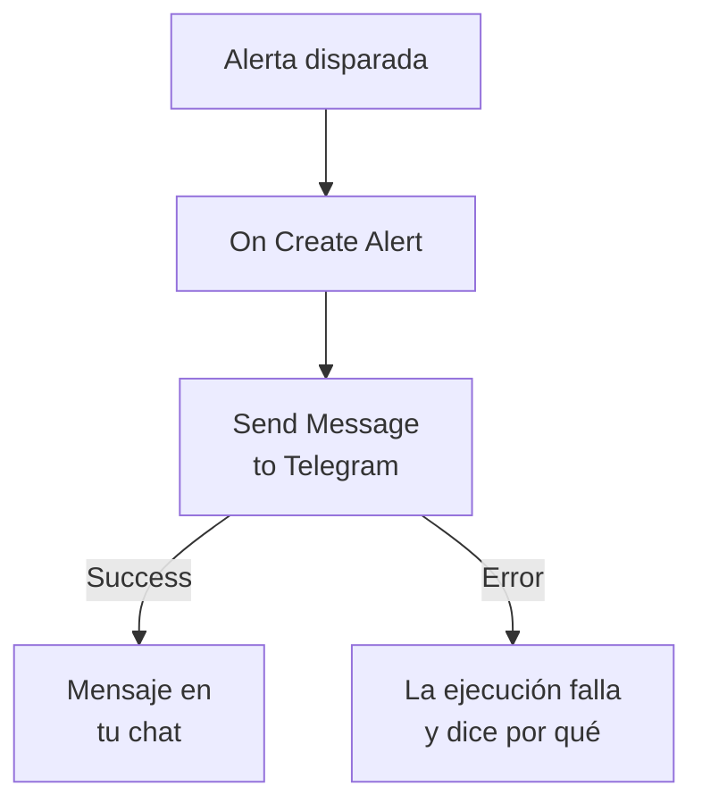

# Telegram

Envía un mensaje a un chat, grupo o canal de [Telegram](https://telegram.org) cuando se dispara una alerta o se abre un incidente. El paso de flujo de trabajo **Send Message to Telegram** de OneUptime lo envía como un bot que tú creas, y una plantilla lista para usar crea el flujo de trabajo para las alertas. Esta integración es **saliente**: el bot envía mensajes y no lee lo que se dice en el chat.

:::cards
- [Cómo funciona](#cómo-funciona): Lo que hace el flujo de trabajo cuando se dispara una alerta.
- [Configuración](#configurar-la-integración): Un bot, su chat y después el flujo de trabajo: desde la plantilla o desde cero.
- [Consejos](#consejos): Texto sin formato, mensajes largos e incidentes.
- [Solución de problemas](#solución-de-problemas): Qué significan los errores de Telegram y qué cambiar.
:::

## Cómo funciona



El paso envía el **Message Text** al chat, como tu bot, a través de la Bot API de Telegram. Toma su salida **Success** cuando Telegram acepta el mensaje, y su salida **Error**, con el motivo de Telegram, cuando Telegram lo rechaza. Sin nada conectado a **Error**, como en la plantilla, una ejecución que no pudo enviar falla, y sus **Pasos** dicen por qué.

## Antes de empezar

- Una cuenta de Telegram, para crear el bot y añadirlo al chat.
- En OneUptime, el derecho a crear flujos de trabajo y variables. En OneUptime Cloud, los flujos de trabajo necesitan el plan **Growth** o superior.

## Configurar la integración

:::steps
### Crear un bot

En Telegram, envía `/newbot` a [@BotFather](https://t.me/BotFather) y responde a sus preguntas. Te da el token del bot, por ejemplo `123456789:ABCdefGhIJKlmnoPQRstuVWxyz`. Quien tenga el token puede enviar mensajes como tu bot, así que guárdalo tan bien como una contraseña.

### Encontrar el ID del chat

1. Añade el bot al grupo, o hazlo administrador del canal. Para escribir a una persona, esa persona empieza primero un chat con el bot.
2. Envía en el grupo un mensaje que mencione al bot, por ejemplo `/start@your_bot`, para que el bot lo vea.
3. Abre `https://api.telegram.org/bot<token>/getUpdates` en un navegador, con el token del bot en lugar de `<token>`.
4. Busca `"chat":{"id":` en la respuesta. El número que sigue es el ID del chat. El ID de un grupo empieza por `-`, y el de un grupo grande por `-100`.

Un canal público se puede indicar con su `@username` en lugar de un ID.

### Crear el flujo de trabajo

Empieza desde la plantilla, que crea todo el flujo de trabajo para las alertas, o desde cero.

:::tabs
@tab Desde la plantilla
1. Abre **Flujos de trabajo** y haz clic en **Crear flujo de trabajo**.
2. Escribe `Telegram` en **Buscar plantillas…**, haz clic en **Tell Telegram when an alert fires** y después en **Usar esta plantilla**.
3. Deja el nombre **Notify Telegram on new alert** o cámbialo, y haz clic en **Siguiente**.
4. Pega el token en **Telegram Bot Token** y el ID en **Telegram Chat ID**, y haz clic en **Crear flujo de trabajo**.

El flujo de trabajo se abre en el **Constructor** con dos pasos: **On Create Alert** y **Send Message to Telegram**, que envía el número, el título, la gravedad y el estado de la alerta. El token se guarda como la variable secreta `telegramBotToken` del flujo de trabajo, y el ID como `telegramChatId`.
@tab Desde cero
1. Guarda el token como variable global secreta: ve a **Flujos de trabajo → Variables globales**, haz clic en **Crear Variable del flujo de trabajo**, ponle el nombre `TELEGRAM_BOT_TOKEN` y haz clic en **Siguiente**. Pega el token en **Contenido**, activa **Secreto** y haz clic en **Crear Variable del flujo de trabajo**.
2. Ve a **Flujos de trabajo**, haz clic en **Crear flujo de trabajo**, elige **Empezar desde cero**, ponle nombre al flujo de trabajo y haz clic en **Crear flujo de trabajo**.
3. En el **Constructor**, haz clic en **Elige qué inicia este flujo de trabajo** y elige **On Create Alert** en **Populares**. Haz clic en el disparador: sus **Fields to pass on** empiezan con **Título**, así que haz clic en **Añadir campo** y elige los demás campos que muestra tu mensaje, por ejemplo **Número de alerta con prefijo**.
4. Haz clic en **Añadir componente**, busca `telegram` y haz clic en **Send Message to Telegram**. Conecta la salida **Success** del disparador a este paso.
5. Haz clic en el paso nuevo. En **Telegram Bot Token**, haz clic en **{ }** y elige `TELEGRAM_BOT_TOKEN` en **Variables globales**. Escribe el ID del chat en **Chat ID**, escribe el mensaje en **Message Text** e inserta los campos de la alerta con **{ }**.
:::

Un mensaje hecho desde cero lee los campos de la alerta con referencias como estas:

```text
🚨 Alert {{local.components.alert-on-create-1.returnValues.model.alertNumberWithPrefix}} fired
Title: {{local.components.alert-on-create-1.returnValues.model.title}}
```

### Activarlo y probarlo

Activa el interruptor **Habilitado** en la parte superior del **Constructor**. A partir de ahí, cada alerta nueva se envía al chat.

Para probarlo sin disparar una alerta, haz clic en **Ejecutar flujo de trabajo** y elige una alerta que ya tengas en **Alerta**: se muestran las más recientes, y al escribir su número o parte de su título encuentras otra. Haz clic en **Ejecutar flujo de trabajo manualmente** y confirma con **Ejecutar**. El panel **Ejecución del flujo de trabajo** sigue la ejecución, y el mensaje aparece en el chat. Si el paso toma **Error** en su lugar, la ejecución falla, y la entrada del paso en **Pasos** dice por qué: consulta [Solución de problemas](#solución-de-problemas).
:::

## Consejos

- **Texto sin formato.** El paso envía el texto tal como se escribe, sin el formato de Telegram, así que `*` y `_` aparecen tal cual.
- **Tener en cuenta el límite de 4.096 caracteres.** Telegram acepta mensajes de hasta 4.096 caracteres. Uno más largo se recorta, y termina con "… (truncated — see OneUptime for the full text)", en lugar de rechazarse.
- **También incidentes.** Crea el mismo flujo de trabajo sobre **On Create Incident**, o sobre **On Update Incident** para los cambios de estado. Para enviar solo algunas alertas, pon un bloque **If / Else** antes del paso.
- **Se comprueba la forma del token.** Un token que no tiene la forma de `123456789:ABCdef…` detiene la ejecución antes de enviar nada, y el token nunca se escribe en el registro.

## Solución de problemas

Cuando el paso toma **Error**, la ejecución falla, y la entrada del paso en los **Pasos** de la ejecución da el motivo de Telegram. El bot tiene que estar en el chat, así que comprueba eso primero.

:::details Telegram responde "Bad Request: chat not found"
El **Chat ID** es incorrecto, o el bot no puede ver el chat: añade el bot al grupo, hazlo administrador del canal, o pide a la persona que empiece un chat con el bot. El ID de un grupo empieza por `-`.
:::

:::details Telegram responde "Forbidden: bot was blocked by the user" o "bot is not a member"
La persona bloqueó el bot, o el bot se quitó del grupo o del canal. Vuelve a añadirlo, o envía a otro chat.
:::

:::details Telegram responde "Unauthorized"
Telegram no aceptó el token: se revocó en @BotFather, o se copió mal. Copia el token actual del bot desde @BotFather y sustituye el valor de la variable.
:::

:::details Telegram responde "Too Many Requests: retry after"
Telegram limita lo rápido que envía un bot, sobre todo a un grupo. Una ráfaga de alertas puede alcanzar ese límite: envía menos mensajes, por ejemplo solo para algunas gravedades.
:::

## Próximos pasos

:::cards
- [Componentes de flujo de trabajo](/docs/workflows/components#telegram): Cada ajuste del paso y qué significan sus salidas.
- [Discord](/docs/integrations/discord): La misma idea, en un canal de Discord.
- [Ejecuciones de flujo de trabajo](/docs/workflows/runs-and-logs): Lee qué hizo cada ejecución del flujo de trabajo.
- [Descripción general de integraciones](/docs/integrations/index): El patrón saliente y las demás herramientas que puedes conectar.
:::
